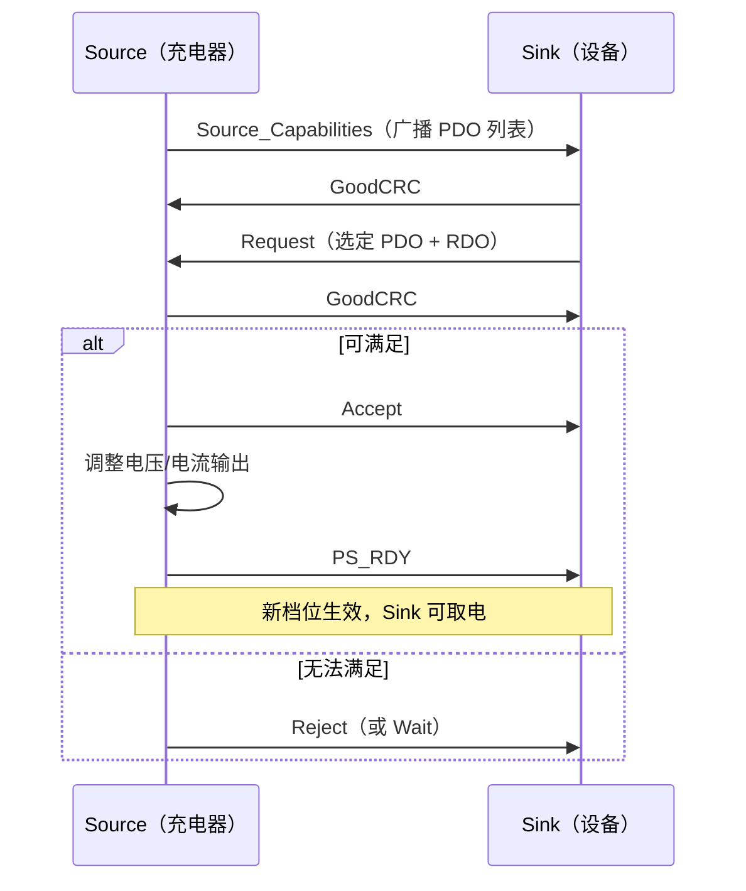
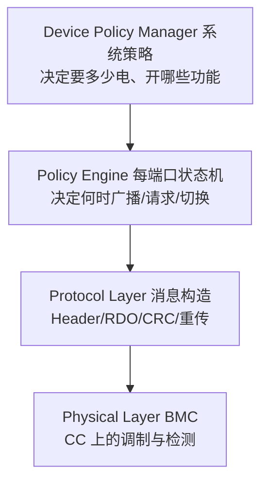
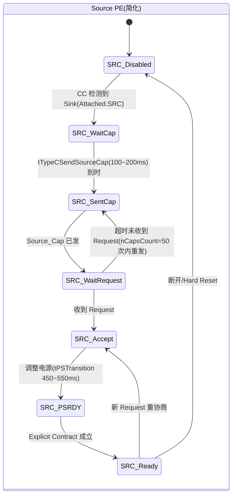
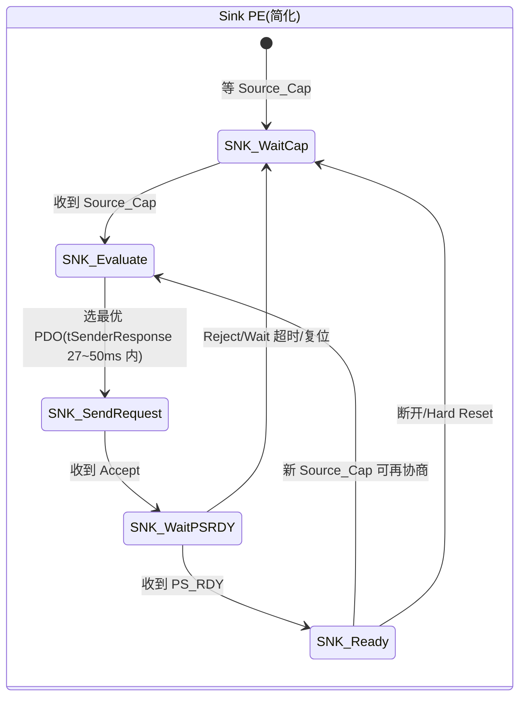
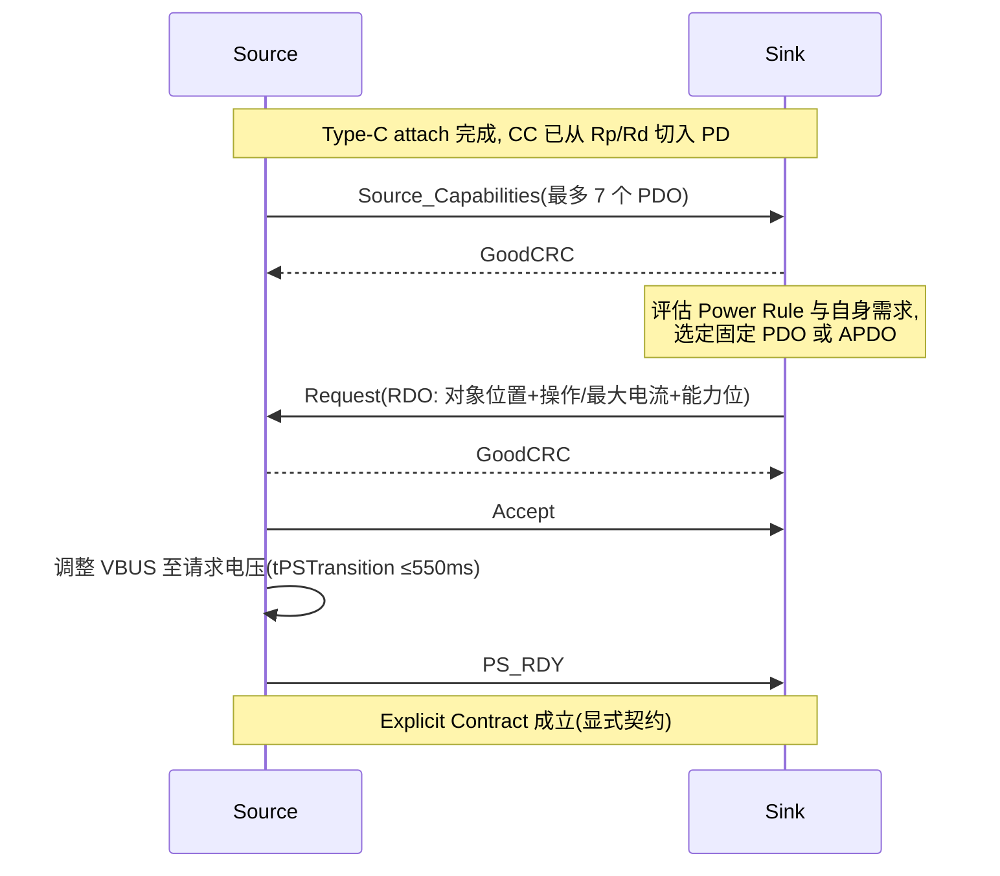
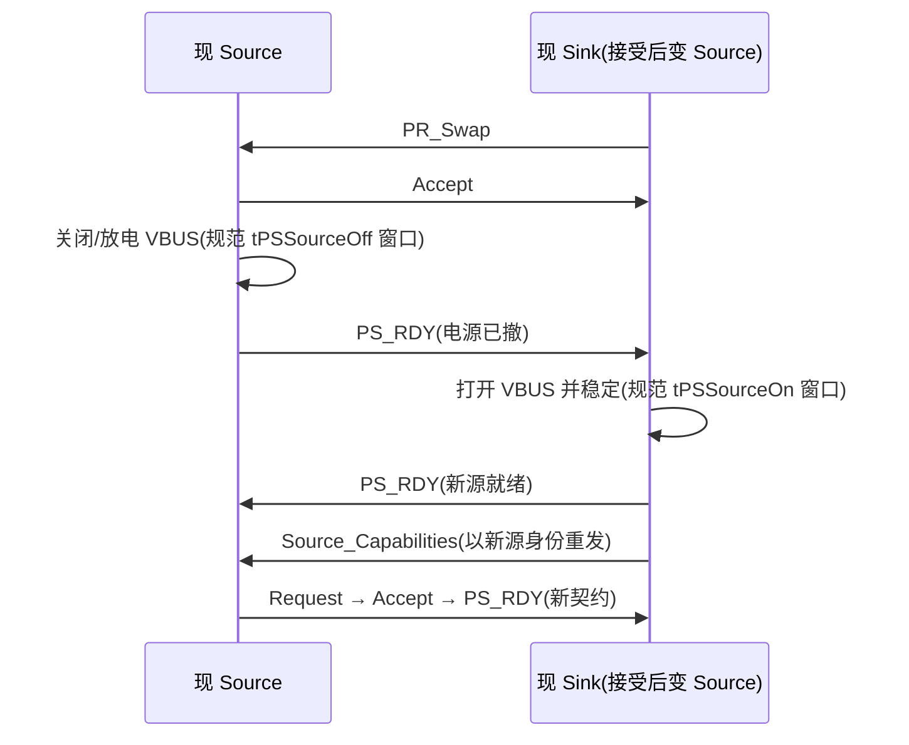
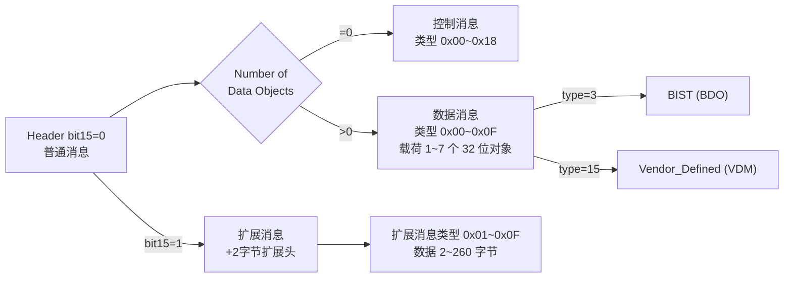

# USB Power Delivery：协议、状态机与消息全表

> 层级 深入 · 主题 `power/pd` · 相关：[连接器演进与 USB Type-C（含 CC 状态机与时序）](20-connectors-typec.md)、[Alternate Mode、Structured VDM 与 E-marker](23-altmode-emarker.md)、[充电：BC 1.2、专有快充；OTG 与角色切换 HNP/SRP](21-charging-bc12-otg.md)

## 核心事实 Key Facts

> 由维护者整理并与规范核对；与下方 USBTree 原文冲突时以本节为准。

- 物理层：CC 线 BMC 编码，300 kbit/s ±10%；4b5b 编码；包 = Preamble + SOP* + Header(16 bit) + 0–7 个 32 bit Data Object（扩展消息更长）+ CRC32 + EOP。
- SOP* 目标：SOP（对端端口）、SOP'（线缆近端 E-marker）、SOP''（线缆远端）、SOP'_Debug、SOP''_Debug。
- Message Header：bit15 Extended、14:12 Number of Data Objects、11:9 MessageID、8 Port Power Role / Cable Plug、7:6 Spec Revision（00 1.0, 01 2.0, 10 3.x）、5 Port Data Role、4:0 Message Type。
- 每条消息需在 tReceive（约 1 ms）内收到 GoodCRC，否则重传（nRetryCount=2）。
- 显式合同：Source_Capabilities → Request → Accept → PS_RDY。
- PDO 类型（bit31:30）：00 Fixed、01 Battery、10 Variable、11 APDO（bit29:28：00 SPR PPS、01 EPR AVS、10 SPR AVS）。Fixed PDO：电压 50 mV 单位（bit19:10）、最大电流 10 mA 单位（bit9:0）。
- 功率范围：SPR ≤ 100 W（5/9/15/20 V，>3 A 需 5 A E-marker 线）；EPR 28/36/48 V，≤ 240 W（EPR 模式需 EPR_Mode 进入流程与 EPR 线缆）。PPS 电压步进 20 mV、电流步进 50 mA。
- 缓存状态仍不一致：`80-参考资料/README.md` 与 `skills/usb-spec-lookup/SKILL.md` 已登记 `usb-core/USB-PD-3.2-V1.2.zip`；`08-USBPD消息全表.md` 开篇仍写「PD 规范本体未缓存」，同页文末又写已缓存。`90-附录/03-时序参数全表.md` §4 来源说明同样仍写未缓存。

## 原文：04-USBPD协议

> Source: [30-枝干-接口与供电/04-USBPD协议.md](https://github.com/tangjianfang/USBTree/blob/main/30-枝干-接口与供电/04-USBPD协议.md)

USB Power Delivery (PD) 是运行在 **CC 线**上的供电协商协议：Source 广播自己能提供什么（PDO），Sink 按需请求（RDO），双方以消息帧对话。PD 同时承担角色管理（电源/数据角色交换）与线缆芯片（E-marker）通信，是现代 Type-C 生态的中枢。

### 一、物理层：CC 上的 BMC

- 连接建立后，CC 线从"电阻编码"切换为 **BMC (Biphase Mark Coding, 双相标记编码)** 调制通信，速率约 **300 kbps**；
- **半双工**：同一时刻 CC 上只有一个发送方，每次发送必须收到对方的 GoodCRC 应答（超时重发）；
- 线路编码为 4b5b + BMC，帧内带 CRC-32；只在与连接方向一致的**一根** CC 线上传输；
- PD 1.0 曾改用 VBUS 上的 BPSK 载波通信，因实现复杂已弃用，PD 2.0 起统一为 CC+BMC。

### 二、协议版本演进

| 版本 | 年份 | 关键变化 |
| --- | --- | --- |
| PD 1.0 | 2012 | VBUS 载波通信，市场弃用 |
| PD 2.0 | 2014 | 迁移到 CC+BMC；消息**定长**（Header + 固定最多 7 个数据对象，按最大长度发送） |
| PD 3.0 | 2015/2016 | 消息**变长**（按对象数发送）；引入 PPS (APDO)；扩展消息 (Extended Messages)；增强消息安全基础 |
| PD 3.1 | 2021 | 引入 **EPR** (Extended Power Range)：28/36/48 V，最高 240 W；AVS 扩展至 EPR 档 |
| PD 3.2 | 2023 | 整合 3.1 与各 ECN（含安全、EPR 模式进入流程）；V1.2 为 3.2 系列最后一版 |
| PD 3.3 | 2026-10 | R3.3 V1.0（2026-10-16）为 usb.org 现行版：按官方 Reorganization Guide，内容与 3.2 V1.2 保持技术等价，章节重组；PDUSB Status and States 拆为伴随规范，BMC 接收器设计示例拆为白皮书 |

工程影响：PD 2.0 与 3.0 报文结构不同（定长 vs 变长），双方通过 Header 中的 Specification Revision 位协商降级到共同版本。

### 三、消息帧结构

每条 PD 消息 = **16 位 Header** + 0~7 个 **32 位数据对象**。

#### 3.1 Header 位段表

| 位 | 字段 | 说明 |
| --- | --- | --- |
| 15 | Extended | 1 = 扩展消息（可跨多块，PD 3.0 分块传输） |
| 14:12 | Number of Data Objects | 后续 32 位对象个数（0~7） |
| 11:9 | Message ID | 消息序号（0~7 循环），配合 GoodCRC 去重/确认 |
| 8 | Port Power Role / Cable Plug | SOP 消息：电源角色（0=Sink,1=Source）；SOP'/SOP''：线缆插头端标识 |
| 7:6 | Specification Revision | 00=Rev1, 01=Rev2（PD2.0）, 10=Rev3（PD3.0） |
| 5 | Port Data Role | 0=UFP, 1=DFP |
| 4:0 | Message Type | 消息类型（见下表） |

#### 3.2 常用消息类型

| 类型 | 编号 | 方向/含义 |
| --- | --- | --- |
| GoodCRC | 1（控制） | 对任何收到的消息立即应答 |
| Accept / Reject | 3 / 4（控制） | 接受/拒绝请求 |
| PS_RDY | 6（控制） | 电源已切换完成（电压/电流就位） |
| Get_Source_Cap | 7（控制） | Sink 主动索要 PDO 列表 |
| Soft_Reset | 13（控制） | 协议层软复位 |
| Source_Capabilities | 1（数据） | Source 广播 PDO 列表（最多 7 个） |
| Request | 2（数据） | Sink 请求某个 PDO（含 RDO） |
| Sink_Capabilities | 4（数据） | Sink 能力上报 |
| Vendor_Defined (VDM) | 15（数据） | 厂商扩展：Discover Identity、Alt Mode、线缆能力等 |

### 四、PDO 类型表

Source_Capabilities 中的每个 32 位对象是一个 PDO (Power Data Object)：

| PDO 类型 | 内容 | 说明 |
| --- | --- | --- |
| Fixed Supply | 固定电压 + 最大电流 | 5 V 必为第 1 个；常用 9/15/20 V 档 |
| Battery | 电压范围 + 最大功率 | 按功率请求，电池供电系统 |
| Variable Supply（非电池） | Vmin/Vmax + 电流 | 电压可漂移的适配器 |
| APDO: PPS (Augmented) | 3.3~21 V 内连续、**20 mV 步进**、电流 50 mA 步进、可随时再协商 | 直充/恒压恒流闭环，游戏手机快充主力 |
| APDO: EPR | 28/36/48 V 固定档 | PD 3.1，需 5 A E-marker 线，进入 EPR 模式须专门流程 |
| APDO: AVS | 连续可调电压（100 mV 步进量级） | SPR 档 15~20 V，EPR 档更高，档位细节见规范 |

#### 功率档位速查

| 档位 | 功率 | 档位 | 功率 |
| --- | --- | --- | --- |
| 5 V/3 A | 15 W | 20 V/3 A | 60 W |
| 9 V/3 A | 27 W | 20 V/5 A | 100 W（PD 2.0/3.0 上限） |
| 12 V/3 A | 36 W | 28 V/5 A | 140 W |
| 15 V/3 A | 45 W | 36 V/5 A | 180 W |
| 9 V/5 A | 45 W | 48 V/5 A | **240 W（EPR 上限）** |

### 五、RDO 关键位

Request 消息中的 32 位对象是 RDO (Request Data Object)，核心字段：

| 位段 | 字段 | 说明 |
| --- | --- | --- |
| 9:0 | 最大工作电流 (10 mA/LSB) | 本档位允许的最大电流 |
| 19:10 | 工作电流 (10 mA/LSB) | 当前实际需要的电流 |
| 24 | No USB Suspend | 不允许挂起时置 1 |
| 23 | USB Comm Capable | 具备 USB 数据通信能力 |
| 27 | GiveBack | 支持降档到最小工作电流（PD 3.0 起弱化为历史位） |
| 26 | Capability Mismatch（能力不匹配位） | 1 = Source 无一档完全满足 Sink 需求，仅按最接近档位供电（evolve 勘误：曾误写为 B27，内核 `RDO_CAP_MISMATCH`=26） |
| 31:28 | Object Position（对象位置） | 1~7：指向 Source_Capabilities 中被请求的那个 PDO（内核 `RDO_OBJ_POS_SHIFT`=28；evolve 勘误——曾误写为"EPR Mode"，进入 EPR 走 EPR_Mode Entry 消息序列，见 [08 篇](22-usb-pd.md)） |

**能力不匹配位**是诊断"能充但不满速"的关键证据；Object Position 指出请求的是第几个 PDO；**240 W 不是普通 Request 一步可达**——需先经 EPR Mode Entry 消息序列进入 EPR 模式（见 [08 篇](22-usb-pd.md)）。

### 六、协商流程时序



- Source 周期性重广播 Source_Capabilities（连接后与超时重发定时见规范）；Sink 变更需求可再次 Request；
- **Hard Reset**：协议僵死时的兜底——VBUS 掉到 vSafe0V 再回 5 V，设备可能重启充电会话；
- 请求新档位时 Source 先发 Accept、调整完再发 PS_RDY，Sink 在 PS_RDY 前不得假设电压已切换。

### 七、双向角色与三种 Swap

| 操作 | 全称 | 作用 |
| --- | --- | --- |
| PR_Swap | Power Role Swap | 交换供电方向（如手机给显示器供电 ↔ 显示器给手机反充），插头与数据角色不变 |
| DR_Swap | Data Role Swap | 交换 DFP/UFP 数据角色（如手机向 PC 传文件时仍由 PC 供电） |
| VCONN_Swap | VCONN 交换 | 交换由哪一端向 E-marker 线缆芯片供 VCONN（角色交换后必须处理，否则线缆芯片断电） |

PD 3.0 另引入 **FRS (Fast Role Swap)**：Source 掉电时 Sink 在毫秒级接管供电，用于对接 UPS 型设备/双口互备场景。

### 八、SOP / SOP' / SOP'' 通信对象

| 通道 | K 码序列（4b5b Sync 码） | 通信对象 |
| --- | --- | --- |
| SOP | Sync-1, Sync-1, Sync-1, Sync-2 | 对端端口（Source↔Sink） |
| SOP' | Sync-1, Sync-1, Sync-3, Sync-3 | 近端线缆芯片（E-marker, VCONN 供电） |
| SOP'' | Sync-1, Sync-3, Sync-1, Sync-3 | 远端线缆芯片（仅主动线缆） |

对线缆的经典消息是 **Discover Identity (VDM)**：读取 E-marker 的厂商、电流档位（3 A/5 A）、线缆类型（被动/主动、电/光）与速率代次（详见 05 叶）。

### 九、策略层分层概念

PD 规范以逻辑分层描述实现（与树干的分层模型同构）：



| 层 | 职责 |
| --- | --- |
| Device Policy Manager (DPM) | 系统级策略：预算、多口分配、热管理 |
| Policy Engine (PE) | 端口级 PD 状态机（Source/Sink 状态集） |
| Protocol Layer | 消息编码、MessageID、定时器、重传 |
| Physical Layer | BMC 收发、CC 检测、连接状态机 |

### 十、PD 3.0 起的扩展消息与安全

- **扩展消息 (Extended Messages)**：超过 7 个对象的负载用分块 (Chunked) 传输，如 Get_Source_Cap_Extended、电池状态、固件信息等；
- **EPR Mode Entry**（PD 3.1）：进入 28 V+ 档前的专门握手（EPR_Mode/EPR_SourceCap 消息组），并要求 5 A 线缆；
- **安全消息组**：PD 3.2 阶段把认证/签名类要求（Type-C Authentication、防诱骗）逐步并入规范体系，实现细节见规范与安全叶。

### 十一、实测工具（一句话档案）

- **PD 协议分析仪**：GRL、Total Phase、Ellisys、LeCroy 等均支持 CC BMC 解码（USB4 时代需支持隧道解析，见 40 枝干）；
- **开源抓包器**：Chromium OS EC 项目的 Twinkie 可在线旁听 CC 消息；
- **PD 诱骗器/触发器**（如 ZY12OGG、CH224 模块）：模拟 Sink 请求指定 PDO，快速验证充电器真实输出档位。

## 原文：07-USBPD深入-状态机与消息全表

> Source: [30-枝干-接口与供电/07-USBPD深入-状态机与消息全表.md](https://github.com/tangjianfang/USBTree/blob/main/30-枝干-接口与供电/07-USBPD深入-状态机与消息全表.md)

>  兄弟链接: [02-USBType-C详解](20-connectors-typec.md) ｜ [04-USBPD协议](22-usb-pd.md) ｜ [05-AlternateMode与E-marker](23-altmode-emarker.md) ｜ [06-OTG与角色切换-HNP-SRP](21-charging-bc12-otg.md) ｜ 树干: ../10-树干-USB核心/ ｜ 高速演进: ../40-枝干-高速演进/
> 规范原文缓存索引: [80-参考资料/README.md](92-spec-references.md)

本页是 [04-USBPD协议](22-usb-pd.md) 的深入篇：以 **PD 3.1**（兼容 2.0/3.0）为准，给出物理层细节、完整消息类型表、Header 逐字段编码、Source/Sink 状态机、协商/PPS/EPR 全流程、四种角色交换时序、VDM 结构与实现者清单。消息编号以规范消息类型表为准（控制/数据消息各一张表）。

### 一、物理层速览：CC 线上的 BMC

| 项目 | 参数 |
| --- | --- |
| 传输媒介 | 连接方向一致的一根 **CC 线**（半双工，同一时刻只有一个发送方） |
| 调制 | **BMC** (Biphase Mark Coding，双相标记编码)，速率约 **200~300 kbps**（标称 300 kbps） |
| 线路编码 | 数据部分经 **4b5b** 编码（每 4 位映射 5 位码字，编码表见规范原文；另有 Sync/RST/EOP 等 K 码），LSB 先发 |
| 帧前导 | **Preamble**：64 位 0101 交替序列（不参与 4b5b），供接收方锁定时钟 |
| 校验 | **CRC-32**（多项式与以太网同族 0x04C11DB7） |
| 结束 | **EOP**（单个 K 码结束符）后发送方释放 CC |
| 前身 | PD 1.0 曾用 VBUS 上的 BPSK 载波，已弃用；PD 2.0 起统一为 CC+BMC |

### 二、SOP 序列：五张"收件人标签"

消息开头是 4 个 K 码组成的 **Ordered Set**，指明这条消息发给谁：

| 序列 | K 码组合 | 用途 |
| --- | --- | --- |
| **SOP** | Sync-1, Sync-1, Sync-1, Sync-2 | 直连的端口伙伴 (Port Partner)：源↔宿 |
| **SOP'** | Sync-1, Sync-1, Sync-3, Sync-3 | 线缆**近源端插头**（E-marker 所在处），源与宿都可寻址它 |
| **SOP''** | Sync-1, Sync-3, Sync-1, Sync-3 | 线缆**远端插头**（另一侧芯片/远端 E-marker） |
| **SOP' Debug** | （K 码组合见规范 Ordered Set 表） | 调试配件寻址近端插头 |
| **SOP'' Debug** | （K 码组合见规范 Ordered Set 表） | 调试配件寻址远端插头 |

MessageID 计数器、重传状态等均**按 SOP 类型独立维护**；E-marker 通信（Discover Identity 查询线缆能力）即经 SOP'（见 [05-AlternateMode与E-marker](23-altmode-emarker.md)）。

### 三、消息帧结构与可靠传输

```
| Preamble(64bit) | SOP(K码x4) | Header(16bit) | Payload(0~7个32bit数据对象) | CRC-32 | EOP |
```

可靠传输三件套：

1. **GoodCRC 自动应答**：接收方对收到的每条消息立即回控制消息 GoodCRC（**回显相同 MessageID**），通常由 PHY/控制器硬件自动完成；
2. **tReceive 超时**：接收方须在 **tReceive（约 0.9~1.1 ms）** 内收完整帧，否则整帧丢弃；发送方在此窗口内未等到 GoodCRC 即**重发**；
3. **MessageID 去重重传**：每端口**每 SOP 类型、每方向**维护 3 位计数器 **nMessageIDCounter（0~7 循环）**，每条新消息自增；重发沿用同一 MessageID，重试上限 **nRetryCount**（规范默认值，见 PD Timers 表）；接收方收到重复 MessageID 丢弃但**仍回 GoodCRC**。Hard Reset、Cable Reset、BIST 消息**不**回 GoodCRC，重试计数另有 **nHardResetCount（=2）**。

### 四、Header 16 位逐字段表

| 位 | 字段 | 取值/说明 |
| --- | --- | --- |
| 15 | Extended | 1 = 扩展消息（结构化扩展头跟在 Header 后，见第八节） |
| 14:12 | Number of Data Objects | 后续 32 位对象数 0~7（控制消息=0） |
| 11:9 | MessageID | 0~7 循环，配 GoodCRC 确认/去重 |
| 8 | Port Power Role | SOP 消息：0=Sink，1=Source（SOP'/SOP'' 中含义见规范） |
| 7:6 | Specification Revision | 00=Rev1.0，01=Rev2.0，10=Rev3.x（双方取共同版本） |
| 5 | Port Data Role | 0=UFP，1=DFP（SOP'/SOP'' 消息中为线缆插头标识） |
| 4:0 | Message Type | 编号见下面两表 |

**解码示例**：PD 3.0 源端发 Source_Capabilities（5 个 PDO、MessageID=0）：
`5<<12 | SRC | Rev3 | DFP | 0x01` = `0x5000 + 0x0100 + 0x0080 + 0x0020 + 0x0001` = **0x51A1**（线上低字节在前）。

### 五、控制消息类型全表（Message Type，无数据对象）

| 编号 | 消息 | 引入 | 用途 |
| --- | --- | --- | --- |
| 0x01 | **GoodCRC** | 1.0 | PHY 级确认，回显 MessageID |
| 0x02 | GotoMin | 1.0 | 请求对方降到最小电流（PD 3.2 已弃用） |
| 0x03 | **Accept** | 1.0 | 接受请求/交换 |
| 0x04 | **Reject** | 1.0 | 拒绝（契约保留） |
| 0x05 | Ping | 1.0 | 主机探活（PD 3.0 起移除） |
| 0x06 | **PS_RDY** | 1.0 | 电源切换完成（电压/电流已就位） |
| 0x07 | **Get_Source_Cap** | 1.0 | Sink 索要 PDO 列表 |
| 0x08 | **Get_Sink_Cap** | 1.0 | 索要对方 Sink 能力 |
| 0x09 | **DR_Swap** | 2.0 | 数据角色交换（DFP↔UFP） |
| 0x0A | **PR_Swap** | 2.0 | 电源角色交换（Source↔Sink） |
| 0x0B | **VCONN_Swap** | 2.0 | VCONN 供电方交换 |
| 0x0C | Wait | 1.0 | "稍等"，对方可超时后重试 |
| 0x0D | **Soft_Reset** | 1.0 | 复位协议层状态（MessageID/定时器），不动电源 |
| 0x10 | **Not_Supported** | 3.0 | 对不支持消息的规范应答（3.0 前只能回 Reject） |
| 0x11 | Get_Source_Cap_Extended | 3.0 | 索要扩展源能力（触发扩展消息应答） |
| 0x12 | Get_Status | 3.0 | 索要 Status 扩展应答（见第七节） |
| 0x13 | FR_Swap | 3.0 | 快速电源角色交换 |
| 0x14 | Get_PPS_Status | 3.0 | 索要 PPS 状态 |
| 0x15 | Get_Country_Codes | 3.0 | 索要国家/地区码 |
| 0x16+ | （PD 3.1/3.2 续有扩充，如 Get_Sink_Cap_Extended、Get_Revision 等） | — | 编号以规范控制消息类型表为准 |

### 六、数据消息类型全表（Message Type，带数据对象）

| 编号 | 消息 | 引入 | 用途 |
| --- | --- | --- | --- |
| 0x01 | **Source_Capabilities** | 1.0 | 源能力广播：最多 7 个 PDO（详见 [04-USBPD协议](22-usb-pd.md)） |
| 0x02 | **Request** | 1.0 | Sink 请求：RDO 指明选中对象位置与操作/最大电流（10 mA 单位） |
| 0x03 | BIST | 1.0 | 一致性测试模式（BIST Carrier Mode 等不入 CRC 计数规则见规范） |
| 0x04 | **Sink_Capabilities** | 1.0 | Sink 能力上报（含自身可接受的电压档） |
| 0x05 | Battery_Status | 1.0 | 电池状态上报 |
| 0x06 | Alert | 3.0 | 异步事件告警（如外部电源插入等，见规范） |
| 0x07 | Get_Country_Info | 3.0 | 索要国家/地区相关信息 |
| 0x08 | Enter_USB | 3.0 | 请求进入指定 USB 版本/速率的数据模式（USB4 协商入口之一） |
| 0x09~0x0D | （EPR 模式专用消息，见第十一节；编号以规范为准） | 3.1 | EPR_Request / EPR_Mode 等 |
| 0x0E | 保留 | — | — |
| 0x0F | **Vendor_Defined (VDM)** | 1.0 | 厂商扩展：Alt Mode、Discover Identity、线缆查询等（见第十三节） |

### 七、扩展消息与 Chunking 分块

Header bit15=1 时，紧跟 2 字节**结构化扩展头**：

| 位 | 字段 | 说明 |
| --- | --- | --- |
| 15 | Chunked | 1 = 分块传输 |
| 14:11 | Chunk Number | 块号 0 起 |
| 10 | Request Chunk | 请求重发指定块 |
| 9:0 | Data Size | 扩展数据总字节数（规范上限 260 字节，见规范） |

- 普通消息最多 7 个 32 位对象=28 字节，减去扩展头 2 字节，**每块有效数据约 26 字节**，超过即分块，接收方按块号拼装；
- 主要扩展消息（编号以规范扩展消息类型表为准）：Source_Cap_Extended、Status、Get_Battery_Cap / Battery_Status / Battery_Cap、Get_Manufacturer_Info / Manufacturer_Info、**Security_Request / Security_Response**、FW_Update_Request / Response、PPS_Status、Country_Codes、Sink_Cap_Extended；
- Get_Source_Cap_Extended、Get_Status、Get_Country_Codes 等是**触发**扩展应答的控制消息（编号见第五节表）。

### 八、Source / Sink 电源状态机（简化）





真实规范中两者是更大的 PE_SRC/PE_SNK 状态集（含 Hard Reset、PR_Swap、BIST、EPR 子机），本图为协商主干。

### 九、协商全流程与 Explicit Contract



- **Explicit Contract**：PS_RDY 之后的电压/电流约定。契约前 Sink 只能按 Type-C 默认（5 V，Rp 声明的电流档）取电；
- **Power Rule（功率仲裁）**：两个 DRP 对连时，**能供更大功率的一方成为 Source**——这是 CC 协商与 PD 能力共同决定的仲裁规则，也解释了充电宝对插手机时的方向；
- Sink 重发 Request 可随时改电压电流（新契约覆盖旧契约）；Source 档位变化时主动重发 Source_Cap；
- Soft_Reset 只复位协议层（契约保留）；Hard Reset 是电气级：VBUS 回 vSafe0V 再回 5 V，**契约作废**。

### 十、PPS 运行循环

| 要素 | 说明 |
| --- | --- |
| 载体 | APDO (PPS)：3.3 V 起连续可调，**20 mV 电压步进**、50 mA 电流步进，上限随档位 5.9/11/16/21 V |
| 请求 | 每次都发普通 Request（RDO 指向 PPS APDO），可实时微调电压/电流（恒压/恒流闭环，直充常用） |
| 保活 | Sink 必须**周期性重发 Request** 维持 PPS（规范 PD Timers 表中的 PPS 相关超时窗口，见规范原文） |
| 回退 | Source 超时未收到新 Request，或收到异常请求，即**退出 PPS 回落 SPR 固定档契约**；Get_PPS_Status 可查询状态 |

### 十一、EPR 模式（PD 3.1）

| 功率档 | 电压/电流 | 功率 |
| --- | --- | --- |
| SPR 上限 | 20 V/5 A | 100 W |
| EPR 固定档 | 28/36/48 V，5 A | 140/180/**240 W** |
| EPR AVS | 连续可调范围（见规范 EPR AVS 定义） | 最高 240 W |

- **进入前提**：双方为 EPR capable（能力经消息能力位声明）、**线缆为 EPR capable**（5 A e-marker，经 SOP' 查询确认）、当前契约 **≥100 W**；
- **进入流程**：Sink（或 Source）发 **EPR_Mode** 消息（Entry 动作）→ 双方进入 EPR → Source 经 **EPR_Source_Cap**（分块扩展消息）发布 28/36/48 V EPR PDO（EDO）→ Sink 用 **EPR_Request** 请求 → Accept/PS_RDY 建立 EPR 契约（消息编号见规范数据消息类型表）；
- **维持**：EPR 模式要求周期性 KeepAlive 类消息（定时器与窗口见规范）；
- **退出**：收到 EPR_Mode Exit、收到普通 Request、超时、断开或 Hard Reset 时退出并**回落 SPR**（电压降回 ≤20 V）；普通 Source_Capabilities 不含 EPR PDO。

### 十二、四种角色交换对比

| 交换 | 发起方 | 消息流 | 变化 | 关键点 |
| --- | --- | --- | --- | --- |
| **PR_Swap** | Source 或 Sink | PR_Swap→Accept→(电源切换)→PS_RDY | 电源角色对调，VBUS 转移 | 双方都须能供电；完成后新 Source 重发 Source_Cap 重建契约 |
| **DR_Swap** | DFP 或 UFP | DR_Swap→Accept | 数据角色对调 DFP↔UFP | 不动电源；现 DFP 收到后即刻翻转 |
| **VCONN_Swap** | 当前 VCONN 源 | VCONN_Swap→Accept→PS_RDY | 谁给线缆 E-marker 供电对调 | 双方须具备 VCONN 供电能力 |
| **FR_Swap** | 仅 Sink | FR_Swap→Accept→(Get_Sink_Cap 校验)→快速切换 | 快速电源角色对调 | 目标把供电中断压到 **150 µs 量级**（精确指标见规范）；用于带后备电池的坞站/显示屏 |



对比 OTG：HNP 只切数据角色且 VBUS 不动（见 [06-OTG与角色切换-HNP-SRP](21-charging-bc12-otg.md)），PD 的 PR_Swap 才真正完成"换谁供电"。

### 十三、VDM 结构（Vendor Defined Message）

VDM 首个 32 位对象为 **VDM Header**（结构化 SVDM）：

| 位 | 字段 | 说明 |
| --- | --- | --- |
| 31:16 | SVID | Standard or Vendor ID（16 位） |
| 15 | VDM Type | 0=结构化 SVDM，1=非结构化 UVDM |
| 14:13 | SVDM Version | 结构化版本（PD 3.0 用 10=2.0） |
| 12:11 | VDO Version | VDO 版本 |
| 10:8 | Object Position | 模式索引 1~7 |
| 7 | 保留 | — |
| 6 | ACK | 1=应答 |
| 5 | IRQ | 1=有后续消息 |
| 4:3 | Command Type | 1=REQ（发起），2=ACK，3=NAK |
| 2:0 | Command | 见下表 |

| 命令值 | 命令 | 用途 |
| --- | --- | --- |
| 1 | Discover Identity | 查身份：SOP' 可读出线缆类型/电流额定（3A/5A）/EPR 能力 |
| 2 | Discover SVIDs | 枚举对方支持的 SVID 列表 |
| 3 | Discover Modes | 枚举某 SVID 下的模式 (Modes) |
| 4 / 5 | Enter Mode / Exit Mode | 进入/退出某模式 |
| 6 | Attention | 模式内事件提示 |

后续对象为 **VDO** (Vendor Data Object)，内容随命令与产品类型（Docks/Peripherals/AMA/Cable）不同，定义见规范与各 SVID 文档。Alt Mode 进入流程（DP over Type-C 等）见 [05-AlternateMode与E-marker](23-altmode-emarker.md)。

### 十四、PD 3.x 安全消息

PD 3.0 引入 **Security_Request / Security_Response** 扩展消息对，配合 USB PD Authentication 规范完成**挑战-响应式身份认证**（证书交换与签名校验），供主机/充电器验证对端（尤其线缆电子标签与配件）真伪；PD 3.1 又为 EPR 补充配套安全要求与消息（细节以规范与安全规范文档为准）。安全能力位在能力消息中协商，未认证链路上的敏感操作（如 EPR）会被规范收紧。

### 十五、实现者清单

**架构分层**：应用（DPM, Device Policy Manager）→ **PE** (Policy Engine，每端口一个，分 PE_SRC/PE_SNK 子状态机) → **TCPM/TCPC**（策略管理器与接口控制器，常见 I²C 连接）→ PHY（BMC/4b5b/CRC，GoodCRC 自动应答最好硬件化——tReceive ≤1.1 ms 在慢速 MCU 上软件难以保证）。

| 定时器/计数器 | 取值 | 用途 |
| --- | --- | --- |
| tReceive | 0.9~1.1 ms | 收帧/GoodCRC 等待窗口 |
| tSenderResponse | 27~50 ms | 收到请求类消息后的应答时限（PD R3.3 Table 7.10；旧版 24~30 ms 已勘误） |
| tTypeCSendSourceCap | 100~200 ms | Source 重发 Source_Cap 间隔 |
| nCapsCount | 50 | Source_Cap 最大重发次数 |
| tNoResponseTimer | 4.5~5.5 s | 无应答总超时（之后回退/报错） |
| tPSTransition | 450~550 ms | 电源状态切换窗口 |
| tSrcRecover | 660~1000 ms | Source 恢复时间窗 |
| nHardResetCount | 2 | Hard Reset 重试上限 |
| tFirstSourceCap | 约 100~250 ms（见规范） | attach 后首包 Source_Cap 窗口 |

PE 实现要点：

1. MessageID 计数器**每 SOP 类型、每方向**独立 0~7 循环；重复 ID 丢包仍回 GoodCRC；
2. 收到 Request 时校验 RDO 对象位置、电流是否超 PDO 上限，违规回 Reject（3.0+ 可回 Not_Supported）；
3. 状态机必须处理 Wait（对方稍等）与超时重试的边界；Hard Reset 后从 vSafe0V 重新走协商；
4. SOP' 查询线缆能力在 EPR/高电流场景是前置步骤，勿遗漏；
5. 所有取值以规范 PD Timers/消息类型表为准，本表是速查不是替代。

## 原文：08-USBPD消息全表

> Source: [30-枝干-接口与供电/08-USBPD消息全表.md](https://github.com/tangjianfang/USBTree/blob/main/30-枝干-接口与供电/08-USBPD消息全表.md)

>  兄弟链接: [04-USBPD协议](22-usb-pd.md) ｜ [07-USBPD深入-状态机与消息全表](22-usb-pd.md)（本篇是其"编号+位域"全表化延伸，叙述不再重复） ｜ [09-TypeC规范级-状态机与CC时序](20-connectors-typec.md) ｜ 树干: ../10-树干-USB核心/ ｜ 高速演进: ../40-枝干-高速演进/
> 规范原文缓存索引: [80-参考资料/README.md](92-spec-references.md)

本篇给出 USB PD **全部消息类型编号**与**数据对象逐位定义**。消息编号与位域以 Linux 内核头文件 `include/linux/usb/pd.h`、`pd_vdo.h`、`pd_bdo.h`（torvalds/master）为权威提取源——该头文件与 USB PD 规范消息类型表一一对应，是可离线核对的交叉校验源。PD 规范本体**已缓存**：`usb-core/USB-PD-3.2-V1.2.zip`（R3.2 V1.2，本文编号核对基线）与 `usb-core/USB-PD-3.3-V1.0.zip`（R3.3 V1.0，2026-10-16，usb.org 现行版；按其 Reorganization Guide，3.3 为保持技术等价的章节重组，章节号与 3.2 不同）。正文编号与规范消息类型表冲突时以规范为准。帧结构、GoodCRC/MessageID 可靠传输、协商时序等叙述见 [07-USBPD深入-状态机与消息全表](22-usb-pd.md)。

### 一、消息路由总览



### 二、控制消息类型全表（Header 中 NDO=0，类型编号 4:0 位）

来源：内核 `pd.h` 枚举 `pd_ctrl_msg_type`（编号即线上值，十六进制）。

| 编号 | 内核宏 | 消息 | 版本 | 一句话用途 |
| --- | --- | --- | --- | --- |
| 0x00 | — | Reserved | — | 保留 |
| 0x01 | PD_CTRL_GOOD_CRC | GoodCRC | 1.0 | PHY 级确认，回显 MessageID |
| 0x02 | PD_CTRL_GOTO_MIN | GotoMin | 1.0 | 请求降至最小电流（PD 3.x 弃用） |
| 0x03 | PD_CTRL_ACCEPT | Accept | 1.0 | 接受请求/交换 |
| 0x04 | PD_CTRL_REJECT | Reject | 1.0 | 拒绝（契约保留） |
| 0x05 | PD_CTRL_PING | Ping | 1.0 | 源探活（PD 3.0 移除） |
| 0x06 | PD_CTRL_PS_RDY | PS_RDY | 1.0 | 电源状态切换完成 |
| 0x07 | PD_CTRL_GET_SOURCE_CAP | Get_Source_Cap | 1.0 | 索要 Source_Capabilities |
| 0x08 | PD_CTRL_GET_SINK_CAP | Get_Sink_Cap | 1.0 | 索要 Sink_Capabilities |
| 0x09 | PD_CTRL_DR_SWAP | DR_Swap | 2.0 | 数据角色交换 |
| 0x0A | PD_CTRL_PR_SWAP | PR_Swap | 2.0 | 电源角色交换 |
| 0x0B | PD_CTRL_VCONN_SWAP | VCONN_Swap | 2.0 | VCONN 供电方交换 |
| 0x0C | PD_CTRL_WAIT | Wait | 1.0 | "稍等"，发起方可超时重试 |
| 0x0D | PD_CTRL_SOFT_RESET | Soft_Reset | 1.0 | 复位协议层（MessageID/定时器） |
| 0x0E~0x0F | — | Reserved | — | 保留 |
| 0x10 | PD_CTRL_NOT_SUPP | Not_Supported | 3.0 | 对不支持消息的规范应答 |
| 0x11 | PD_CTRL_GET_SOURCE_CAP_EXT | Get_Source_Cap_Extended | 3.0 | 触发 Source_Cap_Extended 应答 |
| 0x12 | PD_CTRL_GET_STATUS | Get_Status | 3.0 | 触发 Status 应答 |
| 0x13 | PD_CTRL_FR_SWAP | FR_Swap | 3.0 | 快速电源角色交换 |
| 0x14 | PD_CTRL_GET_PPS_STATUS | Get_PPS_Status | 3.0 | 触发 PPS_Status 应答 |
| 0x15 | PD_CTRL_GET_COUNTRY_CODES | Get_Country_Codes | 3.0 | 触发 Country_Codes 应答 |
| 0x16 | PD_CTRL_GET_SINK_CAP_EXT | Get_Sink_Cap_Extended | 3.x | 触发 Sink_Cap_Extended 应答 |
| 0x17 | — | Reserved | — | 内核 pd.h 标注保留 |
| 0x18 | PD_CTRL_GET_REVISION | Get_Revision | 3.x | 索要 Revision（触发数据消息 Revision） |
| 0x19~0x1F | — | Reserved | — | 保留 |

### 三、数据消息类型全表（NDO≥1，类型编号 4:0 位）

来源：内核 `pd.h` 枚举 `pd_data_msg_type`。

| 编号 | 内核宏 | 消息 | 载荷 | 一句话用途 |
| --- | --- | --- | --- | --- |
| 0x00 | — | Reserved | — | 保留 |
| 0x01 | PD_DATA_SOURCE_CAP | Source_Capabilities | ≤7×PDO | 源能力广播（PDO 见第六节） |
| 0x02 | PD_DATA_REQUEST | Request | 1×RDO | 请求供电（RDO 见第五节） |
| 0x03 | PD_DATA_BIST | BIST | 1×BDO | 一致性测试入口（见第十节） |
| 0x04 | PD_DATA_SINK_CAP | Sink_Capabilities | ≤7×PDO | Sink 能力上报 |
| 0x05 | PD_DATA_BATT_STATUS | Battery_Status | 1×BSDO | 电池状态（见第三节末） |
| 0x06 | PD_DATA_ALERT | Alert | 1~2 对象 | 异步事件告警（位定义见 PD 规范） |
| 0x07 | PD_DATA_GET_COUNTRY_INFO | Get_Country_Info | 1 对象 | 索要国家/地区信息 |
| 0x08 | PD_DATA_ENTER_USB | Enter_USB | 1×EUDO | 请求进入指定 USB 模式（见第八节） |
| 0x09 | EPR_Request | EPR 请求（EPR 模式内） | 3.1 | **已按 PD 3.2 规范 Table 6.5 权威核实**（evolve：PD 3.2 V1.2 缓存提取；内核 pd.h 未给宏） |
| 0x0A | EPR_Mode | 进入/退出 EPR 模式 | 3.1 | 同上（Table 6.5） |
| 0x0B | Source_Info | 源信息（PDP/工作状态） | 3.0 | 同上（Table 6.5；注意与 Get_Source_Info 控制消息配套） |
| 0x0C | PD_DATA_REVISION | Revision | 2 对象 | Get_Revision 的应答（版本协商） |
| 0x0D~0x0E | — | Reserved | — | 保留 |
| 0x0F | PD_DATA_VENDOR_DEF | Vendor_Defined | VDM | 厂商扩展：Alt Mode/线缆查询（见第九节） |
| 0x10~0x1F | — | Reserved | — | 保留 |

### 四、扩展消息类型全表（Header bit15=1）与扩展头位域

来源：内核 `pd.h` 枚举 `pd_ext_msg_type` 与 `PD_EXT_HDR_*` 宏。

| 编号 | 内核宏 | 消息 | 方向/用途 |
| --- | --- | --- | --- |
| 0x00 | — | Reserved | 保留 |
| 0x01 | PD_EXT_SOURCE_CAP_EXT | Source_Cap_Extended | Source→Sink：能力扩展（裕量等） |
| 0x02 | PD_EXT_STATUS | Status | Source→Sink：Get_Status 应答（含 PPS 状态位） |
| 0x03 | PD_EXT_GET_BATT_CAP | Get_Battery_Cap | 索要电池能力 |
| 0x04 | PD_EXT_GET_BATT_STATUS | Get_Battery_Status | 索要电池状态（触发 BSDO） |
| 0x05 | PD_EXT_BATT_CAP | Battery_Capability | 电池能力应答（内核 `batt_cap_ext_msg`：VID/PID/设计容量 0.1Wh/上次充满容量/类型） |
| 0x06 | PD_EXT_GET_MANUFACTURER_INFO | Get_Manufacturer_Info | 索要厂商信息 |
| 0x07 | PD_EXT_MANUFACTURER_INFO | Manufacturer_Info | 厂商信息应答 |
| 0x08 | PD_EXT_SECURITY_REQUEST | Security_Request | 认证挑战（配 USB PD Authentication） |
| 0x09 | PD_EXT_SECURITY_RESPONSE | Security_Response | 认证应答 |
| 0x0A | PD_EXT_FW_UPDATE_REQUEST | FW_Update_Request | 固件更新请求 |
| 0x0B | PD_EXT_FW_UPDATE_RESPONSE | FW_Update_Response | 固件更新应答 |
| 0x0C | PD_EXT_PPS_STATUS | PPS_Status | Get_PPS_Status 应答 |
| 0x0D | PD_EXT_COUNTRY_INFO | Country_Info | 国家/地区信息应答 |
| 0x0E | PD_EXT_COUNTRY_CODES | Country_Codes | Get_Country_Codes 应答（国家码列表） |
| 0x0F | PD_EXT_SINK_CAP_EXT | Sink_Cap_Extended | Sink 能力扩展（内核 `sink_caps_ext_msg`：SKEDB 版本、负载特性、SPR/EPR 的 min/op/max PDP、模式位 SINK_MODE_PPS/VBUS/AC_SUPPLY/BATT/AVS） |
| 0x10~0x1F | — | Reserved | 保留 |

**扩展头（16 位）位域**（内核 `PD_EXT_HDR_*`）：

| 位 | 字段 | 说明 |
| --- | --- | --- |
| 15 | Chunked | 1=分块传输（PD 3.0） |
| 14:11 | Chunk Number | 块号 0~15（`PD_EXT_HDR_CHUNK_NUM`） |
| 10 | Request Chunk | 1=请求重发指定块 |
| 9:0 | Data Size | 扩展数据总字节数 0~511（规范上限 260） |

每块数据固定 **26 字节**（内核 `PD_EXT_MAX_CHUNK_DATA`），即 7 个 32 位对象扣除扩展头后单块有效载荷。

**Battery Status Data Object（BSDO）位域**（内核 `BSDO_*`）：B31:16 当前电量 0.1Wh；B11:10 充电状态（0=充电，1=放电，2=空闲）；B9 电池在位；B8 无效电池引用。

### 五、RDO（Request Data Object）32 位位域表

来源：内核 `pd.h` `RDO_*` 宏。注意：**B19:10 是工作电流（10 mA 单位）、B9:0 是最大电流（10 mA 单位）**，RDO 中没有电压字段（电压由所指向的 PDO 决定）。

| 位 | 字段（Fixed RDO） | 说明 |
| --- | --- | --- |
| 31:28 | Object Position | 所选 PDO 在 Source_Cap 中的序号 1~7（`RDO_OBJ_POS`） |
| 27 | GiveBack | 支持降到最小工作电流（`RDO_GIVE_BACK`） |
| 26 | Capability Mismatch | 无完全匹配 PDO（`RDO_CAP_MISMATCH`） |
| 25 | USB Comm Capable | USB 通信能力（`RDO_USB_COMM`） |
| 24 | No USB Suspend | 不接受 USB 挂起（`RDO_NO_SUSPEND`） |
| 23:20 | 保留 | — |
| 19:10 | Operating Current | 工作电流，**10 mA 单位**（`RDO_FIXED_OP_CURR`） |
| 9:0 | Maximum Operating Current | 最大电流，**10 mA 单位**（`RDO_FIXED_MAX_CURR`） |

其余 RDO 变体（内核宏）：

| 变体 | 位域 | 单位 |
| --- | --- | --- |
| Battery RDO | B19:10 工作功率 / B9:0 最大功率（`RDO_BATT_OP_PWR`/`RDO_BATT_MAX_PWR`） | 250 mW |
| PPS RDO（`RDO_PROG`） | B19:9 输出电压（`RDO_PROG_VOLT`，11 位）/ B6:0 工作电流（`RDO_PROG_CURR`） | **20 mV / 50 mA**（内核 `RDO_PROG_VOLT_MV_STEP`/`RDO_PROG_CURR_MA_STEP`） |
| SPR AVS RDO | B20:9 输出电压（`RDO_SPR_AVS_VOLT`）/ B6:0 工作电流 | **25 mV / 50 mA**（内核 `RDO_SPR_AVS_OUT_VOLT_MV_STEP` 等） |

EPR 模式下的 Request（EPR_Request）首对象为 **RMDO（Request Message Object，PD 3.1+）**，内核 `RMDO()`：B31:28 Revision Major、B27:24 Revision Minor、B23:20 Version Major、B19:16 Version Minor、B15:0 置零；其后跟 EPR 数据对象（EDO）。EDO 位域内核未定义，见 PD 规范 §6.x。

### 六、Fixed / Variable / Battery PDO 位域表

来源：内核 `pd.h` `PDO_*` 宏。对象类型在 B31:30（`PDO_TYPE`）：00=Fixed，01=Battery，10=Variable，11=APDO。

**Fixed PDO（Source）**：

| 位 | 字段 | 说明 |
| --- | --- | --- |
| 31:30 | Fixed | 类型=00 |
| 29 | Dual-Role Power | 支持 PR_Swap（`PDO_FIXED_DUAL_ROLE`） |
| 28 | USB Suspend（Source）/ Higher Capability（Sink） | 同位复用：`PDO_FIXED_SUSPEND` / `PDO_FIXED_HIGHER_CAP` |
| 27 | Externally Powered | 外部供电（`PDO_FIXED_EXTPOWER`） |
| 26 | USB Comm Capable | USB 通信（`PDO_FIXED_USB_COMM`） |
| 25 | Dual-Role Data | 支持 DR_Swap（`PDO_FIXED_DATA_SWAP`） |
| 24 | Unchunked Extended（Source）/ FRS 当前档高位 | `PDO_FIXED_UNCHUNK_EXT`；Sink 侧 B24:23 为 FR_Swap 电流档（`PDO_FIXED_FRS_CURR`） |
| 23 | FRS 当前档低位 | 与 B24 合成 2 位 FR_Swap 电流能力 |
| 22:20 | Peak Current | 峰值电流档 0~3（`PDO_FIXED_PEAK_CURR`） |
| 19:10 | Voltage | 电压，**50 mV 单位**（`PDO_FIXED_VOLT`） |
| 9:0 | Maximum Current | 最大电流，**10 mA 单位**（`PDO_FIXED_CURR`） |

**Variable / Battery PDO**：

| 类型 | 位域 | 单位 |
| --- | --- | --- |
| Variable | B29:20 最大电压 / B19:10 最小电压（50 mV）/ B9:0 最大电流（10 mA） | `PDO_VAR_*` |
| Battery | B29:20 最大电压 / B19:10 最小电压（50 mV）/ B9:0 最大允许功率 | **250 mW**（`PDO_BATT_*`） |

首个 PDO 必为 vSafe5V 固定档（内核 `VSAFE5V`=5000 mV）；PDO 最多 7 个（`PDO_MAX_OBJECTS`）。

### 七、APDO 位域表（B31:30=11b，PPS/AVS）

来源：内核 `pd.h` `PDO_APDO_*`/`PDO_PPS_APDO_*`/`PDO_EPR_AVS_*`/`PDO_SPR_AVS_*`。APDO 子类型在 B29:28（`PDO_APDO_TYPE`）：00=PPS，01=EPR AVS，10=SPR AVS。

**PPS APDO（Source）**：

| 位 | 字段 | 说明 |
| --- | --- | --- |
| 29:28 | 00b | PPS |
| 27 | PPS Power Limited | 功率受限位——**内核 pd.h 未定义该宏**，定义见 PD 规范 §6.x（PPS APDO 表） |
| 26:25 | 保留 | — |
| 24:17 | MAX Voltage | 最大电压，**100 mV 单位**（`PDO_PPS_APDO_MAX_VOLT`，8 位） |
| 16 | 保留 | — |
| 15:8 | MIN Voltage | 最小电压，**100 mV 单位**（`PDO_PPS_APDO_MIN_VOLT`） |
| 7 | 保留 | — |
| 6:0 | MAX Current | 最大电流，**50 mA 单位**（`PDO_PPS_APDO_MAX_CURR`，7 位） |

**AVS APDO（内核已定义，可直接核对）**：

| 子类型 | 位域 | 单位 |
| --- | --- | --- |
| EPR AVS（Source/Sink） | B27:26 峰值电流档；B25:17 最大电压；B15:8 最小电压（均 100 mV）；B7:0 PDP | **1 W**（PDP） |
| SPR AVS（Source） | B27:26 峰值电流档；B19:10 9~15 V 档最大电流；B9:0 15~20 V 档最大电流 | **10 mA**；电压档 9/15/20 V（内核 `SPR_AVS_TIER*`），步进 100 mV |

PPS 电压范围 3.3 V 起、20 mV 步进及运行循环的叙述见 [07-USBPD深入-状态机与消息全表](22-usb-pd.md) 第十节。

### 八、Enter_USB 数据对象（EUDO）位域

来源：内核 `pd.h` `EUDO_*`。Enter_USB 消息（数据消息 0x08）载荷，用于请求 USB2/USB3/USB4 数据模式（USB4 协商入口，见 ../40-枝干-高速演进/）。

| 位 | 字段 | 取值 |
| --- | --- | --- |
| 30:28 | USB Mode | 0=USB2，1=USB3，2=USB4 |
| 26 / 25 | USB4/USB3 Dual-Route | 位方向能力 |
| 23:21 | Cable Speed | 0=USB2，1=USB3 Gen1，2=USB4 Gen2，3=USB4 Gen3 |
| 20:19 | Cable Type | 0=无源，1=重定时，2=重驱动，3=光纤 |
| 18:17 | Cable Current | 0=不支持，2=3 A，3=5 A |
| 16/15/14 | PCIe/DP/TBT 支持 | 各 1 位 |
| 13 | Host Present | 主机在场 |

### 九、VDM 头与 Discover Identity 响应结构

来源：内核 `pd_vdo.h`。VDM 首个 32 位对象为 VDM Header：

| 位 | 字段 | 说明 |
| --- | --- | --- |
| 31:16 | SVID | Standard or Vendor ID（如 DP=0xFF01） |
| 15 | VDM Type | 1=结构化 SVDM，0=非结构化 UVDM |
| 14:13 | SVDM Version | 结构化版本（内核 `VDO_SVDM_VERS`） |
| 12:11 | 保留（内核注释） | SVDM 规范中为 VDO Version——两处定义不一致，以 PD 规范为准 |
| 10:8 | Object Position | 模式索引 1~7（Enter/Exit Mode 用） |
| 7:6 | Command Type | 0=INIT 发起，1=ACK，2=NAK，3=BUSY（`CMDT_*`） |
| 5 | 保留（SVDM） | UVDM 中作为命令类型位 |
| 4:0 | Command | 1=Discover Identity，2=Discover SVIDs，3=Discover Modes，4=Enter Mode，5=Exit Mode，6=Attention，0x10+ 厂商自定义 |

**Discover Identity 应答对象布局**（内核 `VDO_INDEX_*`）：`[0]` SVDM 头 → `[1]` ID Header VDO → `[2]` Cert Stat VDO → `[3]` Product VDO（线缆则为 Cable VDO）→ `[4]` AMA VDO / Cable VDO 1 → `[5]` Cable VDO 2。PD 2.0 与无源线缆为 4 对象，PD 3.0 有源线缆 5 对象。

**ID Header VDO**（`VDO_IDH`/`PD_IDH_*`）：B31 可作 USB Host、B30 可作 USB Device；B29:27 产品类型 UFP/Cable（0=非 UFP/线缆，1=Hub，2=外设，3=PSD，3(线缆)=无源线缆，4(线缆)=有源线缆，5=AMA，6=VPD）；B26 支持 Modal 操作；B25:23 产品类型 DFP（1=Hub，2=Host，3=Power Brick）；B22:21 连接器类型（SVDM 2.0+）；B15:0 USB-IF VID。

**Cert Stat VDO**：B31:0 USB-IF 分配的 XID。**Product VDO**：B31:16 USB PID、B15:0 bcdDevice。

**Cable VDO 要点**（`pd_vdo.h`，PD 2.0 版）：B19:18 插头端类型；B16:13 线缆延迟（0001=<10 ns ≈1 m）；B12:11 端接类型（11b=两端有源需 VCONN）；B6:5 **VBUS 电流能力（01b=3 A，10b=5 A）**——E-marker 判 3A/5A 线即读此字段；B4 VBUS 直通；B3 SOP'' 控制器在场；B2:0 USB 速率。PD 3.0+ 版本增 B10:9 最大 VBUS 电压（20/30/40/50 V）。

### 十、BIST 消息概貌

来源：内核 `pd.h`（消息 0x03）与 `pd_bdo.h`。BIST 载荷为 1 个 **BDO**，模式在 B31:28（`BDO_MODE_*`）：

| 值 | 模式 | 用途 |
| --- | --- | --- |
| 0 | BDO_MODE_RECV | Receiver Mode：接收载波测试帧不回 GoodCRC |
| 1 | BDO_MODE_TRANSMIT | Transmit Mode：被测端发送载波 |
| 2 | BDO_MODE_COUNTERS | Counters Mode：回送错误/丢弃计数 |
| 3~6 | BDO_MODE_CARRIER0~3 | Carrier Mode 2~5（载波序列） |
| 7 | BDO_MODE_EYE | Eye Pattern Mode：发标称载波供眼图 |
| 8 | BDO_MODE_TESTDATA | Test Data Mode |

BIST Carrier Mode 持续 **30~60 ms**（内核 `PD_T_BIST_CONT_MODE` 典型 50 ms）；进入 BIST 后测试帧不参与 MessageID/GoodCRC 规则，用毕以 Hard Reset 或 Soft_Reset 退出。整体测试流程见 ../70-枝干-调试测试与安全/。

### 十一、PD 定时器总表

来源：内核 `pd.h` `PD_T_*`（"典型值"列）与括注的规范范围；规范范围另核对了 [07-USBPD深入-状态机与消息全表](22-usb-pd.md) 第十五节。Type-C 层定时器（tCCDebounce/tPDDebounce/tDRP 系）在 [09-TypeC规范级-状态机与CC时序](20-connectors-typec.md)。

| 定时器/计数器 | 内核典型值 | 规范范围 | 用途 |
| --- | --- | --- | --- |
| tReceive | — | 0.9~1.1 ms | 收帧/GoodCRC 窗口（见 07 篇） |
| tSenderResponse | 60（放宽实现） | 27~50 ms（PD R3.3 Table 7.10） | 请求类消息应答时限（内核注释 "relaxed"） |
| tReceiverResponse | 15 | ≤15 ms | 接收方响应上限 |
| tTypeCSendSourceCap（PD_T_SEND_SOURCE_CAP） | 150 | 100~200 ms | Source 重发 Source_Cap 间隔 |
| tFirstSourceCap | — | 约 100~250 ms（见 PD 规范 PD Timers 表） | attach 后首包 Source_Cap 窗口 |
| nCapsCount | 50 | 50 | Source_Cap 重发上限（PD_T_NO_RESPONSE÷tTypeCSendSourceCap） |
| tNoResponse | 5000 | 4.5~5.5 s | 无应答总超时 |
| tSinkWaitCap | 310 | 310~620 ms | Sink 等 Source_Cap |
| tPSTransition | 500 | 450~550 ms | 电源切换窗口 |
| tSrcTransition | 35 | 见 PD 规范 | Source 电压调整子窗 |
| tPSSourceOff | 920 | 见 PD 规范（内核 920 ms） | PR_Swap 关源时限 |
| tPSSourceOn（PRS 用 PD_T_PS_SOURCE_ON_PRS） | 480/450 | 390~480 ms | PR_Swap 开源时限 |
| tSrcRecover | 760（上限 1000） | 660~1000 ms | Hard Reset 后恢复窗 |
| tSrcTurnOn | 275 | ≤275 ms | vSafe0V→vSafe5V |
| tSafe0V | 650 | ≤650 ms | 放电至 vSafe0V |
| tVCONNSourceOn | 100 | ≤100 ms | 接管 VCONN 供电 |
| tSinkRequest | 100 | ≥100 ms | 两次 Request 最小间隔 |
| tPPSRequest | — | 见 PD 规范 PD Timers 表（内核 pd.h 未定义） | PPS 保活重发 Request 周期，超时退出 PPS |
| tChunkNotSupp | 42 | 40~50 ms | 拒绝分块请求的应答窗 |
| tVCONNStable | 50 | 50 ms | VCONN 稳定等待 |
| tBISTContMode | 50 | 30~60 ms | BIST 载波模式时长 |
| tErrorRecovery（内核实现值） | 100 | Type-C 层 min 25 ms（见 09 篇） | 内核注释 "minimum 25 is insufficient"，实现取 100 ms |
| tSrcSwapStdby / tNewSrc | 625/250 | ≤650 / ≤275 ms | FR_Swap 相关窗 |
| tDRPTry / tDRPTryWait | 100/600 | 75~150 / 400~800 ms | 对应 Type-C tDRPTry/tDRPTryWait |
| nHardResetCount | 2 | 2 | Hard Reset 重试上限 |
| tAVSSrcTrans small/large | 50/700 | 见 PD 规范 | AVS 电压调整时限 |
| PD_I_SNK_STBY / PD_P_SNK_STDBY | 500 mA / 2500 mW | 规范常量 | Standby 电流/功率预算 |
