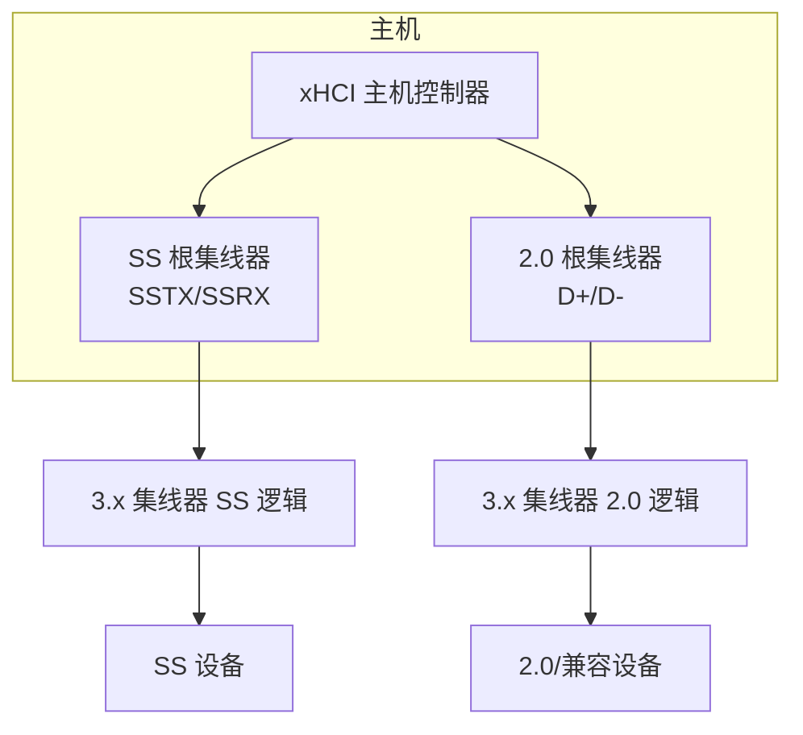
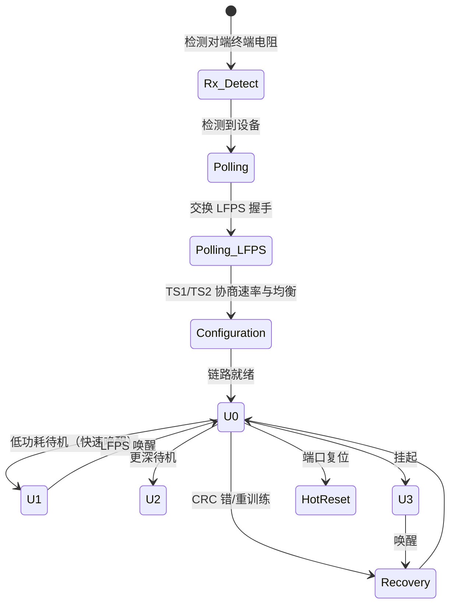
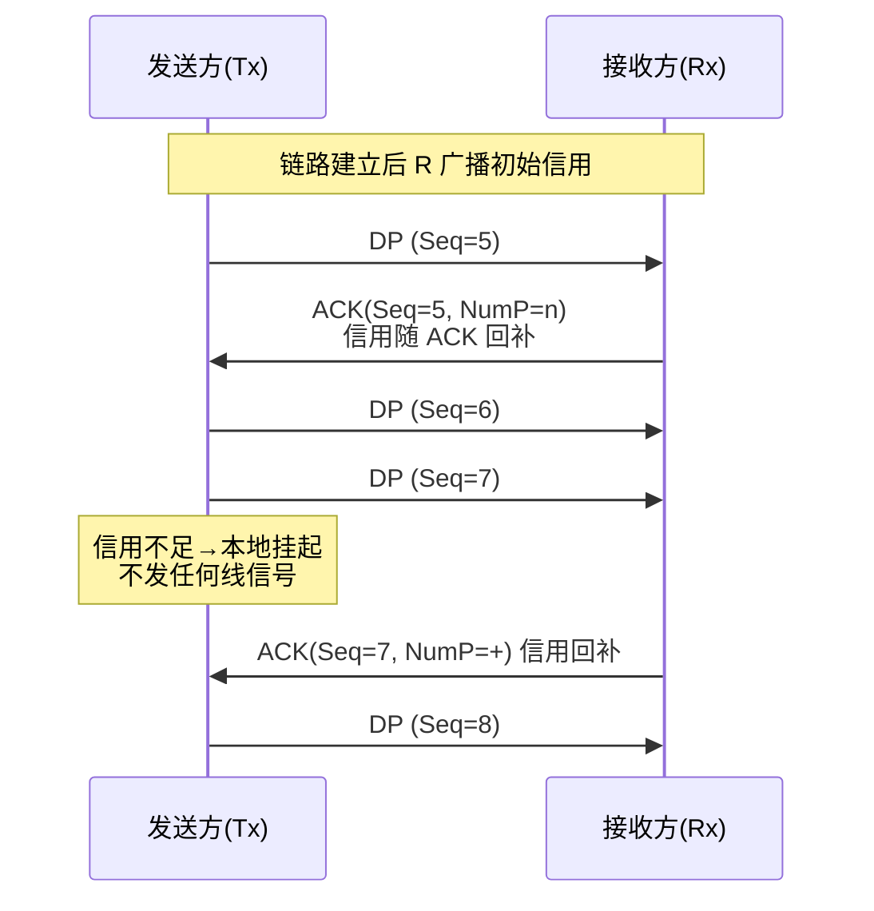
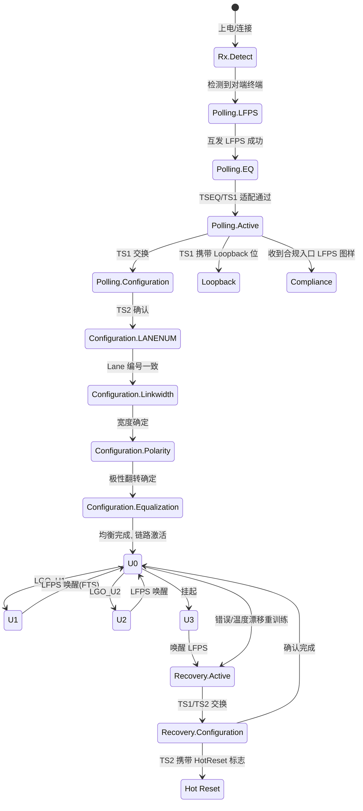

# USB 3.x SuperSpeed：包格式、LTSSM、定时器

> 层级 深入 · 主题 `speed/usb3` · 相关：[USB4：路由器、隧道、配置空间、DROM、连接管理器](31-usb4.md)、[电源管理：挂起、远程唤醒、LPM、U1/U2/U3](08-power-management.md)、[MSC：BOT、CBW/CSW、SCSI 命令与 Sense 全表](15-msc.md)

## 核心事实 Key Facts

> 由维护者整理并与规范核对；与下方 USBTree 原文冲突时以本节为准。

- 双单工：SSTX±/SSRX± 独立差分对，与 USB 2.0 D+/D− 并行，两套拓扑同时存在。
- 包类型：LMP（Link Management）、TP（Transaction Packet：ACK, NRDY, ERDY, STATUS, STALL, DEV_NOTIFICATION, PING, PING_RESPONSE）、DP（Data Packet header + payload）、ITP（Isochronous Timestamp）。
- 流控：设备无数据回 NRDY；就绪后主动发 ERDY，主机再调度——消除 USB 2.0 的 NAK 轮询。
- 批量 wMaxPacketSize 固定 1024，SS Endpoint Companion 描述符 bMaxBurst 0–15（1–16 包）；bmAttributes 中 MaxStreams（2^n，UAS 用）。
- LTSSM 状态：SS.Disabled、Rx.Detect、Polling（LFPS/TSEQ/TS1/TS2）、U0、U1、U2、U3、Recovery、Hot Reset、Loopback、Compliance Mode、SS.Inactive。
- LFPS（Low Frequency Periodic Signaling）用于 Polling、U1/U2/U3 退出、Warm Reset。

## 原文：01-USB3x与SuperSpeed

> Source: [40-枝干-高速演进/01-USB3x与SuperSpeed.md](https://github.com/tangjianfang/USBTree/blob/main/40-枝干-高速演进/01-USB3x与SuperSpeed.md)

USB 3.0 (2008) 不是"更快的 2.0"，而是一次架构革命：独立的 SuperSpeed 总线、全双工双差分对、基于信用的流控、包路由直达目标端口。2.0 的轮询式事务被整体替换。本叶按物理层→链路层→协议层→电源/Hub 拆解。

### 一、架构革命：两条总线并存的拓扑

- 每个 3.x 端口物理上有 **4 组差分线**：SSTX±/SSRX±（SuperSpeed，全双工）+ D+/D−（USB 2.0，半双工）；
- 两条总线**电气独立、协议独立**：SS 事务从不走 D+/D−，2.0 事务从不走 SS 对；
- 设备接哪条总线由自身能力与连接路径决定（详见 [03-各版本对比速查.md](01-overview-versions.md) 的澄清小节）；
- 3.x 集线器内部实际上是"一个 2.0 hub + 一个 3.x hub"背靠背的两套逻辑（见第六节）。

### 二、物理层

#### 2.1 编码与有效带宽

| 代次 | 营销速率 | 线路编码 | 有效数据速率 | 说明 |
| --- | --- | --- | --- | --- |
| Gen 1（USB 3.0/3.1 Gen1/3.2 Gen1x1） | 5 Gbps | **8b/10b** | 4 Gbps（80%） | 每 10 bit 携带 8 bit 数据 |
| Gen 2（USB 3.1 Gen2/3.2 Gen2x1） | 10 Gbps | **128b/132b** | 约 9.7 Gbps（≈97.7%） | 开销降到约 2.3%，代价是更强的均衡需求 |

两代均使用**加扰 (Scrambling)**：以线性反馈移位寄存器对数据流扰码，展平频谱、保证时钟恢复所需的 0/1 跳变密度。Gen 2 增加接收端均衡 (EQ, FSF/BT 上调参数) 与训练。

#### 2.2 全双工

2.0 是半双工：同一时刻只能主机或设备发送。SS 总线用**独立的 TX 对与 RX 对同时收发**，消除了令牌-握手往返的一半延迟，也为流控奠定基础。

### 三、链路层

#### 3.1 链路训练与状态机 (LTSSM)

LTSSM (Link Training and Status State Machine) 在上电/恢复时建立链路，简化骨架：

训练以 **TS1/TS2 有序集**为语言：双方互发 TS1，对端以 TS2 确认，交换速率能力、均衡参数后进入 L0（U0）。

#### 3.2 有序集 (Ordered Sets)

| 有序集 | 作用 |
| --- | --- |
| TSEQ | 训练初期的序列/均衡参考 |
| TS1 / TS2 | 链路训练与配置（速率、均衡、电源能力协商） |
| LFPS | 低频周期信令（Polling 握手、U1/U2/U3 唤醒、Reset），不依赖高速时钟 |
| Skip (SOS) | 补偿两端时钟差导致的弹性缓冲漂移，周期插入 |

另有 LGO*/LGOOD*/LBAD、IDL、EIEOS 等用于链路确认与 Gen2 均衡，见规范。

#### 3.3 LCRC 与重传

- 每个链路级包带 **CRC-32 (LCRC)**；接收方校验失败即丢弃并靠**超时+重发**恢复；
- 发送方为每个 Data Packet 维护序列号，接收方以 ACK/NRDY/STALL 类链路包应答；
- 与 2.0 的区别：2.0 的握手在协议层（每个事务都有令牌+握手），3.x 把可靠性下沉到**链路层点对点**，协议层事务大幅简化。

#### 3.4 基于信用的流控 (Credit-based Flow Control)

| 维度 | USB 2.0 | USB 3.x |
| --- | --- | --- |
| 机制 | 主机轮询设备端点（IN 令牌），设备没数据回 NAK | 接收方预先广播缓冲区**信用值**，发送方仅在信用充足时发包 |
| 无数据时开销 | 反复轮询+NAK，占用带宽与往返延迟 | 零开销：无信用不发，总线留给可用流量 |
| 方向 | 半双工轮询单向 | 全双工双向独立信用 |

这是 3.x 小包/低延迟性能（如 UVC 摄像头、网卡）显著改善的根源之一。

### 四、协议层

#### 4.1 路由字符串：从广播到单播

2.0 的包被集线器**广播到所有下行端口**。3.x 的包头上带有 Route String (路由字符串)：每经过一级 hub，该 hub 在对应 5 位字段填入下行端口号，沿途 hub 据此**精确转发到单一端口**。总线利用率与隔离性大幅提升，也意味着 SS 链路里"sniffer 挂在中间端口"看不到别人的流量。

#### 4.2 包结构

| 包 | 结构 | 作用 |
| --- | --- | --- |
| Data Packet (DP) | Link Control Word (2 B) + Header (16 B) + Data Payload (≤1024 B) + CRC-32 (4 B) | 数据载荷 |
| Transaction Packet (TP) | Link Control + Header + CRC-32 | ACK/NRDY/STALL、流控应答 |
| Link Management Packet (LMP) | 4 B | 链路两端管理（如设置链路功能） |
| ITP | 时间戳广播包 | 主机周期广播，等时传输时间戳同步 |

**宽带宽收益**：2.0 高速每事务最大 1024 B 且被微帧调度切片；3.x 单包 1024 B、链路全双工、无轮询，配合突发即可灌满 Gen1 4 Gbps 有效带宽的大部分（实测参考见 03 叶）。

### 五、链路电源状态与 LFPS

| 状态 | 名称 | 唤醒方式/延迟 |
| --- | --- | --- |
| U0 | 正常工作 | — |
| U1 | 浅待机（链路保持，收发器部分关闭） | LFPS 快速退出，微秒量级 |
| U2 | 深待机（更多电路关闭） | LFPS 退出，稍慢 |
| U3 | 挂起（等同设备级 suspend，见树干电源叶） | 主机发起唤醒，LFPS + 恢复序列 |

Polling.LFPS 是连接初始握手的低频信号（几十 MHz 量级的突发脉冲串），不要求双方先锁定高速时钟；Recovery 状态用于从 U0 出发快速重训练（如温度漂移、错误恢复）。与树干 [../10-树干-USB核心/10-电源管理与挂起唤醒.md](08-power-management.md) 的设备级挂起配合，构成 3.x 的完整低功耗体系。

### 六、集线器变化：一壳双芯

3.x hub 内部同时实现 **2.0 hub 与 3.x hub 两套逻辑**：

- 下行的每个端口都同时暴露 D+/D− 与 SSTX/SSRX；
- 2.0 设备由 2.0 逻辑服务（数据走 D+/D−，速率先经 hub 上行汇聚）；
- SS 设备由 3.x 逻辑服务；
- 结果：**同一个物理口可同时插出 2.0 与 3.x 设备而互不降速**——这是 2.0 做不到的（2.0 hub 下所有设备共享 480 Mbps）。

### 七、USB 3.2：双通道 (Gen 2x2)

| 代次 | 通道 | 速率 |
| --- | --- | --- |
| Gen 1x1 | 1 lane × 5 Gbps (8b/10b) | 5 Gbps |
| Gen 2x1 | 1 lane × 10 Gbps (128b/132b) | 10 Gbps |
| Gen 2x2 | **2 lane × 10 Gbps** | 20 Gbps |

- **Gen 2x2 仅存在于 Type-C 连接器**（需要 2 对 TX + 2 对 RX，Type-A/B 无线对可用）；
- 双通道需要**配对与同步**：两条 lane 独立加扰/训练，链路层聚合；训练中通过 **Lane Margining at Receiver** 测量每条 lane 的时序/电压余量，决定均衡参数；
- Gen 2x2 设备与 Gen 2x1 主机互通时自动退回单通道 10 Gbps。

### 八、向下兼容的物理实现

- **同一连接器，不同线对**：3.0 A/B/ Micro-B 在 2.0 引脚之外增加 SS 对；2.0 设备插入 3.0 口只接通 4 针，照常枚举；
- 2.0 主机 + 3.0 设备：设备退化为 HS 运行（SS 对悬空）；
- 3.0 线缆必须全部 9/10 针导通且 SS 对做阻抗控制，因此"3.0 线更贵"；劣质 3.0 线常见故障是 SS 对误接（SSTX/SSRX 交叉错误），见 [../30-枝干-接口与供电/01-接口形态演进.md](20-connectors-typec.md)；
- Type-C 时代，上述所有线对被镜像化到 24 针中，但两条总线并存的架构不变，直到 USB4 才被路由器拓扑取代（见 02 叶）。

## 原文：04-USB3x包格式与LTSSM

> Source: [40-枝干-高速演进/04-USB3x包格式与LTSSM.md](https://github.com/tangjianfang/USBTree/blob/main/40-枝干-高速演进/04-USB3x包格式与LTSSM.md)

>  兄弟: [01-USB3x与SuperSpeed.md](30-usb3-superspeed.md) · [02-USB4与雷电整合.md](31-usb4.md) · [03-各版本对比速查.md](01-overview-versions.md)
> 规范原文缓存索引: [80-参考资料/README.md](92-spec-references.md)

[01 叶](30-usb3-superspeed.md)讲了 3.x 的架构革命，本叶下钻到线上协议：链路层四类包、32 字节 Header 的逐字段结构、信用流控与重传的精确机制、有序集族、LFPS 信令参数，以及把整条链路"训练"起来的状态机 LTSSM（Link Training and Status State Machine）。字段位级排布以 USB 3.2 规范第 6/8 章为准，本文不逐位复刻处均标注"见规范原文"。

### 1. 链路层包分类总表

| 类型 | 全称 | 组成 | 职责 | 子类型举例 |
|---|---|---|---|---|
| LMP | Link Management Packet | 仅链路控制字（4 B 量级） | 链路两端自身管理，不涉及协议层 | Set Link Function、U2 Inactivity Timeout、Port Configuration 等（见规范原文） |
| TP | Transaction Packet | 链路控制字 + Header(32 B) + CRC-16 | 事务层握手：流控、重传、停摆、通知 | ACK / NRDY / ERTY / STALL / PING / PING_RESPONSE / DEV_NOTIFICATION |
| DP | Data Packet | Header(32 B) + Data Packet Payload (DPP) | 承载数据；DPP = Data Payload（≤1024 B）+ LCRC-32 | — |
| ITP | Isochronous Timestamp Packet | — | 主机周期广播时间戳，等时传输跨设备时间同步 | — |
| VLPEnd | Vendor Low Power End（有序集） | — | 标识厂商自定义低功耗（VLP）操作结束，与 LGO_VLP/VLPS 配套 | — |

与 2.0 的根本差异：不再有令牌包广播；每个包都被**路由到单一链路伙伴**（Route String，见 [01 叶 §4.1](30-usb3-superspeed.md)）。

### 2. Header Packet：32 字节逐字段

所有 TP 与 DP 共用同一 32 字节头结构，靠 Type/SubType 区分：

| 字段 | 宽度 | 取值/含义 |
|---|---|---|
| Type | 4 bit | 包大类：LMP / TP / DP / ITP |
| SubType | 4 bit | 类内细分：TP 的 ACK/NRDY/ERTY/STALL/PING/DEV_NOTIFICATION 等 |
| Route String | 20 bit | 5 bit × 最多 4 级 hub 的下行端口路径；主机发包时填好，沿途 hub 按段转发（位级排布见规范原文） |
| Device Address | 7 bit | 设备地址（与 2.0 一样由 SET_ADDRESS 分配） |
| Direction | 1 bit | IN / OUT 方向 |
| Endpoint Number | 4 bit | 目标端点号 |
| Reserved | 若干 bit | 保留位，置 0 |
| CRC-16 | 16 bit | 头部校验；保护路由/寻址字段（覆盖范围见规范原文），链路层对头错误按包丢弃处理 |

DP 专用字段（同在 32 字节头内）：

| 字段 | 宽度 | 取值/含义 |
|---|---|---|
| Data Length | — | Data Payload 有效字节数指示（编码粒度与位宽见规范原文；DP 载荷最大 1024 B） |
| Sequence Number | 5 bit | 取值 0~31，DP 的序号，供 TP ACK 应答与重传判定 |
| Retry Bit | 1 bit | 重发位置 1：接收方已收过同序号 DP 时静默丢弃并补 ACK，作用类似 2.0 的 DATA0/DATA1 触发位 |

> 字段在 4 个 DW 间的精确排布（含跨 DW 拆分与保留位）见规范原文第 8 章；抓包分析时建议直接依赖分析仪解码而非手工按位拼头。

### 3. TP 类型表

| SubType | 方向 | 语义 | 关键字段 |
|---|---|---|---|
| ACK | 接收方→发送方 | "序号 n 的 DP 已收下" + 流控汇报 | Seq Number（应答号）、Retry Bit、NumP（可接收包数=信用）、PP (Packet Pending)、Dir |
| NRDY | 设备→主机 | Not Ready：端点暂不可收发（2.0 NAK 的替代） | 端点/方向 |
| ERTY | 设备→主机 | Endpoint Ready：NRDY 之后端点恢复就绪 | — |
| STALL | 设备→主机 | 端点永久性错误，需软件介入（语义同 2.0 STALL，见树干 [11 叶](09-errors-testmode.md)） | — |
| PING | 主机→设备 | 轻量探测：接收端是否可收（如链路低功耗态恢复后先探后发） | — |
| PING_RESPONSE | 设备→主机 | 对 PING 的应答 | — |
| DEV_NOTIFICATION | 设备→主机 | 设备通知（DN）：功能级异步事件上报 | 通知类型/数据 |

2.0 → 3.x 事务语义迁移：NAK → NRDY+ERTY 两段式（"现在不行"与"可以了"分开上报），主机无需持续轮询。

### 4. 信用流控（Credit-based Flow Control）

接收方通过 TP（ACK 的 **NumP** 字段）持续告知"我还有多少个 DP 缓冲可收"，发送方据此发送：

| 维度 | USB 2.0 轮询流控 | USB 3.x 信用流控 |
|---|---|---|
| 无数据时线上开销 | 反复 IN 令牌 + NAK（HS 还有 PING 优化，见树干 [11 叶 §7](09-errors-testmode.md)） | **零**：无信用不发，静默即空闲 |
| 流控信息 | 隐含在每次事务结果中 | 显式 NumP 计数，可批量授予 |
| 方向 | 半双工逐事务 | 全双工双向独立 |
| 端点未就绪 | 每次轮询都 NAK | NRDY 一次声明，ERTY 一次恢复，期间不打扰 |

信用按**接收缓冲区数量**计（不按字节），与 2.0"整包重发"的粒度一致。

### 5. 重传与 LCRC-32

两层机制并存，注意区分：

**协议层 DP 重传（Gen1/Gen2 通用）**：
- 每个 DP 的 Data Payload 尾部带 **LCRC-32**，接收方校验失败→静默丢弃、不发 ACK；
- 发送方等待 ACK 超时→**重发同一 DP，Retry Bit 置 1**；接收方若其实已收下（只是 ACK 丢失），比对序号后丢弃重发包、重新 ACK——序号 + Retry 位共同实现"零丢失、零重复"（与 2.0 toggle 的角色对照见树干 [11 叶 §2/§3](09-errors-testmode.md)）；
- 头部 CRC-16 失败的 TP/DP 同样按未收到处理。

**链路层 Replay（Gen2 新增）**：
- Gen2 (128b/132b) 要求更高吞吐、更少停顿，链路层把已发送的包缓存在 **Replay Buffer**，以 **LGOOD_n / LBAD_n** 有序集做批量确认：n 为 4 bit 链路序号（0~15）；收到 LBAD_n → 发送方从检查点把缓存包**整体重放**，链路层错误不再逐包上抛协议层；
- Gen1 则依赖上述协议层逐包重传。两代的目标 BER 均为 10⁻¹²，Gen2 用 Replay 把错误恢复从"微秒级往返"压缩到链路内消化。

### 6. 有序集 (Ordered Sets) 总表

有序集是不带 Header、由特定符号序列构成的"链路语言"，在训练/低功耗/补偿场景使用：

| 有序集 | 作用 |
|---|---|
| TSEQ | 训练最初期发送：接收端适配/均衡与 BER 初测的参考序列 |
| TS1 | 链路训练：速率、通道、均衡能力交换（Polling/Recovery 主角） |
| TS2 | 训练确认：对端配置确认；携带 Hot Reset / Loopback / Disable 等标志位 |
| EIEOS | 电空闲退出 (Electrical Idle Exit) 有序集；Gen2 均衡阶段夹在 TS 间，保证电空闲可靠检出 |
| SKPOS (SKP) | 时钟补偿：两端参考时钟偏差由周期插入的 SKP 符号在弹性缓冲中增删吸收（Gen1/Gen2 符号数不同，见规范原文） |
| FTS | 快速训练：从 U1/U2 返回 U0 时快速重锁时钟/位对齐，避免完整 Polling |
| LGOOD_n / LBAD_n | Gen2 链路层批量确认 / 否认（触发 Replay） |
| LGO_U1/U2/U3、LGO_Ping 等 | 链路操作请求：进入对应低功耗态或探测 |
| VLPS / LGO_VLP / VLPEnd | 厂商自定义低功耗状态的进入/请求/结束 |
| RESET（复位相关） | 链路复位信令（与 Warm/Hot Reset 流程配合；用法与编码见规范原文） |
| Sync Header | 严格说不是有序集：Gen2 每 132 bit 块前的 2 bit 块类型标记（Data 块 / Control 块） |

### 7. LFPS 信令详解

LFPS (Low Frequency Periodic Signaling) 是链路训练/唤醒期的"低频握手语言"：方波突发，标称频率约 60 MHz（相对 5/10 Gbps 线速即为"低频"），不要求双方先锁定高速 PLL，用本地环振即可产生。精确 min/max 参数见规范原文 §6.x，工程量级如下：

| 场景 | 突发形态（量级） | 说明 |
|---|---|---|
| Polling.LFPS | 约 1 µs 突发 + 数 µs 静默，连发 4 组为一代 | 上电/连接后互发，确认对端存在与基本能力 |
| Compliance 入口 | 特殊图样：突发频率/时长组合区别于 Polling | 测试仪发出后 DUT 进入 Compliance Mode（见树干 [12 叶](09-errors-testmode.md)） |
| Reset LFPS（Warm/Hot Reset） | 更长/更多的特定突发序列 | 端口复位信令，区分热复位与暖复位 |
| U1/U2 Wake | 短突发（1 组量级） | 低功耗态快速唤醒，微秒级回到训练 |
| Checkpoint/Recovery 相关 LFPS | 特定突发组合 | Recovery/检查点流程中的带外提示（细节见规范原文） |

设计哲学：**低速可靠信道**完成"要不要高速对话"的协商，避免鸡生蛋问题（高速接收器还没训练好时听不懂任何高速信令）。

### 8. LTSSM 全图

每个状态一句话职责：

| 状态 | 职责 |
|---|---|
| Rx.Detect | 静默期检测对端 Rx 终端阻抗，判定连接存在 |
| Polling.LFPS | 低频握手：对端在吗？ |
| Polling.EQ | 交换 TSEQ：初始均衡适配 |
| Polling.Active | 交换 TS1：能力协商（速率/通道/均衡） |
| Polling.Configuration | 交换 TS2：训练参数确认 |
| Configuration.LANENUM | 多 lane 编号排位（lane 0..n 归位） |
| Configuration.Linkwidth | 协商链路宽度（哪些 lane 参与） |
| Configuration.Polarity | 检测/翻转 RX 极性（布线可免交叉） |
| Configuration.Equalization | 均衡参数最终确认（Gen2 在此/其后做 Preset 与系数协商） |
| U0 | 正常工作（L0），包交换发生地 |
| U1 / U2 | 链路低功耗待机（浅/深），FTS 或 LFPS 快速返回 |
| U3 | 挂起，唤醒走 LFPS + Recovery |
| Recovery.Active / Recovery.Configuration | 快速重训练（错误恢复、唤醒、重均衡），TS1/TS2 再交换 |
| Loopback | 回环测试态（BER） |
| Compliance | 合规图样发送态（电气测试） |
| Hot Reset | 经 Recovery.Configuration 中 TS2 的 HotReset 标志实现的端口复位路径 |

### 9. Gen1 与 Gen2 差异点

| 维度 | Gen1 (5G) | Gen2 (10G) |
|---|---|---|
| 线路编码 | 8b/10b（80% 效率） | 128b/132b（≈97.7%，2 bit Sync Header / 块） |
| 均衡 | 训练期基础适配 | 完整 EQ 流程：Preset 与系数协商、RX LEQ（Link Equalization）过程、Lane Margining 验证 |
| 链路层纠错 | 协议层逐包重传（Seq+Retry） | 其上叠加 Replay（LGOOD/LBAD 批量确认+整段重放） |
| TSEQ/TS1/TS2 | 8b/10b 符号构成 | 128b/132b 块构成；EIEOS 更频繁介入 |
| SKP | SKP 符号对 | BM SKP（块模式下符号数不同） |
| CTLE/DFE 需求 | 较低 | 显著提高（10G 下信道损耗预算更紧） |

### 10. 电源状态 U0–U3 转换表

| 状态 | 进入条件 | 退出条件 | 退出时延（量级） |
|---|---|---|---|
| U0 | 训练完成 / Recovery 完成 | — | — |
| U1 | 任一链路伙伴发 LGO_U1；链路保持配置 | 对端 LFPS 短突发 + FTS 快速重训练 | 亚微秒~微秒级 |
| U2 | LGO_U2；关闭更多收发电路 | LFPS 唤醒 + 重训练 | 数十微秒级 |
| U3 | 系统挂起（配合设备级 suspend，见树干 [10 叶](08-power-management.md)） | 主机发起唤醒 LFPS → Recovery | 毫秒级（含重训练） |

设备在 BOS 描述符的 SuperSpeed Device Capability 中上报 U1/U2 自身退出时延（U1DeviceExitLat / U2DeviceExitLat），供主机在功耗与响应性间权衡；链路低功耗与设备功能挂起的协同（如 PING 探测）见规范原文。U1/U2 的核心收益在硬盘中途空闲、键盘鼠标敲击间隙——不退出训练就能秒级恢复，避免完整 Polling 的几十微秒代价与总线可见的"掉线感"。

## 原文：06-USB3x规范级-包格式与定时器

> Source: [40-枝干-高速演进/06-USB3x规范级-包格式与定时器.md](https://github.com/tangjianfang/USBTree/blob/main/40-枝干-高速演进/06-USB3x规范级-包格式与定时器.md)

> 树干基础: [../10-树干-USB核心/05-包格式与事务.md](04-packets-transactions.md) · [../10-树干-USB核心/11-错误处理与可靠性.md](09-errors-testmode.md)
> 规范原文缓存索引: [../80-参考资料/README.md](92-spec-references.md)

[04 叶](30-usb3-superspeed.md)给出了链路层全景，本叶按 USB 3.2 规范（本地缓存 `80-参考资料/usb-core/USB3.2-Specification-2018.zip` 内 `USB 3.2 Revision 1.0.pdf`，下称 USB 3.2 spec）逐字段下钻：Header Packet 的 16 字节排布、TP/LMP 子类型全表、ITP 结构、有序集族、链路命令与信用管理/重传定时。所有数值取自 PDF 解析；解析错位处在文中显式标注，无法核实的值一律不写。

### 1. 四类包与 Header Packet 骨架

| 类型 | 全称 | 寻址/路由 | 职责（USB 3.2 spec §8.2） |
|---|---|---|---|
| LMP | Link Management Packet | 不携带地址，**不可路由**，仅链路两端 | 链路自身管理与测试 |
| TP | Transaction Packet | Route String + Device Address，贯穿全路径 | 流控、停摆、通知，无数据载荷 |
| DP | Data Packet | 同上 | DPH（头）+ DPP（载荷+CRC-32） |
| ITP | Isochronous Timestamp Packet | 无地址，**多播**到所有 U0 且完成端口配置的链路 | 主机广播时间戳 |

线上结构（§7.2.1.1）：

- 协议层 Header Packet = **12 B 头信息 + 2 B CRC-16 + 2 B Link Control Word = 16 B**。
- Gen 1：再加 4 符号帧定界 HPSTART（3×SHP + EPF），共 20 符号。
- Gen 2：非 deferred DPH 改用 DPHSTART（3×DPHP + EPF），并在 LCW 之后附 **Length 字段副本**（24 B），以实现单比特容错；deferred DPH 仍用 HPSTART、不带副本。
- 常见资料"Header Packet 32 字节"的说法是把帧符号/缓冲粒度计入后的粗略口径；规范协议层口径是上表 16 B + 帧符号。

CRC 实现（§7.2.1.1.2）：CRC-16 多项式 **100Bh**、初值 FFFFh、余数取反、接收端恒定残差 **F6AAh**——与 USB 2.0 的 CRC-16 不同。CRC-5（LCW 用）多项式 00101b、初值 11111b、残差 01100b。

### 2. 16 字节逐字段排布（DW0~DW3）

以 TP 为例（USB 3.2 spec 图 8-2、表 8-13；位序以规范表为准）：

| DW | 位域（bit） | 字段 | 说明 |
|---|---|---|---|
| 0 | 4:0 | Type | 表 8-1，5 bit，见 §3 |
| 0 | 24:5 | Route String / Reserved（20 b） | 下行包由 hub 路由；设备上行时置 0（§8.9：每级 hub 4 位端口号，Hub Depth×4 为偏移） |
| 0 | 31:25 | Device Address（7 b） | 1~127，0 为默认地址（§8.8） |
| 1 | 3:0 | SubType | TP 子类型，见 §3 |
| 1 | 5:4 | Rsvd | 0 |
| 1 | 6 | rty（仅 ACK） | 重发数据包请求 |
| 1 | 7 | D（Direction） | 0=Host→Device，1=Device→Host |
| 1 | 11:8 | Ept Num（4 b） | 端点号 |
| 1 | 14:12 | TT（Transfer Type，仅 SSP 有效） | 100b=Control 等；SS 模式保留为 0 |
| 1 | 15 | HE（仅 ACK） | Header Error 指示 |
| 1 | 20:16 | NumP（仅 ACK/ERDY 语义） | 可接收缓冲数 |
| 1 | 25:21 | Seq Num（5 b） | 数据包序号 |
| 1 | 30:26 | Rsvd（TPF 位组） | 0 |
| 1 | 31 | PP（Packet Pending，仅 ACK） | 主机还有数据 |
| 2 | 15:0 | Stream ID（SSP 流） | 流式端点 |
| 2 | 31:29 | NBI / DBI / RWRPA / SSI 标志组 | 依方向/TP 而异（表 8-13；**位段解析有错位，以规范表为准**） |
| 3 | 15:0 | CRC-16 | 覆盖前 12 B |
| 3 | 31:16 | Link Control Word | 见下表 |

> LMP/ITP 不带 Route String 与 Device Address（不可路由），DW0 高位为时间戳等自有字段；DPH 的 DW1/DW2 携带 Data Length 等字段。逐包差异以 §8.3~§8.7 各表为准。

Link Control Word（§7.2.1.1.3、表 8-2，偏移记作 3:bit）：

| 位段（SS） | 位段（SSP） | 字段 | 说明 |
|---|---|---|---|
| 3:16~3:18 | 3:16~3:19 | Header Sequence Number | 0~7（SS）/0~15（SSP） |
| 3:19~3:21 | 3:20~3:21 | Reserved | 0 |
| 3:22~3:24 | 3:22~3:24 | Hub Depth | 仅 Deferred 包有效，0~4 |
| 3:25 | 3:25 | DL（Delayed） | 包被延迟/重发，一路置位不清除 |
| 3:26 | 3:26 | DF（Deferred） | 仅 hub 可置：目标下行口在 U1/U2 |
| 3:27~3:31 | 3:27~3:31 | CRC-5 | 保护前 11 位 |

### 3. Type 字段与 TP 子类型全表

### 3.5 Gen 2 特殊符号 8bit 编码（表 6-2，evolve #29 提取）

| 符号 | 名称 | Gen 1 (8b/10b K 码) | Gen 2 (128b/132b) | 说明 |
|---|---|---|---|---|
| SKP | Skip | K28.1 | CCh | 位率补偿，可动态插入/删除；Gen2 SSP 不加扰 |
| SKPEND | Skip End | 不适用 | 33h | SKP OS 与后续的边界，不加扰 |
| SDP | Start Data Packet | K28.2 | 96h | 数据包载荷开始；Gen2 加扰且仅在 data block |
| EDB | End Bad | K28.3 | 69h | 包废止（nullified）结束 |

Type（表 8-1）：**LMP=00000b、TP=00100b、DPH=01000b、ITP=01100b**，其余保留。
>  对抗抽查（evolve #43）：四值与 USB 3.2 规范 Table 8-1 正文（-table 重提取）逐项一致。

TP SubType（表 8-12，4 bit）：

| 值 | TP | 用途与关键字段（§8.5 各节） |
|---|---|---|
| 0000b | Reserved | — |
| 0001b | ACK | IN：主机请求并确认；OUT：设备确认并报告 NumP；带 rty/PP（§8.5.1） |
| 0010b | NRDY | 端点未就绪（Not Ready），设备→主机（§8.5.2） |
| 0011b | ERDY | 端点就绪（Endpoint Ready），设备主动上报可收/可发 NumP（§8.5.3） |
| 0100b | STATUS | 控制传输状态阶段（§8.5.4） |
| 0101b | STALL | 端点停摆/请求不支持（§8.5.5） |
| 0110b | DEV_NOTIFICATION | 设备通知：Function Wake、LTM（延迟容忍消息）、Bus Interval Adjustment、Sublink Speed（§8.5.6） |
| 0111b | PING | 主机探测链路/设备在场（§8.5.7） |
| 1000b | PING_RESPONSE | 对 PING 的应答（§8.5.8） |
| 1001b~1111b | Reserved | — |

### 4. LMP 子类型表与端口配置流

LMP SubType（表 8-3，4 bit，偏移 0:5）：

| 值 | LMP | 用途（§8.4 各节） |
|---|---|---|
| 0000b | Reserved | — |
| 0001b | Set Link Function | 含 Force_LinkPM_Accept 位：强制接受 LGO_U1/U2（§8.4.2） |
| 0010b | U2 Inactivity Timeout | 携带 8 bit 超时值（§8.4.3） |
| 0011b | Vendor Device Test | 厂商测试专用（§8.4.4） |
| 0100b | Port Capability | 端口能力宣告（§8.4.5） |
| 0101b | Port Configuration | 端口配置（速度/通道协商的结果下发，§8.4.6） |
| 0110b | Port Configuration Response | 配置应答（§8.4.7） |
| 0111b | Precision Time Management | PTM/LDM（链路延迟测量）相关（§8.4.8） |
| 1000b~1111b | Reserved | — |

**进入 U0 的握手次序**（§7.2.4.2.1 前置条件 4、§8.4.5~8.4.7）：

### 5. ITP 结构

ITP（§8.7、表 8-26）：主机在**每个总线区间**（125 µs）内、且根口链路处于 U0 时才发送；不产生应答；进 U0 后 tIsochronousTimestampStart 内即开始。字段：

| DW | 字段 | 位段 | 说明 |
|---|---|---|---|
| 0 | Type | 4:0 | 01100b |
| 0 | ITS（Isochronous Timestamp） | 31:5 | 低 14 位 = 125 µs 总线区间计数器（0x3FFF 回绕）；高 13 位 = Delta（距上一总线区间边界的时间，单位 tIsochTimestampGranularity，不越过边界取最近值） |
| 1 | Bus Interval Adjustment Control | 7:0 | **本版本已弃用**，置 0 |
| 1 | Correction | 20:8 | 经 PTM hub 累积的负时延修正（同粒度单位），主机置 0 |
| 2 | Reserved | — | 0 |
| 3 | CRC-16 + LCW | — | 同其他头包 |

若收到的 ITP 带有 LCW 的 DL 位，时间戳可能严重失准，设备可忽略。

### 6. 有序集（Ordered Set）与成帧符号

Gen 2 的控制块全集（§6.3.2.2）：**TS1、TS2、TSEQ、SYNC、SKP、SDS**。

| 有序集 | 用途 | 出现时机 |
|---|---|---|
| TSEQ | 均衡训练用的初始训练序列 | Polling.RxEQ；Gen 1 期间不得插入 SKP（§6.4.1.1.1） |
| TS1 / TS2 | 链路参数交换、状态协商 | Polling、Recovery、Hot Reset、Loopback 等所有再训练场合 |
| SYNC | 扰码器重置/块对齐 | Gen 2 每 16,384 个 TSEQ 强制插入一次（§6.3.2.3 规则 10） |
| SKP（+SKPEND） | 时钟补偿 | 周期插入；Gen 2 中以 SDP 结尾界定 |
| SDS | 数据流开始标志 | Gen 2 数据块流前（128b/132b） |

成帧/控制符号（表 6-2，Gen 1 值可靠；Gen 2 值仅列解析确认者）：

| 符号 | Gen 1 | Gen 2 | 含义 |
|---|---|---|---|
| SKP | K28.1 | CCh | 补偿频差 |
| SKPEND | — | 96h | SKP 串结束（不扰码） |
| SDP | K28.2 | 69h | 数据包开始 |
| EDP | K28.3 | （解析错位，见规范） | 数据包结束 |
| EDB | — | 9Ah | 废弃（nullified）包结束 |
| SUB | K28.4 | （见规范） | 解码错误替换符号 |
| COM | K28.5 | （见规范） | 符号对齐 |
| SHP | K27.7 | （65h/4Bh 错位，见规范） | Header Packet 开始 |
| DPHP | — | 同上 | Gen 2 非 deferred DPH 开始 |
| SLC | K30.7 | （见规范） | Link Command 开始 |
| EPF | K23.7 | E1h/36h（错位，见规范） | 包帧结束 |
| SDS | — | （见规范） | 数据流开始 |

> 表 6-2 的 PDF 提取在 Gen 2 列存在行错位，仅 SKP/SKPEND/SDP/EDB 四个值能可靠配对；其余以规范表 6-2 为准。另注：**EIEOS、RESET、FTS、CDRSYNC 属于 USB4 的链路训练有序集**（USB4 规范 §4.2），USB 3.2 规范中并不存在，详见 [07-USB4规范级-配置空间与隧道.md](31-usb4.md)。

### 7. 链路命令（Link Command）

结构（表 7-3）：8 符号 = SLC×3 + EPF + **16 bit 链路命令字 + 其副本**。命令字 = 11 bit 命令信息 + CRC-5（算法同 LCW）。

命令字段（表 7-4）：Class=b10:9，Type=b8:7，SubType=b6:4 与 b3:0。

| Class:Type | 命令 | 语义（表 7-5） |
|---|---|---|
| 00 | LGOOD_n（n=序号） | 确认收到对应序号的 Header Packet（SS：n=0~7；SSP：0~15） |
| 00 | LCRD_x / LCRD1_x / LCRD2_x | Rx Header Buffer 信用（x=A~G；Type1/Type2 两类流量各一组） |
| 00 | LBAD | 收到坏序号 HP，要求重发 |
| 00 | LRTY | 请求对端重发（重发 HP 不改 CRC-16） |
| 01 | LGO_U1 / LGO_U2 / LGO_U3 | 请求进入低功耗链路态 |
| 01 | LAU / LXU / LPMA | 接受/拒绝低功耗请求 / 电源管理确认 |
| 10 | LUP / LDN | 端口在 U0 在场宣告（up/down） |

Gen 2x2 每类信用从 A~D 扩到 **A~G**（多 3 个，§7.2.2.2）。流量分类：Type 1 = 周期 DP、TP、ITP、LMP；Type 2 = 异步 DP。

### 8. 信用管理与 Replay 重传定时

- **信用初始化**：进入 U0 后先做 Header Sequence Number 通告与 Rx Header Buffer Credit 通告（§7.2.4.1；低功耗转移条件 §7.2.4.2.1-4 要求两者完成），信用以 LCRD_x 回收，代表对端"Remote Rx Header Buffer"空位。
- **重传（Replay）机制**：发方等 LGOOD_n；收方校验 CRC-16/CRC-5 失败或序号错即回 LBAD，发方以 LRTY 触发重发；重发的 HP 置 LCW 的 DL 位。
- **定时**（表 7-7/7-8，均为 §7.2.4）：

| 定时器 | 值 | 含义 |
|---|---|---|
| PENDING_HP_TIMER | 10 µs | 等 LGOOD_n/LBAD 回执 |
| CREDIT_HP_TIMER | 5,000 µs | 等对端信用 |
| LGOOD/LBAD 回执期限 | SS 3.0 µs / SSP 1.5 µs | 收到 HP 后必须回执 |
| 链路命令处理时限 | 200 ns | 收到命令后的处理窗口 |
| PM_LC_TIMER / PM_ENTRY_TIMER | 4/8 µs、8/16 µs（x1/x2） | 低功耗入口 |
| Ux_EXIT_TIMER / U1_MIN_RESIDENCY_TIMER | 6,000 µs / 3 µs | 低功耗出口/驻留 |

定时器容差 0~+50%（§7.5）。完整 LTSSM 状态超时表见 [../90-附录/03-时序参数全表.md](90-quick-reference.md)。

### 9. DFP / UFP 传输方向术语

| 术语 | 全称 | 定位 |
|---|---|---|
| DFP | Downstream Facing Port（下行口） | 主机侧与 hub 的下行方向端口；LTSSM Polling.PortConfig 分 (DFP)/(UFP) 两个变体（§7.5.4.6），负责发起 Hot Reset |
| UFP | Upstream Facing Port（上行口） | 设备侧与 hub 上行方向端口 |
| 主机（Host） | — | 唯一可发起 ITP（§8.7）；控制传输发起方 |
| 设备（Device） | — | 以 ERDY/DEV_NOTIFICATION 主动上报（§8.5.3/8.5.6） |

低功耗请求方向：任一端口可发 LGO_Ux，对端以 LAU/LXU 应答（§7.2.4.2）——与 USB 2.0 "只有主机能发起挂起"不同。

### 10. 与 USB 2.0 包体系的对照

| 维度 | USB 2.0 | USB 3.x |
|---|---|---|
| 广播令牌 | OUT/IN/SETUP 广播 | 无令牌，Route String 点对点路由 |
| 重传单位 | 事务（3 包） | 单个 Header Packet（LGOOD/LBAD/LRTY） |
| 流控 | NAK 握手 | NumP 信用 + LCRD 缓冲信用 |
| 同步头 | SYNC 8/32 位 | HPSTART 4 符号 + 16 B 头 |
| 校验 | CRC5/CRC16 | CRC-16（头）+ CRC-32（DPP）+ HEC 类成帧容错 |
