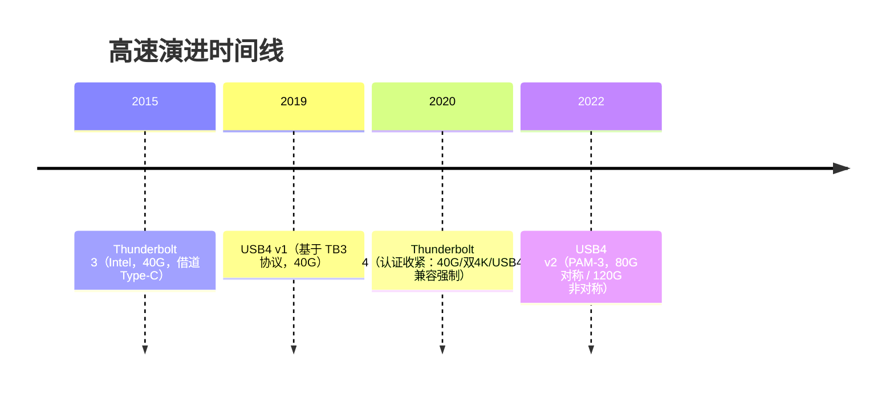
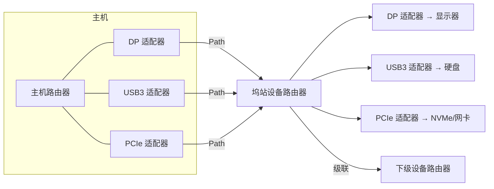
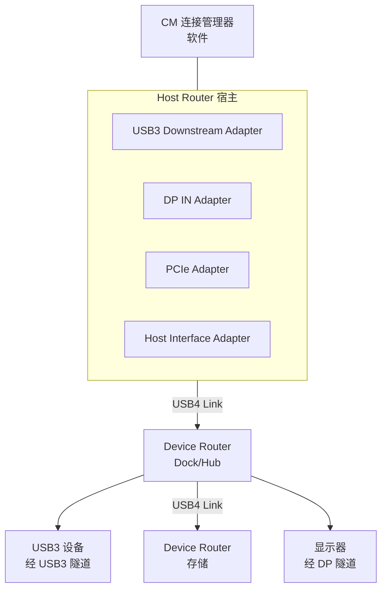
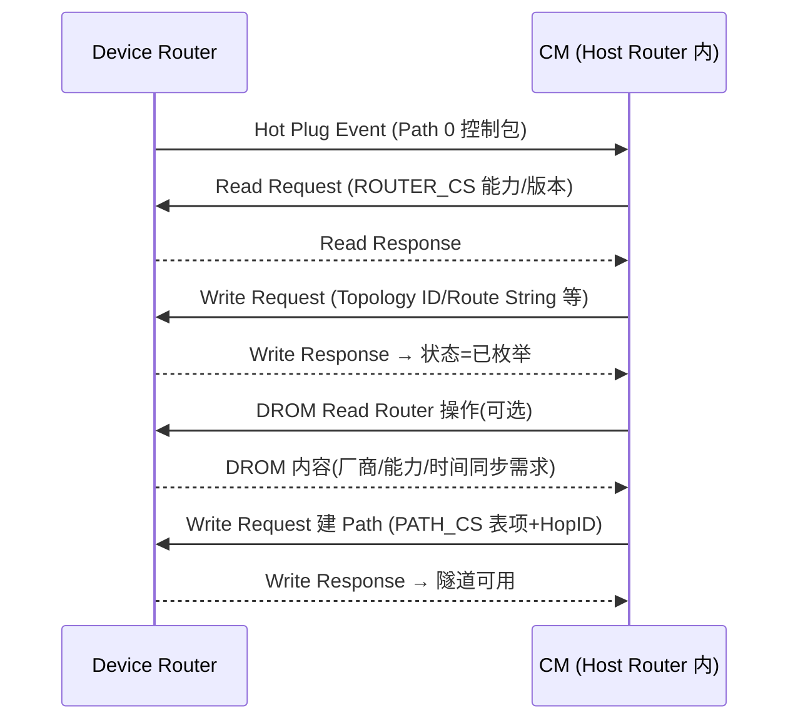
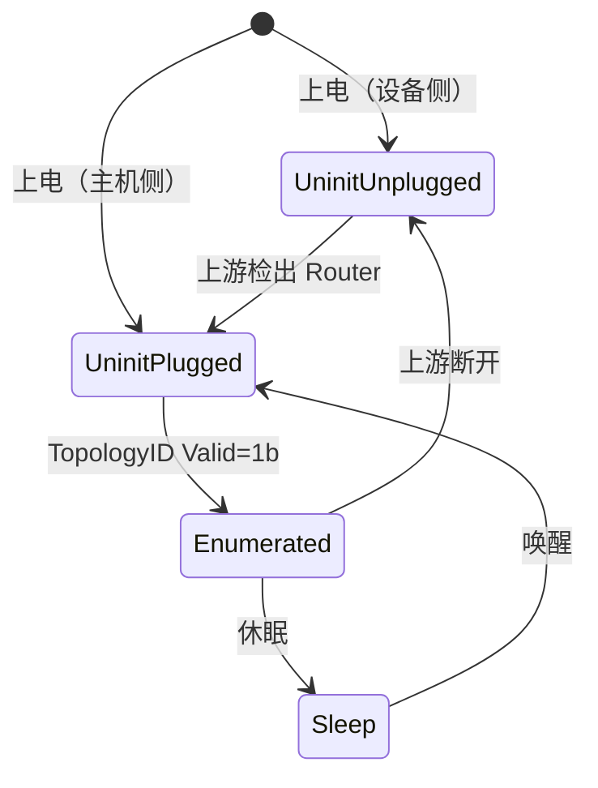
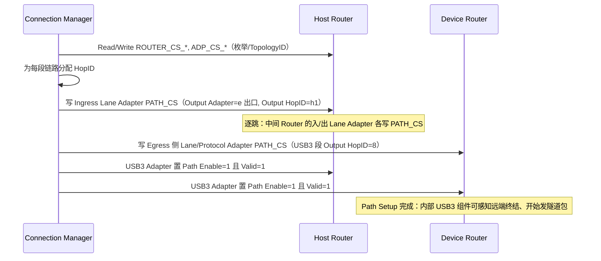

# USB4：路由器、隧道、配置空间、DROM、连接管理器

> 层级 深入 · 主题 `speed/usb4` · 相关：[USB 3.x SuperSpeed：包格式、LTSSM、定时器](30-usb3-superspeed.md)、[USB Power Delivery：协议、状态机与消息全表](22-usb-pd.md)、[Alternate Mode、Structured VDM 与 E-marker](23-altmode-emarker.md)

## 核心事实 Key Facts

> 由维护者整理并与规范核对；与下方 USBTree 原文冲突时以本节为准。

- 基本单元 Router（主机路由器 / 设备路由器），端口称 Adapter：Lane Adapter（物理链路）、Protocol Adapter（USB3 / DP IN/OUT / PCIe Up/Down）、Control Adapter。
- 协议流量封装为 Tunneled Packet，沿 Path 在路由器间转发；USB 2.0 不进隧道，走 Type-C 的 D+/D− 独立线对。
- Connection Manager（软件，Windows 11 内置 USB4 CM；Linux thunderbolt 驱动）通过 Control Packet 读写路由器配置空间，发现拓扑、建立隧道、分配带宽。
- 速率：Gen 2（10 Gbps/lane）、Gen 3（20 Gbps/lane），双 lane 合计 20/40 Gbps；USB4 v2 Gen 4 PAM-3 每 lane 40 Gbps，对称 80 Gbps 或非对称 120/40 Gbps。
- 进入 USB4 经由 Type-C/PD：Discover Identity 后 Enter_USB 消息（PD 3.x）。
- 对普通 USB 外设透明：扩展坞后的设备仍是 USB 2.0/3.x 拓扑。

## 原文：02-USB4与雷电整合

> Source: [40-枝干-高速演进/02-USB4与雷电整合.md](https://github.com/tangjianfang/USBTree/blob/main/40-枝干-高速演进/02-USB4与雷电整合.md)

USB4 (2019) 的关键决定是**直接采用 Thunderbolt 3 协议作为基础**：USB 从"共享总线"变成"分组路由器网络"。视频、存储、网络不再各自定义物理层，而是全部变成路由器之间的**隧道**。



### 一、核心范式转变：从总线到路由器拓扑

| 维度 | USB 2.0/3.x | USB4 |
| --- | --- | --- |
| 拓扑 | 主机为中心的星形总线 | 主机路由器为中心的路由网络（可级联） |
| 转发 | hub 广播（2.0）/路由字符串单播（3.x） | 逐跳路由表 + Path |
| 协议承载 | 各协议独立物理层 | 统一传输层，上层协议以**隧道**形式承载 |

四个基础概念：

- **主机路由器 (Host Router)**：USB4 域的主人（主机 SoC 内的 USB4 逻辑）；
- **设备路由器 (Device Router)**：设备/坞站内的 USB4 逻辑；
- **适配器 (Adapter)**：路由器的端口化出口——USB3 适配器、DP 适配器、PCIe 适配器、USB2 适配器等；
- **通道 (Path)**：两个适配器之间经路由器逐跳建立的单向数据通路（由传输层 Packet + 路由转发实现）。



### 二、隧道化 (Tunneling) 四类

USB4 传输层不关心载荷内容，只按 Path 转发；四种隧道覆盖既有生态：

| 隧道类型 | 承载内容 | 必备性 |
| --- | --- | --- |
| USB3 隧道 | USB 3.x 流量（Gen 2/3 速率档） | 主机与 hub 必须；这让**存量 3.x 设备在 USB4 域中直接工作** |
| PCIe 隧道 | NVMe、eGPU、万兆网卡等 | 主机可选（认证坞/雷电压场景普遍实现） |
| DisplayPort 隧道 | 显示流 + AUX/HPD（内嵌式 DP） | 主机必须；显示器/坞内解出 DP 信号 |
| 主机到主机 (Host-to-Host) | 两台主机组网（文件/网络共享） | 双端支持才可用（雷电组网场景） |

另有一个非隧道的 **USB2.0 适配器**与上述通道并行存在：每个 USB4 口都保留 D+/D− 兑现 USB 2.0 兼容（混合拓扑）。所以 USB4 域里"一根线跑五路流量"：USB3、PCIe、DP 三隧道 + USB2 适配器 + 管理通道。

### 三、TMU 时间同步

**TMU (Time Management Unit)** 是 USB4 的时间基础设施：路由器之间维护 TMU Path，周期传播时间戳，把域内所有路由器同步到统一时基（精度足够支撑音视频与测量类应用）。DP 隧道的媒体时钟、等时应用都依赖它——这是"总线"给"路由网络"补上的一块基础设施。

### 四、配置空间与配置包

每个路由器有**配置空间 (Configuration Space)**：路由表、适配器能力、Path 映射。主机通过 **Configuration Packet**（专用管理通路，不占数据 Path）读写：

1. 发现拓扑（枚举各级路由器/适配器，读取 DROM 等配置结构）；
2. 为每条隧道**建立 Path**（逐跳下发转发表项、分配带宽与缓冲）；
3. 拓扑变化（插拔）时拆除/重建。

对开发者而言，USB4 的"枚举"有两层：USB4 域的路由器发现（管理面）+ 各隧道协议自身的枚举（如 USB3 隧道里的 xHCI 枚举，形态与树干 [../10-树干-USB核心/08-枚举流程与标准请求.md](07-enumeration-requests.md) 一致）。

### 五、带宽管理与分配

主机是带宽预算的管理者：DP 隧道按显示器需求申请（**带宽分配模式**，含 DP Bandwidth Allocation），剩余分给 USB3/PCIe。示例预算（仅演示量级，实际按实现协商）：

| 流量 | 需求 | 40G 链路下 |
| --- | --- | --- |
| DP（双 4K60，DSC） | ~30 Gbps | 优先预留 |
| USB3 存储（SSD） | ~10 Gbps | 保障 |
| PCIe 万兆网卡 | ~10 Gbps | 排队/降速 |
| USB2 | 独立线对 | 不占上表预算 |

当 DP 需求激增（如切换 8K），主机可压缩 USB3/PCIe 配额——这与 2.0"各口共享 480 Mbps"的静态均分是完全不同的资源观。

### 六、Hub/Dock 生态与认证差异

#### 6.1 USB4 域中的 Hub 与 Dock

- **USB4 Hub**：一个多端口设备路由器，把一条上行 Path 拆分为多条下行 Path（仍按隧道转发）；hub 本身可以再挂 PCIe/DP 适配器；
- **Dock（坞站）**：hub + 一组适配器的集成体（DP×2 + USB3 + PCIe + 网卡 + 音频），本质是"带外设的设备路由器"；
- 3.x 集线器在 USB4 域中不再以 3.x hub 身份出现：USB3 流量被宿主/坞的 USB3 适配器**封装为 USB3 隧道**传输，到对端再解封装成 3.x 流量；
- 级联（菊花链）是原生能力：显示器/坞站可串接，每级路由器都参与转发与带宽仲裁——2.0/3.x 的星形 hub 拓扑做不到。

#### 6.2 认证差异表

| 项目 | Thunderbolt 3 | Thunderbolt 4 | USB4 v1 (40G) |
| --- | --- | --- | --- |
| 链路速率 | 40 Gbps | **保证 40 Gbps** | 20/40 Gbps |
| PCIe | 最高 32 Gbps（坞站场景保证值较低，常见 16 Gbps） | **保证 32 Gbps** | 可选隧道 |
| 显示 | 单 5K/双 4K（实现差异大） | **双 4K 或单 8K 强制** | 按实现 |
| USB4 兼容 | 否（自成体系） | **强制** | 本体 |
| 2 m 线缆 40G | 不保证 | **强制**（被动线） | 按线缆认证 |
| 最低供电 | 15 W | **15 W 强制** | 按实现 |
| DMA 攻击防护 | 可选 | **强制**（基于 IOMMU） | 可选 |

Thunderbolt 4 本质是"认证收紧的 USB4+PCIe 保障清单"；选购坞站时 TB4 标签意味着上述每一项都有下限，而裸 USB4 标签只保证协议兼容。

### 七、USB4 v2 (80G)

- **PAM-3 调制**（三电平脉冲幅度调制）取代 NRZ：每符号携带更多信息，在既有通道上把双向对称带宽推到 **80 Gbps**；
- **非对称模式**：可配为 **120 Gbps 下行 / 40 Gbps 上行**（显示占大头的场景收益最大）；
- 向下兼容 v1（同一连接器协商共存）；雷电 5（2023 年发布）即基于同代 PHY 技术。

**常见误解澄清**：

- "USB4 = 雷电 4"：错。TB4 是 Intel 的认证清单（见 6.2 表），USB4 是协议规范；USB4 主机可以不含 PCIe 隧道；
- "USB4 口都是 40G"：USB4 允许 Gen 2x2（20G）实现，认证标签才会写明代次；
- "USB4 设备需要 Alt Mode"：不需要，DP/USB3 走隧道；Alt Mode 只是兼容路径；
- "USB4 下 USB2 会消失"：不会，USB2.0 适配器是规范的强制组成部分。

### 八、拓扑发现与 DROM

主机发现 USB4 域的顺序（管理面）：

1. 入口仍是 PD/CC 协商与 USB4 就绪宣告（30 枝干）；
2. 路由器之间交换 **Discover/Read Configuration** 配置包，读取路由器能力与 **DROM**（Device Router Operation Modes，设备路由器工作模式，描述适配器组织方式）；
3. 主机为每个适配器建立内部标识，逐级构建拓扑图；
4. 后续隧道的建立/拆除都经同一配置空间通道（Path 0 级管理通路），数据 Path 与管理 Path 分离。

这层"先有网络管理、后有协议流量"的结构，是 USB4 与 3.x 排障手感差异的根源。

### 九、开发者视角：调试的变化

| 维度 | 3.x 时代 | USB4 时代 |
| --- | --- | --- |
| 抓包 | SS 总线旁路即可见明文 USB3 事务 | 需支持**隧道解析**的分析仪（把 USB3/DP/PCIe 隧道还原成各自协议视图） |
| 拓扑 | hub 树 | 路由器拓扑 + 隧道路径（分析仪需同时展示管理面配置包） |
| 典型工具 | 一般 SS 分析仪 | GRL、Ellisys、LeCroy 等的 USB4/雷电专项分析方案 |
| 故障定位 | 线缆/枚举/带宽 | 新增维度：线缆代次（E-marker）、路由器发现失败、带宽分配不足 |

实践建议：USB4 问题先分层——PD/CC 协商（30 枝干）→ USB4 路由器发现 → 隧道建立 → 各协议自身枚举。

## 原文：05-USB4深入-路由隧道与配置

> Source: [40-枝干-高速演进/05-USB4深入-路由隧道与配置.md](https://github.com/tangjianfang/USBTree/blob/main/40-枝干-高速演进/05-USB4深入-路由隧道与配置.md)

>  兄弟: [02-USB4与雷电整合.md](31-usb4.md) · [04-USB3x包格式与LTSSM.md](30-usb3-superspeed.md) · [01-USB3x与SuperSpeed.md](30-usb3-superspeed.md)
> 规范原文缓存索引: [80-参考资料/README.md](92-spec-references.md)

[02 叶](31-usb4.md)给出了 USB4 的全景：总线被替换为"路由器 (Router) + 适配器 (Adapter) + 隧道 (Tunnel)"的交换式架构。本叶下钻其运行机制：拓扑实体如何编址，控制包 (Control Packet) 如何读写配置空间，路径 (Path) 如何用 Hop ID 逐跳搭建，四类隧道各自封装什么，时间如何同步，设备如何被枚举，以及 v2 (80G) 与 TB3/TB4 兼容层的要点。依据 USB4 v2 规范（2025-11）。

### 1. 拓扑实体

| 实体 | 定义 | 说明 |
|---|---|---|
| Domain | 一个主机管理下的全部路由器集合 | 域内只有一个 CM（连接管理器） |
| CM (Connection Manager) | 枚举、配置、管理 Domain 的**软件实体** | 通常驻留宿主 OS/固件；仅通过控制包与路由器对话 |
| Host Router | 宿主侧路由器 | Domain 的根，兼任 TMU 时间源与 CM 的本地代理 |
| Device Router | 设备/集线器侧路由器 | 每台 USB4 设备一个，向下可再挂路由器 |
| Protocol Adapter | 协议适配器：USB3（Gen X/Gen T）、DP IN/OUT（含 DP OUT AUX）、PCIe、Host Interface（Host-to-Host）、厂商自定义 | 把原生协议流量封装进隧道 |
| Lane Adapter | 通道适配器 | 对接一条 USB4 链路（Gen2/3 单 lane，Gen4 经 PAM-3 聚合） |
| Control Adapter | 控制适配器 | 路由器上收发控制包的专属接口（无自己的 Adapter 配置空间） |



### 2. 控制包与配置空间

#### 2.1 Control Packet

CM 与各 Router 之间的管理平面。格式：**Header + Route String High + Route String Low + Control Data（可选）+ CRC**——注意 USB4 的 Route String 是 64 位（High/Low 两个 DW），比 USB 3.x 的 20 位大得多，因为拓扑可达 64 层路由器。

| 控制包类型 | 方向 | 作用 |
|---|---|---|
| Read Request / Read Response | CM→Router / Router→CM | 读配置空间寄存器 |
| Write Request / Write Response | CM→Router / Router→CM | 写配置空间（建路径、开关适配器） |
| Notification | Router→CM | 异步事件上报（热插拔、错误、CLx 等） |
| Notification Acknowledgement / Enhanced Notification Ack | CM→Router | 事件确认（带重试限制机制） |
| Hot Plug Event | Router→CM | 下游端口插入/拔出触发枚举 |
| Inter-Domain Request / Response | 跨域 | 两台宿主互联时的域间协调 |

控制包只走 **Path 0**（Hop ID = 0 的控制路径，专用），可靠性由控制包层自身的确认/重试保证（§6.4.4）。

#### 2.2 配置空间三类

| 配置空间 | 寄存器命名 | 内容举例 |
|---|---|---|
| Router 配置空间 | ROUTER_CS_n | 能力/版本、Topology ID、Upstream Adapter 指示、Depth、Router 状态机（未初始化未插入/未初始化已插入/Sleep/已枚举）、TMU 能力、厂商能力（VSC/VSEC） |
| Adapter 配置空间 | ADP_CS_n（按适配器类型有 USB3/DP/PCIe/Lane 专属能力块） | 适配器类型与状态、Max Input/Output HopID、USB4 Port 能力、唤醒/热插拔使能 |
| Path 配置空间 | PATH_CS_n（每适配器一张表） | 每 Path 一条目：Output Adapter 号、Output HopID、传输/缓冲参数；**Path 0 固定为控制路径** |

CM 的全部管理动作归结为一句话：**用 Read/Write 控制包摆弄这三张表**。

### 3. Path 建立：Hop ID 与路由表

Path（路径）= 源适配器 → 逐跳 → 目标适配器的单向数据通路。每跳路由器用**路由表**转发：Ingress Adapter 收到包，按其 Input HopID 查表得 (Egress Adapter Number, Egress HopID)，转发到下一条链路。

CM 建 Path 的规则（规范 §5.2.2，逐条核对过）：

- CM 在 Ingress Adapter 的 Path 配置空间写 **Output HopID** 来为 Path 分配 Hop ID；
- 本跳的 Output HopID 即下一跳 Ingress Adapter 的 Input HopID；
- 同一 Ingress Adapter 内 Input HopID 不得重复；同一 Egress Adapter 内 HopID 不得重复；
- 同一 Output HopID 可在不同条目复用，只要指向不同 Egress Adapter；
- **Path 经过每个路由器时 Hop ID 可以不同**（逐跳重映射）；
- 非 Host Interface 的 Egress：HopID ≥ 8 且不超过 Max Output HopID（低号段保留给控制/管理）；Host Interface Egress：HopID ≥ 1。

带宽分配：每条 Path 在入/出适配器间运行**基于信用的流控**（§5.3.2，含信用计数同步），QoS 上按优先级调度（等时类隧道优先于后台类）；Path 拆除 (Path Teardown) 由 CM 顺序清空两端适配器的表项完成。

### 4. 四类隧道

| 隧道 | 承载协议 | 路径形态 | 流控 |
|---|---|---|---|
| USB3 隧道 | USB 3.x（原生协议层+链路层） | Gen X: 单条 USB4 链路段；Gen T（v2 新增）: 端到端 | 链路段缓冲信用 / Link Credits + Burst Size |
| PCIe 隧道 | PCIe（TLP/DLLP） | 端到端 Path | 信用流控 + PCIe 自身流控 |
| DP 隧道 | DisplayPort（Main-Link + AUX） | 端到端，MAIN 与 AUX 双 Path | 带宽分配模式 + 信用 |
| Host-to-Host 隧道 | 宿主间自定义帧 | 两台 Host Router 间端到端 | E2E Credit Grant/Sync |

#### 4.1 USB3 隧道

- **Gen X（v1 起即有）**：每个 USB4 链路段终止并重建一条"内部 USB3 链路"——Dock/Hub 内是真正的 USB3 构件（有自身 LTSSM），USB4 只把 TP/DP/ITP 及 LFPS/有序集**逐段封装**（§9.1.1 Encapsulation：LFPS、Ordered Set、Link Command、LMP、TP、ITP、DP 全部有封装格式）；因此沿途每跳都有 USB3 集线器语义与缓冲，物理上等同把一棵 USB3 树"装进"USB4 拓扑；
- **Gen T（v2 新增）**：端到端 Path 直达，Link Credits/Burst Size 控制突发，支持 Nullified DP（空化数据包）与 OOBM（带外消息）封装；Hub/Dock 即使没有 Gen T 端口也须以"透传"方式支持（规范 §9/Hub 章节）；
- PING TP 在隧道内同样可用（探测对端是否可收，见 [04 叶 §3](30-usb3-superspeed.md)）。

#### 4.2 PCIe 隧道

- 封装对象是 **TLP 与 DLLP**（§11.1.1），PCIe 有序集与电气空闲状态也有对应封装；PERST# 复位经 USB4 热插拔机制替代传递；
- **中断传递**：MSI/MSI-X 本质是内存写 TLP，随隧道天然透传；传统 INTx 的模拟传递细节见规范原文；
- PCIe Wake（PME 类事件）向上通知 CM/宿主；内部 PCIe 端口即宿主侧根复合体（RC）下行口与设备侧端点之间的桥；
- 可选支持 **PTM**（Precision Time Measurement），把 PCIe 精密时间戳与 USB4 TMU 时间体系对接。

#### 4.3 DP 隧道

- 实体是 **DP IN Adapter**（宿主 GPU 侧）与 **DP OUT Adapter**（输出侧），两通道分离：**Main-Link Path**（视频/音频主链路数据，含 MST 的 MTP 封装与 8b/10b、128b/132b 两种封装）与 **AUX Path**（AUX 事务：DPCD 读写、链路训练指令；§10.3.4.2 AUX Path Packets）；
- **HPD（热插拔）/IRQ 事件**被抽象为 DP 适配器状态与通知在隧道内传播，下游显示器插拔对 GPU 表现为标准 HPD；
- 链路训练由 GPU 发起，可经 LTTPR（透明/非透明模式）逐段接力；HDCP 加密内容照常过隧道；
- **DP 带宽分配模式**（§10.7）：DPTX 与 CM 协商 Estimated Bandwidth，把 DP 流量纳入 USB4 带宽仲裁，避免视频挤爆其他隧道。

**DP ALT 模式 vs DP 隧道对比**（Alt Mode 见 [../30-枝干-接口与供电/05-AlternateMode与E-marker.md](23-altmode-emarker.md)）：

| 维度 | DP Alt Mode | DP 隧道 |
|---|---|---|
| 载体 | Type-C 专用 SuperSpeed 线对直接跑 DP | USB4 结构化包经路由器转发 |
| 可否同时跑 USB/PCIe | 否（线对被 DP 独占，仅 SBU 跑 AUX） | 是，四类隧道并行共享带宽 |
| 可否中途扩展 | 否（点到点） | 是（经 Dock 再分发给多台显示器） |
| 带宽 | DP 线速率上限 | USB4 Path 预留带宽（可协商） |
| 典型场景 | 直连显示器、游戏本满血输出 | 扩展坞、多屏、需要并跑 USB 的场景 |

#### 4.4 Host-to-Host 隧道

两台宿主以 USB4 线直连时，各自 Host Router 的 **Host Interface Adapter** 之间建立端到端 Path（§7 Time Sync 之外的 Inter-Domain 服务也在其上）。宿主把它暴露为网络适配器（IP over USB4，两台机器万兆级直连）或用于系统迁移/文件搬运（如 Windows 迁移与 Intel Unison 类方案的底层通道）；宿主接口以**描述符环**收发，端到端流控用 E2E Credit Grant/Sync 包（§12）。

### 5. TMU 时间同步

每台路由器内置 **TMU (Time Management Unit)**；Domain 内以 Host Router TMU 为时间源（grand master），各级 Device Router 通过**时间同步握手**测量每跳链路的传播时延与频率偏差，逐级校准本地时间——协议形态类似 PTP 的 delay-request/response（TB 语境常称 DELAY_REQ/RESPONSE；USB4 规范的载体是 Time Sync Notification 有序集 + Follow-Up 包，支持双向、单向与增强单向/HiFi 三种握手，精度指标见规范 §7）。PCIe 侧的 PTM（见 4.2）与 DP 的 Link Clock Sync（§10.6）都锚定到该时间体系。

### 6. 枚举流程

路由器状态机：未初始化未插入 → 未初始化已插入 → 已枚举（另有 Sleep 态）。全程由 CM 用控制包驱动：



要点：

- **Topology ID / Route String** 由 CM 分配写入，之后所有控制包按 64 位 Route String 寻址；
- CM 记录设备 **UUID**，热插拔时可比对识别"是不是同一台设备"；
- **DROM**（Device ROM，另有独立规范）提供厂商/名称/适配器用途/所需时间同步握手类型等补充信息；CM 读完 DROM 后若不想接纳该设备，可对其发下游端口复位（§6.9）；
- 每类隧道随后各自完成使能（如 USB3 功能在 Dock 上的开启方式、DP IN/OUT 配对、PCIe 映射表读取），之后才轮到操作系统枚举隧道另一端的原生设备（USB3 设备走 [08-枚举流程与标准请求.md](07-enumeration-requests.md)，PCIe 设备走 PCI 枚举）。

### 7. USB4 Hub / Dock 的路由器角色

USB4 集线器/扩展坞是一台**多下行口的 Device Router**：

- 下行 USB4 口继续挂路由器（级联），下行 USB3/DP/PCIe 口表现为对应协议适配器；
- 对 USB3 Gen T 隧道即使自身无 Gen T 端口也必须透传支持；
- 带宽仲裁在 CM 统一调度下进行：Dock 是路径的途经节点而非流量主人（区别于 TB3 时代 Dock 内"私有交换"的黑盒）；
- 常见产品形态：USB4 Hub（纯集线）、USB4 Dock（Hub + 多适配器 + 供电，供电协商走 [USB PD](22-usb-pd.md)）。

### 8. USB4 v2 (80G) 要点

| 项 | v1 | v2 |
|---|---|---|
| 链路速率 | Gen 3 ×2 lane = 40G（对称） | 新增 **Gen 4**：80G（对称）或**非对称链路**（如 120/40 = 3:1） |
| 调制 | NRZ（Gen1-3） | Gen 4 用 **PAM-3**（三电平），测试图样含 PRTS（伪随机三进制序列） |
| USB3 隧道 | Gen X（逐段） | 新增 **USB3 Gen T 隧道**（端到端） |
| DP | DP 1.4/2.0 级 | 支持 DP 2.1 |
| 时间同步 | 基础握手 | 增强时间同步机制 |
| 共存 | — | Gen 4 与低代次链路按训练结果协商；v2 设备接入 v1 宿主按 v1 运行 |

非对称链路的动因：下行带宽饥渴（显示器、存储）远大于上行，Type-C 四个高速差分对可按 3:1 分配，换取下行 120 Gbps。

### 9. 调试：CM 日志与分析仪

- **CM 日志**：CM 是软件，其 Read/Write 控制包流就是最好的"总线黑匣子"。Windows 提供 USB4 CM 日志/事件追踪（USB4 Connection Manager 类驱动），抓取枚举、路径建立、DROM 读取、带宽仲裁全过程；规范另发布《USB4 Connection Manager Guide》指导实现者；
- **分析仪要求**：流量按路由逐链路转发，**无全局广播**——分析仪必须串接在被测链路上（in-line），只能看到该条链路的包；跨两跳的路径行为需两台分析仪或经 Dock 级联逐段取证（对比 2.0 抓包见 [../70-枝干-调试测试与安全/01-协议分析仪与抓包.md](50-debug-troubleshooting.md)）；
- **Router Operation（规范第 8 章）**：规范内建了完整的测试操作集——SET_TX/RX_COMPLIANCE、START/END_BER_TEST、ENTER_EI_TEST、LFPS_TEST、READ/RUN_HW_LANE_MARGINING、FEC_ERRORS_STAT 等，CM 或测试工具可直接驱使路由器进入电气合规/误码/裕量测试（对照 2.0/3.x 见 [../10-树干-USB核心/12-TestMode与调试模式.md](09-errors-testmode.md)）。

### 10. 与 TB3 / TB4 兼容层对比

USB4 规范第 13 章专门定义与 Thunderbolt 3 系统的互操作：边带通道（Sideband Channel，含 bit-banging 接口）、TS1/TS2 链路训练、链路低功耗态 **CL0s/CL1/CL2**、Pre-Coding、适配器编号与 Max HopID、缓冲分配等均按 TBT3 语义对齐。

| 维度 | TB3 | USB4 v1 | TB4 | USB4 v2 |
|---|---|---|---|---|
| 与 USB4 规范关系 | 前身（Intel 私有为主） | 开放规范，要求兼容 TB3 设备 | **强制通过 USB4 合规认证** 的 TB 标签级 | USB4 v2 认证延续（TB5 为其对应标签级） |
| 速率 | 40G | 40G（Gen3×2） | 40G | 80G（Gen4，支持非对称） |
| PCIe 隧道 | 必选 | 可选（宿主可不做 PCIe 隧道） | 必选且 32 Gbps 起步 | 随宿主实现 |
| 双 4K 显示 | 视实现 | 视实现 | 强制要求 | 随宿主实现 |
| 最低线缆 | 视实现 | 视实现 | 强制 0.8 m 全速线缆 | 同 TB4 思路 |
| CM 角色 | 固件 CM 为主 | 软件栈 CM（规范化） | 同 USB4 | 同 USB4 |

工程记忆点：插上 TB3 设备跑的是第 13 章的兼容链路（边带+CLx），插 USB4 设备跑的是正文架构；同一台宿主两种"方言"并存。

## 原文：07-USB4规范级-配置空间与隧道

> Source: [40-枝干-高速演进/07-USB4规范级-配置空间与隧道.md](https://github.com/tangjianfang/USBTree/blob/main/40-枝干-高速演进/07-USB4规范级-配置空间与隧道.md)

> 树干基础: [../10-树干-USB核心/02-体系架构与分层模型.md](02-architecture-topology.md) · [../10-树干-USB核心/09-集线器与连接管理.md](02-architecture-topology.md)
> 规范原文缓存索引: [../80-参考资料/README.md](92-spec-references.md)

[05 叶](31-usb4.md)讲了 USB4 的架构思想，本叶按 **USB4 v2 规范**（本地缓存 `80-参考资料/usb-core/USB4-Specification-v2-2025-11.zip` 内 `USB4 Specification 2.0 November 2025 - CLEAN.pdf`，下称 USB4 spec）逐寄存器、逐包下钻：传输层包头、四类配置空间、控制包类型、Path 建立流程与 USB3/PCIe/DP 三种隧道的封装细节。数值取自 PDF 解析；错位处显式标注，核实不了的不写。

### 1. 传输层包（Transport Layer Packet）包头

所有 USB4 包共享 4 字节传输层头（USB4 spec 表 5-2）：

| 位段 | 字段 | 说明 |
|---|---|---|
| 7:0 | Length | 载荷字节数（不含填充）；**00h 表示 256 B** |
| 15:8 | HEC | 头校验：8 位，多项式 07h、初值 00h、XorOut 55h，覆盖 bit31:8；可纠正**单比特**头错误 |
| 22:16 | HopID | 在一条链路上下文中唯一标识一条 Path（§5.2.2） |
| 26:23 | Rsvd | 0 |
| 27 | SuppID | 区分需要附加标识的链路管理包 |
| 31:28 | PDF | 协议定义字段：隧道包由协议适配层定义；控制包/链路管理包与 SuppID、HopID 共同决定包类型 |

载荷恒为 4 字节倍数（源适配器补 0~3 B 填充，目的端剥离，§5.1.2.2）。包分三类：Tunneled（协议适配层产生）、Control（配置层，PDF=1h~8h，见 §6）、Link Management（传输层自带，含 Time Sync，见 §11/TMU）。

### 2. 配置空间体系

| 配置空间 | 内容 | 寄存器前缀 | 章节（USB4 spec） |
|---|---|---|---|
| Router Configuration Space | 路由器全局属性 + 能力链表 | ROUTER_CS_n | §8.2.1 |
| Adapter Configuration Space | 每适配器属性 + 各协议能力 | ADP_CS_n 及 *_CS_n 能力组 | §8.2.2 |
| Path Configuration Space | 每适配器的 Path 表（每条 2 个 DW） | PATH_CS_n | §8.2.3 |
| Counters Configuration Space | 统计计数器组 | — | §8.2.4 |

- 结构均为"基本寄存器 + Next Capability Pointer 串起的 Capability 链表"（§8.2.1 图 8-1）。
- **只能通过控制包（Read/Write Request）访问**；CM（Connection Manager）即用这两个包完成全部枚举与配置（§6.4.2.3/6.4.2.5）。
- 控制包走 HopID 0（Path 0）：每个 Lane Adapter / Host Interface Adapter 必须支持（§8.2.3.1）。

#### 2.1 Router 状态与枚举（§6.3）

| 状态 | 进入 | 行为 | 退出 |
|---|---|---|---|
| Uninitialized Unplugged | 上电且上游未连接 | 丢弃所有隧道包、移除全部 Path、配置空间恢复默认；Lane Adapter 处 CLd | 上游检出对端 Router（§4.1.2.2） |
| Uninitialized Plugged | 上电 / 休眠唤醒 / Host Router 复位 | 在所有已连接 Adapter 上做链路初始化 | **TopologyID Valid 位置 1** |
| Enumerated | TopologyID Valid=1b | 可在 Fabric 中路由隧道协议 | 上游断开（或 Host Router 复位） |
| Sleep | 休眠流程（§4.5） | 低功耗待机 | 唤醒事件 |

Device Router 复位/上电后配置空间回到默认值——这就是 CM 每次热插拔都要重新写一遍 TopologyID 与 Path 的原因（§6.7 枚举、§6.8 热插拔事件经 Notification Packet 上报）。



### 3. Router 配置空间寄存器组（表 8-3 摘录）

| 寄存器 | 位段 | 字段 | 属性 |
|---|---|---|---|
| ROUTER_CS_0 | 15:0 | Vendor ID（USB-IF 分配） | RO |
| ROUTER_CS_0 | 31:16 | Product ID（厂商分配） | RO |
| ROUTER_CS_1 | 7:0 | Next Capability Pointer（首个 Capability 的 DW 索引） | RO |
| ROUTER_CS_1 | 13:8 | Upstream Adapter（控制包上下行的适配器号） | RO |
| ROUTER_CS_1 | 19:14 | Max Adapter（最大适配器号） | RO |
| ROUTER_CS_1 | 22:20 | Depth（距 Host Router 跳数，须支持到 5） | R/W |
| ROUTER_CS_1 | 31:24 | Revision Number | RO |
| ROUTER_CS_2 | 31:0 | TopologyID Low | R/W |
| ROUTER_CS_3 | 23:0 | TopologyID High | R/W |
| ROUTER_CS_4 | — | Notification Timeout、CMUV、USB4 Version 等 | R/W·RO |

Router 能力链表（表 8-2）：**TMU Router Configuration（Capability ID = 03h，必选）**；Vendor Specific Capability / VSEC（可选）。

### 4. Adapter 配置空间

基本寄存器中的 ADP_CS_1 携带 **Adapter Type**（Type / Version / Sub-Type，表 8-10）。可靠配对的取值：

| 适配器 | Type | Version | Sub-Type |
|---|---|---|---|
| Unsupported Adapter | 00h | 00h | 00h |
| Lane Adapter | 00h | 00h | 01h |
| Host Interface Adapter | 10h | 01h | 01h |
| Downstream PCIe Adapter | 10h | 01h | 02h |
| Upstream PCIe Adapter | 0Eh | 01h | 01h |
| DP IN Adapter | 0Eh | 01h | 02h |
| DP OUT Adapter | 0Eh | 01h | 03h |
| USB3 Adapter（Down/Up） | 20h | 01h | 01h / 02h |
| Vendor Specific Adapter | FFh | — | — |

> **v2 结构变化（evolve #8 以 `-table` 模式重提取核实）**：v2 的 ADP_CS_2 已把旧版单字节 Adapter Type 拆为三字段——**7:0 Adapter Type Sub-type、15:8 Adapter Type Version、23:16 Adapter Type Protocol**（均 RO、编码见 Table 8-10），ADP_CS_2 的 31:24 Reserved 固定写 01h；v2 新增 **DP OUT AUX Adapter** 与 **USB3 Gen T Adapter**（21h 等新 Type 值）。上表为 v1 兼容取值；v2 三字段逐值仍以规范 Table 8-10 为准（提取文本仅见字段定义，取值行错位未定，已在 COVERAGE 记账）。

Adapter 级能力组（§8.2.2.2~8.2.2.8）：TMU Adapter Capability、Lane Adapter Configuration Capability、USB4 Port Capability、USB3 Gen X Adapter Configuration Capabilities、DP Adapter Configuration Capabilities、PCIe Adapter Configuration Capability、Vendor Specific Adapter Capability。

CM 写入约束（表 8-10 后的 CONNECTION MANAGER NOTE）：不得改 Non-Flow Controlled Buffers、Link Credits Allocated；Lane 1 Adapter 的基本寄存器不得写；Disable Hot Plug Events 等位必须在 Lock/Enable 置位**之前**写好。

### 5. Path 配置空间（PATH_CS_*）

每条 Path 在适配器里占 2 个 DW；Path 0 固定给控制包（HopID 0）。Lane Adapter 的 Path 条目 n（表 8-22，条目基址 2n）：

| DW | 位段 | 字段 | 说明 |
|---|---|---|---|
| PATH_CS_0 | 6:0 | Output HopID | 本段链路的**出方向** HopID |
| PATH_CS_0 | 10:7 | Rsvd | — |
| PATH_CS_0 | 16:11 | Output Adapter | 出方向适配器号 |
| PATH_CS_0 | 23:17 | Path Credits Allocated | Path 流控信用初值（入端生效） |
| PATH_CS_0 | 24 | PMPS（PM Packet Support） | 该 Path 是否"最后包须为 PM 包"才允许 CLx |
| PATH_CS_1 | 3:0 | Weight | 相同优先级内的加权份额 |
| PATH_CS_1 | 10:8 | Priority | QoS 优先级（RO） |
| PATH_CS_1 | 22:12 | Counter ID + CE[23] | 统计计数组选择/使能 |
| PATH_CS_1 | 26 / 27 | ISE / ESE | 入/出方向共享缓冲使能 |
| PATH_CS_1 | 31 | Valid | 条目生效位 |

协议适配器的条目结构相同（§8.2.3.3）。入端写"Output Adapter+Output HopID"，出端对称写——一条 Path 就这样逐跳"接力"。

### 6. Control Packet 类型表

控制包 = 传输层头（Length=10h、HopID=00h、SuppID=0）+ Route String High/Low + Control Data + **CRC-32**（多项式 1EDC6F41h、初值/XorOut FFFFFFFFh、RefIn/Out True，只覆盖 Route String 与数据，§6.4.2.2 表 6-1）。各类型按 PDF 区分（§6.4.2.3~6.4.2.12）：

| PDF | 包类型 | 要点 |
|---|---|---|
| 1h | Read Request / Read Response | Address（DW 地址）、Read Size（1~60 DW）、Adapter Num；响应带读回数据 |
| 2h | Write Request / Write Response | Write Size（1~60 DW）+ 写数据 |
| 3h | Notification（含 Hot Plug Acknowledgment 变体） | Event Code/Event Info，带 SN 位与防重放 Sequence |
| 4h | Notification Acknowledgement | 确认 Notification |
| 5h | Hot Plug Event | 热插拔上报（Adapter Num、PG 等） |
| 6h / 7h | Inter-Domain Request / Response | 跨 Domain 交互（v2） |
| 8h | Enhanced Notification Acknowledgement | 增强确认 |

Read Request 的 DW 级布局（表 6-2；Write Request 结构对称，数据 DW 在 Route String 之后）：

| DW | 位段 | 字段 | 说明 |
|---|---|---|---|
| 0 | 31:0 | 传输层头 | Length=10h，HopID=00h，SuppID=0b，PDF=1h |
| 1 / 2 | 31:0 | Route String High / Low | 目标 Router 的 TopologyID 路由串（§6.4.2.2） |
| 3 | 12:0 | Address | 目标配置寄存器的 **DW 地址** |
| 3 | 18:13 | Read Size | 读取的 DW 数（1~60） |
| 3 | 24:19 | Adapter Num | 目标适配器号 |
| 4… | — | Control Data / CRC | Read Response 中为读回数据 |

控制包路由：上游行包逐跳上送 CM，下行包按 Route String/TopologyID 下发（§6.4.3）；可靠性由重发机制保障（§6.4.4）。

### 7. Path 建立流程

以 USB3 隧道为例（USB4 spec §9.3.1 CONNECTION MANAGER NOTE、§8.2.3）：



要点：

- 两端协议适配器的 **Path Enable 与 Valid 都为 1** 才算建立完成（§9.3.1）。
- USB3 Gen X Path 必须用 Dedicated Flow Control Buffer Allocation 方案；USB4 端口→USB3 适配器一段的 Output HopID 固定为 **8**（§9.3.1）。
- 拆除：先把 Path Enable=0、Valid=1，CM 至少等 **500 ms** 再建新 USB3 Path（等内部端口回 Detect 态，§9.3.1/9.3.2）。

### 8. USB3 隧道

- 载体：Internal USB3 组件（xHCI 控制器 + 集成 SS hub）挂在 Router 的 USB3 Adapter 上；隧道包 PDF 取值（表 9-2）：

| PDF | 内容（Gen X） |
|---|---|
| 0h | LFPS 序列 / OOB 消息 |
| 1h | 一个 TS1、TS2 或 SDS 有序集 |
| 2h | 一个 USB3 Link Command（Gen T：1~4 个） |
| 3h | 一个 Header Packet（LMP/TP/Deferred DPH/ITP） |
| 4h / 5h / 6h | USB3 数据包的 Start / Middle / End 分段（>256 B 分段重组） |
| 7h | nullified DPH |
| Eh | 电源管理包（PM Packet） |

- 缓冲与信用：USB3 Adapter 缓冲深度由实现决定（推荐可配置，§9.1），Path 建立时以 Dedicated Flow Control Buffer Allocation 预留；credit 语义见 §8 的 Path Credits Allocated。
- 断链行为：上行口断开或 Path Enable=0 时，USB3 Adapter 移除远端终结指示，内部 hub 500 ms 内检出断开并对下行设备做复位/重连（§9.3.2）。
- **v2 新增 USB3 Gen T 隧道**（§9 相关节、表 9-12/9-13 时序），见 §12。

### 9. PCIe 隧道

- 封装 PDF（表 11-1）：1h=Ordered Set（EIOS/TS1/TS2 各一）、2h=电气空闲状态指示、3h=TLP/DLLP、4h=TLP Next（未装下的 TLP 续段）、5h/6h=PERST Active/Inactive、7h=EDB（nullified TLP）。
- TLP 封装修剪（§11.1.1.1）：去 STP 符号、4 个前导保留位与 END/EDB 符号，再追加 **TLP Pre-Header**（表 11-2）后放入隧道包载荷。
- 中断（§11）：PCIe Host Router 必须支持 MSI 或 MSI-X（或两者）；MSI 模式请求单个中断，MSI-X 模式支持至多 **16 个**中断向量，并配 ITR 中断节流寄存器。
- Downstream/Upstream PCIe Adapter 类型见 §4；CM 建立 PCIe Path 的方式与 §7 相同。

### 10. DP 隧道

- 适配器：DP IN（源侧）/ DP OUT（汇侧）；AUX 与 Main-Link 分开建 Path（§10.3.4.2 AUX Path Packets、§10.3.4.3 Main-Link Path Packets）。
- AUX 事务由适配器代为承载，AUX 延迟要求见 §10.4.4.4；DPCD 寄存器经"DPCD DP Tunneling over USB4"机制访问（§10.4.4.6）。
- **DP BW Allocation Mode**（§10.7）：以 DPCD 中的 Bandwidth Allocation 寄存器（表 10-24）协商带宽；适配器侧有 CMMS（CM BW Allocation Mode Support，R/W）等位（§10.7.1）。CM/DSC 据此在多条 DP Path 间仲裁带宽。
- v2 的 **High Speed Tunneling**（§10.5）统一承载 8b/10b SST、8b/10b MST 与 128b/132b 主链路（含 Sub-MTP TU 机制，§10.5.2.1）；MTP 帧槽位分配本叶不逐位复刻，见规范原文。

### 11. TMU 与时间同步

- 每个 Router 内含 **TMU（Time Management Unit）**负责时间同步操作；全 Fabric 以 Host Router 为时间源，同步层级沿生成树展开（§7.1、§7.1.1）。
- 同步载体 = 有序集 + **Time Sync Packet**（链路管理包，格式在 §7.3.3，不经 §8 的配置空间）；下游 Router 用本地时间戳 + 包内信息修正自身时钟（§7.1）。
- TMU 相关寄存器：Router 侧 TMU_RTR_CS_*（如 TMU_RTR_CS_12 携带 Computation Time Stamp Low）与 TMU Adapter Capability 组（§8.2.1.2/8.2.2.2）。
- **HiFi 精度配置值（evolve #8 自 v2 CLEAN PDF §8.2.2.2 提取）**：CM 在增强单向模式下应以下列值配置 TMU 至 HiFi Accuracy——Replenish Timeout=3125、Replenish Threshold=0、ReplenishN=30、DirSwitchN=255、AdapterTimeSyncInterval=16（且须在 Router Configuration Valid 置 1b 前写好）。
- v2 支持跨 Domain 时间同步（Inter-Domain，§7.1）：由各域 CM 协商选出全局时间源 Host Router。
- 具体同步精度（ns 级指标）在 §7.4 的参数表中，本地解析未提取到可靠数值，此处不列。

### 12. USB4 v2 相对 v1 的增量（速览）

一句话概括：**Gen 4 物理层（PAM-3 调制，双向对称 80 Gb/s，支持非对称链路如 120/40）+ USB3 Gen T 隧道 + 新 DP 高速隧道模式 + 跨 Domain 服务**。落点：PAM-3 星座与转换（§3，图 3-29/表 3-25）；非对称链路建立与对称↔非对称切换（§4.2.2.5/§4.2.2.6）；USB3 Gen T 隧道与新增时序参数（§9，表 9-12/9-13）；8b/10b MST 与 128b/132b 隧道（§10.5）；Gen 4 链路恢复（HEC 不可纠错时 Lane Adapter 进 Gen 4 Link Recovery 而非重训练，§5.1.2.1.1）；Inter-Domain Request/Response 控制包与 Inter-Domain Service（§6.4.2.11/6.4.2.12）。细节请直接读规范对应章节。

### 13. Inter-Domain Service：主机到主机网络（evolve #51）

USB4 v2 附带规范《Inter-Domain Service Protocol 2.0》（同一缓存 zip 内）定义了两台 Host Router 之间的服务发现与控制：典型形态是**两台 PC 用一根 USB4/雷电 线直连组网**。

- 包类型（§2）：Discovery（UUID Request/Response，双方交换域 UUID 与能力）、Properties Read（读取对端属性）、Properties Changed Notification、Link State Status/Change、Error Response；
- **USB4NET（§5.1）**：以太网帧 over USB4 隧道——支持 ≤1500B 标准帧与 **64KB 巨帧**两种封装（§5.1.5.1/5.1.5.2），Linux 侧呈现为虚拟网卡（thunderbolt-net 驱动）；
- 与 Host-to-Host 隧道的关系：Inter-Domain 协议跑在 H2H Path 之上（[05 篇](31-usb4.md) §隧道四类）。

## 原文：08-USB4-DROM设备ROM规范

> Source: [40-枝干-高速演进/08-USB4-DROM设备ROM规范.md](https://github.com/tangjianfang/USBTree/blob/main/40-枝干-高速演进/08-USB4-DROM设备ROM规范.md)

> 上级: [05-USB4深入-路由隧道与配置](31-usb4.md) · 规范原文缓存: [../../80-参考资料/usb-core/USB4-Specification-v2-2025-11.zip](https://github.com/tangjianfang/USBTree/blob/main/80-参考资料/usb-core/USB4-Specification-v2-2025-11.zip)（内含 `USB4 DROM Specification November 2025.pdf`，Rev 1.2）
> 本叶数值均自该 PDF（pdftotext 提取）。

### 1. DROM 是什么

DROM（Device ROM）是 USB4 产品里的一块**静态只读描述数据**：CM（Connection Manager，通常即主机侧枚举驱动）通过路由器配置空间把它读出来，用于获知设备的厂商信息、适配器偏好与厂商自定义条目。关键性质（§4）：**DROM 是静态的，不反映产品动态状态**——动态能力走 Router/Adapter 配置空间寄存器（见 [05-USB4深入](31-usb4.md)）。

### 2. 访问方式（§2）

DROM 以普通 **Read Configuration Request** 读取（就像读 Router 配置空间一样），因此 CM 无需特殊协议。位序约定（§3）：多字节字段**大端**描述、按 32 位 DW 组织——与 USB4 配置空间的其余部分一致。

### 3. 结构（§4）

```
USB4 DROM
├── Header Section（必选, §5）
├── Adapter Entries（§6：DP Adapter 条目等）
└── Generic Entries（§7：厂商/通用条目）
```

- Reserved 字段必须写 0，读到的 Reserved 值一律忽略；
- `bcd` 前缀字段为 BCD 版本编码：0xJJMN = JJ.M.N（如 2.1.3 → 0213H，3.0 → 0300H）。

### 4. Header Section（§5，必选）

头部关键字段（Figure 5-1 / Table 5-1）：

| 偏移 | 内容 | 说明 |
|---|---|---|
| 0~8 | Reserved + 基本标识区 | 保留字段置 0 |
| 9 | CRC32 | 覆盖 DROM 内容的完整性校验 |
| 13 | Version（bcd） | DROM 格式版本 |
| … | Length | DROM 总长（CM 据此界定读取范围） |

（逐字节排布以规范 Figure 5-1/Table 5-1 为准；本叶给出字段语义与偏移锚点。）

### 5. Adapter Entries 与 Generic Entries（§6/§7）

- **Adapter Entries**：按适配器逐个给出覆盖信息——典型如 **DP Adapter 条目**（DP IN/OUT 适配器的厂商特定偏好：DPCD 能力覆盖、引脚赋值偏好等），CM 在建立 DP 隧道前读取；
- **Generic Entries**：键值式通用条目（厂商名、型号字符串、认证信息等），条目类型由规范 §7 的 Type 编码定义；
- 未使用的 Adapter Entry 槽位保留（结构图中的 Unused Adapter Entries）。

### 6. TBT3 兼容（§8）

DROM 需要同时满足雷电 3 互操作场景：TBT3 CM 可能以雷电的方式读取 ROM，因此 DROM 的头部/条目布局保持了与 TBT3 ROM 的兼容映射（§8 详述兼容规则）。

### 7. 工程要点

1. 自研 USB4 扩展坞/卡：DROM 至少要有合法 Header（CRC32 正确），否则 CM 可能拒绝信任其余配置；
2. DP 偏好（如强制 Pin Assignment、禁用某些 DPCD）优先写 DP Adapter Entry，而不是靠 CM 猜；
3. 调试：CM 日志（Windows USB4 CM 日志/Linux thunderbolt-net 邻接工具）会打印 DROM 读取结果。

## 原文：09-USB4-CM指南要点

> Source: [40-枝干-高速演进/09-USB4-CM指南要点.md](https://github.com/tangjianfang/USBTree/blob/main/40-枝干-高速演进/09-USB4-CM指南要点.md)

> 上级: [07-USB4规范级-配置空间与隧道](31-usb4.md) · [08-USB4-DROM设备ROM规范](31-usb4.md)
> 规范原文缓存: `80-参考资料/usb-core/USB4-Specification-v2-2025-11.zip` 内 `USB4 Connection Manager Guide 2.0 November 2025.pdf`（2.0 rev1.2，2026-01，含 80G lane 初始化对齐）。本叶为该指南的实现要点提炼（非规范本体，实现以其为准）。

### 1. CM 指南是什么

USB4 规范定义"协议"，CM 指南定义**连接管理器的参考实现流程**：初始化顺序、收发路径、热插拔处理、DROM 访问、PCIe BAR 访问、隧道建立与拆除的完整伪代码级步骤（2.0 rev1.2 已对齐 USB4 v2/80G）。写 USB4 固件/驱动的人按它走。

### 2. 初始化与收发骨架

| 阶段 | 要点 |
|---|---|
| Ring 0 初始化（§2.1） | Host Router 侧最小运行环境：寄存器空间映射、Doorbell/Cookie 机制使能 |
| CM 发送流（§2.2） | 构造 Control Packet → 写 Tx Ring → 敲 Doorbell → 等 Completion |
| CM 接收流（§2.3） | Rx Ring 事件 → 判包类型（Config/Notification）→ 分发处理 → 归还缓冲 |
| Host Interface 复位（§2.4） | Host Interface Card/控制器复位时的状态保持要求 |

### 3. DROM 与 PCIe 访问

- **DROM 访问（§2.5）**：Read Configuration Request 直读（结构见 [08-USB4-DROM](31-usb4.md)）；CM 应校验 CRC32 后再信任内容；
- **PCIe 内存 BAR 访问（§2.6）**：经 PCIe 隧道对端点设备的 BAR 进行读写——注意隧道建立前该访问不可用（先建 PCIe Path）。

### 4. 连接事件与隧道建立（§3.x）

连接事件检测 → Hot Plug Event Packet（可被 Adapter 的 DHP 位屏蔽，见 [07 篇](31-usb4.md) ADP_CS 寄存器）→ 读 DROM → 分配 Adapter/HopID → 逐 Path 配置 → Path 使能。拆除为逆过程，且须先停流再回收 HopID。

### 5. v2/80G 增量（rev1.2）

- **80G lane 初始化**流程对齐 USB4 v2（Gen4/PAM-3 的训练参数入口）；
- DROM 新增 **Generic Entry for tunneled path**（隧道路径的厂商条目，rev1.2 变更记录）。
