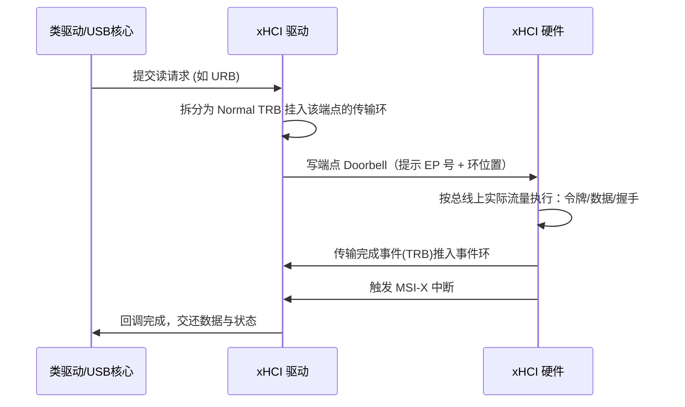
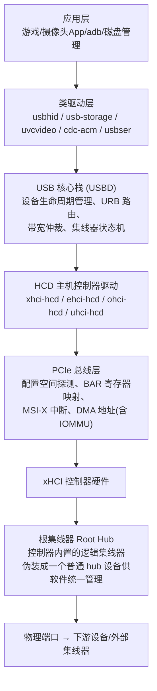

# 主机控制器栈与操作系统 USB 支持

> 层级 进阶 · 主题 `host` · 相关：[Windows USB 驱动开发：选型、WinUSB、KMDF/UMDF、调试](41-windows-driver.md)、[libusb 用户态访问、Linux Gadget/usbip、macOS 与 Linux 主机开发](42-linux-macos-libusb.md)

## 核心事实 Key Facts

> 由维护者整理并与规范核对；与下方 USBTree 原文冲突时以本节为准。

| 控制器 | 速度 | 说明 |
|---|---|---|
| UHCI（Intel）/ OHCI（Compaq/MS/NS） | LS/FS | USB 1.x |
| EHCI | HS | 需伴随控制器（UHCI/OHCI）处理 FS/LS，或内置 TT 的 rate-matching hub |
| xHCI | LS–SS+ | 所有速度一个控制器；Command Ring / Event Ring / 每端点 Transfer Ring（TRB），Doorbell 寄存器触发；Device Context / Slot |

Windows（8+）USB 3 栈：usbxhci.sys → ucx01000.sys（UCX）→ usbhub3.sys → usbccgp.sys（复合）→ 类驱动（hidusb/usbser/usbstor/uaspstor/usbvideo/usbaudio2/BthUsb）或 winusb.sys。旧 USB 2 栈：usbehci/usbport → usbhub.sys。
Linux：xhci_hcd/ehci_hcd → usbcore（hub 线程、URB）→ 接口驱动；用户态经 usbfs（/dev/bus/usb/BBB/DDD）、hidraw；抓包 usbmon。
macOS：IOUSBHostFamily（IOUSBHostDevice/IOUSBHostInterface），DriverKit USBDriverKit。

## 原文：01-主机控制器栈全景

> Source: [60-枝干-主机侧与实现/01-主机控制器栈全景.md](https://github.com/tangjianfang/USBTree/blob/main/60-枝干-主机侧与实现/01-主机控制器栈全景.md)

主机侧的一切复杂度，最终都收敛到一个芯片：**USB 主机控制器(Host Controller)**。它是 USB 规范与操作系统之间约定的"硬件契约"——每个控制器代际都对应一份公开的接口规范（HCI, Host Controller Interface），操作系统按规范写驱动，控制器厂商按规范做硬件。理解 HCI 的演进，就理解了"为什么你的电脑里有好几个 USB 控制器"这一常见现象。

### 一、主机控制器四代演进对照表

| 代际 | 接口全称 | 提倡者 | 适用速度 | 调度责任划分 | 数据结构 | 现状 |
|---|---|---|---|---|---|---|
| UHCI | 通用主机控制器接口(Universal Host Controller Interface) | Intel（联合 TS Labs） | LS/FS | **软件做调度多**：帧列表、队列头、传输描述符全部由软件排布，硬件只按帧执行 | 帧列表(Frame List) + 队列头(QH) + 传输描述符(TD) | 已淘汰，仅在旧平台/虚拟机中见到 |
| OHCI | 开放主机控制器接口(Open Host Controller Interface) | Compaq/Microsoft/National Semiconductor 等 | LS/FS | **硬件做调度多**：硬件自持周期/非周期队列，软件只需提交 ED/TD | 端点描述符(ED) + 传输描述符(TD) | 已淘汰 |
| EHCI | 增强主机控制器接口(Enhanced Host Controller Interface) | Intel 等组成的工业联盟 | **仅 HS**（高速） | 硬件执行周期(周期性)与非周期调度；FS/LS 设备被**移交**给伴随控制器 | 周期帧列表 + 异步队列；iTD/siTD/qTD | 仍存于旧平台；USB2 时代标配 |
| xHCI | 可扩展主机控制器接口(eXtensible Host Controller Interface) | Intel | **全部速度**（LS/FS/HS/SS/SSP，含 USB4 隧道的 USB3 功能） | 软件只负责"投递请求 + 敲门"，硬件自主调度执行 | TRB 环（传输环/命令环/事件环）+ 上下文结构 | 当前绝对主流 |

>  术语提示：SS(SuperSpeed) 指 5Gbps 及以上代际；SSP(SuperSpeedPlus) 指 10Gbps 及以上的链路层增强版。

#### 经典现象解释：为什么插一个 USB 1.1 设备会"跳到另一个控制器"？

在 EHCI 时代的主板上，芯片组通常同时存在 **1 个 EHCI 控制器 + N 个伴随控制器(Companion Controller, 即 UHCI/OHCI)**。EHCI 规范刻意**只定义高速信号处理**：

- 插入高速设备 → 端口路由(Route)到 EHCI；
- 插入全速/低速设备 → 复位探测(chirp 检测)发现设备不支持高速，硬件把端口**路由给伴随控制器**。

于是设备管理器里"USB 大容量存储设备"挂在 EHCI 下，而旁边的"USB 打印机"挂在 UHCI/OHCI 下——设备没变，是**端口所有权变了**。OS 看到的是物理上独立的多颗控制器。xHCI 出现后统一管理所有速度，这一现象基本消失（但同一主板往往有多个 xHCI 控制器对应不同物理口组，设备仍可能落在不同 xHCI 下）。

#### 三代规范的数据结构风格对比

| 维度 | UHCI | OHCI | EHCI | xHCI |
|---|---|---|---|---|
| 调度列表 | 帧列表指向 QH/TD 链 | 周期/完成队列由硬件自持 | 周期帧列表 + 异步队列指针 | 环 + 上下文，硬件全权执行 |
| 软件工作量大头 | 排布每帧队列、回收 TD | 主要是提交/回收 ED/TD | 维护异步 QH 与周期 iTD | 填 TRB、敲 Doorbell |
| FS/LS 支持 | 原生 | 原生 | 转交伴随控制器 | 原生（统一上下文） |
| 编程复杂度焦点 | 帧内时隙手工安排 | 硬件状态机理解 | 混合路由与拆分事务 | 上下文与环的内存布局 |

### 二、xHCI 核心概念（当前主流）

xHCI 与前三代的本质区别：**把"软件排班"改成"软件下单、硬件执行"**。所有交互通过内存中的环形队列(Ring)与寄存器敲门(Doorbell)完成。

| 概念 | 英文 | 说明 |
|---|---|---|
| TRB | Transfer Request Block | 传输请求块，**16 字节**的定长命令/数据单元，是 xHCI 的"指令原子"。主机驱动把工作拆成一串 TRB 放进环里 |
| 传输环 | Transfer Ring | 每个端点(endpoint)一个环，存放该端点的传输 TRB；环尾用链路 TRB(Link TRB) 回卷成环形缓冲 |
| 命令环 | Command Ring | 全局唯一，承载控制器级命令（使能槽位、地址设备、配置端点、停止环等） |
| 事件环 | Event Ring | 控制器向软件汇报结果的环（传输完成事件、命令完成事件、端口状态变化事件）；可配置多个、按中断向量分组 |
| Doorbell 寄存器 | Doorbell Register Array | "敲门"寄存器：软件往环里追加 TRB 后，向对应 Doorbell 写目标(端点/命令)编号，硬件才开始取指执行 |
| 设备上下文 | Device Context / Slot Context / Endpoint Context | 控制器眼中"一台设备"的数据结构：槽位上下文描述设备级信息（地址、速度、路由），每个启用的端点有端点上下文（类型、包长、环指针、错误计数）。软件在**设备上下文基地址数组(Device Context Base Address Array)** 中登记索引 |

典型一次 bulk 传输的协作流程：



要点：

- 生产者-消费者模型靠 TRB 中的**周期位(Cycle Bit)** 区分"硬件可执行"与"软件未填充"，环回卷时翻转，无需软件加锁扫描。
- 环支持**流(Streams)**（SS 端点、配合 UAS 协议实现多队列命令并发），一个 bulk 端点可挂多个传输环，用 Stream ID 区分。
- 链路 TRB 使环物理上可不连续，硬件自动跳转。

#### 2.1 常用命令 TRB 与设备槽位生命周期

xHCI 用"设备槽位(Slot)"统一管理一台设备从插入到移除的全生命周期，全程由命令环上的命令 TRB 驱动：

| 命令 TRB | 触发时机 | 作用 |
|---|---|---|
| Enable Slot | 插入事件后 | 控制器分配一个 Slot 编号 |
| Address Device | 复位完成后 | 执行 SET_ADDRESS 的硬件侧：装载输入上下文（含 Slot/EP0），分配设备地址 |
| Configure Endpoint | SET_CONFIGURATION 后 | 按配置描述符装载各端点上下文与传输环 |
| Evaluate Context | 接口/设置变更 | 让控制器重新读取更新后的上下文 |
| Reset / Stop / Set TR Dequeue | 错误恢复、清除 STALL、清队列 | 端点级运维操作 |
| Disable Slot | 拔出后 | 回收 Slot 与上下文内存 |

对应关系值得记住：**枚举流程（树干 [08-枚举流程与标准请求](07-enumeration-requests.md)）在 xHCI 下被拆解为上述命令序列**，SET_ADDRESS 这类总线事务由控制器硬件代为发出，软件只装载上下文。

#### 2.2 MMIO 寄存器资源一览

| 寄存器组 | 代表成员 | 软件用途 |
|---|---|---|
| 能力寄存器(Capability) | HCSPARAMS、HCCPARAMS | 探测端口数/槽位数、支持的特性（如 64 位寻址、大包突发） |
| 操作寄存器(Operational) | USBCMD、USBSTS、CRCR、DCBAAP | 启停控制器、读状态、设命令环指针与设备上下文数组基地址 |
| 运行时寄存器(Runtime) | MFINDEX、Interrupter 组（IMAN/IMOD/ERSTBA…） | 微帧索引、事件环表绑定、中断合流(Interrupt Moderation)配置 |
| 门铃数组(Doorbell Array) | 每槽位/每端点一个 DWORD | "投递即敲门"的唯一通知通道 |

事件环通常绑定到 **MSI-X 中断向量**，可按中断器(Interrupter)划分到不同 CPU 核（高性能网卡式调优思路）。

### 三、主机侧软件栈层次



几个值得注意的点：

- **根集线器(Root Hub)**：控制器内部实现的虚拟集线器，向 USB 核心注册成一个标准的 1 端点 0 配置 hub 设备，使"枚举集线器—报告端口状态"的逻辑可以完全复用外部集线器代码。
- **类驱动**与 USB 核心的交互单位，在 Linux 中是 URB(USB Request Block)，在 Windows 中是 URB 结构（经 WDF/USB 目标设备抽象）——叫法不同，本质都是"一次传输请求"。
- HCD 与 HCI 规范一一对应：`xhci-hcd` 实现 xHCI，`ehci-hcd` 实现 EHCI……因此内核日志里看到加载哪个 hcd 模块，就能推断控制器的代际。

### 四、帧调度与带宽资源模型

USB 不是"能发包就行"的总线，主机侧必须保证**周期性传输的确定性**。两代模型差异巨大：

| 维度 | FS/HS（UHCI/OHCI/EHCI 模型） | SS/SSP（xHCI 时代） |
|---|---|---|
| 时间基准 | 1ms 帧 + 125µs 微帧 | 125µs 服务间隔(Service Interval) |
| 带宽预留 | 软件按 **bit time** 精确预算：同步与中断传输的 `wMaxPacketSize`×倍率 在每帧中预留时隙，插入前由 USB 核心做准入检查(带宽仲裁)，失败则配置被拒 | 无全局 bit-time 预算；硬件用**突发(Burst)**+链路层**信用(Credit)**流控填充线路，端点以 `wBytesPerInterval` 声明每服务间隔需求，主机控制器据此规划 |
| 非周期流量 | 填充周期时隙之外的剩余带宽 | 与周期流量在服务间隔内动态穿插 |
| 实际效果 | 总线利用率有限（HS 常见仅 ~60-80% 可用），插多了直接报"带宽不足" | 利用率高，"带宽不足"报错大幅减少 |

副作用：主机控制器驱动在为高速同步/中断端点做调度时，需要真实可用的时隙表——这就是为什么旧系统上"第二个摄像头插不进去"是带宽仲裁拒绝，而不是线坏了。

### 五、DMA 与内存一致性注意点

主机控制器是 PCI/PCIe 总线主控(Bus Master)，直接读写系统内存，软件侧有几类经典坑：

1. **两类 DMA 缓冲**
   - 一致性/相干缓冲(Coherent DMA)：供长期驻留的结构（TRB 环、上下文数组），CPU 与硬件同时可见，驱动用 `dma_alloc_coherent`（Linux）/ 常见属性分配（Windows）；
   - 流式缓冲(Streaming DMA)：数据区，每次传输前 map、完成后 unmap。
2. **缓存一致性问题**：x86 的 DMA 是缓存一致的，ARM/嵌入式平台通常**不是**。忘记 `dma_sync_*` 会导致 CPU 写了数据但硬件读到旧缓存（或反之）——"数据对一半"类疑难杂症的头号来源。
3. **IOMMU / DMAR**：现代平台开启 IOMMU 后，设备 DMA 地址与物理地址解耦，驱动必须使用 DMA 映射 API 返回的地址，绝不能把 `virt_to_phys` 的结果交给硬件；配置错误表现为控制器超时/主控错误(Master Abort)。
4. **对齐与驻留**：xHCI 要求 TRB、环段(Segment)、上下文结构按规范对齐（TRB/环段 16 字节，上下文 32/64 字节），且**传输期间内存必须驻留(pinned)**，不可被换出或随意释放。
5. **主机内存碎裂**：USB 核心常把大请求拆分到多个物理页并生成多个 TRB（配合链路 TRB），这也是"一次 huge 读请求实际产生多次总线传输"的原因。

### 六、HCD 初始化与设备插入全流程（以 Linux xHCI 为例）

```text
系统启动/模块加载阶段:
 1. PCI 探测 → 按 class/ID 匹配 xhci-pci 驱动
 2. 映射 MMIO BAR0，读能力寄存器（端口数/槽数/页大小）
 3. 复位控制器（USBCMD.HCRST），分配命令环/事件环/DCBAA(DMA 一致性内存)
 4. 写 DCBAAP/CRCR，使能中断器(IMAN/ERSTBA)，配置 MSI-X
 5. USBCMD.RUN=1 → 根集线器注册为 usb_hcd → hub 驱动接管端口

设备插入阶段:
 6. 端口状态变化事件 → 事件环报 Port Status Change
 7. 软件读 PORTSC 确认 CCS(存在)+PED/速度位 → 复位端口 → chirp 判速度
 8. Enable Slot → Address Device → usbcore 枚举(读描述符/SET_ADDRESS 语义由硬件代发)
 9. SET_CONFIGURATION → Configure Endpoint 装载各端点上下文 → 设备可用
```

理解这条链路的价值：**任何一步卡住，报错位置就指向对应层**（事件环无报文 → 电气/PHY；Enable Slot 后失联 → 上下文装载；Configure Endpoint 报参数错误 → 描述符非法）。

### 七、常见认知校准

- HCI 规范是**公开标准**（xHCI 发布于 usb.org），任何人可据此写驱动；这也是 Windows 8 起能内置 xHCI 驱动的原因。
- xHCI 控制器在 USB4 主机中依然存在：USB4 的 USB3 隧道在主机侧仍以 xHCI 控制器形态呈现给操作系统。
- "控制器代际"与"接口颜色"没有规范绑定，蓝口不一定是 3.x、3.x 口也不一定蓝。

## 原文：02-操作系统USB支持

> Source: [60-枝干-主机侧与实现/02-操作系统USB支持.md](https://github.com/tangjianfang/USBTree/blob/main/60-枝干-主机侧与实现/02-操作系统USB支持.md)

三大桌面系统 + Android 的 USB 子系统各成体系，但都遵循同一分层骨架（见 [01-主机控制器栈全景](40-host-controller-os.md)）。本文按"当前主流做法"梳理各平台的关键组件、驱动绑定机制与工具链。

### 一、Windows

#### 1.1 驱动模型演进

| 阶段 | 栈形态 | 关键组件 | 备注 |
|---|---|---|---|
| XP~7 | WDM USB 2.0 栈 | `usbport.sys`（USB 核心）+ `usbuhci.sys`/`usbohci.sys`/`usbehci.sys` + `usbhub.sys` | 每类 HCI 一个微端口驱动，minidriver 模式 |
| 8 起 | 原生 USB 3.0 栈 | `usbxhci.sys` + **UCX(USB Host Controller Extension, `ucx01000.sys`)** + `usbhub3.sys` | UCX 是 HCI 无关的控制器扩展层，厂商控制器驱动只需对接 UCX；微软从 Win8 开始内置 xHCI 支持 |
| 10 起 | 用户态框架 WinUSB 成熟 | `winusb.sys`（内核）+ `winusb.dll`（用户态 API） | 不写内核驱动即可访问自定义设备的首选；设备侧配合 MS OS 描述符(WCID/MS OS 2.0)可免 INF 自动绑定 |
| 10 起 | USB 双角色与 Type-C 框架 | 双角色控制器栈(URS) + USB 连接器管理(UCM) + UCSI 客户端 | 面向 SoC 平台的 OTG/双角色支持；UCSI(USB Type-C Connector System Software Interface) 用于对接 EC/Retimer 中的 Type-C 管理器 |

当前主流做法：自定义设备一律走 **WinUSB（用户态）**；厂商需要自家内核功能时用 **KMDF** 写驱动；仅做配置/采集则完全不动内核。

#### 1.2 设备安装与驱动绑定规则

Windows 的 PnP 管理器按"硬件 ID(Hardware ID) → 兼容 ID(Compatible ID)"顺序匹配驱动：

- **硬件 ID** 示例：`USB\VID_1234&PID_5678&REV_0100`（设备级）、复合设备每个接口额外生成 `USB\VID_1234&PID_5678&MI_00`；
- **兼容 ID** 按接口类收窄：`USB\Class_03&SubClass_01&Prot_01` → `USB\Class_03` → `USB\`。标准类（HID/Mass Storage/打印机/Win10+ 的 CDC-ACM）由此自动命中内置驱动（`hidusb.sys`、`usbstor.sys`、`usbprint.sys`、`usbser.sys`）；
- 复合设备由 `usbccgp.sys` 按 IAD/接口拆分成多个子设备分别安装——**缺少 IAD 的 CDC 复合设备在 Windows 上常绑定失败（代码 10）**，这是设备固件问题而非系统问题；
- INF 文件的核心段：`[Manufacturer]`/`[Models]`（匹配行）+ `Install` 段（`AddReg` 指定服务、`CopyFiles` 部署文件）。Win10+ 自定义设备更推荐设备端实现 **MS OS 2.0 描述符**（BOS 中的 Platform Capability），声明 compatibleID="WINUSB"，实现**零 INF** 绑定。

#### 1.3 设备管理器错误码速查

| 代码 | 含义 | 常见原因与排查方向 |
|---|---|---|
| 10 | 此设备无法启动(CM_PROB_FAILED_START) | 驱动与设备/描述符不匹配（典型：CDC 无 IAD、接口数与 INF 不符）、固件在配置后挂起、驱动启动路径失败 |
| 28 | 未安装该设备的驱动程序 | 没有任何 INF 匹配：VID/PID 写错、兼容 ID 覆盖不到、驱动未签名导致被策略拦 |
| 43 | Windows 已停止这个设备因为它报告了问题 | 驱动报告致命错误/设备行为异常（枚举后协议级失败）；坏固件、供电不稳时常见 |
| 1 | 设备配置不正确 | INF 中配置与实际硬件不符 |
| 19 | 注册表信息损坏/冲突 | 上层/下层过滤器堆积，卸载驱动+删设备后重装 |
| 22 | 设备被禁用 | 用户或策略禁用（组策略设备安装限制的典型表现，见 [70/04](51-compliance-security.md)） |
| 45 | 设备未连接 | 幽灵设备残留，重新插拔即消 |

查看真实问题码：`设备管理器 → 属性 → 常规/事件`，或 PowerShell：`Get-PnpDevice -InstanceId "USB\VID_1234*" | Format-List Problem,FriendlyName`。

#### 1.4 WDF 写 USB 驱动要点

- **KMDF**(Kernel-Mode Driver Framework)：内核 USB 驱动的标准框架。核心对象：`WDFUSBDEVICE` / `WDFUSBINTERFACE` / `WDFUSBPIPE`；同步/异步读写在 `WDF_REQUEST_SEND_OPTIONS` 之上封装；**连续读取器(Continuous Reader)** 是中断端点的惯用法，预分配缓冲避免高频分配。
- **UMDF 2.x**(User-Mode Driver Framework)：用户态驱动，底层经 WinUSB 通道访问设备；稳定性好、崩溃不影响内核，吞吐要求不高时优先选它。
- 通用建议：中断端点走连续读取器；bulk 用队列并行深度控制背压；控制传输直接用框架的 USB Target API；调试用 WPP 追踪 + `!wdfkd` 调试器扩展。

#### 1.5 工具链

| 工具 | 用途 | 备注 |
|---|---|---|
| PnPUtil | `pnputil /enum-devices /connected`、导出/导入驱动、禁用设备 | 命令行批量管理首选 |
| USBView | 树形展示全部控制器/集线器/设备与描述符 | WDK 附带，有开源等价 GUI |
| UsbTreeView (Uwe Sieber) | USBView 增强版：显示速度、电源、能力、重枚举 | 免费单文件，实战利器 |
| Wireshark + USBPcap | 软件层抓包（Message Analyzer 已退役，官方建议改用 Wireshark 生态） | 详见 [../70-枝干-调试测试与安全/01-协议分析仪与抓包.md](50-debug-troubleshooting.md) |

### 二、Linux

#### 2.1 内核组件地图

```
usbcore (USB 核心: usb_devices、hub 事件、驱动匹配)
 ├─ 主机侧: xhci-hcd / ehci-hcd / ohci-hcd / uhci-hcd (HCD 层)
 ├─ 集线器驱动 hub.ko（kmalloc 探测、端口电源管理）
 ├─ 类驱动: usb-storage.ko / usbhid.ko / cdc-acm.ko / cdc_ether.ko / uvcvideo.ko ...
 ├─ 设备侧(gadget): libcomposite.ko + 各 function 驱动
 └─ 用户态接口: usbfs (/dev/bus/usb/BB/DD) + /sys/bus/usb
```

- **usbcore**：设备生命周期（attach/configure/detach）、URB 提交、驱动绑定、带宽仲裁。
- **usbfs**：每个设备一个节点 `/dev/bus/usb/<bus>/<dev>`，是 libusb 的后端；高吞吐场景注意 `usbfs_memory_mb` 内存上限（见 [04-libusb与用户态访问](42-linux-macos-libusb.md)）。
- **sysfs**：`/sys/bus/usb/devices/` 下的 `1-2.1` 形式节点暴露全部描述符字段（`idVendor`、`bcdDevice`、`bMaxPower`…），shell 脚本即读。

#### 2.2 udev 规则：权限与命名

```
# /etc/udev/rules.d/99-mydevice.rules
# 1) 放开串口权限并固定别名（ATTRS 逐级回溯到 USB 设备节点）
SUBSYSTEM=="tty", ATTRS{idVendor}=="1a86", ATTRS{idProduct}=="7523", \
  MODE="0666", SYMLINK+="my_serial"

# 2) 通用：让 plugdev 组可访问指定 USB 设备
SUBSYSTEM=="usb", ATTRS{idVendor}=="1234", ATTRS{idProduct}=="5678", \
  MODE="0660", GROUP="plugdev"

# 3) 禁止某设备被 sudo 之外的用户访问（安全场景，见 70/04）
SUBSYSTEM=="usb", ATTRS{idVendor}=="0781", MODE="0000"
```

操作命令：

```bash
udevadm info --attribute-walk -n /dev/ttyUSB0   # 查完整属性链，写规则的依据
sudo udevadm control --reload-rules && sudo udevadm trigger
```

匹配原则：`SUBSYSTEM` 选事件类型，`ATTRS{}`（带 S）向父设备回溯；写完用 `udevadm test` 演练。

#### 2.3 驱动绑定与解绑

```bash
# 查看当前绑定
lsusb -t                          # 树形：驱动名、速度、带宽占用
readlink /sys/bus/usb/devices/1-2/driver   # -> ../../../../../../bus/usb/drivers/usb-storage

# 手动解绑/换绑（免重插）
echo 1-2 | sudo tee /sys/bus/usb/devices/1-2/driver/unbind
echo 1-2 | sudo tee /sys/bus/usb/drivers/usbserial/bind

# 为已有驱动追加新 VID/PID（无需改代码重编译）
echo "1234 5678" | sudo tee /sys/bus/usb/drivers/usb-storage/new_id
```

#### 2.4 Gadget 栈：Linux 变身 USB 设备

设备侧（UDC 模式）当前主流用 **configfs + libcomposite** 动态构造复合设备。示例：HID 鼠标 + CDC-ACM 串口。

```bash
sudo modprobe libcomposite
cd /sys/kernel/config/usb_gadget
mkdir g1 && cd g1

echo 0x1d6b > idVendor            # Linux Foundation
echo 0x0104 > idProduct           # Multifunction Composite Gadget
echo 0x0200 > bcdUSB              # USB 2.0
mkdir -p strings/0x409
echo "Demo Corp" > strings/0x409/manufacturer
echo "HID+CDC Demo" > strings/0x409/product
mkdir -p configs/c.1/strings/0x409
echo "hid+acm" > configs/c.1/strings/0x409/configuration
echo 100 > configs/c.1/MaxPower   # 单位 2mA → 200mA

# 功能 1：HID 鼠标
mkdir functions/hid.usb0
echo 1 > functions/hid.usb0/protocol      # 1=鼠标
echo 1 > functions/hid.usb0/subclass      # 1=Boot
echo 8 > functions/hid.usb0/report_length
printf '\x05\x01\x09\x02\xa1\x01\x05\x09\x19\x01\x29\x03\x15\x00\x25\x01\x95\x03\x75\x01\x81\x02\x95\x01\x75\x05\x81\x01\x05\x01\x09\x30\x09\x31\x15\x81\x25\x7f\x75\x08\x95\x02\x81\x06\xc0\xc0' \
  > functions/hid.usb0/report_desc

# 功能 2：CDC-ACM 虚拟串口
mkdir functions/acm.usb1

ln -s functions/hid.usb0 configs/c.1/
ln -s functions/acm.usb1 configs/c.1/

UDC=$(ls /sys/class/udc | head -1)
echo "$UDC" > UDC                 # 绑定控制器，开始枚举
```

构造出来的设备在主机端即表现为"复合设备"：一个 `/dev/ttyGS0`（gadget 侧）+ 主机侧出 HID 和串口两个接口。USB/IP 与 embedded 应用大量依赖此栈。

#### 2.5 USB/IP：跨机器透传

- 内核模块 `usbip-core.ko` + 服务端 `usbip-host.ko`，用户态 `usbip` 工具；Linux 侧 `usbipd` 守护进程共享设备，远端 `usbip attach` 后设备像本地一样出现。
- **usbipd-win**：Windows 上的服务端实现，主要用于 **WSL2 的 USB 设备直通**（Windows 共享 → WSL 内 `usbip attach`），是当前最常用的跨系统透传方案。

### 三、macOS

| 层面 | 说明 |
|---|---|
| 框架 | **IOKit** 的 `IOUSBHostFamily`（IOUSBHostDevice/IOUSBHostInterface），取代旧 IOUSBFamily；驱动开发走 **DriverKit (DEXT)**，内核扩展(kext)已被逐步淘汰 |
| 描述符查看 | `system_profiler SPUSBDataType`、`ioreg -p IOUSB -l`、图形化 IORegistryExplorer（Xcode 工具） |
| 沙盒权限 | 沙盒 App 访问 USB 需 entitlement：`com.apple.security.device.usb`；配合 usage description 说明 |
| 驱动绑定 | 系统按 IOKit 匹配字典(IOProviderMergeProperties/ personalities)绑定；自定义设备可用 DriverKit 的 `USBDriverKit` 或直接由 App 经 IOKit 访问 |
| 权限弹出 | 新版 macOS 对新增 USB 设备（尤其摄像头/音频）会请求用户授权 |

### 四、Android

- **USB Host API**（自 Android 3.1）：`UsbManager` 枚举设备 → 请求权限（`requestPermission` + 广播接收）→ `UsbDeviceConnection` 上做 `controlTransfer`/`bulkTransfer`，接口粒度经 `UsbInterface`/`UsbEndpoint`。
- 声明式匹配：manifest 中 intent-filter `android.hardware.usb.action.USB_DEVICE_ATTACHED` + `res/xml/device_filter.xml`（vendor-id/product-id），插入即启动应用。
- **OTG(On-The-Go)**：手机当主机需要 A-A 转接线（OTG 线），设备侧由手机供 VBUS；USB4/Type-C 时代由 DRP 角色切换承担（见 [../30-枝干-接口与供电/](https://github.com/tangjianfang/USBTree/blob/main/30-枝干-接口与供电) 相关章节）。
- 无 root 的调试通道：adb 本身就是一个 USB 接口上的私有协议，是"USB 复用"的典型案例。

### 五、四平台能力对照

| 能力 | Windows | Linux | macOS | Android |
|---|---|---|---|---|
| 免驱动用户态访问 | WinUSB / libusb | usbfs / libusb | IOKit / libusb | UsbDeviceConnection |
| 热插拔通知 | WM_DEVICECHANGE / CFG 注册 | udev / netlink | IOKit 通知 | 广播 ACTION_USB_DEVICE_* |
| 设备侧(gadget) | 有限（WCID 之外的制造商栈少） | 完整（configfs） | 极少 | 部分设备可开 |
| 抓包 | USBPcap | usbmon | 无原生（见 70/01） | 无原生（root+内核补丁/硬件） |
