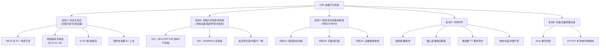
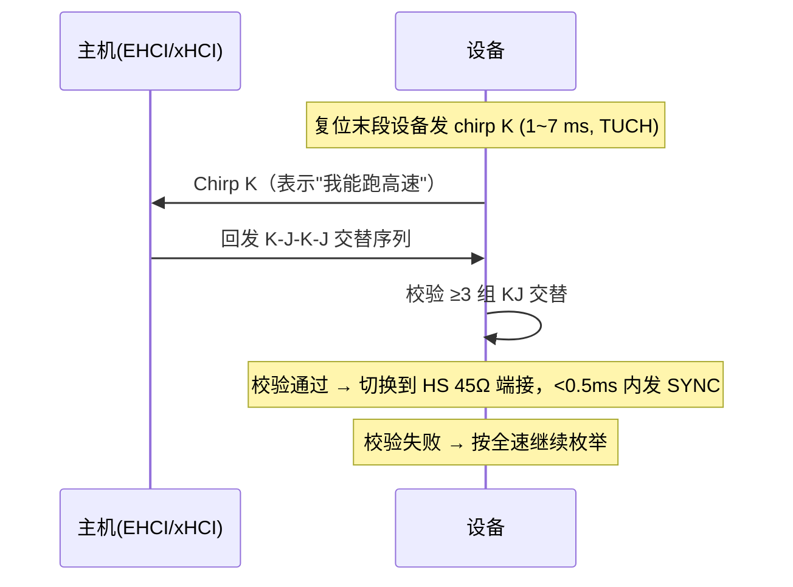

# 协议分析仪、抓包与枚举失败排查

> 层级 进阶 · 主题 `debug` · 相关：[枚举流程、Setup 包与标准请求](07-enumeration-requests.md)、[Windows USB 驱动开发：选型、WinUSB、KMDF/UMDF、调试](41-windows-driver.md)、[libusb 用户态访问、Linux Gadget/usbip、macOS 与 Linux 主机开发](42-linux-macos-libusb.md)

## 核心事实 Key Facts

> 由维护者整理并与规范核对；与下方 USBTree 原文冲突时以本节为准。

| 工具 | 层级 | 可见 | 不可见 |
|---|---|---|---|
| 硬件分析仪（Total Phase Beagle, Ellisys, Teledyne LeCroy） | 线上包 | 每个包、NAK、Chirp、SOF、时序、速度 | — |
| USBPcap（Windows）/ usbmon（Linux）+ Wireshark | URB | 请求、描述符、完成状态 | NAK 重试、物理层 |
| ETW / dmesg | 栈日志 | 枚举阶段与错误码 | 线上数据 |

症状 → 常见根因：完全无反应 → VBUS、纯充电线、上拉未使能；"设备描述符请求失败"/dmesg `device descriptor read/64, error -71` → 时钟偏差、EP0 未及时响应、bMaxPacketSize0 错；SET_ADDRESS 后失联 → 地址切换时机错；代码 43 / `config 1 has an invalid descriptor` → wTotalLength/bLength/bNumEndpoints 不一致；枚举成功无功能 → 类代码错、端点方向错、缺驱动（代码 28）；时好时坏 → 选择性挂起、供电、线材；HS 降为 FS → Chirp 失败。
Wireshark 过滤：`usb.addr == "1.5.1"`、`usb.transfer_type == 0x01`（中断）、`usb.setup.bRequest == 6`、`usbhid.setup.bRequest == 9`。

## 原文：01-协议分析仪与抓包

> Source: [70-枝干-调试测试与安全/01-协议分析仪与抓包.md](https://github.com/tangjianfang/USBTree/blob/main/70-枝干-调试测试与安全/01-协议分析仪与抓包.md)

看懂总线上到底发生了什么，是 USB 调试的"取证"环节。观察手段分三个层次，成本与信息量递增——**先软件后硬件**是纪律：绝大多数枚举/驱动问题软件抓包就能定位。

### 一、三个观察层次

| 层次 | 手段 | 能看到 | 看不到 | 成本 |
|---|---|---|---|---|
| 软件层抓包 | usbmon / USBPcap | 主机侧事务序列、描述符、URB 状态、数据载荷 | 电气层、真实的 NAK/重试细节（部分被驱动聚合）、总线物理异常 | 0 元 |
| 逻辑分析仪 | Saleae 等，探 D+/D- | 电平、速率、极性、chirp/复位波形、粗粒度包 | 无法完整解码高速流、无协议语义标注 | 数百~数千元 |
| 专业协议分析仪 | Beagle/Ellisys/LeCroy 等 | 全速率硬件解码、全部握手重试、性能统计、触发/过滤 | —— | 数千~数十万元 |

### 二、Linux：usbmon

```bash
# 1) 加载与挂载
sudo modprobe usbmon
ls /sys/kernel/debug          # 需要 debugfs；未挂载时:
# sudo mount -t debugfs none /sys/kernel/debug

# 2) usbmon 设备节点：/dev/usbmonN 对应总线 N（usbmon0 表示全部总线）
ls /dev/usbmon*

# 3) Wireshark 图形抓取：刷新接口列表即可看到 usbmon1、usbmon2...
sudo wireshark                 # 或给用户 dialout/usbmon 组权限免 sudo
```

命令行等价：

```bash
sudo tshark -i usbmon1 -w capture.pcapng
sudo cat /dev/usbmon1 | xxd        # 最原始的二进制流（应急用）
```

**常用 Wireshark 显示过滤器：**

| 过滤器 | 含义 |
|---|---|
| `usb.transfer_type == 0x01` | 中断传输（0x00 同步 / 0x01 中断 / 0x02 控制 / 0x03 批量） |
| `usb.transfer_type == 0x03` | bulk 传输 |
| `usb.src == 1.5.1` | 来源=总线1 设备5 端点1（host 表示为 `host`） |
| `usb.dst == host` | 发往主机的方向 |
| `usb.setup.bRequest == 0x06` | 只看 GET_DESCRIPTOR |
| `usb.descriptor_type == 0x02` | 配置描述符相关 |
| `usb.capdata` | 含原始数据载荷的包（右键 → 复制字节流可导出数据） |
| `usb.bDescriptorType` | 描述符类型过滤 |

>  usbmon 看到的是 **URB 级事件**（submit / complete 两条记录），不是线级原始包——NAK 与重试通常被驱动聚合，需要线级细节时用硬件分析仪。

一条 usbmon 记录的关键字段（Wireshark 中对应列/字段）：

| 字段 | 含义 | 分析价值 |
|---|---|---|
| Urb id | URB 唯一编号 | 配对 submit 与 complete，算往返延迟 |
| Urb type | `S`=submit，`C`=complete | 成对出现；只有 S 没 C = 传输挂死 |
| Endpoint | 端点号+方向 | 区分 IN/OUT/控制 |
| Transfer | 传输类型 | 对应过滤 usb.transfer_type |
| Setup / Data | 控制请求参数 / 载荷字节 | 描述符解析、协议还原 |
| Urb status | 完成状态（0=成功，-EPIPE=STALL 等） | 直接定位错误类别 |
| Data Fragment | 载荷（受 snaplen 限制） | 需要完整载荷时加大抓包快照长度 |

#### 带注释的枚举片段（tshark 视角）

```text
# sudo tshark -i usbmon1 -Y "usb.src==\"host\" || usb.dst==\"host\""
No. Time   Source      Info
1   0.000  host        GET DESCRIPTOR Device LEN=64        ← 复位后第一请求
2   0.001  1.12.0      GET DESCRIPTOR Resp DEVICE (18B)    ← 注意只回了18B属正常
3   0.010  host        SET ADDRESS __ 7                    ← 分配地址 7
4   0.012  host        GET DESCRIPTOR Device LEN=18        ← 用新地址重取
5   0.015  host        GET DESCRIPTOR STRING 0             ← 语言ID
6   0.020  host        GET DESCRIPTOR CONFIGURATION LEN=9  ← 先要9字节拿总长
7   0.022  host        GET DESCRIPTOR CONFIGURATION LEN=71 ← 按wTotalLength取全
8   0.030  host        SET CONFIGURATION 1                 ← 上线
```

时间列是性能分析的核心：相邻请求间隔异常拉长（>100ms）多为设备端处理慢或超时重试。

### 三、Windows：USBPcap

1. 安装 [USBPcap](https://desowin.org/usbpcap/)（含 Wireshark 插件），**安装后重启 Wireshark**；
2. Wireshark 接口列表出现 `USBPcap1`（每个根控制器一个）；
3. 选中接口 → 开始捕获。可先运行 `USBPcapCMD` 查看设备树并选只捕获某端口；
4. 过滤器与 Linux 相同（pcapng 格式一致，两边抓包可互换分析）。

要点：USBPcap 挂在栈中，捕获点在主机驱动之上，同样属于"软件层"；系统级复合设备的子接口流量都会呈现。

### 四、macOS：现实可行的方案

macOS **没有原生的用户空间 USB 抓包机制**：旧版 Xcode 附带的 USB Prober 已被弃用移除；Apple 的 PacketLogger 面向蓝牙(BT/LE HCI)，对 USB 无效。实际可行做法按优先级：

1. **硬件分析仪**（最可靠，见下文梯队）；
2. **usbip 透传到 Linux**：macOS 端用支持方案（或换一台 Linux 主机）接入设备，`usbmon` 抓取——语义一致，适合调试协议层；
3. **间接观察**：`system_profiler SPUSBDataType` / `ioreg -p IOUSB -l` 查看枚举结果与描述符；libusb 逐请求探测（见 [../60-枝干-主机侧与实现/04-libusb与用户态访问.md](42-linux-macos-libusb.md)）；
4. macOS 侧问题最后再用 Linux 复现对比：很多"macOS 不识别"实际是描述符/能力声明不合规被严格校验。

### 五、读 trace 方法论

拿到 pcap 后按此顺序分析：

#### 5.1 先看枚举段

对照标准序列（[../10-树干-USB核心/08-枚举流程与标准请求.md](07-enumeration-requests.md)）：复位 → `GET_DESCRIPTOR(Device, 8B)` → 复位 → `SET_ADDRESS` → `GET_DESCRIPTOR(Device, 18B)` → 读字符串/配置 → `SET_CONFIGURATION`。常见异常模式：

| 异常 | 典型含义 |
|---|---|
| 8 字节 GET_DESCRIPTOR 无响应/超时 | EP0 未就绪、时钟漂移、上拉过早（设备端时序） |
| SET_ADDRESS 后请求仍发旧地址/无响应 | 设备地址生效时机 bug |
| GET_DESCRIPTOR(CONFIG) 返回长度 ≠ wTotalLength | 描述符组装 bug |
| 配置请求直接 STALL | bConfigurationValue/接口号越界，或固件未实现 |

#### 5.2 识别 STALL 与 NAK 风暴

- **STALL**：功能性错误/请求不支持。偶发于字符串描述符（iIndex=0）属正常；GET_DESCRIPTOR 被 Stall 则是固件 bug。
- **NAK 风暴**：成千上万 NAK 表示设备"活着但不干活"——固件没武装端点缓冲（OUT）或没数据可发（IN）。软件层表现为 URB 长时间不完成。
- 软件层抓包中 NAK 可能不可见（被聚合）：URB 迟迟 complete + 无数据，等价信号。

#### 5.3 toggle 错乱

bulk/中断的 DATA0/1 交替若错位（固件重启但主机没复位端点、或设备丢包后状态机跳变），表现为：设备发的数据被主机静默丢弃、数据"缺一段"。特征：payload 数据包 PID 序列不交替（DATA0,DATA0 / DATA1,DATA1）。

#### 5.4 bInterval 实测

端点声明 `bInterval=1ms`，trace 中给该中断端点打时间戳直方图：实际交付间隔若 >1ms，说明设备端缓冲供应不上（见 [../60-枝干-主机侧与实现/03-设备端固件栈.md](43-device-firmware.md) 双缓冲一节）；若 < 声明值属允许（早于承诺不算违规但注意功耗）。

### 六、硬件工具梯队

| 梯队 | 代表工具 | 覆盖 | 适用 |
|---|---|---|---|
| 入门：逻辑分析仪 | Saleae Logic 8/Pro、数十元 24MHz 8 通道 | D+/D- 模拟电平、FS/LS 速率判别、chirp/复位/挂起波形 | 看电气健康度：极性、幅度、速率；不能完整解码 |
| 中端：FS/HS 协议分析仪 | Total Phase **Beagle USB 12**（LS/FS）、**Beagle USB 480**（HS） | 实时解码+数据记录，可当数据logger | 单板/产品级调试主力 |
| 企业级 | **Ellisys** Visual USB 系列 / USB Tracker 110、Teledyne LeCroy Advisor/ VNA 系列 | 全速~SuperSpeedPlus 全解析、多总线同步、深度触发、协议专家系统 | 复杂互操作、认证预扫、性能调优 |
| 开源 | **OpenVizsla**（FPGA） | FS/HS 硬件捕获 | 预算有限的协议研究 |
| Type-C/PD | Total Phase USB PD 分析仪、GRL 等专用工具 | CC 线上 PD 报文（BMC 解码）、VBUS 电流曲线 | 供电协商问题（见 [../30-枝干-接口与供电/](https://github.com/tangjianfang/USBTree/blob/main/30-枝干-接口与供电)） |

选型建议：软件抓包解决不了的（电气/时序），先逻辑分析仪看波形，再决定要不要上协议分析仪——多数团队一台 Beagle 480 级别即可覆盖 90% 场景。

#### 数据导出与后处理

```bash
# 只导出控制传输文本（报告附录用）
tshark -r capture.pcapng -Y "usb.transfer_type==0x02" -V > ctrl_only.txt

# 导出某个批量端点的全部载荷（hex）
tshark -r capture.pcapng -Y "usb.src==\"1.12.1\"" -T fields -e usb.capdata

# 统计中断端点实际交付间隔（验 bInterval）
tshark -r capture.pcapng -Y "usb.src==\"1.12.2\"" -T fields -e frame.time_relative
```

pcapng 是跨工具通用格式：Linux usbmon 与 Windows USBPcap 抓的文件可互换分析，团队协作时统一格式能省大量沟通成本。

### 七、抓包注意事项

- **集线器影响**：经 hub 抓/测会引入 TT 转发延迟与信号劣化，测时序或电气时应直插主机；hub 也可能掩盖/改变 NAK 与 split 行为。
- **USB 3.x 抓包澄清**：SS/SSP 链路上的数据是**明文**（规范未加密），理论可解；但 5~20Gbps 的速率、链路训练(LTSSM)与转发器抖动使捕获需要专用高速采样硬件，因此 SS 分析仪价格高企，软件抓包（USBPcap/usbmon 对 xHCI 同样有效）仍是首选起点。
- **urb 级 ≠ 线级**：软件抓包有 submit/complete 两个视角，统计延迟时注意区分；线级包间隔只能靠硬件。
- **数据隐私**：HID 键击、MSC 数据、摄像头帧都会原样进 pcap——分享日志前务必清洗载荷（或只保留头部字段）。
- **抓包本身改变行为**：USBPcap/usbmon 引入额外延迟，可能让临界时序 bug 消失或恶化（海森堡式），重要结论用硬件复测。

## 原文：02-枚举失败排查手册

> Source: [70-枝干-调试测试与安全/02-枚举失败排查手册.md](https://github.com/tangjianfang/USBTree/blob/main/70-枝干-调试测试与安全/02-枚举失败排查手册.md)

枚举是设备上线的第一关，也是固件/硬件问题的集中暴露区。本手册按**症状 → 故障树 → 验证手段**组织，配合抓包（见 [01-协议分析仪与抓包](50-debug-troubleshooting.md)）使用。

### 一、总故障树



### 二、症状 A：完全无反应

主机端毫无感知（无插入提示音、无任何新设备）。这是**物理层/供电层**问题，协议还没开始。

| 检查点 | 方法 | 判定 |
|---|---|---|
| VBUS 有无 5V | 万用表测设备端 VBUS-GND | <4.4V 视为异常；无电压查主机口/线缆 |
| 电流预算 | 主机口标称 500mA(FS)/900mA(HS)；键盘类应 <100mA | 设备需求 > 口供电能力 → 上电即掉 |
| 线缆类型 | 换一根**确定带数据芯**的线；万用表通断测 D+/D- | 市售大量"充电线"只有 2 芯 |
| D+/D- 接反/断线 | 万用表从 A 口到 B 口逐芯通断；示波器看差分幅度 | FS 设备插入后 D+ 应被拉高 ~3.3V（D- 拉高 = LS） |
| 固件上拉 | 重烧固件，确认 pull-up 使能代码在初始化序列末尾 | 无上拉主机永远不会检测到插入 |

>  快速二分：把设备插到**另一台电脑/另一个口**。两边都无反应 → 设备/线缆问题；一边有 → 主机口/系统问题。

### 三、症状 B：有插入声但枚举失败

主机检测到了插入（说明 VBUS 与上拉正常），但配置未完成。**按枚举阶段切分定位**：

#### 3.1 第一段：GET_DESCRIPTOR 前 8 字节失败

主机复位设备后第一件事是 `GET_DESCRIPTOR(Device, wLength=8 或 64)`，取回设备描述符前 8 字节以得知 `bMaxPacketSize0`。

| 可能原因 | 机理 | 验证 |
|---|---|---|
| **EP0 max packet 配置错误** | 固件以 8/16/32 应答但按 64 打包，或反之 → 主机等待字节数不匹配 | usbmon 看该事务 DATA 长度；对照 bMaxPacketSize0 |
| **时钟不准（HSI 偏差）** | USB 数据速率容差约 ±0.25%，内部 RC 振荡器（如 STM32 HSI 出厂 ±1%）超差 → CRC/位填充错 → 主机静默丢包重试至超时 | 换 HSE 晶振或启用 CRS 时钟恢复；示波器测帧间隔是否为 1.000ms± |
| CRC / 位填充错误 | 信号质量差（线劣化、布局干扰）→ 主机收包即弃 | 抓包只见重发同令牌；换短线直插验证 |
| 固件未武装 EP0 | setup 中断路径太慢或描述符缓存未就绪 | 抓包：设备只 NAK 无 DATA；见 [../60-枝干-主机侧与实现/03-设备端固件栈.md](43-device-firmware.md) 时序节 |

#### 3.2 第二段：SET_ADDRESS 后失联

`SET_ADDRESS` 的地址必须在 **status 阶段完成后**生效。自研/魔改协议栈常见 bug：在 data 或 status 期间就切换地址 → 主机用新地址发请求时设备还在监听 0（或已切新地址却按 0 应答）→ 后续所有请求超时，Windows 报"未知设备"。

验证：抓包看 `SET_ADDRESS` 之后的 GET_DESCRIPTOR 用的是哪个地址、有无应答。硬件 IP（STM32/CH32 内置 IP、TinyUSB）已按规范处理，此坑主要出现在裸栈移植。

#### 3.3 第三段：描述符返回不一致

| 症状 | 常见根因 |
|---|---|
| `GET_DESCRIPTOR(CONFIG)` 实际返回长度 < 请求值且 < `wTotalLength` | 固件按单块发送，未实现"分次取完"（wTotalLength > EP0 包长时主机多次请求拼接） |
| 返回长度 ≠ `wTotalLength` | 描述符数组改了长度没改 wTotalLength 常量 |
| `bLength` 与实体不符 | 手工增删描述符后首字节忘改 → 主机解析错位，后续描述符全乱 |
| `bNumEndpoints` ≠ 端点描述符数量 | 同上，接口内数量不符 → 驱动绑定失败 |
| 复合设备 CDC 无 IAD | Windows `usbccgp.sys` 无法拆分 → 代码 10（见 3.4） |

### 四、症状 C：Windows 代码 10 / 28 / 43 逐条路径

| 代码 | 本质 | 排查路径 |
|---|---|---|
| **10** 无法启动 | 驱动找到了、加载了，但启动失败 | ① CDC 复合设备 → 查 IAD 与 bDeviceClass=0xEF/0x02/0x01；② INF 接口数/类码与描述符不一致；③ 用 UsbTreeView 比对描述符与 INF 声明；④ 换 WinUSB(用户态)验证硬件本身没问题 |
| **28** 无驱动 | 没有任何 INF 匹配 VID/PID 或兼容 ID | ① `pnputil /enum-devices` 看硬件 ID 是否符合预期（VID/PID 写错常见）；② 自定义设备 → 装 WinUSB（设备端 WCID/Zadig，见 [../60-枝干-主机侧与实现/04-libusb与用户态访问.md](42-linux-macos-libusb.md)）；③ 检查组策略是否拦截安装 |
| **43** 报告故障 | 驱动报告致命错误（常在配置/初始化阶段协议级失败） | ① 抓包看 SET_CONFIGURATION 之后主机还有什么请求、设备如何答；② 常见：类请求（如 HID SET_REPORT、CDC SET_LINE_CODING）未实现被 STALL；③ 供电不稳导致配置后掉线重连循环 |

> Linux 侧对应物：`dmesg` 中 `usb 1-2: device descriptor read/64, error -71` 类消息；错误码 -71(协议错误)、-110(超时)、-32(管道断，STALL/断开) 覆盖同样问题。

### 五、症状 D：时好时坏

最难缠的一类，按概率排序：

1. **线缆质量/阻抗**：长线、廉价线、接头氧化 → 眼图余量不足，温度/姿态变化触发误码。换原装短线验证是第一步。
2. **插入浪涌**：设备输入电容大 → 插入瞬间 VBUS 跌落 → 主机口或设备自身掉电复位 → "时好时坏"。示波器触发在插入瞬间测 VBUS 跌落深度（>0.5V 量级即可疑）；设备侧加 inrush 限流/缓启动。
3. **集线器 TT 事务耗尽**：多个全速设备挂同一高速 hub 的单 TT(Transaction Translator) 下，周期+批量事务排队超限 → 偶发丢包/延迟超标。换多 TT hub 或分散端口。
4. **地电位差**：两台设备各自接不同电源地，地间电位差在 GND 线上形成电流 → 信号共模漂移。特征：跨机器连接时坏、隔离后好。用隔离器/光耦方案验证。

### 六、症状 E：高速设备回落全速

HS 设备枚举成 "Full Speed"（Windows 设备管理器/UsbTreeView 直接显示速度）。HS 检测靠 **chirp 握手**：



| 回落原因 | 验证手段 |
|---|---|
| chirp 幅度/时长不达标（PHY 供电低、时钟不准） | 示波器看复位末段 D+ 有无 1~7 ms 的 K 电平（Chirp），随后主机 KJ 交替（每拍 40~60 µs） |
| 主机口本身是 FS-only（老 UHCI/OHCI、劣质 hub、充电口） | 换确认 HS 的主机口直插 |
| **HS PHY 未供电/时钟缺失**：OTG_HS 内置 PHY 只能 FS；外接 ULPI PHY 缺 60MHz 时钟 → 静默回落 | 查 PHY 电源与时钟、ULPI 寄存器读回 |
| EMI/长走线使高速眼图闭合 | 眼图测试（认证级）或缩短走线 |

注意：回落全速**不是错误**，功能仍可用；只有带宽敏感场景（摄像头、U 盘速度）才暴露。

### 七、工具对照表

| 症状/疑点 | 首选工具 | 备选 |
|---|---|---|
| VBUS/通断 | 万用表 | 带电流显示的充电头 |
| D+/D- 波形、chirp、幅度 | 示波器（≥20MHz 带宽） | 逻辑分析仪（FS/LS 波形） |
| 枚举序列、描述符内容 | usbmon/USBPcap + Wireshark | lsusb -v / UsbTreeView（结果侧） |
| 线级重试/NAK/toggle | 硬件协议分析仪（Beagle 480 级） | —— |
| 驱动层状态 | dmesg / 设备管理器事件 / PnPUtil | USBView 树 |
| 温度/姿态相关 | 接触良好夹具 + 恒温箱 | 按压线缆复现 |

### 八、printf 调试法（固件侧）

没有分析仪时的最后武器：在 EP0 处理函数中打日志。

```c
void ep0_setup_handler(const usb_setup_t *s) {
    printf("[EP0] bm=%02x bReq=%02x wVal=%04x wIdx=%04x wLen=%u\r\n",
           s->bmRequestType, s->bRequest,
           s->wValue, s->wIndex, s->wLength);
    /* 典型正常序列（2.0）：
       [EP0] bm=80 bReq=06 wVal=0100 wIdx=0000 wLen=64   GET_DESC DEVICE
       [EP0] bm=00 bReq=05 wVal=0007 wIdx=0000 wLen=0    SET_ADDRESS 7
       [EP0] bm=80 bReq=06 wVal=0100 wIdx=0000 wLen=18   GET_DESC DEVICE
       [EP0] bm=80 bReq=06 wVal=0200 wIdx=0000 wLen=255  GET_DESC CONFIG
       [EP0] bm=80 bReq=06 wVal=0300 wIdx=0000 wLen=255  GET_DESC STRING 0
       [EP0] bm=00 bReq=09 wVal=0001 wIdx=0000 wLen=0    SET_CONFIG 1     */
}
```

日志与实际抓包对照，第一处"少了一步/多了一步"就是断点。注意 printf 目的地不能与调试中的 USB 口相同（用 UART/SWO/半主机调试）。

### 九、修复清单 Checklist

- [ ] VBUS 实测 4.75~5.25V，设备峰值电流 ≤ 口供电能力
- [ ] 数据线确认带 D+/D-（通断测量）
- [ ] FS/LS 时钟源满足 ±0.25% 容差（晶振或 CRS，勿裸用 HSI）
- [ ] 上拉使能在 EP0/描述符就绪之后
- [ ] `bLength`/`wTotalLength`/`bNumEndpoints` 与实体一致（脚本自动校验）
- [ ] 复合设备：IAD 存在、bDeviceClass=0xEF/0x02/0x01
- [ ] SET_ADDRESS 在 status 后生效
- [ ] 所有被驱动会使用的类请求（GET_REPORT/SET_LINE_CODING…）有实现，不支持的按规范 STALL
- [ ] 描述符长度恰为 MPS 整数倍的接口考虑 ZLP 语义
- [ ] HS 设备：PHY 供电/时钟确认，逻辑分析仪确认 chirp 握手成功
