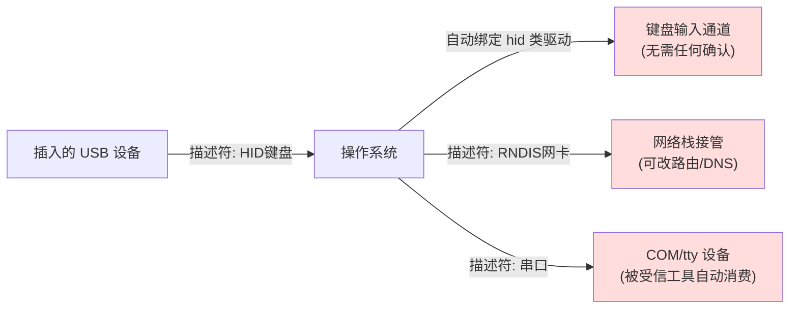
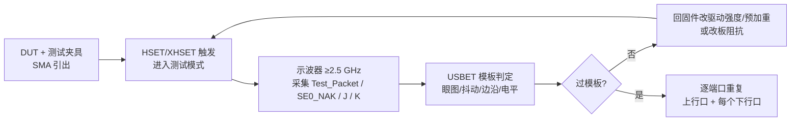

# USB-IF 合规认证、合规测试实操与 USB 安全

> 层级 深入 · 主题 `compliance/security` · 相关：[错误处理、可靠性、Test Mode 与调试模式](09-errors-testmode.md)、[协议分析仪、抓包与枚举失败排查](50-debug-troubleshooting.md)

## 核心事实 Key Facts

> 由维护者整理并与规范核对；与下方 USBTree 原文冲突时以本节为准。

- USBCV（USB Command Verifier）：Chapter 9 测试、HID 测试、MSC 测试、Hub 测试；Logo 需 VID（USB-IF 会员或单独购买）与 TID。
- 安全威胁：设备可伪装任意类（HID 注入、BadUSB 固件重编程）；防御：Linux USBGuard 白名单、Windows 组策略"设备安装限制"（按设备 ID/类 GUID）、macOS 配件授权、物理端口管控。

## 原文：03-USB-IF合规认证

> Source: [70-枝干-调试测试与安全/03-USB-IF合规认证.md](https://github.com/tangjianfang/USBTree/blob/main/70-枝干-调试测试与安全/03-USB-IF合规认证.md)

合规认证回答两个问题：**你的设备是否真的按规范工作**（互操作性与安全性），以及**你能否合法使用 USB 商标/Logo**。对开发者而言，更重要的是把认证背后的测试项内化为自查手段。

### 一、USB-IF 与合规程序

**USB-IF（USB Implementers Forum）** 是 USB 规范的制定与商标管理机构（由 USB 创始厂商组成的非营利组织）。其**合规程序(Compliance Program)** 覆盖三个独立维度：

| 维度 | 对象 | 典型测试载体 |
|---|---|---|
| 设备/主机认证 | U 盘、手机、主机控制器芯片… | 电气 + 协议 + 互操作三关 |
| 线缆/连接器认证 | C-to-C 线、充电线、eMarker 芯片 | 电气 + 机械 + eMarker 数据（需提交 VIF 获得 TID） |
| 供电认证 | PD 充电器/受电设备 | PD 协议 + 电源质量（见 [../30-枝干-接口与供电/](https://github.com/tangjianfang/USBTree/blob/main/30-枝干-接口与供电)） |

### 二、测试项目全景

#### 2.1 电气测试（Electrical Tests）

- **信号完整性眼图(Eye Diagram)**：按速度档在测试模式（test_J/K、test_Packet）下采样眼图，判定抖动、幅度、上升/下降时间是否落在模板内。HS 要求 480Mbps 眼图闭合判定；SS/SSP/USB4 有更严格的信道插损与回损指标。
- **上升/下降时间(Rise/Fall Time)**：驱动器边沿速率超标是互操作杀手（辐射 + 反射）。
- **浪涌电流(Inrush)**：插入瞬间对 100µF 等效负载的充电冲击限值，防止拖垮主机口（对应排障手册症状 D，见 [02-枚举失败排查手册](50-debug-troubleshooting.md)）。
- **VBUS 电压跌落/纹波、Drop/Droop**：满载与突发负载下的电压保持能力。
- Type-C 附加项：**CC 终端(Rp/Rd) 检测**、VBUS 通路电阻、eMarker 通信（SOP' 包）等。

#### 2.2 协议测试（Chapter 9 Tests）

以规范第 9 章（设备框架）命名的协议合规测试，官方工具为 **USB Command Verifier (USBCV)**：

- 描述符合法性：各描述符字段取值域、长度自洽性、`bcdUSB` 与实际能力匹配；
- 标准请求响应：11 个标准请求的状态码、STALL 语义、非法请求必须 STALL 而非挂死；
- **挂起电流**：未配置挂起 ≤0.5mA、配置后挂起 ≤2.5mA；
- 恢复/远程唤醒行为、地址生效时机；
- 端点响应时序（NAK 限速、状态阶段时序）。

> USBCV 主要覆盖 2.0 系；3.x/USB4 的协议与链路层测试由授权实验室用专用设备执行。

#### 2.3 互操作测试（Interop / PlugFest）

- **PlugFest**：USB-IF 定期举办的厂商互测活动，把自家设备与数十家厂商的主机/集线器交叉插拔；
- 覆盖典型组合矩阵：不同速度、经集线器、挂起唤醒、热插拔疲劳、多设备并发；
- 这是认证中"实验室测不出、用户用得出"问题的过滤器。

#### 2.4 3.x / USB4 增项

- **链路训练测试**：LFPS 握手、LTSSM 状态机全路径、均衡(FFE/CTLE)协商；
- **隧道测试(Tunneling)**：USB4 路由器对 PCIe / DisplayPort 隧道的正确封装与带宽仲裁，及 Thunderbolt 3 兼容行为；
- 速率协商矩阵（5/10/20/40/80Gbps 各档回退兼容）。

### 三、Logo 授权体系

#### 3.1 速率标识

认证通过 + 签署商标协议后方可使用认证标识。**2019 年起现行命名体系以能力命名，废弃了 3.0/3.1/3.2 消费者传播名**：

| 认证标识 | 对应规范速率 | 旧称（对照） |
|---|---|---|
| USB 5Gbps | 5Gbps | USB 3.0 / 3.1 Gen1 / 3.2 Gen1 (SuperSpeed) |
| USB 10Gbps | 10Gbps | USB 3.1 Gen2 / 3.2 Gen2 (SuperSpeed+) |
| USB 20Gbps | 20Gbps | USB 3.2 Gen2x2 |
| USB 40Gbps | 40Gbps | USB4 Gen 3x2 |
| USB 80Gbps | 80Gbps（非对称） | USB4 v2 |

| 功率标识 | 含义 |
|---|---|
| USB Certified Power 60W | 20V/3A（标准功率档 SPR） |
| USB Certified Power 100W | 20V/5A（SPR 上限） |
| USB Certified Power 240W | 48V/5A（EPR 档） |

线缆标签要求同时标注**带宽 + 功率**（如 "USB 10Gbps · 240W"），5Gbps 及以上线缆强制 eMarker。

Logo 使用基本规则（概述）：

- 未通过认证/未签协议**不得**在产品、包装、宣传上使用 USB 商标与认证标识（可以用规范名描述接口，如 "USB 2.0 接口" 属于技术性描述，具体边界以商标协议为准）；
- 认证按**产品型号**列名，改板/改描述符后需重新评估；
- 线缆与连接器领域的执法最严格（假冒标识高发区）。

#### 3.2 参与 USB-IF 的两级方式

| 方式 | 义务 | 能做什么 |
|---|---|---|
| Adopters Agreement（采纳者协议，免费） | 承诺遵守规范、不得以规范主张专利壁垒 | 参加合规测试；通过后在 Integrator's List 列名；Logo 使用需按协议执行 |
| 正式会员（年费） | 缴纳年费、参与工作组 | 参与规范制定、提前获取草案、投票；合规程序全权限 |

小型团队常见路径：先以 Adopters 身份做产品认证，需要影响规范时再升级会员。

### 四、WHQL 与 Windows 硬件兼容

- **WHQL（Windows Hardware Quality Labs）**，现称 **Windows 硬件兼容性计划**：微软的兼容性认证，跑 HLK（Hardware Lab Kit）用例；
- 与 USB-IF 认证**相互独立**：拿 USB-IF 徽标不等于过 WHQL，反之亦然；但 HLK 的 USB 用例与 USB-IF 测试方法高度同源（协议/互操作思想一致），先过 USB-IF 自查会显著降低 HLK 返工；
- 实务关系：需要打"兼容 Windows"徽标 → 走 WHQL；需要打 USB Logo → 走 USB-IF；两者常在同一次送测中规划。

### 五、认证流程与费用概貌

> 以下为量级概貌，具体金额以 USB-IF 官网现行公告为准。

1. **成为成员/采纳者**：USB-IF 年费会员（数千美元/年量级）或签署 Adopters Agreement（免费级别但限制 Logo 使用）；
2. **准备 VIF**：Vendor Information File，设备/线缆的标准化描述文件，认证申请与产品数据库登记的基础（线缆类**必须**提交 VIF 获得 TID）；
3. **送测**：USB-IF 授权实验室（Authorized Independent Test Labs，全球若干家）执行电气+协议+互操作，费用按测试组合计，数千至数万美元量级；
4. **拿报告 → 列名**：测试通过后在 USB-IF Integrator's List 列名，凭此使用 Logo。

### 六、开发者的务实自查（不送认证）

| 工具 | 能测什么 | 平台 |
|---|---|---|
| **USBCV（USB Command Verifier）** | Chapter 9 全套协议测试：描述符合法性、标准请求、挂起电流、枚举状态机 | Windows（需特定环境运行） |
| **USBHSET** | 高速电气测试辅助：令设备进入 test_J/K/test_Packet 等测试模式，配合示波器做眼图 | Windows |
| xHCI/EHCI 内建测试模式 | 主机侧测试模式发生（供线路测量） | 固件/驱动入口 |
| 抓包 + 脚本校验 | 描述符自洽性自动检查（bLength 链、wTotalLength、取值域） | 任意 |

自查优先级：协议（USBCV）→ 挂起电流（实测）→ 互操作（尽可能多的主机/hub 矩阵插拔）→ 电气（有条件再测眼图）。

描述符自洽性可以完全脚本化（USBCV 之外的低成本防线）：

```python
# desc_check.py —— 描述符结构自检骨架（读 /sys 下原始描述符或抓包提取均可）
def check_cfg(buf: bytes):
    total = int.from_bytes(buf[2:4], "little")      # wTotalLength
    assert total == len(buf), f"wTotalLength={total} != 实际 {len(buf)}"
    i, n_if = 9, buf[4]                              # 跳过配置描述符
    seen_if = 0
    while i < len(buf):
        ln, typ = buf[i], buf[i+1]
        assert ln >= 2, f"非法 bLength={ln} @ {i}"   # bLength 必须自洽
        if typ == 0x04:                              # 接口描述符
            n_ep = buf[i + 4]
            seen_if += 1
            eps = 0
            i += ln
            while i < len(buf) and buf[i+1] == 0x05: # 数本接口的端点
                eps += 1; i += buf[i]
            assert eps == n_ep, f"接口{seen_if-1}: bNumEndpoints={n_ep} 实际{eps}"
            continue
        i += ln
    assert seen_if == n_if, f"bNumInterfaces={n_if} 实际 {seen_if}"
    print("描述符结构自检通过")
```

把该检查接入 CI：每次固件构建自动校验描述符二进制，可在"换台电脑就翻车"之前拦截大半低级错误。

### 七、常见不合规点清单（来自实战高频）

| 问题 | 后果 |
|---|---|
| **bMaxPower 忘乘 2**：填 500 想表示 500mA | 实际申请 1000mA 超规格；或反过来填 50 实际只有 100mA 导致外设带不动 |
| **字符串索引悬空**：iProduct=3 但只提供 1 个字符串 | 主机请求失败/显示异常；USBCV 直接判不合规 |
| **挂起电流超标**：挂起后 LED 还亮 | >2.5mA 判 FAIL；节能认证连带不过 |
| **bcdUSB 与能力不符**：设备只能 FS 却写 0x0300 | 主机按 3.x 期望测试 → 行为不一致；另 BOS 缺失被 3.x 主机视为遗留设备 |
| 描述符长度不自洽（bLength/wTotalLength） | 部分主机宽容、部分严格 → "这家电脑能用那家不能" |
| 复合设备无 IAD 且类码不为 0xEF/0x02/0x01 | Windows usbccgp 拆分失败 → 代码 10 |
| 非法请求返回超时而非 STALL | 状态机卡死，互操作测试失败 |
| SET_ADDRESS 前使用地址/时机错误 | 间歇性枚举失败（见 [02-枚举失败排查手册](50-debug-troubleshooting.md)） |

## 原文：04-USB安全与BadUSB

> Source: [70-枝干-调试测试与安全/04-USB安全与BadUSB.md](https://github.com/tangjianfang/USBTree/blob/main/70-枝干-调试测试与安全/04-USB安全与BadUSB.md)

USB 的安全模型建立在一个假设上：**设备是无害的外设，主机是可信的裁判**。BadUSB 类攻击证明这个假设可以整体推翻——协议本身不验证设备固件，主机只看描述符说话。

>  **合法边界声明**：本文所有技术内容仅用于防御视角的理解与获授权的安全测试。对未授权设备实施 HID 注入、固件重编程等操作在多数司法辖区构成违法。渗透测试必须持有书面授权与明确范围。

### 一、威胁模型：主机信任设备的崩塌

USB 枚举只回答"你是什么"（描述符），从不回答"你真的按你说的固件在跑吗"：



三重放大效应：

1. **类驱动自动绑定**：HID/网卡/存储驱动零交互加载；
2. **HID 输入免鉴权**：操作系统对"键盘"输入完全信任，可直接执行任意命令序列；
3. **固件不可见**：OS 只见描述符不见固件，无法判断 U 盘是否被重编程。

### 二、BadUSB 历史脉络

| 时间 | 事件 | 意义 |
|---|---|---|
| 2010+ | Hak5 **Rubber Ducky**（橡皮鸭）商用化 | 把"HID 注入"做成标准渗透测试工具，配套 **Ducky Script** 脚本语言 |
| 2014 | Karsten Nohl 与 Jakob Lell 在 Black Hat 公开 **BadUSB** 研究（柏林 SRLabs/安全研究实验室） | 证明可对 U 盘主控（如 Phison 群联 PS2251 系列）**重编程固件**，使其枚举成键盘等任意设备，且常规格式化/杀毒无法清除 |
| 2016+ | Bash Bunny、O.MG 线缆等衍生硬件 | 攻击平台化：多形态伪装（网卡/串口/HID）、无线遥控 |
| 至今 | 真实攻击案例（金融业、政府递送攻击） | 从概念验证走向在野利用，推动零信任外设管控 |

**Phison 主控重编程的原理层理解**（仅作防御视角概述）：多数低成本 U 盘主控的固件存于片内 Flash，厂商私有刷写工具/固件升级接口缺乏签名校验，攻击者可用该通道写入改版固件，让同一物理设备按需在"存储设备 / 键盘 / 网卡"间切换。防御要点由此推论：**无法从描述符判断设备真实身份 → 必须依赖外设准入与白名单，而非"看起来是 U 盘"**。具体攻击固件制作不在本文范围。

### 三、Ducky Script 示例（教学演示）

合法教育用途：演示 HID 注入的形态（打开记事本输入提示文字）。**请在自己的测试机上运行**。

```
REM 教学演示：仅展示键盘注入的形态
DELAY 2000
GUI r
STRING notepad
ENTER
DELAY 800
STRING 演示文字：这台机器的外设策略需要检查！
ENTER
```

要素：`DELAY` 等待系统就绪 → `GUI r`（Win+R）→ 输入命令 → 回车。真实攻击即是把"输入文字"替换为下载执行、加用户、改策略等命令序列——防御视角要理解的是：**速度与拟人性极强，人工拦截几乎不可能，必须设备层管控**。

### 四、攻击面分类表

| 攻击面 | 机理 | 典型场景/概念 | 主防线 |
|---|---|---|---|
| **HID 注入** | 伪装键盘/鼠标，免鉴权注入击键 | Rubber Ducky、Bash Bunny | 设备白名单、HID 数量/类型管控 |
| **伪装网卡** | 枚举为 RNDIS/ECM 以太网适配器，主机自动上网 | 恶意 DHCP/DNS 劫持框架概念：接管解析流量做中间人 | 网络侧：禁用自动新网卡、VPN 强制 |
| **伪装串口** | 枚举 CDC-ACM，利用"串口即运维通道"的惯性 | 面向嵌入式/工控主机的本地提权场景（受信工具自动连接串口执行特权命令） | 串口工具白名单、设备准入 |
| **DMA 攻击** | 经 Thunderbolt/PCIe 直通内存，绕过 OS | Thunderspy 类研究：读改内存、提取密钥 | **内核 DMA 保护(Kernel DMA Protection)** + IOMMU/VT-d、Thunderbolt 安全级别 |
| **PD 电压攻击** | 恶意源/汇违反 PD 状态机，过压/过流 | 烧毁受电设备 | PD 认证设备、具 OVP 保护的产品 |
| **线缆植入** | 线缆内嵌无线模块与微型 MCU | O.MG 线缆概念：外观普通、可远程 HID 注入 | 物理审计、线缆入库管理、WiFi 监测 |

补充：**Juice Jacking**（充电桩数据窃取）属于数据线攻击面，公共充电口用纯充电线/数据阻断器规避（见防御节）。

### 五、为什么固件级攻击难检测

- **OS 盲区**：驱动栈在描述符层工作，固件完整性不在任何协议环节被验证；
- **无固件签名生态**：消费级 USB 外设极少做安全启动(Secure Boot)；
- **持久性与复染**：被重编程的设备换电脑后重新感染——"格式化 U 盘"只清数据分区，不触碰主控固件；
- **外观不可辨**：恶意设备与正品外观完全一致。

结论：单机软件防御（杀软）对该类攻击基本无效，防御必须落在**接入管控**层。

### 六、防御体系

#### 6.1 USBGuard（Linux 设备级白名单）

USBGuard 基于 udev/netlink 实现"插入即裁决"，规则语言按设备属性匹配，默认拒绝是核心思想：

```
# /etc/usbguard/rules.conf  —— 自上而下首个匹配生效，建议兜底 block

# 1) 允许内部根集线器
allow id 1d6b:0002 name "xHCI Root Hub"

# 2) 允许指定序号的员工键盘鼠标（接口级约束：只许 HID Boot 键盘/鼠标）
allow id 046d:c52b serial "12345678" name "USB Receiver" \
     with-interface { 03:01:01 03:01:02 }

# 3) 允许公司采购批次 U 盘
allow id 0781:55a3 serial "AA0102030405" with-interface 08:06:50

# 4) 兜底：其余全部拒绝
block
```

配套命令：`usbguard list-devices`（查看裁决状态）、`usbguard allow-device <id>`（临时放行）、`usbguard watch`（实时监听）。策略可由集中管理端下发。

#### 6.2 Windows 组策略设备安装限制

路径：`计算机配置 → 管理模板 → 系统 → 设备安装 → 设备安装限制`：

- **"阻止安装未由其他策略设置描述的设备"** = 默认拒绝的总开关；
- **"允许安装与这些设备 ID 匹配的设备"** = 白名单（可精确到硬件 ID `USB\VID_046D&PID_C52B`，或按安装类 `{36fc9e60-...}`（USB）/ `{4d36e96b-...}`（HID）放行整类）；
- 配合注册表 `Start=4` 禁用可移动存储类驱动、或 Intune/MDM 等效策略做规模化下发；
- 效果：白名单外的设备插入即被拒（设备管理器代码 28/策略拦截），HID 注入无从绑定驱动。

#### 6.3 macOS

- 原生**无**按 VID/PID 的设备安装白名单；可用 MDM 配置描述文件限制可移动介质挂载、限制 `kext`/`DriverKit` 驱动装载；
- 应用层由**沙盒 entitlement** 收口：`com.apple.security.device.usb` 控制哪些 App 能访问 USB；
- 高安全环境以 Apple Silicon 的启动安全策略 + 第三方 DEXT 过滤驱动实现外设准入。

#### 6.4 Linux udev 策略（轻量替代）

```
# 只允许 plugdev 组读某个已知加密狗，其余该 VID 全拒
SUBSYSTEM=="usb", ATTRS{idVendor}=="1234", ATTRS{idProduct}=="5678", GROUP="plugdev", MODE="0660"
SUBSYSTEM=="usb", ATTRS{idVendor}=="1234", MODE="0000"
```

#### 6.5 组织级与物理层管控

| 措施 | 说明 |
|---|---|
| **数据阻断器(Data Blocker/USB Condom)** | 物理断开 D+/D-，只留 VBUS/GND——公共充电口标配 |
| 纯充电线策略 | 高风险岗位统一使用 2 芯充电线 |
| 端口物理封锁 | 端口锁、封条、BIOS 禁用未用控制器 |
| **NAC / 外设准入** | EDR 设备控制模块（按 VID/PID/序号/类审批）、接入交换机侧策略联动 |
| 打印机/扫描仪外设网关 | 外设经协议网关接入，主机不直连 USB |

### 七、审计与取证

- **Windows**：事件查看器 `Microsoft-Windows-Kernel-PnP`（设备配置事件）、`DriverFrameworks-UserMode` 日志；设备历史可用注册表 `SYSTEM\CurrentControlSet\Enum\USB` 与 `USBSTOR`（取证经典：谁插过什么 U 盘、序号与时间）；
- **Linux**：journalctl 中 udev 事件（`udevadm monitor` 实时）；usbmon 流量**不持久**（内存环形缓冲，重启即失）→ 需要留存时把 USBPcap/usbmon 输出或 USBGuard 日志接入 **SIEM**（osquery 的 `usb_devices` 表是常用采集面）；
- **取证要点**：HID 注入不留文件痕迹，唯一线索是设备枚举记录与时间窗内的键击结果——设备枚举日志的留存等级应高于普通外设。

## 原文：05-合规测试实操

> Source: [70-枝干-调试测试与安全/05-合规测试实操.md](https://github.com/tangjianfang/USBTree/blob/main/70-枝干-调试测试与安全/05-合规测试实操.md)

> 规范缓存: [../80-参考资料/usb-core/USB2-Electrical-Compliance-v1.08.pdf](https://github.com/tangjianfang/USBTree/blob/main/80-参考资料/usb-core/USB2-Electrical-Compliance-v1.08.pdf)（USB 2.0 Electrical Compliance Test Specification v1.08, 2026-04；usb.org 官方下载）· 索引: [../80-参考资料/README.md](92-spec-references.md)

[USB-IF 合规认证](51-compliance-security.md) 讲清了"要测什么"，本叶把它落到"怎么做"：夹具与示波器怎么摆、被测设备（DUT）怎么进测试模式、USBCV 怎么跑、没有认证预算时 15 项自查怎么执行。限值条目全部对齐 USB2 Electrical Compliance Specification v1.08（缓存于 [../80-参考资料/usb-core/](https://github.com/tangjianfang/USBTree/blob/main/80-参考资料/usb-core)，下称"合规规范"），测试模式机制细节见 [../10-树干-USB核心/12-TestMode与调试模式.md](09-errors-testmode.md)。

### 一、电气合规

#### 1.1 实验室配置：夹具与示波器

合规规范 §4.1 对高速信号质量测试的配置要求：

| 设备 | 要求 | 说明 |
|---|---|---|
| 示波器 | 带宽 ≥2.5 GHz，50 Ω 输入 | 高速眼图/边沿测量底线；SS/SSP/USB4 需更高带宽与专用接收机 |
| 连接线缆 | 高品质 SMA 同轴线 | 连接夹具，尽量短 |
| 测试夹具 (fixture) | 按被测口类型选型（常规/OTG 等） | 把板级连接器引到 SMA 口；含 45 Ω 精密负载、DCR 测量与 72.5 Ω 校准点 |
| 分析软件 | **USBET**（USB-IF） | 对采集波形做模板/幅度/抖动/单调性自动判定，区分 near-end / far-end 设置 |
| 主机侧工具 | **HSET / XHSET**（xHCI 主机用 XHSET） | 驱动被测主机/集线器的端口进入测试模式、挂起/复位端口 |

测量点与模板的对应（合规规范 §3.2 EL_3~EL_7）：设备**非 captive 线缆**上行口在 **TP3** 用 **Template 1**（近端）；**captive 线缆**设备在 **TP2** 用 **Template 2**（远端，含线缆影响）；Hub/主机下行口在 **TP2** 用 **Template 1**。眼图垂直开口内还要求波形单调（EL_7）。

#### 1.2 USB 2.0：五种测试模式实操

DUT 进入测试模式的载体是标准请求 `SET_FEATURE(TEST_MODE)`（wIndex 高字节放选择器），见 [../10-树干-USB核心/12-TestMode与调试模式.md](09-errors-testmode.md)。设备固件必须实现"状态阶段 ACK 后 3 ms 内切换收发器"，且**退出只能断电/拔插**——实操前先在自家固件上验证这条路径。

| 模式 | 选择器 | 实操步骤（合规规范 §4） |
|---|---|---|
| Test_J / Test_K | 01H / 02H | 进模式 → 接 45 Ω 对地理想端接 → 测 D+（J）或 D−（K）静态电平；再测"未驱动线 0 V ±20 mV"（EL_9） |
| Test_SE0_NAK | 03H | 进模式 → 把 DUT 从系统隔离（保持供电）→ 接数据发生器发 IN 包 → 扫幅度验证 Squelch：>150 mV 必须接收（回 NAK），<40 mV 必须静默（EL_16/17） |
| Test_Packet | 04H | HSET 触发 → 隔离 DUT（保持总线供电）→ 示波器采集重复测试包 → USBET 按近/远端设置判眼图、抖动、边沿（§4.1.1 标准流程） |
| Test_Force_Enable | 05H | 仅 Hub 下行口：HSET 置模式 → 上行口发 Test_Packet → 在下行口采波形（§4.1.2） |

**HSET 触发法**（无分析仪时的主机侧入口）：HSET/XHSET 枚举出 DUT 后，选中目标设备/端口 → 选择测试模式（Test_Packet、Test_J、Test_K、SE0_NAK、SINGLE_STEP_SET_FEATURE 等）→ Execute，工具即经 USB 栈发出对应请求并把端口切换到测试态；测试中 DUT 对主机"失联"是正常现象。响应时序测试用 `SINGLE_STEP_SET_FEATURE`：逐包单步执行，采 3 个包测 SYNC（32 bit）/EOP（8 bit）与 Setup→Data 响应间隔 88~192 bit（EL_21~EL_25，§4.5.1）。

**无 HSET 时的自制触发**：任何能发标准请求的主机都行（另一块开发板、libusb 脚本、分析仪流量注入）。libusb 版骨架：

```python
# enter_test_mode.py —— 让高速设备进入指定测试模式（pip install libusb / pyusb）
import usb.core
dev = usb.core.find(idVendor=0x1234, idProduct=0x5678)
assert dev is not None, "DUT 未枚举"

# SET_FEATURE(TEST_MODE)：bmRequestType=0x00, bRequest=0x03,
# wValue=0x0002(TEST_MODE)，测试选择器放 wIndex 高字节
def enter_test(selector: int):
    dev.ctrl_transfer(bmRequestType=0x00, bRequest=0x03,
                      wValue=0x0002, wIndex=(selector << 8) & 0xFF00, data_or_wLength=0)

enter_test(0x04)   # 01H=Test_J, 02H=Test_K, 03H=Test_SE0_NAK,
                   # 04H=Test_Packet, 05H=Test_Force_Enable(仅Hub下行口)
print("已进入测试模式；此后设备对主机失联属正常，恢复需断电/拔插")
```

注意：请求发完即结束——测试模式下设备不再应答任何流量；固件侧要保证"状态阶段 ACK 后 3 ms 内切换收发器"（这是自制触发时最常见的翻车点）。

#### 1.3 USB 3.x：LTSSM Compliance Mode

USB 3.x 没有 SET_FEATURE(TEST_MODE)，电气测量改由链路训练状态机（LTSSM）承担，入口是测试仪发出的**合规入口 LFPS 图样**（§6, [../10-树干-USB核心/12-TestMode与调试模式.md](09-errors-testmode.md)）：

1. DUT 上电/热复位后进入 Polling；BERT（误码仪）发出合规 LFPS 序列；
2. DUT LTSSM 转入 **Compliance 状态**，按序发送合规图样 CP0~CP16（CP0 加扰数据图样承担 Gen1 眼图/抖动基础测量，后续 CP 覆盖回环 BER 与 Gen2 专用场景）；测试仪用"CP 跳转命令"在图样间**扫描切换**，逐项采集；
3. 接收端测试经 **Loopback**：BERT 先发均衡训练图样，再切已知图样统计 BER（Gen2 接收裕量）；Lane Margining 评估电压/时间裕量。

测试模式退出依旧只有复位/断电。逐图样编码与扫描时序以 USB 3.2/USB4 规范原文为准（缓存见 [../80-参考资料/README.md](92-spec-references.md)）。

#### 1.4 眼图模板与激励参数表概貌

合规规范把 USB2 高速指标折算成可执行的 EL 断言，下表为概貌（详细数值与测量条件以规范原文为准）：

| 测量项 | 限值/模板 | 断言号 |
|---|---|---|
| 数据速率 | 480 Mb/s ±0.05% | EL_2 |
| 上升/下降时间 | 10%~90% 差分 ≥300 ps | EL_6 |
| 眼图 | Template 1（TP2/TP3）/ Template 2（captive 远端 TP2） | EL_3~EL_5 |
| 波形单调性 | 眼图垂直开口内单调 | EL_7 |
| 未驱动线电平 | 0 V ±20 mV（45 Ω 端接，关预加重） | EL_9 |
| Squelch 阈值 | <40 mV 必静默；>150 mV 必接收 | EL_16/17 |
| 包络检测速度 | 12 bit 内完成锁定 + SYNC 检出 | EL_18 |
| SYNC 字段 | 32 bit | EL_21 |
| 包间隔 IPG | 8~192 bit；主机背靠背 88~192 bit（内建 hub 上限放宽） | EL_22/23 |
| EOP | 8 bit NRZ `01111111`；主机 SOF EOP ≥40 bit | EL_25/EL_55 |
| Chirp（设备） | 幅度 ~800 mV、时长 1~7 ms；KJ≥3 对；终端切换 <500 µs；HS 复位后 3.1~6.0 ms 起chirp | EL_27~EL_31 |
| Chirp（Hub 下行） | 响应 ≤100 µs；J/K 各 40~60 µs、~400 mV；末次 chirp 后 100~500 µs 出首 SOF | EL_33~EL_35 |
| 挂起/恢复 | 3 ms 空闲后 3000~3125 µs 内回 FS 端接；恢复后 2 bit 内回 HS；主机 3 ms 内出 SOF | EL_38~EL_41 |
| Hub 中继器 | SYNC 截断 ≤4 bit；EOP dribble ≤4 bit；时延 ≤36 bit + 4 ns | EL_42~EL_48 |
| DCR（直流电阻） | 设备 ≤17 Ω（captive ≤23 Ω）；主机/Hub/DRD 下行 ≤13 Ω；用 72.5 Ω 校准做假断开/假连接测试 | §3.9 |

流程串起来就是：



#### 1.5 全速/低速与供电类电气项

高速之外，合规规范 §2 对每个上行口（UFP）/下行口（DFP）还列了 FS/LS 与供电类必测项——自查时同样适用万用表/示波器级别的方法：

| 项目 | 被测口 | 方法概貌 | 判据方向 |
|---|---|---|---|
| 低速/全速信号质量 | UFP + DFP | 示波器采 idle/驱动电平、边沿速率、上升/下降时间 | 落入 FS/LS 眼图与电平模板 |
| Inrush 浪涌电流 | UFP | 插入瞬间电流探头采样（对 100 µF 等效负载充电） | 不超规范限值，不拖垮主机口 |
| Back Voltage 背压 | UFP（自供电/电池供电设备） | DUT 不接 VBUS 时测其上行口是否向外馈电 | 无显著背压 |
| Drop/Droop 电压跌落 | DFP（Hub/主机） | 满载与突发负载下测 VBUS | 保持电压窗口内 |

Type-C 系统另有 CC 端接、VBUS 通路电阻、eMarker 项，归入 [../30-枝干-接口与供电/](https://github.com/tangjianfang/USBTree/blob/main/30-枝干-接口与供电) 的 PD/Type-C 认证细则，此处不展开。

### 二、协议合规：USBCV 实操

**USBCV（USB Command Verifier，即 Chapter 9 Verifier）** 是 USB-IF 的官方协议合规工具（覆盖 2.0 系），从 usb.org 文档库/合规页面获取——当前分发形式与运行环境要求**以 usb.org 官网为准**。典型步骤：

1. **搭环境**：一台 Windows 主机装 USBCV（老版本依赖特定系统/运行库，按其发布说明准备）；DUT 经外置高速 Hub 接入（挂起电流测试另需 USB-IF 认可的电流测量夹具/受控 VBUS）；
2. **选设备**：启动后枚举列表中选中 DUT；
3. **跑测试组**：进入 *Chapter 9 Verifier* 测试组，可整组跑或单选（枚举、标准请求、描述符合法性、挂起电流、设备状态机、SET_ADDRESS 时序等）；失败项在报告里给出违反的规范章节；
4. **留证**：导出日志（XML/TXT），对照规范原文与抓包定位。

常见失败项与正文映射：

| USBCV 报错特征 | 根因方向 | 对照 |
|---|---|---|
| 字符串描述符请求失败/索引悬空 | iManufacturer/iProduct/iSerialNumber 指向不存在的字符串 | [03-USB-IF合规认证](51-compliance-security.md) 第七节 |
| 挂起电流 FAIL | 挂起后外设未断电（LED、上拉） | 同上 + [../10-树干-USB核心/10-电源管理与挂起唤醒.md](08-power-management.md) |
| 非法请求未 STALL | 固件对未定义请求挂死/超时 | [../10-树干-USB核心/08-枚举流程与标准请求.md](07-enumeration-requests.md) |
| wTotalLength/bLength 不自洽 | 描述符链拼接错误 | [../10-树干-USB核心/07-描述符详解.md](06-descriptors.md)（自查脚本见 03 叶第六节） |
| SetConfiguration/SET_ADDRESS 时序 FAIL | 状态阶段时机/地址生效时机错误 | [02-枚举失败排查手册](50-debug-troubleshooting.md) |

USBCV 年代久远（以 2.0 系为界），3.x/USB4 的协议与链路层合规由授权实验室用专用分析仪执行；自检可用硬件分析仪的协议测试模块或脚本化描述符校验（见 03 叶第六节）替代。

### 三、HSET 与 Hub 测试

USBHSET/XHSET 除触发设备测试模式外，还是 **Hub/主机下行口**测量的操作台（对应合规规范 §4.1.2/§4.5.2/§4.7）：

- **Hub 下行口信号质量**：对被测 Hub 端口执行 `SetPortFeature(PORT_TEST, TEST_FORCE_ENABLE)`（Hub 类请求，规范 §11.24.2.13），上行口发 Test_Packet，在该下行口采集——空载强制使能是 Hub 测试与设备测试的关键差异；
- **中继器三指标**：上行/下行口同时采集同一 SOF，判 SYNC 截断（≤4 bit）、EOP dribble（≤4 bit）、转发时延（≤36 bit + 4 ns）；
- **主机 SOF 字段**：直接采主机 SOF，数 SYNC（32 bit）与 EOP（≥40 bit）；
- **挂起/复位序列**：HSET 对指定端口下挂起/恢复/复位指令，配合示波器验证 EL_38~EL_41 的时序窗。

### 四、互操作（PlugFest）自查清单

实验室指标合格 ≠ 到处能用。PlugFest 的精髓是**矩阵**：把自家设备放进"主机 × Hub × 线缆"组合里反复横跳。无认证条件下可按下面的矩阵自查（对应 [03-USB-IF合规认证](51-compliance-security.md) 的互操作维度）：

| 测试轴 | 组合要求 | 动作 | 通过判据 |
|---|---|---|---|
| 主机矩阵 | ≥3 家主机（不同芯片平台/OS 各一，如 Intel+Windows、AMD+Windows、Apple/macOS、Linux 主机） | 每台主机：冷插 → 枚举 → 功能 → 卸载 | 全部枚举成功、无错误码（对照 [02-操作系统USB支持](40-host-controller-os.md) 速查） |
| Hub 矩阵 | 直插 + 2 种 Hub（USB2 Hub、USB3 Hub）各一层 + 两层级联 | 同上 | 经 Hub 枚举与满速运行正常 |
| 挂起/恢复 | 每组合：系统睡眠唤醒 ×50、选择性挂起唤醒 ×50 | 唤醒后重枚举/恢复功能 | 无掉线、无数据损坏、无主机口假死 |
| 传输压测 | 每组合满速率持续 ≥2 h（读写交替，数据 CRC 校验） | 记录错误计数 | 零传输错误、吞吐稳定 |
| 热插拔疲劳 | 任选 2 个组合 ×200 次带电插拔 | 枚举成功率统计 | ≥99.5%，无幽灵设备残留 |

抓包配合：矩阵中任何一次失败都要能回放到线上（[01-协议分析仪与抓包](50-debug-troubleshooting.md)），区分"固件 bug"与"某主机宽容/严格"。每一格结果落一张记录表，模板：

```text
# interop_log.md —— 互操作矩阵记录（每设备一份）
| 主机          | Hub 链路        | 枚举 | 挂起/恢复 | 压测 2h | 备注(抓包文件号) |
|---------------|-----------------|------|-----------|---------|------------------|
| Intel/Win11   | 直插            | OK   | 50/50 OK  | 0 错误  | cap001.usb       |
| AMD/Win10     | USB3 Hub ×1     | OK   | 48/50 恢复慢 | 0 错误 | cap014.usb (LFPS?) |
| Apple/macOS14 | USB2 Hub ×2 级联 | FAIL(代码28) | -  | -       | cap017.usb → 描述符 |
| Linux 6.x     | 直插            | OK   | 50/50 OK  | 0 错误  | usbmon005.pcap   |
```

"恢复慢""偶发"这类格子最值得追：它们是认证互操作测试里最典型的 FAIL 前兆。

### 五、USB4 / Thunderbolt 认证级测试概貌

USB4/USB 80Gbps 与 Thunderbolt 的认证已超出"工具+示波器"的桌面自测范畴，必须在授权实验室按四层执行（概貌，用例集以 USB-IF/Intel 现行合规计划为准）：

| 层 | 测什么 | 主要设备 |
|---|---|---|
| 信号 (Signal) | 眼图/插损/回损/抖动、Lane Margining、均衡协商 | 高带宽示波器 + BERT |
| 协议 (Protocol) | LTSSM 全路径、链路训练时序、Timers、一致性协商（速度回退矩阵） | 协议分析仪 |
| 隧道 (Tunneling) | PCIe/DisplayPort/USB3 隧道封装正确性、带宽仲裁与 QoS、休眠隧道行为 | 分析仪 + 主机/显示器/存储矩阵 |
| 互操作 (Interop) | 主机/Hub/线缆/eMarker 交叉矩阵、PD 交互、TBT3 兼容回退 | 实验室 PlugFest |

开发期可做的自救：选择已认证的参考设计/Hub 芯片、送样前先做信道插损仿真与链路训练日志检查，把实验室轮次留给"验证"而非"调试"。

### 六、产品自查表：15 项必测（无认证条件）

| # | 项目 | 方法 | 通过判据 |
|---|---|---|---|
| 1 | 描述符自洽 | 脚本校验 bLength/wTotalLength/字符串索引（03 叶第六节脚本） | 全部断言通过 |
| 2 | 协议合规 | USBCV Chapter 9 全组（或等效抓包脚本） | 零 FAIL |
| 3 | 非法请求处理 | 脚本发未定义请求/错误长度 | 一律 STALL，不挂死 |
| 4 | 挂起电流 | 电流测量夹具/万用表实测挂起态 | 未配置 ≤0.5 mA、配置后 ≤2.5 mA |
| 5 | 远程唤醒/恢复 | 主机挂起 → 设备唤醒信号 | 恢复正常功能，时序在窗内 |
| 6 | 主机矩阵 | ≥3 家主机枚举+功能 | 全部成功 |
| 7 | Hub 矩阵 | USB2/USB3 Hub 各一层 + 级联 | 枚举与运行正常 |
| 8 | 热插拔疲劳 | 200 次带电插拔 | ≥99.5% 枚举成功 |
| 9 | 睡眠唤醒循环 | 系统 S3 ×50 + 选择性挂起 ×50 | 无掉线/假死 |
| 10 | 传输压测 | 满速率 ≥2 h、数据校验 | 零错误 |
| 11 | 短包/零长包边界 | 协议脚本发 ZLP/短包组合 | 状态机不乱、不错包 |
| 12 | bMaxPower 如实性 | 实测峰值电流 vs 描述符 | 实测 ≤ bMaxPower×2 mA 且功能可用 |
| 13 | 低供电口兼容 | 枚举在 500 mA 限流口 | 不因供电不足枚举失败 |
| 14 | 枚举序列比对 | 抓包对照标准枚举流程 | 无异常重试/多余复位 |
| 15 | 断电恢复 | 测试模式/异常态后拔插 | 总能恢复枚举（对齐测试模式"断电才退"特性） |

自查顺序建议：1→3（纯软件，当天出结果）→ 12/13/14（需抓包）→ 4/5/11 → 6~10/15（矩阵与疲劳）。全部绿灯再谈送测，能省下大半实验室返工费。
