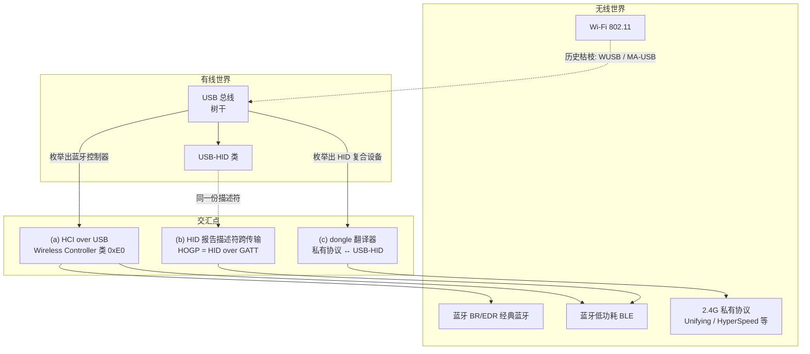
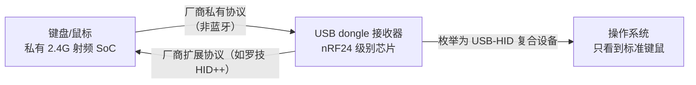
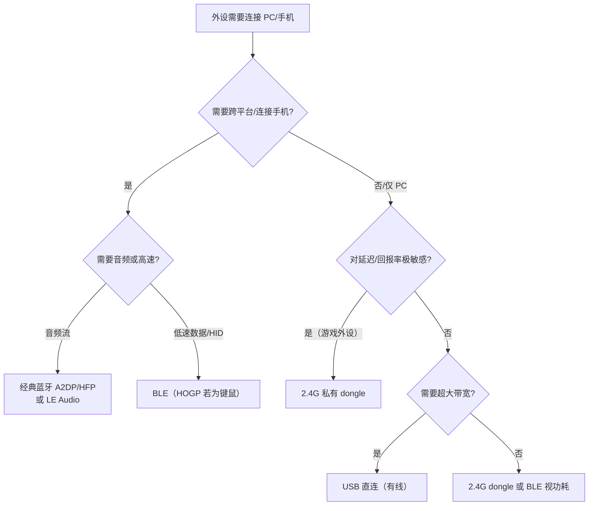
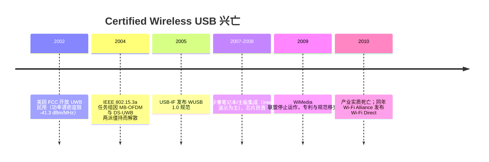
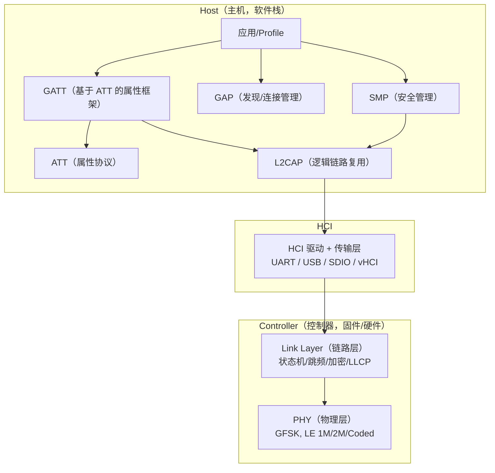
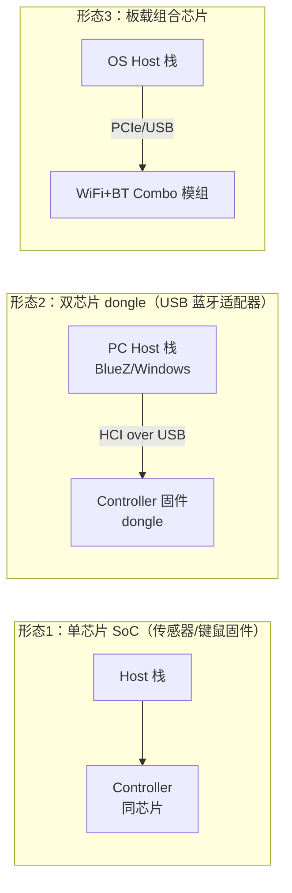
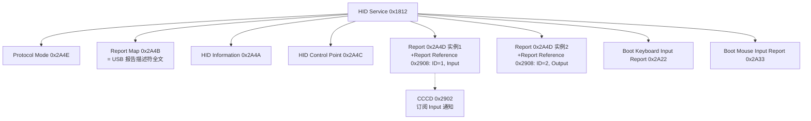
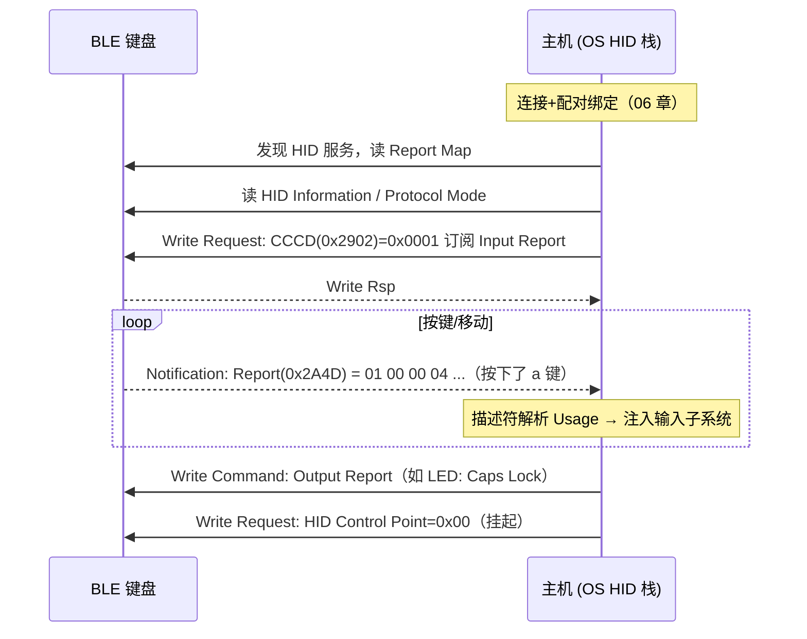

# 无线与 USB 的交汇：HCI-over-USB、HOGP、Wireless USB/MA-USB 历史

> 层级 进阶 · 主题 `wireless` · 相关：[HID 核心：类描述符、报告描述符 Item、Usage、类请求](11-hid-core.md)、[其他设备类 B：蓝牙 HCI、WebUSB/厂商类、MIDI、USBTMC、长尾类、AV、PHDC](19-other-classes-b.md)、[BLE 核心：概述、链路层/物理层、广播与连接、ATT/GATT、GAP、SMP、经典蓝牙对比](61-ble-core.md)

## 核心事实 Key Facts

> 由维护者整理并与规范核对；与下方 USBTree 原文冲突时以本节为准。

| USB HID | HOGP（HID Service 0x1812） |
|---|---|
| 报告描述符（GET_DESCRIPTOR 0x22） | Report Map 特征 0x2A4B |
| Input 报告（中断 IN） | Report 特征 0x2A4D Notify + Report Reference 描述符 0x2908（Report ID, 类型 1 Input/2 Output/3 Feature） |
| SET_REPORT / Output | 写 Report 特征（Output/Feature） |
| GET/SET_PROTOCOL | Protocol Mode 0x2A4E（0 Boot, 1 Report） |
| 挂起 | HID Control Point 0x2A4C（0 Suspend, 1 Exit Suspend） |
| HID 描述符 bcdHID 等 | HID Information 0x2A4A |
| Boot 报告 | Boot Keyboard Input 0x2A22 / Output 0x2A32，Boot Mouse Input 0x2A33 |
- 2.4 GHz 私有无线接收器对主机是普通 USB（复合）HID 设备，与蓝牙无关。
- HCI over USB 端点映射见 [19-other-classes-b](19-other-classes-b.md)。

## 原文：00-无线概览与USB交汇

> Source: [50-枝干-无线关联/00-无线概览与USB交汇.md](https://github.com/tangjianfang/USBTree/blob/main/50-枝干-无线关联/00-无线概览与USB交汇.md)

---

### 一、必须先说清楚的一件事

**BLE（低功耗蓝牙，Bluetooth Low Energy）本身不依赖 USB。**它有自己的射频（RF, Radio Frequency）、链路层（LL, Link Layer）与主机协议栈（L2CAP/ATT/GATT），从协议学上看是一个独立王国。把它收进"USB 知识树"，是因为两者在现实产品中存在**三个不可回避的交汇点**：

| 交汇点 | 一句话概括 | 典型形态 |
|---|---|---|
| (a) 蓝牙适配器 | HCI（主机控制器接口，Host Controller Interface）跑在 USB 总线上 | USB 蓝牙 dongle、主板板载蓝牙 |
| (b) HID 跨传输 | 同一份 HID 报告描述符同时服务 USB 与 BLE（HOGP） | 双模键盘、蓝牙鼠标插线变有线 |
| (c) 2.4G 私有无线 dongle | 厂商私有射频协议 ↔ USB-HID 的"翻译器" | 罗技 Unifying、雷蛇 HyperSpeed 键鼠套装 |

本枝干第 1 篇即本文，专门把这三个交汇点讲透；后续 BLE 子树共 17 篇专注 BLE 本体，只在必要处回扣 USB。

### 二、全景图



### 三、交汇点 (a)：蓝牙适配器 = HCI over USB

PC 上的蓝牙控制器几乎都挂在 USB 总线上（板载芯片内部也是 USB/PCIe 之一，USB 最普遍）。主机栈（Host）与控制器（Controller）之间通过 HCI 命令/事件/数据包交互，HCI 底层传输层（HCI Transport）选择 USB 时：

- **设备类**：无线控制器类（Wireless Controller），`bDeviceClass = 0xE0`，子类 `0x01`（RF Controller），协议 `0x01`（Bluetooth）。
- **端点布局**（惯例）：控制端点收发 HCI Command/Event，中断 IN 端点上送 HCI Event，批量端点搬运 ACL 数据，同步（ISO）端点承载经典蓝牙音频流。细节见专用文件。
- 操作系统视角：Linux 的 `btusb` 驱动、Windows 的蓝牙栈都通过这套接口加载固件（很多 dongle 枚举后还需 `bInterfaceNumber` 指定的厂商固件下载流程，如 Broadcom/Intel 的 `.hex/.dfu`）。

 详见：[05-蓝牙控制器类-HCIoverUSB](19-other-classes-b.md)
BLE 子树中 HCI 的角色见：[01-蓝牙体系架构与HCI](60-usb-wireless-intersection.md)

### 四、交汇点 (b)：HID 报告描述符跨传输

HID（人机接口设备，Human Interface Device）最优雅的设计之一是**报告描述符（Report Descriptor）与传输无关**：同一份描述符中的 Usage/Item 体系，既能通过 USB 中断端点传 Input/Output/Feature 报告，也能通过 BLE 的 GATT 特征（Report Map `0x2A4B`）传同样的报告字节。

- USB 侧：`GET_REPORT/SET_REPORT` 的 `wValue` = （报告类型高字节 + 报告 ID 低字节）。
- BLE 侧：HOGP（HID over GATT）用 Report Reference 描述符 `0x2908` 标注每个 Report 特征的（报告 ID + 报告类型），编码结构与 USB `wValue` **同构**。
- 于是同一颗键盘主控：USB 线插上走 USB-HID，拔线走 BLE-HOGP，描述符只维护一份。

 详见：[02-报告描述符与Item编码](11-hid-core.md)、[10-HID跨传输I2C与BLE](12-hid-devices.md)、本枝干 [07-HOGP-HIDoverGATT](60-usb-wireless-intersection.md)

### 五、交汇点 (c)：2.4G 私有协议 dongle

"无线键鼠套装"（罗技 Unifying、雷蛇 HyperSpeed/Lightspeed、雷柏私有协议等）的方案结构：



要点：

1. **dongle 内是 nRF24 级别的 2.4G 私有协议芯片**（早期罗技 dongle 普遍采用 Nordic nRF24 系列），私有帧格式、私有跳频、私有加密（如 Unifying 的 AES-128），与蓝牙在空口上完全不兼容。
2. **OS 侧完全无感**：dongle 向 USB 枚举成一个标准 HID 复合设备（键盘接口 + 鼠标接口 + 厂商 HID 接口），走通用 HID 类驱动，**所以插上即用、不需要装驱动**。
3. **为什么厂商还要做私有协议**：延迟更低且可控（雷蛇 HyperSpeed 支持 8000Hz 回报率，远超 BLE HID 的常见水平）、功耗调优自由、可一对多配对（一个 dongle 带六件设备）、不受蓝牙栈版本拖累。
4. 代价：丢一个 dongle 这套设备就残废（近年罗技开始用"bolt"USB-C 接收器与跨机连接改善）；安全性曾被研究界点名（如 MouseJack 类漏洞后 Unifying 固件加入 AES）。

### 六、历史上的"正牌"无线 USB（一段话）

在 BLE 与 2.4G 私有方案胜出之前，USB-IF 推过两代正统的"无线 USB"：**Certified Wireless USB（WUSB，2005 规范，基于 UWB 超宽带，3 米 480Mbps）**和 **MA-USB（Media Agnostic USB，2014/2015，把 USB 映射到 WiGig 802.11ad 等任意介质）**，两者均未形成市场，是知识树上名副其实的"枯枝"——枯枝也要挂上去，原因见 [99-WirelessUSB与MA-USB历史](60-usb-wireless-intersection.md)。

### 七、OS 视角：三种 dongle 的枚举形态对照

| | 蓝牙适配器 | 2.4G 私有 dongle | 双模键鼠的有线态 |
|---|---|---|---|
| 枚举出的设备 | Wireless Controller 类 0xE0/0x01/0x01 | HID 类复合设备（键+鼠+厂商接口） | HID 类复合设备 |
| 需要驱动 | OS 内置蓝牙栈（Linux btusb / Windows 蓝牙栈） | 无（通用 HID 驱动） | 无 |
| 报告从哪来 | 主机栈经 HCI→BLE 控制器→HOGP 取得 | dongle 收私有射频帧→翻译成 HID 报告 | 设备直接上报 |
| 断开形态 | 蓝牙断链，设备图标消失 | dongle 仍在，设备"永远插着" | 变回纯有线 |

### 八、常见误区澄清

1. **"Unifying 是蓝牙"** —— 错。Unifying/HyperSpeed 是私有 2.4G 协议，空口与蓝牙互不兼容；只是 dongle 恰好也是 USB 接口而已。
2. **"无线键鼠要装驱动"** —— 基础键鼠功能不需要：dongle 枚举为标准 HID，键值/滚轮/移动走标准报告。装驱动只是为了厂商扩展（宏、灯光、电量显示，如罗技 HID++ 协议，走厂商 HID 接口）。
3. **"蓝牙适配器就是个天线"** —— 它是完整的 BLE/BR-EDR 控制器（PHY+LL+HCI），协议栈另一半（L2CAP/ATT/GATT/SMP）跑在操作系统里。
4. **"BLE HID 走特殊通道"** —— 不特殊：在 PC 上 BLE 键鼠报告的路径是 `HOGP(GATT) → BLE 控制器 → HCI over USB → OS 蓝牙栈 → 内核 HID 子系统`，与 USB 有线键鼠最后汇入同一个 HID core。

### 九、选型决策树



| 维度 | USB 直连 | 经典蓝牙 BR/EDR | BLE | 2.4G 私有 dongle |
|---|---|---|---|---|
| 带宽 | 最高（GB 级） | ~2-3 Mbps（EDR） | ~0.7-1.4 Mbps 实效 | 厂商自定（通常 1-2 Mbps） |
| 延迟 | 最低 | 中 | 较高（连接间隔下限 7.5ms+） | 最低（游戏级 1ms 回报可达） |
| 功耗 | 无线外设不适用 | 高 | 极低 | 低（持续射频，比 BLE 耗电） |
| 跨手机/平板 | 否 | 是 | 是 | 否（无 dongle 槽） |
| 配对/驱动 | 即插即用 | 需配对 | 需配对 | 插 dongle 即用 |
| 典型产品 | 有线键鼠、U 盘 | 耳机、音箱 | 传感器、标签、BLE 键鼠 | 游戏键鼠、无线耳机仓 |

### 十、本枝干文件导航

| 文件 | 内容 |
|---|---|
| [00-无线概览与USB交汇](60-usb-wireless-intersection.md) | 本文：三类交汇点全景 |
| [99-WirelessUSB与MA-USB历史](60-usb-wireless-intersection.md) | 枯枝：两代正统无线 USB 的兴亡 |
| [BLE-低功耗蓝牙/00-BLE概述](61-ble-core.md) | 蓝牙版本史与 BLE 定位 |
| [01-蓝牙体系架构与HCI](60-usb-wireless-intersection.md) | Controller/Host 架构、HCI、L2CAP |
| [02-链路层与物理层](61-ble-core.md) | 频段、PHY、包结构、跳频、加密 |
| [03-广播与连接](61-ble-core.md) | 广播 PDU、AD 结构、连接建立 |
| [04-ATT与GATT](61-ble-core.md) | 属性协议与通用属性规范 |
| [05-GAP与连接管理](61-ble-core.md) | 角色、地址体系、发现与绑定 |
| [06-SMP安全与配对](61-ble-core.md) | 配对、密钥、加密与攻击面 |
| [07-HOGP-HIDoverGATT](60-usb-wireless-intersection.md) | BLE 键鼠：回到 USB 知识树的主干道 |
| [08-经典蓝牙与BLE对比](61-ble-core.md) | BR/EDR vs BLE、LE Audio、选型 |
| [09-LEAudio与LC3](62-ble-advanced.md) | LE Audio、LC3、广播音频 |
| [10-Mesh网络概述](62-ble-advanced.md) | Mesh 泛洪、中继与 GATT 承载 |
| [11-经典蓝牙Profile详解](62-ble-advanced.md) | HID / HFP / AVRCP / A2DP 骨架 |
| [12-LLCP控制过程全表](62-ble-advanced.md) | 链路层控制 Opcode 全表 |
| [13-测向与信道探测](62-ble-advanced.md) | AoA/AoD 与 Channel Sounding |
| [14-RF物理层参数全表](62-ble-advanced.md) | PHY、发射功率与灵敏度 |
| [15-A2DP编解码与AVDTP参数](62-ble-advanced.md) | SBC/AAC 位级与 AVDTP 信令 |
| [16-标准UUID全表](63-ble-uuid.md) | SIG Assigned Numbers 标准 UUID |

## 原文：99-WirelessUSB与MA-USB历史

> Source: [50-枝干-无线关联/99-WirelessUSB与MA-USB历史.md](https://github.com/tangjianfang/USBTree/blob/main/50-枝干-无线关联/99-WirelessUSB与MA-USB历史.md)

---

本文记录两根"枯枝"：Certified Wireless USB（WUSB）与 MA-USB。它们是 USB-IF 官方推出、以"取代 USB 线缆"为目标的正牌无线方案，最终都没有成功。理解失败原因，比记住参数更有价值。

### 一、Certified Wireless USB（CWUSB / WUSB）

#### 1.1 技术底座：UWB 超宽带

| 项目 | 内容 |
|---|---|
| 无线技术 | UWB（Ultra-Wideband，超宽带），工作频段 3.1~10.6 GHz |
| 波形方案 | WiMedia 联盟的 MB-OFDM（Multi-Band OFDM，多带正交频分复用），把频段切成 528 MHz 子带跳变 |
| 速率档位 | 53.3 / 80 / 110 / 160 / 200 / 320 / 400 / 480 Mbps（自适应），对外宣传口径"480 Mbps @ 3 m，110 Mbps @ 10 m"（标称，与 USB 2.0 对齐） |
| 规范 | USB-IF《Certified Wireless USB》1.0，2005 年 5 月发布 |
| 拓扑 | 一个主机簇（cluster）最多 127 个设备，通过 Hub-ish 的 DWA 可扩展 |
| 安全 | AES-128 链路加密，配对采用"线缆关联"（Cable Association，插一次线换密钥）或"数字关联"（输入 PIN） |

监管差异是先天硬伤：FCC（美国）2002 年开放全频段 3.1~10.6 GHz；欧盟与日本初期只批 3.1~4.8 GHz（配合 DCR 检测规避机制），上段（6~10 GHz，即 Band Group 3+）迟迟不放行——芯片要全球销售就必须多做频段组合，成本与上市时间双双恶化。

#### 1.2 架构要点

WUSB 复刻了 USB 的主机中心模型：

- **HWA（Host Wire Adapter）**：主机侧适配器，把系统里的 USB 请求"搬运"到无线信道上，对操作系统表现为一个标准 USB 2.0 控制器。
- **DWA（Device Wire Adapter）**：设备侧适配器，让**普通有线 USB 设备**不用改硬件就能变成"无线设备"——这正是它的野心：存量 USB 外设免改造无线化。
- 对协议栈而言，枚举、标准请求、描述符全部沿用树干那套（见 [08-枚举流程与标准请求](07-enumeration-requests.md)），只是物理层从铜线换成了 UWB。

配套机制对照 USB 有线世界：

| 有线 USB | WUSB 对应物 |
|---|---|
| 集线器扩展 | 一个主机簇（cluster）直接管 127 设备 |
| 插入即枚举 | 设备"出现"在射频范围内时触发枚举 |
| 线缆即信任 | 配对即发密钥：Cable Association（插线换钥）或数字 PIN 关联 |
| 传输类型（控制/中断/批量/同步） | 同样四种，映射到 UWB 信道的时间片 |

#### 1.3 UWB 阵营内战：两个"标准"

| 阵营 | 波形 | 代表厂商 | 结局 |
|---|---|---|---|
| WiMedia Alliance | MB-OFDM（多带 OFDM，528 MHz 子带跳频） | Intel、TI、NEC 等 | 被 USB-IF 采纳为 WUSB 底座 |
| UWB Forum | DS-UWB（直序列扩频） | Freescale、Motorola 等 | 另推"Cable-Free USB"，未成气候 |

IEEE 802.15.3a 任务组试图统一两者，2002 年立项、2006 年因两派无法达成 75% 多数而解散——UWB 短距高速标准在 IEEE 体系内**从未诞生**，只能靠产业联盟自治，这是后来生态失败的关键伏笔。

#### 1.4 时间线



#### 1.5 生态昙花

2007-2008 年间有少量真实产品：集成 WUSB 主机控制器的笔记本（以 Intel 演示与 OEM 试水为主）、D-Link/IOGEAR 等的 WUSB Hub 与适配器套件、无线外置光驱/硬盘盒。共同特征：贵（套件一两百美元级）、要插 dongle、驱动时常抽风——每一项都正好输给"一根 USB 线"。

#### 1.6 失败原因（按重要性）

1. **频谱与监管先天不足**：FCC 2002 年规则把 UWB 功率压到噪声地板附近（-41.3 dBm/MHz），实际覆盖远达不到宣传的 10 米/110 Mbps；且各洲监管不一致，欧洲、日本早期只允许 3.1~4.8 GHz 下段（DCR 时代），WiMedia 方案要靠"全频段规划"（Band Group 扩展）补救，产品一再推迟。
2. **标准内战烧掉了时间窗口**：UWB 阵营自身分裂为 WiMedia（MB-OFDM，Intel/TI 阵营）与 UWB Forum（DS-UWB，Freescale/Motorola 阵营），IEEE 802.15.3a 无法统一，2006 年解散。三年黄金期耗在内斗上。
3. **芯片昂贵、功耗高**：OFDM 射频+基带早期单套 BOM 数十美元，功耗数倍于后来的 BLE 方案，笔记本厂商没有动力为一个"看不见提速"的场景埋单。
4. **对手太强**：同期 802.11n（Wi-Fi 4）把无线吞吐推到百 Mbps 实效并全面普及，"传文件"场景被 Wi-Fi 吃掉；2010 年 Wi-Fi Direct 发布，直接接管了"设备点对点直连"的定位。
5. **定位尴尬**：WUSB 主打"3 米内的高速外设线缆替代"，但键鼠需要的低功耗低延迟它给不了（那是后来 BLE 和 2.4G 私有方案的天下），显示器/硬盘需要的稳定性它又不及有线。

#### 1.7 遗产

UWB 技术本身没有死，只是换赛道复活：2019 年后苹果 U1 芯片（AirDrop 定向、AirTag 精确查找）、汽车数字钥匙（CCC Digital Key 3.0 采用 FiRa 生态的 UWB/BLE 混合方案）让 UWB 以**厘米级测距/定位**的面目回归——和当年"当一根无线线缆"的定位完全不同。讽刺的是，今天的 UWB 设备普遍用 BLE 负责发现与配对、UWB 负责测距，WUSB 若地下有知，大概会承认这个分工比自己的原始设计合理。

WiMedia 联盟 2009 年停摆后，其规范在 2010 年 3 月正式移交给三家具乐部：蓝牙 SIG（想给蓝牙接高速底座）、USB-IF（WUSB 促进组）、OMA（高带宽内容分发）。蓝牙那边随后的选择颇具象征意义：**Bluetooth 3.0 + HS 最终用 802.11 做 AMP 高速通道，而不是 UWB**——"借用另一套无线做高速"这条路，蓝牙试过也放弃了，与 MA-USB 的命运互为注脚。

### 二、MA-USB（Media Agnostic USB）

| 项目 | 内容 |
|---|---|
| 全称 | Media Agnostic USB（介质无关 USB），USB-IF 规范（1.0 于 2015 年前后发布） |
| 思路 | 把 USB 的传输层语义（传输类型、数据包、流控）映射到**任意**高速介质之上，重点是 WiGig（IEEE 802.11ad，60 GHz，理论 7 Gbps） |
| 端到端 | 主机侧"MA-USB 主机控制器"对应一个 802.11ad 站点；设备侧同理；中间跑 MA-USB 协议头封装 |
| 生态 | Intel 等厂商推出过基于 802.11ad 的无线扩展坞（俗称 WiGig Dock：无线坞站同时输出显示、USB、网络），2015-2017 年短暂存在 |

MA-USB 的分层思路：USB 的端点/管道概念被映射为 MA-USB 的"通道（channel）"，控制/中断/批量/同步四种传输语义原样保留，再由底层 802.11ad 的 MAC 层搬运——即"**传输语义与介质解耦**"。同一时期 USB-IF 还推出过姊妹规范 DisplayLink 生态用的"MA-Display Port Extension"思路（把显示流也装进同一框架），但整套体系都未跨过规模化的门槛。

失败原因与 WUSB 高度同构：60 GHz 毫米波穿透性差（隔一堵墙即断）、要求收发器大致对准、模组成本高；同期 USB Type-C + USB 3.1（10 Gbps）+ DP Alt Mode 一根线全解决，"无线扩展坞"迅速退回小众。802.11ad 之后继任的 802.11ay 也未能让 MA-USB 起死回生，USB-IF 官网如今已很少再提该规范。

### 三、失败教训总结

| 教训 | WUSB | MA-USB | 后来的胜者怎么赢的 |
|---|---|---|---|
| 场景要窄而狠 | 想"全面替代 USB"，3m 高速场景太窄 | 依赖"无线坞站"单一场景 | BLE 锁死"纽扣电池十年"场景；2.4G 私有方案锁死"游戏级键鼠" |
| 成本与功耗是生死线 | UWB 芯片贵且耗电 | 60GHz 模组更贵 | BLE 单芯片几美分到几美元，µA 级睡眠 |
| 标准不能内战 | MB-OFDM vs DS-UWB 拖死 802.15.3a | 无内战但生不逢时 | 蓝牙 SIG 一家掌控，版本演进连续 |
| 有线在进步，无线要跑赢它 | USB 2.0 → USB 3.0 拉大差距 | Type-C/USB 3.1/DP Alt 合流 | 无线方案不与有线比带宽，比"无线才有的自由" |
| 生态靠存量兼容 | DWA 想兼容存量，本身成了累赘 | 坞站需专用模组 | HOGP 复用 HID 描述符，存量软件零改动 |

一句话：**无线外设市场最终被 BLE（低功耗/互操作）+ 2.4G 私有方案（低延迟/回报率）+ Wi-Fi Direct（直连传输）三方蚕食，而不是被"另一根无线线缆"接管。**

#### 3.1 与最终胜者的参数对比

| 指标 | WUSB（2005） | MA-USB（2015） | BLE | 2.4G 私有方案 |
|---|---|---|---|---|
| 峰值速率 | 480 Mbps | ~Gbps（依赖 802.11ad） | 1~2 Mbps | 1~2 Mbps（私有帧） |
| 供电目标 | 外设级（有线替代） | 坞站级 | 纽扣电池数年 | 充电电池数月~数年 |
| 链路成本（当年口径） | 数十美元级 | 上百美元（模组） | 美元以下 | 美元以下 |
| 穿透/覆盖 | 差（UWB 被压到噪声级） | 极差（60 GHz 怕墙） | 好（2.4 GHz） | 好（2.4 GHz） |
| 主机侧生态 | 需要 WUSB 栈 + HWA | 需要专用驱动 | OS 内置 | 无感（枚举为 HID） |

结论一目了然：两代"无线 USB"输在成本与生态，赢家的护城河是"便宜到忽略不计 + 主机侧零驱动"。

### 四、为什么知识树保留这根枯枝

1. **完整性**：写"USB 与无线的关系"绕不开官方尝试过的路线，否则读者会误以为 2.4G dongle 或 BLE 就是"无线 USB"——它们在空口协议上都不是。
2. **避免重复发明**：WUSB 的"线缆关联配对"（插线换密钥）、MA-USB 的"传输语义与介质解耦"思想，在今天的 USB4 隧道、Wi-Fi 7 多链路等设计中仍能看到影子。
3. **决策参考**：每当有人想"再造一个无线 USB"，这两段历史就是最好的路障提示。

## 原文：01-蓝牙体系架构与HCI

> Source: [50-枝干-无线关联/BLE-低功耗蓝牙/01-蓝牙体系架构与HCI.md](https://github.com/tangjianfang/USBTree/blob/main/50-枝干-无线关联/BLE-低功耗蓝牙/01-蓝牙体系架构与HCI.md)

---

蓝牙采用与 USB 相似的**主机/控制器分离**思想：射频与实时性敏感的链路层做成控制器（Controller），业务逻辑做成主机栈（Host），两者以 HCI（Host Controller Interface，主机控制器接口）为界。USB 蓝牙 dongle 的本质就是把 Controller 挂在 USB 总线另一端（见 [../../20-枝干-设备类协议/其他设备类/05-蓝牙控制器类-HCIoverUSB](19-other-classes-b.md)）。

### 一、架构总览



| 块 | 职责 | 对应 USB 树的类比 |
|---|---|---|
| Controller = PHY + LL + HCI | 调制解调、跳频、重传、加密引擎、连接调度 | USB 总线接口/PHY + SIE |
| L2CAP | 逻辑信道复用、MTU/分段、流控 | 端点+传输类型 |
| ATT/GATT | 属性数据库与读写订阅 | 设备类协议（类 HID 的接口语义） |
| GAP | 发现、连接、角色、广播 | 枚举与设备状态 |
| SMP | 配对、密钥、加密 | 类似"安全描述符+认证" |

### 二、HCI 三种包

HCI 链路上只有三类信息（5.2 起新增 ISO 数据包用于 LE Audio）：

| 包类型 | USB/H4 包类型指示 | 方向 | 用途 |
|---|---|---|---|
| HCI Command | 0x01 | Host → Controller | 控制命令 |
| HCI Event | 0x04 | Controller → Host | 命令结果/异步通知 |
| ACL 数据 | 0x02 | 双向 | L2CAP 承载（BLE 全部业务数据） |
| SCO/eSCO 数据 | 0x03 | 双向 | 经典蓝牙语音 |
| ISO 数据 | 0x05 | 双向 | LE Audio 等时流（5.2+） |

#### 2.1 Command：Opcode = OGF<<10 | OCF

```
 16-bit Opcode = OGF(6 bits) << 10 | OCF(10 bits)
随后 1 字节参数总长 + 参数。
```

| OGF | 组 | 例子 |
|---|---|---|
| 0x01 | Link Control | Disconnect（OCF 0x0006） |
| 0x03 | Host Controller | Reset（OCF 0x0003） |
| 0x04 | Informational | Read BD_ADDR（OCF 0x0009 → Opcode 0x1009） |
| 0x08 | LE（Low Energy） | 全部 LE 命令 |

#### 2.2 最常用 LE 命令速查（含返回事件）

| 命令 | Opcode | 参数要点 | 完成指示 |
|---|---|---|---|
| LE Set Advertising Parameters | 0x2006 | 最小/最大广播间隔、类型、信道图 | Command Complete (0x0E) |
| LE Set Advertising Data | 0x2008 | ≤31 字节 AD 数据 | Command Complete |
| LE Set Advertising Enable | 0x200A | 0/1 | Command Complete |
| LE Set Scan Parameters | 0x200B | 扫描类型/窗口/间隔 | Command Complete |
| LE Set Scan Enable | 0x200C | 使能扫描 + 是否上报重复 | Command Complete |
| LE Create Connection | 0x200D | 对端地址 + 连接参数 + 窗口 | LE Connection Complete |
| LE Read Buffer Size | 0x2002 | 查询 ACL 包大小/数量 | Command Complete |
| LE Read White List Size | 0x000F OCF → 0x200F | 白名单容量 | Command Complete |

#### 2.3 Event：LE Advertising Report 字节级示例

广播报告是 Host 感知外界 BLE 设备的主要途径（HCI Event 0x3E 的 LE Meta 子事件 0x02）：

```
04                          ; HCI Event 包类型
3E                          ; 事件码 = LE Meta Event
14                          ; 参数长度 = 20 字节（单设备时）
02                          ; Subevent = LE Advertising Report
01                          ; Num Reports = 1
00                          ; Event Type = ADV_IND（可连接）
01                          ; Addr Type = 0x01 Random
C1 02 34 56 78 AB           ; 地址 AB:78:56:34:02:C1（小端）
08 09 4E 52 46 35 32 38 33  ; AD 数据: len=8, type=0x09, "NRF5283"
C8                          ; RSSI = -56 dBm（有符号，最后一个字节）
```

### 三、HCI 传输层

| 传输 | 说明 | 备注 |
|---|---|---|
| UART H4 | 每包前 1 字节类型指示，无流控 | 最简单，SoC 间串口常用 |
| H5 / H4DS | 三线 UART，带滑窗重传与节电 | ETSI TS 101 ...（SIG 采纳） |
| **USB** | 控制端点=Command，中断 IN=Event，批量=ACL，ISO=音频 | PC dongle 标准；详见链接文件 |
| SDIO | 嵌入式（较少见） | 具体见 Core Spec Vol 4 |
| vHCI | 虚拟 HCI（仿真控制器/直连内核调试） | BlueZ `btvirt`、Zephyr 原生 HCI UART |

### 四、Controller 与 Host 的组合形态



- 单芯片：Host 与 Controller 同固件，HCI 可编译为内部调用（Zephyr/ESP-IDF 常见）。
- 双芯片：HCI 必须走真实传输层（UART/USB），协议边界必须严格遵守——这就是 HCI 规范存在的意义。

### 五、L2CAP（Logical Link Control and Adaptation Protocol）

L2CAP 在 ACL 数据之上做**信道（Channel）复用**，每个信道由 CID（Channel Identifier，16 位）标识。

#### 5.1 LE 固定信道

| CID | 用途 | 上层 |
|---|---|---|
| 0x0004 | Attribute Protocol | ATT |
| 0x0005 | LE L2CAP Signaling | 连接参数更新、CoC 建立 |
| 0x0006 | Security Manager Protocol | SMP 配对/加密 |

固定信道无连接建立开销，ATT/SMP 的 PDU 直接封 L2CAP 头（4 字节：Length+CID）进 ACL。

#### 5.2 PDU 封装示例（ATT Read Request over ACL）

```
02                     ; HCI ACL 包类型
40 00                  ; 连接句柄+PB/BC 标志（小端）
07 00                  ; ACL 数据总长 = 7
04 00                  ; L2CAP 长度 = 4
04 00                  ; CID = 0x0004 (ATT)
0A                     ; ATT Read Request
15 00                  ; Handle = 0x0015
```

#### 5.3 关键机制

- **MTU**：每信道协商 MTU；ATT 默认 23 字节（详见 [04-ATT与GATT](61-ble-core.md)）。
- **LE Credit-based Flow Control**（CoC，面向连接的信道）：信用流控，用于大数据（如 OTA 升级私有协议）；5.2 的 EATT 也基于动态 CoC 信道。
- **重传/流控**：BLE 的可靠性主要由链路层 ARQ 保证（SN/NESN），L2CAP 层不再做经典蓝牙式的 RTX 重传；错误处理交上层。
- 信令信道 0x0005 承载 `CONNECTION_PARAM_UPDATE`、`DATA_LENGTH_UPDATE` 等请求——与链路层 LLCP 的同名流程对应（谁发起取决于角色，见 [02-链路层与物理层](61-ble-core.md)）。

## 原文：07-HOGP-HIDoverGATT

> Source: [50-枝干-无线关联/BLE-低功耗蓝牙/07-HOGP-HIDoverGATT.md](https://github.com/tangjianfang/USBTree/blob/main/50-枝干-无线关联/BLE-低功耗蓝牙/07-HOGP-HIDoverGATT.md)

---

HOGP（HID over GATT，规范版本 1.0）是 **BLE 挂回 USB 知识树的关键枝点**：键盘鼠标的报告语义完全不变，只是把 USB 的"中断端点轮询"换成了 GATT 的"CCCD 订阅 + Notification"。OS 端 HID 驱动解析的东西——报告描述符、报告 ID、Usage——与 USB-HID 一字不差。

### 一、报告描述符完全复用

HOGP 的 Report Map 特征里放的就是一份**原汁原味的 USB HID 报告描述符**（Usage/Item 编码体系），解析器可直接复用：

 Item 编码规则见：[02-报告描述符与Item编码](11-hid-core.md)
 跨传输总览见：[10-HID跨传输I2C与BLE](12-hid-devices.md)

这意味着厂商只需维护一份描述符：USB 有线模式与 BLE 无线模式共用；对操作系统而言"插线是 HID 键盘，蓝牙也是 HID 键盘"，应用层零改动。

### 二、HID 服务（UUID 0x1812）结构



#### 2.1 各特征字段详解

| 特征 | UUID | 读/写 | 内容 |
|---|---|---|---|
| Report Map | 0x2A4B | 读 | 完整 HID 报告描述符字节串（与 USB 描述符逐字节相同） |
| HID Information | 0x2A4A | 读 | 4 B：bcdHID(2，如 0x0101=1.01) + bCountryCode(1) + Flags(1，bit0 Remote Wake、bit1 Normally Connectable) |
| Protocol Mode | 0x2A4E | 读/写 | 0x00=Boot 协议 / 0x01=Report 协议（与 USB SET_PROTOCOL 语义一致） |
| HID Control Point | 0x2A4C | 写 | 0x00=挂起（SUSPEND）、0x01=退出挂起（EXIT_SUSPEND） |
| Report | 0x2A4D | 读/写/Notify | 报告本体；同一 UUID 可有多个实例，靠 Report Reference 区分 |
| Boot Keyboard Input Report | 0x2A22 | 读/Notify | BIOS 兼容的 8 B 键盘报告 |
| Boot Mouse Input Report | 0x2A33 | 读/Notify | BIOS 兼容的 3~4 B 鼠标报告 |

#### 2.2 Report Reference 描述符（0x2908）：与 USB wValue 同构

每个 Report 实例挂一个 Report Reference Descriptor，2 字节：

| 偏移 | 字段 | 取值 |
|---|---|---|
| 0 | Report ID | 1~255（0 表示无 ID） |
| 1 | Report Type | 0x01 Input / 0x02 Output / 0x03 Feature |

对照 USB 的 `GET_REPORT/SET_REPORT`：`wValue 低字节 = 报告类型（1/2/3），高字节 = 报告 ID`——**同样的二元组**，两边编码同构，主机栈可以共用查找表。

#### 2.3 配套标准服务

| 服务 | UUID | 内容 |
|---|---|---|
| Battery Service | 0x180F | Battery Level 0x2A19（0~100%，Notify；键鼠电量显示靠它） |
| Device Information | 0x180A | **PnP ID 0x2A50**：VID Source(1)+VID(2)+PID(2)+Version(2)；注意 VID Source 0x01 = USB-IF 分配的 VID——BLE 设备沿用 USB 的厂商编号体系 |
| Scan Parameters | 0x1813 | Scan Interval Window 0x2A10：外设告诉主机"请按此节奏扫描"，为主机省电 |

### 三、数据流：一次按键的旅程



要点：

- **Input 报告**走 Notification（订阅后外设主动推）；**Output 报告**（键盘 LED）走主机写入；**Feature 报告**走 Read/Write Request。
- HOGP 规范要求报告访问需**加密链路**（部分权限要求认证），所以没配对完通常拿不到报告——这就是蓝牙键鼠必须配对的原因。
- CCCD 按连接独立存储，bond 后重连主机要重新（由栈自动）写 CCCD（见 [04-ATT与GATT](61-ble-core.md) 3.2 节）。

#### 3.1 报告字节示例

键盘 Input Report（Report ID=1，8 B 标准布局，描述符同 USB）：

```
01 00 00 04 00 00 00 00
│  │  │  └─ Key1 = 0x04 = 'a'
│  │  └─ 保留
│  └─ Modifier = 0x00（无 Ctrl/Shift）
└─ Report ID = 1
```

### 四、主机侧实现现状

| 平台 | 支持 |
|---|---|
| Windows | 8.1 起原生支持 HOGP 键鼠；报告注入走系统 HID 类栈 |
| Linux | BlueZ 的 HOG（HID over GATT）子系统把 BLE 报告转成 uhid 虚拟设备，进内核 HID core，与 USB-HID 同一条下游管线 |
| Android | 原生支持 BLE 键鼠（早期版本支持键盘，鼠标支持随后加入；随版本而异） |
| iOS/iPadOS | 13 起支持蓝牙鼠标，键盘更早；系统级无障碍驱动 |

主机侧开发的通常形态：**厂商只需提供描述符正确的固件，OS 原生驱动接管**；私有扩展按键（多媒体滚轮自定义层）则另开厂商 Report ID 通道。

### 五、与经典蓝牙 HID Profile 对比

| 维度 | 经典蓝牙 HID（BR/EDR） | HOGP（BLE） |
|---|---|---|
| 承载 | L2CAP PSM 0x0011（控制）/0x0013（中断） | GATT 特征 + Notification |
| 描述符 | 同一套 HID 报告描述符 | 同一套（放 Report Map） |
| 连接建立 | inquiry/page 秒级 | 广播 + CONNECT_IND 毫秒级 |
| 功耗 | 高（持续链路） | 极低（事件化） |
| Boot 协议 | 有 | 有（0x2A22/0x2A33 + Protocol Mode） |
| 现状 | 老蓝牙键鼠，逐渐退出 | 当前主流 |

### 六、双模设备：一份描述符，两种传输

典型双模键盘主控：USB 线插入 → 枚举为 USB-HID 复合设备（走有线）；拔线 → 走 BLE HOGP；两种模式的报告格式、Report ID、描述符完全一致，OS 感知不到差异（甚至同时连接时部分固件会自动切换）。实现细节与 I2C 另一传输见：

 [10-HID跨传输I2C与BLE](12-hid-devices.md)

### 七、GATT 数据库片段示例（YAML）

```yaml
# 一只 BLE 鼠标的 GATT 数据库（节选）
services:
  - uuid: 0x1800        # GAP
    characteristics:
      - { uuid: 0x2A00, value: "BLE Mouse", read: true }
      - { uuid: 0x2A01, value: 0x00C2 }        # Appearance: Mouse
  - uuid: 0x1801        # GATT
    characteristics:
      - { uuid: 0x2A05, indicate: true }       # Service Changed
  - uuid: 0x1812        # HID Service
    characteristics:
      - { uuid: 0x2A4A, value: [0x11, 0x01, 0x00, 0x03] }  # bcdHID=1.11, flags: RW+NC
      - { uuid: 0x2A4B, read: true, value: "<报告描述符原始字节>" }
      - { uuid: 0x2A4E, value: 0x01 }          # Protocol Mode = Report
      - uuid: 0x2A4D                           # Report 实例 1
        descriptors:
          - { uuid: 0x2908, value: [0x01, 0x01] }   # ID=1, Input
        notify: true
      - uuid: 0x2A4D                           # Report 实例 2
        descriptors:
          - { uuid: 0x2908, value: [0x01, 0x02] }   # ID=1, Output
        write: true
  - uuid: 0x180F        # Battery
    characteristics:
      - { uuid: 0x2A19, value: 0x5A, notify: true }  # 90%
```
