# BLE 核心：概述、链路层/物理层、广播与连接、ATT/GATT、GAP、SMP、经典蓝牙对比

> 层级 进阶 · 主题 `wireless/ble` · 相关：[无线与 USB 的交汇：HCI-over-USB、HOGP、Wireless USB/MA-USB 历史](60-usb-wireless-intersection.md)、[BLE 进阶：LE Audio/LC3、Mesh、经典 Profile、LLCP、测向与信道探测、RF 参数、A2DP/AVDTP](62-ble-advanced.md)、[蓝牙标准 UUID 全表](63-ble-uuid.md)

## 核心事实 Key Facts

> 由维护者整理并与规范核对；与下方 USBTree 原文冲突时以本节为准。

- 注：USBTree 审计指出 Bluetooth Core 6.1/6.2 尚未覆盖（6.2 新增 HCI USB 等时传输相关内容）。

## 原文：00-BLE概述

> Source: [50-枝干-无线关联/BLE-低功耗蓝牙/00-BLE概述.md](https://github.com/tangjianfang/USBTree/blob/main/50-枝干-无线关联/BLE-低功耗蓝牙/00-BLE概述.md)

---

低功耗蓝牙（BLE，Bluetooth Low Energy），官方营销名"蓝牙智能"（Bluetooth Smart），2009 年底定稿、随 **Bluetooth 4.0（2010）**正式发布。它与经典蓝牙（BR/EDR，Basic Rate / Enhanced Data Rate）共享 2.4 GHz 频段与品牌，但 PHY、链路层、上层协议栈几乎完全重写。与 USB 知识树的关系（HCI over USB、HOGP、2.4G dongle）见 [00-无线概览与USB交汇](60-usb-wireless-intersection.md)。

### 一、蓝牙版本史

| 版本 | 年份 | 关键内容 | 对 BLE 的意义 |
|---|---|---|---|
| 1.0-1.2 | 1999-2003 | BR（Basic Rate，1 Mbps，GFSK），初代跳频 | 与 BLE 无关 |
| 2.0 + EDR | 2004 | EDR（Enhanced Data Rate）：π/4-DQPSK 2 Mbps、8DPSK 3 Mbps | 经典蓝牙提速 |
| 2.1 | 2007 | SSP（Secure Simple Pairing，简化配对） | 经典蓝牙配对现代化；BLE 后来另起 SMP |
| 3.0 + HS | 2009 | HS（High Speed）：借用 802.11 做 AMP 高速通道 | 与 BLE 无关，路线失败 |
| **4.0** | **2010** | **BLE 诞生**：单模/双模芯片、GATT/GAP/SMP 雏形 | 分水岭 |
| 4.1 | 2013 | 传输层重构、允许设备同时 Central+Peripheral | BLE 1.x 修补 |
| 4.2 | 2014 | **数据包长度扩展（DLE）**、LE Secure Connections（ECDH P-256）、**CSA #2**、IPSP（6LoWPAN/IPv6） | BLE 安全与吞吐补课 |
| 5.0 | 2016 | **2M PHY**、**Coded PHY（长距离）**、**扩展广播/周期广播**、广播集 | 覆盖与吞吐全面增强 |
| 5.1 | 2019 | 测向：AoA/AoD（到达角/离开角）、GATT 缓存增强 | 室内定位 |
| 5.2 | 2020 | **LE Audio**（LC3 编码、ISO 通道）、**EATT**、LE 功率控制 | 进军音频 |
| 5.3 | 2021 | 连接子速率（Connection Subrating）、信道分类增强、广播增强 | 细节优化 |
| 5.4 | 2023 | **PAwR**（带响应的周期广播）、**加密广播数据（EAD）** | 电子货架标签 ESL |
| 6.0 | 2024 | **Channel Sounding（信道探测，安全测距）**、广播编码选择等 | 精确测距，对标 UWB |

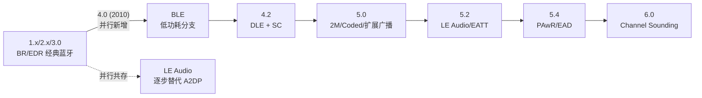

规范获取：蓝牙技术联盟（Bluetooth SIG，Special Interest Group）官网发布《Bluetooth Core Specification》（当前以 Core 5.4 / 6.0 为准，全卷免费注册下载）；Core Spec 只定义协议，Profile/Service 规范（如 HOGP、BAS）单独发布。本子树以 Core 5.4 术语为准（Central/Peripheral 替代旧称 Master/Slave）。

### 二、BLE 设计目标

| 目标 | 手段 |
|---|---|
| 纽扣电池（CR2032）供电运行数年 | 深度睡眠 + 微秒级唤醒；广播/连接事件化，无连接时几乎零电流 |
| 芯片低成本 | 单模 BLE SoC 可低至几美分~几美元；射频前端极简（GFSK 单调制方式） |
| 手机/PC 普遍覆盖 | 与经典蓝牙共用 2.4 GHz 射频前端的"双模"芯片（Wi-Fi+BT Combo 模组标配） |
| 互操作性 | GATT 统一数据模型 + SIG 标准服务 UUID，跨厂商"扫出来就能连" |
| 可接受的吞吐 | 小数据优先；4.2 DLE + 5.0 2M PHY 后实用吞吐可达 1 Mbps 以上 |

核心哲学：**BLE 为"不经常说话、每次只说几个字节"的设备设计**——这是它与经典蓝牙（持续流媒体）和 USB（确定性带宽）最根本的气质差异。

放在 USB 知识树里对照着看：

| 维度 | USB（树干） | BLE（本枝干） |
|---|---|---|
| 时间模型 | 主机轮询，确定性带宽/延迟 | 事件驱动（广播/连接事件），确定性让位于功耗 |
| 供电 | 总线供电 5 V/最多数百 mA | 自供电，µW 级预算 |
| 错误处理 | 硬件 CRC + 重试（近零误码） | 射频重传 + 监督超时断链，链路可能"消失" |
| 设备发现 | 枚举（主机主动拉描述符） | 广播（设备主动推名片） |
| 速率哲学 | 够快，且越来越快 | 够用就好，睡眠优先 |

吞吐参考（工程口径，随芯片/参数浮动）：LE 1M PHY 不开 DLE 时实用吞吐约 0.6~0.7 Mbps；DLE + LE 2M PHY 后可到 1~1.4 Mbps。别拿它传文件——BLE 的强项是"每秒几次、每次几十字节"的传感器节拍。

### 三、典型应用

| 应用 | 用到的机制 | 本子树章节 |
|---|---|---|
| 传感器（温湿度、心率带） | 广播 + GATT 标准服务（HTS/HRS） | [03](61-ble-core.md)、[04](61-ble-core.md) |
| 信标（Beacon：iBeacon/Eddystone） | 不可连接广播 + 厂商自定义 AD | [03](61-ble-core.md) |
| 可穿戴（手环、手表） | 连接 + 绑定 + 众多标准服务 | [05](61-ble-core.md)、[06](61-ble-core.md) |
| 键鼠等 HID | HOGP（HID over GATT） | [07](60-usb-wireless-intersection.md) |
| 音频（TWS 耳机、助听） | LE Audio：ISO 通道、CIS/BIG、Auracast | [08](61-ble-core.md) |
| 资产追踪/查找（AirTag 类） | 广播 + 测向（5.1）/测距（6.0） | ——（见 Core Spec） |
| 电子货架标签 ESL | 5.4 PAwR 双向广播 | ——（见 Core Spec） |

### 四、与经典蓝牙的共存

- **双模芯片（Dual-mode）**：手机、笔记本里的蓝牙芯片几乎都是 BR/EDR + LE 双栈（Dual-mode controller + 双栈 Host）。单模（Single-mode，只有 LE）芯片用于传感器/标签等低成本场景。
- **AFH（Adaptive Frequency Hopping，自适应跳频）**：两套射频共享 2.4 GHz ISM 频段时，通过 AFH 把受 Wi-Fi 干扰的信道从跳频序列中剔除，双模芯片内部还会做共存仲裁（Coexistence，时间片协调 BT/Wi-Fi 收发）。
- BLE 的 40 信道与经典蓝牙的 79 信道在频段上交错，详见 [02-链路层与物理层](61-ble-core.md)。
- 全面对比见 [08-经典蓝牙与BLE对比](61-ble-core.md)。

### 五、芯片与产品形态

| 形态 | 组成 | 典型产品 |
|---|---|---|
| 单模 SoC | BLE 控制器+主机栈同芯片，跑自家固件 | 传感器、手环、BLE 键盘（nRF52/ESP32 级） |
| 双模 Combo 模组 | BT/Wi-Fi 共存芯片 + 双栈 | 手机、笔记本、电视 |
| USB dongle（双芯片） | PC 主机栈 ←HCI over USB→ BLE 控制器 | USB 蓝牙适配器、开发调试 dongle |
| 双芯片嵌入式 | MCU 应用核 + 独立 BLE 控制器芯片（UART HCI） | 需要大算力应用的蓝牙设备 |

### 六、Core Spec 卷结构与学习地图

Core Specification（当前 5.4/6.0）按卷组织，本子树章节与卷的对应：

| 规范位置 | 内容 | 本子树章节 |
|---|---|---|
| Vol 6, Part A/B | PHY 与链路层 | [02](61-ble-core.md)、[03](61-ble-core.md) |
| Vol 3, Part C | GAP（通用访问） | [05](61-ble-core.md) |
| Vol 3, Part F | ATT | [04](61-ble-core.md) |
| Vol 3, Part G | GATT | [04](61-ble-core.md) |
| Vol 3, Part H | SMP（安全管理） | [06](61-ble-core.md) |
| Vol 4, Part B/C/D/E | HCI 逻辑/UART/USB/SDIO/vHCI 传输 | [01](60-usb-wireless-intersection.md) |
| HOGP 1.1（独立 Profile 规范，2025-08-05 采纳；1.0 为 2011-12-27） | HID over GATT；1.1 新增可选 HID ISO（经 LE 等时信道传 HID 报告） | [07](60-usb-wireless-intersection.md) |

高频名词速查：**GAP**管"发现与连接"，**ATT**管"属性表读写"，**GATT**管"表上摆什么服务"，**SMP**管"配对加密"，**HCI**管"主机↔控制器"。五个名字记牢，BLE 文档就读懂一半。

### 七、关键数字速查（背下这几条，BLE 就入门了）

| 数字 | 含义 |
|---|---|
| 40 = 3 + 37 | 2.4 GHz 信道总数 = 广播 + 数据信道 |
| 2402 / 2426 / 2480 MHz | 三个广播信道（信道号 37/38/39） |
| 0x8E89BED6 | 广播包固定 Access Address |
| 7.5 ms ~ 4 s | 连接间隔范围 |
| 20 ms ~ 10.24 s | 广播间隔范围（0.625 ms 步进） |
| 23 / 517 | ATT MTU 默认值 / 上限 |
| 31 + 31 / 255 | 传统广播数据+扫描响应 / 扩展广播单包载荷上限 |
| 5~16 | 连接跳频增量（Hop Increment） |
| 150 µs | 广播→SCAN_REQ/CONNECT_IND 的帧间隔（T_IFS） |
| 15 min（典型） | RPA 地址轮换周期 |

### 八、市场与生态（一句带过）

BLE 是出货量最大的无线协议之一，年出货芯片数十亿颗，几乎所有智能手机、PC、平板原生支持，主机侧协议栈（BlueZ、Zephyr、WinRT、CoreBluetooth）全部内置。

### 九、本子树导航

| 文件 | 内容 |
|---|---|
| [00-BLE概述](61-ble-core.md) | 本文 |
| [01-蓝牙体系架构与HCI](60-usb-wireless-intersection.md) | Controller/Host、HCI 包与命令、L2CAP |
| [02-链路层与物理层](61-ble-core.md) | 信道、PHY、包结构、跳频、LLCP、加密 |
| [03-广播与连接](61-ble-core.md) | PDU 类型、AD 结构、iBeacon、连接建立 |
| [04-ATT与GATT](61-ble-core.md) | 属性表、PDU、服务/特征发现 |
| [05-GAP与连接管理](61-ble-core.md) | 角色、地址、绑定、参数管理 |
| [06-SMP安全与配对](61-ble-core.md) | 配对方法、ECDH、密钥分发、攻击面 |
| [07-HOGP-HIDoverGATT](60-usb-wireless-intersection.md) | BLE 键鼠与 USB-HID 的同构 |
| [08-经典蓝牙与BLE对比](61-ble-core.md) | BR/EDR 对比、LE Audio、选型 |
| [09-LEAudio与LC3](62-ble-advanced.md) | LE Audio、LC3 与广播音频 |
| [10-Mesh网络概述](62-ble-advanced.md) | 管理型泛洪、中继、与 GATT 的交集 |
| [11-经典蓝牙Profile详解](62-ble-advanced.md) | 经典 HID / HFP / AVRCP / A2DP |
| [12-LLCP控制过程全表](62-ble-advanced.md) | LL Control PDU Opcode |
| [13-测向与信道探测](62-ble-advanced.md) | AoA/AoD、Channel Sounding |
| [14-RF物理层参数全表](62-ble-advanced.md) | PHY 速率、功率与灵敏度 |
| [15-A2DP编解码与AVDTP参数](62-ble-advanced.md) | SBC/AAC 信息元素与 AVDTP 信令码 |
| [16-标准UUID全表](63-ble-uuid.md) | 声明/服务/特征/描述符 16-bit UUID |

## 原文：02-链路层与物理层

> Source: [50-枝干-无线关联/BLE-低功耗蓝牙/02-链路层与物理层.md](https://github.com/tangjianfang/USBTree/blob/main/50-枝干-无线关联/BLE-低功耗蓝牙/02-链路层与物理层.md)

---

链路层（LL, Link Layer）与物理层（PHY, Physical Layer）是 BLE 的"树根"，Core Spec Vol 6 的内容。这里的每一个字节格式都决定了嗅探器（sniffer）上看到的东西。

### 一、频段与信道

工作在 2.4 GHz ISM（Industrial, Scientific and Medical）频段，共 **40 个物理信道**，每信道 2 MHz：

```
f = 2402 + 2k MHz，k = 0..39
```

| 信道类型 | 信道号 | 频率 | 说明 |
|---|---|---|---|
| 广播（Advertising） | **37** | 2402 MHz | 频段最低端 |
| 广播 | **38** | 2426 MHz | Wi-Fi 信道 1(2412) 与 6(2437) 之间的空隙 |
| 广播 | **39** | 2480 MHz | 频段最高端，高于 Wi-Fi 11(2462) |
| 数据（Data） | 0~36 | 2404~2476 MHz | 跳频使用，由信道图控制 |

三个广播信道刻意安排在频段两端与中间空隙，**避开 Wi-Fi 最常用的 1/6/11 热点信道中心频点**，降低广播被吞的概率——但只是"降低"，2.4 GHz ISM 从不承诺无干扰（与 USB 的电气隔离不同，见 [../../10-树干-USB核心/03-物理层与电气特性](03-physical-signaling.md) 的确定性对比）。

### 二、调制与三档 PHY

- 调制：GFSK（高斯频移键控，Gaussian Frequency Shift Keying），BT=0.5，1 Msym/s，每符号 1 bit。
- 调制指数（1M/2M）0.5；LE Coded 同为 GFSK 1 Msym/s，靠编码降有效速率。

| PHY | 引入版本 | 有效速率 | 最小灵敏度要求（规范值） | 典型用途 |
|---|---|---|---|---|
| LE 1M | 4.0（必选） | 1 Mbps | -70 dBm | 默认，互操作基准 |
| LE 2M | 5.0 | 2 Mbps | -70 dBm | 短距高速（吞吐/游戏外设） |
| LE Coded S=2 | 5.0 | 500 kbps | -75 dBm | 中距，2 倍编码扩展 |
| LE Coded S=8 | 5.0 | 125 kbps | -80 dBm | 远距（视距数百米级），前向纠错 FEC + 脉冲扩展 |

发射功率：规范允许 -20 ~ +20 dBm（0.01~100 mW），5.2 起 LE 功率控制（LE Power Control）允许对端请求升降功率。典型芯片 0~+8 dBm，空旷视距 10~100 m 量级；Coded PHY 产品可宣传 1 km+（具体取决于天线与噪声环境，见 Core Spec Vol 6 Part A）。

### 三、链路层状态机

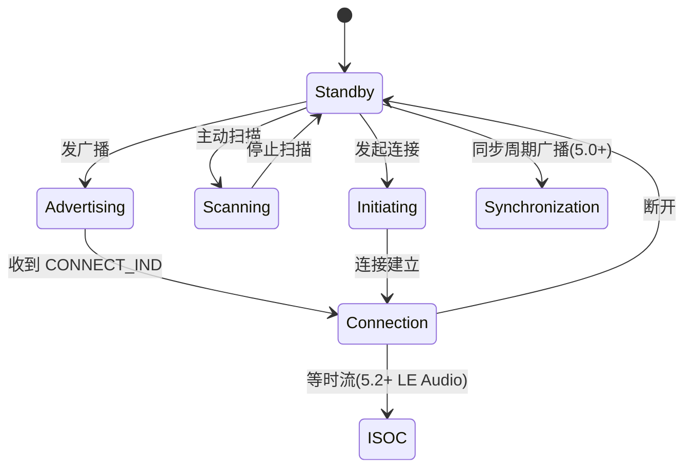

| 状态 | 干什么 |
|---|---|
| Standby | 睡觉，最省电 |
| Advertising | 周期性发广播 PDU（37/38/39 轮发） |
| Scanning | 被动收/主动问广播 |
| Initiating | 盯着目标设备广播，准备回 CONNECT_IND |
| Connection | 连接态，按连接间隔收发 |
| Synchronization | 与周期广播序列同步 |
| ISOC | 等时同步通道（LE Audio 专用） |

### 四、包结构（未编码 PHY）

```
| Preamble | Access Address | Header(2B) | Payload | MIC(可选4B) | CRC24(3B) |
```

| 字段 | 长度 | 内容 |
|---|---|---|
| Preamble | 1 B（LE 1M）/ 2 B（LE 2M） | 01010101 或 10101010（2M 时 0x5555/0xAAAA），按 Access Address 首位取反对齐，用于接收端时钟同步 |
| Access Address | 4 B | 包的身份；广播固定 `0x8E89BED6`；每个连接一个随机生成值 |
| Header | 2 B | 广播头/数据头两种格式，见下 |
| Payload | 0~255 B | 广播 ≤31+6（含 AdvA）；连接态 DLE 后 ≤251 B |
| MIC | 0 或 4 B | 加密时的消息完整性校验码（Message Integrity Check，CCM 产生） |
| CRC24 | 3 B | 多项式 x^24+x^10+x^9+x^6+x^4+x^3+x+1（0x00065B）；广播包初值 0x555555，连接包初值由 CONNECT_IND 下发 |

#### 4.1 广播 PDU 头（16 bits）

| 位 | 字段 | 说明 |
|---|---|---|
| 0-3 | PDU Type | 见 [03-广播与连接](61-ble-core.md) 类型表 |
| 4 | RFU | 保留 |
| 5 | ChSel | 0=CSA#1，1=CSA#2（连接时声明信道选择算法） |
| 6 | TxAdd | 发送者地址类型：0=Public，1=Random |
| 7 | RxAdd | 接收者地址类型（仅 ADV_DIRECT_IND 用） |
| 8-15 | Length | 载荷字节数（legacy 广播 ≤37：6B AdvA + ≤31B 数据） |

#### 4.2 连接态数据 PDU 头（16 bits）

| 位 | 字段 | 说明 |
|---|---|---|
| 0-1 | LLID | 00 保留 / 01 LL 数据（续）/ 10 LL 数据（起）/ 11 LL 控制帧（LLCP） |
| 2 | NESN | Next Expected Sequence（对端下一期望序号，ARQ 用） |
| 3 | SN | 本包序号 |
| 4 | MD | More Data：我还有数据，别睡 |
| 5 | CP | 时钟精度字段存在（5.2+） |
| 6-7 | RFU | 保留 |
| 8-15 | Length | 载荷字节数（0~251，DLE 后；0 表示空包仅作应答） |

LE Coded PHY 的帧在此基础上前移：Preamble+AA 经 S=2/S=8 编码扩展，头部携带 2-bit CI（Coding Indicator）声明载荷所用编码，载荷+CRC+MIC 进入 FEC 块——细节见 Core Spec Vol 6 Part B 3.x。

### 五、连接与跳频

连接建立后双方在**连接事件（connection event）**中成对收发，事件起点称为锚点（anchor point）：

| 参数 | 范围/单位 | 说明 |
|---|---|---|
| 连接间隔 ConnInterval | 7.5 ms ~ 4 s（1.25 ms 单位） | 两次连接事件的周期 |
| 从机延迟 ConnLatency | 0~499 个事件 | 允许外设连续跳过 N 个事件 |
| 监督超时 SupervisionTimeout | 100 ms ~ 32 s（10 ms 单位） | 超时未收到有效包则断链；必须 > 2×(1+Latency)×Interval |

#### 5.1 跳频机制

| 要素 | 内容 |
|---|---|
| Channel Map | 5 字节位图（40 bit 中数据信道 37 bit 有效），把被 Wi-Fi 干扰的信道标 0 剔除（AFH 思想） |
| Hop Increment | 5 bit，取值 5~16，连接建立时由 Central 指定 |
| CSA #1 | 信道选择算法 1：先在未剔除信道里算，再映射回物理信道号 |
| CSA #2 | 4.2 引入，用信道图生成伪随机重映射表，抗窄带干扰更均匀；广播头 ChSel 位声明 |

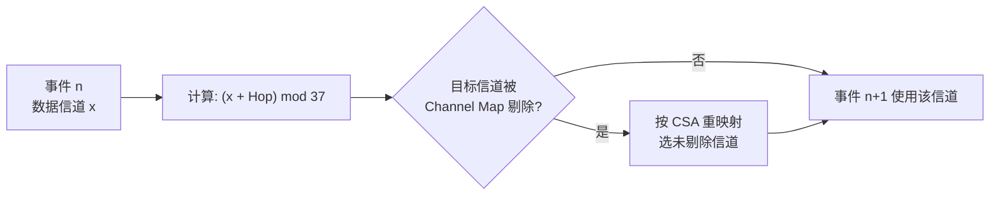

### 六、LL 控制协议（LLCP，LLID=11）

连接双方用 LLCP 管理链路本身，常用控制 PDU：

| Opcode | 名称 | 用途 |
|---|---|---|
| 0x00 | LL_CONNECTION_UPDATE_IND | 即时更新连接参数（Master/Central 直接生效） |
| 0x01 | LL_CHANNEL_MAP_IND | 更新信道图 |
| 0x02 | LL_TERMINATE_IND | 断链（带原因码） |
| 0x03/0x04 | LL_ENC_REQ / LL_ENC_RSP | 开始加密握手（见下） |
| 0x05/0x06 | LL_START_ENC_REQ / RSP | 用新密钥切换加密 |
| 0x08/0x09 | LL_FEATURE_REQ / RSP | 特性交换 |
| 0x0F/0x10 | LL_CONNECTION_PARAM_REQ / RSP | 4.1+ 双方协商连接参数（Peripheral 也能发起） |
| 0x14/0x15 | LL_LENGTH_REQ / RSP | **DLE**：把空口载荷从 27 B 扩到 251 B |
| 0x16~0x18 | LL_PHY_REQ / RSP / UPDATE_IND | PHY 切换（2M/Coded） |

### 七、加密与白化

- **加密**：AES-128，CCM 模式（计数器 CTR 加密 + CBC-MAC 产出 4 字节 MIC）；nonce 由方向位、IV、包计数器组成，防重放。握手 LL_ENC_REQ→…→START_ENC 一气呵成，密钥来自 SMP（见 [06-SMP安全与配对](61-ble-core.md)）。
- **白化/扰码（Whitening / 数据扰码）**：载荷与 CRC 经 7 位 LFSR（多项式 x^7+x^4+1，种子与信道号相关）异或，打散长连 0/1，利于接收端 AGC 与同步；Coded PHY 在 FEC 之前扰码。5.0 规范改称 data whitening/scrambling。

## 原文：03-广播与连接

> Source: [50-枝干-无线关联/BLE-低功耗蓝牙/03-广播与连接.md](https://github.com/tangjianfang/USBTree/blob/main/50-枝干-无线关联/BLE-低功耗蓝牙/03-广播与连接.md)

---

广播（Advertising）是 BLE 设备的"名片"，也是 BLE 与 USB 在时间模型上最不同的一点：USB 设备被轮询，BLE 外设**先自说自话，等被选中才进连接**（对比 [../../10-树干-USB核心/06-四种传输类型](05-transfer-types-bandwidth.md) 的中断传输轮询模型）。

### 一、传统广播 PDU 类型（信道 37/38/39）

PDU Type（4 bit）定义于广播头（见 [02-链路层与物理层](61-ble-core.md)）：

| 值 | PDU | 可连接 | 可扫描 | 载荷 | 说明 |
|---|---|---|---|---|---|
| 0x0 | ADV_IND | （任意 Central） | （可回 SCAN_RSP） | AdvA(6)+Data(≤31) | 最常用：传感器、键鼠待配对 |
| 0x1 | ADV_DIRECT_IND | （仅指定对端） |  | AdvA+TargetA（各 6B） | 重连专用；4.x 中 TxAdd=1 表示高占空比（间隔 ≤3.75ms），5.x 建议改用扩展广播 |
| 0x2 | ADV_NONCONN_IND |  |  | AdvA+Data(≤31) | 纯单向：iBeacon 类 |
| 0x6 | ADV_SCAN_IND |  | （可回 SCAN_RSP） | AdvA+Data(≤31) | 可被查询但不可连接（beacon+附加信息） |
| 0x3 / 0x4 | SCAN_REQ / SCAN_RSP | —— | —— | ScanA+AdvA / AdvA+RspData(≤31) | 主动扫描的问答对 |
| 0x5 | CONNECT_IND | —— | —— | InitA+AdvA+LLData(22B) | Central 回的"连接请求"（旧名 CONNECT_REQ） |
| 0x7 | ADV_EXT_IND | —— | —— | Extended Header | 5.0 扩展广播入口（见第五节） |

### 二、广播间隔与功耗权衡

- 间隔 = N × 0.625 ms，N ∈ [0x20, 0x4000] → **20 ms ~ 10.24 s**；规范还要求每次广播事件叠加 0~10 ms 随机延迟（防碰撞）。
- ADV_IND（可连接）最小 20 ms；不可连接广播 5.x 起也允许到 20 ms（4.x 曾限制 100 ms）。

| 广播间隔 | 被发现速度 | 平均电流（数量级示意） |
|---|---|---|
| 20 ms | 毫秒级扫到 | 数十~数百 µA |
| 100 ms | ~0.1 s | 十 µA 级 |
| 1 s | 秒级 | 个位数 µA |
| 10 s | 十秒级 | 亚 µA |

经验法则：待配对期用 20~100 ms，配对成功后停广播；长期 beacon 视场景 1 s+。这就是 BLE 能跑纽扣电池而 USB 外设可以"永远在线"的代价差异。

### 三、扫描

| 参数 | 含义 | 范围 |
|---|---|---|
| Scan Interval | 相邻扫描窗口起点间隔 | 2.5 ms ~ 10.24 s |
| Scan Window | 每次连续射频收听时长 | ≤ Scan Interval |
| 占空比 | Window/Interval | 100%（连续扫描）到个位数 % |

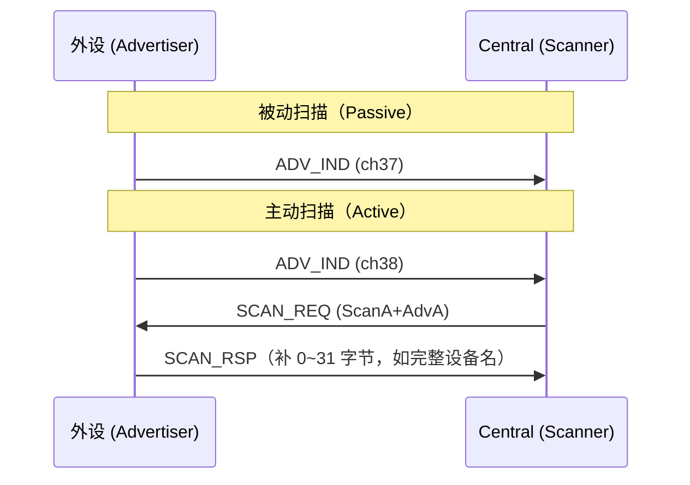

- **被动扫描**只收 ADV_IND，看不到 SCAN_RSP 内容；**主动扫描**多一次问答，把名片凑成两页。
- 扫描响应与广播数据合计最多 62 字节——这是传统广播的数据天花板。

### 四、广播数据结构：AD Structure

Data 字段由一串 AD 结构（Advertising Data Structure）拼接：

```
| Length(1B) | AD Type(1B) | Data(Length-1 B) |
```

常用 AD Type：

| 类型 | 名称 | 典型内容 |
|---|---|---|
| 0x01 | Flags | bit0 LE 有限发现、bit1 LE 普遍发现、bit2 BR/EDR 不支持（几乎总为 `06`） |
| 0x02 / 0x03 | Incomplete / Complete 16-bit Service UUID 列表 | `0x180F`（电池）等 |
| 0x06 / 0x07 | Incomplete / Complete 128-bit Service UUID 列表 | 厂商私有服务 |
| 0x08 / 0x09 | Shortened / Complete Local Name | "NRF52-Kbd" |
| 0x0A | Tx Power Level | 有符号 dBm |
| 0x16 | Service Data | Eddystone 等框架用 |
| 0x19 | Appearance | 与 GAP 服务 0x2A01 同源 |
| 0xFF | Manufacturer Specific Data | 厂商自定义，前 2 字节为公司 ID（蓝牙 SIG 分配） |

#### 4.1 iBeacon 字节级实例（Apple）

```
02 01 06                       ; AD: Flags = 0x06
1A FF 4C 00 02 15              ; AD: len=26, type=0xFF, Apple(0x004C 小端),
                               ;     子类型 0x02（Proximity Beacon）, 长度 0x15(21B)
E2 C5 6D B5 DF FB 48 D2 B0 60  ; iBeacon UUID 前 8 字节
D0 F5 A7 10 96 E0              ; iBeacon UUID 后 8 字节
00 01                          ; Major = 1
00 02                          ; Minor = 2
C5                             ; 校准 TX Power = -59 dBm（有符号）
```

#### 4.2 Eddystone-URL（Google）简例

```
03 03 AA FE                    ; AD: 完整 16-bit UUID 列表 = 0xFEAA
09 16 AA FE 10 00 03 67 6F 6F  ; Service Data: len=9, type=0x16, UUID 0xFEAA,
                               ; 帧=0x10(URL), TX=0 dBm, 前缀 0x03="https://",
                               ; 编码 URL "goo"（后续帧可继续编码完整网址）
```

（URL 编码用 1 字节代表常见子串，如 0x07=".com"，详见 Eddystone 规范。）

### 五、5.0 扩展广播（Extended Advertising）

| 能力 | 说明 |
|---|---|
| 入口 | ADV_EXT_IND 仍在 37/38/39，仅含少量头部字段 + AUX 指针 |
| 二次广播 | AUX_ADV_IND / AUX_CHAIN_IND 在**数据信道**发送，载荷可达 **255 B/包**，链路层分片链接 |
| ADI（AdvDataInfo） | 16 bit（策略+滚动 ID），帮助接收端合并分片、去重 |
| 广播集（Advertising Set） | 单设备并行多路广播（不同身份/间隔/内容） |
| Periodic Advertising | 周期广播序列，供 Synchronization 状态同步接收（beacon 网格、Auracast） |
| 代价 | 老手机（4.x 栈）看不到扩展广播；兼容场景仍用 legacy |

### 六、连接建立全流程

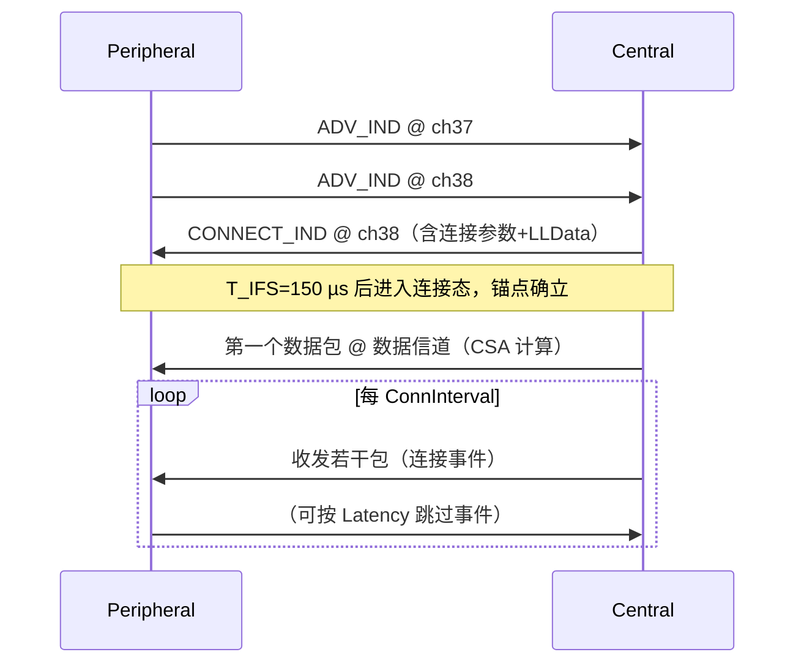

#### 6.1 CONNECT_IND 载荷（34 B）

| 字段 | 长度 | 内容 |
|---|---|---|
| InitA / AdvA | 6+6 B | 发起方/广播方地址 |
| AA | 4 B | **新连接的 Access Address**（随机生成，规则：4 字节互不相等、无 >6 个连续同值位、32 bit 内跳变 ≤24 次、高 16 位跳变 ≤11 次、≠0x8E89BED6） |
| CRCInit | 3 B | 本连接 CRC 初值 |
| WinSize / WinOffset | 1+2 B | 首个连接事件的接收窗口（1.25 ms 单位） |
| Interval | 2 B | 连接间隔（1.25 ms 单位） |
| Latency | 2 B | 从机延迟 |
| Timeout | 2 B | 监督超时（10 ms 单位） |
| ChM | 5 B | 初始信道图 |
| Hop(5b) + SCA(3b) | 1 B | 跳频增量 5~16；Central 睡眠时钟精度 |

### 七、连接参数协商

- **PPCP**（Peripheral Preferred Connection Parameters，特征 0x2A04）：外设在 GATT 里放一份"期望参数"（最小/最大间隔、Latency、超时倍数），Central 酌情采纳。
- 外设主动要：4.1+ 走 `LL_CONNECTION_PARAM_REQ/RSP`（链路层协商）；或 L2CAP 信令信道 0x0005 的 CONNECTION_PARAM_UPDATE（只能 Peripheral→Central）。
- 合法性约束：`SupervisionTimeout > 2 × (1 + Latency) × Interval`（同时各自满足规范范围），否则链路可能被误判断开。

**功耗计算示例**：Interval = 1 s，Latency = 4 → 外设最多每 `1 s × (4+1) = 5 s` 醒一次；若每次唤醒射频活动 3 mA × 3 ms，平均电流 ≈ 3 mA × 3 ms / 5 s = **1.8 µA**（未计广播），CR2032（~220 mAh）理论上可用十年级——参数每放宽 10 倍间隔，平均电流近似降 10 倍。

### 八、多连接拓扑

Central 可同时维持多连接（Nordic SoC 常见 8~20 条），调度器把各连接事件在时间轴上**交错**排布；连接间隔小、连接数多时事件拥挤，吞吐与实时性互相挤压——这也是 2.4G 私有 dongle 在游戏键鼠场景仍占优的原因之一（一条独占链路，回报率可做到 1 kHz/8 kHz）。

### 九、广播配置伪代码（nRF / ESP32 风格）

```c
// 1. 设置广播参数
ble_adv_params_t p = {
    .interval_min = 0x20,          // 20 ms
    .interval_max = 0x40,          // 40 ms（范围内随机化）
    .type = ADV_IND,               // 可连接可扫描
    .own_addr_type = RANDOM_STATIC,
    .channels = CH37|CH38|CH39 };
ble_set_adv_params(&p);

// 2. 填 AD 结构（注意总长 ≤31 B）
ble_adv_data_t d = { FLAGS(0x06),
                     COMPLETE_16(0x180F),      // 声明电池服务
                     NAME("USB-Tree Sensor"),
                     MFG(0x0059, "Nordic...") };
ble_set_adv_data(&d);

// 3. 启动广播；等连接事件回调
ble_adv_start();
on_connection(ble_conn_params_set(INTERVAL_45MS, LATENCY_2, TIMEOUT_4S));
```

（ESP32 NimBLE / Zephyr / SoftDevice 的真实 API 名各异，流程一致：参数→数据→使能→回调。）

## 原文：04-ATT与GATT

> Source: [50-枝干-无线关联/BLE-低功耗蓝牙/04-ATT与GATT.md](https://github.com/tangjianfang/USBTree/blob/main/50-枝干-无线关联/BLE-低功耗蓝牙/04-ATT与GATT.md)

---

属性协议（ATT, Attribute Protocol）定义了一张"属性表"如何被读写；通用属性规范（GATT, Generic Attribute Profile）规定这张表里如何组织服务与特征。所有 BLE 数据业务（包括 HOGP 键鼠报告）最终都是对这张表的读写与订阅。它跑在 L2CAP 固定信道 0x0004 上（见 [01-蓝牙体系架构与HCI](60-usb-wireless-intersection.md)）。

### 一、属性（Attribute）四元组

| 元素 | 大小 | 说明 |
|---|---|---|
| Handle | 2 B（0x0001~0xFFFF） | 表内索引，服务器内唯一、递增排列 |
| Type | UUID 16 bit 或 128 bit | 属性类型；16-bit UUID 由 SIG 分配，128-bit 厂商自定义 |
| Value | ≤ MTU-1 | 任意字节 |
| Permissions | — | 访问权限：可读/可写/加密后可读/认证后可读等（与本表元数据无关，不占用空口字节） |

**ATT MTU**：默认 **23 字节**（1 字节操作码 + 22 字节载荷）；通过 Exchange MTU 协商增大，LE 上限 **517**；链路层 DLE（载荷 27→251 B）是大 MTU 高效运转的前提（见 [02-链路层与物理层](61-ble-core.md)）。

### 二、PDU 模型

| 方法类型 | 应答 | 例子 |
|---|---|---|
| Request | 必有 Response | Read Request |
| Command | **无任何应答**（fire-and-forget） | Write Command（写键值如灯光） |
| Notification | 无需确认 | 电量上报（发完即忘） |
| Indication | 需对方 Confirmation | Service Changed（可靠送达） |
| Confirmation | — | 对 Indication 的回执（opcode 0x1E） |

#### 2.1 核心 Opcode 表（数值务必准确）

| Opcode | PDU | 方向 | 备注 |
|---|---|---|---|
| 0x01 | Error Response | S→C | 携带"请求 opcode + 出错 handle + 错误码" |
| 0x02 / 0x03 | Exchange MTU Req / Rsp | C↔S | 参数：服务器/客户端 RX MTU（2B） |
>  对抗抽查（evolve #30）：方法名序列（Exchange MTU/Execute Write/Find By Type/Handle Value NTF-CFM…）与 Core 6.0 Vol 3 Part F 提取文本比对一致。

| 0x04 / 0x05 | Find Information Req / Rsp | C↔S | 枚举 Handle→UUID 对（发现描述符） |
| 0x06 / 0x07 | Find By Type Value Req / Rsp | C↔S | 按类型+值找 handle 范围（找服务声明） |
| 0x08 / 0x09 | Read By Type Req / Rsp | C↔S | 按类型读（发现特征的主力） |
| 0x0A / 0x0B | Read Req / Rsp | C↔S | 读 ≤MTU-1 字节 |
| 0x0C / 0x0D | Read Blob Req / Rsp | C↔S | 带偏移读长值 |
| 0x0E / 0x0F | Read Multiple Req / Rsp | C↔S | 批量读 |
| 0x10 / 0x11 | Read By Group Type Req / Rsp | C↔S | **发现服务**（按组返回首尾 handle） |
| 0x12 / 0x13 | Write Req / Rsp | C↔S | 有应答写 |
| 0x14 | Signed Write Command | C→S | 无应答+签名（CSRK） |
| 0x16 / 0x17 | Prepare Write Req / Rsp | C↔S | 长写第一步（排队） |
| 0x18 / 0x19 | Execute Write Req / Rsp | C↔S | 长写第二步（提交/取消） |
| 0x1B | Handle Value Notification | S→C | 无应答通知 |
| 0x1D / 0x1E | Handle Value Indication / Confirmation | S↔C | 需确认通知 |
| 0x52 | Write Command | C→S | **无应答写**（HID 输出报告常用） |

（5.2 的 EATT 在动态 L2CAP 信道上允许多个并发 ATT 事务，opcode 0xBF-0x… 的多变量读等新增 PDU 此处不展开，见 Core Spec Vol 3 Part F。）

#### 2.2 Error Response 常见错误码

| 码 | 名称 | 场景 |
|---|---|---|
| 0x01 | Invalid Handle | handle 不存在 |
| 0x02 | Read Not Permitted | 属性禁止读 |
| 0x03 | Write Not Permitted | 属性禁止写 |
| 0x05 | Insufficient Authentication | 需要先配对/认证（最常见的安全拦路虎） |
| 0x06 | Request Not Supported | 服务器不支持该请求 |
| 0x08 | Insufficient Authorization | 授权不足 |
| 0x0A | Attribute Not Found | 发现流程走到头 |
| 0x0F | Insufficient Encryption | 需要加密链路 |

### 三、GATT 层级结构

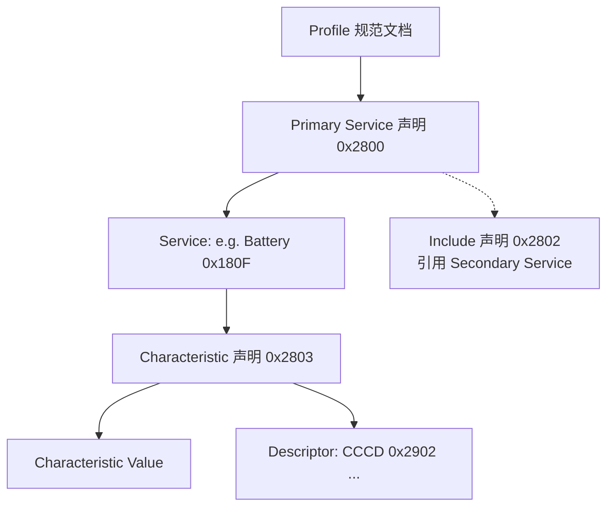

| 元素 | 声明 UUID | 内容 |
|---|---|---|
| Primary Service | 0x2800 | 值 = 服务 UUID（如 0x180F） |
| Secondary Service | 0x2801 | 只能被 Include 引用，不单独发现 |
| Include | 0x2802 | 引用另一服务的 handle 范围 |
| Characteristic | 0x2803 | 值 = Properties(1B) + Value Handle(2B) + 特征 UUID |

#### 3.1 特征属性位（Properties，1 字节）

| bit | 属性 | 含义 |
|---|---|---|
| 0x01 | Broadcast | 可在广播中携带 |
| 0x02 | Read | 可读 |
| 0x04 | Write Without Response | 可无应答写 |
| 0x08 | Write | 可有应答写 |
| 0x10 | Notify | 可通知（配合 CCCD） |
| 0x20 | Indicate | 可指示（配合 CCCD） |
| 0x40 | Authenticated Signed Writes | 支持签名写 |
| 0x80 | Extended Properties | 扩展位在 0x2900 描述符 |

#### 3.2 CCCD：订阅为何是"每连接独立"

CCCD（Client Characteristic Configuration Descriptor，UUID **0x2902**）：2 字节位图，有效位：

| bit | 含义 |
|---|---|
| 0 | 使能 Notification（写 0x0001） |
| 1 | 使能 Indication（写 0x0002） |

**关键设计**：服务器为**每个连接**单独保存一份 CCCD 值（而非存在属性表里共享）。所以手机 A 订阅了电量，手机 B 不订阅，互不影响——这也解释了为什么重连后客户端要重新写 CCCD（bond 后服务器会记住该客户端的 CCCD 并在重连时恢复）。

### 四、常用标准服务/特征 UUID 速查

| UUID | 名称 | 关键特征 |
|---|---|---|
| 0x1800 | GAP 服务 | Device Name 0x2A00、Appearance 0x2A01、PPCP 0x2A04 |
| 0x1801 | GATT 服务 | **Service Changed 0x2A05**、Database Hash 0x2B2A（5.1） |
| 0x180A | Device Information | Manufacturer 0x2A29、Model 0x2A24、Firmware Rev 0x2A26、**PnP ID 0x2A50** |
| 0x180F | Battery Service | Battery Level 0x2A19（0~100%，Notify） |
| 0x1812 | HID 服务 | HOGP 核心，见 [07-HOGP-HIDoverGATT](60-usb-wireless-intersection.md) |
| 0x1813 | Scan Parameters | Scan Interval Window 0x2A10（客户端建议扫描节奏） |

> **全量编号**：本节为速查（高频 6 服务）；完整标准 UUID 表（声明 0x28xx / 服务 0x18xx / 特征 0x2Axx~0x2Bxx / 描述符 0x29xx，SIG 官方 Assigned Numbers 数据机生成 615 项）见 [16-标准UUID全表](63-ble-uuid.md)。字段结构与语义以缓存规范 GATT_Specification_Supplement.pdf（2026-02-05 版）为准——注意现行 GSS 正文已不含 UUID 编号，编号以 Assigned Numbers 为单一事实源。

### 五、服务发现完整流程（抓包级）

以"发现服务→发现特征→订阅电量"为例（C=客户端，S=服务器）：

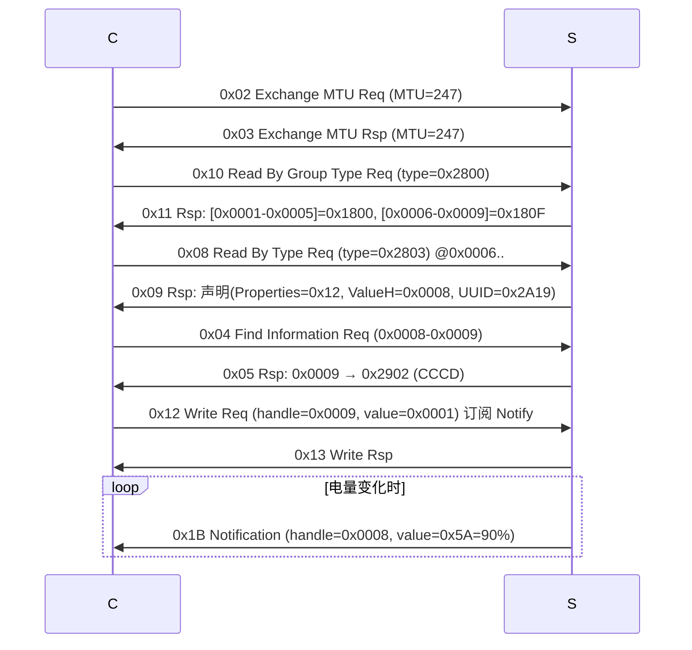

字节示例——`Read By Group Type Request`：

```
04 00            ; L2CAP: 长度 4
04 00            ; L2CAP: CID 0x0004 (ATT)
10 01 00 FF FF 00 28   ; ATT: opcode 0x10, 起始 0x0001, 结束 0xFFFF, 类型 0x2800
```

### 六、GATT 缓存与 Service Changed

- 客户端可**缓存**服务器属性表结构（发现一次，重连直接用）——GAP 的信任与 bond（见 [05-GAP与连接管理](61-ble-core.md)）是缓存的前提。
- 服务器表结构变了（OTA 加了服务）必须通知客户端：GATT 服务（0x1801）的 **Service Changed（0x2A05，Indicate）**携带受影响 handle 范围，客户端收到后重新发现。
- 5.1 增加 Database Hash（0x2B2A）：一次性读出表结构哈希，客户端比对即可知表是否变化，减少 Indicate 依赖。

## 原文：05-GAP与连接管理

> Source: [50-枝干-无线关联/BLE-低功耗蓝牙/05-GAP与连接管理.md](https://github.com/tangjianfang/USBTree/blob/main/50-枝干-无线关联/BLE-低功耗蓝牙/05-GAP与连接管理.md)

---

通用访问规范（GAP, Generic Access Profile）回答三个问题：**我是谁（地址）、我是什么角色、别人怎么找到并连上我**。它是广播（[03](61-ble-core.md)）与安全（[06](61-ble-core.md)）的组织者。

### 一、GAP 四角色

| 角色 | 行为 | 无线电活跃度 |
|---|---|---|
| Broadcaster（广播者） | 只发广播，不收 | 周期性发射 |
| Observer（观察者） | 只听广播 | 周期性收听 |
| Central（主机/中心） | 发起连接（对应旧称 Master） | 扫描+连接+调度多从设备 |
| Peripheral（外设/从机） | 广播等待被连（对应旧称 Slave） | 广播→连接态 |

- 只有 **Central/Peripheral** 涉及连接；Broadcaster/Observer 是纯广播世界的角色（beacon）。
- 术语变迁：5.3 起规范正式以 Central/Peripheral 取代 Master/Slave，读老文档/老代码（`sd_ble_gap_...`、sniffer 抓包）时按同义转换。
- 连接态角色不对称是硬约束：**只有 Central 能在 CONNECT_IND 里拍板初始连接参数**，外设只能事后协商——这与 USB 主机轮询设备的权力结构如出一辙（对照 [../../10-树干-USB核心/02-体系架构与分层模型](02-architecture-topology.md)）。
- 一台设备可同时担任多角色（如手环同时是手机的 Peripheral 和另一设备外设的 Central）；5.2 的拓扑增强（Topology Enhancement）进一步放宽了多角色并发约束，细节见 Core Spec。

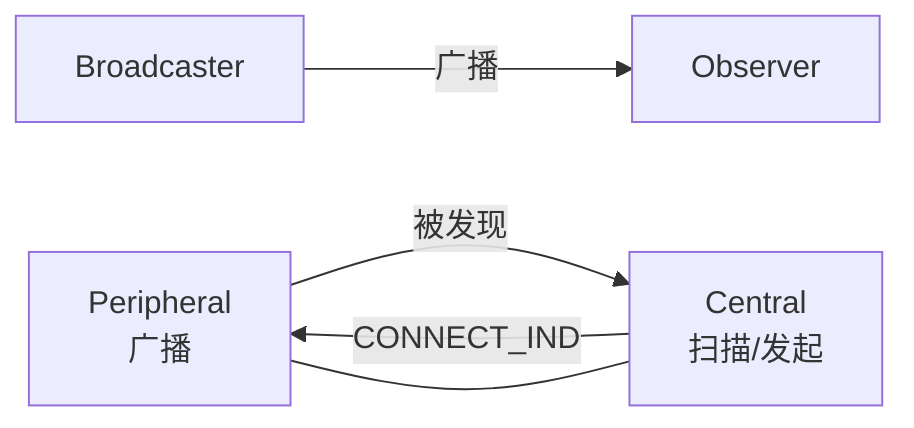

### 二、设备地址体系（48 bit，看起来像 MAC，语义完全不同）

| 类型 | 最高 2 bit | 可否解析 | 特点 |
|---|---|---|---|
| Public Address | —（IEEE 分配） | — | 厂商 OUI 静态地址，等于裸奔身份 |
| Random Static | 11 | 否 | 开机可变但一般每次上电不变；常用默认 |
| Random Private **Resolvable**（RPA） | 01 | 是（持 IRK 者） | **周期轮换**（典型 15 分钟），防追踪首选 |
| Random Private Non-resolvable | 00 | 否 | 纯随机轮换，白名单无法认出你，少用 |

#### 2.1 RPA 的生成与解析

RPA = `prand(3 B) + hash(3 B)`，其中 prand 最高 2 bit = `01`，hash = ah(IRK, prand)（ah 是 AES-128 构造的 24 bit 校验函数，定义于 Core Spec Vol 3 Part H）。

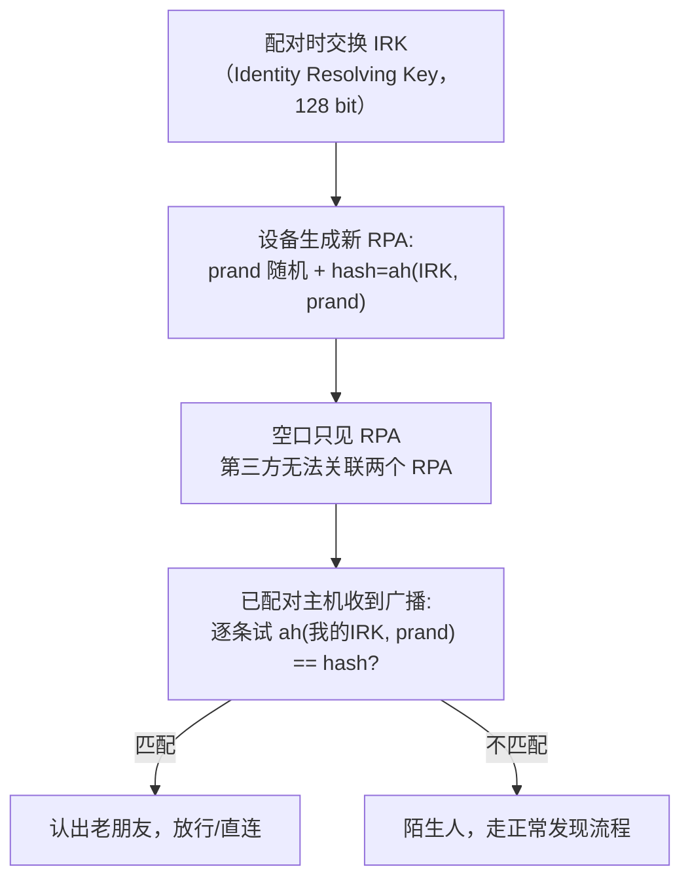

这就是"手机重连手环时，AirTag 防跟踪、手环不被陌生人定位"的同一套机制：**身份藏在 IRK 里，不在地址里**。IRK 在配对第三阶段分发（见 [06-SMP安全与配对](61-ble-core.md)）。

#### 2.2 地址字节级判别示例

```
C0 56 34 12 9F D2   → 最高字节 0xC0 = 11xxxxxx → Random Static（0xC0/0xF0/0xFC...）
F1 8A 3B 22 44 02   → 最高字节 0xF1 = 11...   → Random Static
42 11 22 33 44 55   → 最高字节 0x42 = 01...   → RPA（Resolvable Private）
08 77 66 55 44 33   → 最高字节 0x08 = 00...   → Non-resolvable Private
AC:BC:32:80:00:01   → 以 0xAC 开头（OUI）      → Public（IEEE 分配）
```

（地址在空口/HCI 中均按小端传输，最低字节在前；判别只看**最高字节的最高 2 bit**。）

#### 2.3 白名单与广播过滤

GAP 用**过滤接受表（Filter Accept List，旧称白名单 White List）**控制"理睬谁"：HCI 层维护一组（地址类型+地址）条目，控制器在射频层直接过滤，省去主机 wake 开销。广播端可配四种过滤策略（`LE Set Advertising Parameters` 的 FilterPolicy 字段）：

| 值 | Scanning 过滤 | Connection 过滤 |
|---|---|---|
| 0x00 | 接受所有扫描请求 | 接受所有连接请求 |
| 0x01 | 仅白名单 | 接受所有 |
| 0x02 | 接受所有 | 仅白名单 |
| 0x03 | 仅白名单 | 仅白名单 |

定向重连（ADV_DIRECT_IND）+ 白名单 + RPA 解析，三者组合出"只有我的主人能连我"的工程实现。

#### 2.4 连不上？排查清单

| 现象 | 常见根因 |
|---|---|
| 扫不到设备 | 广播类型为不可连接（ADV_NONCONN_IND）/ 已连接后停播 / 扫描窗口占空比太低 |
| 扫到连不上 | 广播端过滤策略 0x02/0x03（仅白名单）/ 连接参数非法（Timeout ≤ 2×(1+Latency)×Interval） |
| 定向广播无响应 | ADV_DIRECT_IND 的 TargetA 与主机当前 RPA 不符（地址已轮换或解析失败） |
| 连上即断 | 密钥失效（一方已删除 bond）但另一方仍坚持加密 |
| 能连不能读报告 | 未完成配对/加密，ATT 回 Insufficient Authentication |

### 三、连接参数管理（谁说了算）

| 事项 | 规则 |
|---|---|
| 初始参数 | Central 在 CONNECT_IND 中单方面决定（见 [03-广播与连接](61-ble-core.md) 6.1 节） |
| 外设表达期望 | GATT 的 **PPCP（0x2A04）**：Min/Max Interval、Slave Latency、Timeout Multiplier（6 B） |
| 外设主动更新 | L2CAP 信令 `CONNECTION_PARAM_UPDATE`（仅 Peripheral→Central）或链路层 LLCP `LL_CONNECTION_PARAM_REQ/RSP`（双方协商） |
| 合法性约束 | `SupervisionTimeout > 2 × (1 + Latency) × Interval`，且 Interval ∈ [7.5 ms, 4 s]、Timeout ∈ [100 ms, 32 s] |

手机（Central）常在连接初期用激进参数（7.5~30 ms）快速交换数据，随后按省电需求放宽——主机侧策略不同，同一外设的续航可差数倍。

### 四、设备名称与外观

| 特征 | UUID | 说明 |
|---|---|---|
| Device Name | 0x2A00 | UTF-8 字符串；可同时在广播 AD 0x08/0x09 携带缩写 |
| Appearance | 0x2A01 | 16 bit 类别码（如"鼠标""心率带"），广播 AD 0x19 同步 |
| Central Address Resolution | 0x2AA6 | 4.2+：告知外设"主机能否解析 RPA" |

### 五、全生命周期时序

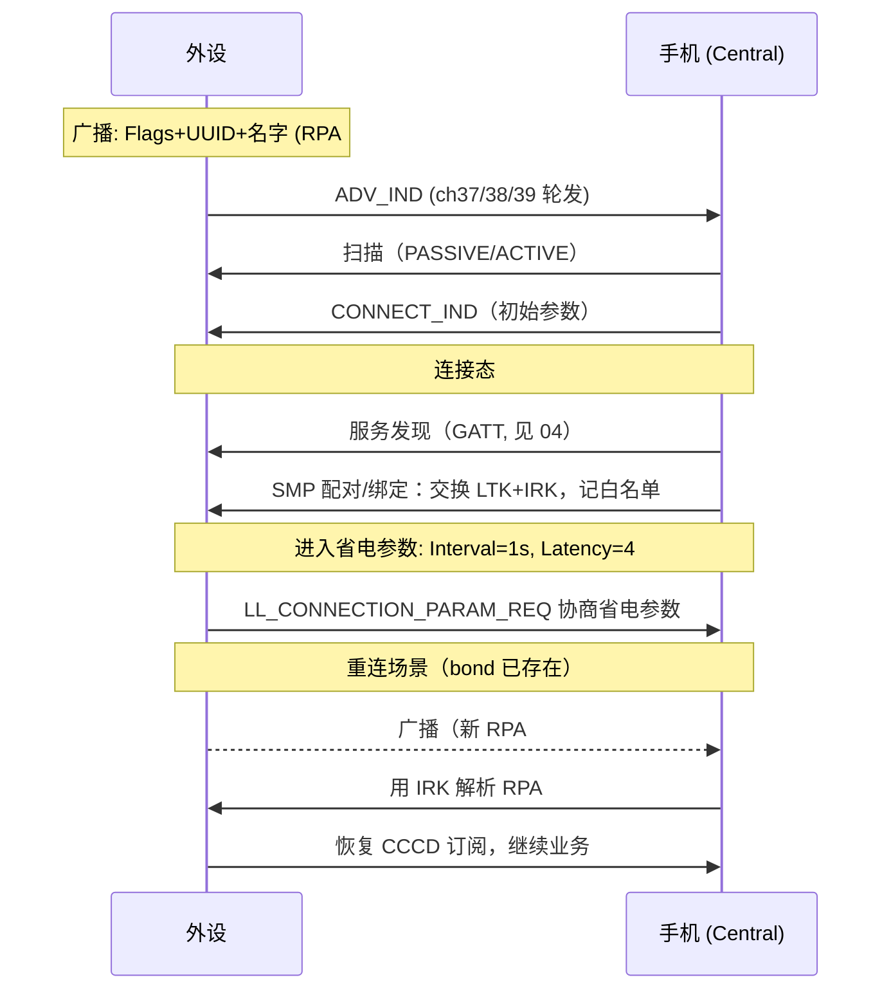

**bonding（绑定）= 配对 + 密钥持久化**。配对只是"这次会话换钥匙"，bonding 把 LTK/IRK 写进双方非易失存储，下次重连直接加密、直接认人，用户无感。详见 [06-SMP安全与配对](61-ble-core.md)。

### 六、实践：nRF Connect 里看到的一切

用手机 App（如 nRF Connect）扫 BLE 设备时，界面元素与本文概念一一对应：

| App 显示 | 对应概念 | 本文章节 |
|---|---|---|
| 设备名 "Sensor" | AD 0x09 / GATT 0x2A00 | 四 |
| 地址 `F2:8A:xx...` + 类型 "Random" | RPA（最高位 01）或 Static（11） | 二 |
| RSSI -67 dBm | 广播包实测场强（HCI Advertising Report 尾字节） | —— |
| "Connectable" 标志 | ADV_IND vs ADV_NONCONN_IND | ——（[03](61-ble-core.md)） |
| 服务列表 0x180F/0x180A | Primary Service 声明 | ——（[04](61-ble-core.md)） |
| 特征旁的"↓↑"订阅箭头 | CCCD 0x2902 写入 | ——（[04](61-ble-core.md)） |
| 配对弹窗（数字比对/输入 PIN） | SMP 配对方法 | ——（[06](61-ble-core.md)） |
| "Forget/Bond" 菜单 | 删除 LTK/IRK/CSRK 持久化密钥 | 三/五 |

## 原文：06-SMP安全与配对

> Source: [50-枝干-无线关联/BLE-低功耗蓝牙/06-SMP安全与配对.md](https://github.com/tangjianfang/USBTree/blob/main/50-枝干-无线关联/BLE-低功耗蓝牙/06-SMP安全与配对.md)

---

安全管理协议（SMP, Security Manager Protocol）跑在 L2CAP 固定信道 **0x0006** 上，负责配对（Pairing）、加密建立（Encryption）与密钥分发（Key Distribution）。USB 世界里"信任即插即用"，BLE 世界里"先配对、再加密、才谈敏感数据"——这是两棵树安全模型的根本差异。

### 一、配对三阶段

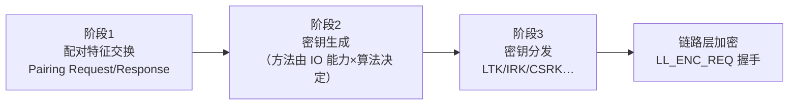

#### 1.1 阶段 1：Pairing Request / Response（7 字节定长）

| 偏移 | 长度 | 字段 | 说明 |
|---|---|---|---|
| 0 | 1 | Opcode | 0x01（Request）/ 0x02（Response） |
| 1 | 1 | IO Capability | 见 1.2 表 |
| 2 | 1 | OOB data flag | 0x00 无 / 0x01 有（NFC 等，4.x；5.x 扩展） |
| 3 | 1 | AuthReq | 见下 |
| 4 | 1 | MaxEncKeySize | 7~16 字节 |
| 5 | 1 | Initiator Key Distribution | 位图（加密后发起方想收的密钥） |
| 6 | 1 | Responder Key Distribution | 位图（加密后响应方想收的密钥） |

**AuthReq 位图**：bit0-1 Bonding（0 无 / 1 bonding）、bit2 **MITM**（要求防中间人）、bit3 **SC**（Secure Connections）、bit4 Keypress、bit5 CT2。

密钥分发位图：bit0 LTK/EncKey、bit1 IRK/IdKey、bit2 CSRK/SignKey（legacy 还含 EDIV+Rand；地址随 IRK 分发）。

#### 1.2 IO 能力与配对方法

五种 IO 能力（IO Capability，1 字节取值）：

| 值 | 能力 | 例子 |
|---|---|---|
| 0x00 | DisplayOnly | 只能显示 6 位数字 |
| 0x01 | DisplayYesNo | 能显示并确认是/否 |
| 0x02 | KeyboardOnly | 只能输入 |
| 0x03 | NoInputNoOutput | 什么都没有（多数手环/标签） |
| 0x04 | KeyboardDisplay | 都行 |

**方法决策（是否选 MITM 方法）**：

| 组合（发起方 × 响应方） | Legacy Pairing | LE Secure Connections |
|---|---|---|
| 任一方 NoInputNoOutput | Just Works（无 MITM） | **Numeric Comparison 不可用**，仍 Just Works |
| DisplayOnly × KeyboardOnly | Passkey Entry | Passkey Entry |
| DisplayYesNo × DisplayYesNo | Passkey Entry（无 MITM 可能降级） | **Numeric Comparison**（双方比 6 位数字） |
| 有键盘 × 有显示 | Passkey Entry | Passkey Entry 或 Numeric Comparison |
| OOB 可用 | OOB（是否 MITM 取决于 OOB 通道） | OOB |

规则内核：**MITM 保护必须来自"通道外的秘密"（人眼看数字、敲键盘、NFC），纯软件无法凭空创造**。这也是"Just Works 不安全但可用"的根本原因——与 USB 无认证直连相比，BLE 至少把"要不要认证"变成了协议里的显式选项。

### 二、Legacy Pairing vs LE Secure Connections

| 维度 | LE Legacy（4.0/4.1） | LE Secure Connections（4.2+） |
|---|---|---|
| 核心算法 | 自定义函数 c1/s1（AES-128 拼装） | **ECDH P-256** 椭圆曲线 Diffie-Hellman（FIPS 186 曲线） |
| 临时密钥 TK | 由配对方法拼出（Passkey 直接参与运算） | 不存在 TK；口令只用于 f4/f5/f6 校验函数 |
| 被动嗅探 | **可破解**：抓到配对过程即可能算出 STK/LTK（工具 Crackle 就是干这个的） | 不可（ECDH 保密协商，监听者只见公钥） |
| 中间人 | Just Works 下无保护 | Numeric Comparison/OOB 下有保护 |

Legacy 流程（简）：确认值 c1 / 随机数 Mrand 交叉验证（Pairing Confirm 0x03 + Pairing Random 0x04）→ 双方各自算出 **STK**（短期密钥）→ 加密链路 → 加密态下分发 **LTK**（长期密钥）。

SC 流程（简）：

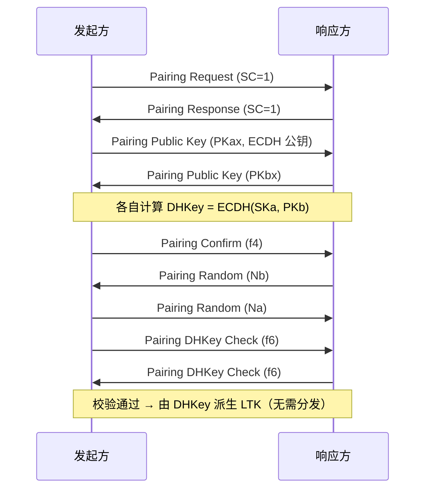

### 三、加密建立（链路层视角）

LTK 就绪后由 LLCP 完成（字段名层面，细节见 Core Spec Vol 6 Part B）：

```
LL_ENC_REQ  (Rand + EDIV[legacy] + SKDm + IVm)
LL_ENC_RSP  (SKDs + IVs)
→ 双方组合 SKD=SKDm‖SKDs、IV=IVm‖IVs，以 LTK 派生会话密钥
LL_START_ENC_REQ → LL_START_ENC_RSP（切换加密，之后所有包带 4 字节 MIC）
```

- Legacy：LTK→（与 SKD 混合）→ STK→会话密钥；SC：LTK 直接派生会话密钥。
- **MIC**：CCM 模式的 4 字节完整性码，篡改即丢包（见 [02-链路层与物理层](61-ble-core.md) 第七节）。

### 四、阶段 3：密钥分发（Encrypt Information，加密态下）

| SMP Opcode | PDU | 内容 |
|---|---|---|
| 0x06 | Encryption Information | LTK（16 B） |
| 0x07 | Master Identification | EDIV(2 B) + Rand(8 B)（legacy 索引用） |
| 0x08 | Identity Information | IRK（16 B） |
| 0x09 | Identity Address Information | 身份地址（类型 + 6 B） |
| 0x0A | Signing Information | CSRK（16 B，签名写用） |
| 0x0B | Security Request | 外设催主机配对（单独使用） |

SC 模式下 LTK 由 DHKey 派生，不走 0x06/0x07 分发；IRK/CSRK/地址仍照发。

### 五、安全等级（Mode 1）

| 级别 | 名称 | 含义 |
|---|---|---|
| Level 1 | No Security | 裸连，如 beacon |
| Level 2 | Unauthenticated pairing with encryption | Just Works 加密（防窃听不防中间人） |
| Level 3 | Authenticated pairing with encryption | Passkey/NC/OOB，防 MITM |
| Level 4 | Authenticated LE Secure Connections | SC + 认证，现行推荐底线 |

GATT 属性权限据此拦人：权限不足时 ATT 回 `Insufficient Authentication (0x05)`，客户端应发起 SMP（见 [04-ATT与GATT](61-ble-core.md)）。

### 六、bonding 后的重连

- 密钥持久化清单：LTK（+EDIV/Rand）、IRK + 身份地址、CSRK、（外设侧）数据库哈希/CCCD 记忆。
- 重连识别：广播用 **RPA**，主机用 IRK 解析（流程见 [05-GAP与连接管理](61-ble-core.md)）；或用 ADV_DIRECT_IND 定向高占空比重连。
- 重连后立即用 LTK 走 LL_START_ENC 恢复加密，无需重新配对——键鼠"开机即用"的体验全部依赖 bonding。

### 七、已知弱点与最佳实践

| 弱点 | 说明 | 对策 |
|---|---|---|
| Just Works | 无 MITM：攻击者可夹在中间代答 | 需要安全的产品用 Numeric Comparison/OOB；硬件加确认键 |
| 固定 Passkey | 键盘只显示固定 6 位（"000000"）= 形同虚设 | 使用动态 Passkey 或 SC |
| Legacy 可被动破解 | 抓包配对过程可恢复密钥（工具 Crackle 一条命令） | 强制 LE Secure Connections（4.2+，现在芯片全面支持） |
| 配对弹窗钓鱼 | 诱导用户对攻击者设备点"配对" | 用户教育 + OS 显示设备名/图标核对 |
| 广播隐私 | 静态地址可被追踪 | 启用 RPA（15 分钟轮换） |

**BLE Mesh 一笔带过**：蓝牙 Mesh（2017）的安全模型独立于 SMP——进网（Provisioning）用独立的椭圆曲线流程，业务数据用 **Application Key / Network Key** 两层密钥体系加密，与点对点配对互不复用，详见 Mesh Profile Specification。

## 原文：08-经典蓝牙与BLE对比

> Source: [50-枝干-无线关联/BLE-低功耗蓝牙/08-经典蓝牙与BLE对比.md](https://github.com/tangjianfang/USBTree/blob/main/50-枝干-无线关联/BLE-低功耗蓝牙/08-经典蓝牙与BLE对比.md)

---

"蓝牙"一个名字下装着两套几乎无关的协议栈：BR/EDR（经典蓝牙，Basic Rate / Enhanced Data Rate）与 LE（Low Energy）。共享的只有 2.4 GHz 频段、品牌与（可选的）双模射频前端。本章给全面对照，并回答选型问题。

### 一、全面对比大表

| 维度 | 经典蓝牙 BR/EDR | BLE |
|---|---|---|
| 信道 | 79 × 1 MHz，AFH 剔除坏信道 | 40 × 2 MHz（3 广播 + 37 数据），AFH 思想同源 |
| 调制 | GFSK（1M）+ π/4-DQPSK（2M EDR）+ 8DPSK（3M EDR） | 仅 GFSK（1M / 2M / Coded 500k / 125k） |
| 峰值速率 | 1 / 2 / 3 Mbps（EDR） | 1 / 2 Mbps；Coded 125k/500k；实用吞吐更低 |
| 拓扑 | Piconet：1 主 7 活跃从机，可组 Scatternet | 星型多连接（Central 带多个 Peripheral），数量由芯片调度器定 |
| 连接建立 | inquiry 扫描（典型 10.24 s）+ page 呼叫，秒级~十秒级 | 广播 + CONNECT_IND，毫秒级 |
| 时间模型 | 持续收发的时隙轮询 | 连接事件 + 深睡（Interval 7.5 ms~4 s + Latency） |
| 功耗 | mW 级持续，不适合纽扣电池 | µA 级平均，纽扣电池数年 |
| 配对/安全 | PIN（ legacy）→ SSP（Secure Simple Pairing，ECDH P-256） | SMP：Legacy Pairing → LE Secure Connections（同为 ECDH P-256） |
| 数据模型 | RFCOMM 串口流 / L2CAP 信道 / SDP 服务发现 | ATT 属性表 + GATT 服务/特征 |
| 音频 | SCO/eSCO 语音 + A2DP 流（持续吞吐型） | LE Audio：ISO 等时通道（5.2+） |
| 典型设备 | 耳机、音箱、车机、老键鼠 | 传感器、手环、标签、新键鼠、资产追踪 |
| 命名：芯片 | 双模（Dual-mode）= BR/EDR+LE | 单模（Single-mode，LE only） |

### 二、协议栈对照

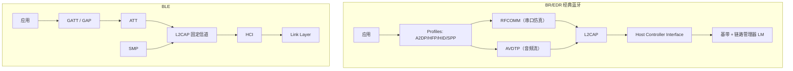

两边在 L2CAP 之下没有共享代码路径；连"连接"这个概念的含义都不同（时隙主从 vs 连接事件）。唯一真正"翻译"两界的是 HCI 之上的主机栈。

链路建立时序数字对照：经典蓝牙一次完整连接 = inquiry（典型 10.24 s 扫描窗口）+ page（亚秒级）≈ **数秒到十秒**；BLE = 扫到广播 + 回 CONNECT_IND ≈ **数十毫秒到数秒**（取决于广播间隔）。真无线耳机开盖秒连、手环抬腕即连，都是 BLE 广播模型的红利。

### 三、经典蓝牙 Profile 世界 vs BLE GATT 世界

| 经典 Profile | 用途 | BLE 对应物 |
|---|---|---|
| SPP（串行端口） | 虚拟串口（量产工具、老仪器） | 无标准等价物（Nordic UART Service 0x6E400001-... 为事实标准，非 SIG 规范） |
| A2DP | 高质量立体声音频流 | LE Audio（LC3 + CIS，5.2+） |
| HFP | 免提通话（双向语音） | LE Audio 通话服务（TMAP/ACS 等） |
| HID | 蓝牙键鼠（PSM 0x11/0x13） | **HOGP**（见 [07](60-usb-wireless-intersection.md)） |
| AVRCP | 媒体控制（播放/暂停） | Media Control 服务族（LE Audio） |
| OBEX/FTP/OPP | 文件传输 | 无等价物（被 Wi-Fi/系统分享取代） |

两套世界的服务模型**不可通约**：SDP 服务发现 vs GATT 属性发现，RFCOMM 字节流 vs ATT 属性读写。一台"支持 BLE 的经典蓝牙耳机"不是"简化版"，而是塞了两套栈。

### 四、双模设备策略

现实产品中最常见的分工：

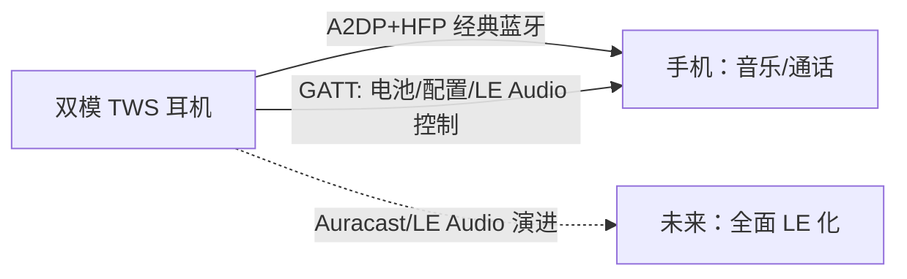

- 耳机：音频走经典 A2DP/HFP（现状最稳），GATT 侧放电量、佩戴检测、配置项；新旗舰开始以 LE Audio 为主路径。
- 键鼠：新设计一律 BLE（HOGP）；仅有线+经典蓝牙双模的老款仍存在。
- 手环/手表：纯 BLE 为主。

#### 4.1 配对模型对照（两代 SSP/SMP 同源）

| 关联模型 | 经典蓝牙 SSP | BLE SMP |
|---|---|---|
| Numeric Comparison | 有（两台都带屏） | 有（SC 模式） |
| Just Works | 有（无 MITM） | 有（无 MITM） |
| Passkey Entry | 有 | 有 |
| OOB（NFC） | 有 | 有 |
| 底层算法 | ECDH P-256 | ECDH P-256（SC 模式）/ 自定义 c1/s1（Legacy） |

BLE 的安全模型是向经典蓝牙 SSP"抄作业"后按低功耗重写的，弱点也一脉相承（Just Works）——详见 [06-SMP安全与配对](61-ble-core.md)。

### 五、LE Audio：更替趋势

| 要素 | 说明 |
|---|---|
| LC3 编解码 | 同音质下码率低于 SBC（A2DP 的默认编码），低功耗高效率 |
| CIS/CIG | Connected Isochronous Stream/Group：等时连接流，天然多路（真无线左右耳不再靠私有转发） |
| BIS/BIG + **Auracast** | 广播音频：一个发射源向无限接收者广播（机场、健身房、教室场景） |
| 现状 | 2022 起规范落地、2023-2025 旗舰手机/耳机逐步支持；A2DP 仍是兼容性基准，短期内两者并存 |

音频编码对照速览：

| 编码 | 所属 | 典型码率 | 评语 |
|---|---|---|---|
| SBC | A2DP 强制 | 328 kbps（高音质档） | 兼容性之王，效率一般 |
| AAC/aptX/LDAC | A2DP 可选扩展 | 256~990 kbps | 厂商授权与专利生态 |
| LC3 | LE Audio 强制 | 160 kbps 起（48 kHz） | 同音质更省电；广播音频唯一标准 |

经典蓝牙 HID 逐渐退出 BLE HOGP 的原因小结：连接建立慢（秒级 vs 毫秒级）、功耗高一个数量级、需要 page/inquiry 全套流程、双模芯片中 BR/EDR 射频成本高——对"纽扣电池遥控器、便携键盘"这类新设计已无理由再选经典 HID。

选型提示：追求"今天就能兼容所有手机"仍选经典 A2DP；面向新设计且目标机型较新，可做双栈（LE Audio 优先 + A2DP 回退）。

### 六、选型决策表

| 需求 | 结论 |
|---|---|
| 与手机/电脑低功耗交换小数据、传感器、穿戴 | BLE |
| 键鼠等 HID，要跨平台连手机 | BLE（HOGP） |
| 键鼠等 HID，只要连 PC 且要 1k~8k Hz 回报率 | 2.4G 私有 dongle（见 [../00-无线概览与USB交汇](60-usb-wireless-intersection.md)） |
| 立体声音乐、通话，需最大兼容性 | 经典蓝牙（A2DP+HFP），可加 LE Audio 双栈 |
| 虚拟串口连老仪器/产测工具 | 经典 SPP（BLE 没有标准等价物） |
| 一对多广播音频（公共空间） | LE Audio Auracast（经典蓝牙无此能力） |
| 超长距离/穿墙（数百米） | BLE Coded PHY，或直接换 Wi-Fi/LoRa 系 |
| 供电 = 纽扣电池且要跑数年 | 只有 BLE 候选；经典蓝牙与私有 2.4G 常态功耗都不满足 |
| 设备同时要连 PC（插 dongle）和手机 | 双模：BLE 连手机 + 2.4G 私有协议连 dongle（近年游戏键鼠的"三模"即 USB 有线 + BLE + 私有 2.4G） |

### 七、主机栈实现与 USB dongle 的结合点

| 主机栈 | 平台 | 备注 |
|---|---|---|
| BlueZ | Linux | 官方栈；`btusb` 驱动 + HCI over USB；提供 `btvirt` 虚拟控制器 |
| Zephyr | 嵌入式 | Host 与 Controller 同源、可拆可合（HCI UART 直连调试） |
| ESP-IDF NimBLE / Bluedroid | ESP32 系 | NimBLE 轻量（Apache Mynewt 移植）；Bluedroid 全功能 |
| Windows 栈 | Windows | 系统内置，经蓝牙无线电接口加载 dongle 固件 |
| CoreBluetooth | macOS/iOS | 系统栈，GATT 中心视角 |

结合点回到树干：**任何主机栈都是经 HCI 之下的 USB 无线控制器类（0xE0）驱动 dongle 的**——这一跳的完整描述符、端点与固件加载流程见：

 [05-蓝牙控制器类-HCIoverUSB](19-other-classes-b.md)
