# BLE 进阶：LE Audio/LC3、Mesh、经典 Profile、LLCP、测向与信道探测、RF 参数、A2DP/AVDTP

> 层级 深入 · 主题 `wireless/ble` · 相关：[BLE 核心：概述、链路层/物理层、广播与连接、ATT/GATT、GAP、SMP、经典蓝牙对比](61-ble-core.md)、[蓝牙标准 UUID 全表](63-ble-uuid.md)

## 原文：09-LEAudio与LC3

> Source: [50-枝干-无线关联/BLE-低功耗蓝牙/09-LEAudio与LC3.md](https://github.com/tangjianfang/USBTree/blob/main/50-枝干-无线关联/BLE-低功耗蓝牙/09-LEAudio与LC3.md)

> 规范原文缓存索引: [../../80-参考资料/README.md](92-spec-references.md)

---

LE Audio 是 SIG 基于 Core 5.2 引入的 **同步通道（Isochronous Channels）** 在 BLE 上构建的整套音频体系：用 LE 连接与广播同时承载"流"（而非经典蓝牙 A2DP 那样借用 ACL 异步管道）。它由十几个 adopted specification 组成——BAP、ASCS、PACS、BASS、CAP、电话族、音量族，加上新编码器 **LC3（Low Complexity Communication Codec）**。对 USB 世界的类比：LE Audio 相当于"等时传输（Isochronous Transfer）进音频"——这是 BLE 与 USB 在传输类型设计上罕见的一一对应。

### 一、体系全景：规范分层

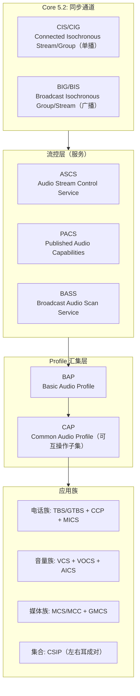

| 缩写 | 全称 | 职责 |
|---|---|---|
| BAP | Basic Audio Profile | 单播/广播音频流的建立、CSD/QoS 约束的总纲 |
| ASCS | Audio Stream Control Service | ASE（Audio Stream Endpoint，音频流端点）状态机与控制点 |
| PACS | Published Audio Capabilities | 对外发布自己支持的编码能力、位置、上下文 |
| BASS | Broadcast Audio Scan Service | 广播音频扫描（Scan Delegator 侧），协助加入 BIG |
| CAP | Common Audio Profile | 把上述服务组合成可互操作的通用用例（呼叫/媒体/音量） |
| CSIP | Coordinated Set Identification Service | 左右耳塞/多设备成套识别（同一 RSI 成组） |
| TMAP | Telephony and Media Audio Profile | 手机/耳塞/音箱的"通话+媒体"角色组合声明 |

### 二、同步通道：CIS/CIG 与 BIG/BIS

| 概念 | 说明 |
|---|---|
| CIS | Connected Isochronous Stream，建立在一条 ACL 连接上的同步流（点对点，可双向） |
| CIG | Connected Isochronous Group，多条 CIS 的调度容器；同一 CIG 内各 CIS 事件互不重叠，保证多流同步 |
| BIG | Broadcast Isochronous Group，无连接广播的调度容器（一对多，单向） |
| BIS | BIG 内的一条广播流（如左声道 BIS / 右声道 BIS） |
| CSD | Codec Specific Configuration，编解码私有配置（帧长、每帧字节数、声道数等 LTV 列表） |
| QoS | 服务质量参数集（SDU 间隔、重传次数、传输延迟、呈现延迟），见下表 |

#### 2.1 单播 QoS 配置参数（CIG/CIS 级）

| 参数 | 典型取值 | 含义 |
|---|---|---|
| SDU_Interval | 7,500 / 10,000 μs | 上层交付一帧语音数据的周期（与 LC3 帧长对齐） |
| Max_SDU | 26~120+ 字节 | 单个 SDU 上限（由码率×帧长决定） |
| RTN（Retransmission Number） | 1~5 | 每个 CIS 事件内的重传次数 |
| Max_Transport_Latency | 10~100 ms | 控制器侧允许的最大传输延迟 |
| Presentation_Delay | 数十 ms 起 | 接收端"收齐到播出"的缓冲延迟（约束见 BAP） |
| CIG_Sync_Delay / CIS_Sync_Delay | 控制器计算 | 同步参考点，保证多声道同时对齐播放 |

#### 2.2 CIS 建立流程概貌

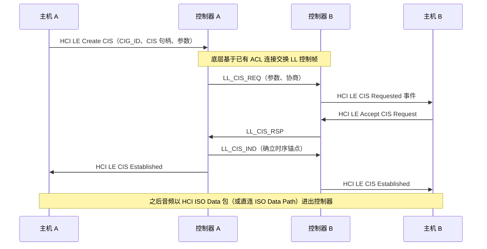

要点：CIS 不是新的链路层"连接"，而是挂在 ACL 连接上的**定时子事件序列**；数据通道可经 HCI（HCI ISO Data packets）或由厂商 ISO Data Path（PCM/I2S 直通编解码器）旁路主机栈。HCI over USB 的实现中，ISO 数据走独立的 HCI ISO Data 包类型（见 [05-蓝牙控制器类-HCIoverUSB](19-other-classes-b.md)）。

BIG 侧对应参数在 **BIGInfo**（周期广播扩展头里广播）：BIG_Offset、ISO_Interval、NSE（子事件数）、BN（每事件突发数）、IRC/PTO（重传策略）、SeedAccessAddress 等——接收者无需任何连接即可凭它解出 BIS，字段定义见 Core Spec 的 Periodic Advertising / BIG 部分。

### 三、流控三件套：PACS / ASCS / BASS

#### 3.1 PACS：能力发布

PACS 用 GATT 特征值对外发布能力，核心是 **PAC 记录**（一条记录 = 一种编码配置能力）：

| 字段 | 长度/类型 | 说明 |
|---|---|---|
| Codec_ID | 5 字节 | Coding Format（LC3 = 0x06）+ Company ID（2）+ Vendor Codec ID（2） |
| Codec Specific Capabilities | LTV 列表 | 支持的采样率位图、帧时长（7.5/10ms 位图）、声道数、每帧最小/最大字节数、每 SDU 最大帧数 |
| Metadata | LTV 列表 | 流上下文（对话/媒体/游戏/…）、程序信息等 |
| Codec Specific Configuration | LTV 列表 | 推荐的默认 CSD |

另有 Sink/Source Locations（声道位置位图：前左 bit0、前右 bit1、…）与 Available/Supported Audio Contexts 特征值。完整字段定义见 PACS 规范。

#### 3.2 ASCS：ASE 状态机（核心）

每个方向每条流占一个 ASE，客户端通过 ASE Control Point 特征值下发操作驱动状态迁移：

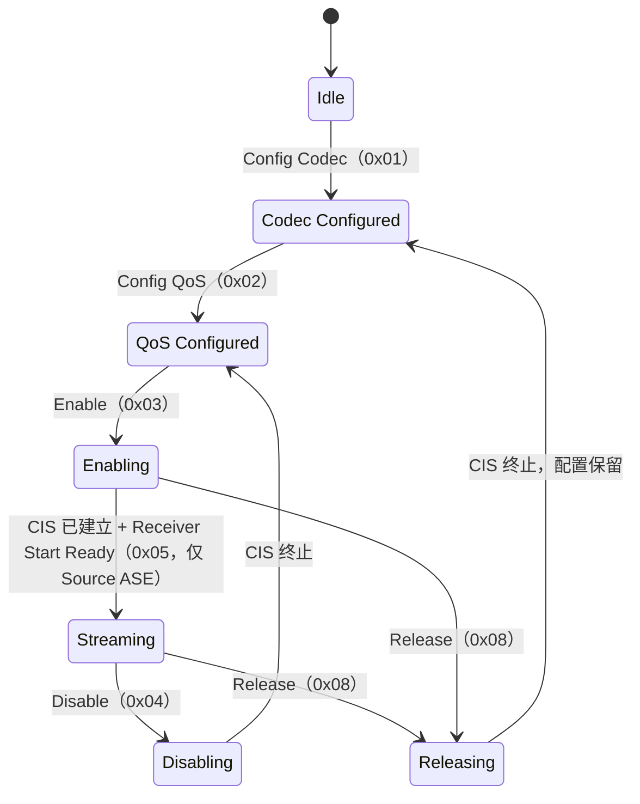

注：以上为主干路径；Update Metadata（0x07）可在 Enabling/Streaming 中原地更新，失败回退与自治迁移（如链路丢失）的完整规则见 ASCS 规范。

| ASE 状态 | 语义 |
|---|---|
| Idle | 未配置 |
| Codec Configured | CSD 已选好，未定 QoS |
| QoS Configured | QoS 参数已定，等 Enable |
| Enabling | 已请求建立 CIS，等数据路径就绪 |
| Streaming | 音频流传输中 |
| Disabling | 暂停中（保留 QoS），CIS 终止后回 QoS Configured |
| Releasing | 释放中，CIS 终止后回 Codec Configured |

#### 3.3 BASS：广播扫描与"代扫"

BASS 位于接收设备（如耳机，角色 Scan Delegator），允许手机等（角色 Broadcast Assistant）远程代为扫描广播源：助手扫描到 BASE 后，通过 BASS 的 Add Source 操作把广播源信息（广播 SID、地址、PA 周期、BIG 加密信息）写给 Delegator，由 Delegator 自己完成 PA/BIG 同步。另可选 BIG 加密（Broadcast Code，128 位），写进 BASS 即解密。**Scan Offloader** 是被助手委托执行扫描的第三个角色。

### 四、电话族与音量族

| 服务/Profile | 缩写 | 作用 |
|---|---|---|
| Generic Telephone Bearer Service | GTBS | 通用电话承载：来去电列表、呼入/呼出/活动呼叫状态 |
| Telephone Bearer Service | TBS | 厂商扩展电话承载（多 SIM/多线路时每个承载一个实例） |
| Call Control Profile/Service | CCP/CCS | 呼叫控制（接听/挂起/合并等，由 GTBS/TBS 特征值操作） |
| Microphone Control Service | MICS | 静音控制（本端麦克风 Mute 状态） |
| Volume Control Service | VCS | 总音量 + Mute |
| Volume Offset Control Service | VOCS | 每个音频输入源的相对音量偏移 |
| Audio Input Control Service | AICS | 输入源描述/增益模式/静音状态 |

CAP 把这些拼成用例：Unicast 呼叫 = ASCS + TBS/GTBS + MICS + VCS；媒体 = ASCS + MCS/MCC（Media Control，含 Now Playing、搜索）+ VCS；左右耳 = CSIP（RSI 成组）+ BAP 多流。全部走 GATT（见 [04-ATT与GATT](61-ble-core.md)），没有私有 AT 命令——这是与经典 HFP 最大的架构差异。

### 五、LC3 编解码器

LC3 是 SIG 为 LE Audio 指定的编码器（规范《Low Complexity Communication Codec》），**BAP 中唯一必选**的 Coding Format（0x06）。

| 参数 | 取值 |
|---|---|
| 帧时长 | 7.5 ms 或 10 ms（二选一，逐流配置） |
| 采样率 | 8 / 16 / 24 / 32 / 44.1 / 48 kHz |
| 码率 | 16~320 kbps，逐帧可变（帧长按字节整数配置） |
| 声道 | 单声道流；立体声 = 两条流/两个 ASE（保证声道同步与独立重传） |
| 算法骨架 | DC 去除 + LTPF 长时后滤波 + MDCT 变换 + 谱系数量化 + 算术编码；帧间无依赖，丢一帧不扩散 |

**帧结构概念**：一帧 = 固定时长采样块 → 编码为 `Octets_per_Frame` 字节；`Octets_per_Frame = 码率 × 帧时长 ÷ 8`，例如 80 kbps × 10 ms = 100 字节/帧，10 ms 内塞进一个 SDU。发送端逐帧独立编码，接收端错帧最多损失一帧音频。

**与 SBC 对比**（SBC 为经典 A2DP 必选编码，见 [11-经典蓝牙Profile详解](62-ble-advanced.md)）：

| 维度 | LC3 | SBC |
|---|---|---|
| 归属 | SIG LE Audio 指定 | A2DP 必选（BR/EDR） |
| 帧时长 | 固定 7.5/10 ms 两档 | 随参数变化（子带/块配置），约数 ms 量级 |
| 算法 | MDCT + 算术编码 | 子带编码（4/8 子带）+ 位分配 + 块缩放 |
| 同码率质量 | 显著优于 SBC；SIG 宣称同质量下码率约为 SBC 一半 | 基线 |
| 码率范围 | 16~320 kbps 连续可调 | A2DP 高质量档典型上限 ~328 kbps（44.1 kHz Joint Stereo） |
| 承载 | LE ISO（CIS/BIS） | BR/EDR ACL（L2CAP，见 A2DP 篇） |
| 系统延迟 | 算法延迟约一帧量级，且端到端延迟由 QoS 参数显式控制 | 算法延迟低但系统延迟由 A2DP 缓冲策略支配，不可显式协商 |

### 六、延迟构成分析

LE Audio 端到端延迟 = 各段之和，且**每段都可被 QoS 参数显式约束**：

| 段 | 构成 | 由谁控制 |
|---|---|---|
| 采集/编码缓冲 | 攒满一个 SDU 间隔（7.5/10 ms）+ LC3 编码处理 | SDU_Interval、终端处理能力 |
| 控制器排队+重传 | CIS 事件调度 + RTN 次重传机会 | RTN、Max_Transport_Latency |
| 空口传输 | CIS 事件间隔内的子事件 | CIS/CIG 调度（控制器） |
| 接收缓冲/呈现 | 收齐到播出的缓冲 | **Presentation_Delay（接收端声明，发送端确认）** |
| 解码/输出 | LC3 解码 + DAC | 终端处理能力 |

对比 A2DP：延迟大头是发送端深缓冲（数十至数百 ms）且完全由实现自定；LE Audio 把延迟变成协商参数——这正是 GMAP 游戏场景能压低延迟的机制基础。

### 七、Auracast 广播音频

Auracast 是基于 BIG/BIS 的公共广播品牌化用例：一个发射源（手机/笔记本/机场电视）无限量接收（耳机、助听器、音箱）。接收加入时序：

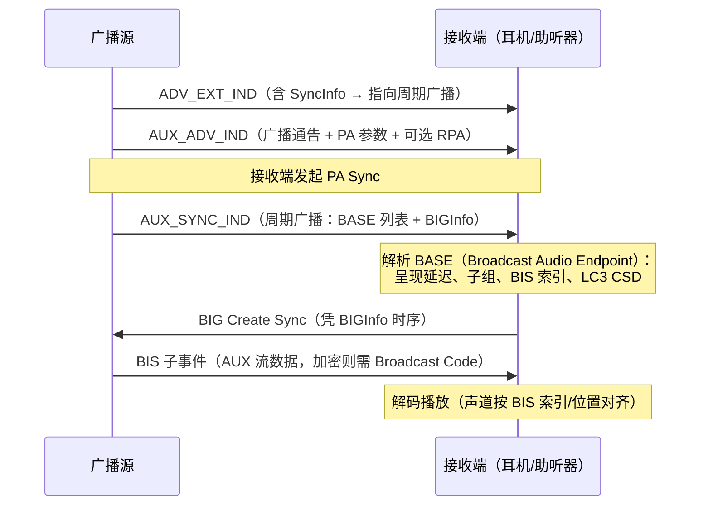

- **BASE** 位于周期广播数据中：呈现延迟（3 字节）+ 子组列表（每组含 BIS 数、Codec_ID、CSD、各 BIS 索引与配置）。
- 加入公共广播通常由 **Broadcast Assistant**（手机）扫描并经 BASS 协助耳机完成 PA/BIG 同步；直接在耳机上扫码/按键也能自行完成（BASE 里有推荐配置）。
- 加密广播 = BIG 级 128 位 Broadcast Code，凭二维码/密码分发。

### 八、GMAP 与 HEA

**GMAP（Gaming Audio Profile）**：面向游戏的规范族，在 BAP 之上定义低延迟配置与"游戏音频 + 语音聊天"多流并行（角色 Game Gateway / Game Terminal 等），用更小的 SDU、更短的呈现延迟换实时性，是"LE Audio 天然低延迟"的极致体现。

**HEA（Hearing Access）**：助听体系（HAP Hearing Aid Profile + HAS 服务），让助听器成为 LE Audio 一等公民：双耳同步流、环境声模式、程序切换，并借助 Auracast 直接接收公共场合广播——传统助听器要靠外挂中转器，HEA 后原生直连。

### 九、与经典 A2DP 并存：双模耳机架构

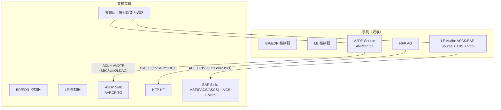

并存策略：双模耳机同时具备 BR/EDR 与 LE 射频，按对端能力与信号质量选路——老旧手机走 A2DP+HFP，新手机可走 LE Audio（TMAP 兼容性更好、功耗更低、还顺带获得 Auracast 接收能力）。迁移期普遍"双栈都留"，互操作由各 Profile 独立保证。

### 十、实现状态与芯片支持

- 芯片：Nordic nRF53/nRF54 系列（nRF Connect SDK 内置 LE Audio 栈与 LC3）、Qualcomm S5/S7 音频平台、Silicon Labs、ST（STM32WBA）、Telink 等均有公开的 LE Audio 支持（以各厂商发布资料为准）。
- 操作系统：Android 自 13 起内置 LC3 与 LE Audio 协议栈并逐步成熟；Windows 11 已提供 LE Audio 支持；苹果侧从助听器场景（iOS 18 起）接入 LE Audio，媒体生态仍以自有方案为主——以各平台当前文档为准。
- 规范版本：BAP/ASCS/PACS 等为 1.0/1.0.1 系列，持续修订中；写驱动前应核对 SIG 当前 adopted version 列表。

### 十一、调试要点：ASE 状态卡住排查

ASE Control Point 返回码先看：0x00 成功、0x01 资源不足、0x02 无效 ASE 索引、0x03 当前状态不允许该操作（其余码见 ASCS）。

| 现象 | 检查点 |
|---|---|
| 停在 Codec Configured | Config QoS 未发/被拒；PACS 声称的能力与 CSD 不匹配（采样率、帧长、每帧字节数超范围） |
| Enable 后不动（卡 Enabling） | CIS 建立失败：抓 LL_CIS_REQ/RSP/IND 看 ACL 是否存活、参数是否越界；ISO Data Path 是否 Setup（HCI LE Setup ISO Data Path 方向配反是高频错误） |
| Streaming 但无声 | Presentation_Delay 过小被拒；SDU 内容帧长与协商 CSD 不一致；Source ASE 未等 Receiver Start Ready 就发数据 |
| 随机断流 | RTN 不足以覆盖射频环境；SDU_Interval 与帧长不匹配（7.5ms 帧配 10ms 间隔） |
| 广播收不到 | PA Sync 未建立就先 BIG Sync（顺序必须 PA → BIG → BIS）；加密 BIG 未写 Broadcast Code |

工具：Android btsnoop（Wireshark 解 ATT/ASCS 操作）、Ellisys/nRF Sniffer 空口抓 LL_CIS 与 BIG 包；对照 HCI 日志中 LE CIS Established 事件参数核对 QoS。

## 原文：10-Mesh网络概述

> Source: [50-枝干-无线关联/BLE-低功耗蓝牙/10-Mesh网络概述.md](https://github.com/tangjianfang/USBTree/blob/main/50-枝干-无线关联/BLE-低功耗蓝牙/10-Mesh网络概述.md)

> 规范原文缓存索引: [../../80-参考资料/README.md](92-spec-references.md)

---

蓝牙 Mesh（Mesh Profile Specification 1.0 于 2017 采纳，1.1 于 2023 修订）是**独立于 GATT 连接模型的多对多（many-to-many）网络**：节点之间不需要建立连接，靠"管理型泛洪（Managed Flooding）"把消息扩散全网。它与前几篇的"点对点连接"是平行的两套世界——唯一交集是：Mesh 消息既可以躺在 BLE 广播包里传播，也可以借一条普通 GATT 连接穿越"只有手机有 Mesh 射频"的死角。

### 一、与 BLE 单跳连接的关系

BLE 链路层是单跳的：连接或广播都只有一跳。Mesh 在其上加了一层"网络层"负责多跳转发：

| 承载（Bearer） | 载体 | 说明 |
|---|---|---|
| Advertising Bearer（ADV Bearer） | BLE 广播包（37/38/39 信道） | 专用 AD Type：Mesh Message = 0x2A、Mesh Beacon = 0x2B；无需连接，天然一收多转 |
| GATT Proxy Bearer | GATT 连接上的 Mesh Proxy Service（UUID 0x1828） | 手机/网关把 Mesh PDU 装进 Proxy PDU（Network PDU / Mesh Beacon / Proxy Configuration 三种类型）经连接注入网络 |

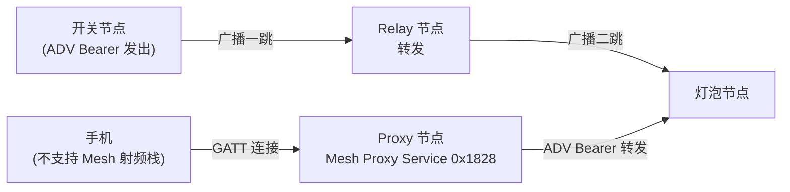

### 二、核心角色四件套

| 角色 | 功能 | 功耗特征 |
|---|---|---|
| Relay（中继） | 收到网络层 PDU 后 TTL 减 1 再泛洪转发（TTL≥2 才转；同一消息按缓存去重） | 常供电 |
| Proxy（代理） | GATT 与 ADV 两种承载间的桥接，跑 Mesh Proxy Service | 常供电或中功耗 |
| Friend（朋友） | 为 LPN 缓存消息（Friend Queue），在 LPN 轮询时下发 | 常供电，缓存有容量上限 |
| LPN（Low Power Node，低功耗节点） | 大部分时间休眠，Friendship 建立后周期性醒来收消息 | 电池供电（传感器典型） |

**Friendship 建立**：LPN 发 Friend Request（指定 Receive Window、队列需求、超时等），候选 Friend 回 Friend Offer（报价：Receive Window 大小、队列容量、RSSI），LPN 择一接受（Friend Poll / Friend Update 完成 friendship 建立）。之后 LPN 按轮询间隔醒来取 Friend Queue 里攒的消息；Friendship 断开有超时机制。细节见 Mesh Profile 的 Friendship 部分。

注意：一个节点可兼任多个角色（如 Relay+Proxy+Friend）；是否支持某角色在节点能力/配置里声明。

### 三、网络分层模型

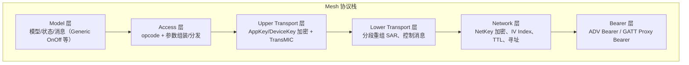

#### 3.1 Network 层 PDU 格式概貌

| 偏移 | 大小 | 字段 | 说明 |
|---|---|---|---|
| 0 | 1 bit | IVI | IV Index 最低位，接收端据此匹配当前/上一 IV Index |
| 0 | 7 bit | NID | 由 NetKey 派生（k2 算法）的网络标识，节点据此判断"是否认识这个网络" |
| 1 | 1 bit + 7 bit | CTL + TTL | CTL=1 为控制消息（走 DeviceKey、可免应用层加密）；TTL 每次转发减 1 |
| 2~4 | 3 字节 | SEQ | 序列号，防重放（同一 SRC 不允许重复） |
| 5~6 | 2 字节 | SRC | 源单播地址 |
| 7~8 | 2 字节 | DST | 目的地址（单播/组播/虚拟，见下表） |
| 9~ | 变长 | 传输 PDU + NetMIC | 下层运输 PDU + 网络层 MIC（CTL=0 为 4 字节，CTL=1 为 8 字节） |

整个 Network PDU 上限 **29 字节**——所以应用有效载荷极小，长内容必须靠分段。

**地址类型**：

| 地址范围 | 类型 |
|---|---|
| 0x0000 | 未分配（Unassigned） |
| 0x0001~0x7FFF | 单播（Unicast，每个 Element 一个） |
| 0x8000~0xBFFF | 虚拟（Virtual，16 字节 Label UUID 的哈希标签） |
| 0xC000~0xFFFF | 组播（Group，如 0xFFFF 全节点、0xC000 起 SIG 预留组） |

#### 3.2 Lower Transport：分段重组（SAR）

| 形态 | 有效载荷上限 | 机制 |
|---|---|---|
| 未分段（Unsegmented） | 15 字节 | 单包直达，开销最小 |
| 分段（Segmented） | 12 字节 × (SegN+1) 段 | 每段带 SeqZero（同一上层数据的段组标识）+ SegO/SegN；接收端回 **Segment Acknowledgment**（CTL=1 控制消息）补齐丢段 |

#### 3.3 Upper Transport 与双重加密设计

Mesh 的标志性安全设计：**一份数据，两层加密**。

| 层 | 密钥 | 保护内容 | MIC |
|---|---|---|---|
| 网络层 | **NetKey**（全网共用） | 源/目的地址、传输 PDU（含应用数据） | NetMIC 4/8 字节 |
| 应用层 | **AppKey**（按应用绑定） | Access Payload（opcode + 参数） | TransMIC 4/8 字节 |
| 特殊 | **DeviceKey**（每节点独有） | 配置消息（Configuration Model） | 同应用层 |

意义：中继节点只有 NetKey——它能"看懂"路由信息并转发，却**永远解不开应用数据**；不同应用（灯光 AppKey1、门锁 AppKey2）互相隔离，灯光节点就算被攻破也动不了门锁。加密算法为 AES-CCM。

#### 3.4 Access 与 Model 层

Access 层把 Upper Transport 解出的 payload 按 opcode 分发给对应 Model。**消息模型三概念**：

- **Element（元素）**：节点上可独立寻址的最小单元，每个 Element 一个单播地址。一个灯泡可以是 1 个 Element（含开关+亮度两个模型），也可以拆成 2 个。
- **Model（模型）**：某类功能的定义 = 状态（State）+ 消息（Opcode）+ 行为。分 Server（持有状态、响应消息）/ Client（发命令）两侧。
- **State（状态）**：如 Generic OnOff 的 OnOff 布尔值、Generic Level 的 int16。

**发布-订阅（Publish/Subscribe）**：发送者向一个组地址/虚拟地址"发布"，所有订阅该地址的节点处理该消息。多对多的解耦核心——开关不需要知道有几盏灯、灯的地址是什么。

**SIG 基础模型示例——Generic On/Off**：

| 消息 | Opcode | 方向 |
|---|---|---|
| Generic OnOff Get | 0x8201 | Client → Server |
| Generic OnOff Set | 0x8202 | Client → Server（要求回 Status） |
| Generic OnOff Set Unacknowledged | 0x8203 | Client → Server（不回，靠重复发布保证可靠） |
| Generic OnOff Status | 0x8204 | Server → Client（当前状态 + 目标状态 + 剩余时间） |

Set 消息带 **Transaction Number + 源地址** 做事务去重：泛洪导致重复包很正常，按 (SRC, TID) 窗口内去重即可幂等。Foundation Model 层另有 Configuration Server/Client（组网后改订阅表、发布地址、加 AppKey）与 Health Model，配置类消息用 DeviceKey 加密。

### 四、安全体系：Provisioning 配网流程

新设备出厂是"白板"，必须由 **Provisioner（配网者，通常手机/网关）** 执行配网（Provisioning）才能入网：

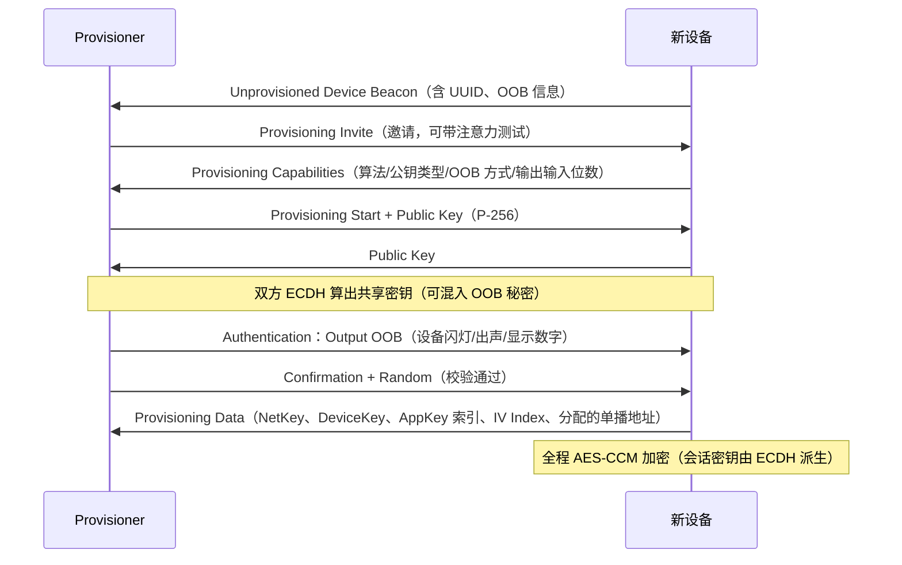

**认证 OOB（Out of Band）方式**（防 MITM 的关键，思想与 BLE 配对 MITM 同源，见 [06-SMP安全与配对](61-ble-core.md)）：

| 方式 | 形式 | 例 |
|---|---|---|
| Output OOB | 设备"输出"秘密：闪灯次数/蜂鸣次数/振动/显示数字/字符串 | 灯闪 3 下，用户在 App 输入 3 |
| Input OOB | 用户"输入"秘密：按按键/敲键盘 | 用户按设备按钮 |
| Static OOB | 预置静态密钥（出厂贴纸/二维码） | 扫描设备底部二维码 |
| No OOB | 无认证（同"Just Works"，无 MITM 保护） | 开发调试 |

配网完成后设备获得：NetKey（网络身份）、DeviceKey（独有配置密钥）、初始 AppKey、IV Index 快照与一个单播地址段。此后换 AppKey/加网络走 Configuration Model 的 Key Refresh / NetKey 管理。

**IV Index 与 IV Update 流程**：IV Index 是全网共享的 32 位计数器，参与 nonce 构成防重放。节点在 Normal Operation 至少 **96 小时** 后可进入 IV Update In Progress（IV Index 递增用于发送，同时仍容忍旧值接收，防个别节点时钟落后），再经至少 96 小时回到 Normal。规范还允许"IV Recovery"恢复长期离线节点（约束见 Mesh Profile）。

### 五、场景与限制

| 维度 | 评价 |
|---|---|
| 规模 | 数百节点级成熟；泛洪的重复包随密度上升，超大规模需仔细规划 Relay 密度 |
| 延迟 | 每跳转发有排队与扫描间隔开销，多跳链路延迟抖动明显；不适合高实时控制 |
| 时延 vs 确定性 | 管理型泛洪无路由建立，鲁棒但非确定延迟 |
| 与 Zigbee 对比一句话 | Zigbee 是"建路由表的网状网"（AODV 式，延迟低但路由维护复杂），蓝牙 Mesh 是"管理型泛洪"（零路由状态、部署简单，代价是重复包与调度开销） |
| 典型场景 | 智能照明、楼宇传感器网络、工业监控（低速率、广覆盖、电池设备多） |

1.1 版补充了定向转发（Directed Forwarding）、基于 EDCA 的子集等改进以缓解规模/延迟问题，详见 Mesh Protocol 1.1。

### 六、实现栈

| 栈 | 说明 |
|---|---|
| Zephyr BLE Mesh | Zephyr RTOS 内置，1.0/1.1 特性覆盖广，开源参考实现地位 |
| Nordic Mesh | Nordic nRF Connect SDK 的 Mesh 库（底层与 Zephyr 同源体系） |
| Silicon Labs Mesh | Gecko SDK 内置，照明市场出货量大 |
| ESP-IDF BLE Mesh | Espressif 提供 esp_ble_mesh（基于 Zephyr Mesh 移植） |

芯片侧任何支持 BLE 广播 + 足够 Flash/RAM 的 SoC 都能跑（Mesh 不需要特殊射频功能；LPN 特性对睡眠功耗有要求）。与 USB 的关联点：USB 网关/HAT 类设备常以"Provisioner + Proxy"角色把 Mesh 网络接入主机（见 [00-无线概览与USB交汇](60-usb-wireless-intersection.md)）。

### 七、与 HomeKit / Matter 的关系

三者不是竞争同一层的协议：Matter 是**应用层**智能家居标准，跑在 Wi-Fi/Thread/以太网上（配网引导用 BLE），其底层网状网是 Thread（802.15.4），不是蓝牙 Mesh；HomeKit 是苹果生态的应用标准，其 BLE 直连用苹果自有的 HAP 规范，也不采用蓝牙 Mesh。蓝牙 Mesh 的定位是"SIG 自家"的照明/传感网络；实践中常见 **蓝牙 Mesh ↔ Matter 桥接设备**（把照明子网作为 Matter 端点暴露给全屋系统），以及 Mesh + GATT 双栈产品。产品选型时先定应用层生态（Matter/HomeKit），再倒推底层网络，避免"用蓝牙 Mesh 却进不了 Matter 生态"的错位。

## 原文：11-经典蓝牙Profile详解

> Source: [50-枝干-无线关联/BLE-低功耗蓝牙/11-经典蓝牙Profile详解.md](https://github.com/tangjianfang/USBTree/blob/main/50-枝干-无线关联/BLE-低功耗蓝牙/11-经典蓝牙Profile详解.md)

> 规范原文缓存索引: [../../80-参考资料/README.md](92-spec-references.md)

---

[08-经典蓝牙与BLE对比](61-ble-core.md) 给了两套栈的总对照，本篇深入 BR/EDR（Basic Rate / Enhanced Data Rate）一侧**每个 Profile 的运行机制**：SDP 如何找到服务、RFCOMM 如何仿真串口、A2DP 如何协商编码器、HFP 如何跑 AT 命令。总览图先立骨架，再逐个拆解。

### 一、协议栈总览

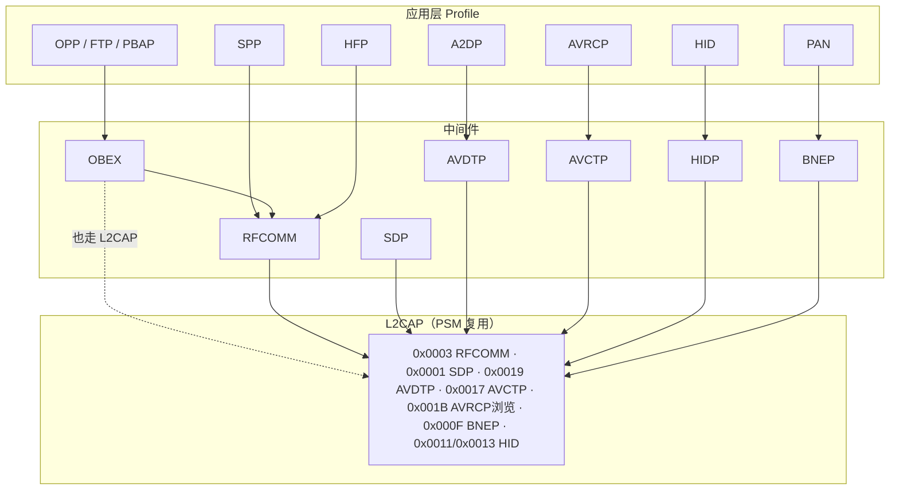

### 二、SDP：服务发现协议

SDP（Service Discovery Protocol）让设备在**建立业务连接之前**回答两个问题："你有什么服务？服务跑在哪个信道/PSM？"它本身是客户端-服务器模型：持有服务的一方是 Server，L2CAP PSM **0x0001** 固定专用。

#### 2.1 服务记录与属性

每个服务是一条 **服务记录（Service Record）**：32 位 ServiceRecordHandle + 属性表（属性 ID → 数据元素 Data Element）。关键属性：

| 属性 ID | 名称 | 例（SPP 记录） |
|---|---|---|
| 0x0000 | ServiceRecordHandle | 0x00010001 |
| 0x0001 | ServiceClassIDList | SerialPort（UUID） |
| 0x0004 | ProtocolDescriptorList | L2CAP/RFCOMM + **Server Channel=5** |
| 0x0009 | BluetoothProfileDescriptorList | SPP 版本 1.2 |
| 0x0100 | ServiceName | "My Serial Port" |

数据元素是自描述 TLV：类型（UUID/无符号整数/字符串/序列…）+ 大小索引 + 值；UUID 搜索时用 128 位完整 UUID 或 16/32 位别名。浏览按 BrowseGroupList 层级展开。

#### 2.2 SDP PDU 概貌

PDU 头：PDU ID（1）+ Transaction ID（2）+ Parameter Length（2）+ 参数（响应可能带 Continuation State 续传）。

| PDU ID | 名称 | 用途 |
|---|---|---|
| 0x01 | SDP_ErrorResponse | 错误报告 |
| 0x02 / 0x03 | ServiceSearchRequest / Response | 按 UUID 模式找服务，返回记录句柄 |
| 0x04 / 0x05 | ServiceAttributeRequest / Response | 按句柄取指定属性 |
| 0x06 / 0x07 | ServiceSearchAttributeRequest / Response | 一次完成"搜索+取属性"（最常用） |

### 三、RFCOMM：串口仿真

RFCOMM 基于 ETSI TS 07.10（GSM 串口复用标准）裁剪，跑在 L2CAP PSM **0x0003** 上，向上提供多达 60 条虚拟串口（Server Channel 0~30，两个方向）。

#### 3.1 帧结构与 DLCI

| 字段 | 说明 |
|---|---|
| Address | EA(1) + CR(1) + **DLCI（6 bit）**；DLCI = 2 × ServerChannel + 方向位，标识一条数据链路连接（DLC, Data Link Connection） |
| Control | UIH（0xEF，带校验不重传，数据帧主流）、SABM（建链请求 0x2F/0x3F）、UA（应答 0x63/0x73）、DISC |
| Length | 1~2 字节，EA 位指示是否续字节 |
| Data | 有效载荷（受 MFS 限制） |
| Credits | 信用流控（Credit-based Flow Control，RFCOMM 特有扩展）：每个 UIH 帧头带 1 字节信用数，收发互赠 |
| FCS | 帧校验（UIH 仅覆盖 Address+Control） |

**MX 帧（Multiplex Control，Control=0xE3 等的 DLCI=0 控制链路）**：PN（DLC 参数协商：帧大小、优先级、是否信用流控）、MSC（Modem Status：DTR/DSR/RTS/CTS 虚拟调制解调器线）、RPN（远端端口设置：波特率/校验位——仅语义传递，实际链路速率由蓝牙决定）、Test、NSC（不支持的命令）。

### 四、SPP：Serial Port Profile

SPP 定义"蓝牙串口线"：两个角色 **Device A（发起方）/ Device B（接受方）**，语义上对应 DTE/DCE 的对称仿真（无主从业务差异，链路主从由建连方决定）。

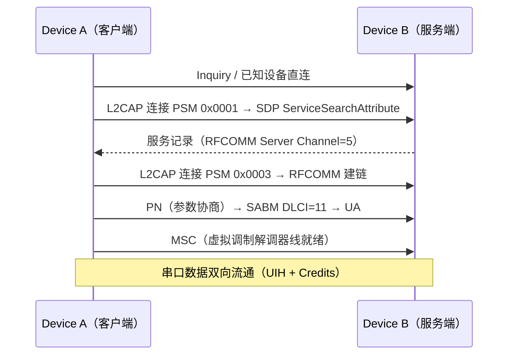

注意模式：端口仿真层（Port Emulation）在两端各自向本地应用呈现"一个 COM 口"，映射行为（波特率等）只是兼容语义。工业适配器、POS、单片机透传模块至今仍以 SPP 为最通用通道（iOS 除外——苹果不开放经典 SPP，这也是很多外设"安卓能用 iPhone 不能"的根因）。

### 五、A2DP：高级音频分发

A2DP（Advanced Audio Distribution Profile）定义**单声道/立体声高质量音频**单向流：**Source（源，手机）→ Sink（汇，耳机）**。传输协议 AVDTP（Audio/Video Distribution Transport Protocol，L2CAP PSM **0x0019**）分两个角色面：

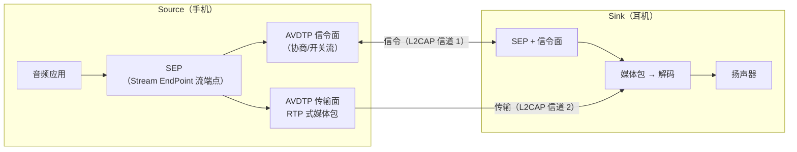

#### 5.1 SEP 与流建立过程

每个编码器实例注册为一个 SEP（带 TSEP 类别 Source/Sink）。信令命令（信号信道，命令/响应配对）：

| 命令 | 作用 |
|---|---|
| DISCOVER | 列出对端所有 SEP |
| GET_CAPABILITIES / GET_ALL_CAPABILITIES | 取某 SEP 支持的编码能力（Service Capabilities：媒体编解码、内容保护 SCMS-T、延迟上报等） |
| SET_CONFIGURATION | 选定编码器 + 填入 **Codec Specific Information Elements**（如 SBC 的 bitpool）→ SEP 进入 Configured |
| OPEN | 建立传输信道（第二条 L2CAP） |
| START / SUSPEND / CLOSE | 流控 |
| RECONFIGURE | 在流中途改编码参数（如降 bitpool） |
| DELAY_REPORT | Sink 上报链路延迟（AVDTP 1.3+，供视频唇音同步） |

#### 5.2 编码器协商

| 编码 | 地位 | 说明 |
|---|---|---|
| SBC | **必选** | 子带编码，44.1 kHz Joint Stereo 高质量档 ~328 kbps；bitpool 越大质量越高 |
| MPEG-1,2 Audio / MPEG-2,4 AAC | SIG 可选 | AAC 常见于苹果生态 |
| aptX / aptX HD / aptX Adaptive | 厂商扩展（高通，Vendor Specific + Company ID） | 低延迟与自适应码率（公开资料：Adaptive 数十至数百 kbps 动态） |
| LDAC | 厂商扩展（索尼） | 三档 ~330/660/990 kbps，Hi-Res 认证路线 |
| LHDC | 厂商扩展（SAVITECH 等联盟） | 高码率低延迟路线 |

协商规则：Source 汇总两边 GET_CAPABILITIES 的交集，选一个双方都支持的编码写进 SET_CONFIGURATION；厂商编码走 Vendor Specific A2DP Codec（媒体载荷格式由厂商定义）。音频流媒体包带简单 RTP 式头部（版本/序号/时间戳）。

### 六、AVRCP：媒体控制面

>  规范原文已缓存（evolve #15）：[AVRCP-1.6.3.pdf](https://github.com/tangjianfang/USBTree/blob/main/80-参考资料/bluetooth/AVRCP-1.6.3.pdf)（绝对音量/浏览/播放列表，AVC 命令经 AVCTP PSM 0x0017）。

AVRCP（Audio/Video Remote Control Profile）跑在 AVCTP（PSM **0x0017**）上，与 A2DP 并行：A2DP 管"数据面"，AVRCP 管"控制面"。

| 版本 | 关键能力 |
|---|---|
| 1.0 | 基本穿透命令（Pass-Through：播放/暂停/快进，源自 AV/C） |
| 1.3 | 元数据（曲目名/艺术家/专辑/播放时间）+ 事件通知机制（Register Notification） |
| 1.4 | **浏览信道（Browsing，独立 L2CAP，PSM 0x001B）**、多播放器选择、**绝对音量（Absolute Volume）** |
| 1.5/1.6 | 多播放器/浏览目录细节完善（UID Counter、Cover Art 引用等），1.6 为当前主流实现版本 |

- **绝对音量**：手机侧 CT 发 `SetAbsoluteVolume`（0~127），耳机侧 TG 用 `VOLUME_CHANGED` 通知回推——解决"耳机旋钮与手机音量条各自为政"的经典痛点。
- **与 A2DP 协作**：暂停/播放经 AVRCP 翻译成 A2DP 的 SUSPEND/START；播放进度靠 AVRCP 通知驱动。二者角色配对：A2DP Source ↔ AVRCP Controller（CT），A2DP Sink ↔ AVRCP Target（TG）。

### 七、HFP：免提

>  规范原文已缓存（evolve #14）：[HFP-1.10.pdf](https://github.com/tangjianfang/USBTree/blob/main/80-参考资料/bluetooth/HFP-1.10.pdf)（现行最新版；AT 命令全表/eSCO 参数见原文第 4~5 章）。

>  规范原文已缓存（evolve #14）：[HFP-1.10.pdf](https://github.com/tangjianfang/USBTree/blob/main/80-参考资料/bluetooth/HFP-1.10.pdf)（现行最新版；AT 命令全表/eSCO 参数见原文第 4~5 章）。

**常用 AT 命令速查**（evolve #23 自 HFP-1.10 原文提取，数值/行为均可溯源）：

| AT 命令 | 方向 | 用途 |
|---|---|---|
| AT+BRSF=<feat> | HF→AG | 握手第一步：上报 HF 支持特性位图，AG 回+BRSF:<AG feat>（并由此得知是否支持编解码协商） |
| AT+BAC=<codec...> | HF→AG | 声明可用编解码（mSBC 等），触发 Codec Negotiation |
| AT+CIND=? / AT+CIND? | HF→AG | 查询指示器定义/当前状态（call、callsetup、service…） |
| AT+CMER | HF→AG | 订阅指示器变化上报 |
| AT+CHLD=? / AT+CHLD=<n> | HF→AG | 三方呼叫能力查询与保持/挂断操作（n=0~4） |
| AT+BIEV=<ind>,<val> | HF→AG | HF Indicator 状态上报（电量 2、语音识别文本 4 等） |
| AT+BVRA=<0/1> | 双向 | 语音识别开关（AG 侧唤起语音助手） |
| AT+NREC=<0/1> | HF→AG | 回声消除/降噪开关 |
| AT+CCLK? / AT+CNUM | HF→AG | 取网络时间 / 本机号码 |
**eSCO 语音参数速查**（evolve #56 自 HFP-1.10 Tables 6.11~6.14 提取）：

| 场景 | 分组 | 包类型 | Voice_Setting | Max_Latency | Retransmission_Effort |
|---|---|---|---|---|---|
| SCO/CVSD 基础 | — | HV1 | CVSD | 4 ms | 0x00/0xFF |
| eSCO CVSD | S1~S4 | EV3 / 2-EV3 | CVSD | 7 / 7 / 10 / 12 ms | 0x01 / 0x01 / 0x01 / 0x02 |
| **mSBC 宽带语音（T1/T2 必选）** | T1 | EV3 | Transparent Data | 不重传语义 | — |
| | T2 | 2-EV3 | Transparent Data | — | — |

mSBC 强制参数集：Mono / 16 kHz / Loudness / 8 子带 / 块长 15 / **Bitpool 26**，帧前 H2 同步头；宽带语音**只能走 eSCO**。

HFP（Hands-Free Profile）管**双向语音**：**AG（Audio Gateway，音频网关——通常是手机）** 与 **HF（Hands-Free，免提设备——车载/耳机）**。语音不走 ACL，而走 **eSCO（Extended Synchronous Connection-Oriented）** 同步链路，保留时隙、带有限重传，天然抗抖动。

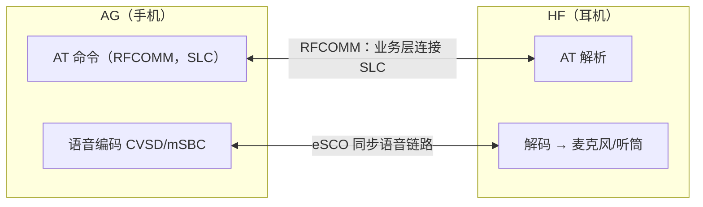

- **SLC（Service Level Connection）建立**：RFCOMM 建链后 AT+BRSF（交换双方特性位图）→ AT+CIND（呼叫指示状态）→ AT+CMER（订阅事件）→（三方通话时 AT+CHLD=?）→ SLC 就绪。
- **音频链路建立**：AG 或 HF 发起（AT+BCC / HCI Setup eSCO），随后**编码协商**：AG 通知可用编码（AT+BIA 时代的 +BCS 流程），HF 以 AT+BCS 确认——CVSD（窄带 8 kHz/64 kbps）或 **mSBC 宽带语音（Wide Band Speech，16 kHz，HFP 1.6 引入）**；更新版本增加超宽带（SWB，32 kHz，见 HFP 1.9），具体以所用版本规范为准。
- **常用 AT 命令**：ATD/ATA（拨/接）、AT+CHLD（呼叫保持/切换）、AT+CLCC（列当前呼叫）、AT+BTRH（保持状态）、AT+NREC（回声消除开关）、AT+BIA（ indicator 订阅）、AT+BIEV（HF Indicator 事件，如电量）。

### 八、经典 HID

人机接口设备在 BR/EDR 上走 **HID Profile**：两条 L2CAP 信道——PSM **0x0011 控制**（HID Control：协议/模式管理）与 PSM **0x0013 中断**（HID Interrupt：报告数据走这里，低延迟单向为主）。上层 HIDP 复用 USB HID 的报告描述符（Report Descriptor）体系——所以 USB 键鼠固件改造成蓝牙 HID 成本很低（与 [07-HOGP](60-usb-wireless-intersection.md)、USB HID 三方同源）。

| 事务 | 信道 | 用途 |
|---|---|---|
| GET_REPORT / SET_REPORT | 控制 | 读/写报告（LED 状态等） |
| GET_PROTOCOL / SET_PROTOCOL | 控制 | Boot（引导）协议 ↔ Report 协议切换 |
| SET_IDLE / SET_PASSTHROUGH | 控制 | 速率与穿透控制 |
| DATA 报告 | 中断 | 键盘/鼠标数据持续上报 |

**与 BLE HOGP 的差异**：

| 维度 | 经典 HID | HOGP（HID over GATT） |
|---|---|---|
| 传输 | BR/EDR ACL，PSM 0x11/0x13 专用信道 | LE ACL + GATT HID Service（0x1812） |
| 配对 | SSP（见 06 篇 + 下文 GAP） | SMP（LE 配对/bonding） |
| 描述符 | HID 报告描述符（HIDP 直传） | Report Map 特征值（同一描述符格式） |
| 功耗 | 高（BR/EDR 信标/sniff 仍重） | 低（LE 休眠机制），电池键鼠首选 |
| 重连 | 主机侧虚拟电缆逻辑 + page | GAP 目录重连 + LL 自动连接机制 |
| BIOS 级兼容 | 老平台 Boot 协议可被原生支持 | 需平台固件支持（新平台普遍支持） |

**虚拟电缆（Virtual Cable）**：HID 用"信任换持久"的机制——配对 bond 后两端保存链路密钥，逻辑上等同插了根不存在的电缆；任一端可发起重连（HID 主机主动 page，或设备唤醒后请求重连），断电重开无需任何用户操作。SPP 也借同一思想描述"无线串口线"。

### 九、OPP / OBEX / FTP：对象交换

OBEX（Object Exchange，源自 IrDA）跑在 RFCOMM 上（也可直连 L2CAP），提供会话式对象传输：CONNECT / PUT / GET / SETPATH / DISCONNECT，对象类型靠 MIME 头声明。

| Profile | 用途 | 角色 |
|---|---|---|
| OPP（Object Push Profile） | 推送名片（vCard）、日历（vCalendar）、图片到对端 | Push Client → Push Server（服务端只收不浏览） |
| FTP（File Transfer Profile） | 文件系统浏览：列目录（SETPATH）、取放文件 | Client ↔ Server（完整文件夹语义） |
| PBAP（Phone Book Access） | 车机拉取手机通讯录（vCard 2.1/3.0 流），典型车载场景 | PSE（Phone Book Server）↔ PCE |

OPP 是早期"蓝牙传文件"的本体；PBAP 与 MAP（短信访问）让 OBEX 族在车载场景长盛不衰。

### 十、PAN / NAP

PAN（Personal Area Networking Profile）基于 BNEP（Bluetooth Network Encapsulation Protocol，L2CAP PSM **0x000F**）在蓝牙上承载以太网 II 帧：PANU 是终端用户节点；GN 提供小组自组织转发；**NAP（Network Access Point）** 是最常见用例——手机开"蓝牙网络共享"，把一台设备的 IP 流量桥接到蜂窝网（类似 USB NCM/ECM 的无线镜像，见 USB 网络类文档）。因速率与并发能力有限，如今多被 Wi-Fi 热点取代。

### 十一、GAP（经典版）：发现、连接与配对回顾

| 机制 | 说明 |
|---|---|
| Inquiry（查询） | 发起端发 ID 包扫全频段，可发现设备回 FHS 包（含时钟偏移、class of device）；访问码 GIAC 0x9E8B33（通用）/LIAC（受限） |
| Inquiry Scan | 可发现端周期监听；发现模式分 Non-discoverable / Limited / General |
| Page / Page Scan | 已知地址建链：page 端按 FHS 中的跳频信息追叫，Page Scan 端应答后进入主从协商 |
| 连接模式 | Active / Sniff（省电降频）/ Hold / Park——语音外场景几乎靠 Sniff 省电 |
| 可配对性 | Pairable / Non-pairable 独立于可发现性 |
| SSP（Secure Simple Pairing） | ECDH P-256 密钥交换 + 四种关联模型：Numeric Comparison / Just Works / Passkey Entry / OOB；配对细节与链路密钥体系见 [06-SMP安全与配对](61-ble-core.md)（该篇聚焦 LE，SSP 与 LE SC 同用 ECDH 但独立执行） |

### 十二、双模设备 Profile 组合实战

**耳机/音箱（必备三件套）**：A2DP（媒体流）+ AVRCP（播放控制/绝对音量）+ HFP（通话）。三者独立建连：来电时切到 HFP 的 eSCO 语音链路，挂断回 A2DP；mic 采集只在 HFP 路径存在——"听歌高音质、通话窄语音"的体验差异正是 A2DP(SBC/aptX) 与 HFP(CVSD/mSBC) 两条链路的切换痕迹。新平台再加 LE Audio（BAP/TMAP）成为"四件套"。

**键鼠（二选一）**：经典 HID 或 HOGP 通常**只实现其一**——两者并存会带来双倍配对状态与重连仲裁复杂度，且电池产品没有双栈功耗预算。选型逻辑：追求 BIOS 级即插即用/老主机兼容 → 经典 HID；追求长续航/新生态（iPad、Android 平板）→ HOGP。部分游戏外设做双模切换（物理开关二选一）而非同时在线。

## 原文：12-LLCP控制过程全表

> Source: [50-枝干-无线关联/BLE-低功耗蓝牙/12-LLCP控制过程全表.md](https://github.com/tangjianfang/USBTree/blob/main/50-枝干-无线关联/BLE-低功耗蓝牙/12-LLCP控制过程全表.md)

>  规范依据: Bluetooth Core 6.0（2024-08-27）Vol 6 Part B §2.4.2（PDU 定义）、§4.6（FeatureSet）、§5.1~5.5（控制过程/超时/冲突），本地缓存见 [../../80-参考资料/README.md](92-spec-references.md)

---

LL Control PDU（LLCP）是 BLE 连接的"带外管理帧"：LLID=11 的数据信道 PDU，载荷为 1 字节 Opcode + 定长 CtrData。它管理链路本身的一切——参数、信道图、加密、PHY、DLE、CIS、功控、测距。本文是 [02-链路层与物理层](61-ble-core.md) 第六节 LLCP 简表的"附录化"全量版。

### 一、LL Control PDU 全表（Opcode 0x00~0x3C）

下表逐条来自 Core 6.0 Vol 6 Part B Table 2.22（位级 CtrData 布局见规范 §2.4.2 各小节，本文只给"方向+用途一句话"）。方向列：C=仅 Central 发起，P=仅 Peripheral 发起，双=任一方发起。

| Opcode | 名称 | 方向 | 用途一句话 |
|---|---|---|---|
| 0x00 | LL_CONNECTION_UPDATE_IND | C→P | 即时更新 connInterval/Latency/SupervisionTimeout（带 Instant，见 §3.1） |
| 0x01 | LL_CHANNEL_MAP_IND | C→P | 即时更新数据信道图（AFH 剔除坏信道，带 Instant） |
| 0x02 | LL_TERMINATE_IND | 双 | 断链，携带原因码（断链可随时发起，优先级最高） |
| 0x03 | LL_ENC_REQ | C→P | 加密启动第一步：携带 Rand+EDIV（Host 侧密钥索引）与 SKD_C、IV_C |
| 0x04 | LL_ENC_RSP | P→C | 回 SKD_P、IV_P，双方拼出会话密钥种子 |
| 0x05 | LL_START_ENC_REQ | P→C（无 CtrData） | Peripheral 已算好会话密钥，明文发出此包并准备收密文 |
| 0x06 | LL_START_ENC_RSP | 双（无 CtrData） | 密文三握手的后两步，收发各一次，完成即加密生效 |
| 0x07 | LL_UNKNOWN_RSP | 双 | 对端不认识该 Opcode 时回应，UnknownType=收到的 Opcode |
| 0x08 | LL_FEATURE_REQ | C→P | Central 侧 FeatureSet 位图（见 §5 特征位图） |
| 0x09 | LL_FEATURE_RSP | P→C | Peripheral 侧 FeatureSet 位图 |
| 0x0A | LL_PAUSE_ENC_REQ | C→P（无 CtrData） | 暂停加密（换 LTK 不断链的第一阶段） |
| 0x0B | LL_PAUSE_ENC_RSP | P→C（无 CtrData） | 确认暂停；随后自动重新走 Start 加密流程 |
| 0x0C | LL_VERSION_IND | 双 | 版本交换：Version/Company_Identifier/Subversion（值见 Assigned Numbers） |
| 0x0D | LL_REJECT_IND | 双 | 拒绝请求（旧式，1 字节 ErrorCode） |
| 0x0E | LL_PERIPHERAL_FEATURE_REQ | P→C | Peripheral 发起的特性交换（4.2+ 特性位） |
| 0x0F | LL_CONNECTION_PARAM_REQ | 双 | 4.1+ 参数协商：Interval_Min/Max、Latency、Timeout、偏好周期、锚点偏移表 |
| 0x10 | LL_CONNECTION_PARAM_RSP | 双 | 对协商窗口的回应（不含最终参数，最终由 Central 用 0x00 下发） |
| 0x11 | LL_REJECT_EXT_IND | 双 | 扩展拒绝：RejectOpcode + ErrorCode（可精确拒绝某个 Opcode） |
| 0x12 | LL_PING_REQ | 双 | 空包探活：验证加密链路上 MIC 校验通路（对应 HCI LE Ping） |
| 0x13 | LL_PING_RSP | 双 | PING 应答（无 CtrData） |
| 0x14 | LL_LENGTH_REQ | 双 | DLE 协商：MaxTx/RxOctets + MaxTx/RxTime（见 §3.4） |
| 0x15 | LL_LENGTH_RSP | 双 | DLE 协商应答，携带本端实际采用值 |
| 0x16 | LL_PHY_REQ | 双 | PHY 偏好声明：TX_PHYS/RX_PHYS 位图（1M/2M/Coded） |
| 0x17 | LL_PHY_RSP | P→C | Central 发起时 Peripheral 的 PHY 偏好回应 |
| 0x18 | LL_PHY_UPDATE_IND | C→P | 裁定结果 PHY_C_TO_P / PHY_P_TO_C + Instant，Instant 处生效 |
| 0x19 | LL_MIN_USED_CHANNELS_IND | P→C | Peripheral 声明至少需要 N 个可用信道（法规/实现约束） |
| 0x1A | LL_CTE_REQ | 双 | 请求对端回一个带 CTE 的包（测向用，见 [13-测向与信道探测](62-ble-advanced.md)） |
| 0x1B | LL_CTE_RSP | 双 | 带 Constant Tone Extension 的应答包 |
| 0x1C | LL_PERIODIC_SYNC_IND | C→P | PAST：把周期广播同步信息（SyncInfo）直接推给连接对端 |
| 0x1D | LL_CLOCK_ACCURACY_REQ | 双 | 查询对端睡眠时钟精度 SCA（对应 HCI LE Request Peer SCA） |
| 0x1E | LL_CLOCK_ACCURACY_RSP | 双 | 回报本端 SCA，可据此收紧/放宽锚点窗口 |
| 0x1F | LL_CIS_REQ |
>  对抗抽查（evolve #44）：CIS 组 0x1F/0x20/0x21/0x22 与 6.0 新增 0x23~0x26（POWER_CONTROL/SUBRATE）经 Core 6.0 提取文本证实。
 C→P | 建立 CIS：CIG/CIS 编号、ISO 间隔、BN/FT/NSE、PHY、时间窗 |
| 0x20 | LL_CIS_RSP | P→C | 接受（回传收紧后的时间窗）或随后用 0x11 拒绝 |
| 0x21 | LL_CIS_IND | C→P | 最终裁定 CIS 锚点时刻 + CIG/CIS_Sync_Delay，收到即建流 |
| 0x22 | LL_CIS_TERMINATE_IND | 双 | 拆除一条 CIS（CIS_ID + Instance_ID + 原因） |
| 0x23 | LL_POWER_CONTROL_REQ | 双 | 5.2+ 功控：请求对端按目标 RSSI 调整发射功率 |
| 0x24 | LL_POWER_CONTROL_RSP | 双 | 回报调整后的 RSSI/Gain/功率档 |
| 0x25 | LL_POWER_CHANGE_IND | 双 | 主动通告本端发射功率变化（Apptype/Phy/Tx Power） |
| 0x26 | LL_SUBRATE_REQ | 双 | 5.3+ 子速率连接：按倍数稀疏收发（省电） |
| 0x27 | LL_SUBRATE_IND | C→P | 子速率裁定结果 |
| 0x28 | LL_CHANNEL_REPORTING_IND | 双 | 6.0：开关对端信道分类报告的使能与触发参数 |
| 0x29 | LL_CHANNEL_STATUS_IND | 双 | 6.0：上报测得的信道质量状态（配合 AFH） |
| 0x2A | LL_PERIODIC_SYNC_WR_IND | C→P | PAST 写入变体（写者非接收者场景，配合 0x1C 二选一） |
| 0x2B | LL_FEATURE_EXT_REQ | 双 | 请求读取对端第 1 页及以上扩展 FeatureSet（bit63 置位时用） |
| 0x2C | LL_FEATURE_EXT_RSP | 双 | 回指定页的扩展 FeatureSet |
| 0x2D | LL_CS_SEC_RSP | 双 | CS 安全启动应答（CS 角色交换确认，见 [13-测向与信道探测](62-ble-advanced.md)） |
| 0x2E | LL_CS_CAPABILITIES_REQ | 双 | 交换 CS 能力（支持的模式/序列长度/天线数等） |
| 0x2F | LL_CS_CAPABILITIES_RSP | 双 | CS 能力应答 |
| 0x30 | LL_CS_CONFIG_REQ | 双 | 写入一组 CS 配置（模式组合、信道选择、序列类型等） |
| 0x31 | LL_CS_CONFIG_RSP | 双 | CS 配置确认 |
| 0x32 | LL_CS_REQ | 双 | 启动一次 CS 过程（含起止参数） |
| 0x33 | LL_CS_RSP | 双 | CS 过程启动确认 |
| 0x34 | LL_CS_IND | C→P | 携带 CS 过程锚点 Instant，Instant 处开始执行 |
| 0x35 | LL_CS_TERMINATE_REQ | 双 | 请求终止 CS 过程 |
| 0x36 | LL_CS_FAE_REQ | 双 | 请求对端回报 FFO 激励误差表（频率校准数据） |
| 0x37 | LL_CS_FAE_RSP | 双 | FAE 表应答 |
| 0x38 | LL_CS_CHANNEL_MAP_IND | 双 | CS 专用信道图更新（72 个 CS 信道，独立于数据信道图） |
| 0x39 | LL_CS_SEC_REQ | 双 | CS 安全启动请求（防中继的角色挑战） |
| 0x3A | LL_CS_TERMINATE_RSP | 双 | CS 终止确认 |
| 0x3B | LL_FRAME_SPACE_REQ | 双 | 6.0：协商更短/更长的帧间隔（替代默认 150µs，见 [14-RF物理层参数全表](62-ble-advanced.md)） |
| 0x3C | LL_FRAME_SPACE_RSP | 双 | 帧间隔协商应答 |
| 0xF0~0xFB | 保留 | — | 留给规范开发（specification development purposes） |
| 其余 | 保留 | — | 收到不支持的 Opcode 必须回 LL_UNKNOWN_RSP |

> 注：Vol 6 Part B 对大表格的 PDF 排版偶有错位，上表 Opcode↔名称映射已逐段核对；个别 CtrData 字节级布局未在本文展开，位级见 Core 6.0 Vol 6 Part B §2.4.2。

### 二、过程通用规则

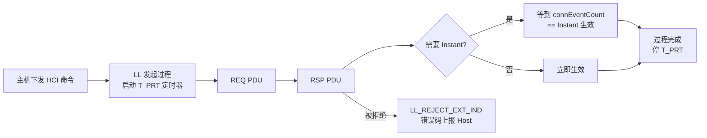

- **一次一个**：每设备每连接同时只能发起一个 LL 控制过程（ACL Termination 除外）；但可以在"响应对端过程"的同时发起自己的过程。
- **应答超时**：过程启动时启动 **T_PRT（Procedure Response Timeout）定时器**，每个排队发送的 LLCP 都会复位它；**到 40 秒视为链路丢失**，退出 Connection 态并通知 Host（§5.2）。注意 Connection Update 与 Channel Map Update 两个过程**没有**超时规则（它们靠 Instant 兜底）。
- **Instant（生效时刻）**：connEventCount 按 mod 65536 比较；Central 选 Instant 时应至少预留 6 个连接事件（考虑 subrating/latency 后对端还能听到）。
- **不认识就问**：收到不支持/非法的 LLCP 回 LL_UNKNOWN_RSP；参数越界可就地取最接近合法值继续，或用 LL_REJECT_IND / LL_REJECT_EXT_IND 拒绝。

### 三、主要过程时序

#### 3.1 连接参数更新（Connection Update / 参数请求协商）

新规范（4.1+）优先走"协商"：任一方发 LL_CONNECTION_PARAM_REQ（给出 Interval_Min/Max 窗口、Latency、Timeout、偏好周期与 6 个锚点偏移 Offset0~5），对端 LL_CONNECTION_PARAM_RSP 收窄窗口；最终仍由 **Central 发 LL_CONNECTION_UPDATE_IND**（WinSize、WinOffset、Interval、Latency、Timeout、Instant）拍板。Peripheral 若不支持协商特性，只能走 L2CAP CoC 信令向 Host 汇报，由 Central 的 Host 触发 0x00。

生效规则：从 Instant 前一个连接事件起，双方必须"按时到场"；Instant 处切换 connIntervalOLD→NEW，监督定时器在 Instant 复位；若 peripheral latency 变大，同一 Instant 内还要迁移锚点（WinSize/WinOffset 描述第一个新锚点窗口）。

#### 3.2 加密建立全流程（Encryption Start，LTK 的起点在 SMP）

前置：配对/绑定已在 Host 侧产出 LTK（流程见 [06-SMP安全与配对](61-ble-core.md)）。LL 层收到 Host 的 LE_Enable_Encryption 后：

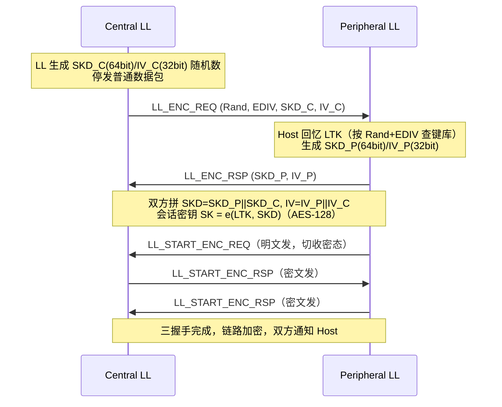

失败分支：对端不支持加密→LL_REJECT_IND（0x1A Unsupported Remote Feature）；Host 无 LTK→拒绝码 PIN or Key Missing（0x06）。握手期间收到任何"意外的"数据 PDU，立即断链，原因码 Connection Terminated Due to MIC Failure（0x3D）——这是防重放/防注入的硬规则。

**换钥不断链（Encryption Pause）**：换新 LTK 时 Central 先发 LL_PAUSE_ENC_REQ/RSP 冻结加密（期间禁止明文数据），再自动重跑一遍上面的 Start 流程。LE Ping 的 authenticatedPayloadTO 定时器（默认 30 s）在暂停期间继续走。

#### 3.3 PHY 更新（PHY Update）

Central 发起：LL_PHY_REQ → LL_PHY_RSP → Central 裁定发 LL_PHY_UPDATE_IND（PHY_C_TO_P、PHY_P_TO_C、Instant）。Peripheral 发起：LL_PHY_REQ → Central 直接 LL_PHY_UPDATE_IND（省掉 RSP）。裁定规则：取双方偏好位图的交集；无交集则该方向不变。Instant 处双方向切换新 PHY；若没选新 PHY（两边都没变）则无 Instant、立即完成。CIS 的 PHY 独立于 ACL，不受此过程影响。

#### 3.4 DLE（Data Length Update）

任一方发 LL_LENGTH_REQ（本端 connMaxTx/RxOctets + connMaxTx/RxTime），对端回 LL_LENGTH_RSP 并可借机抬价。REQ 一到（或识别出对端的 RSP）立即更新对端能力参数，新参数只作用于**尚未排队**的新包。默认载荷 27 B（connInitialMaxTxOctets=27）；DLE 上限 251 B。对端不支持 LE Coded 时 MaxRxTime/MaxTxTime ≤ 2128 µs。DLE 无 Instant，协商完成即用。

#### 3.5 CIS 建立（CIS Creation，LE Audio 的入口）

仅 Central 可发起：LL_CIS_REQ（CIG_ID/CIS_ID、CIS_Offset_Min/Max 窗口、ISO_Interval、BN/FT/NSE/MPT、Framing、PHY）→ Peripheral 接受回 LL_CIS_RSP（收紧后的时间窗，必须完全落在 REQ 窗口内且按 ISO_Interval 对齐）→ Central 发 LL_CIS_IND（最终锚点时刻 + CIG_Sync_Delay/CIS_Sync_Delay）。收到 LL_CIS_IND 时双方停掉 T_PRT、按 cisEventCounter=0 建流；收到对端第一条 CIS PDU 才算"已建立"。拒绝路径一律 LL_REJECT_EXT_IND（如 0x1A、0x30 Parameter Out of Mandatory Range）。应用全景见 [09-LEAudio与LC3](62-ble-advanced.md)。

#### 3.6 其他高频过程速记

| 过程 | 时序 | 备注 |
|---|---|---|
| 特性交换 | FEATURE_REQ→RSP | 建链后尽早做；bit63 置位说明有扩展页（FEATURE_EXT_REQ/RSP） |
| 版本交换 | VERSION_IND→VERSION_IND | 双方各发一次，无显式请求 |
| PING | PING_REQ→RSP | 验证加密链路活着；配合 authenticatedPayloadTO（默认 30 s） |
| SCA 询问 | CLOCK_ACCURACY_REQ→RSP | 应答值不得低于当前在用精度；不宜每秒超过一次 |
| 信道图更新 | CHANNEL_MAP_IND（带 Instant） | Instant 前用旧图，Instant 起用新图并做 CSA 重映射 |
| 功控 | POWER_CONTROL_REQ→RSP | 配合 LL_POWER_CHANGE_IND 通告，见 [14-RF物理层参数全表](62-ble-advanced.md) 的功率分类 |
| 子速率 | SUBRATE_REQ→IND | 5.3+，按倍数"隔 N 个事件收发一次" |
| 帧间隔 | FRAME_SPACE_REQ→RSP | 6.0 新增，把默认 150 µs 帧间隔改成更短/更长 |
| CTE 请求 | CTE_REQ→CTE_RSP | 拒绝用 REJECT_EXT_IND（0x20/0x1E/0x2A），见 [13-测向与信道探测](62-ble-advanced.md) |

### 四、过程冲突与 Instant 相关断链

两个过程"不兼容"的情形（§5.3）：都带 Instant；都是 CS Configuration 过程；都是 CS Procedure Repeat Termination；一方是 Frame Space Update 与另一 Frame Space Update / CIS 建立撞车。处理规则：

- 设备 A 已在过程 X 中，收到对端发来的不兼容过程 Y 的首包：
  - 若 A 已向对端发过 X 的 PDU → 立即断链（原因码见下）；
  - A 是 Central → 用 REJECT_EXT_IND/REJECT_IND 拒掉 Y，继续 X；
  - A 是 Peripheral → 放弃 X，服从 Central 的 Y，只处理随后的拒绝通知。
- 错误码：同过程自撞（或 ConnUpdate 撞 ConnParamReq）用 **0x23 LMP Error Transaction Collision / LL Procedure Collision**；其余用 **0x2A Different Transaction Collision**。

### 五、FeatureSet 特征位图（LL_FEATURE_REQ/RSP CtrData）

Core 6.0 Vol 6 Part B Table 4.10（本表为位号→特征名摘录；"Send to Peer" 约束略，位级语义见规范）：

| 位 | 特征 | 位 | 特征 |
|---|---|---|---|
| 0 | LE Encryption | 25 | Periodic Advertising Sync Transfer - Recipient |
| 1 | Connection Parameters Request procedure | 26 | Sleep Clock Accuracy Updates |
| 2 | Extended Reject Indication | 27 | Remote Public Key Validation |
| 3 | Peripheral-initiated Features Exchange | 28 | CIS - Central |
| 4 | LE Ping | 29 | CIS - Peripheral |
| 5 | LE Data Packet Length Extension | 30 | Isochronous Broadcaster |
| 6 | LL Privacy | 31 | Synchronized Receiver |
| 7 | Extended Scanning Filter Policies | 32 | CIS (Host Support) |
| 8 | LE 2M PHY | 33 | LE Power Control Request |
| 9 | Stable Modulation Index - Transmitter | 34 | LE Power Control Request（与 bit33 必须同值） |
| 10 | Stable Modulation Index - Receiver | 35 | LE Path Loss Monitoring |
| 11 | LE Coded PHY | 36 | Periodic Advertising ADI support |
| 12 | LE Extended Advertising | 37 | Connection Subrating（Host Controlled） |
| 13 | LE Periodic Advertising | 38 | Connection Subrating (Host Support) |
| 14 | Channel Selection Algorithm #2 | 39 | Channel Classification |
| 15 | LE Power Class 1 | 40/41 | Advertising Coding Selection / (Host Support) |
| 16 | Minimum Number of Used Channels procedure | 42 | Decision-Based Advertising Filtering |
| 17 | Connection CTE Request | 43 | PAwR - Advertiser |
| 18 | Connection CTE Response | 44 | PAwR - Scanner |
| 19 | Connectionless CTE Transmitter | 45 | Unsegmented Framed Mode |
| 20 | Connectionless CTE Receiver | 46 | Channel Sounding |
| 21 | Antenna Switching During CTE Transmission (AoD) | 47 | Channel Sounding (Host Support) |
| 22 | Antenna Switching During CTE Reception (AoA) | 48 | Channel Sounding Tone Quality Indication |
| 23 | Receiving Constant Tone Extensions | 56~62 | 保留（规范开发用） |
| 24 | Periodic Advertising Sync Transfer - Sender | 63 | LL Extended Feature Set（支持 64+ 位特征者必置） |
| — | — | 64/65 | Monitoring Advertisers / Frame Space Update |

LL_FEATURE_RSP 的 FeatureSet[0] 是"双方交集"语义（双方都必须支持的特性），FeatureSet[1..7] 是发送方自己的能力——调试嗅探器抓包时注意这一差别。

## 原文：13-测向与信道探测

> Source: [50-枝干-无线关联/BLE-低功耗蓝牙/13-测向与信道探测.md](https://github.com/tangjianfang/USBTree/blob/main/50-枝干-无线关联/BLE-低功耗蓝牙/13-测向与信道探测.md)

>  规范依据: Bluetooth Core 6.0（2024-08-27）——测向：Vol 6 Part B §2.1.5/§2.5（CTE）+ Part A §5（天线切换）；信道探测（CS）：Vol 6 Part H（新分卷）+ Part B §2.4.2.45~2.4.2.58/§4.5.18/§5.1.25~5.1.27 + Part A §3.4/§5.3/§6，本地缓存见 [../../80-参考资料/README.md](92-spec-references.md)

---

BLE 的两条"定位/测距"支线：**测向（Direction Finding，5.1 引入）**靠天线阵列+IQ 采样解出**角度**；**信道探测（Channel Sounding，CS，6.0 新增）**靠双设备对射信号直接测**距离**。前者解决"目标在哪个方向"，后者解决"目标有多远"——数字钥匙、Find My 类硬件寻找器是两者的典型落地。

### 一、AoA/AoD 测向：Constant Tone Extension（CTE）

#### 1.1 CTE 物理结构

CTE 是追加在包尾（CRC 之后）的一段**恒定单音**：内容为不加白化的一串连续 '1'。1 Msym/s GFSK、调制指数 0.5 时，连续发 '1' 就是恒定正频偏——即载波偏上约 **+250 kHz** 的单音（fd = h×fsym/2 = 0.5×1 MHz/2 = 250 kHz），天线阵列能在这个稳定相位上做相干采样。

| 参数 | 值 | 说明 |
|---|---|---|
| 总时长 | 16 ~ 160 µs | CTEInfo 的 CTETime 字段，以 8 µs 为单位，取值 2~20（其余保留） |
| Guard period | 4 µs | 防御段，切换天线只允许发生在它和 switch slot 内 |
| Reference period | 8 µs | 参考段，固定用切换序列的第 1 根天线，采 8 个 IQ 样点 |
| Switch/Sample slot | 各 1 µs 或 2 µs | 交替排列；2 µs 为必选，1 µs 为可选（选了则所有支持 CTE 的 PHY 都得支持） |
| CTEType | 0=AoA / 1=AoD(1µs) / 2=AoD(2µs) | 3 保留 |
| 白化 | 不做 | CTE 不参与 CRC/MIC 计算 |
| 限制 | 不得出现在等时信道包上；**LE Coded PHY 上没有 CTE** | Part B §2.1.5/§2.2 原文明确 |

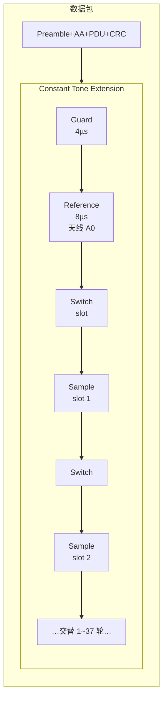

#### 1.2 AoA 与 AoD 的分工

| 方法 | 谁切天线 | 场景特征 |
|---|---|---|
| **AoA**（Angle of Arrival） | **接收端**切（发射端单天线不切换） | 标签便宜（单天线发射），定位器/基站做阵列——资产追踪、室内定位经典拓扑 |
| **AoD**（Angle of Departure） | **发射端**切（接收端单天线即可，可不切换） | 信标侧做阵列，手机侧便宜——导航类广播场景（常配连接less CTE 挂在周期广播上） |

IQ 采样规则（Part B §2.5.4）：参考段内**每微秒采 1 个 IQ 样点**（共 8 个），每个 sample slot 采 1 个；2 µs slot 时建议采在后 1 µs。总样点数 9~82（2 µs 槽 1~37 个、1 µs 槽 2~74 个）。规范还给出采样窗建议：每个 1 µs 周期开头 0.125 µs 与结尾 0.125 µs 之外取 0.75 µs 窗口采样，保证样点间一致性好。CRC 错的包也**可以**做 IQ 采样（丢 CRC 不丢相位）。

三个常见坑：CTE 不参与 CRC/MIC 计算（截掉它不影响链路层校验）；CTE 不能跑在 LE Coded PHY 上（远距与测向互斥，只能 1M/2M）；等时信道（CIS/BIS，LE Audio）的包禁止携带 CTE。

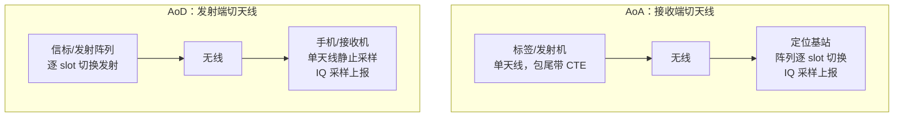

#### 1.3 从相位差到角度

两天线间距 d 的阵列收到波长 λ 的平面波，来波方向角 θ 时两阵元相位差：

```
Δφ = 2π · d · sin(θ) / λ   →   θ = arcsin( Δφ · λ / (2π·d) )
```

- 2.4 GHz 时 λ≈12.2 cm，工程上常取 d≈λ/2≈5~6 cm（d 过大出现相位模糊，过小则分辨率差）。
- **数值例**：d=5 cm、来波 θ=30° 时，Δφ = 2π×0.05×sin30°/0.1224 ≈ 1.28 rad ≈ 73.6°——阵列测量的是这个相位差，逐 slot 采样后按天线分组求平均相对相位（MRP）再反解 θ；规范规定的测试判据（95% 相对相位偏差 ≤±0.52 rad 等）保证了样点可用于此类解算。
- 多 slot/多天线数据融合：同一根天线在多个 sample slot 的相位取平均（Arg(Σe^iφ) 形式，Part A §5.2.1 定义），等效压制高斯噪声——这也是"CTE 越长精度越好"的原因。
- 规范把"原始 IQ→相对相位→每根天线的平均相对相位（MRP）"的定义与**测试通过判据**写在 Vol 6 Part A §5.2（如 95% 的相对相位偏差落在 ±0.52 rad 内、MRPD ∈ ±1.125 rad），并给出标准测试切换模式（2 天线 A0,A1,A0,A0；3/4 天线见 Table 5.2）。**角度解算算法本身不在规范内**，由厂商/上层实现（MUSIC、加权最小二乘等）。
- 精度影响因素：天线阵列的幅度/相位一致性（校准表）、IQ 采样质量（4.0 以上偏置）、多径反射（室内主敌）、CTE 时长与 slot 精度、阵列孔径（天线数）。

#### 1.4 配套的 LLCP 与 HCI

| 层 | 机制 | 内容 |
|---|---|---|
| LLCP | LL_CTE_REQ（0x1A）→ LL_CTE_RSP（0x1B） | 连接态：任一方请求对端回一个带 CTE 的包；条件不满足回 LL_REJECT_EXT_IND（0x20/0x1E/0x2A），见 [12-LLCP控制过程全表](62-ble-advanced.md) |
| LLCP | LL_PERIODIC_SYNC_IND（0x1C） | 连接less CTE（周期广播带 CTE）+ PAST 转移同步 |
| HCI | LE_Set_Connection_CTE_Receive_Parameters、LE_Set_Connection_CTE_Transmit_Parameters、LE_Connection_CTE_Request_Enable、LE_Connectionless_CTE_Transmit / _Receive、LE_Set_Connectionless_CTE_Sampling_Enable、LE_Antenna_Information | 配置切换模式、slot 时长、使能采样上报（Vol 4 Part E §7.8） |
| HCI 事件 | LE Connection IQ Report（连接态采样结果）、LE Connectionless IQ Report（周期广播采样结果）、LE CTE Request Failed | IQ 样点流式上报：包统计 + 通道索引 + RSSI + 天线编号 + I/Q 样点数组 |
| 特征位 | FeatureSet bit17~23 | 连接 CTE 请求/应答、连接less 收发、AoD 发切/AoA 收切、IQ 采样能力 |

#### 1.5 天线阵列与解算实践（工程知识，非规范内容）

- **阵列几何**：线性阵（ULA）只解一个维度的角度且存在 ±θ 镜像模糊；矩形阵/均匀圆阵（UCA）可解方位角+俯仰角。天线间距常取 d≈λ/2≈5~6 cm；d 越大分辨率越高，但相位差超过 ±π 出现解模糊（需多间距组合或连续性约束消解）。
- **开关时序**：切换序列（antenna switching pattern）由 Host 配置并循环使用；Part A Table 5.1 强制支持长度：2 天线 1~4、3 天线 1~8、4 天线 1~12；天线只能在 guard period 与 switch slot 内换（换件噪声不能污染 sample slot）。
- **精度账本**：规范侧给的是"能解算的原始材料"（IQ 样点质量与切换时序），最终角度精度由阵列一致性校准（幅度±1 dB、相位±5° 量级的工程目标）、多径环境、CTE 时长/样点数共同决定——室内多径下"米级定位"是合理预期，Free-space 标定环境可到分米级。

### 二、Channel Sounding（CS，Core 6.0 新增）

#### 2.1 两大测距法：PBR 与 RTT

| 方法 | 原理 | 优点 | 局限 |
|---|---|---|---|
| **RTT**（Round-Trip Time，step mode-1） | A 发 CS_SYNC 包、B 秒回，测 ToA/ToD 差得往返时间，减去固定收发偏移 T_SY_CENTER_DELTA = T_SY+T_RD+T_IP1 | 只要包级时间戳，最抗多径漂移 | 精度受时基采样分辨率限制（故规范又定义基于 sounding/random 序列的**分数级** timing 精化，Part H §3.2~3.4） |
| **PBR**（Phase-Based Ranging，step mode-2） | 多个频率点上测信道相位（CS tone 交换，双方报 IQ/PCT），相位随频率的变化率对应传播时延，解出距离 | 分数级精度高（毫米级理论分辨率） | 存在相位-距离多值模糊（需多频解模糊）；对多径相位失真敏感 |

规范明确：**距离解算算法不在规范内**，只给出数学表示（Vol 1 Part A §9.2）：对称信道下 CH(f) 为信道相位、LO(f) 为双方本振相位差，双方测得 INIT(f)=CH(f)−LO(f)、REFL(f)=CH(f)+LO(f)——两式结合可消掉 LO(f)，再以跨频率的相位斜率估时延。

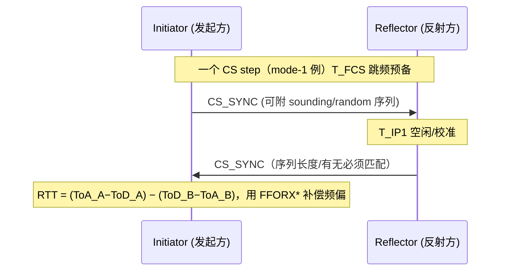

#### 2.2 层级与规模参数

角色：发起 CS 过程的一方是 **Initiator**，应答方是 **Reflector**（可经 LL_CS_SEC_REQ/RSP 交换角色，且每次 CS 交换由 DRBG 随机化，防预测）。

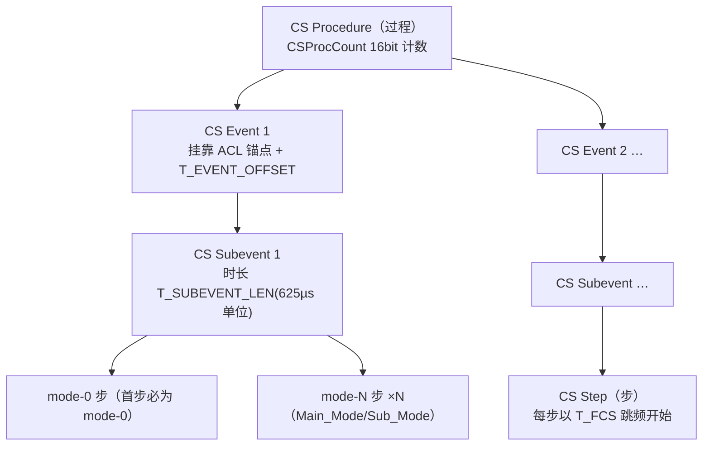

规模上限（Part B §4.5.18）：每过程 ≤32 个 subevent；每 subevent 2~160 步；每过程 ≤256 步；每 subevent 首步必须是 mode-0。subevent 间留时间空隙以利共存。事件按 T_EVENT_INTERVAL（LE 连接间隔倍数）周期重入，可配 N_PROCEDURE_COUNT 个连续过程实例。

#### 2.3 四种 step 模式

| 模式 | 测什么 | 交换内容 | 必选性 |
|---|---|---|---|
| mode-0 | 双方**频偏**校准（FFO），Initiator 用它补偿后续步的频率/时间误差 | CS_SYNC_0_I → CS_SYNC_0_R（CS_SYNC+CS tone，T_FM=80 µs 测频段） | 必选 |
| mode-1 | **RTT** | CS_SYNC 包对（可带 sounding/random 序列） | 必选 |
| mode-2 | **PBR** 相位旋转 | 纯 CS tone（时长 (T_SW+T_PM)×(N_AP+1)，T_PM ∈ {10,20,40} µs，40 必选；尾部 tone extension slot 用 ASK、有无发射由 DRBG 决定） | 必选 |
| mode-3 | RTT+相位二合一 | CS_SYNC 后接 CS tone | 可选 |

一次 CS 过程最多两种非 mode-0 模式（Main_Mode + Sub_Mode），合法组合：1/2/3 单独、2+1、2+3、3+2（Table 4.11）；Sub_Mode 插入节奏由 DRBG 随机化（Main_Mode_Min/Max_Steps）。跳频准备期 T_FCS 合法值 15/20/30/40/50/60/80/100/120/150 µs 十档（Table 4.3，150 µs 为必选档），一次 CS 过程内固定用同一档；T_IP1/T_IP2 类似（145 µs 档对 T_IP1 必选）。

射频侧配套（Part A）：CS 用 **72 个专用信道**（2402+k MHz，k=2~22 与 26~76，避开广播信道频点）；CS_SYNC 包可跑 LE 1M/2M/**2M 2BT**（BT=2.0，仅 CS 可用）三种 PHY；CS tone 是**未调制单音**（ASK 仅用于 extension slot 的有/无）；要求发射**稳定相位**（T_PM_MEAS 期间 95% 去趋势相位残差 ≤20°）与天线路径切换 N_AP≤4（1:1/1:N/N:1/2:2 配置）。

#### 2.4 安全特性：为什么 CS 敢说"防中继"

- **NADM 攻击检测指标**（Part H §3.5）：接收机把收到的 GFSK 信号与"已知数据重构的参考相位信号"比对，差异+误码率折算成 NADM 值：0x00 Attack extremely unlikely → 0x06 Attack extremely likely，0xFF Unknown（不支持 NADM 处理时上报）。物理层篡改（提前应答、信号注入）会抬高该值。
- **DRBG 随机化**（Part H §4.8）：信道选择（CSA #3）、序列、tone extension 有无、角色交换时机都由双方共享种子的伪随机函数驱动，攻击者无法预测下一步在哪跳、哪回。
- **双向 IQ + 频偏交叉校验**：mode-0 的 FFO 测量与 FAE 表让时间/频率造假残留可检测的痕迹；mode-2 双端相位天然要求真实往返。
- **可信度输出**：上述值聚合后交上层"attack detector"判定威胁等级（算法规范外）。诚实声明：规范给的是"检测原材料"，不是完整反中继协议——业务侧（如 CCC 数字钥匙）还要叠认证与策略。

#### 2.5 配套 LLCP/HCI 与应用

| 层 | 机制 | 内容 |
|---|---|---|
| LLCP | 0x2E~0x3A 共 13 条 LL_CS_* | 能力交换、配置、启动/终止、FAE 表、CS 信道图（见 [12-LLCP控制过程全表](62-ble-advanced.md)） |
| HCI | LE_CS_Read_Remote_Supported_Capabilities、LE_CS_Create_Config / Remove_Config、LE_CS_Set_Channel_Classification、LE_CS_Set_Procedure_Parameters、LE_CS_Procedure_Enable、LE_CS_Test（另含 Security Start 系列） | Vol 4 Part E；对应 HCI 事件回报 IQ/RTT 样本与 NADM |
| 特征位 | bit46/47 Channel Sounding (Host Support)、bit48 Tone Quality Indication | bit63 扩展页机制承载更多 |

CS 事件/子事件的调度参数在 CS Configuration 与 CS Start 过程中协商（Part B §4.5.18）：

| 参数 | 含义 |
|---|---|
| T_PROCEDURE_INTERVAL | 相邻 CS 过程实例间隔（LE 连接间隔的倍数） |
| N_PROCEDURE_COUNT | 连续执行的 CS 过程实例个数 |
| T_EVENT_OFFSET | CS 事件起点相对 ACL 锚点的微秒偏移 |
| T_EVENT_INTERVAL | 相邻 CS 事件间隔（LE 连接间隔的倍数）；CS 事件可以超出单个连接间隔 |
| T_SUBEVENT_LEN / T_SUBEVENT_INTERVAL | 子事件最大时长 / 起点间隔（625 µs 单位） |
| N_SUBEVENTS_PER_EVENT | 每个 CS 事件内的子事件数 |

#### 2.6 应用与 UWB 对比（一句话版）

应用：**CCC 数字钥匙（Digital Key 3.0 选定 BLE CS 做精测距）**、Apple Find My 类"精确查找"、门禁/保险柜/防丢器；测向（CTE）则统治室内定位基建（AoA 锚点阵列）。对比 **UWB**（802.15.4z，500 MHz+ 带宽）：UWB 测距精度与抗多径天生更强（约 ±10 cm 级 vs CS 约 ±0.5~1 m 级工程表现，具体见各家实测），但 CS 复用既有 BLE 芯片、成本与部署门槛低一个量级——"够用且便宜"是 CS 的立足点。

#### 2.7 天线路径与天线配置（Part A §5.3）

| 项 | 规范内容 |
|---|---|
| N_AP（天线路径数） | 1~4；一条"路径"= Initiator 某天线 × Reflector 某天线的组合（AP1~AP4） |
| 配置类别（ACI） | 1:1（双方单天线）、1:N_AP、N_AP:1、2:2（N_AP=4） |
| 用途 | mode-2/3 的相位测量在每个天线路径上重复（(T_SW+T_PM)×(N_AP+1) 的 +1 即尾部 tone extension slot），多路径数据可解更稳的相位斜率并辅助校准 |

#### 2.8 数据产出与测试模式（HCI 侧）

| 机制 | 内容 |
|---|---|
| HCI_LE_CS_Subevent_Result / _Continue | 每个子事件结束后把各步的测量结果流式上报 Host：RTT（ToD/ToA）、IQ（相位+幅度）、NADM、测量频点等（分片续传） |
| HCI_LE_CS_Procedure_Enable_Complete | 一次 CS 过程（实例）执行完毕的通知 |
| HCI_LE_CS_Test / _Test_End(_Complete) | 线路/射频测试专用模式（类似常规 BLE 的 Direct Test Mode），产测与认证用 |

#### 2.9 测向 vs 测距：怎么选

| 维度 | CTE 测向（5.1） | CS 信道探测（6.0） |
|---|---|---|
| 输出 | 方向角（需要阵列+解算） | 距离（双方交互+上层解算） |
| 硬件代价 | 定位端多天线阵列+开关 | 兼容现有 BLE 射频（需相位/频偏校准），无阵列也可用 |
| 承载 | 连接包或周期广播的 CTE | 专用 LL_CS_* 过程+72 专用信道 |
| 典型生态 | 室内定位（AoA 基站）、Find My 方向箭头 | CCC 数字钥匙 3.0、Find My 距离档、无钥匙门禁 |

两者互补：方向+距离联合输出才是完整定位（"在哪个方向、多远"）。

## 原文：14-RF物理层参数全表

> Source: [50-枝干-无线关联/BLE-低功耗蓝牙/14-RF物理层参数全表.md](https://github.com/tangjianfang/USBTree/blob/main/50-枝干-无线关联/BLE-低功耗蓝牙/14-RF物理层参数全表.md)

>  规范依据: Bluetooth Core 6.0（2024-08-27）Vol 6 Part A（Physical Layer Specification）§2~§5 + Part B §4.1（帧间隔），本地缓存见 [../../80-参考资料/README.md](92-spec-references.md)。本文所有"规范值"均自该 PDF 提取；标注"工程估算"的除外。

---

这是 [02-链路层与物理层](61-ble-core.md) 第二、七节的"仪表盘级"展开：发射、接收、定时、吞吐、链路预算——拿它对照芯片 datasheet 或量产测试（OTA/传导）指标最顺手。

### 一、频段与信道（Part A §2）

- 工作频段：**2400~2483.5 MHz ISM**，40 个射频信道，中心频率 2402+2k MHz（k=0..39），间隔 2 MHz。
- **CS 专用 72 信道**（6.0）：2402+k MHz，k∈{2..22} ∪ {26..76}，间隔 1 MHz——信道探测（见 [13-测向与信道探测](62-ble-advanced.md)）独有的窄格信道。

### 二、发射参数（Part A §3）

#### 2.1 发射功率与功率等级

最大设定下的辐射发射功率须在 **0.01 mW（−20 dBm）~ 100 mW（+20 dBm）**之间（天线接口处，无接口按 0 dBi 参考天线折算）。功率等级（Table 3.1）：

| Power Class | 要求（Pmax = 最大辐射功率） |
|---|---|
| 1 | 100 mW（+20 dBm）≥ Pmax > 10 mW（+10 dBm） |
| 1.5 | 10 mW（+10 dBm）≥ Pmax > 2.5 mW（+4 dBm） |
| 2 | 2.5 mW（+4 dBm）≥ Pmax > 1 mW（0 dBm） |
| 3 | 1 mW（0 dBm）≥ Pmax ≥ 0.01 mW（−20 dBm） |

- 相邻两个可调功率档差应 ≤ **8 dB**（LE Power Control Request 可用时"should"）。
- 高功率近距离会饱和对端接收机——6.0 强调用功控而非蛮力（LL_POWER_CONTROL_REQ，见 [12-LLCP控制过程全表](62-ble-advanced.md)）。
- 特征位 bit15 "LE Power Class 1" 声明支持 +20 dBm 档。

#### 2.2 调制特性（§3.1）

| 参数 | 规范值 | 备注 |
|---|---|---|
| 调制方式 | GFSK，BT = 0.5 | '1'=正频偏，'0'=负频偏 |
| 调制指数 | 0.45 ~ 0.55 | "稳定调制指数"发射机：0.495~0.505（可声明特征 bit9/bit10） |
| 最小频偏 Fmin | ≥ 80% 满频偏；且 ≥ **185 kHz**（1 Msym/s）、≥ **370 kHz**（2 Msym/s） | 对应调制指数恰为 0.5 时偏差 250/500 kHz |
| 符号定时精度 | 优于 **±50 ppm** | 晶振选型直接约束（见 §7） |
| 过零误差 | ≤ ±1/8 符号周期 | |
| LE 2M 2BT（CS 专用） | BT = 2.0，符号中心最小频偏 ≥ 420 kHz | 仅 CS_SYNC 包可用 |
| CS SNR 输出控制 | SOI 0~4 → 18/21/24/27/30 dB | 可选；控制误差 ≤3 dB（95% 步） |

#### 2.3 频率容限（§3.3）

| 参数 | 规范值 |
|---|---|
| 包内中心频率偏差（初始偏移+漂移合计） | ≤ **±150 kHz**（≈±61 ppm @2.44 GHz） |
| 包内最大频漂 | ≤ ±50 kHz |
| 最大漂移速率 | ≤ 400 Hz/µs |

#### 2.4 杂散发射（§3.2）

| 调制 | 频偏 | 邻道功率（1 MHz 带宽） |
|---|---|---|
| 1 Msym/s（1M/Coded） | ±2 MHz | ≤ −20 dBm |
| 1 Msym/s | ≥ ±3 MHz | ≤ −30 dBm |
| 2 Msym/s（2M/2M 2BT） | ±4、±5 MHz | ≤ −20 dBm |
| 2 Msym/s | ≥ ±6 MHz | ≤ −30 dBm |

允许 3 个 1 MHz 宽的例外频段（中心在整数 MHz 上，绝对值 ≤−20 dBm）。带外杂散按销售国法规（FCC/ETSI）。6 dB 带宽 ≥500 kHz（FCC 15.247 路线）。

### 三、接收参数（Part A §4）

#### 3.
>  对抗抽查（evolve #18）：Table 4.2 灵敏度（-70/-75/**-82** dBm）与 Core 6.0 提取文本逐值一致（S=8 为 6.0 新值，非旧版 -80）。
1 灵敏度（Table 4.2，Core 6.0 版）

| PHY | 参考灵敏度 | 备注 |
|---|---|---|
| LE 1M / LE 2M（未编码） | **−70 dBm** | 实际灵敏度按 BER 与最大载荷长度分级：载荷 1~37 B 时 BER≤0.1%，128~255 B 时 BER≤0.017% |
| LE Coded S=2（500 kb/s） | **−75 dBm** | |
| LE Coded S=8（125 kb/s） | **−82 dBm** | **6.0 已由旧版 −80 dBm 收紧为 −82 dBm**（引用旧文献注意） |

芯片实测灵敏度通常显著优于规范值（1M 典型 −90~−97 dBm，datasheet 值），规范值是互操作底线。

#### 3.2 抗干扰性能（Tables 4.3~4.6）

测量条件：有用信号 −67 dBm（未编码）/ −72 dBm（S=2）/ −79 dBm（S=8），BER ≤0.1%。注意 PDF 表格易错位，下表数值已按原始提取顺序核对（干扰类型→比值一一对应）。

| 干扰类型 | LE 1M | LE 2M | Coded S=2 | Coded S=8 |
|---|---|---|---|---|
| 同频 C/I | 21 dB | 21 dB | 17 dB | 12 dB |
| 邻道（1 MHz @1M / 2 MHz @2M） | 15 dB | 15 dB | 11 dB | 6 dB |
| 次邻道（2 MHz @1M / 4 MHz @2M） | −17 dB | −17 dB | −21 dB | −26 dB |
| 三邻道（3 MHz @1M / 6 MHz @2M） | −27 dB | −27 dB | −31 dB | −36 dB |
| 镜频干扰 | −9 dB | −9 dB | −13 dB | −18 dB |
| 镜频±1 MHz（@1M）/±2 MHz（@2M） | −15 dB | −15 dB | −19 dB | −24 dB |

- 允许 5 个"杂散响应信道"不达上表（1 Msym/s 时距有用信号 2 MHz、2 Msym/s 时 4 MHz 处，镜频除外），放宽为 C/I = −17 dB。
- 干扰信号：有用信号用 PRBS9，干扰用 PRBS15（参考信号定义 §4.6：调制指数 0.5±1%、BT 0.5±1%、码率 ±1 ppm）。

#### 3.3 带外阻塞（Table 4.7，有用信号=灵敏度+3 dB，中心 2426 MHz）

| 干扰频率 | 干扰电平 | 分辨率带宽 |
|---|---|---|
| 30 MHz ~ 2000 MHz | −30 dBm | 10 MHz |
| 2003 ~ 2399 MHz | −35 dBm | 3 MHz |
| 2484 ~ 2997 MHz | −35 dBm | 3 MHz |
| 3000 MHz ~ 12.75 GHz | −30 dBm | 25 MHz |

允许 10 个整数 MHz 中心的例外频点（至少 7 个可放宽到 −50 dBm，最多 3 个更低）。

#### 3.4 互调与最大输入（§4.4/§4.5）

| 项目 | 条件/要求 |
|---|---|
| 互调 | 有用信号 f0（灵敏度+6 dB）；正弦 f1 = −50 dBm、调制干扰 f2 = −50 dBm，满足 f0 = 2f1−f2 且 \|f2−f1\| = n×1 MHz（1M，n=3/4/5）或 n×2 MHz（2M）；三选一满足即可 |
| 最大可用输入电平 | −10 dBm 输入时 BER ≤0.1%（强信号饱和裕量） |
| RSSI 精度 | ±6 dB（should，支持 RSSI 时） |

#### 3.5 参考信号定义（§4.6，所有收发测量的"标尺"）

| 参数 | 规范值 |
|---|---|
| 调制 | GFSK |
| 调制指数 | 0.5 ± 1%（标准调制指数）；0.5 ± 0.5%（稳定调制指数） |
| BT | 0.5 ± 1% |
| 数据码率 | 1 Mb/s ±1 ppm（LE 1M）、2 Mb/s ±1 ppm（LE 2M）、500 kb/s ±1 ppm（S=2）、125 kb/s ±1 ppm（S=8） |
| 调制数据 | 有用信号 PRBS9；干扰信号 PRBS15 |
| 频率准确度 | 优于 ±1 ppm（测试信号源要求，非被测件要求） |

### 四、包定时（Part B §4.1 + Part A）

| 计时参数 | 值 | 说明 |
|---|---|---|
| T_IFS（ACL/CIS 帧间隔） | 默认 **150 µs** | T_IFS_ACL_CP / T_IFS_ACL_PC / T_IFS_CIS 按 RX 方 PHY 选值；6.0 起可用 Frame Space Update 过程（LL_FRAME_SPACE_REQ/RSP）协商改短/改长 |
| T_IFS_150 | 150 µs（固定） | 广播应答、扫描、PAwR 等不可协商场合 |
| T_MAFS（Minimum AUX Frame Space） | **300 µs** | AuxPtr 指向的辅助包最小间隔 |
| T_MSS_CIS / T_MSS_150 | 默认 150 µs | CIS/BIS 子事件间最小间隔（CIS 可协商） |
| 锚点接收窗口 | connWinSize × 1.25 ms，上限 10 ms | 连接建立/参数迁移时第一个包的到达窗口 |
| Radio wake-up | 实现相关，无规范值 | 控制器须在锚点前完成频率校准+AGC；低功耗设计把唤醒时间压到 µs~百 µs 级，具体见芯片手册 |

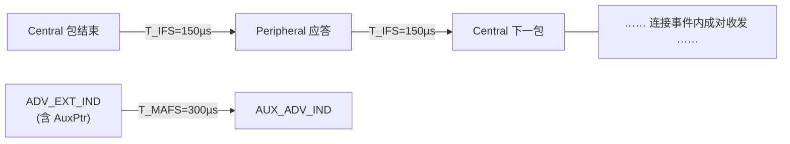

补充两张定时相关的表。

**最大空口包时间**（按 [02-链路层与物理层](61-ble-core.md) 包格式推算，DLE=251 B+4 B MIC；Coded 一行为规范原文）：

| PHY | 最大包时间 | 推算依据 |
|---|---|---|
| LE 1M | ≈2120 µs | 8+32+16+2040+24 bit = 2120 bit ÷ 1 Mb/s；与 connMaxTxTime 上限一致 |
| LE 2M | ≈1064 µs | 前导/头按 2M 时序折算，载荷减半 |
| LE Coded | 462 ~ 17040 µs | Part B Table 2.1 原文（S=2/S=8 合并范围） |

**睡眠时钟精度 SCA 分档**（HCI/LLCP 用 0x00~0x07 表达，Vol 4 Part E；连接参数里 Peripheral 最低须 ±500 ppm）：

| 编码 | 0x00 | 0x01 | 0x02 | 0x03 | 0x04 | 0x05 | 0x06 | 0x07 |
|---|---|---|---|---|---|---|---|---|
| 精度 | 500 ppm | 250 ppm | 150 ppm | 100 ppm | 75 ppm | 50 ppm | 30 ppm | 20 ppm |

SCA 决定 Peripheral 锚点漂移窗口：connInterval=1 s、SCA=±50 ppm 时最大漂移 ±50 µs——这就是"低功耗为什么费接收窗口"的算术，也是 LL_CLOCK_ACCURACY_REQ/RSP 存在的理由（对端换了好晶振就收紧窗口省电）。

### 五、空中数据率与有效吞吐对照

| PHY | 空口码率 | 空口净荷速率（去 FEC 开销后） | 应用层吞吐（工程估算，1 包/事件理想化） | 说明 |
|---|---|---|---|---|
| LE 1M | 1 Mb/s | 1 Mb/s | ~0.6~0.8 Mb/s | 计入接入地址/前导/CRC/帧间隔与重传 |
| LE 2M | 2 Mb/s | 2 Mb/s | ~1.3~1.6 Mb/s | 帧头开销比例同 1M，包时间减半 |
| LE Coded S=2 | 1 Msym/s + FEC（S=2，符号组 P=1） | 500 kb/s | ~0.3~0.4 Mb/s | FEC 扩展 2 倍，覆盖换取可靠 |
| LE Coded S=8 | 1 Msym/s + FEC（S=8，符号组 P=4） | 125 kb/s | ~0.07~0.1 Mb/s | 8 倍扩展；包最长 17040 µs，连接间隔下限也随之抬高 |

> 空口净荷速率是定义值（S=2/S=8 编码后数据速率 500/125 kb/s，规范原文）；"应用层吞吐"为按 DLE=251 B、无干扰、无重传的典型链路估算值，**非规范数据**，实际取决于连接间隔、MTU、事件内包数（MD 位滚动）。

吞吐三杠杆，按影响排序：**连接间隔**（7.5 ms 间隔下事件密度翻倍再翻倍）、**DLE**（27 B→251 B 使单包有效载荷占比从 ~50% 提到 ~93%）、**PHY**（2M 使包时间减半，T_IFS 占比反而上升）。BLE 5 起还允许一个连接事件内塞多组"包+应答"，逼近空口极限。

### 六、链路预算估算示例（工程估算）

自由空间路径损耗 FSPL(dB) ≈ 40.2 + 20·log₁₀(d/m)（f=2450 MHz）。预算 = TX 功率 + 天线增益和 − FSPL − 灵敏度 + 衰落裕量。

| 场景 | 配置 | 计算 | 可达距离（视距） |
|---|---|---|---|
| 典型穿戴 | TX +4 dBm，0 dBi×0 dBi，1M 实测灵敏度 −90 dBm，裕量 20 dB | FSPL = 4+0−(−90)−20 = 74 dB | d ≈ 10^((74−40.2)/20) ≈ **49 m** |
| Class 1 上限 | TX +20 dBm，规范底线灵敏度 −70 dBm，裕量 10 dB | FSPL = 20−(−70)−10 = 80 dB | d ≈ **98 m（"100 m"级宣传的出处）** |
| Class 1 + 实测 | TX +20 dBm，1M 实测灵敏度 −90 dBm，裕量 20 dB | FSPL = 20−(−90)−20 = 90 dB | d ≈ 10^((90−40.2)/20) ≈ **309 m（"300 m"级）** |
| 远距 beacon | TX +20 dBm，Coded S=8 实测灵敏度 −100 dBm，裕量 20 dB | FSPL = 20−(−100)−20 = 100 dB | d ≈ 10^((100−40.2)/20) ≈ **977 m ≈ 1 km+（空旷视距）**；室内多径下大幅缩水 |

结论：规范灵敏度（−70/−75/−82）只是互操作底线，**实际覆盖由芯片灵敏度+天线增益+环境决定**；广告里"数百米/1 km"基本都建立在 Coded PHY 与实测灵敏度之上。

### 七、PCB 设计要点（由规范反推）

- **晶振精度**：符号定时 ±50 ppm + 中心频率偏差（含漂移）±150 kHz（≈±61 ppm）→ 晶振选 ±20~±40 ppm 档（含焊接偏移与温漂预算），留出 AGC/频偏跟踪吃掉剩余。廉价 ±50 ppm 晶振在宽温下会顶到规范红线。
- **天线匹配**：50 Ω 参考阻抗下做 π 型匹配（串联 L + 并联 C×2），VSWR < 2；净空区（keep-out）≥ 规定的天线半波长比例，远离电池/USB 连接器金属体。外接天线产品按有效天线增益折算 EIRP（功率上限约束的是"辐射功率"而非芯片引脚功率）。
- **谐波与杂散**：满足 §2.4 邻道 −20/−30 dBm 需要良好的电源去耦与屏蔽；2 次谐波（4.8 GHz）是常见翻车点（ETSI 限值更紧）。
- **镜像抑制**：镜频 C/I 仅 −9 dB（1M），低中频/零中频架构的镜像校准必须做；PCB 布局避免让 Wi-Fi 2.4G PA 输出走线耦合进 BLE LNA。
- **CTE/CS 附加要求**（做测向/测距产品）：天线阵列幅度/相位一致性校准（测向精度主导因素）；CS 要求发射稳定相位（Part A §3.4：95% 去趋势相位残差 ≤20°）与 FAE 表校准——射频前端相位噪声预算比普通 BLE 严格一档。
- **测试条件**（Part A 附录 A）：全部规范值只在厂商声明的正常工作条件（温度/湿度/标称供电电压）下有效——量产 OTA 测试的温箱范围要与声明对齐，否则 −70 dBm 灵敏度指标无意义。

## 原文：15-A2DP编解码与AVDTP参数

> Source: [50-枝干-无线关联/BLE-低功耗蓝牙/15-A2DP编解码与AVDTP参数.md](https://github.com/tangjianfang/USBTree/blob/main/50-枝干-无线关联/BLE-低功耗蓝牙/15-A2DP编解码与AVDTP参数.md)

> 本文是 [11-经典蓝牙Profile详解](62-ble-advanced.md) 第五章（A2DP）的规范级深化：只讲"信令怎么走、参数位怎么填"。
> 规范原文缓存: [../../80-参考资料/bluetooth/A2DP-1.4.1.pdf](https://github.com/tangjianfang/USBTree/blob/main/80-参考资料/bluetooth/A2DP-1.4.1.pdf)（2025-06-30 版，含 SBC/MPEG/AAC 编码互操作全表）；编解码信息元素格式另见 AVDTP 规范 §8.21.5，原文见 [../../80-参考资料/bluetooth/AVDTP-1.3.pdf](https://github.com/tangjianfang/USBTree/blob/main/80-参考资料/bluetooth/AVDTP-1.3.pdf)。缓存索引: [../../80-参考资料/README.md](92-spec-references.md)
> 上游基础: [11-经典蓝牙Profile详解](62-ble-advanced.md)、[08-经典蓝牙与BLE对比](61-ble-core.md)

### 1. AVDTP：三个信道与一套信令

AVDTP（Audio/Video Distribution Transport Protocol，L2CAP PSM **0x0019**）在 SRC（源，手机）与 SNK（汇，耳机）间最多跑三类 L2CAP 信道：

| 信道 | PSM | 用途 |
|---|---|---|
| 信令信道 | 0x0019（固定） | Discover/配置/开关流的全部命令-响应对；一对设备只有一条 |
| 媒体信道 | 动态分配 | OPEN 后建立，承载 RTP 式媒体包（版本/序号/时间戳/SSRC 头 + 编码载荷） |
| 恢复/报告信道 | 动态分配（可选） | Recovery（丢包重传，需能力协商）/ Reporting（时间戳报告）信道；另有 Content Protection（SCMS-T 内容保护）随能力协商挂在媒体信道上 |

信令命令集（Signal Identifier，命令/响应配对；数值源：AVDTP 1.3 Table 8.6，缓存 AVDTP-1.3.pdf）：

| 代码 | 命令 | 作用 |
|---|---|---|
| 0x01 | DISCOVER | 列出对端全部 SEP（Stream Endpoint，流端点） |
| 0x02 / 0x0C | GET_CAPABILITIES / GET_ALL_CAPABILITIES | 取某 SEP 的服务能力（后者含厂商扩展能力） |
| 0x03 | SET_CONFIGURATION | 选中 SEP 并填入编码参数（Codec Specific Information Elements）→ 进入 Configured |
| 0x04 | GET_CONFIGURATION | 读回当前配置 |
| 0x05 | RECONFIGURE | 流中途只改编码参数（如降 bitpool，不动传输信道） |
| 0x06 / 0x08 | OPEN / CLOSE | 建立 / 拆除媒体（及恢复、报告）信道 |
| 0x07 / 0x09 | START / SUSPEND | 流的走/停（RTP 流继续存在但暂停发包） |
| 0x0A | ABORT | 任意状态强制回 IDLE |
| 0x0B | SECURITY_CONTROL | 内容保护（SCMS-T）的鉴权载荷交换 |
| 0x0D | DELAY_REPORT | SNK 上报链路延迟（AVDTP 1.3 起，见第 8 节） |

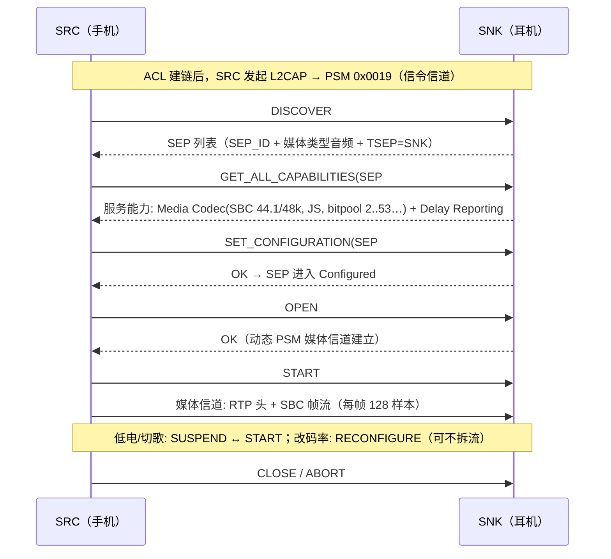

### 2. SEP 与 TSEP：编解码器实例的"插座"

- **SEP（Stream Endpoint）**：设备向对端暴露的一个可配置流端点，一个编码器实例对应一个 SEP；`DISCOVER` 拿到的每个 SEP 带 SEP_ID（6 bit）。ATRAC 这类"一版本一 SEP"的编码（A2DP 1.4.1 §4.6.2.1），支持多版本就要开多个 SEP。
- **TSEP（Type of SEP，AVDTP 1.3 起）**：0x00=SRC（能发出流）、0x01=SNK（能收流）——双模/中继设备的 SEP 表里明确标方向，是 LE Audio 之前"角色发现"的雏形。
- 流状态机：IDLE → Configured → Open → Streaming（SUSPEND/START 往返；CLOSE/ABORT 回退）。
- 不启用 Multiplexing 能力时，一对设备同时只有一条传输会话（一套媒体信道），想双编码并发就得开复用能力——现实设备几乎不开。

### 3. 服务能力类别（GET_ALL_CAPABILITIES 返回的内容）

| 类别码 | 名称 | 内容 |
|---|---|---|
| 0x01 | Media Transport | 基础传输能力（几乎必带） |
| 0x02 | Reporting | 报告信道 |
| 0x03 | Recovery | 丢包恢复窗口参数 |
| 0x04 | Content Protection | 如 SCMS-T（DRM 旗标） |
| 0x05 | Header Compression | RTP 头压缩 |
| 0x06 | Multiplexing | 多会话复用 |
| 0x07 | Media Codec | 媒体类型 + **Audio Codec Type** + 编码信息元素（本文主角） |
| 0x08 | Delay Reporting | AVDTP 1.3 新增，SNK 才会声明 |

Audio Codec Type 取值（Bluetooth Assigned Numbers）：**0x00 SBC、0x01 MPEG-1,2 Audio、0x02 MPEG-2,4 AAC、0x03 ATRAC family、0xFF 厂商专属**。能力查询时可置多个位（one-hot 位图），`SET_CONFIGURATION` 时每个字段**只允许置一位**（A2DP 1.4.1 §4.3.2 明文）。

### 4. SBC 位级表（必选编码，A2DP 1.4.1 §4.3 + Figure 4.1）

编码信息元素共 **4 字节**：

| 位置 | 字段 | 值 |
|---|---|---|
| Octet0 b7..b4 | 采样频率 | b7=16k、b6=32k、b5=**44.1k**、b4=**48k**（SNK 必选 44.1/48；SRC 至少其一） |
| Octet0 b3..b0 | 声道模式 | b3=MONO、b2=DUAL、b1=STEREO、b0=**JOINT STEREO**（SNK 全必选） |
| Octet1 b7..b4 | 块长 | b7=4、b6=8、b5=12、b4=**16**（双侧全必选） |
| Octet1 b3..b2 | 子带数 | b3=4、b2=**8**（SRC 必须支持 8） |
| Octet1 b1..b0 | 分配法 | b1=SNR、b0=**LOUDNESS**（SRC 至少支持 Loudness） |
| Octet2 | 最小 bitpool | 独立 8 位 UiMsbf：**合法范围 2~250** |
| Octet3 | 最大 bitpool | 同上；SNK 至少须支持 2 到"High Quality bitpool"（下表）；能力查询时表示"允许区间"，配置时表示"INT 想用的值" |

现网最常见的一条 SBC 配置即 `21 15 02 35`（BlueZ 默认）——逐字节回读：0x21=44.1k+Joint Stereo，0x15=块 16+8 子带+Loudness，min bitpool=2，max bitpool=53。

关键规则（A2DP 1.4.1 §4.3.2.7/§4.3.4）：码率上限 **单声道 320 kb/s、双声道 512 kb/s**；bitpool 可在流中动态改（不需 SUSPEND）；其它参数变更走 RECONFIGURE/GAVDP 流程。

**推荐参数档（Table 4.7，block=16、subbands=8、Loudness）**——"328/345 kbps 高音质"的官方出处：
>  对抗抽查（evolve #27）：Table 4.7 的 bitpool 53/51 与 328/345 kb/s 已与 A2DP 1.4.1 缓存原文逐值比对一致。

| 档位 | 模式 | 采样率 | bitpool | 帧长（字节） | 码率 |
|---|---|---|---|---|---|
| Middle Quality | Mono | 44.1k / 48k | 19 / 18 | 46 / 44 | 127 / 132 kb/s |
| Middle Quality | Joint Stereo | 44.1k / 48k | 35 / 33 | 83 / 79 | 229 / 237 kb/s |
| **High Quality** | Mono | 44.1k / 48k | 31 / 29 | 70 / 66 | 193 / 198 kb/s |
| **High Quality** | **Joint Stereo** | **44.1k** | **53** | **119** | **328 kb/s** |
| **High Quality** | **Joint Stereo** | **48k** | **51** | **115** | **345 kb/s** |

工程速记：8 子带 JS 帧长 = 4 + 8 + ceil((8 + 块长×bitpool)/8)，帧含 块长×子带=128 样本；帧长×帧率×8 即码率。真机常见上限即 bitpool 53（许多耳机把 max bitpool 广播为 53）；社区"**SBC-XQ**"玩法是让 SRC 越过 53 用到对端实际可解码的更大 bitpool（如 76 → 512 kb/s，SNK 对 512 kb/s 的强制要求见 A2DP 老版本互操作条款）——非保证互操作，属灰色优化。

### 5. AAC 位级表（可选编码，A2DP 1.4.1 §4.5 + Figure 4.5）

编码信息元素共 **8 字节**。注意：**A2DP 1.4.1（2025）重排了位段**，而现网设备按 1.3 布局互通——两版对照如下（1.3 列为 Android/BlueZ 实现惯例，规范细节见规范）：

| 字段 | A2DP 1.3（部署基线） | A2DP 1.4.1（缓存规范 Table 4.14~4.20） |
|---|---|---|
| Object Type（Octet0） |
>  对抗抽查（evolve #42）：Object Type 位段描述与 A2DP 1.4.1 原文 §4.5.2.1 比对一致（1.3/1.4.1 差异已在表中并列）。
 b7=**MPEG-2 AAC LC（必选）**、b6=MPEG-4 LC、b5=MPEG-4 SBR、b4=MPEG-4 LD | b7=MPEG-2 LC（必选）、b6=MPEG-4 LC、b5=LTP、b4=scalable、b3=HE-AAC 等扩展；**b0=MPEG-D DRC**（新增，不支持 MPEG-2 LC 时才可置 1） |
| 采样频率（16 位位图，Octet1~2） | 0x8000=8k、…、0x0100=44.1k、0x0080=48k、…、0x0010=96k | 同布局：Octet1 b7..b0=8k/11.025k/12k/16k/22.05k/24k/32k/44.1k，Octet2 b7..b4=48k/64k/88.2k/96k（SNK 必选 44.1/48） |
| 声道（Octet2） | b1=1 声道、b0=2 声道 | **重排**：b3=1ch、b2=2ch、b1=5.1、b0=7.1（新增多声道；SNK 必选 1/2ch） |
| VBR | 与码率同字段最高位 | Octet3 b7=VBR（SNK 必选支持 VBR） |
| 码率 | 23 位 UiMsbf，单位 b/s；CBR=平均码率，VBR=每帧峰值码率；0=未知 | Octet3 b6..b0 + Octet4 + Octet5，23 位 UiMsbf，语义同左 |
| 其余 | 保留 | Octet6~7 保留 |

载荷格式：MPEG-4 **LATM**（muxConfigPresent=1）；发 MPEG-2 AAC LC 时 SRC 须先改写编解码信息转成 MPEG-4 LC 再打包（A2DP 1.4.1 §4.5.4 原文要求）。苹果生态大量使用 AAC（典型 SBR+LC 组合、VBR），这也是"iPhone 上 AAC 比 SBC 明显好"的规范层原因。

一条按 1.3 布局构造的 AAC 配置示例（教学用）：`80 01 01 04 E2 00 00 00` = MPEG-2 AAC LC（0x80）+ 44.1 kHz（0x0100）+ 2 声道（0x01）+ CBR 320 000 b/s（0x04E200）+ 保留零。抓包时用这 8 字节可快速校验对端字节序与字段理解是否一致。

### 6. MPEG-1,2 Audio（MP3）参数概貌（可选编码，A2DP 1.4.1 §4.4）

信息元素 **4 字节**：

| 位置 | 字段 | 值 |
|---|---|---|
| Octet0 b7..b5 | Layer | b7=Layer I、b6=Layer II、b5=Layer III（mp3；双侧各至少一） |
| Octet0 b4 | CRC 保护 | SNK 必选、SRC 可选 |
| Octet0 b3..b0 | 声道模式 | Mono/Dual/Stereo/Joint Stereo 位图 |
| Octet1 b5..b0 | 采样率 | 16k/22.05k/24k/32k/44.1k/48k（SNK 必选 44.1/48） |
| Octet1 MPF 位 | 载荷格式 | MPF-1 必选；MPF-2（Layer III 抗错封装）可选，置 1 表示支持（位位置见规范 Figure 4.4） |
| Octet2 b7 | VBR | SNK 必选、SRC 可选；置位时码率索引字段被忽略 |
| Octet2 b6..b0 + Octet3 | 码率索引位图 | 按 MP3 帧头 bitrate index 逐一置位（'1111' free format 不用；MPEG-1 Layer II 存在"码率×声道"组合限制，见其规范 §2.4.2.3） |

MP3 曾是 SBC 之外最早的 SIG 可选编码，现基本被 AAC 取代，抓包遇到即为老设备。

### 7. 厂商编解码：注册机制与公开参数

机制（A2DP §4.2.3/§4.7）：Audio Codec Type = **0xFF（Vendor Specific）**，编码信息元素开头为 **Vendor ID（Bluetooth 公司 ID）+ Vendor Codec ID**，其后参数格式厂商自定。对端在 GET_ALL_CAPABILITIES 时若认识这对 ID 即可选入 SET_CONFIGURATION；媒体包格式亦由厂商定义。常见厂商编码参数（**全部为厂商公开资料，非 SIG 规范数值**）：

| 编码 | 厂商 | 公开参数 | 备注 |
|---|---|---|---|
| aptX（经典） | APT/Qualcomm | 16-bit，44.1/48 kHz，352/384 kb/s 固定（4:1 ADPCM） | 专利授权制；延迟低于 SBC |
| aptX HD | Qualcomm | 24-bit/48 kHz，576 kb/s 固定 | aptX 的高码率版 |
| aptX Adaptive | Qualcomm | 最高 24-bit/96 kHz；约 279~420 kb/s 动态自适应 | 按 RF/内容动态调码率与量化，延迟亦动态 |
| LDAC | Sony | 最高 96 kHz/24-bit；330/660/990 kb/s 三档 + 自适应 | Hi-Res Audio Wireless 认证路线；安卓 8 起集成于 AOSP |
| LHDC（HWA 联盟） | Savitech/Hi-Res 联盟 | 最高 96 kHz/24-bit，约 900 kb/s 量级（LHDC 3.0/4.0/5.0 逐代提高） | 华为等采用过；认证体系独立 |
| Samsung Seamless（原 Scalable） | Samsung | 约 88.2~303 kb/s 自适应（官方公开值域） | 三星自家耳机/手机封闭生态 |

厂商编码互操作矩阵完全由授权清单决定：同一副耳机在小米/索尼/苹果手机上可选到的编码列表可以完全不同——这正是 SET_CONFIGURATION 前"能力交集"逻辑的后果。

### 8. 延迟上报与绝对音量：1.3/1.4 时代的体验补丁

```mermaid
sequenceDiagram
    participant S as SRC（手机，视频播放）
    participant K as SNK（耳机）
    Note over S,K: 耳机发现自身缓冲/解码延迟变化 ≥ 阈值（或流开启时）
    K->>S: 信令信道: DELAY_REPORT（延迟值，单位 0.1 ms，UiMsbf）
    Note over S: 手机把视频轨道同步点后移，实现"唇音同步"（视频 APP + BT 栈协作）
    participant T as TG（耳机 AVRCP Target）
    S->>T: AVRCP REGISTER_NOTIFICATION(VOLUME_CHANGED)
    T-->>S: VOLUME_CHANGED（0~127 绝对音量）
    S->>T: SET_ABSOLUTE_VOLUME(0x5A)
    Note over S,T: AVRCP 1.4 起绝对音量打通"耳机旋钮=手机音量条"
```

- **DELAY_REPORT（AVDTP 1.3）**：只有声明了 Delay Reporting 能力（服务类别 0x08）的 SNK 才会发；手机据此校准 A/V 同步——蓝牙耳机看视频不对口型的历史遗留，靠它收敛。
- **绝对音量（AVRCP 1.4）**：范围 0x00~0x7F；与 A2DP 独立跑在 AVCTP（PSM 0x0017）上。两者与 1.3 之前"耳机只能相对音量、视频永远不同步"的裸 A2DP 时代形成对照。

### 9. 双模耳机的音频路径选择策略

双模（BR/EDR + LE）耳机如今面对两条音频管线：经典 A2DP（本文）与 LE Audio（LC3 + CIS，见 [09-LEAudio与LC3](62-ble-advanced.md)）。选择发生在**手机侧协议栈策略 + 耳机侧能力广播**之间：

| 环节 | 经典 A2DP 路径 | LE Audio 路径 | 决策方 |
|---|---|---|---|
| 能力发现 | SDP 查 A2DP SNK 记录 + AVDTP 能力 | GATT 读 PACS（可发布编解码能力）/ASCS（SEP） | 双方 |
| 编码 | SBC/AAC/厂商（位级见上） | LC3（必选）+ 厂商扩展 | 能力交集 |
| 传输 | ACL + AVDTP 媒体信道（RTP） | CIS/ISO 流（可多路，左右分离） | 拓扑 |
| 语音 | 切 HFP eSCO（CVSD/mSBC） | TMAP 通话（LC3-SWB），不再换链路 | 场景 |
| 典型回退链 | —— | LE Audio 不可用/不稳 → 自动落回 A2DP | 平台策略 |

工程策略要点：① 通话场景优先级高于媒体——老平台即使 LE Audio 在放歌，来电仍会拉 HFP 链路（双链路并存仲裁）；② 手机平台普遍"LE Audio 可用则优先"，但厂商编码溢价（LDAC/aptX Adaptive 的高码率）仍是经典路径留存的理由；③ TWS 左右耳私享信道多在厂商私有 2.4G 协议上实现，手机只看到单耳"代理"，A2DP 位级参数（尤其 bitpool 上限）由代理耳机决定——这解释了为何不同 TWS 抓到的 SBC max bitpool 差异巨大。

### 10. 抓包排错清单（工程向）

按发生率排序的 A2DP 建流失败原因，逐项对照本文位级表即可定位：

| 症状 | 常见根因 |
|---|---|
| SET_CONFIGURATION 被拒 | 参数与 GET_CAPABILITIES 交集不符：某字段置了多个位（能力响应可多位、配置请求只许一位，第 3 节规则）；或对象类型位/采样位/通道位填错位段（AAC 尤甚，第 5 节两版布局差异） |
| 能连上但无声 | 媒体信道 RTP 头与编码信息元素不一致（如 SBC 实际 bitpool 与广播 max 不符）；或 SNK 只声明 Delay Reporting 却被 SRC 当作必配能力塞进 SET_CONFIGURATION |
| 只有单耳/卡顿 | Recovery 能力未协商就丢包；eSCO（HFP）与 ACL 抢时隙 |
| AAC 在安卓可用、特定耳机不可用 | 厂商对 Object Type 位（MPEG-2 LC vs MPEG-4 SBR）与通道位的实现分歧——用第 5 节示例字节比对两端 IE |
| 音量键不同步 | 对端 AVRCP < 1.4，绝对音量不存在；回退相对音量策略 |
| 视频对口型差 | SNK 不支持 Delay Reporting（AVDTP 1.3 前的老栈），只能靠平台静态延迟估计 |

工具侧： HCI 日志里 `AVDTP_SET_CONFIGURATION_CMD` 的 Configuration Object 直接按第 4~6 节字节表翻译；社区在线工具可自动解析 SBC/AAC 信息元素（btcodecs 类解析器，公开资料）。
