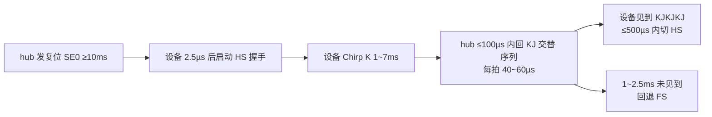

# 速查表大全与时序参数全表

> 层级 进阶 · 主题 `reference` · 相关：[标准描述符字段全表](06-descriptors.md)、[枚举流程、Setup 包与标准请求](07-enumeration-requests.md)、[四种传输类型、bInterval 与带宽调度](05-transfer-types-bandwidth.md)

## 核心事实 Key Facts

> 由维护者整理并与规范核对；与下方 USBTree 原文冲突时以本节为准。

- `03-时序参数全表.md` §4 来源说明仍写「未缓存 USB PD 规范原文」，同表 tFirstSourceCap 行又写「PD 3.2 V1.2 已缓存」。以 `80-参考资料/README.md` 的 `usb-core/USB-PD-3.2-V1.2.zip` 为准。

## 原文：02-速查表大全

> Source: [90-附录/02-速查表大全.md](https://github.com/tangjianfang/USBTree/blob/main/90-附录/02-速查表大全.md)

高频数值速查合集。每张表标注规范出处章节与知识树内的详解链接。

### 1) 描述符类型码表（bDescriptorType）

详见 [../10-树干-USB核心/07-描述符详解.md](06-descriptors.md)

| 值 | 类型 | 级别 |
|---|---|---|
| 0x01 | DEVICE 设备描述符 | 设备 |
| 0x02 | CONFIGURATION 配置描述符 | 设备 |
| 0x03 | STRING 字符串描述符 | 设备 |
| 0x04 | INTERFACE 接口描述符 | 配置内 |
| 0x05 | ENDPOINT 端点描述符 | 接口内 |
| 0x06 | DEVICE_QUALIFIER 设备限定 | 设备（HS 设备必备） |
| 0x07 | OTHER_SPEED_CONFIGURATION 其他速度配置 | 设备 |
| 0x08 | INTERFACE_POWER 接口电源 | 接口 |
| 0x0A | DEBUG 调试描述符 | 设备 |
| 0x0B | INTERFACE_ASSOCIATION (IAD) 接口关联 | 配置内 |
| 0x0F | BOS 二进制对象存储 | 设备（2.0.01+/3.x） |
| 0x10 | DEVICE_CAPABILITY 设备能力 | BOS 内 |
| 0x21 | HID 描述符 | 类（HID） |
| 0x22 | HID REPORT 报告描述符 | 类（经 GET_DESCRIPTOR 获取） |
| 0x23 | HID PHYSICAL 物理描述符 | 类 |
| 0x24 | CS_INTERFACE 类接口（功能描述符） | 类（CDC 等） |
| 0x25 | CS_ENDPOINT 类端点 | 类（CDC） |
| 0x29 | HUB 集线器描述符 | 类（Hub） |
| 0x30~0x3F | 保留给标准未来扩展 | —— |

### 2) 11 个标准 bRequest 表

详见 [../10-树干-USB核心/08-枚举流程与标准请求.md](07-enumeration-requests.md)

| 编号 | bRequest | 方向 | 接收者 | wValue | wIndex | wLength |
|---|---|---|---|---|---|---|
| 0x00 | GET_STATUS | IN | D/I/E | 0 | 0 / 接口 / 端点 | 2 |
| 0x01 | CLEAR_FEATURE | OUT | D/I/E | 特性选择子 | 0 / 接口 / 端点 | 0 |
| 0x03 | SET_FEATURE | OUT | D/I/E | 特性选择子 | 0 / 接口 / 端点 | 0 |
| 0x05 | SET_ADDRESS | OUT | 设备 | 设备地址 1~127 | 0 | 0 |
| 0x06 | GET_DESCRIPTOR | IN | 设备 | 高字节类型<低字节索引 | 0 / 语言 ID | 描述符长度 |
| 0x07 | SET_DESCRIPTOR | OUT | 设备 | 同上 | 0 / 语言 ID | 描述符长度 |
| 0x08 | GET_CONFIGURATION | IN | 设备 | 0 | 0 | 1 |
| 0x09 | SET_CONFIGURATION | OUT | 设备 | 配置值（0=未配置） | 0 | 0 |
| 0x0A | GET_INTERFACE | IN | 接口 | 0 | 接口号 | 1 |
| 0x0B | SET_INTERFACE | OUT | 接口 | 备选设置 | 接口号 | 0 |
| 0x0C | SYNCH_FRAME | IN | 端点 | 0 | 端点号 | 2 |

特性选择子：0x00 ENDPOINT_HALT（作用于端点）、0x01 DEVICE_REMOTE_WAKEUP、0x02 TEST_MODE（HS）。0x02/0x04 为保留编号。

### 3) bmRequestType 位分解表

详见 [../10-树干-USB核心/08-枚举流程与标准请求.md](07-enumeration-requests.md)

| 位 | D7 | D6 D5 | D4~D0 |
|---|---|---|---|
| 含义 | 传输方向 | 请求类型 | 接收者 |
| 取值 | 0=OUT(主机→设备) 1=IN(设备→主机) | 00=标准 01=类 10=厂商 11=保留 | 00000=设备 00001=接口 00010=端点 00011=其他 |

常用组合：`0x80` 设备→主机·标准·设备（读描述符）、`0x00` 主机→设备·标准·设备（SET_CONFIG）、`0x21` 主机→设备·类·接口（HID SET_REPORT）、`0xA1` 设备→主机·类·接口（HID GET_REPORT）。

### 4) PID 编码表（4 位 PID）

详见 [../10-树干-USB核心/05-包格式与事务.md](04-packets-transactions.md)

| 组 | PID | 二进制 | 线上字节* | 用途 |
|---|---|---|---|---|
| 令牌 | OUT | 0001 | 0xE1 | 主机→端点写 |
| 令牌 | IN | 1001 | 0x69 | 主机←端点读 |
| 令牌 | SOF | 0101 | 0xA5 | 帧起始+帧号 |
| 令牌 | SETUP | 1101 | 0x2D | 控制传输建立阶段 |
| 数据 | DATA0 | 0011 | 0xC3 | 偶触发位数据 |
| 数据 | DATA1 | 1011 | 0x4B | 奇触发位数据 |
| 数据 | DATA2 | 0111 | 0x87 | 高速高带宽同步 |
| 数据 | MDATA | 1111 | 0x0F | 高速高带宽同步 |
| 握手 | ACK | 0010 | 0xD2 | 确认接收 |
| 握手 | NAK | 1010 | 0x5A | 未准备好（非错误） |
| 握手 | STALL | 1110 | 0x1E | 端点停顿/请求不支持 |
| 握手 | NYET | 0110 | 0x96 | 收到但下包先等 |
| 特殊 | PRE | 1100 | 0x3C | 低速前导 |
| 特殊 | ERR | 1100 | 0x3C | 拆分事务错误（与 PRE 同码） |
| 特殊 | SPLIT | 1000 | 0x78 | 高速拆分事务前缀 |
| 特殊 | PING | 0100 | 0xB4 | 高速批量 OUT 流控探询 |

\* 线上字节 = 低 4 位 PID + 高 4 位取反校验，例如 OUT：`0001 | 1110` → 按位序组合为 0xE1。

### 5) 四传输类型 × 速率最大包长表

详见 [../10-树干-USB核心/06-四种传输类型.md](05-transfer-types-bandwidth.md)；带宽逐位推导见 [../10-树干-USB核心/13-总线带宽与调度计算.md](05-transfer-types-bandwidth.md)

| 传输类型 | 低速 LS | 全速 FS | 高速 HS | 超速 SS/SSP |
|---|---|---|---|---|
| 控制 | 8 | 8/16/32/64 | 64 | 512 |
| 批量 | 不支持 | 64 | 512 | 1024 |
| 中断 | ≤8 | ≤64 | ≤1024 | ≤1024 |
| 同步 | 不支持 | ≤1023 | ≤1024 | ≤1024 |

超速批量/中断/同步单次传输可经 burst 聚合（1~16 包/突发），`wMaxPacketSize` 高 11 位记录突发尺寸。

### 6) bInterval 语义换算表

详见 [../10-树干-USB核心/06-四种传输类型.md](05-transfer-types-bandwidth.md)

| 速度 | 中断传输 | 同步传输 |
|---|---|---|
| 低速 LS | 1~255 ms（帧数） | 不支持 |
| 全速 FS | 1~255 ms（帧数） | 1~16，周期 = 2^(bInterval−1) ms |
| 高速 HS | 1~16，周期 = 2^(bInterval−1) × 125µs | 同左 |
| 超速 SS | 1~16，周期 = 2^(bInterval−1) × 125µs | 同左 |

例：HS 中断 bInterval=4 → 8×125µs = 1ms；bInterval=1 → 125µs（8000 次/秒）。超速的表述与高速一致（以 125µs 为单位）。

### 7) 设备类代码总表（bDeviceClass / bInterfaceClass）

详见 [../10-树干-USB核心/07-描述符详解.md](06-descriptors.md)

| 值 | 类 | 说明 |
|---|---|---|
| 0x00 | 设备类=0 | 类信息在接口级声明（复合设备常见） |
| 0x01 | Audio 音频 | UAC |
| 0x02 | CDC-Control 通信控制 | 与 0x0A 配对 |
| 0x03 | HID 人机接口 | 键鼠/手柄 |
| 0x05 | Physical 物理 | 传感类（少用） |
| 0x06 | Image 图像 | 照相机 PTP |
| 0x07 | Printer 打印机 | |
| 0x08 | Mass Storage 大容量存储 | U 盘 |
| 0x09 | Hub 集线器 | 仅设备级 |
| 0x0A | CDC-Data 通信数据 | CDC 的数据接口 |
| 0x0B | Smart Card 智能卡 | CCID |
| 0x0E | Video 视频 | UVC 摄像头 |
| 0x0F | Personal Healthcare 个人健康 | |
| 0x10 | Audio/Video 音视频 | AV 设备 |
| 0x11 | Billboard 公告牌 | Type-C 替代模式提示 |
| 0x12 | USB Type-C Bridge | 桥接类 |
| 0xDC | Diagnostic 诊断 | |
| 0xE0 | Wireless Controller 无线控制器 | 蓝牙无线适配器（子类 0x01/协议 0x01） |
| 0xEF | Miscellaneous 杂项 | 复合设备 IAD 用：类 0xEF/子类 0x02/协议 0x01 |
| 0xFF | Vendor Specific 厂商自定义 | 需要自家驱动（或 WinUSB 绑定） |

### 8) 键盘键值速查（HID Usage ID）与 HID 类请求

详见 [../20-枝干-设备类协议/HID-人机接口设备/00-HID概述与定位.md](11-hid-core.md)；**完整键值/Item 前缀/类请求六列全表**见 [../20-枝干-设备类协议/HID-人机接口设备/12-HID规范级附录.md](13-hid-spec-appendix.md)

**修饰键字节**（报告第 0 字节）：

| bit | 0 | 1 | 2 | 3 | 4 | 5 | 6 | 7 |
|---|---|---|---|---|---|---|---|---|
| 键 | 左Ctrl | 左Shift | 左Alt | 左GUI | 右Ctrl | 右Shift | 右Alt | 右GUI |

**常用 Usage ID**：

| 键 | ID | 键 | ID |
|---|---|---|---|
| A~Z | 0x04~0x1D | Enter | 0x28 |
| 1~9 | 0x1E~0x26 | Esc | 0x29 |
| 0 | 0x27 | Backspace | 0x2A |
| F1~F12 | 0x3A~0x45 | Tab | 0x2B |
| ↑↓←→ | 0x52/0x51/0x50/0x4F | Space | 0x2C |

**HID 类请求**（bmRequestType 高位：SET=0x21 / GET=0xA1）：

| bRequest | 值 | 方向 | 说明 |
|---|---|---|---|
| GET_REPORT | 0x01 | IN | 主机拉取报告 |
| GET_IDLE | 0x02 | IN | 读空闲速率 |
| GET_PROTOCOL | 0x03 | IN | 0=Boot 1=Report |
| SET_REPORT | 0x09 | OUT | 主机下发（LED、Output 报告） |
| SET_IDLE | 0x0A | OUT | 设置空闲重复率 |
| SET_PROTOCOL | 0x0B | OUT | 切换 Boot/Report 协议 |

### 9) 蓝牙速查：GATT UUID 与 ATT Opcode

详见 [../50-枝干-无线关联/BLE-低功耗蓝牙/](https://github.com/tangjianfang/USBTree/blob/main/50-枝干-无线关联/BLE-低功耗蓝牙)；LLCP 全部 Opcode 见 [../50-枝干-无线关联/BLE-低功耗蓝牙/12-LLCP控制过程全表.md](62-ble-advanced.md)，RF/干扰限值见 [../50-枝干-无线关联/BLE-低功耗蓝牙/14-RF物理层参数全表.md](62-ble-advanced.md)

**GATT 16 位 UUID（服务/声明/描述符）**：

| UUID | 名称 | UUID | 名称 |
|---|---|---|---|
| 0x1800 | Generic Access | 0x2800 | Primary Service 声明 |
| 0x1801 | Generic Attribute | 0x2801 | Secondary Service 声明 |
| 0x180A | Device Information | 0x2802 | Include 声明 |
| 0x180F | Battery Service | 0x2803 | Characteristic 声明 |
| 0x1811 | Alert Notification | 0x2900 | 特征扩展属性 |
| 0x1815 | Automation IO | 0x2901 | 用户描述 |
| 0x1816 | Cycling Speed & Cadence | 0x2902 | **CCCD**（通知/指示订阅） |
| 0x1819 | Heart Rate | 0x2903 | 服务器配置 |
| 0x181A | Health Thermometer | 0x2904 | 呈现格式 |
| 0x181C | User Data | 0x2905 | 聚合格式 |

**ATT 常用 Opcode**：

| Opcode | 报文 | Opcode | 报文 |
|---|---|---|---|
| 0x01 | Error Response | 0x12 | Write Request |
| 0x02/0x03 | Exchange MTU Request/Response | 0x13 | Write Response |
| 0x04 | Find Information Request | 0x52 | Write Command（无响应） |
| 0x08 | Read By Type Request | 0x1B | Handle Value Notification |
| 0x0A/0x0B | Read Request/Response | 0x1D | Handle Value Indication |
| 0x10 | Read By Group Type Request | 0x1E | Handle Value Confirmation |

### 10) PD 固定电压档与功率表

详见 [../30-枝干-接口与供电/](https://github.com/tangjianfang/USBTree/blob/main/30-枝干-接口与供电)；PDO/RDO 位域与消息全表见 [../30-枝干-接口与供电/08-USBPD消息全表.md](22-usb-pd.md)

| 规范档 | 固定电压 | 最大电流 | 最大功率 |
|---|---|---|---|
| PD 2.0/3.0 SPR 基础 | 5V | 3A | 15W |
| SPR 常用档 | 9V / 15V | 3A | 27W / 45W |
| SPR 上限 | 20V | 3A / 5A | 60W / **100W** |
| PD 3.1 EPR 档 | 28V / 36V / 48V | 5A | 140W / 180W / **240W** |
| PPS（可编程） | SPR 3.3~11V / 3.3~16V / 3.3~21V | 5A | 任意步进 20mV |
| AVS（EPR 可调） | 15~48V 连续可调 | — | 至 240W |

固定 PDO 是"电压档+电流"组合，由源端广播、受电端按 RDO 请求；线缆承载 >3A（5A）需带 eMarker。

### 11) 时序参数速查

>  本表为速记版；**权威全表**（含 USB2/OTG/USB3/PD/Type-C/BLE 六族、规范章节出处）见 [03-时序参数全表](90-quick-reference.md)。冲突时以全表为准。
> 相关：[../10-树干-USB核心/09-集线器与连接管理.md](02-architecture-topology.md) · [../10-树干-USB核心/11-错误处理与可靠性.md](09-errors-testmode.md)

| 参数 | 数值 | 说明 |
|---|---|---|
| 复位时长（SE0） | ≥10ms | 主机驱动典型发 10~20ms |
| 插入稳定等待 | ≥100ms | 主机检测到连接后到复位前 |
| SET_ADDRESS 恢复 | ≤2ms | status 完成后地址生效，随后可请求 |
| 挂起判定 | 3ms | 总线持续空闲 3ms 后进入挂起 |
| 恢复信号 | ≥20ms | 主机/远程唤醒的 RESUME 保持时长 |
| 恢复后到首个 SOF | ≤3ms | §7.1.7.7 |
| 唤醒后恢复传输 | 见全表 §1.3 | resume 撤除到设备可收发的完整定时以 [03 全表](90-quick-reference.md)为准 |
| HS Chirp K（设备, TUCH） | 1~7ms | 复位末段设备发 K；主机 KJ 交替每拍 40~60µs |
| 帧长度 | 1ms（FS）/125µs（HS 微帧） | bInterval 的基准 |
| EOP 定界 | 2 位 SE0 + 1 位 J | 低速为 1 位 SE0 + 1 位 J |

### 12) 速度命名新旧对照迷你表

详见 [../10-树干-USB核心/01-概述与版本演进.md](01-overview-versions.md)

| 现行标识（USB-IF） | 规范名 | 旧称（已弃用传播名） |
|---|---|---|
| USB 480Mbps（HS） | USB 2.0 | USB 2.0 Hi-Speed |
| USB 5Gbps | USB 3.2 Gen 1 | USB 3.0 / USB 3.1 Gen 1（SuperSpeed） |
| USB 10Gbps | USB 3.2 Gen 2 | USB 3.1 / USB 3.1 Gen 2（SuperSpeed+） |
| USB 20Gbps | USB 3.2 Gen 2×2 | USB 3.2 |
| USB 40Gbps | USB4 Gen 3×2 | USB4 |
| USB 80Gbps | USB4 v2（非对称） | USB4 2.0 |

### 13) USB3 Header Packet 字段迷你表（DW0/DW1）

详见 [../40-枝干-高速演进/06-USB3x规范级-包格式与定时器.md](30-usb3-superspeed.md)（USB 3.2 spec §8 级全表）

| DW | 位 | 字段 |
|---|---|---|
| 0 | 4:0 | Type（表 8-1） |
| 0 | 24:5 | Route String（20b，上行置 0） |
| 0 | 31:25 | Device Address（7b） |
| 1 | 3:0 | SubType |
| 1 | 14:12 | TT（仅 SSP） |
| 1 | 25:21 | Seq Num（5b） |

### 14) BLE LLCP Opcode 常用段

完整 61 条见 [../50-枝干-无线关联/BLE-低功耗蓝牙/12-LLCP控制过程全表.md](62-ble-advanced.md)（Core 6.0 Vol 6 Part B Table 2.22）

| Opcode | 名称 | 方向 |
|---|---|---|
| 0x00 | LL_CONNECTION_UPDATE_IND | C→P |
| 0x01 | LL_CHANNEL_MAP_IND | C→P |
| 0x02 | LL_TERMINATE_IND | 双 |
| 0x03/0x04/0x05/0x06 | LL_ENC_REQ/RSP、START_ENC_REQ/RSP | 加密握手 |
| 0x08 | LL_FEATURE_REQ | 双 |
| 0x0C | LL_VERSION_IND | 双 |
| 0x0E | LL_PING_REQ | C→P |

### 15) PD 核心定时器迷你表

完整表见 [../30-枝干-接口与供电/08-USBPD消息全表.md](22-usb-pd.md) 与 [07-USBPD深入](22-usb-pd.md)

| 定时器 | 数值 | 用途 |
|---|---|---|
| tReceive | 0.9~1.1 ms | GoodCRC 等待窗口，超时重发 |
| tSenderResponse | 24~30 ms | 命令后等响应 |
| nCapsCount | 50 | Source Capabilities 重发上限 |
| tTypeCSendSourceCap | 100~200 ms | 上电后首广播窗口 |

<!-- NAMING:BEGIN
| USB 480Mbps | USB 2.0 | USB 2.0 Hi-Speed、USB 2.0 High Speed | 0 Gbps |
| USB 5Gbps | USB 3.2 Gen 1 | USB 3.0、USB 3.1 Gen 1、SuperSpeed USB | 5 Gbps |
| USB 10Gbps | USB 3.2 Gen 2 | USB 3.1、USB 3.1 Gen 2、SuperSpeed USB 10Gbps、SuperSpeed+ | 10 Gbps |
| USB 20Gbps | USB 3.2 Gen 2×2 | USB 3.2（双通道） | 20 Gbps |
| USB 40Gbps | USB4 Gen 3×2 | USB4 | 40 Gbps |
| USB 80Gbps | USB4 v2（Gen 4） | USB4 2.0 | 80 Gbps |
NAMING:END -->
| 现行标识（USB-IF） | 规范名 | 旧称（已弃用传播名） | 标称速率 |
|---|---|---|---|
| USB 480Mbps | USB 2.0 | USB 2.0 Hi-Speed、USB 2.0 High Speed | 0 Gbps |
| USB 5Gbps | USB 3.2 Gen 1 | USB 3.0、USB 3.1 Gen 1、SuperSpeed USB | 5 Gbps |
| USB 10Gbps | USB 3.2 Gen 2 | USB 3.1、USB 3.1 Gen 2、SuperSpeed USB 10Gbps、SuperSpeed+ | 10 Gbps |
| USB 20Gbps | USB 3.2 Gen 2×2 | USB 3.2（双通道） | 20 Gbps |
| USB 40Gbps | USB4 Gen 3×2 | USB4 | 40 Gbps |
| USB 80Gbps | USB4 v2（Gen 4） | USB4 2.0 | 80 Gbps |

| 现行标识（USB-IF） | 规范名 | 旧称（已弃用传播名） | 标称速率 |
|---|---|---|---|
| USB 480Mbps | USB 2.0 | USB 2.0 Hi-Speed、USB 2.0 High Speed | 0 Gbps |
| USB 5Gbps | USB 3.2 Gen 1 | USB 3.0、USB 3.1 Gen 1、SuperSpeed USB | 5 Gbps |
| USB 10Gbps | USB 3.2 Gen 2 | USB 3.1、USB 3.1 Gen 2、SuperSpeed USB 10Gbps、SuperSpeed+ | 10 Gbps |
| USB 20Gbps | USB 3.2 Gen 2×2 | USB 3.2（双通道） | 20 Gbps |
| USB 40Gbps | USB4 Gen 3×2 | USB4 | 40 Gbps |
| USB 80Gbps | USB4 v2（Gen 4） | USB4 2.0 | 80 Gbps |

| 现行标识（USB-IF） | 规范名 | 旧称（已弃用传播名） | 标称速率 |
|---|---|---|---|
| USB 480Mbps | USB 2.0 | USB 2.0 Hi-Speed、USB 2.0 High Speed | 0 Gbps |
| USB 5Gbps | USB 3.2 Gen 1 | USB 3.0、USB 3.1 Gen 1、SuperSpeed USB | 5 Gbps |
| USB 10Gbps | USB 3.2 Gen 2 | USB 3.1、USB 3.1 Gen 2、SuperSpeed USB 10Gbps、SuperSpeed+ | 10 Gbps |
| USB 20Gbps | USB 3.2 Gen 2×2 | USB 3.2（双通道） | 20 Gbps |
| USB 40Gbps | USB4 Gen 3×2 | USB4 | 40 Gbps |
| USB 80Gbps | USB4 v2（Gen 4） | USB4 2.0 | 80 Gbps |

<!-- NAMING:BEGIN -->
| 现行标识（USB-IF） | 规范名 | 旧称（已弃用传播名） | 标称速率 |
|---|---|---|---|
| USB 480Mbps | USB 2.0 | USB 2.0 Hi-Speed、USB 2.0 High Speed | 480 Mbps |
| USB 5Gbps | USB 3.2 Gen 1 | USB 3.0、USB 3.1 Gen 1、SuperSpeed USB | 5 Gbps |
| USB 10Gbps | USB 3.2 Gen 2 | USB 3.1、USB 3.1 Gen 2、SuperSpeed USB 10Gbps、SuperSpeed+ | 10 Gbps |
| USB 20Gbps | USB 3.2 Gen 2×2 | USB 3.2（双通道） | 20 Gbps |
| USB 40Gbps | USB4 Gen 3×2 | USB4 | 40 Gbps |
| USB 80Gbps | USB4 v2（Gen 4） | USB4 2.0 | 80 Gbps |
<!-- NAMING:END -->

## 原文：03-时序参数全表

> Source: [90-附录/03-时序参数全表.md](https://github.com/tangjianfang/USBTree/blob/main/90-附录/03-时序参数全表.md)

> 兄弟叶: [01-术语表.md](91-glossary.md) · [02-速查表大全.md](90-quick-reference.md)
> 规范原文缓存索引: [../80-参考资料/README.md](92-spec-references.md)

本叶把散落在树干与各枝干里的**定时器/时序参数**收拢成一张总表，按协议分节。表列为：参数 / 最小 / 典型 / 最大 / 单位 / 出处。凡从本地缓存规范 PDF（poppler 解析）提取的数值，出处标注规范名+章节；PDF 表格列有错位而采用公开通行值的，已在"出处"列注明；**无法核实的一律不写**。

### 1. USB 2.0 总线定时

来源：`80-参考资料/usb-core/USB2.0-Specification.zip`（2025-06-03 修订版 PDF，下称 USB 2.0 spec）。

#### 1.1 帧定时

| 参数 | 最小 | 典型 | 最大 | 单位 | 出处 |
|---|---|---|---|---|---|
| 帧间隔（标称） | 11,958 | 12,000 | 12,042 | FS 位时间 | USB 2.0 spec §11.2.2（±42 位为 hub 帧定时器公差） |
| 微帧间隔 | — | 125 | — | µs | USB 2.0 spec §5.9 |
| FS 数据线空闲超时（判决挂起） | 3.0 | — | — | ms | §7.1.7.6（超过 3.0 ms Idle 即开始进入挂起） |
| 挂起完全生效（只吸挂起电流） | — | — | 10 | ms | §7.1.7.6 |
| 复位后恢复期（软件不得访问） | 10 | — | — | ms | §7.1.7.7（TRSMRCY）；复位后 10 ms（TRSTRCY）见 §7.1.7.5 |

#### 1.2 复位与高速检测握手（Chirp）

| 参数 | 最小 | 典型 | 最大 | 单位 | 出处 |
|---|---|---|---|---|---|
| hub 下行复位宽度（TDRST） | 10 | — | — | ms | §7.1.7.5 |
| 根端口复位宽度（TDRSTR） | 50 | — | — | ms | §7.1.7.5（可分段，见下两条） |
| 分段复位间隔（TRHRSI） | — | — | <3 | ms | §7.1.7.5 |
| 每段 SE0 宽度 | 10 | — | — | ms | §7.1.7.5（TDRST） |
| 设备判定复位（上游 SE0，TDETRST） | 2.5 | — | — | µs | §7.1.7.5 |
| FS 状态下启动 HS 握手窗（TWTRSTFS） | 2.5 µs | — | 3.0 ms | — | §7.1.7.5 步骤 3b |
| HS 状态回退 FS 窗（TWTREV） | 3.0 | — | 3.125 | ms | §7.1.7.5 步骤 3c |
| 回退后采样总线窗（TWTRSTHS） | 100 µs | — | 875 µs | — | §7.1.7.5 步骤 3c |
| 设备 Chirp K 时长（TUCH/TUCHEND） | 1.0 | — | 7.0 | ms | §7.1.7.5 步骤 4 |
| hub 检出 Chirp 的滤波（TFILT） | 2.5 | — | — | µs | §7.1.7.5 步骤 5/8 |
| hub 开始 K/J 序列（TWTDCH） | — | — | 100 | µs | §7.1.7.5 步骤 6 |
| 每个 Chirp K/J 拍宽（TDCHBIT） | 40 | — | 60 | µs | §7.1.7.5 步骤 6 |
| 序列终止点（TDCHSE0，复位结束前） | 100 | — | 500 | µs | §7.1.7.5 步骤 6 |
| 设备转 HS（TWTHS） | — | — | 500 | µs | §7.1.7.5 步骤 8a |
| 未见到 KJKJKJ 回退 FS（TWTFS） | 1.0 | — | 2.5 | ms | §7.1.7.5 步骤 8b |

> 说明：任务稿中"主机 KJ 序列 40~60ms"的单位应为 **µs**（TDCHBIT，40~60 µs/拍），整段 hub chirp 序列持续到复位结束前 100~500 µs 才停止。

#### 1.3 挂起/恢复/远程唤醒

| 参数 | 最小 | 典型 | 最大 | 单位 | 出处 |
|---|---|---|---|---|---|
| 主机下行恢复信号（TDRSMDN） | 20 | — | — | ms | §7.1.7.7 |
| 恢复后到首个 SOF 限时 | — | — | 3 | ms | §7.1.7.7 |
| 远程唤醒前须持续 Idle（TWTRSM） | 5 | — | — | ms | §7.1.7.7（"挂起满 5 ms 才可唤醒"） |
| 设备驱动唤醒 K（TDRSMUP） | 1 | — | 15 | ms | §7.1.7.7 |
| hub 转发/重播恢复（TURSM） | — | — | 1 | ms | §7.1.7.7 |
| 中间 hub 上行驱动恢复 | 1 | — | 15 | ms | §7.1.7.7 |

#### 1.4 事务超时与包界定

| 参数 | 最小 | 典型 | 最大 | 单位 | 出处 |
|---|---|---|---|---|---|
| FS/LS 事务超时（响应未到） | 16 | — | 18 | 位时间 | §7.1.19.1 |
| HS 不超时下限 | 736 | — | — | HS 位时间 | §7.1.19.2 |
| HS 必须超时上限 | — | — | 816 | HS 位时间 | §7.1.19.2 |
| EOP：FS（SE0+J） | 2+1 | — | — | 位 | §7.1.7.4.1 |
| EOP：LS（SE0+J，LS 位时间） | 1+1 | — | — | 位 | §7.1.7.4.1 |
| EOP：HS | 8 | — | — | 位 | 表 5-3/5-10 原注（"8 bit EOP"） |
| SYNC 长度：FS/LS / HS | 8 / 32 | — | — | 位 | §8.2 |
| HS 背靠背包间延迟（THSIPDSD） | 88 | — | 192（THSRSPIPD1） | HS 位时间 | §7.1.18 |

#### 1.5 TestMode

| 参数 | 最小 | 典型 | 最大 | 单位 | 出处 |
|---|---|---|---|---|---|
| 进入测试模式时限（状态段完成后） | — | — | 3 | ms | §7.1.20 |

### 2. OTG 与 Embedded Host

来源：USB 2.0 缓存包内 `USB_OTG_and_EH_2-0-version 1_1a.pdf`（OTG & EH Supplement 2.0 v1.1a）。**注意：该 PDF 的定时总表提取后列错位严重**，下表"最小/最大"凡标 ※ 的为与正文/公开通行值互核后的结果，仍建议对照原文 §5。任务稿中的"TAIDL_TRY"并无此参数，对应的是 TA_AIDL_BDIS / TB_AIDL_BDIS。

| 参数 | 含义 | 最小 | 最大 | 单位 | 出处 |
|---|---|---|---|---|---|
| TA_WAIT_BCON | A 等待 B 连接 | 1.1 | 30 | s | §5.2.1 |
| TA_AIDL_BDIS | A-Idle 到 B 断开 | 200 | 5 | ms / s（200 ms~5 s）※ | §5.3.1 |
| TA_BIDL_ADIS | B-Idle 到 A 断开 | 155 | 200 | ms | §5.2.1 |
| TA_BCON_SDB | B 连接短去抖 | 2.5 | — | µs | §5.2.3 |
| TA_BCON_LDB | B 连接长去抖 | 100 | 30 | ms / s（100 ms~30 s）※ | §5.2.1 |
| TA_SRP_RSPNS | A 响应 SRP | — | 4.9 | s | §5.1.6 |
| TB_SSEND_SRP | 会话结束到 B 发起 SRP | 1.5 | 2.0 | s ※ | §5.1.2 |
| TB_SE0_SRP | SRP 前 SE0 时长 | 100 | 150 | ms ※ | §5.1.2 |
| TB_DATA_PLS | SRP 数据脉冲宽度 | 5 | 10 | ms | §5.1.3（表值 5/10 可辨） |
| TB_SRP_FAIL | SRP 失败判定 | 5 | 6 | s | §5.1.6 |
| TB_AIDL_BDIS | B-Idle 到 B 断开 | 4 | 150 | ms | §5.2.1 |
| TB_ASE0_BRST | A-SE0 到 B 复位（HNP） | 2.5 | 155 | ms ※ | §5.3.1 |
| TB_SVLD_BCON | 会话有效到 B 连接 | — | 1 | s | §5.1.5 |

### 3. USB 3.x LTSSM 与链路定时

来源：`80-参考资料/usb-core/USB3.2-Specification-2018.zip` 内 `USB 3.2 Revision 1.0.pdf`（下称 USB 3.2 spec）。链路层定时器容差统一为 **0~+50%**（§7.5）。

#### 3.1 LFPS 电气与信令（表 6-29/6-30，§6.9.1）

| 参数 | 最小 | 典型 | 最大 | 单位 | 出处 |
|---|---|---|---|---|---|
| tPeriod（LFPS 周期） | 20 | — | 100 | ns | USB 3.2 spec 表 6-29 |
| Polling.LFPS tBurst | 0.6 | 1.0 | 1.4 | µs | 表 6-30 |
| Polling.LFPS tRepeat | 6 | 10 | 14 | µs | 表 6-30 |
| Ping.LFPS tBurst | 40 | — | 200 | ns | 表 6-30（≥2 个周期） |
| U1 退出 burst 检测 | 300 | — | — | ns | 表 6-30 注 7 |
| U2/Loopback 退出 tBurst | 900 ns | — | 2 µs | — | 表 6-30（evolve #29 以 -table 重提取确认） |
| U3 唤醒 tBurst | 80 µs | — | 10 ms | — | 表 6-30（evolve #29 确认） |

> ※ 表 6-30 两行已于 evolve #29 以 -table 重提取对照原文确认（Polling.LFPS tBurst 0.6~1.4 µs、tRepeat 6~14 µs 亦同步核实）。**tNoCommonMode、tNoRxTermination** 这两个名字在 USB 3.2 规范文本中未检索到（为 USB 3.0/3.1 时代资料常用名），USB 3.2 以 tNoLFPSResponseTimeout 及表 6-29/6-30 参数承担同类判据——如需这两个符号的权威数值，请查 USB 3.0 规范原文。

#### 3.2 LTSSM 状态转移超时（表 7-12，§7.5）

| 参数 | 起始状态 | 超时值 | 出处 |
|---|---|---|---|
| teSSInactiveQuietTimeout | eSS.Inactive.Quiet | 12 ms | 表 7-12 |
| tRxDetectQuietTimeoutDFP | Rx.Detect.Quiet | 12 ms（min）~120 ms（max） | 表 7-12 |
| tRxDetectQuietTimeoutUFP | Rx.Detect.Quiet | 12 ms | 表 7-12 |
| tPollingLFPSTimeout | Polling.LFPS(+Plus) | 360 ms | 表 7-12 |
| tPollingSCDLFPSTimeout（SSP） | Polling.LFPS | 60 µs | 表 7-12 |
| tPollingLBPMLFPSTimeout（SSP） | Polling.PortMatch/Config | 12 ms | 表 7-12 |
| tPollingActiveTimeout | Polling.Active | 12 ms（x1）/ 24 ms（x2） | 表 7-12 |
| tPollingConfigurationTimeout | Polling.Configuration | 12 ms（x1）/ 24 ms（x2） | 表 7-12 |
| tPollingIdleTimeout | Polling.Idle | 2 ms | 表 7-12 |
| tU0RecoveryTimeout | U0 | 1 ms | 表 7-12 |
| tU0LTimeout | U0 | 10 µs | 表 7-12 |
| tNoLFPSResponseTimeout | U1 | 2 ms | 表 7-12 |
| tNoLFPSResponseTimeout | U2 | 300 ms | 表 7-12 |
| tNoLFPSResponseTimeout | U3 | 100 ms | 表 7-12 |
| tU1PingTimeout | U1 | 100 ms | 表 7-12 |
| tRecoveryActiveTimeout | Recovery.Active | 2 ms | 表 7-12 |
| tRecoveryConfigurationTimeout | Recovery.Configuration | 10 ms | 表 7-12 |
| tRecoveryIdleTimeout | Recovery.Idle | 12 ms | 表 7-12 |
| tLoopbackExitTimeout | Loopback.Exit | 6 ms | 表 7-12 |
| tHotResetActiveTimeout / tHotResetExitTimeout | Hot Reset | 2 ms / 2 ms | 表 7-12 |
| tU3WakeupRetryDelay | U3 | 12 ms | 表 7-12 |
| tU2RxdetDelay / tU3RxdetDelay | U2 / U3 | 2 ms / 100 ms | 表 7-12 |

> 表 7-12 末数行（300 ms/100 ms×3）PDF 解析有错位，逐行归属以规范表为准；上表按语义合理归属并保留此提醒。

#### 3.3 链路流控与电源管理定时（表 7-7/7-8，§7.2.4）

| 参数 | 值 | 出处 |
|---|---|---|
| PENDING_HP_TIMER（等 LGOOD/LBAD） | 10 µs | USB 3.2 spec 表 7-7 |
| CREDIT_HP_TIMER（等信用） | 5,000 µs | 表 7-7 |
| 收到 HP 后回 LGOOD_n/LBAD 期限（SS/SSP） | 3.0 µs / 1.5 µs | 表 7-7 注 |
| 链路命令处理时限 | 200 ns | 表 7-7 注 |
| PM_LC_TIMER（x1 / x2） | 4 / 8 µs | 表 7-8 |
| PM_ENTRY_TIMER（x1 / x2） | 8 / 16 µs | 表 7-8 |
| Ux_EXIT_TIMER | 6,000 µs | 表 7-8 |
| U1_MIN_RESIDENCY_TIMER | 3 µs | 表 7-8 |

### 4. USB PD

>  来源说明：本库 `80-参考资料/` **未缓存 USB PD 规范原文**。下表数值为 USB PD 3.x 规范定时表的公开通行值，并与 Linux 内核 TCPM 实现常量（`PD_T_*`，drivers/usb/typec）互核；标注"待复核"的行请在官方 USB PD 文档中确认后再用于合规设计。

| 参数 | 最小 | 典型 | 最大 | 单位 | 出处 |
|---|---|---|---|---|---|
| tReceive（BMC 消息接收窗） | 0.9 | — | 1.1 | ms | PD 3.x 定时表；内核 PD_T_RECEIVE |
| tSenderResponse | 24 | — | 30 | ms | 同上；内核 PD_T_SENDER_RESPONSE |
| nCapsCount（Source Cap 重发计数） | — | 50 | — | 次 | PD 3.x nCapsCount 定义 |
| tTypeCSendSourceCap | 100 | — | 200 | ms | PD 3.x 定时表；内核 PD_T_SEND_SOURCE_CAP |
| tFirstSourceCap（首次广播 Source Cap） | 100 | — | 250 | ms | PD 3.x 定时表；内核未定义此宏；**PD 3.2 V1.2 已缓存**（Table 7.10 §7.31.3.3，精确 min/max 请按缓存原文复核） |
| tPPSRequest（PPS 保活重请求） | 4 | 6 | 7.5 | s | PD 3.x PPS；内核 PD_T_PPS_REQUEST=6 s（典型值印证；**PD 3.2 V1.2 已入缓存**，Table 7.10 含本参数） |
| tPSTransition（电源状态切换） | 450 | 500 | 550 | ms | PD 3.x 定时表；内核 PD_T_PS_TRANSITION=500 印证（evolve #35） |

### 5. USB Type-C（Release 2.5）

来源：`80-参考资料/usb-core/USB-TypeC-Spec-2.5-2026.zip` 内 `USB Type-C Spec R2.5 - March 2026.pdf`，§4.11.2 Timing Parameters。

#### 5.1 VBUS/VCONN（表 4-32）

| 参数 | 最小 | 最大 | 单位 | 出处 |
|---|---|---|---|---|
| tVBUSON（进入 Attached.SRC 到供上 VBUS） | 0 | 275 | ms | Type-C 2.5 表 4-32 |
| tVBUSOFF（断开后到撤除 VBUS） | 0 | 650 | ms | 表 4-32 |

#### 5.2 DRP（表 4-33）

| 参数 | 最小 | 最大 | 单位 | 出处 |
|---|---|---|---|---|
| tDRP（角色切换周期） | 50 | 100 | ms | 表 4-33 |
| dcSRC.DRP（广播 Source 占空比） | 30 | 70 | % | 表 4-33 |
| tDRPTransition | 0 | 1 | ms | 表 4-33 |
| tDRPTry | 75 | 150 | ms | 表 4-33 |
| tDRPTryWait | 400 | 800 | ms | 表 4-33 |
| tTryTimeout | 550 | 1,100 | ms | 表 4-33 |
| tVPDDetach | 10 | 20 | ms | 表 4-33 |

#### 5.3 CC 定时（表 4-34）

| 参数 | 最小 | 最大 | 单位 | 出处 |
|---|---|---|---|---|
| tCCDebounce（连接去抖） | 100 | 200 | ms | 表 4-34 |
| tPDDebounce（隐藏 PD BMC 通信） | 10 | 20 | ms | 表 4-34 |
| tTryCCDebounce | 10 | 20 | ms | 表 4-34 |
| tErrorRecovery（错误恢复状态时长） | 550 | 650 | ms | 表 4-34（PDF 行错位，此为通行值） |
| tSRCDisconnect（Source 判离） | 0 | 240 | ms | 表 4-34（同上） |

> 表 4-34 提取后"最小/最大"两列与行名错位明显；以上取值跨 Type-C 2.x 各版本稳定。未列出的 tCCDebounceGap、tNoToggleConnect 等参数请直接查规范表 4-34。

### 6. BLE（Bluetooth Core 6.0）

来源：`80-参考资料/bluetooth/Bluetooth-Core-6.0.pdf`（2024-08-27），Vol 6 Part B（链路层）与 Vol 4 Part E（HCI）。

| 参数 | 最小 | 典型 | 最大 | 单位 | 出处 |
|---|---|---|---|---|---|
| T_IFS_150（帧间隔，不可协商） | — | 150 | — | µs | Core 6.0 Vol 6 Part B §4.1.1 |
| T_IFS_ACL_CP / T_IFS_ACL_PC / T_IFS_CIS | — | 150（默认） | — | µs | 同上（可经 Frame Space Update 按 PHY 协商） |
| connInterval | 7.5（N×1.25） | — | 4 s（N=0x0C80） | ms | Vol 6 Part B §4.5；Vol 4 Part E（Range 0x0006~0x0C80） |
| 监督超时 supervisionTimeout | 100（N×10） | — | 32 s | ms | Vol 4 Part E HCI 参数 |
| 监督超时约束 | > (1+Max_Latency)×Subrate_Factor×connIntervalMax×2 | — | — | — | Vol 6 Part B §5.3（连接更新约束） |
| 连接未建立即判丢 | 6×connInterval（或 6 个连接事件） | — | — | — | Vol 6 Part B §4.5.2 |
| 传统广播事件间隔 | 20 | — | 10.24 | s | Vol 4 Part E LE Set Advertising Parameters（N×0.625 ms，0x0020~0x4000） |
| 扩展广播事件间隔 | 20 | — | 10,485.759375 | s | Vol 6 Part B（N×1.25 ms） |

### 7. 使用注意

1. USB 3.x 链路层定时器公差统一 0~+50%（USB 3.2 spec §7.5）；USB 2.0 多数参数只给单边界，"最小"即规范要求。
2. Type-C 明确要求 DRP 切换时钟**不要**用精密时钟源（表 4-33 前文），以便两端随机化避免死锁。
3. 本表不含主机控制器调度类数值（帧预算、事务开销），见 [../10-树干-USB核心/13-总线带宽与调度计算.md](05-transfer-types-bandwidth.md)。
