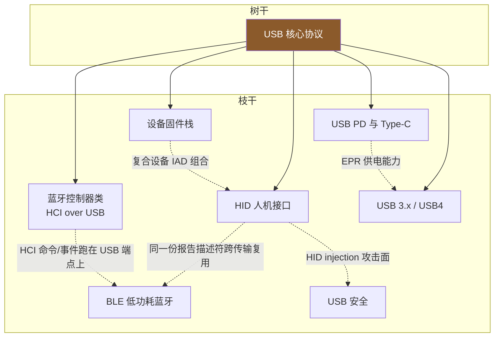

# 官方规范参考与缓存索引

> 层级 入门 · 主题 `reference` · 相关：[知识库索引](index.md)

## 核心事实 Key Facts

> 由维护者整理并与规范核对；与下方 USBTree 原文冲突时以本节为准。

- 注：USBTree `80-参考资料/` 原文 PDF 不随仓库分发（但仍存在于 Git 历史中，见审计报告）；`tools/spec_fetch.sh` 对蓝牙 Core 6.0 勘误表与 HID-Service-1.1 会把登录页/中转页保存为 PDF。

## 原文：README

> Source: [80-参考资料/README.md](https://github.com/tangjianfang/USBTree/blob/main/80-参考资料/README.md)

>  本目录是知识树所依赖的**官方规范原文下载缓存**，按枝干分目录存放。下载日期：2026-09-05；2026-11-28 按 usb.org / bluetooth.com / intel.com 现行版全量复核并补齐（新增条目见各表“2026-11 新增”）。
> 法律提示：USB-IF 规范按其 Adopters Agreement 分发，蓝牙规范按 SIG 许可分发——此处缓存仅用于个人学习与工程参考，商用/再分发请阅读各规范附带的许可条款。

### 一、usb-core/ —— 核心规范

| 本地文件 | 规范 | 官方来源 | 知识树对应 |
|---|---|---|---|
| USB2.0-Specification.zip | USB 2.0 Specification（2025-06-03 修订版，zip 内含 PDF） | [usb.org 文档库](https://www.usb.org/documents?search=USB+2.0) | [10-树干](01-overview-versions.md) 全部 |
| USB3.2-Specification-2018.zip | USB 3.2 Specification rev 1.0（2018-09-12，含 3.0/3.1 历史合并） | [usb.org](https://www.usb.org/sites/default/files/documents/usb_32_20180912.zip) | [高速演进](30-usb3-superspeed.md)、[包格式与LTSSM](30-usb3-superspeed.md) |
| USB4-Specification-v2-2025-11.zip | USB4 Specification Version 2.0（2025-11） | [usb.org 文档库](https://www.usb.org/documents) | [USB4 深入](31-usb4.md) |
| USB-TypeC-Spec-2.5-2026.zip | USB Type-C Cable and Connector Release 2.5（2026-03，**现行最新**） | [usb.org](https://www.usb.org/sites/default/files/USB%20Type-C%202.5%20Release%20202603.zip) | [Type-C 详解](20-connectors-typec.md) |
| USB3.2-Rev1.1-2022-06.zip | USB 3.2 Specification **Revision 1.1**（2022-06，**现行最新**，含相对 R1.0 的 redline；2026-11 新增） | [usb.org 文档库](https://www.usb.org/document-library/usb-32-revision-11-june-2022) | 同 USB 3.2 行 |
| USB-PD-3.3-V1.0.zip | USB Power Delivery **Rev 3.3 Ver 1.0**（2026-10-16，**现行最新**；内含 Reorganization Guide、R3.2 V1.2 上一版与 redline；2026-11 新增） | [usb.org 文档库](https://www.usb.org/document-library/usb-power-delivery) | [PD 协议](22-usb-pd.md)、[时序参数全表 §4](90-quick-reference.md) |
| UCSI-3.2.zip | UCSI Revision 3.2（2026-09，**现行最新**，含 ECN；2026-11 新增） | [usb.org 文档库](https://www.usb.org/document-library/usb-type-cr-connector-system-software-interface-ucsi-specification) | 同 UCSI 3.1 行 |
| BC-1.2.zip | Battery Charging v1.2（含勘误 2012-03-15；2026-11 新增） | [usb.org 文档库](https://www.usb.org/document-library/battery-charging-v12-spec-and-adopters-agreement) | [BC1.2 与专有快充](21-charging-bc12-otg.md) |
| eUSB2-PHY-Supplement-1.2.zip | eUSB2 物理层补充规范 Rev 1.2（2026-11 新增） | [usb.org 文档库](https://www.usb.org/document-library/embedded-usb2-eusb2-physical-layer-supplement-usb-revision-20-specification-rev-12) | 10-树干 物理层 |
| USB-Authentication-1.0-2019.zip | USB Type-C Authentication 1.0（ECN/勘误至 2019-01-07；2026-11 新增） | [usb.org 文档库](https://www.usb.org/document-library/usb-authentication-specification-rev-10-ecn-and-errata-through-january-7-2019) | 70-枝干 安全 |
| USB-TypeC-Spec-R2.0.pdf | Type-C Release 2.0（2019-08，可读性好的单 PDF，历史参考） | [usb.org](https://www.usb.org/sites/default/files/USB%20Type-C%20Spec%20R2.0%20-%20August%202019.pdf) | 同上 |
| UCSI-3.1.zip | USB Type-C Connector System Software Interface (UCSI) 3.1 | [usb.org](https://www.usb.org/sites/default/files/USB%20Type-C%20Connector%20System%20Software%20Interface%20UCSI%20Revision_3.1.zip) | [PD 深入](22-usb-pd.md)（OS 侧接口） |
| USB-PD-3.2-V1.2.zip | **USB Power Delivery Specification Rev 3.2 Ver 1.2**（公开包 `USB_PD_R3.2_V1.2_2.zip`，含 R3.2 V1.1/R2.0 历史版与 PDUSB 伴随规范——**EP-1 材料解锁**。文档库另有更新包，换版时改 `tools/spec_fetch.sh` 并复核 30/08） | [usb.org 直链](https://www.usb.org/sites/default/files/USB_PD_R3.2_V1.2_2.zip) · [文档库](https://www.usb.org/document-library/usb-power-delivery) | [PD 深入](22-usb-pd.md)、[PD 消息全表](22-usb-pd.md) |
| USB2-Electrical-Compliance-v1.08.pdf | USB2 电气合规测试规范 v1.08（2026-04） | [usb.org](https://www.usb.org/sites/default/files/USB2%20Electrical%20Compliance%20Specification%20v1.08.pdf) | [合规测试实操](51-compliance-security.md) |

### 二、device-classes/ —— 设备类规范

| 本地文件 | 规范 | 官方来源 | 知识树对应 |
|---|---|---|---|
| HID-1.11.pdf | Device Class Definition for HID 1.11 | [usb.org](https://www.usb.org/sites/default/files/hid1_11.pdf) | [HID 子树](11-hid-core.md) |
| HID-UsageTables-1.3.pdf | HID Usage Tables 1.3 | [usb.org](https://www.usb.org/sites/default/files/hut1_3_0.pdf) | [Usage 体系](11-hid-core.md)（注：v1.4/1.5 起官网仅发布 docx，请按需到[文档库](https://www.usb.org/documents?search=usage+tables)取最新） |
| HID-UsageTables-1.7.pdf | HID Usage Tables **1.7**（**现行最新**；新增 0x11 SoC 页等；2026-11 新增） | [usb.org 文档库](https://www.usb.org/document-library/hid-usage-tables-17) | [HID 规范级附录](13-hid-spec-appendix.md) |
| HID-PowerDevices-1.1.pdf / HID-PID-1.01.pdf | HID Power Devices 用法表 1.1 / PID 1.01（2026-11 新增） | [usb.org](https://usb.org/sites/default/files/pdcv11.pdf) · [PID](https://www.usb.org/sites/default/files/pid1_01_0.pdf) | HID 子树 |
| CDC-NCM-1.1.zip / CDC-NCM-1.0.zip / CDC-EEM-1.0.pdf / CDC-MBIM-1.0-Errata1.zip / CDC-1.2-WMC-1.1-Errata-2013.zip | NCM 1.1（2026-02-05 含 Errata 1）、NCM 1.0、EEM 1.0、MBIM 1.0 Errata-1、CDC 1.2 勘误包（2026-11 新增） | [usb.org NCM 1.1](https://www.usb.org/document-library/usb-communications-class-subclass-specifications-network-control-model-devices-v11) | [CDC 网络子类](14-cdc.md) |
| MSC-Overview-1.4.pdf / MSC-Bootability-1.0.pdf | MSC 规范总览 1.4、MSC 可引导 1.0（2026-11 新增） | [usb.org](https://www.usb.org/document-library/mass-storage-class-specification-overview-14) | MSC 子树 |
| UAC-2.0-Errata-2026-09.pdf / UAC-3.0.zip / UAC-4.0-current.zip / MIDI-2.0.pdf | UAC 2.0 含勘误/ECN 至 **2026-09-14**（现行推荐阅读版）、UAC 3.0、UAC 4.0 现行包、USB MIDI 2.0（2026-11 新增） | [usb.org 文档库](https://www.usb.org/document-library/usb-device-class-definition-audio-devices-release-20-errata-and-ecn-through) | [UAC 子树](17-uac.md) |
| Printer-1.1.pdf / IPP-USB-1.0.zip / MTP-1.1.zip / StillImage-1.0.zip / ICCD-1.0.pdf / I3C-1.1.pdf | 打印机类 1.1、IPP over USB 1.0、MTP 1.1、静态图像 1.0、ICCD 1.0、I3C 类 1.1（2026-11 新增） | [usb.org 文档库](https://www.usb.org/documents) | 其他设备类子树 |
| CDC-1.2.zip | Class Definitions for Communication Devices 1.2（含 PSTN/WMC 等子规范） | [usb.org](https://www.usb.org/sites/default/files/CDC1.2_WMC1.1_012011_0.zip) | [CDC 枝干](14-cdc.md) |
| MSC-BOT-1.0.pdf | MSC Bulk-Only Transport 1.0 | [usb.org](https://www.usb.org/sites/default/files/usbmassbulk_10.pdf) | [BOT](15-msc.md) |
| MSC-UFI-1.0.pdf | MSC UFI 1.0（软盘命令子集） | [usb.org](https://www.usb.org/sites/default/files/usbmass-ufi10.pdf) | [SCSI 与 UFI](15-msc.md) |
| UASP-1.0.zip | USB Attached SCSI Protocol (UASP) 1.0 | [usb.org](https://www.usb.org/document-library/usb-attached-scsi-protocol-uasp-v10-and-adopters-agreement) | 同上（UAS 一节） |
| UAC-1.0.pdf / -Formats.pdf / -Terminals.pdf | USB Audio Class 1.0 + 数据格式 + 终端类型三件套 | [usb.org](https://www.usb.org/sites/default/files/audio10.pdf) | [UAC1.0 详解](17-uac.md) |
| UAC-2.0-final.zip | USB Audio Class 2.0 原始发布包 | [usb.org](https://www.usb.org/document-library/audio-devices-rev-20-and-adopters-agreement) | [UAC2 与 UAC3](17-uac.md) |
| UAC-2.0-Errata-2025.pdf | UAC 2.0 含勘误与 ECN（至 2025-04-02，**推荐阅读版**） | [usb.org 文档库](https://www.usb.org/documents?search=audio) | 同上 |
| UAC-4.0.zip | USB Audio Class Release 4.0（2025，含 ECN 至 2025-10-31） | [usb.org](https://www.usb.org/document-library/usb-audio-devices-release-40-and-adopters-agreement) | 同上（4.0 为最新代际，本库暂未单列章节） |
| UVC-1.5.zip | USB Video Class 1.5（含载荷/协议/ 电子补充文档） | [usb.org](https://www.usb.org/sites/default/files/USB_Video_Class_1_5.zip) | [UVC 详解](16-uvc.md) |
| DFU-1.1.pdf | Device Firmware Upgrade 1.1 | [usb.org](https://www.usb.org/sites/default/files/DFU_1.1.pdf) | [DFU](18-other-classes-a.md) |
| CCID-1.1.pdf | ICCD/CCID 智能卡类 1.1 | [usb.org](https://www.usb.org/sites/default/files/DWG_Smart-Card_CCID_Rev110.pdf) | [CCID](18-other-classes-a.md) |
| USBTMC-USB488-1.0.zip | USB Test & Measurement Class 1.0（含 USB488 子类） | [usb.org](https://www.usb.org/document-library/test-measurement-class-specification) | [USBTMC](19-other-classes-b.md) |
| Billboard-1.2.2.zip | USB Billboard Device Class 1.2.2 | [usb.org](https://www.usb.org/document-library/billboard-device-class-spec-revision-122-and-adopters-agreement) | [长尾设备类](19-other-classes-b.md) |
| AV-1.0.zip | USB Audio/Video Devices 1.0（AVFunction/AVFormat1~3） | [usb.org 直链](https://www.usb.org/sites/default/files/USB_AV_Specification_Rev_1.0.zip) | [AV 设备类详解](19-other-classes-b.md) |
| AV-BDP-1.0.pdf | USB AV Basic Device Profile 1.0 | [usb.org 直链](https://www.usb.org/sites/default/files/AV_BDP_v1.0.pdf) | 同上 |
| PHDC-1.0.zip | Personal Healthcare Devices 1.0（含勘误） | [usb.org 直链](https://www.usb.org/sites/default/files/Personal_Healthcare_1.zip) | [PHDC 健康医疗类](19-other-classes-b.md) |
| *注* | 上表部分 zip 附 `*.txt`（pdftotext 提取文本，便于 grep 检索） | — | — |

### 三、bluetooth/ —— 蓝牙 SIG 规范

| 本地文件 | 规范 | 官方来源 | 知识树对应 |
|---|---|---|---|
| Bluetooth-Core-6.0.pdf | Bluetooth Core Specification 6.0（2024，全 6 卷） | [bluetooth.com](https://www.bluetooth.com/specifications/specs/core-specification-6-0/) | [BLE 子树](61-ble-core.md) 全部 |
| Bluetooth-Core-6.0-Errata-List.pdf | Core 6.0 勘误清单 | **MANUAL**：DocMan `doc_id=588930` 现跳到 [Bluetooth.org 登录页](https://www.bluetooth.com/specifications/specs/core-specification-6-0/)，登录后下载并保存为该文件名（须为 `%PDF`） | 同上 |
| HOGP-1.0.pdf | HID over GATT Profile (HOGP) 1.0 | [bluetooth.com](https://www.bluetooth.com/specifications/specs/hid-over-gatt-profile-1-0/) | [HOGP](60-usb-wireless-intersection.md) |
| HID-Service-1.1.pdf | HID Service (GATT) 1.1 | [bluetooth.com](https://www.bluetooth.com/specifications/specs/hid-service-specification/) | 同上 |
| Bluetooth-HID-Profile-1.1.1.pdf | Human Interface Device Profile 1.1.1（经典蓝牙 HID） | [bluetooth.com](https://www.bluetooth.com/specifications/specs/human-interface-device-profile-1-1-1/) | [经典蓝牙 Profile 详解](62-ble-advanced.md) |
| A2DP-1.4.1.pdf | Advanced Audio Distribution Profile 1.4.1（2025-06-30；2026-11 复核仍须浏览器下载） | **MANUAL**：[bluetooth.com 规范页](https://www.bluetooth.com/specifications/specs/a2dp-1-4-1/) 浏览器下载后保存为该文件名 | [A2DP 编解码与 AVDTP 参数](62-ble-advanced.md) |
| AVDTP-1.3.pdf | A/V Distribution Transport Protocol 1.3（Table 8.6 信令码/§8.21 编码能力） | [bluetooth.com](https://www.bluetooth.com/specifications/specs/a-v-distribution-transport-protocol-1-3/) · DocMan `doc_id=260860` | 同上 |
| AVRCP-1.6.3.pdf | A/V Remote Control Profile 1.6.3（绝对音量/浏览） | **MANUAL（2026-11 起）**：files.bluetooth.com 现返回 HTML 下载页而非 PDF，须在 [bluetooth.com 规范页](https://www.bluetooth.com/specifications/specs/a-v-remote-control-profile1-6-3/) 用浏览器下载 | [经典 Profile 详解 · AVRCP](62-ble-advanced.md) |
| HFP-1.10.pdf | Hands-Free Profile 1.10（现行最新，AT 命令/eSCO） | [bluetooth.com](https://www.bluetooth.com/specifications/specs/hands-free-profile-1-10/) | [经典 Profile 详解 · HFP](62-ble-advanced.md) |
| Bluetooth-Core-7.0.pdf | Bluetooth Core Specification **7.0**（bluetooth.com 发布于 2026-11-03，**现行最新**；LLCP 新增 0x3D~0x4A；2026-11 新增） | [bluetooth.com](https://www.bluetooth.com/specifications/specs/core-specification-7-0/) | BLE 子树（正文仍以 6.0 为引用基线，差异逐条标注） |
| HOGP-latest.pdf | HID over GATT Profile **1.1**（2025-08-05 采纳，新增 HID ISO；2026-11 新增） | [bluetooth.com](https://www.bluetooth.com/specifications/specs/hid-over-gatt-profile/) | [HOGP](60-usb-wireless-intersection.md) |
| BAS-latest.pdf / DIS-latest.pdf | Battery Service 1.1（2022-12-20）/ Device Information Service 1.2（2026-11 新增） | [BAS](https://www.bluetooth.com/specifications/specs/battery-service/) · [DIS](https://www.bluetooth.com/specifications/specs/device-information-service/) | HOGP 必备服务 |
| Assigned_Numbers.pdf | Bluetooth Assigned Numbers（UUID/AD Type/公司 ID 等编号权威来源；2026-11 新增） | [bluetooth.com](https://www.bluetooth.com/specifications/assigned-numbers/) | [标准 UUID 全表](63-ble-uuid.md) |
| GATT_Specification_Supplement.pdf | GATT Specification Supplement（现行 GSS；正文不含 UUID 编号，编号见 Assigned Numbers） | [Azure blob 直链](https://btprodspecificationrefs.blob.core.windows.net/gatt-specification-supplement/GATT_Specification_Supplement.pdf) | [标准 UUID 全表](63-ble-uuid.md)、[ATT 与 GATT](61-ble-core.md) |
| *注* | `files.bluetooth.com` 新链需经中转页取 nonce 直链（见 [docs/lessons.md](https://github.com/tangjianfang/USBTree/blob/main/docs/lessons.md) L7）。`tools/spec_fetch.sh` 只接受文件头 `%PDF` 或 `PK`，HTML 登录页会判失败并删除。带 `MANUAL:` 的条目不建目录，按日志里的路径手工保存 | — | — |

### 四、未能直连下载的规范（门控/付费）与官方在线替代

USB PD 3.2 已有公开直链，见第一节 `USB-PD-3.2-V1.2.zip` 与 `bash tools/spec_fetch.sh`。消息编号另与 [Linux 内核 pd.h](https://github.com/torvalds/linux/blob/master/include/linux/usb/pd.h) 交叉验证。

| 规范 | 状态 | 获取途径 |
|---|---|---|
| xHCI 1.2 / EHCI 1.0 | **已勘误：Intel 官网公开免费下载**，并非会员限定；已缓存为 `host-controllers/xHCI-1.2.pdf`（Revision 1.2，2019-05）与 `host-controllers/EHCI-1.0.pdf` | [xHCI 1.2](https://www.intel.com/content/dam/www/public/us/en/documents/technical-specifications/extensible-host-controler-interface-usb-xhci.pdf) · [EHCI 1.0](https://www.intel.com/content/dam/www/public/us/en/documents/technical-specifications/ehci-specification-for-usb.pdf) |
| PTP (ISO 15740) | ISO 付费标准 | 免费近似是 PTP-IP，即 [CIPA DC-005-2005](https://www.cipa.jp/std/documents/download_e.html?CIPA_DC-005-2005)（在 [CIPA 标准列表](https://www.cipa.jp/e/std/std-sec.html) 点标题下载；旧直链 `DC-009_E.pdf` 已 404，且 DC-009 是 DCF 相机文件规则，不是 PTP-IP）。白皮书直链：[CIPA DC-005 White Paper](https://www.cipa.jp/std/documents/e/CIPA_DC-005_Whitepaper_ENG.pdf)。另见 [Microsoft MTP 文档](https://learn.microsoft.com/windows/win32/wmdm/) |
| HID over I2C | 微软规范，在线文档形态 | [HID over I2C Guide](https://learn.microsoft.com/windows-hardware/drivers/hid/hid-over-i2c-guide) |
| Microsoft OS 2.0 Descriptors | 在线文档形态 | [Microsoft OS descriptors](https://learn.microsoft.com/windows-hardware/drivers/usbcon/microsoft-os-2-0-descriptors-specification) |
| WinUSB / UDE / MS OS 1.0 描述符 | 微软在线文档 | [WinUSB 访问](https://learn.microsoft.com/windows-hardware/drivers/usbcon/using-winusb-api-to-communicate-with-a-usb-device) · [UDE 虚拟 USB](https://learn.microsoft.com/windows-hardware/drivers/usbcon/developing-windows-drivers-for-emulated-usb-host-controllers-and-devices) · [MS OS 1.0](https://learn.microsoft.com/windows-hardware/drivers/usbcon/microsoft-defined-usb-descriptors) |
| Linux Gadget ConfigFS / FunctionFS / Raw Gadget / USB/IP | kernel.org 在线文档（虚拟 USB 设备实现参考） | [gadget_configfs](https://docs.kernel.org/usb/gadget_configfs.html) · [functionfs](https://docs.kernel.org/usb/functionfs.html) · [raw-gadget](https://docs.kernel.org/usb/raw-gadget.html) · [usbip_protocol](https://docs.kernel.org/usb/usbip_protocol.html) |
| WebUSB | WICG 草案（在线） | [webusb spec](https://wicg.github.io/webusb/) |
| Wireless USB / MA-USB（历史） | 文档库可下但意义有限 | [文档库检索](https://www.usb.org/documents?search=wireless+usb)；本库说明见 [Wireless USB 历史](60-usb-wireless-intersection.md) |

Billboard、AV-1.0、AV-BDP、PHDC 均已缓存，直链见第二节与 `bash tools/spec_fetch.sh`。类码总表见 [defined-class-codes](https://www.usb.org/defined-class-codes)。

### 五、官方工具与代码库（在线资源）

| 工具 | 用途 | 链接 |
|---|---|---|
| Wireshark + USBPcap | USB 软件层抓包 | [wireshark.org](https://www.wireshark.org/) / [USBPcap](https://desowin.org/usbpcap/) |
| TinyUSB | 跨平台设备/主机固件栈 | [github.com/hathach/tinyusb](https://github.com/hathach/tinyusb) |
| libusb 1.0 | 跨平台用户态 USB 访问 | [libusb.info](https://libusb.info/) |
| usbipd-win | Windows 侧 USB/IP 服务 | [github.com/dorssel/usbipd-win](https://github.com/dorssel/usbipd-win) |
| dfu-util | DFU 升级工具 | [dfu-util.sourceforge.net](https://dfu-util.sourceforge.net/) |
| USBTreeView | Windows 描述符树查看 | [uwe-sieber.de](https://www.uwe-sieber.de/usbtreeview_e.html) |
| USBHSET / USBCV | USB-IF Hub/Chapter9 测试工具 | [usb.org 文档库](https://www.usb.org/documents?search=HSET) 检索 |
| USB-IF 定义类码表 | 官方 Class/SubClass/Protocol 编码 | [defined-class-codes](https://www.usb.org/defined-class-codes) |
| Bluetooth GATT 规范目录 | 全部 GATT Service/Characteristic UUID | [bluetooth.com specifications](https://www.bluetooth.com/specifications/specs/) |

### 六、如何更新缓存

```bash
# 按 tools/spec_fetch.sh 的清单重建全部可直链的缓存（假 PDF/ZIP 会被拒绝并删除）
bash tools/spec_fetch.sh
# 只拉某一份，例如 USB4
bash tools/spec_fetch.sh USB4
```

注意：usb.org 直链命名随版本变化（如 USB 2.0 从 `usb2.0.pdf` 变为 `usb_20_YYYYMMDD.zip`），失效时以 [文档库](https://www.usb.org/documents) 页面为准；蓝牙规范直链格式为 `bluetooth.org/DocMan/handlers/DownloadDoc.ashx?doc_id=NNNNN`，可从各规范落地页获取。

## 原文：00-知识树总图

> Source: [00-知识树总图.md](https://github.com/tangjianfang/USBTree/blob/main/00-知识树总图.md)

<!-- usbtree-stats: articles=155 lines=25944 entities=104 edges=102 specs=71 checks=11 -->

>  本文件是整棵知识树的地图。树干 = USB 核心协议；枝干 = 依赖/关联 USB 的协议族；分枝 = 子协议模块；叶 = 具体知识点。
>  本库定位：**USBTree · USB/BLE 领域知识系统** —— 知识树 × 关系图谱 × 可执行技能 × 官方规范缓存。图谱层（`graph/`，104 实体/102 边）与技能层（`skills/`，4 个技能包）已建成，见 [README](https://github.com/tangjianfang/USBTree/blob/main/README.md) 的 Agent 使用指南。

### 一、树的比喻：如何使用这棵树

| 树的部位 | 对应内容 | 目录 |
|---|---|---|
| **树根** | 概述、历史与全景 | `00-知识树总图.md`、`README.md` |
| **树干** | USB 核心协议（一切枝干的基础） | `10-树干-USB核心/` |
| **主枝（枝干）** | 设备类、接口与供电、高速演进、无线关联、主机实现、框架与API、调试安全 | `20~70` 各目录（含 `65`） |
| **分枝** | HID、CDC、MSC、UAC、UVC、BLE 等协议族内部的子模块 | 各枝干目录下的子目录 |
| **树叶** | 具体知识点：一个描述符、一条命令、一次配对、一个电阻值 | 各文件内的小节 |
| **果实/枯枝** | 工具速查、术语表、失败的历史协议（Wireless USB） | `90-附录/`、`50/99-*.md` |

阅读规则：**自底向上**——先读懂树干（USB 核心协议），任何枝干上的问题最终都会落回树干的某个知识点（描述符、传输类型、枚举流程）。

### 二、全景图（Mermaid 思维导图）

#### 分枝索引入口

思维导图本身不是链接。下面这些入口能走进各枝干索引，以及此前没有从总图链出去的叶：

- [接口与供电索引](https://github.com/tangjianfang/USBTree/blob/main/30-枝干-接口与供电/00-索引.md)
- [高速演进索引](https://github.com/tangjianfang/USBTree/blob/main/40-枝干-高速演进/00-索引.md) · [USB4 DROM](31-usb4.md) · [USB4 CM 指南](31-usb4.md)
- [主机侧索引](https://github.com/tangjianfang/USBTree/blob/main/60-枝干-主机侧与实现/00-索引.md) · [Windows 驱动开发](41-windows-driver.md) · [macOS 与 Linux 主机开发](42-linux-macos-libusb.md)
- [框架与 API 索引](https://github.com/tangjianfang/USBTree/blob/main/65-枝干-框架与API/00-索引.md) · [WebHID 详解](https://github.com/tangjianfang/USBTree/blob/main/65-枝干-框架与API/03-WebHID详解.md) · [框架对比与选型](https://github.com/tangjianfang/USBTree/blob/main/65-枝干-框架与API/11-框架横向对比与选型指南.md)
- [调试测试与安全索引](https://github.com/tangjianfang/USBTree/blob/main/70-枝干-调试测试与安全/00-索引.md) · [工具与分析仪索引](https://github.com/tangjianfang/USBTree/blob/main/70-枝干-调试测试与安全/工具与分析仪/00-工具与分析仪索引.md)
- [AI 时代的 USB 索引](https://github.com/tangjianfang/USBTree/blob/main/78-AI时代的USB/00-索引.md) · [经验与坑](https://github.com/tangjianfang/USBTree/blob/main/78-AI时代的USB/12-经验与坑.md) · [本地模型 USB 助手](https://github.com/tangjianfang/USBTree/blob/main/78-AI时代的USB/13-本地模型USB助手工作流.md)
- [Mesh 网络概述](62-ble-advanced.md) · [标准 UUID 全表](63-ble-uuid.md)

### 三、枝干之间的"嫁接点"（交叉关系）

知识树不是严格分层的——有些枝干彼此嫁接，这是理解全树的关键：



| 嫁接点 | 说明 | 涉及文件 |
|---|---|---|
| HID ↔ BLE | USB-HID 与 HOGP 共用同一套 Usage / 报告描述符体系，一套描述符两处使用 | HID 子树与 [HOGP](60-usb-wireless-intersection.md) |
| USB ↔ 蓝牙 | 蓝牙适配器 = HCI 命令/事件/数据流跑在 USB 批量端点上 | [蓝牙控制器类](19-other-classes-b.md) |
| Type-C ↔ 一切 | Type-C 是 3.x/USB4 的物理载体，PD 决定供电，Alt Mode 决定显示 | [接口与供电](20-connectors-typec.md) |
| 枚举 ↔ 一切 | 任何设备类的第一步都是树干的枚举流程 | [枚举流程](07-enumeration-requests.md) |
| 固件 ↔ 浏览器 | BOS 中的 WebUSB 平台能力 + MS OS 2.0 让同一台设备免驱进入 WinUSB、libusb 与网页；HID 配置放厂商顶层集合才能被 WebHID 访问 | [WebUSB 固件桥接](https://github.com/tangjianfang/USBTree/blob/main/65-枝干-框架与API/10-设备端框架与WebUSB固件桥接.md) · [WebHID 详解](https://github.com/tangjianfang/USBTree/blob/main/65-枝干-框架与API/03-WebHID详解.md) |

### 四、三条推荐阅读路径

1. **驱动/内核工程师**：树干 01→02→05→06→07→08→09 → [主机侧 01/02](40-host-controller-os.md) → [抓包](50-debug-troubleshooting.md)
2. **嵌入式固件工程师**：树干 06→07→08 → 目标设备类（如 [HID](11-hid-core.md)、[CDC-ACM](14-cdc.md)）→ [固件栈](43-device-firmware.md) → [排查手册](50-debug-troubleshooting.md)
3. **硬件/充电/线缆工程师**：树干 03→10 → [接口形态](20-connectors-typec.md) → [Type-C](20-connectors-typec.md) → [USB PD](22-usb-pd.md) → [高速演进](30-usb3-superspeed.md)

### 五、声明

本知识库基于公开规范整理：USB-IF 各版规范（USB 2.0 / 3.2 / Type-C / PD / 各设备类规范）与 Bluetooth SIG（Bluetooth Core Spec）。规范原文是唯一权威来源，本库用于学习与速查；个别未确定的编码细节均已标注"见规范原文"。
