# USB 知识库全文（llms-full）

> 由 kb/ 下 39 个文件拼接；源：tangjianfang/USBTree@c987a96。每个主题以 `<!-- file: xxx.md -->` 分隔。

<!-- file: index.md -->

# USB 知识库索引（AI 参考）

用途：供 AI 代理检索 USB（及相关 Type-C/PD、USB4、BLE-HID）技术事实。每个文件 = 一个主题；frontmatter 含 level、keywords、sources（USBTree 原文路径与 URL）、spec_refs、related。
每个文件结构：`核心事实 Key Facts`（手工整理、已核对，含对 USBTree 原文的勘误）→ `原文：…`（USBTree 原文清洗版：去导航/emoji，链接改写为 KB 内链或 GitHub URL，保留表格、代码、Mermaid）。
冲突处理优先级：官方规范 > 本库 Key Facts > USBTree 原文。`llms-full.md` 为全部文件按顺序拼接的单文件版本。

## 文件列表

| 文件 | 标题 | 层级 | 主题 | 关键词 |
|---|---|---|---|---|
| [01-overview-versions.md](01-overview-versions.md) | USB 概述、版本演进与命名 | 入门 | `core` | USB 1.1, USB 2.0, USB 3.2 Gen 2x2, USB4, USB4 v2, 速率 speed, 命名 naming, USB-IF |
| [02-architecture-topology.md](02-architecture-topology.md) | 体系架构、拓扑、端点与管道、集线器 | 入门 | `core` | host, hub, function, tiered star 分层星型, endpoint 端点, pipe 管道, interface 接口, configuration 配置 |
| [03-physical-signaling.md](03-physical-signaling.md) | 物理层、电气特性与信号编码 | 进阶 | `core` | VBUS, D+/D-, pull-up 上拉 1.5k, speed detection 速度检测, chirp, NRZI, bit stuffing 位填充, SYNC |
| [04-packets-transactions.md](04-packets-transactions.md) | 包格式、PID、事务、帧与 Data Toggle | 进阶 | `core` | PID, token packet, data packet, handshake, ACK, NAK, STALL, NYET |
| [05-transfer-types-bandwidth.md](05-transfer-types-bandwidth.md) | 四种传输类型、bInterval 与带宽调度 | 进阶 | `core` | control transfer, bulk, interrupt, isochronous, bInterval, wMaxPacketSize, polling rate 回报率, 1000 Hz |
| [06-descriptors.md](06-descriptors.md) | 标准描述符字段全表 | 进阶 | `core` | device descriptor 设备描述符, configuration descriptor, interface descriptor, endpoint descriptor, string descriptor, IAD, BOS, device qualifier |
| [07-enumeration-requests.md](07-enumeration-requests.md) | 枚举流程、Setup 包与标准请求 | 进阶 | `core` | enumeration 枚举, setup packet, bmRequestType, GET_DESCRIPTOR, SET_ADDRESS, SET_CONFIGURATION, SET_INTERFACE, CLEAR_FEATURE |
| [08-power-management.md](08-power-management.md) | 电源管理：挂起、远程唤醒、LPM、U1/U2/U3 | 进阶 | `core` | suspend 挂起, resume, remote wakeup 远程唤醒, selective suspend 选择性挂起, LPM, L1, L2, U0 |
| [09-errors-testmode.md](09-errors-testmode.md) | 错误处理、可靠性、Test Mode 与调试模式 | 深入 | `core` | CRC, retry 三次重试, STALL, babble, timeout, toggle resync, PING/NYET, TEST_MODE |
| [10-class-index.md](10-class-index.md) | 设备类代码索引与驱动映射 | 入门 | `class` | class code 类代码, bDeviceClass, bInterfaceClass, 0x03 HID, 0x08 MSC, 0x0E UVC, 0x01 Audio, 0x02 CDC |
| [11-hid-core.md](11-hid-core.md) | HID 核心：类描述符、报告描述符 Item、Usage、类请求 | 进阶 | `class/hid` | HID, report descriptor 报告描述符, item, Usage Page, Usage, Collection, Report ID, Input/Output/Feature report |
| [12-hid-devices.md](12-hid-devices.md) | HID 典型设备：键盘、鼠标、消费控制、手柄、触控、跨传输、完整描述符 | 进阶 | `class/hid` | boot keyboard report, NKRO, modifier, boot mouse, polling rate, consumer control, gamepad, digitizer |
| [13-hid-spec-appendix.md](13-hid-spec-appendix.md) | HID 规范级附录（全表） | 深入 | `class/hid` | HID item table, usage tables, unit encoding, HID spec appendix, PID force feedback, sensor usages |
| [14-cdc.md](14-cdc.md) | CDC：ACM 虚拟串口、ECM/NCM/RNDIS 网络、请求与通知全表 | 进阶 | `class/cdc` | CDC, ACM, virtual COM, SET_LINE_CODING, SET_CONTROL_LINE_STATE, SERIAL_STATE, ECM, NCM |
| [15-msc.md](15-msc.md) | MSC：BOT、CBW/CSW、SCSI 命令与 Sense 全表 | 进阶 | `class/msc` | mass storage, BOT, bulk-only, CBW, CSW, SCSI, UFI, UAS |
| [16-uvc.md](16-uvc.md) | UVC：视频类控制、格式、Probe/Commit 全表 | 进阶 | `class/uvc` | UVC, VideoControl, VideoStreaming, Camera Terminal, Processing Unit, Extension Unit, probe commit, payload header |
| [17-uac.md](17-uac.md) | UAC：音频类 1.0/2.0/3.0、实体与请求全表 | 进阶 | `class/uac` | UAC, UAC1, UAC2, UAC3, AudioControl, AudioStreaming, Feature Unit, Clock Source |
| [18-other-classes-a.md](18-other-classes-a.md) | 其他设备类 A：DFU、CCID、PTP/MTP、Printer | 进阶 | `class/other` | DFU, DFU_DNLOAD, dfuIDLE, CCID, APDU, PC_to_RDR, PTP, MTP |
| [19-other-classes-b.md](19-other-classes-b.md) | 其他设备类 B：蓝牙 HCI、WebUSB/厂商类、MIDI、USBTMC、长尾类、AV、PHDC | 进阶 | `class/other` | Bluetooth HCI over USB, btusb, WebUSB, MS OS 2.0 descriptor, WinUSB compatible ID, vendor class, MIDI, USB-MIDI event packet |
| [20-connectors-typec.md](20-connectors-typec.md) | 连接器演进与 USB Type-C（含 CC 状态机与时序） | 进阶 | `phy/typec` | Type-A, Micro-B, Type-C, CC, Rp, Rd, Ra, VCONN |
| [21-charging-bc12-otg.md](21-charging-bc12-otg.md) | 充电：BC 1.2、专有快充；OTG 与角色切换 HNP/SRP | 进阶 | `power` | BC1.2, SDP, CDP, DCP, primary detection, secondary detection, QC, 快充 |
| [22-usb-pd.md](22-usb-pd.md) | USB Power Delivery：协议、状态机与消息全表 | 深入 | `power/pd` | USB PD, BMC, SOP, GoodCRC, Source_Capabilities, Request, Accept, PS_RDY |
| [23-altmode-emarker.md](23-altmode-emarker.md) | Alternate Mode、Structured VDM 与 E-marker | 深入 | `power/pd` | Alt Mode, DisplayPort Alt Mode, SVID, 0xFF01, Discover Identity, Discover SVIDs, Discover Modes, Enter Mode |
| [30-usb3-superspeed.md](30-usb3-superspeed.md) | USB 3.x SuperSpeed：包格式、LTSSM、定时器 | 深入 | `speed/usb3` | SuperSpeed, LTSSM, U0, U1, U2, U3, Polling, Recovery |
| [31-usb4.md](31-usb4.md) | USB4：路由器、隧道、配置空间、DROM、连接管理器 | 深入 | `speed/usb4` | USB4, router, adapter, tunnel 隧道, path, connection manager, CM, Thunderbolt 3 |
| [40-host-controller-os.md](40-host-controller-os.md) | 主机控制器栈与操作系统 USB 支持 | 进阶 | `host` | UHCI, OHCI, EHCI, xHCI, TRB, transfer ring, event ring, doorbell |
| [41-windows-driver.md](41-windows-driver.md) | Windows USB 驱动开发：选型、WinUSB、KMDF/UMDF、调试 | 深入 | `host/windows` | WinUSB, WinUsb_ReadPipe, WinUsb_ControlTransfer, KMDF, UMDF, WDFUSBDEVICE, WDFUSBPIPE, continuous reader |
| [42-linux-macos-libusb.md](42-linux-macos-libusb.md) | libusb 用户态访问、Linux Gadget/usbip、macOS 与 Linux 主机开发 | 进阶 | `host/linux-macos` | libusb, libusb_control_transfer, libusb_bulk_transfer, async transfer, hidapi, Zadig, usbfs, udev |
| [43-device-firmware.md](43-device-firmware.md) | 设备端固件栈与 TinyUSB 实战 | 进阶 | `device/firmware` | TinyUSB, tud_task, tud_descriptor_device_cb, tud_hid_report, tud_hid_set_report_cb, tusb_config.h, DCD, USBD |
| [50-debug-troubleshooting.md](50-debug-troubleshooting.md) | 协议分析仪、抓包与枚举失败排查 | 进阶 | `debug` | protocol analyzer, Beagle, Ellisys, USBPcap, usbmon, Wireshark filter usb., enumeration failure, device descriptor request failed |
| [51-compliance-security.md](51-compliance-security.md) | USB-IF 合规认证、合规测试实操与 USB 安全 | 深入 | `compliance/security` | USB-IF compliance, USBCV, Chapter 9 test, HID test, electrical test, eye diagram, PlugFest, TID |
| [60-usb-wireless-intersection.md](60-usb-wireless-intersection.md) | 无线与 USB 的交汇：HCI-over-USB、HOGP、Wireless USB/MA-USB 历史 | 进阶 | `wireless` | HOGP, HID over GATT, HID Service 0x1812, Report Map 0x2A4B, Report 0x2A4D, Protocol Mode 0x2A4E, HCI, btusb |
| [61-ble-core.md](61-ble-core.md) | BLE 核心：概述、链路层/物理层、广播与连接、ATT/GATT、GAP、SMP、经典蓝牙对比 | 进阶 | `wireless/ble` | BLE, link layer, PHY 1M 2M Coded, advertising, connection interval, ATT, GATT, GAP |
| [62-ble-advanced.md](62-ble-advanced.md) | BLE 进阶：LE Audio/LC3、Mesh、经典 Profile、LLCP、测向与信道探测、RF 参数、A2DP/AVDTP | 深入 | `wireless/ble` | LE Audio, LC3, CIS, BIS, Auracast, Mesh, A2DP, AVRCP |
| [63-ble-uuid.md](63-ble-uuid.md) | 蓝牙标准 UUID 全表 | 深入 | `wireless/ble` | UUID, 16-bit UUID, service UUID, characteristic UUID, descriptor UUID, assigned numbers |
| [90-quick-reference.md](90-quick-reference.md) | 速查表大全与时序参数全表 | 进阶 | `reference` | cheat sheet 速查, timing parameters 时序参数, constants, bInterval table, PID table, descriptor types, reset timing, resume timing |
| [91-glossary.md](91-glossary.md) | 术语表（中英对照） | 入门 | `reference` | glossary 术语, terminology, abbreviations 缩写 |
| [92-spec-references.md](92-spec-references.md) | 官方规范参考与缓存索引 | 入门 | `reference` | specifications, usb.org, Bluetooth SIG, spec cache, spec_fetch |

## 按问题找文件

| 问题类型 | 先看 |
|---|---|
| 字段偏移/长度、描述符类型码 | 06-descriptors, 11-hid-core |
| Setup 包、标准/类/厂商请求码 | 07-enumeration-requests, 11-hid-core, 14-cdc, 15-msc, 16-uvc |
| PID、事务、toggle、帧 | 04-packets-transactions |
| bInterval、回报率、带宽 | 05-transfer-types-bandwidth, 12-hid-devices |
| 枚举失败、代码 43、dmesg 错误 | 50-debug-troubleshooting, 07-enumeration-requests |
| Windows HID/WinUSB/KMDF API | 41-windows-driver, 11-hid-core |
| PD 消息、PDO、EPR | 22-usb-pd |
| Type-C 电阻、CC 时序 | 20-connectors-typec |
| USB3 LTSSM、包格式 | 30-usb3-superspeed |
| USB4 隧道 | 31-usb4 |
| 固件 TinyUSB | 43-device-firmware |
| BLE HOGP 与 USB HID 对应 | 60-usb-wireless-intersection |
| 数值/时序速查 | 90-quick-reference |

## 术语统一（中文 ↔ English）

| 中文 | English |
|---|---|
| 主机 | Host |
| 设备 / 功能 | Device / Function |
| 集线器 | Hub |
| 端点 | Endpoint (EP) |
| 管道 | Pipe |
| 接口 | Interface |
| 备用设置 | Alternate Setting |
| 配置 | Configuration |
| 描述符 | Descriptor |
| 枚举 | Enumeration |
| 事务 | Transaction |
| 传输 | Transfer |
| 控制/批量/中断/同步传输 | Control / Bulk / Interrupt / Isochronous |
| 帧 / 微帧 | Frame (1 ms) / Microframe (125 µs) |
| 数据翻转 | Data Toggle |
| 握手 | Handshake |
| 零长度包 | Zero-Length Packet (ZLP) |
| 复合设备 | Composite Device |
| 接口关联描述符 | Interface Association Descriptor (IAD) |
| 事务转换器 | Transaction Translator (TT) |
| 挂起 / 恢复 / 远程唤醒 | Suspend / Resume / Remote Wakeup |
| 报告描述符 | Report Descriptor |
| 顶层集合 | Top-Level Collection (TLC) |
| 供电方 / 受电方 | Source / Sink |
| 数据下行/上行端口 | DFP / UFP |
| 双角色端口 | Dual-Role Port (DRP) |
| 功率数据对象 | Power Data Object (PDO) |
| 请求数据对象 | Request Data Object (RDO) |
| 替代模式 | Alternate Mode |
| 电子标签线缆 | Electronically Marked Cable (E-marker) |
| 链路训练状态机 | LTSSM |
| 连接管理器 | Connection Manager (CM) |
| 隧道 | Tunnel |
| 主机控制器接口 | xHCI / EHCI / OHCI / UHCI |

## 已知 USBTree 原文勘误（已在对应 Key Facts 中更正）

- `30-枝干-接口与供电/08-USBPD消息全表.md` 开篇仍写「PD 规范本体未缓存（门控下载）」，同页文末以及 `80-参考资料/README.md`、`skills/usb-spec-lookup/SKILL.md` 已登记 `usb-core/USB-PD-3.2-V1.2.zip`。→ 22-usb-pd
- `90-附录/03-时序参数全表.md` §4 来源说明仍写「未缓存 USB PD 规范原文」，同表 tFirstSourceCap 行又写「PD 3.2 V1.2 已缓存」。→ 90-quick-reference


---

<!-- file: 01-overview-versions.md -->
---
id: 01-overview-versions
title: "USB 概述、版本演进与命名"
topic: core
level: 入门
keywords: ["USB 1.1", "USB 2.0", "USB 3.2 Gen 2x2", "USB4", "USB4 v2", "速率 speed", "命名 naming", "USB-IF", "LS/FS/HS/SS"]
sources:
  - path: "10-树干-USB核心/01-概述与版本演进.md"
    url: "https://github.com/tangjianfang/USBTree/blob/main/10-树干-USB核心/01-概述与版本演进.md"
  - path: "40-枝干-高速演进/03-各版本对比速查.md"
    url: "https://github.com/tangjianfang/USBTree/blob/main/40-枝干-高速演进/03-各版本对比速查.md"
spec_refs: ["USB 2.0 Specification", "USB 3.2 Specification", "USB4 Specification v2.0"]
related: ["02-architecture-topology", "30-usb3-superspeed", "31-usb4", "90-quick-reference"]
usbtree_commit: c987a96
generated: 2026-11-27
---

# USB 概述、版本演进与命名

> 层级 入门 · 主题 `core` · 相关：[体系架构、拓扑、端点与管道、集线器](02-architecture-topology.md)、[USB 3.x SuperSpeed：包格式、LTSSM、定时器](30-usb3-superspeed.md)、[USB4：路由器、隧道、配置空间、DROM、连接管理器](31-usb4.md)、[速查表大全与时序参数全表](90-quick-reference.md)

## 核心事实 Key Facts

> 由维护者整理并与规范核对；与下方 USBTree 原文冲突时以本节为准。

| 速率模式 Speed | 标称速率 | 首个规范 | 物理/编码 |
|---|---|---|---|
| Low Speed (LS) | 1.5 Mbit/s | USB 1.0 (1996-01) | D+/D− 半双工, NRZI + bit stuffing |
| Full Speed (FS) | 12 Mbit/s | USB 1.0/1.1 (1998-09) | 同上 |
| High Speed (HS) | 480 Mbit/s | USB 2.0 (2000-04) | 同上, 微帧 125 µs |
| SuperSpeed Gen 1 (SS) | 5 Gbit/s | USB 3.0 (2008-11) | 独立 TX/RX 对, 8b/10b |
| SuperSpeedPlus Gen 2 | 10 Gbit/s | USB 3.1 (2013-07) | 128b/132b |
| Gen 2x2 | 20 Gbit/s | USB 3.2 (2017-09) | 双通道, 仅 Type-C |
| USB4 Gen 3x2 | 40 Gbit/s | USB4 (2019-08) | 隧道架构, 基于 Thunderbolt 3 |
| USB4 Gen 4 | 80 Gbit/s（非对称 120/40） | USB4 v2 (2022-10) | PAM-3 |

- 命名规则：规范版本号 ≠ 速率。现行营销名按速率：SuperSpeed USB 5Gbps / 10Gbps / 20Gbps、USB 40Gbps、USB 80Gbps。USB 3.0 = USB 3.1 Gen 1 = USB 3.2 Gen 1。
- USB 2.0 规范最常查章节：第 7 章 电气、第 8 章 协议层（包/PID/CRC）、第 9 章 USB Device Framework（描述符、标准请求、设备状态）、第 11 章 Hub。
- 设计原则：Host-centric polled bus——所有事务由主机发起；设备唯一主动行为是挂起态下的远程唤醒（Remote Wakeup）。
- USB 2.0（及 1.x）线上是 NRZI + 位填充，有效速率开销来自位填充、包头/握手与微帧调度，不使用 8b/10b。8b/10b 是 USB 3.0 Gen1（5 Gbit/s 线路速率，编码后 4 Gbit/s）；USB 3.1 Gen2 起为 128b/132b。

## 原文：01-概述与版本演进

> Source: [10-树干-USB核心/01-概述与版本演进.md](https://github.com/tangjianfang/USBTree/blob/main/10-树干-USB核心/01-概述与版本演进.md)

### 1. USB 是什么

USB（Universal Serial Bus，通用串行总线）是 1990 年代由 Intel、Microsoft、Compaq 等 7 家公司联合发起的**主机centric 外设总线标准**，目标是取代当时 PC 背后杂乱的串口、并口、PS/2、游戏口。今天它同时承担四件事：

1. **数据通信**——设备与主机间的分层数据传输；
2. **供电**——5V 基础供电，经 Type-C/PD 扩展到最高 240W；
3. **设备描述与驱动绑定**——即插即用（Plug and Play）的协议化；
4. **扩展生态载体**——通过 Alt Mode/隧道承载显示（DP）、PCIe（雷电）等其它协议。

核心设计原则：**主机轮询（Host-centric / polled bus）**。设备永远不能主动发数据，一切事务由主机发起；设备唯一的"主动性"是挂起状态下的远程唤醒信号。这一原则贯穿全树，是理解后续所有机制（NAK、中断传输、PING）的前提。

### 2. 设计目标与被取代者

| 被取代的接口 | 缺点 | USB 的对应优势 |
|---|---|---|
| RS-232 串口 | 速率低、无即插即用、接口针脚不规范 | 统一连接器 + 枚举自描述 |
| PS/2 键鼠 | 不支持热插拔（早期） | 热插拔 + 枚举 |
| 并口（LPT） | 体积大、速率低 | 高速双向传输 |
| 游戏口（Game Port） | 模拟、校准复杂 | HID 类标准化（见 [HID 子树](11-hid-core.md)） |
| 软盘/CD 刻录分发 | — | 大容量存储（MSC） |

关键能力清单：统一连接器与线缆、热插拔（Hot-plug）、即插即用（枚举自动加载驱动）、总线供电（无需外接电源）、可扩展速率、多设备级联（集线器，最多 127 个可寻址设备）。

### 3. 版本演进时间线

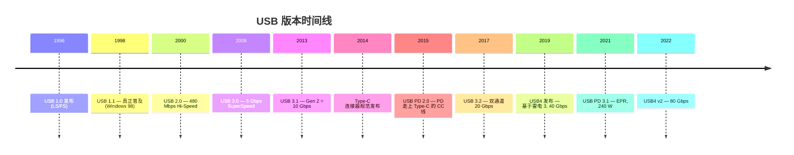

#### 版本与速率总表

| 规范版本 | 发布 | 速率模式 | 标称速率 | 编码后有效速率 | 备注 |
|---|---|---|---|---|---|
| USB 1.0 | 1996-01 | LS (Low Speed) | 1.5 Mbit/s | — | 首版，鲜有产品 |
| USB 1.1 | 1998-09 | LS / FS (Full Speed) | 1.5 / 12 Mbit/s | — | 真正普及的起点 |
| USB 2.0 | 2000-04 | HS (High Speed) | 480 Mbit/s | ≈ 414 Mbit/s（NRZI+位填充与协议开销，非 8b/10b） | 引入微帧与事务转换器 |
| USB 3.0 | 2008-11 | SS Gen1 | 5 Gbit/s | 4 Gbit/s（8b/10b） | 全双工双 Simplex |
| USB 3.1 | 2013-07 | SS Gen2 | 10 Gbit/s | ≈ 9.77 Gbit/s（128b/132b） | 新编码方案 |
| USB 3.2 | 2017-09 | Gen 1×1 / 1×2 / 2×1 / 2×2 | 5 / 10 / 20 Gbit/s | ×2 模式双通道并发 | ×2 仅限 Type-C |
| USB4 | 2019-08 | Gen 2×2 / Gen 3×2 | 20 / 40 Gbit/s | 隧道化架构 | 兼容雷电 3 |
| USB4 v2 | 2022-10 | Gen 4 | 80 Gbit/s（非对称可达 120） | PAM-3 调制 | USB 80Gbps |

>  勘误：USB 2.0 有效速率此前写成「8b/10b 无关」，容易读成这条总线跟 8b/10b 有关。USB 2.0（以及 1.x）用的是 **NRZI 加位填充**（USB 2.0 spec §7.1.8、§7.1.9），没有块编码。**8b/10b** 从 USB 3.0 SuperSpeed Gen1 才开始（5 Gbit/s 线路速率，编码后 4 Gbit/s）；USB 3.1 Gen2 改为 **128b/132b**。见上表 USB 3.0 / USB 3.1 两行与[信号编码](03-physical-signaling.md)。

#### 命名混乱澄清表（重要叶子）

USB-IF 的市场命名在 2019 年彻底重编，"USB 3.0/3.1"的说法已被官方废弃，但民间仍在混用。查任何资料先对齐下表：

| 规范名称（现行） | 旧称 1 | 旧称 2 | 现行营销名 | 速率 |
|---|---|---|---|---|
| USB 3.2 Gen 1 | USB 3.0 | USB 3.1 Gen 1 | SuperSpeed USB 5Gbps | 5 Gbit/s |
| USB 3.2 Gen 2 | — | USB 3.1 Gen 2 | SuperSpeed USB 10Gbps | 10 Gbit/s |
| USB 3.2 Gen 2×2 | — | — | SuperSpeed USB 20Gbps | 20 Gbit/s |
| USB4 Gen 3×2 | — | — | USB 40Gbps | 40 Gbit/s |
| USB4 Gen 4 | — | — | USB 80Gbps | 80 Gbit/s |

识别口诀：**看速率别看版本号**——"USB 3.2"设备可能是 5/10/20 Gbps 中任何一个。

### 4. 供电能力演进

| 时代 | 机制 | 最大能力 |
|---|---|---|
| USB 1.x/2.0 | 单位负载 (Unit Load) 100 mA，配置后高功耗 500 mA | 2.5 W (5V×0.5A) |
| USB 3.x | 150 mA 单位负载，配置后 900 mA | 4.5 W |
| BC 1.2（充电规范） | DCP/CDP 端口 | 7.5 W (1.5A) |
| Type-C 电阻编码 | Rp 声明电流 | 15 W (5V×3A) |
| USB PD 2.0/3.0 | CC 线数字协商 | 100 W (20V×5A) |
| USB PD 3.1 EPR | 扩展功率范围 | 240 W (48V×5A) |

详见枝干 [接口与供电](20-connectors-typec.md) 与 [USB PD 协议](22-usb-pd.md)。

### 5. 组织与规范体系

- **USB-IF**（USB Implementers Forum）：拥有者与认证机构。规范原文在 usb.org 发布，开发者注册后免费下载。
- 规范族结构（树干层面）：
  - *Universal Serial Bus Specification rev 2.0* —— LS/FS/HS 的圣经，第 5/8/9 章是核心（信号/框架/设备框架）；
  - *USB 3.2 Specification*（含 3.0/3.1 历史合并）、*USB4 Specification*；
  - *Universal Serial Bus Type-C Cable and Connector Specification*；
  - *USB Power Delivery Specification*；
  - 各设备类规范（Device Class Specs），构成本树的所有枝干，见[设备类索引](10-class-index.md)。
- 认证与合规见 [USB-IF 合规认证](51-compliance-security.md)。

### 6. 与其它总线的坐标系

| 总线 | 关系 |
|---|---|
| RS-232 / PS/2 / LPT | 被 USB 取代的对象 |
| IEEE 1394 (FireWire) | 同代竞争者，高成本致败 |
| PCIe | USB4 通过隧道承载它（[USB4 与雷电](31-usb4.md)） |
| I²C / SPI | 板内低速总线；HID 可跨传输运行（[HID 跨传输](12-hid-devices.md)） |
| 蓝牙 BLE | 与 USB 平行的无线总线，交汇于 HCI-over-USB 与 HID（[无线概览](60-usb-wireless-intersection.md)） |

## 原文：03-各版本对比速查

> Source: [40-枝干-高速演进/03-各版本对比速查.md](https://github.com/tangjianfang/USBTree/blob/main/40-枝干-高速演进/03-各版本对比速查.md)

一页看全 USB 从 1.5 Mbps 到 80 Gbps：版本大表、新旧命名对照、每次速率跳变的工程代价、2.0/3.x 并存架构澄清、典型吞吐与选型建议。

### 一、全版本一张大表

| 版本 | 发布年 | 营销名（当时→现行） | 速率（理论） | 编码 | 双工 | 供电能力 | 主连接器 | 关键特性 |
| --- | --- | --- | --- | --- | --- | --- | --- | --- |
| USB 1.0/1.1 | 1996/1998 | Low-Speed / Full-Speed | 1.5 Mbps / 12 Mbps | NRZI | 半双工 | 100/500 mA | Type-A/B | 中断/批量/控制/等时四传输定型 |
| USB 2.0 | 2000 | High-Speed (Hi-Speed) | 480 Mbps | NRZI + 8/16 位 CRC | 半双工 | 500 mA（BC 1.2 补到 1.5 A） | Type-A/B/Mini/Micro | 微帧 (125 µs)、TT 事务转换、OTG |
| USB 3.0 | 2008 | SuperSpeed → 3.1 Gen1 → 3.2 Gen1 → USB 5Gbps | 5 Gbps（有效 4） | 8b/10b + 加扰 | 全双工 | 900 mA | 9 针 A/B、Micro-B、（后）Type-C | 双总线、链路层 CRC/重传、信用流控、包路由 |
| USB 3.1 | 2013 | SuperSpeed+ → 3.1 Gen2 → 3.2 Gen2 → USB 10Gbps | 10 Gbps（有效 ≈9.7） | 128b/132b | 全双工 | 900 mA / Type-C 档 | Type-C 普及 | 接收均衡、Type-C 规范同年落地 |
| USB 3.2 | 2017 | 3.2 Gen 1x1/2x1/**2x2** → USB 20Gbps | 20 Gbps（2×10） | 128b/132b ×2 lane | 全双工 | 同上 + PD | **仅 Type-C**（2x2） | 双通道聚合、Lane Margining |
| USB4 v1 | 2019 | USB4 40Gbps | 40 Gbps（Gen 3x2） | 8b/10b（每 lane Gen3 档） | 全双工 | PD 100 W 时代 | 仅 Type-C | TB3 基因、隧道化、路由器拓扑 |
| USB4 v2 | 2022 | USB4 80Gbps | 80 Gbps 对称 / 120G 非对称 | **PAM-3** | 全双工 | PD 240 W（EPR） | 仅 Type-C | 与 v1 共存、显示带宽优先 |

> 速率均为理论线速；有效数据带宽再乘编码效率与协议开销（见第五节实测参考）。

### 二、新旧命名对照（避坑表）

USB-IF 多次改名，市面包装混乱，对照如下：

| 速率 | 2008 命名 | 2013 命名 | 2017 命名 | 2022 命名 |
| --- | --- | --- | --- | --- |
| 5 Gbps | USB 3.0 | USB 3.1 **Gen 1** | USB 3.2 **Gen 1x1** | USB 5Gbps |
| 10 Gbps | — | USB 3.1 **Gen 2** | USB 3.2 **Gen 2x1** | USB 10Gbps |
| 20 Gbps | — | — | USB 3.2 **Gen 2x2**（营销常简写"USB 3.2"） | USB 20Gbps |
| 40 Gbps | — | — | — | USB 40Gbps（USB4） |
| 80 Gbps | — | — | — | USB 80Gbps（USB4 v2） |

陷阱：商品页写"USB 3.1"可能指 5 G（Gen1）也可能指 10 G（Gen2）；"USB 3.2"可能是 20 G 也可能是改名后的 5/10 G。**只认 Gbps 或 Gen 2x2**。

认证/Logo 速读（印在插头或线上）：

| 标识 | 含义 |
| --- | --- |
| SuperSpeed（SS 徽标） | 5 Gbps |
| SuperSpeed+ / SS10 | 10 Gbps |
| SS x2 / 20 | 20 Gbps（双通道） |
| Certified USB4 | USB4 认证（40G 或 80G 标注在旁） |
| Thunderbolt 徽标（闪电）+ 数字 | 雷电 3/4/5 认证，含 PCIe 隧道保障 |
| 线上数字对（如 5A / 40Gbps） | 电流档与速率代次，两个独立维度（30 枝干 05 叶） |

### 三、每次跳变的代价

| 跳变 | 新增代价 |
| --- | --- |
| FS→HS (2.0) | 高速信号完整性；**微帧与事务转换器 (TT)**：hub 必须在 HS 上行与 FS/LS 下行间缓冲拆包（split 事务）；协议复杂度大增 |
| HS→SS (3.0) | **全新线缆与连接器**（9/10 针，SS 对阻抗控制）；链路训练/LTSSM；链路层 CRC/重传/信用流控；hub 双芯 |
| SS 5G→10G (3.1) | 接收端均衡与重训练（长线/劣线易掉速）；128b/132b 块同步 |
| 10G→20G (3.2) | 双 lane 配对与聚合；**只有 Type-C** 有足够线对（Type-A/B 用户被排除） |
| 20G→USB4 40G | 隧道路由器栈（软件复杂度大增）；线缆需认证代次（E-marker）；长距需**主动线缆** |
| 40G→USB4 v2 80G | PAM-3 PHY；更长距离更依赖有源/光方案 |

规律：速率每上一档，"线"先于"芯"成为瓶颈——排查高速问题时优先怀疑线缆。

### 四、2.0 与 3.x 并存架构（澄清常见误区）

**误区**："3.0 设备先以 2.0 枚举，再切换到 3.0。"

**准确表述**：

1. 3.x 设备物理上同时具备 D+/D−（2.0 接口）与 SSTX/SSRX（SS 接口），两套接口独立工作；
2. 主机 xHCI 在端口检测到连接后，通过 SS 通路（Rx Detect/LFPS）与 D+ 上拉分别探测两条总线；
3. **SS 通路可用（设备和路径都全）时，设备直接在 SS 总线上完成枚举**，全程不涉及 2.0 枚举；
4. 若插入仅 2.0 的环境（2.0 hub 下方、2.0 专用线、SS 对断线），则回退为 **HS 枚举**，走 D+/D−；
5. 2.0 接口的存在是为了**兼容**（插入旧 host/hub），不是枚举的"第一跳"。

由此推论：SS 设备接 2.0 hub 会整体掉到 480 Mbps 且**无法通过换口恢复**，必须换到 SS 路径；这解释了"3.0 U 盘突然变慢"的绝大多数案例。枚举细节见 [../10-树干-USB核心/08-枚举流程与标准请求.md](07-enumeration-requests.md)。

### 五、带宽利用率实测参考

理论线速 × 编码效率 − 协议开销 = 实际吞吐。以下为常见设备的典型量级（存储类受介质制约明显，仅供对照，非规范值）：

| 场景 | 版本路径 | 典型实测吞吐 |
| --- | --- | --- |
| HID 键鼠/串口芯片 | 2.0 FS | KB/s 级（瓶颈在轮询间隔与器件） |
| UVC 摄像头 1080p30 | HS | 视压缩 ~10-30 MB/s（接近 HS 上限的一半即告警） |
| 传统 U 盘 | HS / SS 5G | HS ~30-40 MB/s；SS U 盘 ~150-400 MB/s（介质为主瓶颈） |
| SATA SSD 盒 | SS 5G / 10G | ~400-450 MB/s / ~900 MB/s |
| NVMe 盒 | 10G / 20G | ~900-1000 MB/s / ~1800-2000 MB/s |
| 千兆/2.5G 网卡 | SS 5G | ~118 / ~290 MB/s（网卡线速） |
| 4K60 UVC + 存储并发 | 10G | 视频占用后存储明显降速（共享通道） |
| RAID 阵列盒 | USB4 40G | 数 GB/s（受 RAID/介质限制，难以打满 40G） |

读法：**10 Gbps ≈ 1000 MB/s 理论、~900 MB/s 实际**是工程速算锚点；SS 链路协议开销后有效约 4 Gbps（Gen1）→ 9.7 Gbps（Gen2）。

换算速查：5 Gbps→约 500 MB/s；10 Gbps→约 1000 MB/s；20 Gbps→约 2000 MB/s；40 Gbps→约 4000 MB/s；再按 80%~97% 编码效率与实际协议开销打折。存储设备实测若只有线速的 30%~40%，先怀疑介质与桥接芯片，而不是线缆。

### 六、选型建议（按场景）

| 场景 | 建议 |
| --- | --- |
| HID/串口/慢速传感 | USB 2.0 足够；选低 BCD 需求芯片简化驱动（参考 20 枝干设备类） |
| 摄像头 (UVC) | 1080p 用 HS；4K/多流必须 5G 起步，注意 Isochronous 带宽预算 |
| 移动存储 | ≥10G + 认证线；UASP 支持（见 20 枝干 BOT/UASP）比速率更影响小文件体验 |
| 显示坞 | USB4/TB4（隧道化）或 DP Alt Mode 2 通道+USB3 并行；确认显示器代次 |
| 外接显卡/万兆网络 | 必须 PCIe 隧道（TB3/TB4/USB4+PCIe 实现） |
| 充电优先 | PD 协商与 5A E-marker 线（30 枝干），速率可完全放弃 |

### 七、传输类型与版本矩阵

| 传输类型 | 2.0 | 3.x | USB4 |
| --- | --- | --- | --- |
| 控制 (Control) | 支持（8/16/32/64→512B 包） | 支持（512B） | 经 USB3 隧道不变 |
| 批量 (Bulk) | 512 B/包 | 1024 B/包，流协议 (Streams) 支持 | USB3 隧道承载 |
| 中断 (Interrupt) | 微帧内调度 | 服务间隔 (Service Interval) 协商 | USB3 隧道承载 |
| 等时 (Isochronous) | 每微帧配额 | 时间戳包 (ITP) 同步 + 突发 | USB3 隧道承载（媒体场景也常改走 AV 类隧道思路） |

注意：**USB4 里没有新的设备级传输类型**——设备看到的一直是 USB 3.x 语义，隧道化对设备固件透明。

### 八、排障速查表

| 症状 | 高概率根因 | 检查动作 |
| --- | --- | --- |
| 3.x 设备只跑 480 Mbps | 插在 2.0 hub/2.0 线下；SS 对断线 | 换直插主机口 + 认证线 |
| 时快时慢 | 温控降速或线缆边缘余量 | 换短粗线；看盘温 |
| Type-C 口完全不识别 | 充电线无数据对 / CC 异常 | 换全功能线；读 PD 协商 |
| 充电慢但能识别 | Rp 档位低 / PD 未达成 / 非 5A 线 | 读 PDO 与 SOP' 身份 |
| 扩展坞视频掉线 | DP 带宽被挤出 / DSC 不支持 | 单屏测试；查 Alt Mode 或隧道建立 |
| USB4/TB 设备不识别 | 主机未开 PCIe 隧道 / 线缆代次不足 | 换认证 40G 线；查 BIOS 安全设置（DMA 保护） |
| 大文件传输中断 | 电源不足触发断连 | 测 PD 实际供电档位 |

### 九、术语速查

| 术语 | 含义 |
| --- | --- |
| Gen 1x1 / 2x1 / 2x2 | 3.2 通道配置：代次 × lane 数 |
| U0~U3 | 3.x 链路电源状态（01 叶） |
| LTSSM | 链路训练状态机（01 叶） |
| TT / split | 2.0 hub 的高低速事务转换 |
| Route String | 3.x 包头路由字段（01 叶） |
| Path / Tunnel | USB4 的路由通路与协议封装（02 叶） |
| PDO / RDO | PD 的能力广播与请求对象（30 枝干 04 叶） |
| SOP / SOP' / SOP'' | PD 的端口/近端线缆/远端线缆通信对象 |


---

<!-- file: 02-architecture-topology.md -->
---
id: 02-architecture-topology
title: "体系架构、拓扑、端点与管道、集线器"
topic: core
level: 入门
keywords: ["host", "hub", "function", "tiered star 分层星型", "endpoint 端点", "pipe 管道", "interface 接口", "configuration 配置", "device state 设备状态", "TT 事务转换器", "composite device 复合设备"]
sources:
  - path: "10-树干-USB核心/02-体系架构与分层模型.md"
    url: "https://github.com/tangjianfang/USBTree/blob/main/10-树干-USB核心/02-体系架构与分层模型.md"
  - path: "10-树干-USB核心/09-集线器与连接管理.md"
    url: "https://github.com/tangjianfang/USBTree/blob/main/10-树干-USB核心/09-集线器与连接管理.md"
spec_refs: ["USB 2.0 Specification ch.4/5/9/11"]
related: ["04-packets-transactions", "06-descriptors", "07-enumeration-requests"]
usbtree_commit: c987a96
generated: 2026-11-27
---

# 体系架构、拓扑、端点与管道、集线器

> 层级 入门 · 主题 `core` · 相关：[包格式、PID、事务、帧与 Data Toggle](04-packets-transactions.md)、[标准描述符字段全表](06-descriptors.md)、[枚举流程、Setup 包与标准请求](07-enumeration-requests.md)

## 核心事实 Key Facts

> 由维护者整理并与规范核对；与下方 USBTree 原文冲突时以本节为准。

| 约束 | 值 | 来源 |
|---|---|---|
| 设备地址 Address | 7 bit, 1–127（0 = 默认地址，仅枚举前） | Token ADDR 字段 7 bit |
| 端点号 Endpoint Number | 0–15，每个方向独立；EP0 双向且必有 | Token ENDP 字段 4 bit |
| 层级 Tiers | 最多 7 层（根集线器为第 1 层；链路上最多 5 个非根集线器） | USB 2.0 §4.1.1 |
| 端点地址编码 | bit7 = 方向（1 = IN 设备→主机），bit3:0 = 端点号，如 0x81 = EP1 IN | USB 2.0 §9.6.6 |

- 方向永远以主机为参照：IN = Device→Host，OUT = Host→Device。
- 层次：Configuration ⊃ Interface（+ Alternate Setting）⊃ Endpoint。同一时刻只有一个 Configuration 生效；类驱动按 Interface 绑定。
- 设备状态（USB 2.0 §9.1）：Attached → Powered → Default（总线复位后）→ Address（SET_ADDRESS）→ Configured（SET_CONFIGURATION ≠ 0）；任一状态总线空闲 3 ms → Suspended。
- 集线器 Hub：上行端口 + Repeater + Hub Controller；HS Hub 含 TT（单 TT / 多 TT）为 FS/LS 设备做 Split 事务。USB 3.x Hub = USB 2.0 Hub + SuperSpeed Hub 并联，两套独立拓扑。
- 复合设备 Composite：bDeviceClass=0x00（或 0xEF/0x02/0x01 + IAD），Windows 由 usbccgp.sys 为每个接口/IAD 功能创建子 devnode。

## 原文：02-体系架构与分层模型

> Source: [10-树干-USB核心/02-体系架构与分层模型.md](https://github.com/tangjianfang/USBTree/blob/main/10-树干-USB核心/02-体系架构与分层模型.md)

### 1. 三种角色

| 角色 | 英文 | 职责 |
|---|---|---|
| 主机 | Host | 唯一的调度者：发起一切事务、分配地址、轮询设备、管理带宽与电源。每条 USB 总线**有且只有一个主机**（USB4 的 Host-to-Host 通信是例外，见[高速演进](31-usb4.md)） |
| 设备 | Device | 功能提供者：响应主机请求、上报数据。逻辑上 = 一个 USB 逻辑设备（唯一地址）+ 若干接口（功能） |
| 集线器 | Hub | 扩展器：一个上行口 + N 个下行口，转发事务并管理端口（详见[集线器与连接管理](02-architecture-topology.md)） |

USB 集线器在协议层也是一种设备（类代码 0x09），所以"设备"是广义概念。

### 2. 拓扑：物理星型，逻辑点对点

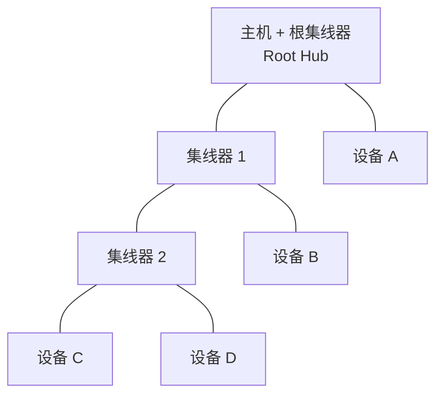

- 物理上是以主机为根的**星型树**，集线器只能级联。
- 逻辑上主机把每个设备当作**点对点**连接对待：主机的"客户软件"只看得到自己的设备，集线器对功能层透明。
- 规模上限：
  - 7 位设备地址，0 保留作默认地址 → 最多 **127 个设备**（含集线器）；
  - 含根集线器最多 **7 层**；主机与设备之间的链路上最多串联 **5 个非根集线器**（剩余层次留给设备/集线器本身），这是传播延迟约束。
- USB 3.x 引入路由字符串后，高速包不再向所有下行口广播（见[高速演进](30-usb3-superspeed.md)）。

### 3. 分层模型（树干的主心骨）

主机与设备两端**层与层垂直对应**，水平通信只在物理层真实发生，上层是逻辑对等体：

```mermaid
graph LR
    subgraph 主机 Host
        A1[客户软件 / 类驱动<br/>Function Layer] 
        A2[USB 系统软件<br/>USBD + HCD, Device Layer]
        A3[主机控制器 + 根集线器<br/>Bus Interface Layer]
    end
    subgraph 设备 Device
        B3[SIE + 收发器 PHY<br/>Bus Interface Layer]
        B2[USB 逻辑设备<br/>端点0, 枚举, Device Layer]
        B1[功能 Function<br/>接口 + 端点组, Function Layer]
    end
    A1 <-. 逻辑通道/管道 .-> B1
    A2 <-. 默认管道 端点0 .-> B2
    A3 === 总线 | D+ D- VBUS | === B3
```

| 层 | 主机侧 | 设备侧 | 树内对应知识 |
|---|---|---|---|
| 功能层 (Function Layer) | 类驱动 / 客户软件 | 功能固件（接口+端点组合） | 全部设备类枝干（[索引](10-class-index.md)） |
| 设备层 (USB Device Layer) | USBD：枚举、标准请求、地址/配置管理 | 端点 0、描述符、默认管道 | [描述符详解](06-descriptors.md)、[枚举流程](07-enumeration-requests.md) |
| 总线接口层 (Bus Interface) | 主机控制器（UHCI/OHCI/EHCI/xHCI） | SIE（串行接口引擎）+ PHY | [信号编码](03-physical-signaling.md)、[包格式](04-packets-transactions.md)、[主机控制器栈](40-host-controller-os.md) |

**SIE（Serial Interface Engine）** 是设备端硬件状态机，自动完成：NRZI 编解码、位填充/删除、SYNC/EOP 生成检测、CRC 校验、地址比对、PID 解析。固件只在 SIE 校验通过的包之后介入——调试时记住：**SIE 层的问题（时钟偏差、位填充）在固件日志里是看不见的**。

### 4. 端点与管道：一切通信的落点

- **端点 (Endpoint)**：设备端的数据收发缓冲区，用 4 位编号（0~15）+ 1 位方向（IN=设备→主机，OUT=主机→设备）标识。**IN/OUT 以主机视角命名**。
- **端点 0**：每个设备必有，双向，专用于控制传输（枚举与标准请求），也叫**默认控制管道**。
- **管道 (Pipe)**：主机端软件对"某端点+传输类型+带宽+特性"的逻辑抽象：
  - **消息管道 (Message Pipe)**：仅端点 0，有固定格式（Setup/Data/Status）；
  - **流管道 (Stream Pipe)**：中断/批量/同步端点，无结构约定。
- 端点必须在描述符中声明（[描述符详解](06-descriptors.md)），主机按声明分配带宽与调度。

### 5. 设备状态机（USB 2.0 视角）

```mermaid
stateDiagram-v2
    [*] --> Attached: 插入, VBUS 上电
    Attached --> Powered: 上电完成
    Powered --> Default: 复位, 得到默认地址0
    Default --> Addressed: SET_ADDRESS 成功
    Addressed --> Configured: SET_CONFIGURATION 成功
    Configured --> Suspended: 总线空闲≥3ms
    Suspended --> Configured: 恢复信号
    Configured --> [*]: 拔出
```

要点：

1. **Attached→Powered**：设备检测到 VBUS 即上电，但必须等到总线复位才可响应（上电后除端点 0 的基本电路外不得乱拉总线）。
2. **Default**：所有设备初始都用地址 0，主机用它与设备完成第一次描述符读取，再分配唯一地址（见[枚举流程](07-enumeration-requests.md)）。
3. **Addressed**：SET_ADDRESS 的新地址在**该请求状态阶段完成后**生效——常见固件错误是提前切换导致主机收到无应答。
4. **Configured**：只有进入 Configured 态，功能端点才开始工作；高功耗设备此时才可取用超过 100 mA 的电流（150 mA on 3.x）。
5. **Suspended** 与上述状态正交：任何工作态都可以被挂起（见[电源管理](08-power-management.md)）。

### 6. 数据流模型：客户—功能对等

一次数据交换的逻辑路径（以"应用读取 U 盘"为例）：

```
应用 → 文件系统 → MSC 类驱动 → USB 核心(构造 URB/IRP) → HCD(排入调度)
→ 主机控制器(打包/编码) → 总线 → 设备 SIE(解码/CRC) → 端点缓冲 → MSC 固件 → 闪存
```

反向返回数据走同样路径的镜像。理解这条链路后，[错误处理](09-errors-testmode.md)中每一环如何报告错误就都有了位置感：电气错误在 PHY/SIE 被 CRC 捕获，协议错误在设备层表现为 STALL，类语义错误由类驱动翻译。

### 7. 速度与"多速并存"的架构处理

- HS 设备接入时先以 FS 检测，再通过 **Chirp 握手**升级到 HS（详见[信号编码](03-physical-signaling.md)）。
- USB 3.x 设备走独立的 SS 双 Simplex 线对枚举，同时保留 D+/D- 用于向后兼容与首次检测。
- 一个 3.x 集线器内部同时包含 3.x 集线器与 2.0 集线器两套逻辑——低速设备插在 3.x 集线器上实际挂在它的 2.0 半区。

## 原文：09-集线器与连接管理

> Source: [10-树干-USB核心/09-集线器与连接管理.md](https://github.com/tangjianfang/USBTree/blob/main/10-树干-USB核心/09-集线器与连接管理.md)

### 1. 集线器的三件套

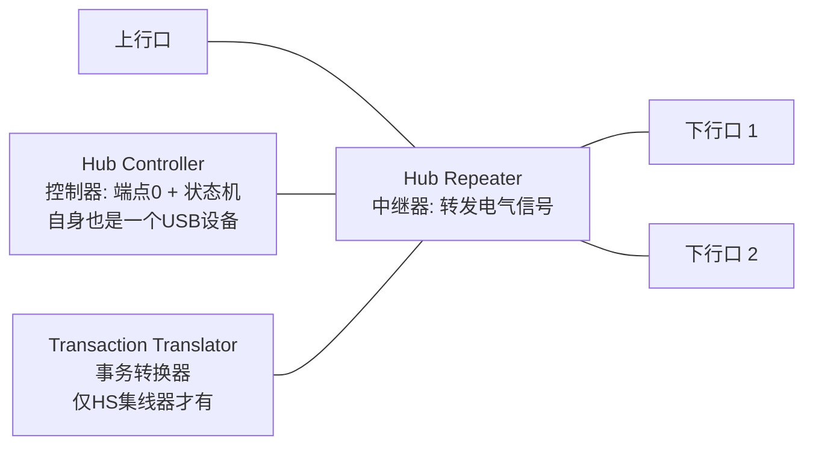

- **Hub Repeater**：电气层中继，做连接检测、速率隔离、帧边界转发；
- **Hub Controller**：集线器自己的 USB 设备部分——默认地址 0 → 枚举 → 端点 0 → 类代码 **0x09**；
- **Transaction Translator (TT)**：USB 2.0 集线器独有，把 HS 下行事务转换为 FS/LS 事务（分裂事务）。

### 2. 端口状态与变更位

集线器暴露两类寄存器式请求（类请求，接口=0）：

- `GET_STATUS(端口)`：连接、使能、挂起、过流、复位、供电 + **高速已连接/低速已连接** 位；
- `GET/CLEAR_FEATURE(端口)`：变更位 C_PORT_CONNECTION / C_PORT_RESET / C_PORT_OVER_CURRENT 等——**写 1 清除**（写后自清）模型。

插入流程：设备上拉数据线 → 下行口 15kΩ 下拉检测到变化 → 控制器置 C_PORT_CONNECTION → 集线器驱动（主机）轮询发现 → 复位端口 → 开始[枚举](07-enumeration-requests.md)。**热插拔的协议实现就是这一条轮询链**。

### 3. 端口电源与过流

| 机制 | 说明 |
|---|---|
| 每口独立供电 (per-port) | 可单独开关下行口电源（SET_FEATURE PORT_POWER） |
| 分组供电 (ganged) | 多口同开同关，省成本 |
| 过流检测 | 电流超限 → 置过流位 → 主机可关端口；BC1.2/Type-C 时代由硬件保护接管（[供电枝干](21-charging-bc12-otg.md)） |
| 复位后状态 | 复位完成端口进入 enabled；失败则反复复位若干次后放弃（设备"假死"的一种） |

### 4. 事务转换器 (TT) 与分裂事务

HS 集线器下方挂着 FS/LS 设备时，主机不能让慢速设备占住 480 Mbps 总线。解法是**分裂事务 (Split Transaction)**：

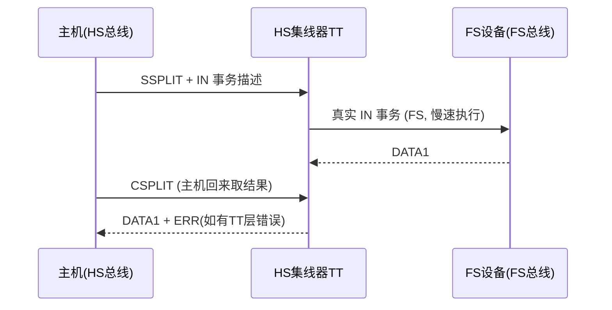

- 主机侧把 FS/LS 设备的带宽按**开销预算**排进微帧（TT 有自己的 FS 帧时域）；
- **单 TT (Single TT)**：所有下行口共享一个 TT → 一个慢设备拖累全 hub；**多 TT (Multi TT)**：每口独立 TT——好集线器的卖点，设备描述符里 bDeviceProtocol=0x02 声明；
- 排查联想：多口 hub 上 U 盘突然掉速/失联，优先怀疑单 TT hub 的 FS/LS 设备干扰。

### 5. 集线器描述符速览

- 标准描述符之外有**集线器类描述符**（类型 0x29）：bNbrPorts、wHubCharacteristics（供电方式/过流模式）、bPwrOn2PwrGood、bHubContrCurrent、每个口的可移除位图 (DeviceRemovable)；
- 类请求：`GET_STATUS/CLEAR_FEATURE/SET_FEATURE` 作用于端口（PORT_RESET/PORT_POWER/PORT_SUSPEND 等特征号）；
- 主机的集线器驱动（Windows usbhub、Linux usbcore 的 hub.c）就是围着这些位转的。

### 6. 挂起/恢复在集线器上的传播

- **全局挂起**：主机停发 SOF，整棵树顺次进入挂起（[电源管理](08-power-management.md)）；
- **选择性挂起**：主机 SET_FEATURE(PORT_SUSPEND) 只挂起某口子树，其余照常；
- **恢复**：主机对端口发恢复信号（PORT_RESUME），集线器向下游转发 K 序列；设备远程唤醒时向上行转发（每级集线器要能"中继唤醒"）；
- 集线器在挂起期间必须保持端口供电与检测电路，且自己消耗 ≤2.5 mA（自供电 hub 有例外计算规则）。

### 7. 层级限制回顾

- 最多 **7 层**（含根集线器）：根(1) + 最多 5 个串联非根集线器 + 设备(7)；
- 127 个地址含沿途所有集线器——一层 6 口 hub×5 级就吃掉 30 个地址；
- 超限的表现：多插的设备不枚举（地址/层级耗尽），无报错——排查外设问题时别忽略。

### 8. USB 3.x 的集线器变化

- 3.x 集线器 = 3.x 半区（包路由、链路训练中继）+ 2.0 半区（含 TT）双逻辑并立；
- 3.x 不再需要分裂事务：3.x 域内没有"慢速设备混跑高速总线"的问题（FS/LS 设备由 2.0 半区处理）；
- 路由字符串 (Routing String) 让 3.x 包沿路径直达端口，不再广播——与 2.0 中继模型的本质差异（[USB3x](30-usb3-superspeed.md)）。


---

<!-- file: 03-physical-signaling.md -->
---
id: 03-physical-signaling
title: "物理层、电气特性与信号编码"
topic: core
level: 进阶
keywords: ["VBUS", "D+/D-", "pull-up 上拉 1.5k", "speed detection 速度检测", "chirp", "NRZI", "bit stuffing 位填充", "SYNC", "EOP", "SE0", "J/K state"]
sources:
  - path: "10-树干-USB核心/03-物理层与电气特性.md"
    url: "https://github.com/tangjianfang/USBTree/blob/main/10-树干-USB核心/03-物理层与电气特性.md"
  - path: "10-树干-USB核心/04-信号编码与比特流.md"
    url: "https://github.com/tangjianfang/USBTree/blob/main/10-树干-USB核心/04-信号编码与比特流.md"
spec_refs: ["USB 2.0 Specification ch.7"]
related: ["02-architecture-topology", "04-packets-transactions", "20-connectors-typec"]
usbtree_commit: c987a96
generated: 2026-11-27
---

# 物理层、电气特性与信号编码

> 层级 进阶 · 主题 `core` · 相关：[体系架构、拓扑、端点与管道、集线器](02-architecture-topology.md)、[包格式、PID、事务、帧与 Data Toggle](04-packets-transactions.md)、[连接器演进与 USB Type-C（含 CC 状态机与时序）](20-connectors-typec.md)

## 核心事实 Key Facts

> 由维护者整理并与规范核对；与下方 USBTree 原文冲突时以本节为准。

| 项 | 值 |
|---|---|
| USB 2.0 线 | VBUS(5V)、D−、D+、GND |
| FS 设备识别 | 设备 1.5 kΩ 上拉 D+；主机每线 15 kΩ 下拉 |
| LS 设备识别 | 设备 1.5 kΩ 上拉 D− |
| HS 识别 | 以 FS 连接，复位期间设备发 Chirp K，主机回 K-J 序列，成功后切 HS 终端（45 Ω） |
| 编码 | NRZI：数据 0 = 电平翻转，1 = 保持；连续 6 个 1 后插入 0（bit stuffing） |
| 包边界 | SYNC（FS/LS 8 bit，HS 32 bit）开头；EOP = SE0 + J |
| 复位 Reset | 主机驱动 SE0 ≥ 10 ms |
| 单段线长 | FS/HS 约 5 m |

- HS 设备只跑 FS 的首要原因：Chirp 握手失败（信号完整性、线长、经过仅 FS 的 Hub）。

## 原文：03-物理层与电气特性

> Source: [10-树干-USB核心/03-物理层与电气特性.md](https://github.com/tangjianfang/USBTree/blob/main/10-树干-USB核心/03-物理层与电气特性.md)

### 1. USB 2.0 的四根线

| 线 | 名称 | 电气规格 | 功能 |
|---|---|---|---|
| 1 | VBUS | 4.75~5.25 V（源端），最坏情形设备端可低至 4.4 V | 总线供电 |
| 2 | D− | 90 Ω 差分阻抗双绞线，与 D+ 成对 | 差分数据 |
| 3 | D+ | 同上 | 差分数据 |
| 4 | GND | — | 参考地 / 回流 |

Mini/Micro 接口增加第 5 根 **ID** 线，用于 OTG 角色判定（详见[接口形态演进](20-connectors-typec.md)）。

### 2. 供电模型（USB 2.0 时代）

- **单位负载 (Unit Load) = 100 mA**：
  - 未配置设备（枚举未完成/未 SET_CONFIGURATION）最多取 1 个单位负载；
  - 配置为高功耗 (bMaxPower > 100 mA) 后最多 **500 mA**；
  - 低功耗设备永远不超过 100 mA，且不能被远程唤醒负载例外。
- 集线器下行口按端口供电（每口 1 单位负载待机 + 5 单位负载满配）或 ganged 分组供电，必须支持过流检测与报告（见[集线器](02-architecture-topology.md)）。
- 挂起态限流 **2.5 mA**——注意这个数字比一个单位负载还小，做低功耗设备时挂起路径要独立核算。
- 3.x 时代：单位负载 150 mA，最大 900 mA；Type-C/PD 体系彻底另起炉灶（[Type-C](20-connectors-typec.md)、[USB PD](22-usb-pd.md)）。

### 3. 速度检测：上拉/下拉的博弈

这是全树最重要的电气"握手"，发生在任何数据包之前：

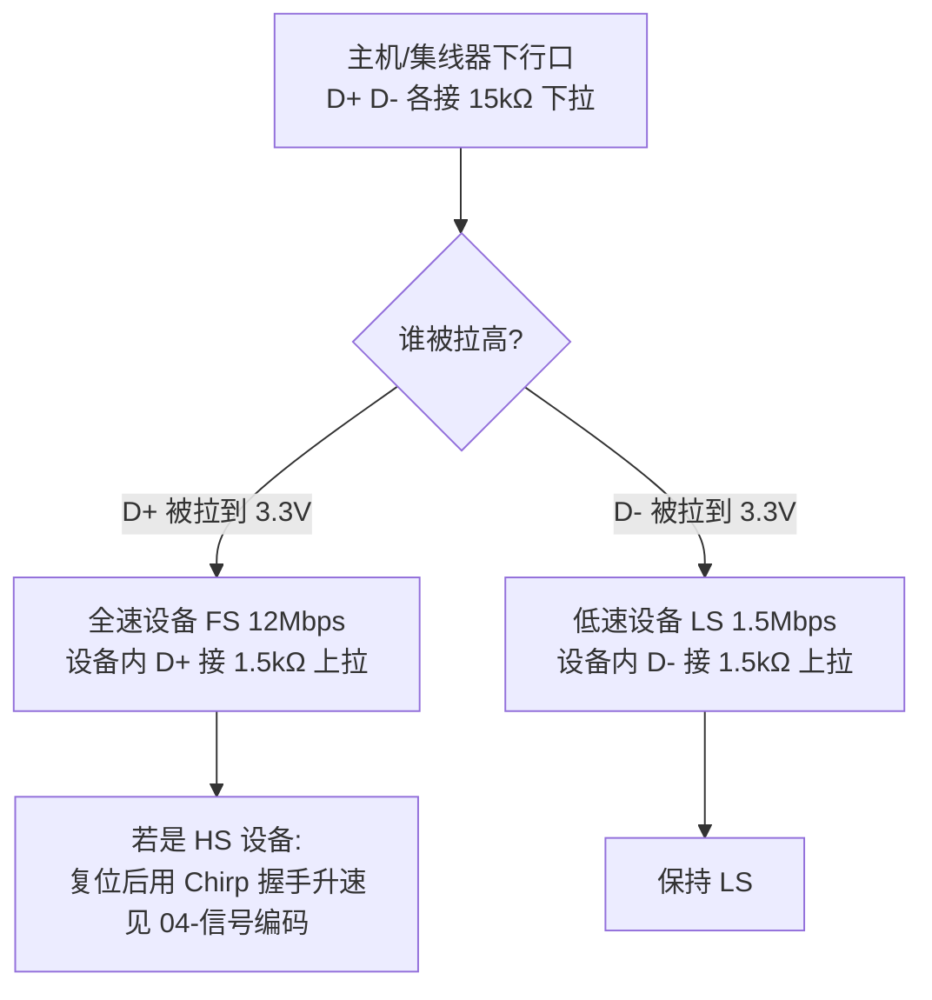

固件启示：**D+/D- 的 1.5 kΩ 上拉何时接入由固件控制**（很多 MCU 是"使能 USB 外设"这个动作）。固件初始化完成后再使能上拉，主机才能看到"设备插入"——这就是软件模拟热插拔的电气基础。

### 4. 线缆与连接器

#### 4.1 引脚定义（公头，从接触面看）

| 连接器 | 1 | 2 | 3 | 4 | 5 |
|---|---|---|---|---|---|
| Type-A / Type-B | VBUS | D− | D+ | GND | — |
| Mini-B / Micro-B | VBUS | D− | D+ | **ID** | GND |
| Type-A/B (3.0 版加宽) | VBUS | D− | D+ | GND | + SSTX±/SSRX± 共 9 针 |

3.0 的 SSTX/SSRX 与 D+/D- 物理隔离——3.x 高速通信与 2.0 共用连接器但不用同一对线。

#### 4.2 线缆规格要点

| 参数 | FS | LS | HS/SS |
|---|---|---|---|
| 最大长度（规范建议） | 5 m | 3 m | 5 m（HS）/ 主动线缆延长（SS/USB4） |
| 差分阻抗 | 90 Ω ±15% | 同左 | 90 Ω ±15%（SS 更严） |
| 结构 | 非屏蔽可用（LS） | — | 必须屏蔽双绞 + 地线 |

常见故障源头：仅充电线（没有 D+/D- 线对）、超长劣质线（差分阻抗失控→眼图闭合）、接头氧化。系统性排查见[枚举失败排查手册](50-debug-troubleshooting.md)。

### 5. 信号幅度与阈值（FS/LS）

| 参数 | FS | LS |
|---|---|---|
| 驱动幅度 | 0 / 3.3 V 单端摆幅（差分） | 同 FS |
| 差分接收器灵敏度 | |VID| ≥ 200 mV | 同 |
| 单端阈值 | 0.8 / 2.0 V 之间 | 同 |
| 上升/下降时间 | 4~20 ns | 75~300 ns |

**J/K 状态极性相反**是 LS 的著名坑：

| 总线状态 | FS 含义 | LS 含义 |
|---|---|---|
| Differential 1 | **J**（空闲态） | **K** |
| Differential 0 | K | J |
| SE0（两线均低） | 复位/EOP 用 | 同 |
| SE1（两线均高） | 非法 | 非法 |

### 6. USB 3.x 的物理层变化

- 每方向一对独立差分线（SSTX+/− 主机→设备，SSRX+/− 设备→主机），**全双工**，与 2.0 的半双工轮询根本不同。
- 8b/10b（Gen1，5 Gbps→有效 4 Gbps）→ 128b/132b（Gen2，10 Gbps，效率 97.7%）。
- 幅度降到约 800~1200 mV 峰峰值（Gen1），通过均衡 (Equalization) 补偿通道损耗。
- 线缆认证分级、主动线缆（红光雷电线/光纤）与 E-marker 详见 [AlternateMode 与 E-marker](23-altmode-emarker.md)。
- 信号完整性验证手段：眼图 (Eye Diagram)、TDR 阻抗测量——属于[合规认证](51-compliance-security.md)的电气测试项。

### 7. 插入检测与上电时序

1. 主机/集线器持续驱动 15 kΩ 下拉，轮询检测任一数据线被拉高 → 判定有设备接入；
2. 主机读端口状态，稳定去抖（通常 100 ms 量级的软件延时）后对端口复位；
3. 设备侧：检测 VBUS 有效 → 初始化 SIE → 使能 D+/D- 上拉 → 等待复位；
4. ESD 防护（TVS 阵列）是量产设备标配，注意其结电容对高速信号的影响（选低容 TVS）。

## 原文：04-信号编码与比特流

> Source: [10-树干-USB核心/04-信号编码与比特流.md](https://github.com/tangjianfang/USBTree/blob/main/10-树干-USB核心/04-信号编码与比特流.md)

### 1. NRZI 编码：0 翻转，1 保持

USB 2.0 线上不传时钟，靠 **NRZI（Non-Return-to-Zero Inverted）** 编码携带时序信息：

| 数据位 | NRZI 动作 |
|---|---|
| 0 | 电平翻转（J↔K） |
| 1 | 电平保持 |

示例：设初始态为 J，发送比特流 `1 1 1 0 1 0 0 1`：

```
数据:  1    1    1    0    1    0    0    1
NRZI:  J    J    J    K    K    J    K    K
```

风险：长串 1 → 长时间无翻转 → 接收端时钟漂移失锁。解决方案就是位填充。

### 2. 位填充 (Bit Stuffing)

规则：**每连续 6 个 1 之后，无论下一位是什么，强制插入一个 0**（保证至少每 7 位一次翻转）。

```
原始:   0111111 0 ...      → 连续六个 1 后插入 0
发送:   01111110 ...
```

- 填充发生在**整个包内**（PID 到 CRC，不含 SYNC 与 EOP 的特殊电平序列）；
- 接收端自动删除填充位；若在数据区收到 7 个连续 1，即**位填充错误 (Bit Stuff Error)** → 丢弃整包、不应答（发送方超时重传，见[错误处理](09-errors-testmode.md)）；
- 位填充让实际总线占用率与数据内容相关——理论带宽计算时按最坏情形留余量（FS 每帧有效位时间约 12000 个）。

### 3. SYNC 域：每个包的开胃菜

接收端需要用 SYNC 对齐每位采样时钟：

| 速率 | SYNC 长度 | NRZI 波形 | 比特 |
|---|---|---|---|
| FS/LS | 8 位 | KJKJKJKK | `00000001` |
| HS | 32 位 | (KJ)×15 后接 KK | 32 位 |

主机与设备都用 SYNC 的跳变沿做时钟恢复；HS 需要更长 SYNC 是因为 480 Mbps 下锁相更快更严。

### 4. EOP（包结束）与总线特殊状态

| 状态/序列 | 定义 | 用途 |
|---|---|---|
| EOP (FS/LS) | SE0 持续 2 位时间 + J 持续 1 位 | 正常包结束标记 |
| EOP (HS) | 故意制造的 NRZI 位错误（无填充违规错） | HS 用电气特征替代 |
| 复位信号 | **SE0 ≥ 10 ms** | 主机复位端口/设备 |
| 空闲 (Idle) | FS: J 态 / LS: J 态（各自极性） | 无包时的静默态 |
| 挂起 (Suspend) | 空闲 ≥ 3 ms | 设备进入低功耗（[电源管理](08-power-management.md)） |
| 恢复 (Resume) | **K 态 ≥ 20 ms** + 低速 EOP | 唤醒 |
| 连接指示 | D+（FS/HS）或 D-（LS）被拉高 | 速度检测（[物理层](03-physical-signaling.md)） |

记忆口诀：**复位看 SE0 十毫秒，挂起看空闲三毫秒，唤醒看 K 态二十毫秒**。

### 5. HS Chirp 握手：从全速升到高速

HS 设备接入时先被识别为 FS（D+ 上拉），复位信号结束后发生"谈判"：

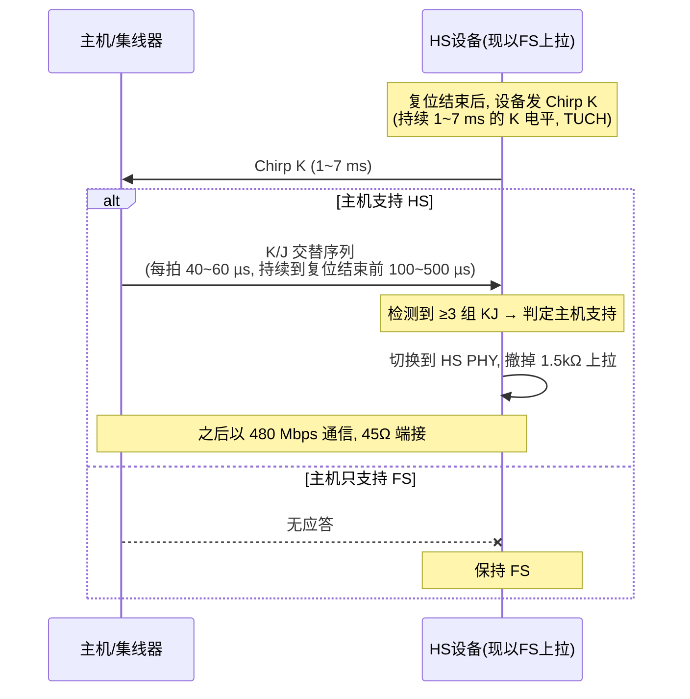

排查联想：**HS 设备始终以 FS 运行**，多半是 Chirp 握手环节失败（PHY 供电不足、时钟偏差、上拉未按规范撤除）。更多见[排查手册](50-debug-troubleshooting.md)。

>  勘误（evolve #3）：本节此前误写设备 Chirp 为"17~20 ms"、主机序列"每段 1~7 ms/共 40~60 ms"——均不正确。规范值：设备 Chirp K（TUCH）**1~7 ms**，主机 KJ 交替每拍（TDCHBIT）**40~60 µs**，见 USB 2.0 spec Table 7-5 与 [时序参数全表](90-quick-reference.md) §1.2。

### 6. 时钟与容差

| 项目 | FS/LS | HS |
|---|---|---|
| 数据速率容差 | ±0.25%（FS 从设备），主机更严 | ±500 ppm |
| 每帧抖动要求 | 帧间隔 1 ms ±若千 ns | 微帧 125 µs |
| 帧长 | 1 ms（每帧一个 SOF） | 125 µs 微帧 ×8（每微帧一个 SOF） |

晶振选型教训：内部 RC 振荡器通常达不到 ±0.25%，必须用晶体或经时钟恢复——用内部 RC 的设备枚举失败是经典案例。

### 7. 3.x 的编码（速览）

USB 3.x 放弃 NRZI/位填充，改用：
- **Gen1**: 8b/10b 分组编码（保证直流平衡与时钟内容），加扰 (Scrambling) 扩频；
- **Gen2**: 128b/132b 块编码（效率 97.7%）+ 更强加扰；
- 训练与对齐交给有序集 (Ordered Sets) 与 LFPS 信令，详见 [USB3x 与 SuperSpeed](30-usb3-superspeed.md)。


---

<!-- file: 04-packets-transactions.md -->
---
id: 04-packets-transactions
title: "包格式、PID、事务、帧与 Data Toggle"
topic: core
level: 进阶
keywords: ["PID", "token packet", "data packet", "handshake", "ACK", "NAK", "STALL", "NYET", "PING", "SPLIT", "SOF", "frame 帧", "microframe 微帧", "data toggle", "CRC5", "CRC16"]
sources:
  - path: "10-树干-USB核心/05-包格式与事务.md"
    url: "https://github.com/tangjianfang/USBTree/blob/main/10-树干-USB核心/05-包格式与事务.md"
spec_refs: ["USB 2.0 Specification ch.8"]
related: ["05-transfer-types-bandwidth", "09-errors-testmode", "30-usb3-superspeed"]
usbtree_commit: c987a96
generated: 2026-11-27
---

# 包格式、PID、事务、帧与 Data Toggle

> 层级 进阶 · 主题 `core` · 相关：[四种传输类型、bInterval 与带宽调度](05-transfer-types-bandwidth.md)、[错误处理、可靠性、Test Mode 与调试模式](09-errors-testmode.md)、[USB 3.x SuperSpeed：包格式、LTSSM、定时器](30-usb3-superspeed.md)

## 核心事实 Key Facts

> 由维护者整理并与规范核对；与下方 USBTree 原文冲突时以本节为准。

PID 字节 = PID[3:0] + 反码 ~PID[3:0]（高 4 位），线上 LSB 先发。

| 类型 | PID | 4 bit | PID 字节 | 说明 |
|---|---|---|---|---|
| Token | OUT | 0001 | 0xE1 | 主机→设备数据 |
| Token | IN | 1001 | 0x69 | 设备→主机数据 |
| Token | SOF | 0101 | 0xA5 | 帧起始 + 11 bit 帧号 |
| Token | SETUP | 1101 | 0x2D | 控制传输 Setup 阶段 |
| Data | DATA0 | 0011 | 0xC3 | |
| Data | DATA1 | 1011 | 0x4B | |
| Data | DATA2 | 0111 | 0x87 | HS 高带宽同步 |
| Data | MDATA | 1111 | 0x0F | HS 高带宽同步 / Split |
| Handshake | ACK | 0010 | 0xD2 | |
| Handshake | NAK | 1010 | 0x5A | 暂时无法收/发 |
| Handshake | STALL | 1110 | 0x1E | 端点停止 / 请求不支持 |
| Handshake | NYET | 0110 | 0x96 | HS：已收，下一包未就绪 |
| Special | PRE / ERR | 1100 | 0x3C | LS 前导 / Split 错误 |
| Special | SPLIT | 1000 | 0x78 | HS Hub Split 事务 |
| Special | PING | 0100 | 0xB4 | HS 批量/控制 OUT 流控 |

- Token 包：PID + ADDR(7) + ENDP(4) + CRC5；Data 包：PID + 0–1024 B + CRC16；Handshake：仅 PID。
- 帧 Frame：FS/LS 1 ms，SOF 每帧一个；HS 微帧 Microframe 125 µs，8 个/帧。
- Data Toggle：DATA0/DATA1 交替去重；SETUP 阶段恒 DATA0；Status 阶段恒 DATA1；SET_CONFIGURATION / SET_INTERFACE / CLEAR_FEATURE(ENDPOINT_HALT) 将相关端点 toggle 复位为 DATA0。
- 同步端点不回握手包。

## 原文：05-包格式与事务

> Source: [10-树干-USB核心/05-包格式与事务.md](https://github.com/tangjianfang/USBTree/blob/main/10-树干-USB核心/05-包格式与事务.md)

### 1. 三个尺度：包、事务、传输

| 尺度 | 定义 | 例子 |
|---|---|---|
| **包 (Packet)** | 线上一个不可分割的传输单元 | Token 包、Data 包、Handshake 包 |
| **事务 (Transaction)** | 完成一次数据搬运的包序列：**令牌 → (数据) → 握手** | 一次批量 OUT = OUT+DATA1+ACK |
| **传输 (Transfer)** | 逻辑上有意义的一次应用数据流，由多个事务构成 | 一次控制传输（三阶段）、一个 1 MB 文件的批量传输 |

记忆：传输 = 事务×N，事务 = 包×2~3。

### 2. PID：包的身份牌

每包以 8 位 PID 开头：低 4 位是类型，高 4 位是低 4 位的取反（自校验）。按功能分四组：

| 组 | PID（名称 = 编码） |
|---|---|
| Token（令牌） | OUT=0001, IN=1001, SOF=0101, SETUP=1101 |
| Data（数据） | DATA0=0011, DATA1=1011, HS 专有: DATA2=0111, MDATA=1111 |
| Handshake（握手） | ACK=0010, NAK=1010, STALL=1110, HS 专有: NYET=0110 |
| Special（特殊） | PRE=1100(前导,LS), ERR=1100(split), SPLIT=1000, PING=0100(HS) |

### 3. 三种包的格式

#### 3.1 Token 包（令牌：宣布"我要跟谁干什么"）

```
| SYNC | PID(8) | ADDR(7) | ENDP(4) | CRC5(5) | EOP |
```

- ADDR：7 位设备地址（0 = 枚举期默认地址）；
- ENDP：4 位端点号；
- CRC5：仅覆盖 ADDR+ENDP，生成多项式 x⁵+x²+1；
- IN = 主机要收，OUT = 主机要发，SETUP = 控制传输的第一拍（只发给端点 0）；
- SOF：帧起始包，ADDR 字段改放 11 位**帧号**。

#### 3.2 Data 包（数据：货）

```
| SYNC | PID(8) | PAYLOAD(0~1023 字节) | CRC16(2) | EOP |
```

- CRC16 覆盖全部载荷，多项式 x¹⁶+x¹⁵+x²+1；
- DATA0/DATA1 交替用于**去重**（重传后接收方靠 toggle 识别"这是新数据还是旧数据重放"）；
- DATA2/MDATA 仅用于 HS 高带宽同步传输的每微帧多包场景。

#### 3.3 Handshake 包（握手：收货确认）

```
| SYNC | PID(8) | EOP |     （无 CRC —— 8 位 PID 自校验足够）
```

| 握手 | 含义 | 谁发出 |
|---|---|---|
| ACK | 收到了，校验通过 | 接收方 |
| NAK | 忙/暂无数据，**不是错误**，稍后再来 | 设备 |
| STALL | 端点挂起/请求非法，需要主机干预（ClearHalt 或下一个 SETUP） | 设备 |
| NYET | 本次收下了，但下个 OUT 之前请先 PING（HS 批量 OUT 流控） | 设备 |

### 4. 事务模板

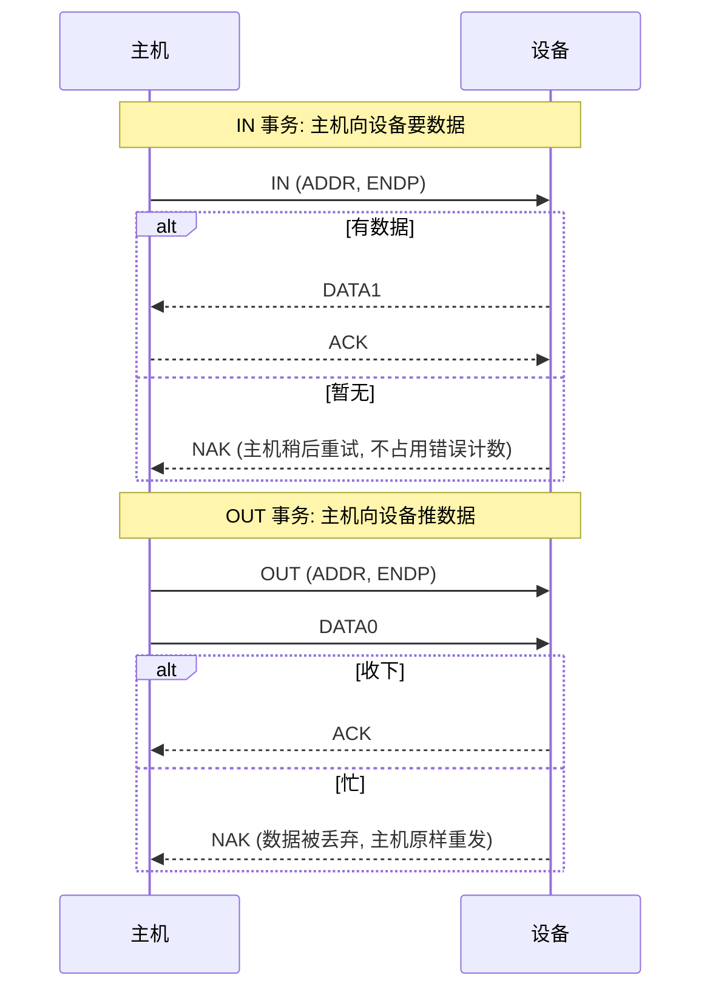

- SETUP 事务：`SETUP → DATA0(8 字节请求) → ACK`，设备**必须**接受（不允许 NAK？——规范上设备用 STALL 拒绝后续，SETUP 本身必须确认）。
- PING 事务（HS 批量 OUT 优化）：`PING → ACK/NYET`，先探路再发大包，避免白白占用带宽发一个被 NAK 的 OUT。

### 5. 帧与微帧：总线的心跳

| | FS/LS | HS |
|---|---|---|
| 帧长 | 1 ms | 125 µs 微帧 ×8 = 1 ms |
| 心跳包 | SOF（含 11 位帧号） | 每微帧一个 SOF |
| 调度粒度 | 每帧预留同步/中断带宽 | 每微帧 8 次机会 |

全设备共享这 1 ms 心跳：同步传输在中断/同步预留后，剩余带宽全给批量；批量没有任何保证，但"有空就吃"（见[四种传输类型](05-transfer-types-bandwidth.md)）。

### 6. 数据触发 (Data Toggle)：重传不重复

- 每个端点方向维护 1 位 toggle，成功收发一次在 DATA0/DATA1 间翻转；
- 接收方收到的 PID 与本地期望不符 → 视为**旧包重放**，丢弃但**仍回 ACK**（告诉对方"我知道你重发了，我已有这份数据"）；
- 控制传输特殊规则：数据阶段以 DATA1 起步，状态阶段恒为 DATA1；
- ClearFeature(ENDPOINT_HALT) 清除 STALL 时 **toggle 复位为 DATA0**——驱动清 halt 后与设备重新对齐的细节（[错误处理](09-errors-testmode.md)）。

### 7. 带宽账本（估算叶子）

一次 FS 64 字节批量 IN 事务的线上开销（位时间）：

```
Token: SYNC8+PID8+ADDR7+ENDP4+CRC5+EOP3 ≈ 35 bit
Data : SYNC8+PID8+512(64B)+CRC16+EOP3 ≈ 547 bit
HSK  : SYNC8+PID8+EOP3 ≈ 19 bit
合计 ≈ 601 bit ≈ 75 字节时间  → 协议开销 ≈ 17%
```

| 速率/类型 | 理论上限（数据） | 典型实测 |
|---|---|---|
| FS 批量 | ≈ 1.216 MB/s | ≈ 1 MB/s |
| HS 批量 | 13×512B/微帧 ≈ 53.2 MB/s | 35~45 MB/s |
| SS 批量 | ≈ 500 MB/s（Gen1 流） | 350~450 MB/s |
| FS 同步 | 1023 B/ms ≈ 1.023 MB/s | — |
| HS 同步 | 1024B×3/微帧 ≈ 24.576 MB/s | — |

### 8. 分裂事务（Split，HS 集线器服务 FS/LS 设备）

HS 集线器后面的 FS/LS 设备不能让慢速事务占住 HS 总线。主机把一次 FS 事务拆成两半，经 HS 集线器的**事务转换器 (TT)** 执行：

- `SSPLIT`（开始分裂）：主机把请求交给 TT 就走；
- TT 在 FS 总线上慢速执行真实事务；
- `CSPLIT`（完成分裂）：主机回来取结果（数据/握手），带 `ERR` 握手报告 TT 层错误。

详细机制与 TT 结构见[集线器与连接管理](02-architecture-topology.md)。


---

<!-- file: 05-transfer-types-bandwidth.md -->
---
id: 05-transfer-types-bandwidth
title: "四种传输类型、bInterval 与带宽调度"
topic: core
level: 进阶
keywords: ["control transfer", "bulk", "interrupt", "isochronous", "bInterval", "wMaxPacketSize", "polling rate 回报率", "1000 Hz", "8000 Hz", "high-bandwidth", "bandwidth budget 带宽预算"]
sources:
  - path: "10-树干-USB核心/06-四种传输类型.md"
    url: "https://github.com/tangjianfang/USBTree/blob/main/10-树干-USB核心/06-四种传输类型.md"
  - path: "10-树干-USB核心/13-总线带宽与调度计算.md"
    url: "https://github.com/tangjianfang/USBTree/blob/main/10-树干-USB核心/13-总线带宽与调度计算.md"
spec_refs: ["USB 2.0 Specification ch.5, §9.6.6"]
related: ["04-packets-transactions", "06-descriptors", "12-hid-devices"]
usbtree_commit: c987a96
generated: 2026-11-27
---

# 四种传输类型、bInterval 与带宽调度

> 层级 进阶 · 主题 `core` · 相关：[包格式、PID、事务、帧与 Data Toggle](04-packets-transactions.md)、[标准描述符字段全表](06-descriptors.md)、[HID 典型设备：键盘、鼠标、消费控制、手柄、触控、跨传输、完整描述符](12-hid-devices.md)

## 核心事实 Key Facts

> 由维护者整理并与规范核对；与下方 USBTree 原文冲突时以本节为准。

| 类型 | 带宽保证 | 时延保证 | 重传 | wMaxPacketSize LS / FS / HS / SS |
|---|---|---|---|---|
| Control | 保留份额 | 无 | 有 | 8 / 8,16,32,64 / 64 / 512 |
| Bulk | 无 | 无 | 有 | — / 8–64 / 512 / 1024（burst ≤16） |
| Interrupt | 每周期 1 次（HS 可 1–3 事务/微帧） | ≤ 周期 | 有 | ≤8 / ≤64 / ≤1024 / ≤1024 |
| Isochronous | 预留 | 每帧/微帧 | 无 | — / ≤1023 / ≤1024×3 / ≤1024 |

bInterval 语义：

| 速率/类型 | 解释 | 范围 | 最高轮询率 |
|---|---|---|---|
| LS 中断 | 帧数（ms），实际主机多按 ≥10 ms 处理 | 10–255 | ~100 Hz |
| FS 中断 | 帧数（ms） | 1–255 | **1000 Hz**（bInterval=1） |
| FS 同步 | 2^(bInterval−1) 帧 | 1–16 | 1000 Hz |
| HS 中断/同步 | 2^(bInterval−1) 微帧 | 1–16（125 µs – 4.096 s） | **8000 Hz**（bInterval=1） |
| SS 中断/同步 | 同 HS | 1–16 | 8000 Hz |

- HS 高带宽：wMaxPacketSize bit12:11 = 每微帧附加事务数（0–2，即 1–3 个事务）。
- 规则：USB 2.0 周期性传输（中断+同步）最多占 FS 帧 90% / HS 微帧 80%。
- 鼠标回报率：全速中断 bInterval=1 即 1 ms = 1000 Hz（全速上限）；高速 bInterval=1 为 125 µs = 8000 Hz，bInterval=4 为 8×125 µs = 1 ms = 1000 Hz。高带宽（每微帧 2~3 个事务）只增加每微帧字节数，且要求 bInterval=1。

## 原文：06-四种传输类型

> Source: [10-树干-USB核心/06-四种传输类型.md](https://github.com/tangjianfang/USBTree/blob/main/10-树干-USB核心/06-四种传输类型.md)

主机与设备约定"怎么传"只有四种选项，端点在描述符中声明自己属于哪种（[端点描述符 bmAttributes](06-descriptors.md)）。四种类型是**可靠性 × 时延 × 带宽保证**三角的不同折中：

| 传输类型 | 带宽保证 | 时延保证 | 可靠性 | 典型应用 |
|---|---|---|---|---|
| 控制 Control | 保留份额（EP0） | 无 | 有重传 | 枚举、配置、类请求——一切设备的起点 |
| 批量 Bulk | 无（"有空就传"） | 无 | 有重传，零差错 | U 盘、串口、网卡 |
| 中断 Interrupt | 有（每 interval 保证一个事务） | 有（≤ interval） | 有重传 | 键鼠、手柄、传感器、通知 |
| 同步 Isochronous | 有（独占带宽） | 有（每帧/微帧） | **无重传**，容忍丢包 | 摄像头、音频 |

### 1. 控制传输 (Control Transfer)

唯一被规范详细规定**格式**的传输——三个阶段：

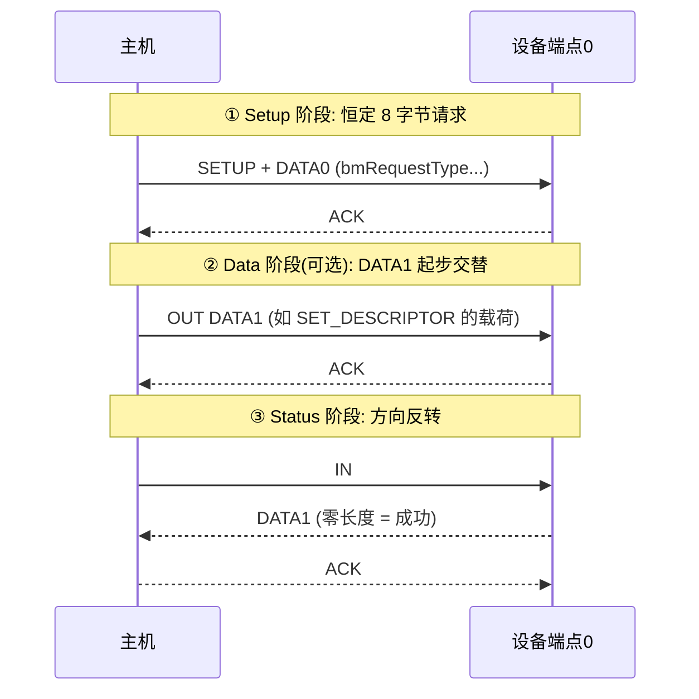

- 端点 0 最大包长：LS 8；FS 8/16/32/64；HS 64；SS 512。USB 2.0 及更早 `bMaxPacketSize0` 直接写字节数，仅 SuperSpeed 写指数 0x09（见[描述符详解](06-descriptors.md)）；
- 设备拒绝请求 → 数据/状态阶段回 **STALL**（控制 STALL 在收到下一个 SETUP 时自动清除，这是它与其他端点 STALL 的区别）；
- 作用：**枚举（[下一叶](06-descriptors.md)）+ 标准请求 + 类请求**（各设备类枝干大量使用，如 HID 的 SET_REPORT）。

### 2. 批量传输 (Bulk Transfer)

- 目标：在"不影响同步/中断预留"的剩余带宽里尽快搬完数据，且**保证数据正确**（CRC + 重传 + toggle 去重）；
- 无带宽/时延承诺：总线空闲时独吃，繁忙时可能每毫秒只抢到几个事务；
- 端点最大包长：FS 64；HS 512（LS 无批量）；
- HS 专有的 **PING/NYET 流控**：设备说 NYET 后，主机下次先发 PING 探测，得到 ACK 才真正发 OUT——避免大包白跑一趟；
- 实战语义：**批量可靠 ≠ 及时**。U 盘拷贝时键鼠卡顿，就是调度上批量挤占的直观表现（实际上是主机调度策略，协议保证中断优先）。

### 3. 中断传输 (Interrupt Transfer)

- 名字里的"中断"指**主机保证以不超过 bInterval 的周期轮询该端点**——设备挂起中断、主机软件侧产生事件，本质仍是轮询；
- 用最小的事务搬运小数据：键鼠报告几字节到几十字节；
- 端点最大包长：LS 8；FS 64；HS 1024；
- **bInterval 语义**（重要且易错）：

| 速率/类型 | bInterval 含义 |
|---|---|
| LS 中断 | 帧数，单位 1 ms；合法 10~255（最快约 100 Hz） |
| FS 中断 | 帧数，单位 1 ms；合法 1~255。bInterval=1 即 1 ms = **1000 Hz**，这是全速中断的上限 |
| FS 同步 | 2^(bInterval−1) 个帧（1 ms）；bInterval 1~16，即 1 ms~32.768 s |
| HS 中断/同步 | 2^(bInterval−1) × 125 µs；bInterval **1~16**，即 125 µs~**4.096 s** |
| SS 中断/同步 | 与高速相同：2^(bInterval−1) × 125 µs，bInterval 1~16（125 µs~4.096 s） |

- 错误重试与批量相同（ACK/NAK/重传），**保证送达**；
- 鼠标回报率就是这条轮询上限（见[鼠标详解](12-hid-devices.md)）：全速中断 bInterval=1 为 1 ms（1000 Hz）；高速 bInterval=1 为 125 µs（8000 Hz），bInterval=4 为 2^(4−1)×125 µs = 1 ms（1000 Hz）。1000 Hz 用全速端点即可，不必是高速 bInterval=1。

>  勘误：此前把高速中断写成「1~16 微帧，即 125 µs~256 ms」，并把 1000 Hz 鼠标解释成「HS 指数取 1（125 µs）再加微帧内多次事务」。USB 2.0 spec §9.6.6：全速/高速同步与高速中断的 bInterval 取 1~16，用作 2^(bInterval−1) 的指数；周期见 §5.6.4（同步）与 §5.7.4（中断）。高速单位是 125 µs 微帧，所以上限是 2^15 × 125 µs = **4.096 s**，不是 16 个微帧，也不是 256 ms。USB 3.2 对 Enhanced SuperSpeed 中断/同步端点用同一公式（bInterval 1~16，单位 125 µs）。全速中断的 bInterval 则是毫秒数（1~255），bInterval=1 就是 1000 Hz。微帧内多次事务（高带宽，`wMaxPacketSize` bit12:11）只增加每微帧的字节数，而且高带宽端点必须 bInterval=1（§5.7.4），它不会把 125 µs 变成 1 ms。

### 4. 同步传输 (Isochronous Transfer)

- 目标：**每帧准时交付**（实时流丢不起等不起），代价是放弃重传；
- 无握手包：接收方不回 ACK/NAK，CRC 错误的数据也交付上层（上层自行插值/丢帧）；
- 带宽在配置时预留：FS ≤ 1023 B/帧；HS ≤ 1024 B/事务 ×(1~3 事务/微帧)（高带宽，wMaxPacketSize 的 bit12:11 声明事务数）；
- 端点对 (IN+OUT) + 可选反馈端点构成音频时钟闭环（异步音频为什么准，见 [UAC 概述](17-uac.md)）；
- 视频流同理：UVC 在同步与批量之间做选择（[UVC 详解](16-uvc.md)）。

### 5. 带宽预算（每帧/微帧怎么分）

HS 微帧（125 µs）的典型账本：

```
总预算: 8 个事务时隙/微帧
同步预留: 已配置的同步端点(最多 3 事务×1024B)
中断预留: 各中断端点按 2^(bInterval-1) 的节拍占位
剩余时间: 全部让给批量(每微帧理论最多 13 个 512B 批量事务)
```

FS 帧（1 ms）同理。设计启示：
1. 设备端点越多、间隔越密，留给批量的越少——多接口复合设备要算总账；
2. 同步端点声明多少主机就**预留**多少，声明过大 = 永久浪费（配置描述符审查项）。

### 6. 选型决策表

| 你的需求 | 选择 |
|---|---|
| 命令/状态/配置 | 控制传输（端点 0） |
| 大块数据、不计时延 | 批量 |
| 小数据、周期性、要时延上限 | 中断 |
| 实时流（音视频） | 同步（或 HS 批量承载压缩流，如部分 UVC/UAS 场景） |

## 原文：13-总线带宽与调度计算

> Source: [10-树干-USB核心/13-总线带宽与调度计算.md](https://github.com/tangjianfang/USBTree/blob/main/10-树干-USB核心/13-总线带宽与调度计算.md)

> 高速侧对照: [../40-枝干-高速演进/01-USB3x与SuperSpeed.md](30-usb3-superspeed.md)
> 规范原文缓存索引: [../80-参考资料/README.md](92-spec-references.md)

本叶把 [06-四种传输类型](05-transfer-types-bandwidth.md) 里"定性"的带宽说法落到"逐位"计算上：一个事务到底占多少位时间、一帧能塞多少事务、1.216 MB/s 与 53.248 MB/s 这两个经典数字是怎么算出来的。所有带宽数值表均取自 USB 2.0 规范（2025-06-03 修订版）第 5 章（本地缓存 `80-参考资料/usb-core/USB2.0-Specification.zip` 内 `usb_20.pdf`），出处以"USB 2.0 spec §x.y"标注；推导过程为笔者按规范字段逐位累加。

### 1. 三个尺度：位时间、帧、微帧

| 信号速率 | 1 位时间 (bit time) | 帧结构 | 每帧位时间 |
|---|---|---|---|
| 低速 LS 1.5 Mb/s | 666.67 ns | 1 ms 帧 | —（LS 事务寄生在 FS 帧内） |
| 全速 FS 12 Mb/s | 83.33 ns | 1 ms 帧 | 12,000 |
| 高速 HS 480 Mb/s | 2.0833 ns | 125 µs 微帧 ×8 | 60,000 |

规范口径（USB 2.0 spec §11.2.2）：

- 帧间隔标称值 = **12,000 个全速位时间**；集线器帧定时器允许范围 11,958~12,042 位（即 **±42 位**，用于容纳主机与 hub 的时钟量化/抖动）。
- 高速侧同理：125 µs × 480 Mb/s = 60,000 个高速位时间，每 1 ms 帧含 8 个微帧（SOF 每微帧一个）。

> 注意：网上常见"FS 帧有 12,500 个位时间"的说法**不是规范值**——12 Mb/s × 1 ms 只有 12,000 位。正确算法是 12,000 减去 SOF 开销与位填充余量后得到可用预算（见下节）。

#### 1.1 帧预算逐位核算（FS）

一帧内不搬"用户数据"的固定开销：

| 项目 | 位数 | 说明 |
|---|---|---|
| 帧总长 | 12,000 | 12 Mb/s × 1 ms（USB 2.0 spec §11.2.2） |
| SOF 事务 | ≈ 40 | SYNC 8 + PID 8 + 帧号 11 + CRC5 5 = 32 位，加 EOP（SE0 2 位 + J 1 位）与发送翻转余量 |
| 帧定时误差 | ≤ 84 | ±42 位（hub 帧定时器公差，同 §11.2.2） |
| 位填充余量 | ≈ 12~120 | 平均膨胀 <1%（最坏远高于此，取决于数据图案；规范各带宽表均**未计入**位填充，见各表原注） |
| **可用于事务** | **≈ 11,800~11,900** | 工程预算口径（推导值，非规范值） |

高速微帧做同样的账：60,000 位减去 SOF（HS SYNC 为 32 位，SOF 事务 ≈ 32+8+11+5+8(EOP) ≈ 64 位）与位填充，可用 ≈ 59,800 位以上。

### 2. 单事务开销：逐位累加

#### 2.1 包级分量

| 分量 | 位数（FS/HS） | 位数（LS） |
|---|---|---|
| SYNC | FS 8 / HS 32 | 按规范开销口径折算 |
| PID | 8 | 8 |
| 令牌地址区 | ADDR 7 + ENDP 4 + CRC5 5 = 16 | 同 16（但按 LS 位时间计时变长） |
| 数据 CRC | CRC16 = 16 | 16 |
| EOP | FS：SE0 2 位 + J 1 位；HS：8 位 | SE0 1 个 LS 位 + J 1 个 LS 位（USB 2.0 spec §7.1.7.4.1） |

LS 的 EOP 与 SYNC 都以低速位时间定义（1 LS 位 = 8 个 FS 位时间），再叠加前置 PRE 包与 hub 重定时，因此**同一个事务在 LS 下开销字节更多**——这就是规范把 LS 中断事务开销定为 19 字节、而 FS 只有 13 字节的原因（USB 2.0 spec §5.7.4 表 5-6/5-7）。

#### 2.2 规范口径的单事务/单传输开销总表

规范第 5 章各表给出的"协议开销"已包含 SYNC、PID、地址+CRC5、CRC16 与包间延迟，**不含位填充**。四个速率/类型的组合汇总（出处为各表原注）：

| 传输类型 | LS | FS | HS | 出处（USB 2.0 spec） |
|---|---|---|---|---|
| 控制（按"一次传输"计，含 SETUP 数据 8 B） | 63 B（表 5-1） | 45 B（表 5-2） | 173 B（表 5-3） | §5.5.4 |
| 中断（每事务） | 19 B（表 5-6） | 13 B（表 5-7） | 55 B（表 5-8） | §5.7.4 |
| 批量（每事务） | — | 13 B（表 5-9） | 55 B（表 5-10） | §5.8.4 |
| 同步（每事务） | — | 9 B（表 5-4） | 45 B（表 5-5） | §5.6.3 |

以 FS 批量 64 B 事务为例手工核一遍 13 字节的来历：

```text
令牌包:  SYNC(8) + PID(8) + ADDR(7) + ENDP(4) + CRC5(5)      = 32 bit = 4 B
数据包:  SYNC(8) + PID(8) + DATA(64×8) + CRC16(16)            = 544 bit = 68 B
握手包:  SYNC(8) + PID(8)                                     = 16 bit = 2 B
包间延迟/EOP 余量（三次包边界）                                ≈ 3 B
合计: 4 + 68 + 2 + 3 = 77 B，其中净载荷 64 B → 开销 13 B ✓（与表 5-9 一致）
```

同步事务没有握手包，所以 FS 开销只有 9 B（少 1 个 SYNC+PID 与 2 B 包间延迟）；HS 把"包间延迟"放大为 3×(1+11) 字节（8 位 EOP + 至少 88 位总线翻转，USB 2.0 spec §7.1.18/表 5-10 原注），故 HS 批量开销 55 B、同步 45 B、控制 173 B（三次事务 + SETUP 数据 8 B）。

### 3. 批量带宽推导：1.216 MB/s 与 53.248 MB/s

#### 3.1 全速：每帧最多事务数 → 1.216 MB/s

```text
每事务位时间      = (13 B 开销 + 64 B 数据) × 8 = 616 bit
每帧事务数        = 12,000 ÷ 616 = 19.48 → 取整 19（余 496 bit，装不下第 20 笔）
每秒事务数        = 19 × 1,000 帧/s
带宽              = 19 × 64 B × 1,000 = 1,216,000 B/s ≈ 1.216 MB/s
帧占用率          = 19 × 616 / 12,000 ≈ 97.5%
```

与 USB 2.0 spec 表 5-9 完全一致（64 B 载荷行：Max Transfers = 19，1,216,000 B/s）。这就是"全速批量上限 1.216 MB/s"的全过程。同理按更小载荷推：8 B → 107 笔/帧 → 107 kB/s；32 B → 33 笔 → 1.056 MB/s（表 5-9）。

#### 3.2 高速：微帧同理 → 53.248 MB/s

```text
每事务位时间      = (55 B 开销 + 512 B 数据) × 8 = 4,536 bit
每微帧事务数      = 60,000 ÷ 4,536 = 13.2 → 13
带宽              = 13 × 512 B × 8,000 微帧/s = 53,248,000 B/s ≈ 53.248 MB/s
微帧占用率        = 13 × 4,536 / 60,000 ≈ 98.3%
```

与表 5-10 的 512 B 行（Max Transfers = 13，53,248,000 B/s）一致。注意三点：

- 这是**单端点**吞吐上限；微帧理论毛速率是 60,000,000 B/s（表 5-10 Max 行），批量永远只能"吃剩余"。
- HS 批量 OUT 必须实现 PING 流控（USB 2.0 spec §5.8.4、§8.5.1）：NYET/PING 握手会额外挤占非周期窗口。
- 批量没有带宽保证：同步/中断/控制排完之后才轮到它（§5.8.4）。

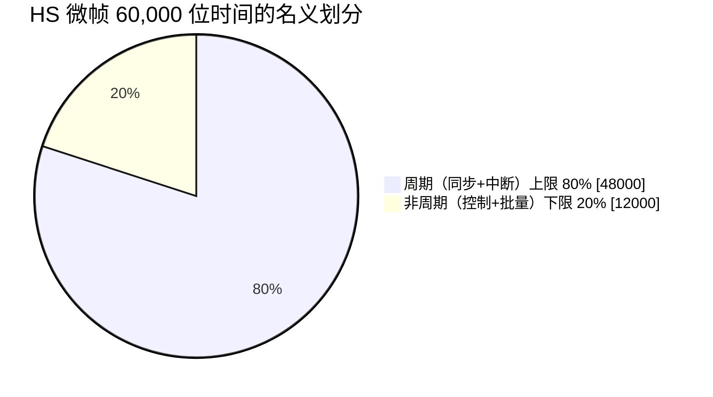

### 4. 同步传输预算

| 速率 | 单事务载荷上限 | 单事务开销 | 每 (微)帧预算 | 极限速率 | 出处 |
|---|---|---|---|---|---|
| FS | 1,023 B（端点级） | 9 B | (1023+9)×8 = 8,256 bit → **1 笔/帧** | 1,023,000 B/s | USB 2.0 spec §5.6.3、表 5-4 |
| HS | 1,024 B×1/2/3（事务/微帧） | 45 B | 1 笔：(1024+45)×8 = 8,552 bit → 7 笔/微帧 → 7×1024 = 7,168 B | 57,344,000 B/s | §5.6.3、表 5-5 |

要点：

- FS 同步端点 wMaxPacketSize 最大 **1023 B**，一帧只能塞一笔 1023 B 事务（8,256 bit，剩余 3,744 bit 装不下第二笔），所以每个 FS 同步端点最多 1.023 MB/s；一帧可以给**多个**同步端点各排一笔小事务（表 5-4：1 B 载荷可排 150 笔）。
- HS 同步端点单笔 ≤1024 B；要更高带宽用**高带宽端点**（high-bandwidth）：每微帧 2~3 笔事务（DATA2/MDATA PID），单端点最高 3,072 B/微帧 = 192 Mb/s（USB 2.0 spec §5.9）。
- 整个微帧所有同步+中断合计不得超过 **80%**（HS）/ **90%**（FS 帧）的周期预算（§5.6.4、§5.7.4）。

### 5. 中断预算表

中断占用 = 事务开销 + 载荷，按 bInterval 周期性出现。规范上限（USB 2.0 spec 表 5-6/5-7/5-8 摘录）：

| 速率 | 载荷 | 每 (微)帧最多事务 | 单端点带宽 | 单笔占用（位） |
|---|---|---|---|---|
| LS | 8 B | 6/帧 | 48,000 B/s | (19+8)×8 = 216 FS 位 |
| FS | 8 B | 71/帧 | 568,000 B/s | (13+8)×8 = 168 位 |
| FS | 64 B | 19/帧 | 1,216,000 B/s | 616 位 |
| HS | 8 B | 119/微帧 | 7,616,000 B/s | (55+8)×8 = 504 位 |
| HS | 64 B | 63/微帧 | 32,256,000 B/s | 944 位 |
| HS | 512 B | 13/微帧 | 53,248,000 B/s | 4,536 位 |
| HS | 1024×1/2/3 | 6/3/2 笔 | 49,152,000 B/s（×1 时） | — |

调度口径换算（占用率 = 单笔位 ÷ 帧预算 ÷ 每帧 (微)帧数 × 频率）：

| 设备 | interval | 占用 | 计算式 |
|---|---|---|---|
| FS 键盘 8 B | 10 ms | 每帧 ≈ 1.4% × 1/10 帧 | 168 ÷ 12,000 |
| FS 鼠标 4 B | 8 ms | ≈ 1.2% × 1/8 | (13+4)×8 ÷ 12,000 |
| HS HID 8 B | 125 µs | ≈ 0.84%/微帧 | 504 ÷ 60,000 |

bInterval 规则：FS 端点可要 1~255 ms；LS 只允许 10~255 ms；HS 按 2^(bInterval-1) × 125 µs，bInterval = 1~16（USB 2.0 spec §5.7.4）。

### 6. 控制传输的保留份额

控制没有"带宽分配"请求，靠**保留时间**保底（USB 2.0 spec §5.5.4）：

| 总线 | 非周期保留 | 单笔控制传输 | 名义保障 | 计算 |
|---|---|---|---|---|
| FS/LS | 每帧 10% = 1,200 位 | LS 8 B：63+8 = 71 B = 568 位 | LS ≈ 2 笔/帧 | 1,200 ÷ 568 |
| FS/LS | 同上 | FS 8 B：45+8 = 53 B = 424 位 | FS ≈ 3 笔/帧 | 1,200 ÷ 424 = 2.8 → **3**（§5.5.4"nominal three"） |
| HS | 每微帧 20% = 12,000 位 | 64 B：173+64 = 237 B = 1,896 位 | ≈ 6.3 → **6 笔/微帧**（§5.5.4"nominally six"） | 12,000 ÷ 1,896 |

物理极限比保留份额高得多：FS 8 B 控制传输理论上可排 13 笔/帧（表 5-2，64 B 行），HS 可排 31 笔/微帧（表 5-3，64 B 行）；保留份额只是"最差情况下仍能轮到"的底座。

### 7. 调度示例：一台 HS hub 下挂 FS 键盘 + HS U 盘 + FS 音箱

**配置**：根集线器 → HS hub；hub 下挂 FS 键盘（中断 IN，8 B/10 ms）、HS U 盘（批量）、FS 音箱（同步 OUT，48 kHz/16 bit/立体声 = 192 B/ms）。FS/LS 设备挂在 HS hub 后，所有 FS 事务都要经 **split 事务**（SSPLIT/CSPLIT，USB 2.0 spec §8.4.2、§11.15~11.21）在高速上游链路上搬运。

开销估算（推导值，非规范表值）：SPLIT 令牌 = SYNC 32 + PID 8 + HUB_ADDR 7 + SC 1 + PORT 7 + S/E 2 + ET 2 = 59 位，加 EOP 8 位与包间隙 ≈ **150~200 位/次**；音箱每微帧一次 SSPLIT-OUT（带 24 B 数据）+ CSPLIT ≈ 900 位。

一张 1 ms 帧（8 个微帧）的手工时间表（U 盘在非周期窗口吃剩余）：

| 微帧 | SOF | FS 音箱（周期，每微帧） | FS 键盘（周期，10 ms 一次→本帧命中） | 控制保留（非周期） | HS U 盘（批量，吃剩余） |
|---|---|---|---|---|---|
| µf0 |  | SSPLIT-OUT 24B + CSPLIT | SSPLIT-IN（µf0）+ CSPLIT-IN 取数（µf2） | 保留 1,200 位 | 4~5 笔 512 B 批量（含 PING/NYET） |
| µf1 |  | SSPLIT-OUT + CSPLIT | — | 保留 | 4~5 笔 |
| µf2 |  | SSPLIT-OUT + CSPLIT | CSPLIT-IN：DATA0/1（8 B）或 ERR | 保留 | 4~5 笔 |
| µf3~µf7 |  | SSPLIT-OUT + CSPLIT ×5 | — | 保留 | 各 4~5 笔 |

核算：音箱 ≈ 900 × 8 = 7,200 位/帧（≈12%，计入周期预算）；键盘每 10 帧多花约 700 位（可忽略）；周期合计仍远低于 80% 上限；U 盘在每微帧剩余 ~4,000 位内搬 4~5 笔 512 B，实际吞吐 ≈ 16~20 MB/s（对 U 盘而言闪存本身才是瓶颈）。若把音箱换成 1023 B 的 FS 同步端点，仅它一个就要 8,256 位/帧，周期预算立刻紧张——这就是端点 wMaxPacketSize 要在配置阶段被调度器检查的原因（§5.6.3）。

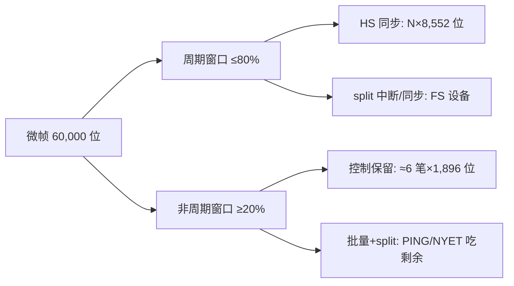

### 8. 结结论：设计时留多少余量

| 预算项 | FS/LS | HS | 出处（USB 2.0 spec） |
|---|---|---|---|
| 周期（同步+中断）上限 | 每帧 90% | 每微帧 80% | §5.6.4 / §5.7.4 |
| 非周期（控制+批量）下限 | 每帧 10% | 每微帧 20% | §5.5.4 |
| 控制名义保障 | ≈3 笔/帧 | ≈6 笔/微帧 | §5.5.4 |
| 批量 | 吃剩余 | 吃剩余 | §5.8.4 |
| 位填充 | 各带宽表均未计入 | 同左 | 表 5-1~5-10 原注 |

工程经验（推导建议，非规范条款）：

1. **同步先行、留死账**：同步端点的带宽在配置时一次锁定，按"最坏位填充 + split 开销"预留，不要按平均值排。
2. **周期预算别贴 80% 上限**：split 事务的实际开销是直连 FS 的 2~4 倍（SSPLIT+CSPLIT 两趟），建议周期总占用设计在 60~70% 以内。
3. **控制/批量至少保 20%**：与规范下限一致即可，批量天然吃剩余；但注意 PING/NYET 与 ERR 重试会吃掉非周期窗口。
4. **校核单端点极限**：FS 批量 1.216 MB/s、HS 批量 53.248 MB/s、HS 同步 57.344 MB/s、高带宽端点 192 Mb/s——需求超过这些数字时只能改拓扑或升级速率（[../40-枝干-高速演进/01-USB3x与SuperSpeed.md](30-usb3-superspeed.md)）。


---

<!-- file: 06-descriptors.md -->
---
id: 06-descriptors
title: "标准描述符字段全表"
topic: core
level: 进阶
keywords: ["device descriptor 设备描述符", "configuration descriptor", "interface descriptor", "endpoint descriptor", "string descriptor", "IAD", "BOS", "device qualifier", "bMaxPacketSize0", "wTotalLength", "bmAttributes", "bMaxPower"]
sources:
  - path: "10-树干-USB核心/07-描述符详解.md"
    url: "https://github.com/tangjianfang/USBTree/blob/main/10-树干-USB核心/07-描述符详解.md"
spec_refs: ["USB 2.0 Specification §9.5–9.6", "USB 3.2 Specification §9.6", "IAD ECN"]
related: ["07-enumeration-requests", "11-hid-core", "14-cdc"]
usbtree_commit: c987a96
generated: 2026-11-27
---

# 标准描述符字段全表

> 层级 进阶 · 主题 `core` · 相关：[枚举流程、Setup 包与标准请求](07-enumeration-requests.md)、[HID 核心：类描述符、报告描述符 Item、Usage、类请求](11-hid-core.md)、[CDC：ACM 虚拟串口、ECM/NCM/RNDIS 网络、请求与通知全表](14-cdc.md)

## 核心事实 Key Facts

> 由维护者整理并与规范核对；与下方 USBTree 原文冲突时以本节为准。

描述符类型码 bDescriptorType：

| 值 | 描述符 | 长度 |
|---|---|---|
| 0x01 | Device | 18 |
| 0x02 | Configuration | 9（+ wTotalLength 子树） |
| 0x03 | String | 可变，UTF-16LE；索引 0 = LANGID 列表（0x0409 en-US） |
| 0x04 | Interface | 9 |
| 0x05 | Endpoint | 7（SS 后跟 SS Endpoint Companion 0x30，6 B） |
| 0x06 | Device Qualifier | 10 |
| 0x07 | Other Speed Configuration | 9 |
| 0x0B | Interface Association (IAD) | 8 |
| 0x0F | BOS | 5 + 能力描述符 |
| 0x10 | Device Capability | 可变（0x02 USB 2.0 Extension/LPM，0x03 SS USB，0x05 Platform：MS OS 2.0 / WebUSB） |
| 0x21 / 0x22 / 0x23 | HID / Report / Physical（类描述符） | |
| 0x24 / 0x25 | CS_INTERFACE / CS_ENDPOINT（CDC/UAC/UVC 类特定） | |

Device Descriptor（18 B）：bLength(1)=0x12, bDescriptorType(1)=0x01, bcdUSB(2), bDeviceClass(1), bDeviceSubClass(1), bDeviceProtocol(1), bMaxPacketSize0(1), idVendor(2), idProduct(2), bcdDevice(2), iManufacturer(1), iProduct(1), iSerialNumber(1), bNumConfigurations(1)。多字节字段小端。

- bMaxPacketSize0：**USB 2.0 及以下为字节数**（LS 8；FS 8/16/32/64；HS 64）；**USB 3.x SuperSpeed 为 2 的指数**，固定 0x09 表示 2^9 = 512。
- bcdUSB：0x0200 = USB 2.0；0x0201/0x0210 = 支持 BOS（LPM、MS OS 2.0 平台能力需要）；0x0300/0x0320 = USB 3.x。
- Configuration bmAttributes：D7 必须 1，D6 Self-powered，D5 Remote Wakeup；bMaxPower 单位 2 mA（USB 2.0）/ 8 mA（SS）。
- Endpoint bmAttributes bit1:0：00 Control / 01 Isochronous / 10 Bulk / 11 Interrupt；同步端点 bit3:2 同步类型（异步/自适应/同步），bit5:4 用途（数据/反馈/隐式反馈）。
- USB 2.0 spec Table 9-8 / §5.5.3 与 USB 3.2 spec §9.6.1（Table 9-11）对 bMaxPacketSize0 的编码不同，读描述符时必须先看 bcdUSB 与当前速率，不能把 0x09 当成 9 字节。

## 原文：07-描述符详解

> Source: [10-树干-USB核心/07-描述符详解.md](https://github.com/tangjianfang/USBTree/blob/main/10-树干-USB核心/07-描述符详解.md)

### 1. 描述符：设备的"自我介绍文本"

设备把自身结构编码为一串结构化数据（描述符，Descriptor），主机通过标准请求逐级读取。这是即插即用的根基：**主机驱动不需要认识设备，只需要读它的自我描述**。

层级嵌套关系（俄罗斯套娃）：

```
设备描述符 (Device)
└── 配置描述符 (Configuration) ×N
    └── 接口描述符 (Interface) ×M        ← 功能所在（类代码写在这里）
        ├── (类特定描述符, 如 HID 报告)   ← 各设备类枝干的入口
        └── 端点描述符 (Endpoint) ×K      ← 真正传数据的端点
        └── 字符串描述符 (String, 由索引引用)
```

读取时嵌套展开：读配置描述符头部 9 字节得到 wTotalLength，再一次性读全（含所有接口/端点）。

### 2. 设备描述符 (bDescriptorType=0x01, 18 字节)

| 偏移 | 字段 | 长度 | 含义与要点 |
|---|---|---|---|
| 0 | bLength | 1 | 0x12 |
| 1 | bDescriptorType | 1 | 0x01 |
| 2 | bcdUSB | 2 | 规范版本 BCD，如 0x0200、0x0210（LPM）、0x0300/0x0320 |
| 4 | bDeviceClass | 1 | 设备级类代码：0x00=在接口级声明（最常见）；0x09=集线器；0xEF=Misc（复合/IAD）；0x02=CDC（特殊：类在设备级） |
| 5 | bDeviceSubClass | 1 | 同上 |
| 6 | bDeviceProtocol | 1 | 如 HS 设备 0x01=单 TT 集线器、0x02=多 TT |
| 7 | bMaxPacketSize0 | 1 | 端点 0 最大包。USB 2.0 及更早为**字节数**：只允许 8/16/32/64（HS 必须 64）。仅 USB 3.x 在 SuperSpeed（Gen X）运行为**指数**：0x09 = 2^9 = 512 |
| 8 | idVendor | 2 | VID，USB-IF 分配 |
| 10 | idProduct | 2 | PID，厂商自定义 |
| 12 | bcdDevice | 2 | 设备版本号（固件升级时递增它，驱动可据此区分） |
| 14 | iManufacturer / iProduct / iSerialNumber | 3 | 字符串索引（0=无；**iSerialNumber 非零时同一 VID/PID 靠序列号区分多台**） |
| 17 | bNumConfigurations | 1 | 配置数 |

实例（某全速鼠标）：

```
12 01 00 02 00 00 00 40 41 23 01 00 00 01 01 02 00 01
│  │  │─│  │  │  │  │─│─ │─│─ └┬┘ └┬┘ └┬┘ │  │  │  └ 1 个配置
│  │  │ │  │  │  │  │ │ │ │ │   │   │   │  │  └ 产品名=串2
│  │  │ │  │  │  │  │ │ │ │ │   │   │   └ 厂商=串1, 序列号=无(0)
│  │  │ │  │  │  │  │ └─┴─┴─┘   │   └ bcdDevice=0x0100
│  │  │ │  │  │  │  └ VID=0x2341, PID=0x0001
│  │  │ │  │  │  └ 端点0 = 64 字节
│  │  │ │  │  └ 设备协议/子类 = 0
│  │  │ │  └ 设备类 = 0 (类在接口级)
│  │  │ └ USB 2.00
│  │  └ 类型 0x01
│  └ 长度 18
```

>  勘误：此前把 `bMaxPacketSize0` 写成「唯一以 2^n 编码而非直接数值的字段」，对 USB 2.0 及更早不成立。USB 2.0 spec Table 9-8：该字段就是端点 0 最大包的**字节数**，合法值只有 8、16、32、64；高速设备必须为 64（§5.5.3）。只有在 SuperSpeed / Gen X 运行时才改成指数——USB 3.2 spec §9.6.1（Table 9-11）：`bMaxPacketSize0` 用作 2^bMaxPacketSize0 的指数，Gen X 唯一合法值 **09H**，表示 512 字节。上例 `0x40` 是全速设备的字节数，不是指数。

### 3. 配置描述符 (0x02, 头部 9 字节)

| 偏移 | 字段 | 要点 |
|---|---|---|
| 0/1 | bLength / bDescriptorType | 9 / 0x02 |
| 2 | wTotalLength | **配置+全部接口+全部端点+类特定描述符的总长**，主机据此一次性读取整包 |
| 4 | bNumInterfaces | 接口数 |
| 5 | bConfigurationValue | SET_CONFIGURATION 的参数（多配置设备如"固件升级配置/正常配置"） |
| 6 | iConfiguration | 字符串索引 |
| 7 | bmAttributes | bit7=1(必须，历史保留)；bit6=自供电；bit5=支持远程唤醒；bit4~0 保留 |
| 8 | bMaxPower | **单位 2 mA**：500 mA 写 0xFA=250——常被乘错的字段（[合规](51-compliance-security.md)常见不合规点） |

### 4. 接口描述符 (0x04, 9 字节) —— 功能的户口本

| 偏移 | 字段 | 要点 |
|---|---|---|
| 4 | bInterfaceNumber | 接口编号（0 起） |
| 5 | bAlternateSetting | **备用设置**：同号接口的多套端点方案（带宽换挡，典型：UVC 零带宽 Alt0 / 常速 Alt1） |
| 6 | bNumEndpoints | 本设置的端点数（不含端点 0） |
| 7 | **bInterfaceClass** | 类代码——主机按它挑类驱动（[设备类索引](10-class-index.md)） |
| 8 | bInterfaceSubClass | 子类 |
| 9 | bInterfaceProtocol | 协议（如 HID 的 Boot 协议位） |
| 9 | iInterface | 字符串索引 |

类代码速查：0x01 音频、0x02 CDC 控制、0x03 HID、0x06 图像(PTP)、0x07 打印机、0x08 MSC、0x09 集线器、0x0A CDC 数据、0x0B 智能卡、0x0E 视频、0xE0 无线控制器(蓝牙)、0xEF Misc、0xFF 厂商自定义。

### 5. 端点描述符 (0x05, 7 字节)

| 偏移 | 字段 | 要点 |
|---|---|---|
| 2 | bEndpointAddress | bit7=方向(IN=0x80)，bit3~0=端点号 |
| 3 | bmAttributes | bit1~0：00 控制 / 01 同步 / 10 批量 / 11 中断；bit5~3 是同步类型（同步端点专用） |
| 4 | wMaxPacketSize | bit10~0=包长；**bit12~11 仅 HS 同步端点**：每微帧附加事务数（1/2/3 次） |
| 6 | bInterval | 轮询间隔，语义随速率与传输类型变（换算表见[四种传输类型](05-transfer-types-bandwidth.md)） |

### 6. 其它标准描述符

| 描述符 | 类型码 | 用途与要点 |
|---|---|---|
| 字符串 String | 0x03 | UTF-16LE；索引 0 是 LANGID 表（通常 0x0409 美式英语）；iSerialNumber 用于多台同型号区分与安全策略（[USBGuard](51-compliance-security.md)） |
| 设备限定 Device Qualifier | 0x06 | 描述"另一速率下我是什么样"（HS 设备必给，供回退 FS 时查询） |
| 其它速度配置 Other Speed Configuration | 0x07 | 与限定符配套的另一速率配置 |
| **IAD 接口关联** | 0x0B | 把多个接口捆成一个功能（CDC、UVC、UAC2 复合设备的必需品；避免 Windows 给每个接口单独装驱动） |
| **BOS** | 0x0F | 二进制设备对象存储：bcdUSB≥0x0201/3.x 设备必备，内含**设备能力描述符 (0x10)** 链：USB 2.0 Extension（LPM 声明）、SuperSpeed、Container ID、Platform Capability（挂 MS OS 2.0 描述符与 WebUSB）、Power Delivery 能力等 |
| OTG | 0x09 | OTG 能力声明（HNP/SRP 支持） |

类特定描述符（HID 描述符 0x21、报告 0x22、CDC 功能描述符、UVC 终端/单元……）是各枝干的正题：从[设备类索引](10-class-index.md)进入。

### 7. 描述符编码通用规则

1. **每个描述符第一个字节永远是自己的长度**，第二个字节永远是类型码——解析器靠这两字节游走；
2. 多字节字段一律**小端 (Little-Endian)**；
3. 主机第一次 GET_DESCRIPTOR(DEVICE) 时 wLength 可能只有 64（甚至 8）：设备应**截断返回**（bLength 超出 wLength 部分不发），这是设备端必须实现的语义；
4. bLength 与实际不符 → 枚举失败，主机会拒绝整个配置（[排查手册](50-debug-troubleshooting.md)症状 B）。


---

<!-- file: 07-enumeration-requests.md -->
---
id: 07-enumeration-requests
title: "枚举流程、Setup 包与标准请求"
topic: core
level: 进阶
keywords: ["enumeration 枚举", "setup packet", "bmRequestType", "GET_DESCRIPTOR", "SET_ADDRESS", "SET_CONFIGURATION", "SET_INTERFACE", "CLEAR_FEATURE", "ENDPOINT_HALT", "ZLP", "composite", "class request", "vendor request"]
sources:
  - path: "10-树干-USB核心/08-枚举流程与标准请求.md"
    url: "https://github.com/tangjianfang/USBTree/blob/main/10-树干-USB核心/08-枚举流程与标准请求.md"
spec_refs: ["USB 2.0 Specification §9.3–9.4"]
related: ["06-descriptors", "50-debug-troubleshooting", "43-device-firmware"]
usbtree_commit: c987a96
generated: 2026-11-27
---

# 枚举流程、Setup 包与标准请求

> 层级 进阶 · 主题 `core` · 相关：[标准描述符字段全表](06-descriptors.md)、[协议分析仪、抓包与枚举失败排查](50-debug-troubleshooting.md)、[设备端固件栈与 TinyUSB 实战](43-device-firmware.md)

## 核心事实 Key Facts

> 由维护者整理并与规范核对；与下方 USBTree 原文冲突时以本节为准。

Setup 包（8 B，SETUP + DATA0）：bmRequestType(1) bRequest(1) wValue(2) wIndex(2) wLength(2)。
bmRequestType：D7 方向（0 OUT/1 IN）；D6:5 类型（0 Standard/1 Class/2 Vendor）；D4:0 接收者（0 Device/1 Interface/2 Endpoint/3 Other）。

| bRequest | 名称 | 典型 bmRequestType | wValue | wIndex | wLength |
|---|---|---|---|---|---|
| 0x00 | GET_STATUS | 0x80/0x81/0x82 | 0 | 0/接口/端点 | 2 |
| 0x01 | CLEAR_FEATURE | 0x00/0x01/0x02 | 特征选择子 | 0/接口/端点 | 0 |
| 0x03 | SET_FEATURE | 0x00/0x01/0x02 | 特征选择子 | 0/接口/端点（TEST_MODE 高字节为测试号） | 0 |
| 0x05 | SET_ADDRESS | 0x00 | 地址 1–127 | 0 | 0 |
| 0x06 | GET_DESCRIPTOR | 0x80（类描述符如 HID Report 为 0x81） | 类型<<8 \| 索引 | 0 或 LANGID | 长度 |
| 0x07 | SET_DESCRIPTOR | 0x00 | 类型<<8 \| 索引 | 0 或 LANGID | 长度 |
| 0x08 | GET_CONFIGURATION | 0x80 | 0 | 0 | 1 |
| 0x09 | SET_CONFIGURATION | 0x00 | 配置值 | 0 | 0 |
| 0x0A | GET_INTERFACE | 0x81 | 0 | 接口 | 1 |
| 0x0B | SET_INTERFACE | 0x01 | 备用设置 | 接口 | 0 |
| 0x0C | SYNCH_FRAME | 0x82 | 0 | 端点 | 2 |
| 0x30 / 0x31 | SET_SEL / SET_ISOCH_DELAY | 0x00 | | | USB 3.x |

特征选择子：0 ENDPOINT_HALT（端点）、1 DEVICE_REMOTE_WAKEUP（设备）、2 TEST_MODE（设备）；USB 3.x 另有 U1_ENABLE(48)、U2_ENABLE(49)、FUNCTION_SUSPEND(0，接口)。

枚举顺序（Windows 典型）：端口复位 → [地址 0] GET_DESCRIPTOR(Device, 64) → 再次复位 → SET_ADDRESS(n) → GET_DESCRIPTOR(Device, 18) → GET_DESCRIPTOR(Config, 9) → GET_DESCRIPTOR(Config, wTotalLength) → 字符串（LANGID、序列号、产品名）→ [可选 BOS / MS OS 描述符] → SET_CONFIGURATION(1) → 类驱动加载。Linux 首次读取通常也是 64 字节。

固件规则：复位后 10 ms 内可在地址 0 响应；SET_ADDRESS 在 Status 阶段完成后才生效；GET_DESCRIPTOR 按 min(wLength, 实际长度) 返回；返回长度 < wLength 且为 wMaxPacketSize0 整数倍时补 ZLP；不支持的请求回 STALL（控制端点 STALL 在下一个 SETUP 自动清除）。

## 原文：08-枚举流程与标准请求

> Source: [10-树干-USB核心/08-枚举流程与标准请求.md](https://github.com/tangjianfang/USBTree/blob/main/10-树干-USB核心/08-枚举流程与标准请求.md)

### 1. Setup 包：8 字节定乾坤

一切标准/类/厂商请求都用 8 字节 Setup 数据承载（控制传输 Setup 阶段，恒 DATA0）：

| 偏移 | 字段 | 分解 |
|---|---|---|
| 0 | bmRequestType | D7=方向(1=IN 设备→主机)；D6~5=类型(00 标准/01 类/10 厂商/11 保留)；D4~0=接收者(00000 设备/00001 接口/00010 端点/00011 其他) |
| 1 | bRequest | 请求号（标准请求见下表） |
| 2 | wValue | 2 字节，含义随请求（如描述符类型<<8 \| 索引） |
| 4 | wIndex | 2 字节，通常接口号或端点地址 |
| 6 | wLength | 数据阶段长度（IN：设备最多发这么多；OUT：主机将发这么多） |

例：读设备描述符 = `80 06 00 01 00 00 40 00`（IN、标准、设备 / GET_DESCRIPTOR / 类型 0x01 索引 0 / LANGID 0 / 读 64 字节）。

### 2. 十一个标准请求

| bRequest | 名称 | 方向 | 接收者 | wValue | wIndex | 备注 |
|---|---|---|---|---|---|---|
| 0x00 | GET_STATUS | IN | 设备/接口/端点 | 0 | 0 或接口/端点 | 自供电/远程唤醒位；端点=HALT 位 |
| 0x01 | CLEAR_FEATURE | OUT | 同上 | 特征号 | — | 0=ENDPOINT_HALT，1=DEVICE_REMOTE_WAKEUP，2=TEST_MODE |
| 0x03 | SET_FEATURE | OUT | 同上 | 同上 | — | 唤醒授权=SET_FEATURE(REMOTE_WAKEUP) |
| 0x05 | SET_ADDRESS | OUT | 设备 | 地址 1~127 | 0 | **状态阶段完成后生效** |
| 0x06 | GET_DESCRIPTOR | IN | 设备 | 类型<<8 \| 索引 | LANGID(字符串时) | 0x01 设备/0x02 配置/0x03 字符串/0x06 限定符/0x0F BOS + 类级(如 0x22 报告) |
| 0x07 | SET_DESCRIPTOR | OUT | 设备 | 同上 | 同上 | 可选，极少用 |
| 0x08 | GET_CONFIGURATION | IN | 设备 | 0 | 0 | 返回当前配置值 |
| 0x09 | SET_CONFIGURATION | OUT | 设备 | 配置值(0=去配置) | 0 | 枚举终点，功能由此激活 |
| 0x0A | GET_INTERFACE | IN | 接口 | 0 | 接口号 | 返回当前备用设置 |
| 0x0B | SET_INTERFACE | OUT | 接口 | 备用设置 | 接口号 | 带宽换挡（UVC 零带宽切换） |
| 0x0C | SYNCH_FRAME | IN | 端点 | 0 | 端点 | 同步端点帧号同步，极少用 |

### 3. 枚举全流程（背下来）

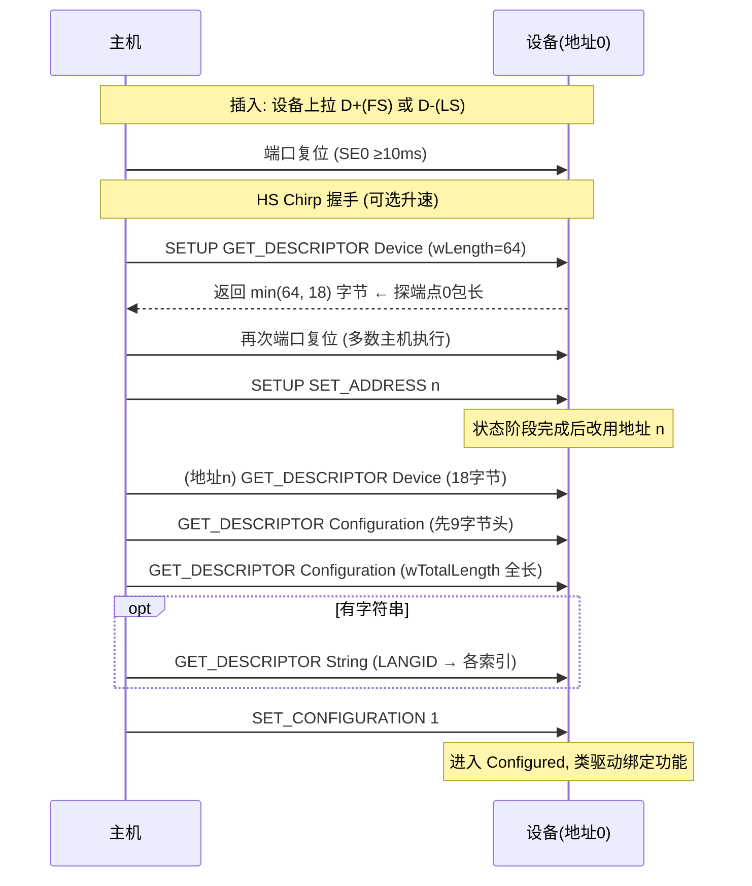

固件视角的义务清单：

1. 复位后 10 ms 内准备好在地址 0 上响应；
2. 端点 0 恒可用，SETUP 与状态阶段不得 NAK 到卡死；
3. GET_DESCRIPTOR 支持**截断返回**与类级描述符路由（0x22 报告描述符由 HID 接口应答）；
4. SET_ADDRESS 在状态阶段后切换地址；
5. 大端点 0 包长按 bMaxPacketSize0 分包发送长描述符；
6. 每个不认识的请求 → 正确地 STALL（别挂死）。

### 4. 每一步失败的典型现象

| 卡住的步骤 | 现象 | 常见根因 |
|---|---|---|
| 检测插入 | 主机毫无反应 | 仅充电线、上拉未使能、VBUS 欠压 |
| 复位/Chirp | 设备以 FS 慢速工作 | Chirp 失败，HS 回落 |
| 第一个 GET_DESCRIPTOR | "无法识别的 USB 设备" | 时钟偏差、EP0 包长声明错误 |
| SET_ADDRESS 后 | 枚举中断 | 提前/滞后切换地址 |
| 读配置 | 报描述符错误/代码 43 | wTotalLength、bLength、bNumEndpoints 不一致 |
| SET_CONFIGURATION 后 | 设备在但无功能 | 接口类代码错误、端点方向写反 |

完整故障树与工具对应见[枚举失败排查手册](50-debug-troubleshooting.md)。

### 5. 类请求与厂商请求：同一管道的延伸

- 枚举完成后，**类驱动用同一根默认管道继续发类特定请求**（bmRequestType 的类型位=01），如 HID 的 SET_REPORT(0x09)、MSC 的 GET_MAX_LUN(0xFE)、CDC 的 SET_LINE_CODING(0x20)；
- 厂商请求（类型位=10）留给私有协议，配合 WinUSB/WebUSB 在用户态直发（[WebUSB 与自定义类](19-other-classes-b.md)）；
- 接收者位决定 wIndex 语义（接口 vs 端点）——类规范里每个请求表都以此为准绳。

### 6. 复合设备 (Composite Device) 的枚举

- 单个物理设备、设备级类代码 0x00/0xEF，多个接口各自挂类驱动；
- **IAD** 把"同一功能的多个接口"（如 CDC 的控制+数据接口对）捆在一起，避免 Windows 拆开装错驱动（[描述符](06-descriptors.md)）；
- 各接口的类驱动独立 claim 各自的端点——互不越界是复合设备固件的纪律。


---

<!-- file: 08-power-management.md -->
---
id: 08-power-management
title: "电源管理：挂起、远程唤醒、LPM、U1/U2/U3"
topic: core
level: 进阶
keywords: ["suspend 挂起", "resume", "remote wakeup 远程唤醒", "selective suspend 选择性挂起", "LPM", "L1", "L2", "U0", "U1", "U2", "U3", "unit load", "bMaxPower"]
sources:
  - path: "10-树干-USB核心/10-电源管理与挂起唤醒.md"
    url: "https://github.com/tangjianfang/USBTree/blob/main/10-树干-USB核心/10-电源管理与挂起唤醒.md"
spec_refs: ["USB 2.0 Specification §7.1.7.6, §9.2.5", "USB 2.0 LPM ECN", "USB 3.2 Specification ch.7"]
related: ["06-descriptors", "21-charging-bc12-otg", "30-usb3-superspeed"]
usbtree_commit: c987a96
generated: 2026-11-27
---

# 电源管理：挂起、远程唤醒、LPM、U1/U2/U3

> 层级 进阶 · 主题 `core` · 相关：[标准描述符字段全表](06-descriptors.md)、[充电：BC 1.2、专有快充；OTG 与角色切换 HNP/SRP](21-charging-bc12-otg.md)、[USB 3.x SuperSpeed：包格式、LTSSM、定时器](30-usb3-superspeed.md)

## 核心事实 Key Facts

> 由维护者整理并与规范核对；与下方 USBTree 原文冲突时以本节为准。

| 项 | 值 |
|---|---|
| 进入挂起 | 总线空闲（无 SOF/流量）3 ms |
| 挂起电流 | ≤ 2.5 mA（USB 2.0 ECN 后；早期 500 µA） |
| 主机恢复 Resume | 主机驱动 K ≥ 20 ms，随后 LS EOP |
| 远程唤醒 | 设备挂起 ≥ 5 ms 后才可发起，驱动 K 1–15 ms；需主机先 SET_FEATURE(DEVICE_REMOTE_WAKEUP)，配置描述符 bmAttributes D5=1 |
| 单位负载 Unit Load | USB 2.0 100 mA（配置后最多 500 mA）；USB 3.x 150 mA（最多 900 mA） |
| LPM（L1） | 需 bcdUSB ≥ 0x0201 + BOS USB 2.0 Extension（bmAttributes bit1 LPM）；进出为微秒级 |
| USB 3.x 链路态 | U0 工作、U1/U2 低功耗（由 U1_ENABLE/U2_ENABLE 及超时控制）、U3 挂起 |

- Windows "USB 选择性暂停"（Selective Suspend）：HID 类驱动在空闲时请求挂起；外设"唤醒后丢首个报告/无法唤醒"多与固件 Suspend/Resume 处理或远程唤醒未授权有关。

## 原文：10-电源管理与挂起唤醒

> Source: [10-树干-USB核心/10-电源管理与挂起唤醒.md](https://github.com/tangjianfang/USBTree/blob/main/10-树干-USB核心/10-电源管理与挂起唤醒.md)

### 1. 为什么 USB 2.0 的电源管理这么"粗"

USB 2.0 把整条总线当一个整体对待：主机停发 SOF（帧起始包）就是挂起的唯一开关。设备端识别挂起的方式是**被动计时**：总线空闲 ≥ 3 ms 即进入挂起。

| 参数 | 数值 | 说明 |
|---|---|---|
| 挂起判定 | 空闲 ≥ 3 ms | 设备必须在收到最后一个包后 7 ms 内进入挂起（3ms 判定 + 裕量） |
| 挂起电流上限 | **2.5 mA**（总线供电设备） | 含远程唤醒电路 |
| 主机恢复信号 | K 态 ≥ 20 ms，随后低速 EOP | 集线器逐级转发 |
| 恢复后恢复时间 | 设备须在恢复结束后 ~10 ms 内可通信 | 固件时钟恢复要快 |
| 远程唤醒 | 设备挂起 ≥ 5 ms 后可发 1~15 ms 的 K | 且必须先获授权（见下） |

**远程唤醒授权流程**：主机在挂起前 `SET_FEATURE(DEVICE_REMOTE_WAKEUP)`（[标准请求](07-enumeration-requests.md)表）→ 设备挂起后检测到本地事件（如键盘按键）→ 驱动 K ≥ 若干 ms → 集线器逐级向上中继 → 主机回发完整恢复序列。没拿到授权就发唤醒是固件 bug。

### 2. 选择性挂起

主机可对树上任一子树单独挂起（SET_FEATURE(PORT_SUSPEND)），其余照常工作——鼠标闲置挂起、U 盘继续读写。这是操作系统"USB 选择性挂起"开关背后的机制，也是很多设备兼容性问题（挂起后唤不醒）的来源。

### 3. LPM：链路电源管理 (L1 Sleep)

USB 2.0 补充规范引入，BOS 描述符声明（USB 2.0 Extension capability）：

- 主机发 **LPM 事务**（扩展令牌包）让设备进入 **L1 Sleep**，几十微秒级进出，远快于 L2 挂起（毫秒级）；
- 设备在 L1 中仍可被快速唤醒，电流限值比 2.5 mA 宽（支持更高的 L1 电流档位，需描述符声明）；
- 意义：SS 集线器时代主机频繁进出低功耗，L1 让"挂起"从秒级事件变成微秒级动作。

### 4. USB 3.x 的链路电源状态 U0~U3

3.x 链路是两条独立实体（各方向），低功耗在**链路对之间协商**：

| 状态 | 名称 | 特征 | 进出延迟 |
|---|---|---|---|
| U0 | 正常活动 | 全速传输 | — |
| U1 | 快速待机 | 空闲短憩 | 微秒级 |
| U2 | 深度待机 | 更省电 | 几十微秒~毫秒 |
| U3 | 挂起 | 对应 2.0 挂起 | 毫秒级（LFPS 唤醒） |

- 进出 U1/U2/U3 通过 **LFPS（Low Frequency Periodic Signaling）** 脉冲握手（与链路训练共用信令通道，见[USB3x](30-usb3-superspeed.md)）；
- **Function Remote Wake**：3.x 精确到**接口级**唤醒——键盘接口唤醒，同设备的鼠标接口继续睡；实现依赖 BOS 的 SuperSpeed capability + 主机下发 FUNCTION_SUSPEND 控制请求 + **Device Notification**（"Function Wake"通知包）通知主机；
- 固件注意点：3.x 下端点挂起/恢复由链路层处理，但接口级功能挂起仍需类协议配合。

### 5. 设备端实现要点（固件叶子）

1. **时钟策略**：挂起时停 PLL/主时钟，仅留低速唤醒检测（D+/D- 边沿或 VBUS 检测）；唤醒后必须在恢复序列结束前恢复时钟（xHCI 主机恢复后立刻发令牌，时钟没起来就丢第一个包）；
2. **VBUS 检测**：自供电设备也要能感知 VBUS 掉电（总线掉电时主动进入未连接态，停止驱动上拉）；
3. **挂起电流核算**：MCU 睡眠电流 + 上拉电阻电流 + 分压网络 ≤ 2.5 mA（或声明 LPM 档位）；
4. **远程唤醒三条件**：配置了远程唤醒能力（bmAttributes bit5）+ 主机 SET_FEATURE 授权 + 挂起满 5 ms；
5. 调试技巧：挂起问题的抓包特征是"恢复序列后第一个 IN 事务无应答/超时重试"（[抓包](50-debug-troubleshooting.md)）。

### 6. 供电侧的演进（指向枝干）

| 主题 | 去处 |
|---|---|
| Type-C CC 电阻协商电流 (1.5A/3A) | [Type-C 详解](20-connectors-typec.md) |
| PD 协商 (PDO/RDO, 最高 240W) | [USB PD 协议](22-usb-pd.md) |
| BC 1.2 / 专有快充 | [BC1.2 与专有快充](21-charging-bc12-otg.md) |
| OTG / DRP 角色切换（设备变主机） | [接口形态演进](20-connectors-typec.md) |


---

<!-- file: 09-errors-testmode.md -->
---
id: 09-errors-testmode
title: "错误处理、可靠性、Test Mode 与调试模式"
topic: core
level: 深入
keywords: ["CRC", "retry 三次重试", "STALL", "babble", "timeout", "toggle resync", "PING/NYET", "TEST_MODE", "Test_J", "Test_K", "Test_SE0_NAK", "Test_Packet", "debug class"]
sources:
  - path: "10-树干-USB核心/11-错误处理与可靠性.md"
    url: "https://github.com/tangjianfang/USBTree/blob/main/10-树干-USB核心/11-错误处理与可靠性.md"
  - path: "10-树干-USB核心/12-TestMode与调试模式.md"
    url: "https://github.com/tangjianfang/USBTree/blob/main/10-树干-USB核心/12-TestMode与调试模式.md"
spec_refs: ["USB 2.0 Specification §7.1.20, §8.6, §9.4.9"]
related: ["04-packets-transactions", "51-compliance-security"]
usbtree_commit: c987a96
generated: 2026-11-27
---

# 错误处理、可靠性、Test Mode 与调试模式

> 层级 深入 · 主题 `core` · 相关：[包格式、PID、事务、帧与 Data Toggle](04-packets-transactions.md)、[USB-IF 合规认证、合规测试实操与 USB 安全](51-compliance-security.md)

## 核心事实 Key Facts

> 由维护者整理并与规范核对；与下方 USBTree 原文冲突时以本节为准。

- 主机控制器对同一事务连续 3 次错误（CRC/超时/位填充错误）后向软件报告。
- STALL：功能性停止。控制端点 STALL 在下一个 SETUP 自动清除；批量/中断端点需 CLEAR_FEATURE(ENDPOINT_HALT)，同时 toggle 复位为 DATA0（主机和设备都要复位，否则数据错位）。
- Babble：设备在帧尾（EOF1 之后）仍在发送，Hub 禁用该端口。
- TEST_MODE 选择子（SET_FEATURE(TEST_MODE)，wIndex 高字节）：0x01 Test_J、0x02 Test_K、0x03 Test_SE0_NAK、0x04 Test_Packet、0x05 Test_Force_Enable；进入后需断电/复位退出。

## 原文：11-错误处理与可靠性

> Source: [10-树干-USB核心/11-错误处理与可靠性.md](https://github.com/tangjianfang/USBTree/blob/main/10-树干-USB核心/11-错误处理与可靠性.md)

### 1. 错误从哪里来

| 层 | 错误类型 | 检测者 | 典型根因 |
|---|---|---|---|
| 电气 | 信号失真、抖动超限 | 接收端采样失败 | 线缆质量、阻抗失配、ESD |
| 编码 | 位填充错误（7 个连续 1） | SIE | 时钟偏差、干扰 |
| 校验 | CRC5/CRC16 不符 | SIE | 位错误、包损坏 |
| 时序 | 超时（无握手返回） | 发送方 | 设备忙/失联、NAK 滥用 |
| 协议 | Babble（包尾之后仍有活动） | 集线器/主机 | 设备固件 bug、包长越界 |
| 语义 | 请求非法 → STALL | 设备 | 驱动与固件状态不一致 |

### 2. 重传机制（控制/批量/中断的护城河）

- 接收方 CRC 或位填充校验失败 → **静默丢弃、不发握手**；
- 发送方等不到握手 → **超时 → 原样重发**（数据内容与 toggle 都不变）；
- 接收方看到 toggle 与期望不符 → 判定为"上次其实已成功收到的重放"→ 丢弃数据**但仍回 ACK**，让发送方推进；
- 结果：三种传输类型最终交付的数据**零丢失、零重复、零乱序**——这是批量传输能扛 U 盘大文件的核心保证。

主机侧重试上限：一般 3 次重传失败即上抛软件层错误（丢设备/复位端口），避免总线被坏设备空转占满。

### 3. 数据触发对齐 (Toggle Resync)

错误恢复后两端 toggle 可能失步，规范给了明确的复位规则：

| 场景 | 处理 |
|---|---|
| ClearFeature(ENDPOINT_HALT) 清除 STALL | **两端 toggle 复位为 DATA0** |
| 控制传输 Setup 阶段 | 数据阶段从 DATA1 开始（自动对齐） |
| SET_CONFIGURATION / SET_INTERFACE 之后 | 端点 toggle 复位为 DATA0 |

驱动/固件不一致的经典症状：设备被"卸载重装"后第一批数据全部被丢弃——多半是某一方没按规则复位 toggle。

### 4. STALL：协议层的"举手喊停"

| 类型 | 触发 | 清除方式 |
|---|---|---|
| 功能 STALL (Function Stall) | 端点自身挂起（如 MSC 介质错误） | 主机 ClearFeature(ENDPOINT_HALT) |
| 协议 STALL (Protocol Stall) | 控制请求不支持/参数非法 | 收到下一个 SETUP 自动清除 |

语义要点：
- STALL 是**状态不是流控**：NAK 才是"稍后再来"，STALL 是"不干了，需要主机介入"；
- 主机收到数据/状态阶段 STALL → 整个控制传输以错误告终，类驱动记录并继续（不卸载驱动）；
- IN 端点 STALL 后主机不该再排队请求；OUT 端点 STALL 后到达的包会被设备丢弃。

### 5. 超时与 Babble

- **超时**：FS/LS 发送方在 816 位时间（约 0.68~8.2 ms 视速率）内未收到握手即判失败；HS 用更严的时序；主机收到 NAK 不算超时（NAK 是正常流控）；
- **Babble**：包尾 EOP 之后总线仍有活动（设备发疯了）→ 集线器检测并**禁用该端口**——防止一个坏设备瘫痪整棵树；这是集线器"中继器"职责的一部分（[集线器](02-architecture-topology.md)）。

### 6. 同步传输的容错哲学

- 无握手、无重传：错误数据照常交付（音频掉一个样本人耳无感，等重传则卡顿人人有感）；
- 接收方仍查 CRC 并统计错误率（反馈给驱动做质量监控）；
- 上层容错策略：音频插值/静音替换、视频丢帧——类协议各自的业务逻辑（[UAC](17-uac.md)、[UVC](16-uvc.md)）。

### 7. HS 批量 OUT 的 PING 优化

问题：HS 批量 OUT 被 NAK 时，512 字节大包白白占了一趟微帧。
方案：设备 NYET（"这次收下了，下次先问"）→ 主机改发 **PING**（令牌+握手两拍）→ ACK 才发真正 OUT。
收益：流控开销从"每趟 512B"降到"每趟 8B"。这是 HS 对 2.0 之前的 OUT 流控浪费的修正（[包格式](04-packets-transactions.md)）。

### 8. 可靠性设计清单（工程叶子）

固件侧：
- [ ] 端点 0 永不挂死：每个请求路径都有 ACK/NAK/STALL 的明确归宿；
- [ ] CRC 硬件使能，别软件手算长包；
- [ ] toggle 状态在 STALL 清除/配置切换时复位；
- [ ] 挂起唤醒后首个事务前完成时钟恢复（[电源管理](08-power-management.md)）。

驱动/主机侧：
- [ ] 处理 -EPIPE/-EPROTO/-EOVERFLOW 等错误码的差异化恢复（清 halt vs 重新枚举）；
- [ ] 对 NAK 风暴设软件超时（设备逻辑死锁时给用户反馈）；
- [ ] 复合设备隔离故障接口，不让一个接口的 STALL 拖垮整机。

验证手段：错误注入（线缆接触不良模拟）、抓包统计 NAK 率与重传率（[抓包](50-debug-troubleshooting.md)）、[合规测试](51-compliance-security.md)的协议一致性项。

## 原文：12-TestMode与调试模式

> Source: [10-树干-USB核心/12-TestMode与调试模式.md](https://github.com/tangjianfang/USBTree/blob/main/10-树干-USB核心/12-TestMode与调试模式.md)

>  兄弟: [11-错误处理与可靠性.md](09-errors-testmode.md) · [10-电源管理与挂起唤醒.md](08-power-management.md) · [09-集线器与连接管理.md](02-architecture-topology.md)
> 规范原文缓存索引: [80-参考资料/README.md](92-spec-references.md)

协议是否正确可以靠抓包验证，但**电气波形是否合格**必须让设备发出"已知、可控、可重复"的信号，示波器/误码仪才有测量基准。USB 2.0 在规范 §7.1.20 定义了 Test Mode（测试模式），USB 3.x 用 LTSSM 的 Compliance/Loopback 状态承担同等职责；另有独立于合规测试的调试通道（Debug Descriptor / Debug Mode），用于系统最底层的固件调试。本叶汇总这三层机制。

### 1. 测试模式的定位

| 维度 | Test Mode (USB 2.0) | Compliance Mode (USB 3.x) | Debug Mode |
|---|---|---|---|
| 服务对象 | 电气合规测量 | 电气合规测量 | 软件调试 |
| 由谁发起 | 主机软件（SET_FEATURE 请求） | 测试夹具/测试仪（LFPS 图样） | 主机调试端口（EHCI/xHCI DbC） |
| 强制范围 | 所有 HS-capable 设备/Hub/主机控制器 | 所有 SuperSpeed 链路 | 可选 |
| 退出方式 | 上行口断电（power cycle） | 复位/断电 | 软件退出 |

### 2. 入口：SET_FEATURE(TEST_MODE)

设备测试模式由标准请求进入。请求字段（对照 [08-枚举流程与标准请求.md](07-enumeration-requests.md) 的 Setup 包格式）：

| 字段 | 取值 | 说明 |
|---|---|---|
| bmRequestType | 0x00 | 接收者=设备（TEST_MODE 仅对设备接收者定义），Host→Device，无数据阶段 |
| bRequest | 0x03 | SET_FEATURE |
| wValue | 0x0002 | 特性选择器 TEST_MODE = 2（Table 9-6） |
| wIndex 高字节 | 测试选择器 | Test_J=01H、Test_K=02H、Test_SE0_NAK=03H、Test_Packet=04H、Test_Force_Enable=05H |
| wIndex 低字节 | 0x00 | 必须为 0 |
| wLength | 0 | 无数据阶段 |

进入条件与行为要点（规范 §9.4.9 / §7.1.20）：

- **状态要求**：高速设备在 Default、Address、Configured 三种设备状态下都必须能接受该请求——不要求必须先完成配置（这一点常被误解为"必须配置态"）；
- 仅高速能力设备强制支持；**非高速设备不支持**（返回 STALL）；
- 无效测试选择器 → 设备以请求错误（STALL）应答；wLength 非 0 时行为未定义；
- 状态阶段完成后设备回 ACK，**测试模式切换必须在状态阶段完成后 3 ms 内完成**，且切换不得早于状态阶段（否则主机误以为请求失败）；
- **退出**：上行口的测试模式只能靠**设备断电（power cycle，含拔插）**退出——没有"软件退出"请求，这是排障时"插回设备才恢复"的原因；
- **集线器下行口**走 Hub 类请求 SetPortFeature(PORT_TEST)（§11.24.2.13），选择器同样放 wIndex 高字节，退出方式为**复位集线器**。

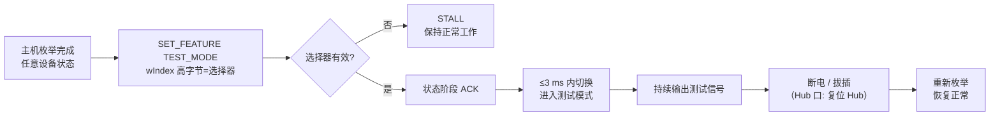

#### 2.1 集线器下行口的入口差异

集线器的下行口不能对"不存在"的设备发标准请求，改走 Hub 类请求 SetPortFeature(PORT_TEST)（规范 §11.24.2.13）：

| 字段 | 取值 | 说明 |
|---|---|---|
| bmRequestType | 0x23 | 接收者=其他（类），接收者=集线器 |
| bRequest | 0x03 | SET_FEATURE |
| wValue | 0x0015 | 端口特性选择器 PORT_TEST = 21（区别于设备级 TEST_MODE=2） |
| wIndex 低字节 | 端口号 | 1 起编的下行端口号 |
| wIndex 高字节 | 测试选择器 | 与设备级同一套取值（01H~05H，含 Test_Force_Enable） |

两类入口的行为差异总结：设备上行口进入测试模式后"断电才退"；集线器下行口则是"复位集线器才退"，且 Test_Force_Enable 只对下行口有意义（它就是为测 Hub 断开检测阈值设计的）。

### 3. 五种测试模式详解

所有模式下，设备的行为就是把上行口收发器置于指定状态并**保持**，直到退出动作：

| 模式 | 选择器 | 上行口行为 | 测量目标 |
|---|---|---|---|
| Test_J | 01H | 持续发送高速 J 状态 | D+ 线高电平驱动电平 |
| Test_K | 02H | 持续发送高速 K 状态 | D− 线高电平驱动电平 |
| Test_SE0_NAK | 03H | 进入高速接收态，持续 SE0；**对收到的任何 CRC 正确的 IN 令牌回 NAK** | 输出阻抗、低电平输出电压、负载特性、设备 Squelch（静默电平检测）灵敏度 |
| Test_Packet | 04H | 无限重复发送规范定义的固定测试包 | 上升/下降时间、眼图、抖动等全部动态波形指标 |
| Test_Force_Enable | 05H | 仅 Hub 下行口：无设备接入也强制使能（高速），上行口收到的包在该口照常转发 | Hub 断开检测阈值（改变端口负载轮询 disconnect detect 位） |

工程要点：

- Test_J/Test_K 是**直流电平**测量（驱动器强度），Test_SE0_NAK 是"静态+ stimulus/response"混合测量，Test_Packet 才是波形动态测量；
- Test_SE0_NAK 中"回 NAK"的设计让测试仪可以顺带验证设备的基本协议响应能力（通用功能测试激励）；
- 测试模式进入后设备对主机"失联"是正常现象：主机软件发完请求后不应再期待任何响应（USBHSET 类工具即按此工作）。

#### 3.1 Test_Packet：眼图与示波器校验的标准信号源

测试包内容由规范以**精确比特串**逐字段定义（规范 §7.1.20 Table 7-9，整包约 53 字节）：SYNC → DATA0 PID → 多段 0/1、交替、最长连 1 等特征序列（含刻意安排的位填充 S 标记）→ CRC-16 → EOP。设计目标是让一条包里同时覆盖：

- 高/低电平保持段（测电平与幅度）；
- 最快翻转段（测上升/下降时间与抖动）；
- 最长连 1 段（测位填充行为与时钟恢复能力）；
- 全 0 段与随机性序列（测眼图张开度）。

发送节奏：重复发送，包间隔不小于最小包间隙（§7.1.18）且**不大于 125 µs**——示波器以无限余辉叠加即可拼出眼图；USB-IF 的 SigTest 软件正是对该波形做模板比对（见第 4 节）。

#### 3.2 电气测量项与模式的对应

规范对各电气参数指定了测法（含测试负载条件），合规测试时逐一对应：

| 测量项 | 用哪个模式 | 负载/条件（规范要点） |
|---|---|---|
| 高电平驱动电压 | Test_J / Test_K | 每根数据线对地接 45 Ω 负载分别测 D+ / D− |
| 眼图、上升/下降时间、抖动 | Test_Packet | 规范图示的标准夹具，示波器余辉 + SigTest 模板 |
| 输出阻抗、低电平输出电压、负载特性 | Test_SE0_NAK | 高速接收态持续 SE0 |
| Squelch（静默检测）灵敏度 | Test_SE0_NAK | 测试仪发幅度渐变的合法包，观察设备是否响应 |
| 收发器寄生电容（芯片级） | Test_SE0_NAK | 断电态测线对地电容（die/封装各 ≤5 pF 量级指导值） |
| Hub 断开检测阈值 | Test_Force_Enable | 空载使能端口，改变负载轮询 disconnect detect 位 |

这份对应表就是 [USB-IF 合规认证](51-compliance-security.md) 电气项的底层剧本；第 6 节的 USB 3.x 机制在高速演进枝干接续同一思路。

### 4. 主机侧工具

| 工具 | 角色 | 典型用法 |
|---|---|---|
| USBHSET | 主机侧高速电气测试工具 | 通过主机控制器向目标端口发 SET_FEATURE(TEST_MODE)，配合测试夹具把端口切到 Test_J/K/SE0_NAK/Packet |
| SigTest (USB-IF) | 信号质量分析软件 | 对示波器采到的 Test_Packet 波形做眼图模板/幅度/抖动自动判定 |
| 测试夹具 (fixture) | 把主板连接器引到同轴口 | 分常规/OTG 等多种夹具，属 [USB-IF 合规认证](51-compliance-security.md) 设备清单 |

嵌入式/裸机场景没有 USBHSET 时，任何能发出上述标准请求的主机（包括另一块开发板、协议分析仪的流量注入功能）都可以进入测试模式；设备固件侧则必须实现"收到请求→状态阶段 ACK→3 ms 内切换收发器"的完整路径。

### 5. 调试描述符 (0x0A) 与 Debug Mode

Test Mode 服务于产线/实验室，真正的"开发期调试"靠独立机制——USB 2.0 Debug Device 规范（含 Debug 描述符与 Debug Mode）：

- **Debug 描述符**：类型码 `bDescriptorType = 0x0A`，声明调试能力，其中给出调试专用 **IN/OUT 端点号**（bDebugInEndpoint / bDebugOutEndpoint）；主机通过 GetDescriptor(Debug) 读取；
- **Debug Mode 进入**：主机发 SetFeature(DEBUG_MODE)（设备特性选择器 DEBUG_MODE = 6）；此后设备进入特殊状态，只有"调试从机 (debug slave)"保持工作；
- **电气概貌**：调试从机是精简收发器，挂接在 **D+ 一线**上工作，允许目标系统其余部分（主 PHY、CPU 电源域以外的大部分逻辑）处于断电或深度挂起——这正是"系统已死、还能救"的价值；两根**批量管道**用于固件日志与调试器消息的双向搬运（消息粒度与包长等细节见 USB 2.0 Debug Device 规范原文）；
- **主机侧对应物**：EHCI 的 Debug Port 能力（配合 Linux earlyprintk/dbgp 等）；xHCI 时代对应 **xHCI Debug Capability (DbC)**，以 USB 3.x 批量端点跑同样的角色（字段级细节见 xHCI 规范，此处不展开）。

对照记忆：Test Mode 是"设备向示波器单说"，Debug Mode 是"设备向另一台计算机说话"。

### 6. USB 3.x 对应机制

USB 3.x 没有 SET_FEATURE(TEST_MODE)——链路训练由 LTSSM（见 [04-USB3x包格式与LTSSM.md](30-usb3-superspeed.md)）接管，合规模式成为状态机的一部分。

#### 6.1 Compliance Mode（合规模式）

- **入口**：Polling 阶段，设备收到测试仪/夹具发出的**合规入口 LFPS 图样**（一组频率/时长与正常 Polling 不同的突发序列）后，LTSSM 转入 Compliance 状态；
- **行为**：链路持续发送合规测试图样（Compliance Pattern, CP），供测试仪做眼图、抖动、回损等测量；Gen2 下还涉及接收端均衡（CTLE 等）参数的训练与验证；
- **Compliance Pattern 概览**：规范定义 CP0～CP16 一族图样，CP0 为加扰数据图样（Gen1 眼图/抖动基础图样），CP1 起覆盖回环 BER 与 Gen2 各专用场景（逐图样的编码与用途见规范原文）；
- 与 2.0 的一致性设计：同样是"可控已知信号 + 测量判定"，只是入口从软件请求换成了 LFPS 握手。

#### 6.2 Loopback 模式

LTSSM 的 Loopback 状态：训练期间收到带 **Loopback 位**的 TS1 有序集即进入，此后把收到的数据原样回环发送。测试仪借此对 DUT 做**误码率 (BER) 测试**——先发均衡/适配图样，再切换已知图样统计误码。这是 Gen2 接收端裕量测试的基础设施之一。

#### 6.3 与 USB 2.0 测试模式对照

| 能力 | USB 2.0 | USB 3.x |
|---|---|---|
| 静态电平（J/K） | Test_J / Test_K | CP 图样中的电平保持段 + Lane Margining |
| 眼图/抖动 | Test_Packet | Compliance Mode + CP0 等 |
| stimulus/response | Test_SE0_NAK（回 NAK） | Loopback（回环 BER） |
| 入口载体 | SET_FEATURE 标准请求 | LTSSM Compliance 入口 LFPS 图样 |

### 7. 在合规认证中的位置

上述模式是 [USB-IF 合规认证](51-compliance-security.md) 中"电气信号质量"大项的全部测量载体：2.0 眼图测 Test_Packet、驱动电平测 Test_J/K、Squelch 测 Test_SE0_NAK；3.x 眼图/抖动/BER 全部经 Compliance/Loopback 完成。协议一致性项则靠抓包（[协议分析仪与抓包](50-debug-troubleshooting.md)）与标准请求序列（[枚举流程](07-enumeration-requests.md)）覆盖。

排障提示：设备"进测试模式出不来"的三个高频根因——固件在 ACK 状态阶段后忘记切换收发器（测试仪读不到图样）、把 TEST_MODE 误实现为接口/端点接收者（应 STALL 却行为怪异）、以及在测试模式中响应了本不该响应的流量。


---

<!-- file: 10-class-index.md -->
---
id: 10-class-index
title: "设备类代码索引与驱动映射"
topic: class
level: 入门
keywords: ["class code 类代码", "bDeviceClass", "bInterfaceClass", "0x03 HID", "0x08 MSC", "0x0E UVC", "0x01 Audio", "0x02 CDC", "0xEF misc", "0xFF vendor", "0xE0 wireless"]
sources:
  - path: "20-枝干-设备类协议/00-设备类索引.md"
    url: "https://github.com/tangjianfang/USBTree/blob/main/20-枝干-设备类协议/00-设备类索引.md"
spec_refs: ["USB-IF Defined Class Codes"]
related: ["11-hid-core", "14-cdc", "15-msc", "16-uvc", "17-uac", "18-other-classes-a", "19-other-classes-b"]
usbtree_commit: c987a96
generated: 2026-11-27
---

# 设备类代码索引与驱动映射

> 层级 入门 · 主题 `class` · 相关：[HID 核心：类描述符、报告描述符 Item、Usage、类请求](11-hid-core.md)、[CDC：ACM 虚拟串口、ECM/NCM/RNDIS 网络、请求与通知全表](14-cdc.md)、[MSC：BOT、CBW/CSW、SCSI 命令与 Sense 全表](15-msc.md)、[UVC：视频类控制、格式、Probe/Commit 全表](16-uvc.md)、[UAC：音频类 1.0/2.0/3.0、实体与请求全表](17-uac.md)、[其他设备类 A：DFU、CCID、PTP/MTP、Printer](18-other-classes-a.md)、[其他设备类 B：蓝牙 HCI、WebUSB/厂商类、MIDI、USBTMC、长尾类、AV、PHDC](19-other-classes-b.md)

## 核心事实 Key Facts

> 由维护者整理并与规范核对；与下方 USBTree 原文冲突时以本节为准。

| 类代码 | 类 | 使用层级 | Windows 内置驱动 | Linux 驱动 |
|---|---|---|---|---|
| 0x00 | 按接口定义 | Device | — | — |
| 0x01 | Audio (UAC) | Interface | usbaudio.sys / usbaudio2.sys | snd-usb-audio |
| 0x02 | CDC Control | Both | usbser.sys / UsbNcm.sys | cdc_acm / cdc_ether / cdc_ncm |
| 0x03 | HID | Interface | hidusb.sys + hidclass.sys | usbhid (+hidraw) |
| 0x05 | Physical | Interface | — | — |
| 0x06 | Still Image (PTP/MTP) | Interface | WPD (WpdMtp) | 用户态 libmtp/libgphoto2 |
| 0x07 | Printer | Interface | usbprint.sys | usblp |
| 0x08 | Mass Storage | Interface | usbstor.sys / uaspstor.sys | usb-storage / uas |
| 0x09 | Hub | Device | usbhub.sys / usbhub3.sys | hub (usbcore) |
| 0x0A | CDC Data | Interface | (同 CDC) | |
| 0x0B | Smart Card (CCID) | Interface | usbccid / WUDFUsbccidDriver | pcscd + libccid |
| 0x0D | Content Security | Interface | | |
| 0x0E | Video (UVC) | Interface | usbvideo.sys | uvcvideo |
| 0x0F | Personal Healthcare (PHDC) | Interface | | |
| 0x10 | Audio/Video Devices | Interface | | |
| 0x11 | Billboard | Device | | |
| 0x12 | USB Type-C Bridge | Interface | | |
| 0x3C | I3C | Interface | | |
| 0xDC | Diagnostic | Both | | |
| 0xE0 | Wireless Controller（Bluetooth 0xE0/0x01/0x01） | Interface | BthUsb.sys | btusb |
| 0xEF | Miscellaneous（0xEF/0x02/0x01 = IAD 复合） | Both | usbccgp.sys | usbcore |
| 0xFE | Application Specific（0x01 DFU, 0x02 IrDA, 0x03 USBTMC） | Interface | | usbtmc |
| 0xFF | Vendor Specific | Both | WinUSB / 厂商驱动 | libusb / 厂商驱动 |

## 原文：00-设备类索引

> Source: [20-枝干-设备类协议/00-设备类索引.md](https://github.com/tangjianfang/USBTree/blob/main/20-枝干-设备类协议/00-设备类索引.md)

> 上一级: [知识树总图](92-spec-references.md) · 基础: [描述符详解](06-descriptors.md)

设备类 (Device Class) 是 USB 知识树最大的枝干群：USB 核心只解决"怎么传"，设备类回答"传的是什么"。主机靠接口描述符的 `bInterfaceClass / bInterfaceSubClass / bInterfaceProtocol` 三元组绑定类驱动（详见[描述符详解](06-descriptors.md)）。

### 类代码总表

| bInterfaceClass | 名称 | 本库位置 | 典型设备 |
|---|---|---|---|
| 0x00 | 类在设备级声明 | — | 特殊布局设备 |
| 0x01 | Audio | [Audio-UAC/](17-uac.md) | 声卡、麦克风、MIDI |
| 0x02 | CDC-Control | [CDC-通信设备类/](14-cdc.md) | 虚拟串口、调制解调器 |
| 0x03 | HID | [HID-人机接口设备/](11-hid-core.md) | 键鼠、手柄、触摸、传感器 |
| 0x05 | Physical | [其他设备类/09-长尾设备类](19-other-classes-b.md) | 康复/运动设备 |
| 0x06 | Image (Still Capture) | [其他设备类/03-PTP与MTP](18-other-classes-a.md) | 相机、手机 MTP |
| 0x07 | Printer | [其他设备类/04-Printer打印机类](18-other-classes-a.md) | 打印机 |
| 0x08 | Mass Storage | [MSC-大容量存储/](15-msc.md) | U 盘、读卡器、硬盘 |
| 0x09 | Hub | 树干: [集线器与连接管理](02-architecture-topology.md) | 集线器 |
| 0x0A | CDC-Data | [CDC-通信设备类/](14-cdc.md) | CDC 的数据接口 |
| 0x0B | Smart Card | [其他设备类/02-CCID智能卡](18-other-classes-a.md) | YubiKey、读卡器 |
| 0x0E | Video | [Video-UVC/](16-uvc.md) | 摄像头、采集卡 |
| 0x0F | Personal Healthcare (PHDC) | [其他设备类/11-PHDC健康医疗类](19-other-classes-b.md)（概览见 [09](19-other-classes-b.md)） | 血压计、健康秤 |
| 0x10 | Audio/Video | [其他设备类/10-AV设备类详解](19-other-classes-b.md)（概览见 [09](19-other-classes-b.md)） | AV 设备（少用） |
| 0x11 | Billboard | [其他设备类/09-长尾设备类](19-other-classes-b.md) | Type-C 拓扑告示牌 |
| 0x12 | Type-C Bridge | [其他设备类/09-长尾设备类](19-other-classes-b.md) | 双口桥接调试 |
| 0x3C | I3C Device Class | [其他设备类/09-长尾设备类](19-other-classes-b.md) | I3C 隧道化调试 |
| 0xE0 | Wireless Controller | [其他设备类/05-蓝牙控制器类](19-other-classes-b.md) | **蓝牙适配器（HCI over USB）** |
| 0xEF | Miscellaneous | [其他设备类/06-WebUSB与厂商自定义类](19-other-classes-b.md) | RNDIS、IAD 复合声明 |
| 0xFE | Application Specific | [其他设备类/01-DFU固件升级](18-other-classes-a.md) · [08-USBTMC](19-other-classes-b.md) | DFU（协议 0x01）、USBTMC（子类 0x03） |
| 0xFF | Vendor Specific | [其他设备类/06-WebUSB与厂商自定义类](19-other-classes-b.md) | FTDI/CH340、私有协议 |

设备级类代码 (bDeviceClass) 的特殊值：0x00=类在各接口声明（最常见）、0x09=集线器、0xEF/0x02/0x01=带 IAD 的复合设备、0x02/0x00/0x00=CDC 设备级声明。

### 分枝导航

| 分枝 | 一句话定位 | 核心概念 |
|---|---|---|
| [HID](11-hid-core.md) | 自我描述的人机接口 | 报告描述符、Usage、Boot 协议、跨传输 |
| [CDC](14-cdc.md) | 串口/网络通信 | ACM 虚拟串口、ECM/NCM/RNDIS、[请求与通知全表](14-cdc.md) |
| [MSC](15-msc.md) | 块设备存储 | BOT/CBW/CSW、SCSI 命令、UAS、[操作码与 Sense 全表](15-msc.md) |
| [UAC](17-uac.md) | 数字音频 | 实体图、时钟同步、反馈端点 |
| [UVC](16-uvc.md) | 视频流 | Probe/Commit、帧描述符、格式、[控制与格式全表](16-uvc.md) |
| [其他设备类](18-other-classes-a.md) | DFU/CCID/PTP/打印机/蓝牙控制器/WebUSB/MIDI | 各类专用机制 |

### 复合设备：一根树干上多根分枝

一台真实设备往往是复合设备 (Composite Device)——一个设备、多个接口、每个接口是一个设备类：

```
无线键鼠接收器 (composite)
├── 接口0: HID/键盘 (0x03)
├── 接口1: HID/鼠标 (0x03)
└── 接口2: 厂商自定义 0xFF (配置私有通道)
蓝牙适配器: 单接口 Wireless Controller (0xE0)
手机: MTP (0x06) + ADB (0xFF) + Audio (0x01) 复合
```

多接口功能的组合需要 **IAD** 描述符捆扎（[描述符详解](06-descriptors.md)），固件构造方法见[设备端固件栈](43-device-firmware.md)。


---

<!-- file: 11-hid-core.md -->
---
id: 11-hid-core
title: "HID 核心：类描述符、报告描述符 Item、Usage、类请求"
topic: class/hid
level: 进阶
keywords: ["HID", "report descriptor 报告描述符", "item", "Usage Page", "Usage", "Collection", "Report ID", "Input/Output/Feature report", "GET_REPORT", "SET_REPORT", "SET_IDLE", "SET_PROTOCOL", "boot protocol", "HidD_GetFeature", "top-level collection"]
sources:
  - path: "20-枝干-设备类协议/HID-人机接口设备/00-HID概述与定位.md"
    url: "https://github.com/tangjianfang/USBTree/blob/main/20-枝干-设备类协议/HID-人机接口设备/00-HID概述与定位.md"
  - path: "20-枝干-设备类协议/HID-人机接口设备/01-HID描述符.md"
    url: "https://github.com/tangjianfang/USBTree/blob/main/20-枝干-设备类协议/HID-人机接口设备/01-HID描述符.md"
  - path: "20-枝干-设备类协议/HID-人机接口设备/02-报告描述符与Item编码.md"
    url: "https://github.com/tangjianfang/USBTree/blob/main/20-枝干-设备类协议/HID-人机接口设备/02-报告描述符与Item编码.md"
  - path: "20-枝干-设备类协议/HID-人机接口设备/03-Usage体系与集合.md"
    url: "https://github.com/tangjianfang/USBTree/blob/main/20-枝干-设备类协议/HID-人机接口设备/03-Usage体系与集合.md"
  - path: "20-枝干-设备类协议/HID-人机接口设备/04-传输与类特定请求.md"
    url: "https://github.com/tangjianfang/USBTree/blob/main/20-枝干-设备类协议/HID-人机接口设备/04-传输与类特定请求.md"
spec_refs: ["Device Class Definition for HID 1.11", "HID Usage Tables (HUT)"]
related: ["12-hid-devices", "13-hid-spec-appendix", "41-windows-driver", "60-usb-wireless-intersection"]
usbtree_commit: c987a96
generated: 2026-11-27
---

# HID 核心：类描述符、报告描述符 Item、Usage、类请求

> 层级 进阶 · 主题 `class/hid` · 相关：[HID 典型设备：键盘、鼠标、消费控制、手柄、触控、跨传输、完整描述符](12-hid-devices.md)、[HID 规范级附录（全表）](13-hid-spec-appendix.md)、[Windows USB 驱动开发：选型、WinUSB、KMDF/UMDF、调试](41-windows-driver.md)、[无线与 USB 的交汇：HCI-over-USB、HOGP、Wireless USB/MA-USB 历史](60-usb-wireless-intersection.md)

## 核心事实 Key Facts

> 由维护者整理并与规范核对；与下方 USBTree 原文冲突时以本节为准。

接口：bInterfaceClass=0x03；bInterfaceSubClass 0x00 无 Boot / 0x01 Boot；bInterfaceProtocol 0x01 键盘 / 0x02 鼠标（仅 SubClass=1 有意义）。端点：Interrupt IN 必需，Interrupt OUT 可选（无则 Output 报告走 SET_REPORT）。

HID 描述符（0x21，9 B 起）：bLength, bDescriptorType=0x21, bcdHID(2)=0x0111, bCountryCode(1), bNumDescriptors(1), [bDescriptorType(1)=0x22, wDescriptorLength(2)]×N。报告描述符由 GET_DESCRIPTOR（bmRequestType=0x81, wValue=0x2200, wIndex=接口号）读取。

短 Item 前缀字节：bTag[7:4] | bType[3:2]（0 Main/1 Global/2 Local）| bSize[1:0]（0/1/2/4 字节）。长 Item 前缀 0xFE。

| 类型 | Item | 前缀（bSize=1 时） |
|---|---|---|
| Main | Input / Output / Feature | 0x81 / 0x91 / 0xB1 |
| Main | Collection / End Collection | 0xA1 / 0xC0 |
| Global | Usage Page | 0x05 |
| Global | Logical Minimum / Maximum | 0x15 / 0x25 |
| Global | Physical Minimum / Maximum | 0x35 / 0x45 |
| Global | Unit Exponent / Unit | 0x55 / 0x65 |
| Global | Report Size / Report ID / Report Count | 0x75 / 0x85 / 0x95 |
| Global | Push / Pop | 0xA4 / 0xB4 |
| Local | Usage / Usage Minimum / Usage Maximum | 0x09 / 0x19 / 0x29 |
| Local | Designator / String Index / Delimiter | 0x39 / 0x79 / 0xA9 |

Main Item 数据位：bit0 Data(0)/Constant(1)，bit1 Array(0)/Variable(1)，bit2 Absolute(0)/Relative(1)，bit3 No Wrap/Wrap，bit4 Linear/Nonlinear，bit5 Preferred State/No Preferred，bit6 No Null/Null State，bit7 Non Volatile/Volatile（Input 保留），bit8 Bit Field/Buffered Bytes。
Collection 类型：0x00 Physical、0x01 Application、0x02 Logical、0x03 Report、0x04 Named Array、0x05 Usage Switch、0x06 Usage Modifier。

常用 Usage Page：0x01 Generic Desktop（0x02 Mouse, 0x04 Joystick, 0x05 Gamepad, 0x06 Keyboard, 0x30 X, 0x31 Y, 0x38 Wheel）、0x07 Keyboard/Keypad、0x08 LED、0x09 Button、0x0C Consumer（0xE9 Vol+, 0xEA Vol−, 0xCD Play/Pause, 0x238 AC Pan）、0x0D Digitizer、0x0F PID（力反馈）、0x20 Sensors、0xFF00–0xFFFF Vendor-defined。

类请求（Setup）：

| bRequest | 名称 | bmRequestType | wValue | wIndex | 数据 |
|---|---|---|---|---|---|
| 0x01 | GET_REPORT | 0xA1 | 报告类型<<8 \| Report ID（1 Input, 2 Output, 3 Feature） | 接口 | 报告 |
| 0x02 | GET_IDLE | 0xA1 | 0<<8 \| Report ID | 接口 | 1 B |
| 0x03 | GET_PROTOCOL | 0xA1 | 0 | 接口 | 1 B（0 Boot, 1 Report） |
| 0x09 | SET_REPORT | 0x21 | 同 GET_REPORT | 接口 | 报告 |
| 0x0A | SET_IDLE | 0x21 | Duration(4 ms 单位)<<8 \| Report ID | 接口 | 无 |
| 0x0B | SET_PROTOCOL | 0x21 | 0 Boot / 1 Report | 接口 | 无 |

- Boot 设备必须支持 GET_REPORT(Input)、GET/SET_PROTOCOL；设备复位后默认 Report 协议。
- 有 Report ID 时每个报告首字节为 ID；无 Report ID 时 Input/Output/Feature 每种类型各只有一个报告（Windows API 缓冲区首字节仍须为 0）。
- Windows：hidclass.sys 按顶层集合（Top-Level Collection, Application Collection）创建 HID 设备接口；kbdhid.sys / mouhid.sys 独占 Keyboard/Mouse TLC（用户态无法读取其 Input 报告），厂商配置通道通常使用 Usage Page 0xFF00+ 的独立 TLC。API：HidD_GetFeature / HidD_SetFeature（EP0 Feature）、HidD_GetInputReport / HidD_SetOutputReport（EP0）、ReadFile（中断 IN 缓冲）/ WriteFile（中断 OUT，若无则 SET_REPORT）、HidP_GetCaps（*ReportByteLength 含 Report ID 字节）、HidD_SetNumInputBuffers（默认 32，可调至 512）。

## 原文：00-HID概述与定位

> Source: [20-枝干-设备类协议/HID-人机接口设备/00-HID概述与定位.md](https://github.com/tangjianfang/USBTree/blob/main/20-枝干-设备类协议/HID-人机接口设备/00-HID概述与定位.md)

### 1. HID 是什么

HID（Human Interface Device，人机接口设备）是 USB 设备类(Class)中最早、最普及的一类，由 USB-IF 在 1996 年随 USB 1.0 时代发布 HID 1.0 规范，现行版本为 **Device Class Definition for Human Interface Devices 1.11**（2001 年发布）。它最初只为解决一个问题：让鼠标(Mouse)和键盘(Keyboard)不需要为每个型号编写专用驱动，插上就能用。

如今 HID 已经远远超出"键鼠"的范畴：

| 领域 | 典型设备 | 利用的 HID 机制 |
|---|---|---|
| 输入 | 键盘、鼠标、轨迹球、触摸板 | Boot 协议、中断端点 |
| 消费电子 | 多媒体键盘、遥控器、耳机线控 | Consumer Usage Page(0x0C) |
| 游戏 | 手柄、摇杆、方向盘、力反馈 | 多轴 + 按钮阵列 + Output/PID |
| 触控 | 触摸屏、精密触摸板、数位板 | Digitizer Page(0x0D)、多点触控 |
| 医疗 | 血压计、血糖仪面板 | Medical Instruments Page(0x40) |
| VR/模拟 | 头显控制器、飞行摇杆 | VR Page(0x03)、Simulation Page(0x02) |
| 传感 | 传感器中枢（I2C 侧） | 传感器 Usage（编码见 HID Usage Tables） |
| 工业 | 扫码枪(Barcode Scanner 0x8C)、电子秤(Scale 0x8D) | 专用 Usage Page |

HID 能"通吃"这些设备的根本原因是：**HID 不定义"设备是什么"，只定义"如何描述数据"**。这正是它在 USB 枚举体系中的位置——HID 属于接口级类定义，挂在接口描述符(Interface Descriptor)上：

```mermaid
flowchart TD
    D["设备描述符 Device Descriptor"] --> C["配置描述符 Configuration Descriptor"]
    C --> I["接口描述符 Interface Descriptor<br/>bInterfaceClass = 0x03 (HID)"]
    I --> HD["HID 类描述符 (0x21)"]
    I --> EP["中断端点描述符"]
    HD -.->|GET_DESCRIPTOR(0x22) 单独获取| RD["报告描述符 Report Descriptor<br/>描述设备的数据格式"]
```

主机看到 `bInterfaceClass=0x03` 后加载通用 HID 类驱动，再解析报告描述符即可知道"这个设备会上报什么格式的数据"，无需厂商驱动。

### 2. 接口级类代码

HID 的类代码全部定义在**接口描述符**中（设备描述符中的 bDeviceClass 保持 0x00，即"各类在接口级声明"）：

| 字段 | 取值 | 含义 |
|---|---|---|
| `bInterfaceClass` | `0x03` | HID 类 |
| `bInterfaceSubClass` | `0x00` | 不支持 Boot 协议（绝大多数设备） |
| `bInterfaceSubClass` | `0x01` | 支持 Boot 协议(Boot Protocol) |
| `bInterfaceProtocol` | `0x00` | 无（SubClass=0 时无意义） |
| `bInterfaceProtocol` | `0x01` | Boot 键盘 |
| `bInterfaceProtocol` | `0x02` | Boot 鼠标 |

注意：

- `bInterfaceProtocol` **仅在 SubClass=1（Boot）时有意义**；普通 HID 设备一律写 0。
- Boot 协议是一套固定的极简报告格式，专为 BIOS/EFI 在没有完整 HID 解析器时操作键盘鼠标而设（详见 [05-键盘详解.md](12-hid-devices.md)、[06-鼠标详解.md](12-hid-devices.md)）。
- 复合设备（如"键盘+鼠标"）用**多个 HID 接口**实现，每个接口一份 HID 类描述符。

### 3. 自我描述的设计哲学

HID 最核心的设计是**报告描述符(Report Descriptor)**：设备用一段二进制 Item 序列自述"我的报告里有哪些字段、各多少位、取值范围、物理含义"。主机解析一次，之后所有数据交换都按这份"数据字典"进行。

这带来三个结果：

1. **协议与传输无关**。报告描述符只描述数据结构，不绑定 USB——同一份描述符可以跑在 USB、I2C、SPI、蓝牙 GATT 上（见 [10-HID跨传输I2C与BLE.md](12-hid-devices.md)）。
2. **一个通用驱动即可服务无限种设备**。Windows/Linux/macOS 的 HID 类驱动都是"描述符驱动的通用解析器"。
3. **扩展零成本**。新设备（如 VR 手柄）不需要新协议，只需要新的 Usage 组合（见 [03-Usage体系与集合.md](11-hid-core.md)）。

### 4. HID 规范文档族

HID 不是一个文档，而是一个文档族。写 HID 描述符时必须区分"类定义"与"Usage 表"两类规范：

| 文档 | 发布方 | 内容 |
|---|---|---|
| Device Class Definition for Human Interface Devices (HID) 1.11 | USB-IF | 类定义本体：描述符、Item 编码、类请求、Boot 协议 |
| HID Usage Tables（1.x 多个版本） | USB-IF | 全部 Usage Page/Usage ID 分配表（键盘键码、鼠标、Consumer、Digitizer……） |
| HID over I2C Protocol Specification | Microsoft/USB-IF | I2C 传输层（内置触控板/触摸屏） |
| HID over GATT Specification (HOGP) | Bluetooth SIG | BLE 传输层（Report Map 特征复用同一份报告描述符） |
| Device Class Definition for Physical Interface Devices (PID) 1.0 | USB-IF | 力反馈/效果管理（Usage Page 0x0F） |
| HID Sensor Usages | Microsoft | 传感器类 Usage 定义 |

版本细节与最新发布状态请以 usb.org 的 HID 页面为准，本文各数值均以 HID 1.11 与公开的 Usage Tables 为依据。

### 5. 为什么 HID 强制要求中断端点

人机交互数据有两个特点：**数据量小**（每报告几字节到几十字节）、**对延迟敏感**（按下到光标移动必须可感知地"跟手"）。这决定了 HID 不能只靠默认控制管道(Default Control Pipe)：

- 控制传输(Bontrol Transfer)无带宽/服务周期保证，且要和枚举、标准请求、状态轮询共用 EP0，主机软件调度一层叠一层，延迟不可控。
- 中断传输(Interrupt Transfer)的本质是**主机保证以不大于 `bInterval` 的间隔轮询该端点**——给出了一个确定性的最大延迟上限。这正是"低延迟轮询"的含义：不是设备主动打断主机，而是主机周期性地"上门取件"。

因此 HID 1.11 对端点的要求是：

| 端点 | 必选性 | 用途 |
|---|---|---|
| 默认控制端点 EP0 | 必选（USB 通用） | 枚举、类特定请求、Feature 报告 |
| 中断 IN 端点 | **必选**（每个 HID 接口恰好 1 个） | 周期上报 Input 报告（按键/移动） |
| 中断 OUT 端点 | 可选 | 主机向设备推 Output 报告（如键盘 LED）；没有时退化为控制管道上的 `SET_REPORT` |

`bInterval` 与延迟直接挂钩：全速(Full-Speed)下 `bInterval=1ms` 即 1000Hz 轮询，低速率键盘用 10~20ms 也够用。高速(High-Speed)中断端点的 `bInterval` 以微帧(µFrame)为单位按 2^(n−1) 解释。

### 6. 在 USB 事务中的样子

一次典型的键盘按键上报（全速、`bInterval=10ms`）：

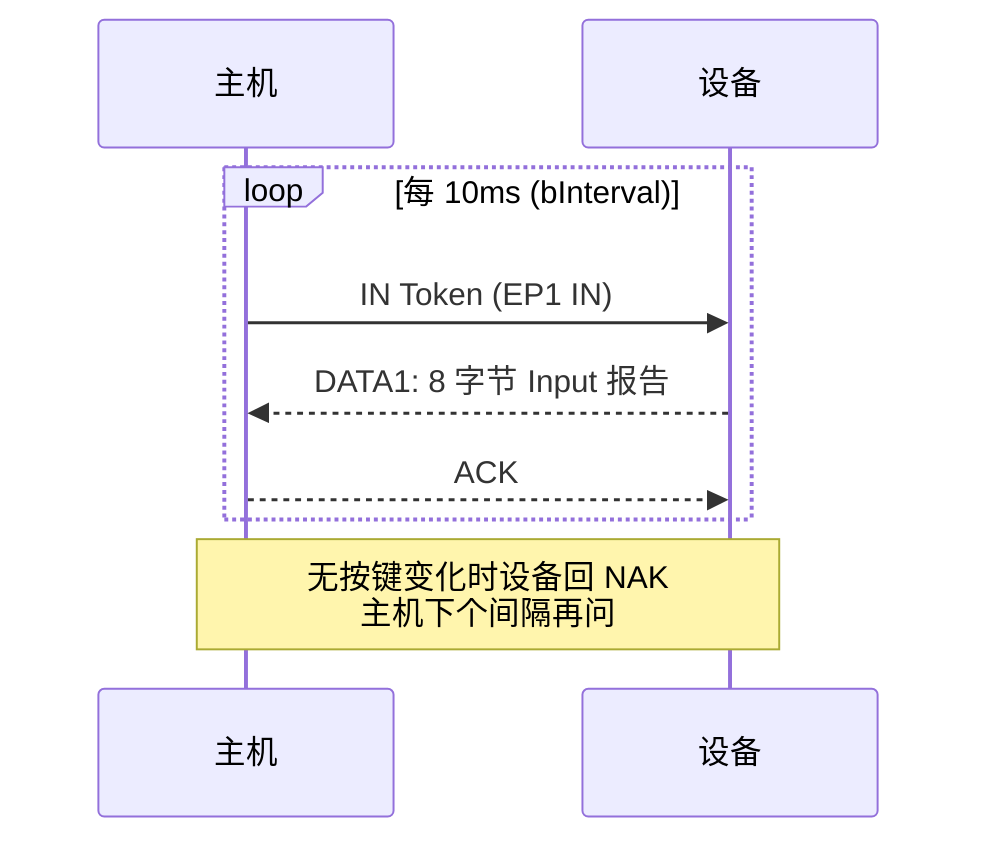

设备没有事件时对 IN 令牌回答 NAK，主机按 `bInterval` 周期重试——这就是 HID "永远在线、按需上报"的运行姿态。

### 7. 三类报告模型

HID 的全部数据被组织成三种报告，方向与通道是固定的，所有后续章节都建立在这个模型上：

| 报告类型 | 方向 | 典型内容 | 通道 |
|---|---|---|---|
| Input | 设备 → 主机 | 按键状态、位移、触点、传感器值 | 中断 IN 周期上报；也可 `GET_REPORT` 主动拉取 |
| Output | 主机 → 设备 | LED、背光、马达强度 | 中断 OUT（可选）；无则 `SET_REPORT` |
| Feature | 双向（主机发起） | 配置项：灵敏度、背光档位、协议版本 | 仅控制管道 `GET_REPORT/SET_REPORT` |

三类报告在描述符中分别由 `Input/Output/Feature` Main Item 声明，字段含义与编码规则完全一致，差别只在方向与通道（详见 [02-报告描述符与Item编码.md](11-hid-core.md)、[04-传输与类特定请求.md](11-hid-core.md)）。

### 8. Boot 协议 vs Report 协议

每个 HID 接口有两种运行协议，通过 `SET_PROTOCOL` 切换、逐接口独立：

| 维度 | Boot 协议 | Report 协议 |
|---|---|---|
| 报告格式 | 规范硬性固定（键盘 8B / 鼠标 3B） | 报告描述符任意定义 |
| Report ID | 无（固定格式不含 ID 字节） | 可用 |
| 进入方式 | 主机显式 `SET_PROTOCOL(0)` | **枚举后的默认状态** |
| 面向场景 | BIOS/EFI、恢复环境、无 HID 解析器 | 现代操作系统 |
| 功能上限 | 6 键无冲、3 按钮、无滚轮 | 任意：NKRO、多轴、多点触控、媒体键 |

设计建议：消费级键盘/鼠标应兼容 Boot（保证进 BIOS 可用）；游戏/多功能设备在 Report 协议下扩展，且扩展字段永远"接在 Boot 布局之后"，保证两协议共用一份描述符（[06-鼠标详解.md](12-hid-devices.md) 的双协议示例即此套路）。

### 9. 典型形态速查

| 形态 | 描述符组织 | 参考章节 |
|---|---|---|
| 独立 USB 键盘/鼠标 | 单接口单 TLC（Boot 兼容） | [05](12-hid-devices.md) / [06](12-hid-devices.md) |
| 无线接收器（键鼠一体 dongle） | 单接口多 TLC + Report ID，或多接口 | [11-实战完整报告描述符.md](12-hid-devices.md) |
| 多媒体键盘 | 键盘 TLC + Consumer TLC | [07-消费控制与多媒体.md](12-hid-devices.md) |
| 笔记本内置触摸板 | I2C-HID，Touch Pad TLC | [09](12-hid-devices.md) / [10](12-hid-devices.md) |
| BLE 无线鼠标 | HOGP，Report Map 复用 USB 描述符 | [10-HID跨传输I2C与BLE.md](12-hid-devices.md) |
| 游戏手柄 | Game Pad TLC 多轴 + Output 振动 | [08-游戏手柄与摇杆.md](12-hid-devices.md) |

## 原文：01-HID描述符

> Source: [20-枝干-设备类协议/HID-人机接口设备/01-HID描述符.md](https://github.com/tangjianfang/USBTree/blob/main/20-枝干-设备类协议/HID-人机接口设备/01-HID描述符.md)

### 1. HID 设备的描述符组合

一个 HID 接口由四层描述符叠加描述：**USB 标准描述符**（树干通用）+ **HID 类描述符**(Class Descriptor) + **报告描述符**(Report Descriptor)（不通过配置描述符连读，须单独获取）+ 可选**物理描述符**(Physical Descriptor)。

| 描述符 | 类型码 | 获取方式 | 归属 |
|---|---|---|---|
| 设备描述符 Device | `0x01` | GET_DESCRIPTOR(Device) | USB 标准 |
| 配置描述符 Configuration | `0x02` | GET_DESCRIPTOR(Config)，连读全部下挂描述符 | USB 标准 |
| 接口描述符 Interface | `0x04` | 随配置连读 | USB 标准 |
| **HID 类描述符** | `0x21` | 随配置连读 | HID 类 |
| **报告描述符 Report** | `0x22` | **必须单独 GET_DESCRIPTOR(0x22)** | HID 类 |
| 物理描述符 Physical（可选） | `0x23` | GET_DESCRIPTOR(0x23)，类请求级 | HID 类 |
| 端点描述符 Endpoint | `0x05` | 随配置连读 | USB 标准 |

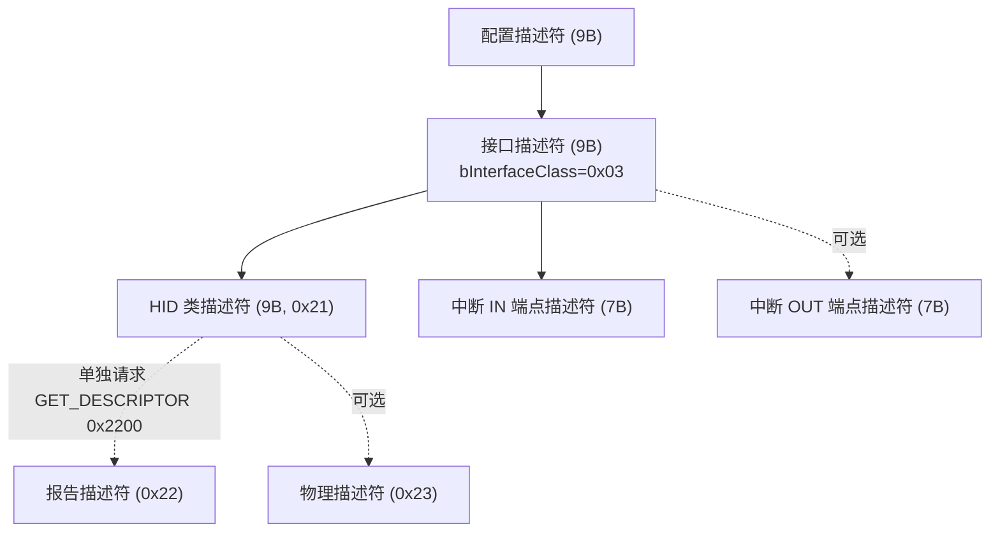

### 2. HID 类描述符逐字段

HID 类描述符固定挂在接口描述符之后，最常见形态为 9 字节（只有一个报告描述符时）：

| 偏移 | 字段 | 长度 | 示例值 | 说明 |
|---|---|---|---|---|
| 0 | `bLength` | 1 | `0x09` | 本描述符长度（仅报告描述符时为 9） |
| 1 | `bDescriptorType` | 1 | `0x21` | HID 类描述符 |
| 2 | `bcdHID` | 2 | `0x0111` | 类规范版本号 BCD，`0x0111` = HID 1.11 |
| 4 | `bCountryCode` | 1 | `0x00` | 目标国家键盘布局代码，见下表 |
| 5 | `bNumDescriptors` | 1 | `0x01` | 下挂的附属类描述符个数（至少含报告描述符=1） |
| 6 | `bDescriptorType2` | 1 | `0x22` | 第 1 个附属描述符的类型：报告描述符 |
| 7 | `wDescriptorLength` | 2 | 如 `0x003F` | 报告描述符的字节长度（小端） |
| — | （更多附属描述符） | 3/项 | — | 若 bNumDescriptors>1，继续跟 (bDescriptorType, wDescriptorLength) 对 |

#### bCountryCode 取值节选

| 值 | 含义 | 值 | 含义 |
|---|---|---|---|
| 0 | Not Supported（绝大多数设备用此值） | 15 | Japan (Katakana) |
| 1 | Arabic | 16 | Korean |
| 3 | Canadian-Bilingual | 19 | Norwegian |
| 7 | Finnish | 25 | Spanish |
| 8 | French | 26 | Swedish |
| 9 | German | 28 | Swiss/German |
| 13 | International (ISO) | 32 | UK |
| 14 | Italian | **33** | **US** |

完整 0~35 的取值表见 HID 1.11 附录。非键盘设备一律填 0。

#### 物理描述符(0x23)简介

物理描述符用可选的静态数据描述"数据项与人身体部位的对应关系"（如某个轴对应哪根手指），配合 Input/Output Item 中的 Non-Linear、Physical Min/Max 等语义使用。实际产品极少使用，且它是纯信息性的——主机 HID 解析器不依赖它。绝大多数设备不实现，本文不展开。

### 3. 为什么报告描述符必须单独获取

两个结构性原因：

1. **配置描述符的连读链不含类内部数据**。`GET_DESCRIPTOR(Config)` 返回的是"配置→接口→（类描述符）→端点"这一固定骨架；报告描述符在规范里被定义为**可变的、可能很大的**数据块（几十到上千字节）。把它放进 wTotalLength 会让所有通用主机栈在枚举时被迫解析或缓冲未知长度的类数据。
2. **长度要先知道才能取**。报告描述符的长度只记录在 HID 类描述符的 `wDescriptorLength` 里——主机必须先读到 HID 类描述符，才知道用多大的 `wLength` 去请求报告描述符。这是刻意的两段式设计。

获取报告描述符用的是**标准** GET_DESCRIPTOR 请求（不是类请求），只是定向到接口：

| 字段 | 值 |
|---|---|
| `bmRequestType` | `0x81`（Device-to-Host, Standard, Interface） |
| `bRequest` | `0x06` (GET_DESCRIPTOR) |
| `wValue` | `0x2200`（高字节 0x22=Report，低字节 Index=0） |
| `wIndex` | 接口号 |
| `wLength` | HID 类描述符中给出的 `wDescriptorLength` |

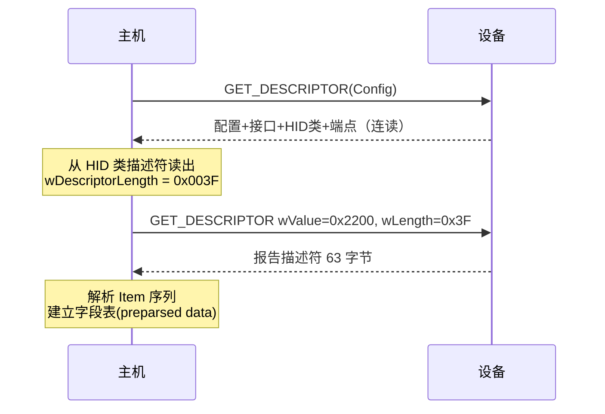

### 4. 端点要求

| 端点 | 要求 | 说明 |
|---|---|---|
| 中断 IN | **必选** | Input 报告周期上报的唯一通道 |
| 中断 OUT | 可选 | 有则 Output 报告走它；无则 Output/Feature 全部走 EP0 上的 `SET_REPORT` |
| 等时/批量 | 禁止 | HID 类设备不得使用 |

中断端点参数速查：

| 速率 | wMaxPacketSize 上限 | bInterval 单位/范围 |
|---|---|---|
| 低速 | 8 字节 | ms，10~255 |
| 全速 | 64 字节 | ms，1~255 |
| 高速 | 64 字节 | µFrame，按 2^(n−1) 解释 |

### 5. 完整示例：USB Boot 键盘的配置描述符

一个最简 Boot 键盘（单接口、无 OUT 端点）的配置描述符总长构成：

```
配置描述符 9 + 接口描述符 9 + HID 类描述符 9 + 中断IN端点描述符 7 = 34 字节
```

逐字节十六进制（`wTotalLength = 0x0022 = 34`）：

```text
09 02 22 00 01 01 00 A0 32   ; 配置描述符: 总长34, 1接口, bConfigurationValue=1,
                             ;   iConfiguration=0, bmAttributes=0xA0(总线供电+远程唤醒),
                             ;   bMaxPower=0x32(100mA)
09 04 00 00 01 03 01 01 00   ; 接口描述符: 接口0, 1端点, Class=0x03,
                             ;   SubClass=0x01(Boot), Protocol=0x01(键盘)
09 21 11 01 00 01 22 3F 00   ; HID 类描述符: bcdHID=0x0111, 国家=0(不支持),
                             ;   1个描述符, 报告描述符长 0x003F=63 字节
07 05 81 03 08 00 0A         ; 端点描述符: EP1 IN, 中断, 8字节包, bInterval=10ms
```

要点核对：

- `wTotalLength`（偏移 2~3，小端 `22 00`）= 9+9+9+7 = **34**。
- 若增加一个中断 OUT 端点，总长变为 41 字节（+7）。
- `wDescriptorLength = 0x003F` 对应 [05-键盘详解.md](12-hid-devices.md) 中那份 63 字节的 Boot 键盘报告描述符——两份描述符的数值互相咬合。
- 多接口复合设备（如键盘+鼠标）则为"每接口一套 接口+HID+端点"，配置描述符的 `bNumInterfaces` 相应增加。

### 6. 描述符之间的数值一致性清单

实现时最常翻车的是跨描述符的一致性，逐项检查：

| 检查项 | 来源 | 去向 |
|---|---|---|
| `wDescriptorLength` | HID 类描述符 | GET_DESCRIPTOR(0x22) 的实际返回长度必须相等 |
| `bNumEndpoints` | 接口描述符 | 实际端点描述符个数（HID 恒为 1 或 2） |
| `bInterfaceProtocol` | 接口描述符 | Boot 描述符的固定报告格式（键盘 8B / 鼠标 3B/4B） |
| `wMaxPacketSize` | 端点描述符 | 报告长度（含 Report ID 字节）不得超过它 |
| `bcdHID` | HID 类描述符 | 描述符中使用的 Item 语法不得超出该版本 |

## 原文：02-报告描述符与Item编码

> Source: [20-枝干-设备类协议/HID-人机接口设备/02-报告描述符与Item编码.md](https://github.com/tangjianfang/USBTree/blob/main/20-枝干-设备类协议/HID-人机接口设备/02-报告描述符与Item编码.md)

### 1. 自描述字节流

报告描述符(Report Descriptor)不是"字段表"，而是一段**紧缩的字节码**：由若干 Item（项）顺序排列组成，主机 HID 解析器按顺序"执行"这些 Item，构建出报告的位级布局。它介于"数据结构声明"与"小型编程语言"之间——类比：报告描述符之于 HID 数据，相当于 DTD/Schema 之于 XML。

特点：

- 长度任意（几十字节到数百字节），由 HID 类描述符的 `wDescriptorLength` 声明；
- 获取方式：`GET_DESCRIPTOR(wValue=0x2200)`（见 [01-HID描述符.md](11-hid-core.md)）；
- Item 序列末尾约定俗成以 `0xC0`（End Collection）收束，但严格说解析器以"读满 wDescriptorLength"为准。

### 2. Item 的两种形态

#### 2.1 短 Item（Short Item）

1 字节头部 + 0/1/2/4 字节数据：

```text
  bit  7 6 5 4 | 3 2 | 1 0
     ┌─────────┼─────┼─────┐
     │  bTag   │bType│bSize│
     └─────────┴─────┴─────┘
  bSize: 00=0字节  01=1字节  10=2字节  11=4字节   （数据部分字节数）
  bType: 00=Main  01=Global  10=Local
  bTag:  Item 功能码（随 bType 分空间）
```

- 头部即编码：`前缀 = bTag<<4 | bType<<2 | bSize`。例如 `Usage Page` 的 bTag=0x0、bType=01、数据 1 字节 → 前缀 `0b0000_01_01 = 0x05`。
- **数据为小端(Little-Endian)**，且按规范解释为**有符号数**：若值为负、而数据只有 1/2 字节，解析器将其**符号扩展(sign-extend)到 32 位**。因此 `Logical Minimum (-127)` 编码为 `15 81`（0x81 即 -127），而 `0x15 0xFF` 表示的是 **-1 而不是 255**——这是最常见的编码事故（见 [11-实战完整报告描述符.md](12-hid-devices.md) 错误清单）。

多字节编码示例：

| Item 字节序列 | 解读 |
|---|---|
| `05 01` | Usage Page(Generic Desktop)，1 字节数据 |
| `26 FF 0F` | Logical Maximum(4095)，前缀 0x26=bSize 10（2 字节数据，小端） |
| `27 00 00 01 00` | Logical Maximum(65536)，bSize=11 → 4 字节数据 |
| `15 81` | Logical Minimum(-127)，负数符号扩展 |
| `26 FF FF` | Logical Maximum(**-1**)，经典符号扩展错误现场 |
| `85 03` | Report ID(3) |
| `A4` / `B4` | Push / Pop，bSize=0 无数据 |

#### 2.2 长 Item（Long Item）

前缀固定 `0xFE`（bTag=0xF, bType=11, bSize=10），随后 1 字节说明：高半字节 `bLongItemTag`、低半字节 `bDataSize`，其后跟 0~255 字节数据。长 Item 是规范预留的扩展通道，HID 1.11 未定义任何具体长 Item，实际描述符中不应出现。

### 3. 三类 Item 总表

#### 3.1 Main 类（bType=00）——描述数据与结构

| Item | 前缀（1 字节数据项） | 作用 |
|---|---|---|
| Input | `0x80`+位图 → 实际如 `81 02` | 声明一段"设备→主机"数据字段 |
| Output | `0x90` 基 → 如 `91 02` | "主机→设备"数据字段（LED 等） |
| Feature | `0xB0` 基 → 如 `B1 02` | 双向配置字段，仅走控制通道 |
| Collection | `A1 <type>` | 开启集合（如 `A1 01` = Application） |
| End Collection | `C0` | 关闭集合 |

Input/Output/Feature 的 1 字节数据是**位图标志**：

| 位 | 0 | 1 | 说明 |
|---|---|---|---|
| bit0 | Data | Constant | Constant=填充位/保留位 |
| bit1 | Array | Variable | Array=键码数组；Variable=独立位字段 |
| bit2 | Absolute | Relative | 绝对坐标 vs 相对位移（鼠标 X/Y=Relative） |
| bit3 | No Wrap | Wrap | 数值回绕 |
| bit4 | Linear | Non Linear | 物理映射是否线性 |
| bit5 | Preferred State | No Preferred State | 是否有默认回落状态 |
| bit6 | No Null Position | Null State | Null State=存在"无意义"取值（如帽开关 8~15） |
| bit7 | Non Volatile | Volatile | 仅 Output/Feature 有意义：主机是否可主动改写 |
| bit8 | Bit Field | Buffered Bytes | 按位打包 vs 按字节缓冲 |

常用组合速记：`81 02`=Data,Var,Abs（普通位图）；`81 00`=Data,Array,Abs（键码数组）；`81 06`=Data,Var,Rel（鼠标位移）；`81 03`=Const,Var,Abs（填充字节）；`81 42`=Data,Var,Abs,**Null State**（帽开关）。

#### 3.2 Global 类（bType=01）——带状态、跨 Item 生效

| Item | bTag | 典型前缀（1 字节数据） | 作用 |
|---|---|---|---|
| Usage Page | 0x0 | `05 <page>` | 设置当前 Usage Page（高 16 位） |
| Logical Minimum | 0x1 | `15 <n>` | 字段数值下界（报告值域） |
| Logical Maximum | 0x2 | `25 <n>` | 数值上界 |
| Physical Minimum | 0x3 | `35 <n>` | 物理量下界 |
| Physical Maximum | 0x4 | `45 <n>` | 物理量上界 |
| Unit Exponent | 0x5 | `55 <e>` | 物理单位指数 |
| Unit | 0x6 | `65 <u>` | 物理单位编码 |
| Report Size | 0x7 | `75 <n>` | 每个字段的位数 |
| Report ID | 0x8 | `85 <id>` | 为随后的报告定义 1~255 的编号 |
| Report Count | 0x9 | `95 <n>` | 相同 Size 字段的个数 |
| Push | 0xA | `A4`（无数据） | 压栈保存全部 Global 状态 |
| Pop | 0xB | `B4`（无数据） | 出栈恢复 |

#### 3.3 Local 类（bType=10）——一次性标签

| Item | bTag | 典型前缀 | 作用 |
|---|---|---|---|
| Usage | 0x0 | `09 <id>` | 给随后的 Main Item 贴 Usage 标签 |
| Usage Minimum | 0x1 | `19 <id>` | Array/位图字段的 Usage 起始 |
| Usage Maximum | 0x2 | `29 <id>` | Usage 结束 |

### 4. Global 持久 vs Local 即弃

理解报告描述符的关键心智模型：**解析器维护一个 Global 状态栈和一个 Local 标签列表**。

```text
Global 状态: { Usage Page, Logical Min/Max, Phys Min/Max,
               Unit/Exponent, Report Size, Report Count, Report ID }
   → 一直保持, 直到被新的 Global Item 覆盖或 Pop 恢复

Local 标签: { Usage, Usage Min/Max 累积列表 }
   → 每遇到一个 Main Item(Input/Output/Feature/Collection)
     即"贴"到该 Main Item 上, 然后【清空】
```

因此描述符写作顺序通常是："Global 定参（Page/Logical/Size/Count）→ Local 贴标签 → Main 产出字段"。同一个 `95 08`（Report Count=8）可以连续服务多个 Input Item，直到被改写；而每个 Input 前都要重新贴 Usage。

### 5. 报告字段的位填充与对齐

- 字段从每个字节的**最低位(LSB)开始连续打包**；一个字段可以跨越字节边界（如 12 位 X 后接 12 位 Y 共占 3 字节）。
- **位图(Variable)字段不足整字节时必须用 Constant 位补齐到字节边界**，否则整个报告从此错位：
  `Report Size(1), Report Count(3)`（3 个按钮）+ `Report Size(1), Report Count(5)`（Constant 填充）= 1 字节。
- Array 字段以"取值"表意（值=Usage 编号），单位是 Report Size 位；Boot 键盘的 6 键数组即 6 个 8 位 Array 字段。
- 报告总长 = Σ(Report Size × Report Count) 按字节向上取整，且不得超过端点 `wMaxPacketSize`。

### 6. Report ID 规则

- `85 <id>` 给"随后定义的报告"赋予 1~255 的编号；**Report ID 0 不可用**（0 表示"无 Report ID"的保留语义）。
- 使用 Report ID 后，**该报告在线上传输时第一个字节恒为 Report ID**，数据紧随其后；主机按 ID 分发到不同解析分支。
- 同一接口内 Input/Output/Feature **共用同一套 ID 编号空间**，每个 ID 唯一。
- 一旦接口中任何报告使用了 Report ID，则**所有报告都必须带 ID**（不存在"部分带"的混合状态）。
- 未使用 Report ID 的设备，报告中**没有 ID 字节**，第一个字节就是数据。
- Boot 协议报告是固定格式，永远不含 Report ID 字节（详见 [04-传输与类特定请求.md](11-hid-core.md)）。

### 7. 实例：8 字节 Boot 键盘报告的描述符（逐行注释）

这是 HID 1.11 附录 Boot 键盘描述符的等价形态，共 **63 字节（0x3F）**，与 [01-HID描述符.md](11-hid-core.md) 示例中 `wDescriptorLength=0x003F` 一致：

```text
05 01        Usage Page (Generic Desktop)      ; Global: 页=0x01
09 06        Usage    (Keyboard)               ; Local : TLC 用法=键盘
A1 01        Collection (Application)          ; 顶层集合开始
  05 07      Usage Page (Keyboard/Keypad)      ; 切到键码页
  19 E0      Usage Minimum (0xE0)              ; 左Ctrl
  29 E7      Usage Maximum (0xE7)              ; 右GUI
  15 00      Logical Minimum (0)               ; 位值域 0..1
  25 01      Logical Maximum (1)
  75 01      Report Size (1)                   ; 每字段 1 位
  95 08      Report Count (8)                  ; 8 个 → 第 1 字节
  81 02      Input (Data,Var,Abs)              ; [字节0] 修饰键位图
  95 01      Report Count (1)
  75 08      Report Size (8)
  81 03      Input (Const,Var,Abs)             ; [字节1] 保留, 恒 0
  95 06      Report Count (6)                  ; 6 个 8 位 Array 字段
  75 08      Report Size (8)
  15 00      Logical Minimum (0)               ; 0 = 无事件
  25 65      Logical Maximum (101)             ; 0x65 = 键码上限
  19 00      Usage Minimum (0)                 ; Array 值域映射 Usage 0x00..0x65
  29 65      Usage Maximum (101)
  81 00      Input (Data,Array,Abs)            ; [字节2..7] 6 键数组
  05 08      Usage Page (LEDs)                 ; 以下为 LED Output 报告
  19 01      Usage Minimum (Num Lock)
  29 05      Usage Maximum (Kana)
  15 00      Logical Minimum (0)
  25 01      Logical Maximum (1)
  75 01      Report Size (1)
  95 05      Report Count (5)
  91 02      Output (Data,Var,Abs)             ; 5 个 LED 位
  95 03      Report Count (3)
  91 03      Output (Const,Var,Abs)            ; [bit5..7] 填充补齐 1 字节
C0           End Collection                    ; 顶层集合结束
```

对应报告字节流（无 Report ID）：

| 字节 | bit7 | bit6 | bit5 | bit4 | bit3 | bit2 | bit1 | bit0 |
|---|---|---|---|---|---|---|---|---|
| 0 | 右GUI | 右Alt | 右Shift | 右Ctrl | 左GUI | 左Alt | 左Shift | 左Ctrl |
| 1 | 保留（恒 0） | | | | | | | |
| 2~7 | 键码数组（0=无按键，值域 0x00~0x65） | | | | | | | |

## 原文：03-Usage体系与集合

> Source: [20-枝干-设备类协议/HID-人机接口设备/03-Usage体系与集合.md](https://github.com/tangjianfang/USBTree/blob/main/20-枝干-设备类协议/HID-人机接口设备/03-Usage体系与集合.md)

### 1. Usage = 32 位 = Page + ID

Usage（用法）是 HID 的"语义词汇表"：报告描述符里的每个字段都通过 Usage 告诉主机"这个字段是什么意思"。一个 Usage 是 **32 位**值：

```text
 31              16 15               0
┌──────────────────┬──────────────────┐
│  Usage Page(高)   │   Usage ID(低)   │
└──────────────────┴──────────────────┘
例: 0x00010030 = Generic Desktop 页的 X 轴
```

- Usage Page 是 8 位编码空间（0x00~0xFF），Usage ID 是 16 位空间；
- `Usage Page(Generic Desktop)` 后跟 `Usage(X 0x30)`，等价于完整 Usage `0x00010030`；
- 分配权威是 USB-IF 的《HID Usage Tables》，任何页/ID 都应能在其中查到出处，**禁止私造**——厂商私有功能应使用厂商自定义页（0xFF00~0xFFFF）。

### 2. 常用 Usage Page 一览

| 页码 | 名称 | 典型设备 |
|---|---|---|
| `0x00` | Undefined | 未定义 |
| `0x01` | Generic Desktop | 鼠标、键盘 TLC、轴、系统控制 |
| `0x02` | Simulation Controls | 飞行/驾驶模拟 |
| `0x03` | VR Controls | VR 头显与控制器 |
| `0x05` | Game Controls | 游戏手柄 TLC |
| `0x06` | Generic Device Controls | 设备模式切换（PTP Input Mode 等） |
| `0x07` | Keyboard/Keypad | 键盘键码 |
| `0x08` | LEDs | Num/Caps/Scroll Lock 等 |
| `0x09` | Button | 通用按钮阵列 |
| `0x0A` | Ordinal | 序号（多点触控排序等） |
| `0x0C` | Consumer | 媒体键、遥控（见 [07-消费控制与多媒体.md](12-hid-devices.md)） |
| `0x0D` | Digitizer | 触摸屏/触摸板/数位笔（见 [09-触摸屏触摸板与数字化仪.md](12-hid-devices.md)） |
| `0x0F` | Physical Input Device (PID) | 力反馈（见 [08-游戏手柄与摇杆.md](12-hid-devices.md)） |
| `0x10` | Unicode | 文本输入 |
| `0x40` | Medical Instruments | 医疗设备 |
| `0x84` | Power | 电源设备（UPS 等） |
| `0x8C` | Barcode Scanner | 扫码枪 |
| `0x8D` | Scale | 电子秤 |
| `0x91` | Camera Control | 相机控制 |
| `0x92` | Arcade | 街机设备 |
| `0xFF00`~`0xFFFF` | Vendor Defined | 厂商私有 |

传感器(Sensor)类 Usage（Windows HIDSensor 使用）由微软规范单独定义，具体页码与 ID 请查阅最新《HID Usage Tables》及微软 HID Sensors 文档。另外 0x04(Sport)、0x0B(Telephony)、0x0E(Haptics) 等页也存在，此处不展开。

### 3. Generic Desktop 页常用 Usage

Generic Desktop(0x01) 是最繁忙的页——注意 **0x30=X、0x31=Y、0x32=Z、0x38=Wheel**，不要与其它页混淆：

| Usage ID | 名称 | 用途 |
|---|---|---|
| `0x01` | Pointer | 指针集合（鼠标物理集合常用） |
| `0x02` | Mouse | 鼠标 TLC |
| `0x04` | Joystick | 摇杆 TLC |
| `0x05` | Game Pad | 手柄 TLC |
| `0x06` | Keyboard | 键盘 TLC |
| `0x07` | Keypad | 小键盘 TLC |
| `0x30` | X | X 轴 |
| `0x31` | Y | Y 轴 |
| `0x32` | Z | Z 轴 |
| `0x33` | Rx | 旋转 X |
| `0x34` | Ry | 旋转 Y |
| `0x35` | Rz | 旋转 Z |
| `0x36` | Slider | 滑块（油门等） |
| `0x37` | Dial | 旋盘 |
| `0x38` | Wheel | 滚轮（鼠标 Report 协议扩展） |
| `0x39` | Hat Switch | 帽开关（方向帽） |
| `0x80` | System Control | 系统控制集合 |
| `0x81` | System Power Down | 关机键 |
| `0x82` | System Sleep | 睡眠键 |
| `0x83` | System Wake Up | 唤醒键 |

注：早期资料常把 0x08 误当 X——0x08 在现行 Usage Tables 中并非 X，X 从 0x30 开始。

### 4. Collection 类型与语义

Collection Item（`A1 <type>`）把字段组织成树；1 字节数据是集合类型：

| 类型码 | 名称 | 语义 |
|---|---|---|
| `0x00` | Physical | 物理集合：字段来自同一物理时刻/同一传感器（如鼠标的一个物理集合包住 X/Y） |
| `0x01` | Application | 应用集合：**一个逻辑设备单元**，主机按它拆分/归类设备 |
| `0x02` | Logical | 逻辑集合：字段间有耦合关系（如 2 字节合成一个 16 位值、触点的 X/Y/宽高） |
| `0x03` | Report | 报告集合：标注字段归属哪个报告（不常用，多用于报告交叉引用） |
| `0x04` | Named Array | 命名数组：选择器（从命名选项中选一） |
| `0x05` | Usage Switch | 布尔开关集合 |
| `0x06` | Usage Modifier | 修饰键集合（如把 Ctrl/Alt/Shift 组成一组） |

#### 4.1 Top Level Collection (TLC)

最外层的 Application Collection 称为**顶层集合**，是主机归类设备的依据：

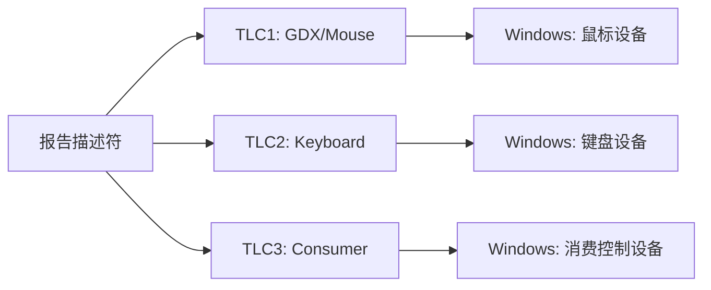

- 一个 TLC ⇒ 一个 HID 设备实例：Windows 的 HID 类驱动为每个 TLC 生成独立的设备栈（PDO/FDO），所以"键鼠一体接收器"在一个 USB 接口里可以表现为系统里的两个设备。
- 多个 TLC ⇒ 复合设备形态：报告之间用 Report ID 区分（见 [11-实战完整报告描述符.md](12-hid-devices.md)）。
- TLC 的 Usage 决定系统行为：TLC=`GDX/Mouse` → 光标移动；`GDX/Keyboard` → 文字输入；`Consumer` → 媒体键；`GDX/System Control` → 电源键语义。
- 同一 TLC 下可以再有 Physical/Logical 等内层集合，但 **Application Collection 不可嵌套 Application**。

### 5. 键盘修饰键 Usage（0xE0–0xE7）

Keyboard/Keypad 页(0x07)的 0xE0~0xE7 是 8 个修饰键，天然构成 1 字节位图（Boot 报告字节 0，见 [05-键盘详解.md](12-hid-devices.md)）：

| Usage ID | 修饰键 | 报告位 |
|---|---|---|
| `0xE0` | Left Control | bit0 |
| `0xE1` | Left Shift | bit1 |
| `0xE2` | Left Alt | bit2 |
| `0xE3` | Left GUI (Win/⌘) | bit3 |
| `0xE4` | Right Control | bit4 |
| `0xE5` | Right Shift | bit5 |
| `0xE6` | Right Alt (AltGr) | bit6 |
| `0xE7` | Right GUI | bit7 |

### 6. 使用规则速查

1. `Usage Page` 属于 **Global** 状态：设置后一直有效，直到下次设置；`Usage/Usage Min/Usage Max` 属于 **Local**：贴完一个 Main Item 即清空（见 [02-报告描述符与Item编码.md](11-hid-core.md)）。
2. 位图字段用 `Usage Minimum~Usage Maximum` 连续区间一次声明（如 LED 0x01~0x05）；离散 Usage 则逐个 `Usage` 列举。
3. Array 字段中，**报告值本身就是要选中的 Usage ID**，因此 Usage Min/Max 必须覆盖 Logical Min/Max 的取值范围，否则解析器查表落空。
4. Usage 超出当前页 16 位 ID 空间的"扩展用法"（Extended Usages）在部分新版 Usage Tables 中存在，遇到时请以最新 Usage Tables 为准。

### 7. Usage 的类型标注

《HID Usage Tables》里每个 Usage 除了编号，还有一个**用法类型(Type)**标注，告诉主机解析器这个字段应按什么语义处理：

| 缩写 | 全称 | 语义 | 典型例子 |
|---|---|---|---|
| MC | Momentary Control | 瞬态：按住为 1，松开为 0 | 普通按键、媒体键 |
| OOC | On/Off Control | 双态切换：状态量 | Num Lock LED |
| OSC | One-Shot Control | 单发触发 | 静音切换 |
| RTC | Re-trigger Control | 可重触发 | 部分遥控键 |
| DV | Dynamic Value | 动态数值 | 轴、坐标、滚轮 |
| DF | Dynamic Flag | 动态标志 | Tip Switch、In Range |
| Sel | Selector | 从命名集合中选一 | 帽开关命名数组 |
| LC | Linear Control | 线性控制量 | 音量滑条 |
| CL / CA | Collection Logical / Application | 集合的语义标签 | Finger / Touch Screen |

写描述符时不必显式声明类型（类型藏在 Usage Tables 里，主机解析器按 Usage 编号查表得知），但**设计报告结构时必须尊重它**：把 OOC 键做成数组选值、或把 DV 轴按位图上报，都会导致主机侧行为异常。

### 8. 查 Usage Tables 的工作流

1. 确定 TLC（Application Collection 的 Usage）——决定 OS 归类；
2. 在 Usage Tables 索引中找到对应 Usage Page，确认页码与所需 Usage ID 及其类型标注；
3. 检查该 Usage 要求的值域/位宽（DV 类常注明建议 Logical 范围）；
4. 厂商私有功能一律进 0xFF00~0xFFFF 厂商页，不得占用标准编号；
5. 记录版本：Usage Tables 有多个版本，编号偶有增补，描述符注释里注明依据的版本，便于回归。

### 9. Ordinal 页(0x0A)与编号语义

Ordinal（序数）页用于"第几个"这类纯序号语义，典型场景是多点触控中给触点编号的辅助手段。它是"值=序号"的页，与 Array 字段配合使用；是否采用由设备厂商决定，现代触控方案多用 Contact Identifier(0x51) 替代（见 [09-触摸屏触摸板与数字化仪.md](12-hid-devices.md)）。

## 原文：04-传输与类特定请求

> Source: [20-枝干-设备类协议/HID-人机接口设备/04-传输与类特定请求.md](https://github.com/tangjianfang/USBTree/blob/main/20-枝干-设备类协议/HID-人机接口设备/04-传输与类特定请求.md)

### 1. HID 的三条通道

HID 接口的数据通路只有三条，与三类报告一一对应：

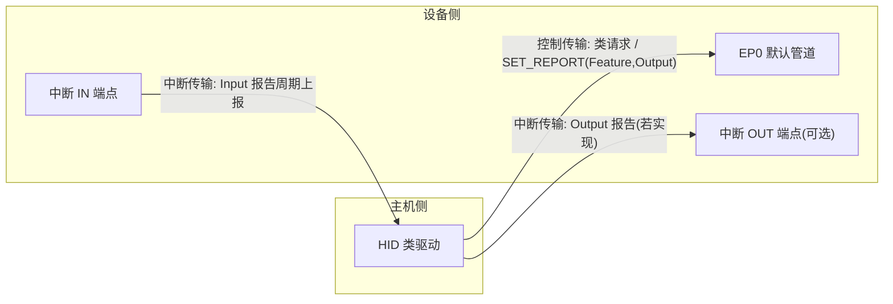

| 通道 | 承载内容 | 特点 |
|---|---|---|
| 控制管道(EP0) | 六个类特定请求、**Feature 报告**、未实现中断 OUT 时的 Output 报告 | 按需、双向、无周期保证 |
| 中断 IN | **Input 报告** | 主机按 `bInterval` 轮询，延迟有上界 |
| 中断 OUT | Output 报告 | 可选；把"主机→设备"数据从控制管道分流出去 |

**Feature 报告为什么只能走控制通道**：Feature 报告是"配置语义"的数据（设备状态读写），事件性弱、频率低、需要主机主动拉取或推送——控制传输的"请求-响应"模型正合适；而中断端点被定义为周期性数据流，不适合"主机随机读取"的模式。因此 HID 1.11 规定 Feature 报告只通过 `GET_REPORT/SET_REPORT`（类型 3=Feature）在默认管道传输。

### 2. 六个类特定请求总表

| 请求 | bRequest | bmRequestType | wValue | wIndex | wLength | Data 阶段 |
|---|---|---|---|---|---|---|
| GET_REPORT | `0x01` | `0xA1` | 高字节=Report ID，低字节=报告类型 | 接口号 | 报告长度 | 报告数据 |
| GET_IDLE | `0x02` | `0xA1` | 高字节=Report ID，低字节=0 | 接口号 | 1 | 1 字节当前 Idle 率 |
| GET_PROTOCOL | `0x03` | `0xA1` | 0 | 接口号 | 1 | 0=Boot，1=Report |
| SET_REPORT | `0x09` | `0x21` | 高字节=Report ID，低字节=报告类型 | 接口号 | 报告长度 | 报告数据 |
| SET_IDLE | `0x0A` | `0x21` | 高字节=Report ID，低字节=Duration | 接口号 | 0 | 无 |
| SET_PROTOCOL | `0x0B` | `0x21` | 低字节：0=Boot，1=Report | 接口号 | 0 | 无 |

- `bmRequestType` 编码：`10100001B`=`0xA1`（Device→Host，Class，Interface）；`00100001B`=`0x21`（Host→Device，Class，Interface）。
- **wValue 中的报告类型**（低字节）：`1`=Input，`2`=Output，`3`=Feature；高字节为 Report ID（无 Report ID 设备填 0）。
- `wIndex` 恒为接口号——HID 类请求都定向到接口。
- 以上 bRequest 值与 HID 1.11 第 7.2 节一致：注意 **GET_IDLE=0x02、GET_PROTOCOL=0x03**（0x05 未分配给 GET_PROTOCOL，勿与其它类混用）。

#### 2.1 GET_REPORT / SET_REPORT

- 用途：状态同步与初始化。主机开机时不知道设备当前按键/LED 状态，用 `GET_REPORT(Input)` 主动读一次；LED、背光用 `SET_REPORT(Output)`；背光亮度、灵敏度等配置用 `SET_REPORT(Feature)`。
- HID 1.11 要求：**支持 Boot 协议的键盘/鼠标必须支持对 Input 报告的 GET_REPORT**（BIOS/OS 由此轮询当前状态）。
- 无中断 OUT 端点的设备，Output 报告一律经 `SET_REPORT` 下发。

#### 2.2 SET_IDLE / GET_IDLE —— Idle 率

Input 报告默认"变化才上报"，但对某些设备（如 joystick 中位）主机希望周期性拿到最新值。Idle 率解决"多久强制重发一次"：

- **单位是 4ms**：写入值 N 表示 N×4ms，即设备每 N×4ms 对该报告"无变化也重发一次"；
- **Duration=0 表示无限(Infinity)**：退回"仅状态变化时上报"（最常用默认值）；
- `SET_IDLE` 的 Duration 在 **wValue 低字节**，Report ID 在高字节；Report ID=0 表示作用于该接口全部 Input 报告；
- 典型时序：BIOS 时代常用 `SET_IDLE(0)` 关闭重发省电，全速游戏设备则常设非零 Idle 保证轮询可见性。

示例：`21 0A 04 00 00 00 00 00` 是一条完整的 SET_IDLE Setup 包：bmRequestType=0x21, bRequest=0x0A, wValue=`0x0004`（高字节 Report ID=0，低字节 Duration=4 → 16ms；wValue 线上小端，故字节序为 `04 00`），wIndex=0，wLength=0。

#### 2.3 GET_PROTOCOL / SET_PROTOCOL —— 双协议切换

| wValue | 协议 | 报告格式 |
|---|---|---|
| 0 | Boot 协议 | 固定极简格式（键盘 8 字节 / 鼠标 3~4 字节），见 [05-键盘详解.md](12-hid-devices.md)、[06-鼠标详解.md](12-hid-devices.md) |
| 1 | Report 协议 | 报告描述符描述的完整格式 |

- 协议状态**逐接口独立**（同一设备的不同接口可处于不同协议）。
- 设备枚举后默认处于 **Report 协议**；BIOS/EFI 想用键鼠时必须显式 `SET_PROTOCOL(0)`。
- 仅 `bInterfaceSubClass=1` 的接口必须响应这两个请求；普通设备收到应回 STALL。

```mermaid
sequenceDiagram
    participant B as BIOS/EFI
    participant D as Boot 键盘
    Note over D: 枚举完成, 处于 Report 协议
    B->>D: SET_PROTOCOL(wValue=0)
    D-->>B: 状态阶段完成
    B->>D: GET_REPORT(Input, ID=0)
    D-->>B: 8 字节 Boot 键盘报告(当前状态)
    loop 轮询
        B->>D: IN (EP1)
        D-->>B: Input 报告(变化时)
    end
```

### 3. 挂起与远程唤醒

USB 总线空闲 ≥3ms 主机即挂起总线（见树干 [10-电源管理与挂起唤醒.md](08-power-management.md)）。键盘鼠标必须在挂起期间保持"能被按键唤醒"的能力，流程分**授权**与**触发**两步：

```mermaid
sequenceDiagram
    participant H as 主机
    participant D as 设备
    H->>D: SET_FEATURE(标准请求 bRequest=0x03, wValue=1)<br/>DEVICE_REMOTE_WAKEUP 授权
    H->>D: 总线挂起(停止 SOF)
    Note over D: 低功耗守候, 中断端点逻辑仍在
    D->>D: 按键 → Input 报告内容将变化
    D->>H: 驱动 Resume 信号(K 状态)拉醒总线
    H->>D: 恢复轮询(继续 IN 事务)
    D-->>H: 中断 IN: 按键 Input 报告
```

要点：

1. **远程唤醒必须先获得授权**：主机通过标准请求 `SET_FEATURE`，`wValue=1`（DEVICE_REMOTE_WAKEUP）；配置描述符 `bmAttributes` bit5 置 1 表示"支持远程唤醒"，两者缺一不可。
2. **触发条件是"输入状态将变化"**：按键/鼠标移动使 Input 报告待更新，即构成唤醒事件；设备发 Resume 信号（低速/全速为驱动 K 状态若干 ms），随后主机恢复总线并轮询，设备用中断 IN 交付报告。
3. 主机可随时用 `CLEAR_FEATURE(DEVICE_REMOTE_WAKEUP)` 收回授权，此后设备不得再发 Resume。

### 4. 错误处理

- **不支持/非法的类请求回 STALL**：如普通 HID 收到 `GET_PROTOCOL`，或请求类型字段非法。设备以 `STALL` 握手应答 Data 或 Status 阶段，主机清端点后继续。
- **wLength 与报告长度不符**：设备按 wLength 截断或以短包(Short Packet)结束，不得溢出。
- **Boot 接口未进入 Boot 协议时收到 Boot 语义的请求**：协议请求仅约束协议状态，报告内容仍以当前协议为准。
- 报告管道的传输错误重试由 USB 层完成（见树干 [11-错误处理与可靠性.md](09-errors-testmode.md)），HID 类本身没有额外重传机制——报告是"最新状态"语义，丢一帧等下一帧即可。

### 5. 类请求的 Setup 包字节级示例

控制传输的 Setup 包恒为 8 字节：`bmRequestType, bRequest, wValue(小端2B), wIndex(小端2B), wLength(小端2B)`。

**例 1：点亮 Caps Lock（SET_REPORT, Output, 无 Report ID，1 字节数据）**

```text
21 09 02 00 00 00 01 00    ; wValue=0x0002: 低字节 2=Output, 高字节 ID=0
│  │  └─┬─┘ └─┬─┘ └─┬─┘
│  │    │    │    └─ wLength=1
│  │    │    └─ wIndex=接口0
│  │    └─ wValue: 02 00 (低字节在前!)
│  └─ bRequest=0x09 (SET_REPORT)
└─ bmRequestType=0x21 (Host→Device, Class, Interface)
Data 阶段: 1 字节 LED 位图, 点亮 Caps Lock → 02
```

**例 2：BIOS 读键盘当前状态（GET_REPORT, Input, 无 Report ID）**

```text
A1 01 01 00 00 00 08 00    ; wValue=0x0001 (1=Input), wLength=8
Data 阶段: 设备返回 8 字节 Boot 键盘报告
```

**例 3：进入 Boot 协议（SET_PROTOCOL）**

```text
21 0B 00 00 00 00 00 00    ; wValue 低字节 0=Boot; 无 Data 阶段
```

### 6. 支持矩阵：哪些请求是必须的

| 请求 | 普通 HID 设备（SubClass=0） | Boot 设备（SubClass=1） |
|---|---|---|
| GET_REPORT | 实现 Feature/Output 读取时必须 | **Input 报告的 GET_REPORT 必须**（BIOS 轮询依赖） |
| SET_REPORT | 实现 Output/Feature 时必须 | 建议（LED、模式配置） |
| GET_IDLE / SET_IDLE | 可选；不实现可回 STALL，主机应容忍 | 建议（BIOS 常用 SET_IDLE(0) 关闭重发） |
| GET_PROTOCOL / SET_PROTOCOL | 不支持（应回 STALL） | **必须** |

补充细节：`GET_IDLE` 无论选中哪个 Report ID，**返回恒为 1 字节**（该 ID 当前的 Idle 率）；`GET_PROTOCOL` 返回 1 字节当前协议号。wLength 与规范不符时设备按短包处理，不得溢出缓冲。


---

<!-- file: 12-hid-devices.md -->
---
id: 12-hid-devices
title: "HID 典型设备：键盘、鼠标、消费控制、手柄、触控、跨传输、完整描述符"
topic: class/hid
level: 进阶
keywords: ["boot keyboard report", "NKRO", "modifier", "boot mouse", "polling rate", "consumer control", "gamepad", "digitizer", "precision touchpad", "HID over I2C", "HOGP", "report descriptor example"]
sources:
  - path: "20-枝干-设备类协议/HID-人机接口设备/05-键盘详解.md"
    url: "https://github.com/tangjianfang/USBTree/blob/main/20-枝干-设备类协议/HID-人机接口设备/05-键盘详解.md"
  - path: "20-枝干-设备类协议/HID-人机接口设备/06-鼠标详解.md"
    url: "https://github.com/tangjianfang/USBTree/blob/main/20-枝干-设备类协议/HID-人机接口设备/06-鼠标详解.md"
  - path: "20-枝干-设备类协议/HID-人机接口设备/07-消费控制与多媒体.md"
    url: "https://github.com/tangjianfang/USBTree/blob/main/20-枝干-设备类协议/HID-人机接口设备/07-消费控制与多媒体.md"
  - path: "20-枝干-设备类协议/HID-人机接口设备/08-游戏手柄与摇杆.md"
    url: "https://github.com/tangjianfang/USBTree/blob/main/20-枝干-设备类协议/HID-人机接口设备/08-游戏手柄与摇杆.md"
  - path: "20-枝干-设备类协议/HID-人机接口设备/09-触摸屏触摸板与数字化仪.md"
    url: "https://github.com/tangjianfang/USBTree/blob/main/20-枝干-设备类协议/HID-人机接口设备/09-触摸屏触摸板与数字化仪.md"
  - path: "20-枝干-设备类协议/HID-人机接口设备/10-HID跨传输I2C与BLE.md"
    url: "https://github.com/tangjianfang/USBTree/blob/main/20-枝干-设备类协议/HID-人机接口设备/10-HID跨传输I2C与BLE.md"
  - path: "20-枝干-设备类协议/HID-人机接口设备/11-实战完整报告描述符.md"
    url: "https://github.com/tangjianfang/USBTree/blob/main/20-枝干-设备类协议/HID-人机接口设备/11-实战完整报告描述符.md"
spec_refs: ["HID 1.11 Appendix B (Boot)", "HID Usage Tables", "HID over I2C 1.0", "HOGP 1.0", "Windows Precision Touchpad"]
related: ["11-hid-core", "13-hid-spec-appendix", "60-usb-wireless-intersection"]
usbtree_commit: c987a96
generated: 2026-11-27
---

# HID 典型设备：键盘、鼠标、消费控制、手柄、触控、跨传输、完整描述符

> 层级 进阶 · 主题 `class/hid` · 相关：[HID 核心：类描述符、报告描述符 Item、Usage、类请求](11-hid-core.md)、[HID 规范级附录（全表）](13-hid-spec-appendix.md)、[无线与 USB 的交汇：HCI-over-USB、HOGP、Wireless USB/MA-USB 历史](60-usb-wireless-intersection.md)

## 核心事实 Key Facts

> 由维护者整理并与规范核对；与下方 USBTree 原文冲突时以本节为准。

- Boot 键盘 Input 报告 8 B：byte0 修饰键位图（bit0 LCtrl, 1 LShift, 2 LAlt, 3 LGUI, 4 RCtrl, 5 RShift, 6 RAlt, 7 RGUI）、byte1 保留、byte2–7 最多 6 个键码（6KRO，Usage Page 0x07；0x01 = ErrorRollOver）。Output 报告 1 B LED：bit0 NumLock, bit1 CapsLock, bit2 ScrollLock, bit3 Compose, bit4 Kana。
- Boot 鼠标 Input 报告 ≥3 B：byte0 按键位（bit0 左, 1 右, 2 中），byte1 X、byte2 Y（int8 相对），可选 byte3 滚轮。
- 回报率：FS 中断端点 bInterval=1 → 1000 Hz（FS 上限）；HS 中断端点 bInterval=1 → 125 µs → 8000 Hz，bInterval=2 → 4000 Hz，bInterval=4 → 1000 Hz。
- NKRO：用位图式报告（Usage Min 0x00–Max 0xE7 的 Variable 字段）替代 6 键数组。

## 原文：05-键盘详解

> Source: [20-枝干-设备类协议/HID-人机接口设备/05-键盘详解.md](https://github.com/tangjianfang/USBTree/blob/main/20-枝干-设备类协议/HID-人机接口设备/05-键盘详解.md)

### 1. Boot 协议报告：固定的 8 字节

Boot 键盘（`bInterfaceSubClass=1, bInterfaceProtocol=1`）在 Boot 协议下的 Input 报告是**固定 8 字节**，与报告描述符无关：

| 偏移 | 内容 | 说明 |
|---|---|---|
| 0 | 修饰键位图 | 8 位对应 Usage 0xE0~0xE7，见下表 |
| 1 | 保留 | 恒 0（OEM 保留字节） |
| 2~7 | 6 个键码 | 6KRO（6-Key Rollover）数组，0=无按键 |

修饰键位图（值域 0/1，Usage 0xE0 起按位对应）：

| 位 | Usage | 键 | 位 | Usage | 键 |
|---|---|---|---|---|---|
| bit0 | 0xE0 | 左 Ctrl | bit4 | 0xE4 | 右 Ctrl |
| bit1 | 0xE1 | 左 Shift | bit5 | 0xE5 | 右 Shift |
| bit2 | 0xE2 | 左 Alt | bit6 | 0xE6 | 右 Alt |
| bit3 | 0xE3 | 左 GUI | bit7 | 0xE7 | 右 GUI |

示例：按下 `Ctrl+Shift+A` 的报告序列（无按键时全 0）：

```text
按下: 03 00 04 00 00 00 00 00   (修饰键=0x03, 键码 0x04='A')
保持: 03 00 04 00 00 00 00 00   (Idle=0 时变化才发, 无需重复)
释放: 00 00 00 00 00 00 00 00   (必须显式发送"全零"释放报告)
```

Boot 协议报告**不含 Report ID 字节**，即使报告描述符中使用了 Report ID（Boot 格式由规范固定）。

### 2. Report 协议与 NKRO

进入 Report 协议（`SET_PROTOCOL(1)`，见 [04-传输与类特定请求.md](11-hid-core.md)）后，键盘可按报告描述符任意扩展：

- **NKRO（N-Key Rollover，全键无冲）**：用 1 字节 Report ID + 32 字节（256 位）键位图，每键一位，同时按下任意多键互不冲突；
- 或将键码分区，用**多个 Report ID** 分别承载不同键区（主键区/小键盘/多媒体区）；
- 6KRO 数组方案的局限：第 7 个同拍按键被丢弃或覆盖；矩阵无二极管时还会产生"鬼键"(Ghosting)——NKRO 硬件前提是每个键位串联隔离二极管。

### 3. Usage Page 0x07 键值表节选

| Usage ID | 键 | Usage ID | 键 |
|---|---|---|---|
| `0x04`~`0x1D` | a/A ~ z/Z | `0x28` | Return (Enter) |
| `0x1E`~`0x26` | 1! ~ 9( | `0x29` | Escape |
| `0x27` | 0) | `0x2A` | Backspace |
| `0x2B` | Tab | `0x39` | Caps Lock |
| `0x2C` | Spacebar | `0x53` | Keypad NumLock and Clear |
| `0x2D`~`0x31` | -_=…\ | `0x56` | Keypad - |
| `0x33`~`0x38` | ;'`,./ | `0x57` | Keypad + |
| `0x3A`~`0x45` | F1 ~ F12 | `0x58` | Keypad Enter |
| `0x46` | PrintScreen | `0x59`~`0x63` | Keypad 1~0 与 . |
| `0x47` | Scroll Lock | `0x64` | Non-US Backslash |
| `0x48` | Pause | `0x65` | Application (菜单键) |
| `0x49`~`0x4E` | Insert/Home/PgUp/Del/End/PgDn | `0x68`~`0x73` | F13 ~ F24 |
| `0x4F`~`0x52` | →←↓↑ | `0xE0`~`0xE7` | 修饰键 |

注意两处易错：`0x53` 是**小键盘 NumLock**（不是 Keypad Period，小数点在 `0x63`）；F13 从 `0x68` 开始（`0x57/0x58` 是小键盘 +/Enter）。完整表以《HID Usage Tables》Keyboard/Keypad 页为准。

### 4. LED 输出报告

键盘 Output 报告承载 5 个 LED，注意区分**Usage ID**（LED 页 0x08 分配）与**Boot 报告位掩码**两套编号：

| LED | Usage ID (页 0x08) | Boot 报告位掩码 | 报告位 |
|---|---|---|---|
| Num Lock | `0x01` | `0x01` | bit0 |
| Caps Lock | `0x02` | `0x02` | bit1 |
| Scroll Lock | `0x03` | `0x04` | bit2 |
| Compose | `0x04` | `0x08` | bit3 |
| Kana | `0x05` | `0x10` | bit4 |
| （填充） | — | — | bit5~7 |

主机在 Caps Lock 状态变化时以 `SET_REPORT(Output)` 下发 1 字节（有中断 OUT 端点则走端点）；LED 状态是**绝对状态**而非翻转指令——设备不得自行取反。

### 5. 完整 Boot 键盘报告描述符（逐行注释）

63 字节（`0x3F`），Input+LED Output 双报告，无 Report ID，逐字节十六进制：

```text
05 01    Usage Page (Generic Desktop)   ; 全局: 桌面页
09 06    Usage    (Keyboard)            ; TLC = 键盘 → 系统按键盘归类
A1 01    Collection (Application)       ; 顶层应用集合
05 07    Usage Page (Keyboard/Keypad)   ; 切键码页
19 E0    Usage Minimum (0xE0)
29 E7    Usage Maximum (0xE7)
15 00    Logical Minimum (0)
25 01    Logical Maximum (1)
75 01    Report Size (1)
95 08    Report Count (8)
81 02    Input (Data,Var,Abs)           ; [字节0] 修饰键位图 8 位
95 01    Report Count (1)
75 08    Report Size (8)
81 03    Input (Const,Var,Abs)          ; [字节1] 保留字节(常量填充)
95 06    Report Count (6)
75 08    Report Size (8)
15 00    Logical Minimum (0)            ; 数组值 0 = 无按键
25 65    Logical Maximum (101)          ; 0x65 = 最大标准键码
19 00    Usage Minimum (0)              ; 数组值 v ↔ Usage (0x07页) v
29 65    Usage Maximum (101)
81 00    Input (Data,Array,Abs)         ; [字节2~7] 6 键码数组 (6KRO)
05 08    Usage Page (LEDs)              ; ── Output 报告 ──
19 01    Usage Minimum (Num Lock)
29 05    Usage Maximum (Kana)
15 00    Logical Minimum (0)
25 01    Logical Maximum (1)
75 01    Report Size (1)
95 05    Report Count (5)
91 02    Output (Data,Var,Abs)          ; 5 个 LED 位
95 03    Report Count (3)
91 03    Output (Const,Var,Abs)         ; 3 位填充补齐整字节
C0       End Collection
```

描述符侧配套：接口描述符 `bInterfaceSubClass=1`、`bInterfaceProtocol=1`；HID 类描述符 `wDescriptorLength=0x003F`（与 [01-HID描述符.md](11-hid-core.md) 的 34 字节配置描述符示例咬合）。

### 6. 键位无冲与鬼键

```mermaid
flowchart LR
    M["按键矩阵"] -->|"无隔离二极管"| G["同排/列多键<br/>电流绕行 → 鬼键 Ghosting"]
    M -->|"每键串联二极管"| R["任意组合可测<br/>6KRO 数组或 NKRO 位图"]
```

- **6KRO**：报告只有 6 个键码槽，第 7 键被丢弃——Boot 协议的先天限制；
- **NKRO**：256 位键位图 + Report ID，全键无冲，代价是报告变大（1+32 字节）且 BIOS 不认识；
- 主机侧实现注意：数组报告的"去重/乱序"要按值处理而非按位置。

### 7. 为什么 BIOS/EFI 需要 Boot 协议

BIOS/EFI 固件没有完整的 HID 解析器（无内存解析 Usage 树、无驱动框架），也不一定有时间枚举解析报告描述符。Boot 协议用三件套把键鼠降到"傻瓜模式"：

1. 接口描述符自报家门：`SubClass=1` + `Protocol=1/2`；
2. 固定格式的报告（键盘 8 字节、鼠标 3 字节），固件硬编码解析；
3. 两个请求搞定一切：`SET_PROTOCOL(0)` 进入 Boot 模式、`GET_REPORT(Input)` 主动取状态（规范要求 Boot 设备必须支持）。

因此做"支持进 BIOS 的键盘"，报告描述符必须同时满足 Boot 约束（固定字段顺序与格式）与 Report 协议扩展——通常用"Boot 字段在前 + Report ID + 扩展字段在后"的双协议描述符（鼠标实例见 [06-鼠标详解.md](12-hid-devices.md)）。

### 8. 从键码到字符：主机的另一半工作

HID 只传递"键码"(0x04='a'位)，**字符映射是 OS 键盘布局层的事**：

| 环节 | 数据 | 例子 |
|---|---|---|
| 设备报告 | 键码 + 修饰键位图 | `02 00 0A 00...` = Shift+G 键码 |
| OS 键盘布局（中文输入法等） | 键码→字符/输入法事件 | 0x0A + Shift → "G" |

推论：

1. 设备永远不知道自己连着德语还是中文布局——`bCountryCode` 只是提示，不改变键码含义；
2. "宏键盘"实现自定义字符的正规途径是发送对应字符的键码序列（含 Shift 位图），而非发明新键码；
3. 多语言方案（如日语罗马字输入）完全由 OS 输入法完成，HID 层无感知。

## 原文：06-鼠标详解

> Source: [20-枝干-设备类协议/HID-人机接口设备/06-鼠标详解.md](https://github.com/tangjianfang/USBTree/blob/main/20-枝干-设备类协议/HID-人机接口设备/06-鼠标详解.md)

### 1. Boot 协议：3 字节最小报告

Boot 鼠标（`bInterfaceSubClass=1, bInterfaceProtocol=2`）的 Input 报告固定为 3 字节（1 键版本可协商 4 字节含滚轮，实践中以 3 字节为基准）：

| 偏移 | 内容 | 值域 |
|---|---|---|
| 0 | 按钮位图：bit0=左键, bit1=右键, bit2=中键，bit3~7 填充 | 0/1 |
| 1 | X 相对位移 | −127~127（计数） |
| 2 | Y 相对位移 | −127~127 |

示例：按住左键向右移动 10、向上移动 4：

```text
按钮: 01   X: 0A   Y: FC   (0xFC = -4, 符号扩展语义)
```

相对位移的语义是"自上一份报告以来的增量计数"，主机累加得到光标位置；一次移动超过 127 计数时设备拆成多帧上报。

### 2. Report 协议扩展

进入 Report 协议后，鼠标常在 Boot 三字节之上扩展（保持前 3 字节兼容即可让 Boot 主机照常工作）：

| 扩展 | Usage | 典型描述 |
|---|---|---|
| 垂直滚轮 | GDX/Wheel `0x38` | Logical −127~127，8 位，Relative；一格=+1 |
| 水平滚轮 | Consumer/AC Pan `0x238` | 同上 8 位，Relative（见 [07-消费控制与多媒体.md](12-hid-devices.md)） |
| 高精度位移 | X/Y 仍 `0x30/0x31` | Report Size 16，±32767 计数，避免大 DPI 拆帧 |
| 更多按键 | Button 页 `0x01..0x08` | 侧键×2 + DPI 切换键等 |
| 双滚轮 | Wheel + AC Pan | 垂直/水平独立 8 位字段 |

补充语义：

- **报告分辨率(Resolution)**：X/Y 报告的是"计数(count)"，计数与物理距离的换算由描述符中 Physical Min/Max + Unit/Unit Exponent 声明——`分辨率 = (Physical Max−Physical Min) / (Logical Max−Logical Min)`。若以 0.0001 英寸为物理单位，分辨率数值即每英寸计数(CPI/DPI)。DPI 档位切换是设备内部改变计数刻度，报告格式不变。
- **高分辨率滚轮**（120 刻度/格的平滑滚动）由微软 High-Resolution Wheel 规范在 Wheel/AC Pan 基础上以 Feature 报告声明倍率实现，细节以微软文档为准。

### 3. 相对 vs 绝对坐标

Input Item 的 **bit2（Absolute/Relative）** 决定主机处理方式：

| 模式 | Input 标志 | 典型设备 | 主机行为 |
|---|---|---|---|
| 相对 | `Data,Var,Rel`（`81 06`） | 鼠标、轨迹球 | 增量累加到光标 |
| 绝对 | `Data,Var,Abs`（`81 02`） | 绝对坐标鼠标/触摸板/数位板 | 值直接映射到屏幕坐标域 |

绝对模式鼠标把整个 Logical Min~Max 映射到虚拟屏幕/板面：例如触摸板 `Logical Max` 对应板面最右缘，配合 Physical Min/Max(米制) 声明物理尺寸；主机将其折算到显示区域。Precision Touchpad 即绝对模式 + Digitizer 语义（见 [09-触摸屏触摸板与数字化仪.md](12-hid-devices.md)）。

### 4. 双协议鼠标报告描述符（逐行注释）

前 3 字节与 Boot 格式逐位一致，后接滚轮/AC Pan/侧键扩展；无 Report ID：

```text
05 01    Usage Page (Generic Desktop)
09 02    Usage (Mouse)                     ; TLC = 鼠标
A1 01    Collection (Application)
  09 01  Usage (Pointer)
  A1 00  Collection (Physical)             ; 三字段来自同一物理采样
  05 09    Usage Page (Button)
  19 01    Usage Minimum (Button 1)
  29 03    Usage Maximum (Button 3)
  15 00    Logical Minimum (0)
  25 01    Logical Maximum (1)
  75 01    Report Size (1)
  95 03    Report Count (3)
  81 02    Input (Data,Var,Abs)            ; [字节0 bit0..2] 左/右/中键
  95 05    Report Count (5)
  81 03    Input (Const,Var,Abs)           ; [bit3..7] 填充
  05 01    Usage Page (Generic Desktop)
  09 30    Usage (X)
  09 31    Usage (Y)
  15 81    Logical Minimum (-127)          ; 有符号! 0x81=-127
  25 7F    Logical Maximum (127)
  75 08    Report Size (8)
  95 02    Report Count (2)
  81 06    Input (Data,Var,Rel)            ; [字节1,2] X/Y 相对位移
  09 38    Usage (Wheel)
  15 81    Logical Minimum (-127)
  25 7F    Logical Maximum (127)
  75 08    Report Size (8)
  95 01    Report Count (1)
  81 06    Input (Data,Var,Rel)            ; [字节3] 垂直滚轮
  05 0C    Usage Page (Consumer)
  0A 38 02 Usage (AC Pan)                 ; AC Pan = Consumer 页 0x238,
                                          ; ID 超过 255 → 用 2 字节数据的
                                          ; Local Usage (前缀 0x0A)
  15 81    Logical Minimum (-127)
  25 7F    Logical Maximum (127)
  75 08    Report Size (8)
  95 01    Report Count (1)
  81 06    Input (Data,Var,Rel)            ; [字节4] 水平滚轮
  05 09    Usage Page (Button)
  19 04    Usage Minimum (Button 4)        ; 侧键×2
  29 05    Usage Maximum (Button 5)
  75 01    Report Size (1)
  95 02    Report Count (2)
  81 02    Input (Data,Var,Abs)            ; [字节5 bit0..1]
  95 06    Report Count (6)
  81 03    Input (Const,Var,Abs)           ; [bit2..7] 填充 → 6 字节报告
C0       End Collection                   ; Physical
C0       End Collection                   ; Application
```

> 写法说明：AC Pan 的标准编码是 Consumer 页 Usage ID `0x238`。1 字节数据的 Local Usage 前缀（`09`）只能表达 0~255 的 ID，因此必须用 2 字节数据形式的 Local Usage（前缀 `0x0A`，数据小端 `38 02`）给出完整 16 位 ID。

对应报告布局（6 字节）：`[0] 按钮位图 [1] X [2] Y [3] Wheel [4] AC Pan [5] bit0..1=侧键2、bit2..7=填充`。

### 5. 轮询间隔与上报率

鼠标"上报率"(Hz) 由端点 `bInterval` 直接决定——主机轮询多快，报告最多就多快：

| bInterval | 上报率 | 适用 |
|---|---|---|
| 10 ms | 100 Hz | 低速设备的上限（LS 中断端点 bInterval≥10ms） |
| 8 ms | 125 Hz | 传统办公鼠标 |
| 4 ms | 250 Hz | 均衡 |
| 2 ms | 500 Hz | 游戏 |
| 1 ms | 1000 Hz | 游戏鼠标（需全速/高速端点） |

要点：

- 低速(Low-Speed)中断端点 `bInterval` 最小 10ms，因此 **1000Hz 游戏鼠标必然是全速或高速设备**；
- 高速端点 `bInterval` 单位是微帧，按 2^(n−1) 微帧解释（n=1 → 125µs ≈ 8000Hz 语境）；
- 上报率与 DPI 独立：DPI 决定"每毫米产生多少计数"，上报率决定"每秒送多少帧"；
- 无移动时设备对 IN 令牌回 NAK，不消耗带宽。

### 6. 报告字节流实例

以第 4 节的 6 字节双协议报告为例（`[0]按钮 [1]X [2]Y [3]Wheel [4]ACPan [5]侧键`）：

```text
事件: 按住左键向右快移 200 计数(8 位 X 一帧装不下, 拆两帧)
  帧1: 01 7F 00 00 00 00    ; 左键=1, X=+127
  帧2: 01 49 00 00 00 00    ; X=+73 (127+73=200)
释放: 00 00 00 00 00 00     ; 按钮位归零, X/Y 无位移
滚轮下滚一格: 00 00 00 FF 00 00   ; Wheel=-1 (0xFF 符号扩展语义)
```

要点：X/Y 是增量，"零位移"字节仍会随按钮状态变化一起发送；固件把一次大位移拆帧时，各帧按钮状态保持一致直到真实释放。

### 7. Boot 模式的两个"没有"

1. **没有滚轮**：Boot 鼠标报告固定 3 字节（3 按钮+X+Y），规范未定义 Boot 滚轮字段——无线接收器即使实现 Boot 鼠标，滚轮也只在 Report 协议下可用；
2. **没有 Report ID**：Boot 报告永不含 ID 字节，即使描述符其它报告使用 ID。

因此"BIOS 里滚轮可用"这个需求无解，属正常现象而非缺陷。

### 8. 高速设备的 bInterval 换算

高速(High-Speed)中断端点的 `bInterval` 以微帧(125µs)为单位，按 **2^(n−1)** 解释：

| bInterval | 轮询周期 | 上报率 |
|---|---|---|
| 1 | 125 µs | 8000 Hz |
| 2 | 250 µs | 4000 Hz |
| 3 | 500 µs | 2000 Hz |
| 4 | 1 ms | 1000 Hz |

4000Hz/8000Hz 的电竞鼠标即高速端点 + 小 bInterval 的产物；全速端点理论上限仍是 1000Hz（bInterval=1ms）。

## 原文：07-消费控制与多媒体

> Source: [20-枝干-设备类协议/HID-人机接口设备/07-消费控制与多媒体.md](https://github.com/tangjianfang/USBTree/blob/main/20-枝干-设备类协议/HID-人机接口设备/07-消费控制与多媒体.md)

### 1. Consumer 页(0x0C)的定位

Consumer Usage Page 承载"媒体控制/遥控器/应用控制"语义：播放、音量、浏览器导航、电源、频道等。它使一个 HID 设备能表达"电视遥控器""耳机线控""多媒体键区"而不需要任何厂商驱动——OS 对这些 Usage 有内建映射。

### 2. 常用 Usage ID

| Usage ID | 名称 | 语义 |
|---|---|---|
| `0x30` | Power | 系统电源键（消费者语义） |
| `0xB5` | Scan Next Track | 下一曲 |
| `0xB6` | Scan Previous Track | 上一曲 |
| `0xB7` | Stop | 停止 |
| `0xCD` | Play/Pause | 播放/暂停切换 |
| `0xE2` | Mute | 静音 |
| `0xE9` | Volume Increment | 音量+ |
| `0xEA` | Volume Decrement | 音量− |
| `0x223` | AC Home | 浏览器主页 |
| `0x224` | AC Back | 浏览器后退 |
| `0x225` | AC Forward | 浏览器前进 |
| `0x238` | AC Pan | 水平滚动（鼠标水平滚轮复用，见 [06-鼠标详解.md](12-hid-devices.md)） |

其余（菜单、频道、快进快退、数字键区等）以《HID Usage Tables》Consumer 页为准，此处不逐一展开。

### 3. 两种描述方式：位图 vs 数组

#### 3.1 位图（Variable）——推荐

每个 Usage 独占 1 位，可**同时**表达多个键、天然支持按住/释放语义：

```text
05 0C        Usage Page (Consumer)
09 01        Usage (Consumer Control)     ; TLC
A1 01        Collection (Application)
  85 02      Report ID (2)
  09 B5      Usage (Scan Next Track)
  09 B6      Usage (Scan Previous Track)
  09 B7      Usage (Stop)
  09 CD      Usage (Play/Pause)
  09 E2      Usage (Mute)
  09 E9      Usage (Volume Increment)
  09 EA      Usage (Volume Decrement)
  15 00      Logical Minimum (0)
  25 01      Logical Maximum (1)
  75 01      Report Size (1)
  95 07      Report Count (7)
  81 02      Input (Data,Var,Abs)        ; 7 位状态位图
  95 01      Report Count (1)
  81 03      Input (Const,Var,Abs)       ; 1 位填充 → 1 字节
C0           End Collection
```

报告示例（Report ID 2）：`02 08` = Play/Pause 按下（第 4 个 Usage → bit3）；`02 00` = 释放。

#### 3.2 数组（Array）

一次报告携带"当前按下的 Usage ID 值"，N 字节可放 N 个同时按键，但**同一字节内语义互斥、表达"按住集合"不如位图直观**，且空报告须填 0（0 通常映射到"无事件"Usage）：

```text
  15 00      Logical Minimum (0)
  26 FF 00   Logical Maximum (255)
  19 00      Usage Minimum (0)
  2A FF 0C   Usage Maximum (0x0CFF)      ; Consumer 页全范围
  75 08      Report Size (8)
  95 02      Report Count (2)
  81 00      Input (Data,Array,Abs)      ; 2 键并发上限的数组
```

#### 3.3 对比

| 维度 | 位图 Variable | 数组 Array |
|---|---|---|
| 并发按键 | 任意多（每位独立） | 受报告字节数限制 |
| 报告大小 | 键多时位图迅速变宽 | 键多时更紧凑（每键 1~2 字节） |
| 释放语义 | 全 0 报告 | 值移除 |
| Usage 稀疏时 | 位图有大量空洞浪费位 | 按需填值，无浪费 |
| 典型场景 | 固定媒体键区 | 数百个遥控键码 |

### 4. 典型实现：复合键盘 + 媒体键

多媒体键盘的标准做法是**单接口多 Report ID 多 TLC**：键盘、鼠标、Consumer 各占一个顶层集合，Report ID 区分（详见 [11-实战完整报告描述符.md](12-hid-devices.md)）：

```mermaid
flowchart LR
    IF["HID 接口"] --> T1["TLC: Keyboard<br/>Report ID 1/2"]
    IF --> T2["TLC: Mouse<br/>Report ID 3"]
    IF --> T3["TLC: Consumer<br/>Report ID 4"]
    IF --> T4["TLC: System Control<br/>Report ID 5"]
    T1 --> W1["Windows: 键盘"]
    T3 --> W3["Windows: 消费控制设备"]
```

好处：

- 主机按 TLC 归类，媒体键走"消费控制设备"路径，与普通打字互不干扰；
- 媒体键按下产生 `ID+位图` 报告，OS 映射为系统事件（见下节）；
- 不占用宝贵的 6 键数组槽位。

### 5. OS 级映射行为

| 键 | Windows | macOS |
|---|---|---|
| Volume +/−、Mute | 系统音量（带 OSD 叠加） | 系统音量 |
| Play/Pause、Next/Prev | 媒体会话控制（SMTC） | iTunes/Music/Now Playing |
| AC Home/Back/Forward | 浏览器导航 | 浏览器导航 |
| Consumer Power | 可映射到系统电源动作 | 由系统设置决定 |

注意：映射在 OS 的 HID 输入栈完成，设备无需感知操作系统；同一描述符在两套系统上行为细节（如 OSD、应用内拦截）会有差异，这是平台行为而非协议差异。

### 6. 遥控器场景要点

遥控器/线控是 Consumer 页最重度的用户，工程上有三条硬规矩：

1. **释放必须发全 0 报告**：位图语义下，主机以"位=1 的集合"定义当前按下状态；只发按下不发释放会让音量键一直加到爆。
2. **长按重复由主机实现（Hold & Repeat）**：设备保持位=1 不重复发送，OS 依自身重复策略处理音量连加；设备侧自行连发会导致双倍速率。
3. **键码不跨界**：遥控器专用功能（频道、EPG 等）若在 Usage Tables 中查不到对应 Usage，应进厂商页或改用 array+完整 Usage 编码，不得私占标准 ID。

```mermaid
sequenceDiagram
    participant R as 遥控器
    participant H as 主机
    R->>H: 中断 IN: [ID4, bit=Volume+] 按下
    Note over H: OS 开始音量+ (含重复策略)
    R--x H: 长按期间不再发送
    R->>H: 中断 IN: [ID4, 0x00] 释放
    Note over H: 音量停止变化
```

### 7. 字节级时序实例

以第 3.1 节描述符（7 个媒体键位图，Report ID 2）为例，用户长按"音量+"：

```text
按下:  中断 IN ← 04 20      ; ID=4, bit5=Volume Increment
长按:  (设备静默, 位保持逻辑上为 1)
       OS 依自身重复策略连续加音量
释放:  中断 IN ← 04 00      ; 位图归零, 状态结束
连击组合: Mute+音量− 同时 → 04 50   ; bit4|bit6 = 0x10|0x40
```

组合能力正是位图方案胜过数组的场景：数组一次只能表达"一个键码"，Mute+Vol− 的组合要么丢失要么需要多字节。反之若媒体键区只有三五个键，位图的浪费可忽略。

### 8. 实现陷阱清单

1. **只发按下不发释放**——主机认为键一直按着（音量加到顶、播放键反复触发）；
2. **设备自行连发**代替 OS 重复——长按时音量增速翻倍；
3. **Consumer TLC 缺失**——媒体键塞进键盘 TLC 会被部分系统当普通键处理，OSD/媒体会话不生效；
4. **Report ID 漏发**——多 TLC 设备每个报告首字节必须是 ID，固件手滑发成无 ID 报告会被整包丢弃；
5. **占用标准编号做私事**——找不到 Usage 就进厂商页，占用 Consumer 标准编号会让不同 OS 的内建映射帮倒忙。

## 原文：08-游戏手柄与摇杆

> Source: [20-枝干-设备类协议/HID-人机接口设备/08-游戏手柄与摇杆.md](https://github.com/tangjianfang/USBTree/blob/main/20-枝干-设备类协议/HID-人机接口设备/08-游戏手柄与摇杆.md)

### 1. 顶层集合选择：Game Pad vs Joystick

游戏设备没有专属 Usage Page——它们复用 Generic Desktop 页的 TLC，再加轴/按钮组合：

| TLC Usage | 值 | 适用 |
|---|---|---|
| `GDX/Game Pad (0x05)` | TLC | 双摇杆+十字键+XYAB 面按钮的现代手柄 |
| `GDX/Joystick (0x04)` | TLC | 飞行摇杆、街机摇杆 |
| `GDX/Simulation Controls(0x02 页)` | TLC | 方向盘、油门刹车组合 |

OS 对两者都走通用 HID 游戏设备路径（Windows 下产生游戏控制器设备实例）；差异主要在 UI 与校准体验，语义上按设备形态选择即可。

### 2. 轴与帽开关

#### 2.1 模拟轴

| Usage | 名称 | 典型配置 |
|---|---|---|
| `0x30` X / `0x31` Y | 左摇杆 | Logical −127~127，8 位，Absolute |
| `0x33` Rx / `0x34` Ry | 右摇杆 | 同上 |
| `0x32` Z | 单摇杆设备（或油门） | 同上 |
| `0x35` Rz | 方向盘类旋转轴 | 同上 |
| `0x36` Slider | 滑块/油门杆 | 0~255 或 −127~127 |
| `0x37` Dial | 旋盘 | 同上 |

摇杆中位物理回弹 → 描述符常加 `Preferred State(0)`（bit5=0）+ `No Null Position`；绝对值语义恒为 `Absolute`。

#### 2.2 帽开关（Hat Switch）两种编码

**方式一：4 位数值编码（主流）**——Usage `Hat Switch (0x39)`，4 位，Logical 0~7，Input 加 **Null State** 位（bit6），8~15 表示"居中/无方向"：

```text
09 39      Usage (Hat Switch)
15 00      Logical Minimum (0)
25 07      Logical Maximum (7)
75 04      Report Size (4)
95 01      Report Count (1)
81 42      Input (Data,Var,Abs,Null State)
```

取值表（0=北，顺时针递增）：

| 值 | 方向 | 值 | 方向 |
|---|---|---|---|
| 0 | 上(N) | 4 | 下(S) |
| 1 | 右上(NE) | 5 | 左下(SW) |
| 2 | 右(E) | 6 | 左(W) |
| 3 | 右下(SE) | 7 | 左上(NW) |
| 8~15 | 中性（Null State，无方向） | | |

**方式二：命名数组(Named Array)**——Logical 1~8，Usage Min/Max 逐一对应 Usage Tables 中"帽方向"命名 Usage，报告值即方向名；居中用 Logical 值域外的 0 表达。具体方向 Usage 的编号请查阅《HID Usage Tables》Generic Desktop 页。

### 3. 按钮阵列

按钮永远使用 Button 页(0x09)：`Usage Min 1 / Usage Max N` + `Report Size 1 / Report Count N` + `Input(Data,Var,Abs)`。位序即按钮序，不足整字节补 Constant 位。经典手柄布局（无标准强制，纯约定）：1=△/Y 2=○/B 3=/A 4=□/X 或 ABXY 区分平台——OS 不解释按钮含义，游戏内由玩家映射。

### 4. 振动与力反馈

两条技术路线：

1. **直发 Output 报告（左右马达强度）**：简单粗暴，几乎所有现代手柄都可用。注意 **Output 报告没有标准化的"马达" Usage**——实践中普遍使用厂商自定义页(0xFF00 起)承载，或像 DS4 一样整体用厂商报告格式。
2. **PID 页(0x0F, Physical Input Device)**：USB-IF《Device Class Definition for PID 1.0》定义的完整力反馈模型——效果(Effect)类型、参数包、启动/停止、效果块索引、增益等全部 Usage 化，报告经 Output/Feature 承载。适用于专业力反馈设备（可编程波形），复杂度高，消费级手柄很少实现。具体 Usage 编码请查 Usage Tables 与 PID 1.0 规范。

Output 报告示例（厂商页 + Report ID 2）：

```text
05 FF      Usage Page (Vendor Defined 0xFF00)
09 21      Usage (0x21)
A1 01      Collection (Application)
  85 02    Report ID (2)
  09 01    Usage (Left Motor)
  15 00    Logical Minimum (0)
  26 FF 00 Logical Maximum (255)
  75 08    Report Size (8)
  95 01    Report Count (1)
  91 02    Output (Data,Var,Abs)      ; 左马达强度 0~255
  09 02    Usage (Right Motor)
  91 02    Output (Data,Var,Abs)      ; 右马达强度
C0         End Collection
```

主机经 `SET_REPORT(Output, Report ID 2)` 或中断 OUT 端点下发。

### 5. XInput 与 HID 的关系

| 设备 | 接口形态 | 说明 |
|---|---|---|
| Xbox 360 手柄 | 厂商特定类 `0xFF`/子类 `0x5D`/协议 `0x01` | **非标准 HID**，私有 XInput USB 协议，需微软驱动/包装层 |
| Xbox One/Series 手柄 | 厂商特定类 + GIP 协议 | 同为私有；新固件部分场景兼容 HID 模式 |
| DualShock 4 / DualSense | 标准 HID 接口 + 厂商页扩展 | 报告描述符可用通用 HID 栈解析，振动/灯条走厂商 Output 报告 |
| Switch Pro 手柄 | HID 形态 + 厂商页(0xFF00) | 输入走 HID，配对/命令走厂商协议 |

XInput 是**API+传输**的组合私有方案，绕过了 HID 的自描述机制；HID 手柄则由 OS 通用栈直接支持（DirectInput/Raw Input 路径）。

### 6. 主机 API 三代简表

| API | 年代 | 数据来源 | 特点 |
|---|---|---|---|
| DirectInput | Win95 | HID/非 HID 抽象 | 轴/按钮上限固定、轮询模型老旧，微软已标记过时 |
| XInput | X360 时代 | 仅 XInput 手柄 | 振动/引导灯开箱即用，但只覆盖 XBox 手柄 |
| Raw Input | WinXP 起 | 原始 HID 报告 | 直接拿设备数据，配合 HID 解析最通用；现代游戏常用 Raw Input + XInput 双轨 |

### 7. 完整 Game Pad 报告描述符（逐行注释）

输入含 4 轴+帽开关+16 键（Report ID 1），输出含双马达（Report ID 2）：

```text
05 01      Usage Page (Generic Desktop)
09 05      Usage (Game Pad)              ; TLC = 手柄
A1 01      Collection (Application)
  85 01    Report ID (1)                 ; ── Input 报告 ──
  A1 00    Collection (Physical)
  09 30    Usage (X)                     ; 左摇杆
  09 31    Usage (Y)
  09 33    Usage (Rx)                    ; 右摇杆
  09 34    Usage (Ry)
  15 81    Logical Minimum (-127)        ; 8 位有符号
  25 7F    Logical Maximum (127)
  75 08    Report Size (8)
  95 04    Report Count (4)
  81 02    Input (Data,Var,Abs)          ; [字节1~4] 四轴
  09 39    Usage (Hat Switch)
  15 00    Logical Minimum (0)
  25 07    Logical Maximum (7)
  75 04    Report Size (4)
  95 01    Report Count (1)
  81 42    Input (Data,Var,Abs,Null State) ; [字节5 低4位] 帽开关
  05 09    Usage Page (Button)
  19 01    Usage Minimum (Button 1)
  29 10    Usage Maximum (Button 16)
  15 00    Logical Minimum (0)
  25 01    Logical Maximum (1)
  75 01    Report Size (1)
  95 10    Report Count (16)
  81 02    Input (Data,Var,Abs)          ; [字节5高4位+字节6] 16 键
  75 04    Report Size (4)
  95 01    Report Count (1)
  81 03    Input (Const,Var,Abs)         ; 4 位填充 → 报告共 7 字节
C0         End Collection                ; Physical
05 FF      Usage Page (Vendor Defined)   ; ── Output: 振动 ──
09 21      Usage (0x21)
A1 01      Collection (Application)
  85 02    Report ID (2)
  09 01    Usage (Left Motor)
  15 00    Logical Minimum (0)
  26 FF 00 Logical Maximum (255)
  75 08    Report Size (8)
  95 02    Report Count (2)
  91 02    Output (Data,Var,Abs)         ; 左/右马达
C0         End Collection
C0         End Collection                ; Application(Game Pad)
```

对应 Input 报告（8 字节）：`[0]=Report ID 1 [1..4]=X/Y/Rx/Ry [5低4位]=帽开关 [5高4位+6]=16 键 [7]=填充字节`；Output 报告（3 字节）：`[0]=Report ID 2 [1]=左马达 [2]=右马达`。

> 工程提示：Global 状态（Usage Page、Logical Min/Max、Report Size/Count 等）跨集合持续生效。上面 Output 集合进入前显式重设了 Logical Min/Max/Size/Count——因为继承的 Global 值来自 Input 集合（−127、4 位等），直接沿用会产生错位/错值的报告布局。跨集合务必重新声明完整的 Global 组合（见 [11-实战完整报告描述符.md](12-hid-devices.md) 错误清单）。

## 原文：09-触摸屏触摸板与数字化仪

> Source: [20-枝干-设备类协议/HID-人机接口设备/09-触摸屏触摸板与数字化仪.md](https://github.com/tangjianfang/USBTree/blob/main/20-枝干-设备类协议/HID-人机接口设备/09-触摸屏触摸板与数字化仪.md)

### 1. Digitizer 页(0x0D)总览

触摸屏(Touch Screen)、触摸板(Touch Pad)、数位笔(Stylus)统一使用 Digitizer Usage Page `0x0D`。核心特征：**绝对坐标** + **多触点** + **接触状态机**。

#### 1.1 核心 Usage 表

| Usage ID | 名称 | 语义 |
|---|---|---|
| `0x04` | Touch Screen | 触摸屏 TLC（手指悬停不计入） |
| `0x05` | Touch Pad | 触摸板 TLC（用于 Precision Touchpad） |
| `0x20` | Stylus | 数位笔集合 |
| `0x22` | Finger | 单根手指集合（多点触控的"触点"单元） |
| `0x42` | Tip Switch | 笔尖/指尖是否接触表面（1=触底） |
| `0x32` | In Range | 触点/笔是否在感应范围内 |
| `0x44` | Barrel Switch | 笔侧键 |
| `0x45` | Eraser | 笔尾橡皮 |
| `0x30` | Tip Pressure | 笔压感（Digitizer 页自己的 0x30） |
| `0x48` | Width | 触点宽度 |
| `0x49` | Height | 触点高度 |
| `0x47` | Confidence | 该触点是否为有效触摸（防掌压） |
| `0x51` | Contact Identifier | 触点跟踪 ID（跨帧识别同一触点） |
| `0x54` | Contact Count | 本帧有效触点总数 |
| — | Touch Valid | 触点坐标有效标志；其编码在不同版本 Usage Tables 中有差异，请以最新《HID Usage Tables》为准 |

#### 1.2 关于 X/Y 的页归属

触控描述符中的坐标通常取 **Generic Desktop 页的 X(0x30)/Y(0x31)**（描述符中显式 `05 01` 切页），而不是 Digitizer 页——Digitizer 页自己的 `0x30` 是 Tip Pressure。这是描述符里频繁切页的原因，也是新手最容易混淆的地方。

### 2. 绝对坐标报告

触控字段恒为 `Input(Data,Var,Abs)`；坐标域用 Logical Min/Max 声明（如 0~4095），物理尺寸用 Physical Min/Max + Unit 声明，主机据此换算屏幕位置——与相对模式鼠标（[06-鼠标详解.md](12-hid-devices.md)）形成对照。

笔/手指集合的典型结构：

```text
05 0D        Usage Page (Digitizers)
09 04        Usage (Touch Screen)        ; TLC
A1 01        Collection (Application)
  85 01      Report ID (1)
  09 54      Usage (Contact Count)       ; 全帧触点数
  15 00      Logical Minimum (0)
  25 0A      Logical Maximum (10)
  75 08      Report Size (8)
  95 01      Report Count (1)
  81 02      Input (Data,Var,Abs)        ; [字节1]
  05 0D      Usage Page (Digitizers)     ; 切回 Digitizer 页
  09 22      Usage (Finger)              ; 触点集合
  A1 02      Collection (Logical)
    09 42    Usage (Tip Switch)
    09 32    Usage (In Range)
    15 00    Logical Minimum (0)
    25 01    Logical Maximum (1)
    75 01    Report Size (1)
    95 02    Report Count (2)
    81 02    Input (Data,Var,Abs)        ; 2 个状态位
    95 06    Report Count (6)
    81 03    Input (Const,Var,Abs)       ; 6 位填充 → [字节2]
    05 01    Usage Page (Generic Desktop)
    09 30    Usage (X)                   ; GDX 页的 X!
    09 31    Usage (Y)
    26 FF 0F Logical Maximum (4095)      ; 12 位坐标
    75 10    Report Size (16)            ; 16 位字段装 12 位值域
    95 02    Report Count (2)
    81 02    Input (Data,Var,Abs)        ; [字节3~6]
  C0        End Collection              ; Finger
C0           End Collection              ; Touch Screen TLC
```

报告：`[0]=ID1 [1]=ContactCount [2]=Tip|In|pad [3..4]=X [5..6]=Y`。

### 3. 多点触控两种上报模式

#### 3.1 并行（Parallel）——一帧报全部触点

描述符中把 Finger 逻辑集合重复 N 次（N=最大触点数），一份报告携带所有触点；Windows 触摸屏要求至少 5 点并行。触点数不足时多余槽位 Tip=0。优点是时序一致；代价是报告大（5 点×7 字节）。

```mermaid
flowchart LR
    subgraph "并行报告 (ID=1, 一次中断)"
        A["触点#1"] --- B["触点#2"] --- C["..."] --- D["触点#5"]
    end
```

#### 3.2 混合（Hybrid）——逐触点上报 + Contact Count

一次报告只含一个触点槽，连续发 N 份"扫描线"，每份首字段 Contact Count 表明本帧总触点数，主机攒齐 N 份后合成一帧。报告小、固件省缓冲，但帧内时序被拉长。描述符只写 1 个 Finger 集合 + Contact Count 即可。

| 维度 | 并行 | 混合 |
|---|---|---|
| 报告大小 | 大（N 触点/帧） | 小（1 触点/报） |
| 帧时序 | 各触点同帧 | 帧被拆成 N 份 |
| Windows 触摸屏认证 | 要求（≥5 点并行） | 不符合触摸屏要求 |
| 典型设备 | 电容触摸屏 | 早期触控/简单触摸板 |

#### 3.3 触点跟踪：Contact Identifier

多触点的灵魂是 `Contact Identifier (0x51)`：每个触点在按下期间保持唯一 ID（递增复用），释放后 ID 作废。主机靠 ID 把"上帧的触点"和"本帧的触点"串成轨迹（单指拖动、双指捏合）。无 ID 的触控流只能按位置匹配，快速滑动时极易断轨。

### 4. Windows Precision Touchpad (PTP) 要点

PTP 是微软对触摸板的报告结构规范（配合 Generic Device Controls 页做模式切换），核心要求：

1. **绝对坐标 + 触点机制**：Touch Pad TLC，逐触点含 Tip Switch、Contact Identifier、（可选）Width/Height；
2. **单位制**：X/Y 以 **0.01mm** 级物理分辨率表达（Unit=cm 系 + Unit Exponent 负指数，配合 Physical Min/Max），主机按物理毫米计算手势速度；
3. **Tip Switch 状态机**：接触→触底(Tip=1)→离面(Tip=0, In Range=0) 的每个迁移都必须可见，主机据此合成点击/拖动；
4. **Confidence**：触点需给出置信位，掌压(大接触面)可被主机丢弃；
5. **模式切换**：通过 Feature/Input 机制在"鼠标模拟"与"PTP 原生"间切换（Generic Device Controls 页的 Input Mode 等 Usage；具体取值见微软 PTP 规范）；
6. 支持 P 的设备在 Windows 中不再走鼠标路径，手势全部由 OS 合成。

```mermaid
stateDiagram-v2
    [*] --> 离面
    离面 --> 悬停: In Range=1 (Tip=0)
    悬停 --> 触底: Tip Switch=1
    触底 --> 触底: 坐标更新, ID 不变
    触底 --> 悬停: Tip=0 (抬手)
    悬停 --> 离面: In Range=0, 释放 ID
```

### 5. 数位板压感

数位笔集合 = `Stylus(0x20)` 内含 Tip Switch、Barrel Switch、Eraser、In Range、X/Y、**Tip Pressure（Digitizer 页 0x30）**。压感通常 10~16 位（如 0~8191），绝对值，Tip=1 时有效。压感分辨率与报告率（常见 133~266Hz 的 bInterval 折算）共同决定"压感曲线"的手感。进阶参数（倾斜、扭转等）的 Usage 编码请查阅《HID Usage Tables》。

### 6. 触屏 PTP 触摸板与鼠标模拟的关系

| 形态 | Windows 中的表现 | 实现要点 |
|---|---|---|
| 触摸屏 | 原生触摸输入（TLC=Touch Screen） | 并行 ≥5 点，绝对坐标 |
| PTP 触摸板 | 精确触摸板（TLC=Touch Pad，手势 OS 合成） | PTP 报告结构 + 模式切换 |
| 普通触摸板 | 报成"鼠标"，手势由厂商驱动合成 | 描述符就是鼠标（[06-鼠标详解.md](12-hid-devices.md)） |
| 双模设备 | 同一接口切换模式 | Input Mode Feature 决定报告形态 |

设备固件可同时实现"鼠标报告 + PTP 报告 + Input Mode 切换"，老系统当鼠标用，新系统切 PTP——这正是很多笔记本触摸板的实际做法。

### 7. 混合模式字节级实例

用第 2 节的单触点描述符（ID1、ContactCount、单 Finger 槽）上报"三指同时触底"（混合模式）：

```text
第 1 份报告: 01 03 03 00 20 01 40 02   ; Count=3, 触点1: Tip|In=0x03, X=0x0120, Y=0x0240
第 2 份报告: 01 03 03 00 60 01 80 02   ; Count=3, 触点2: X=0x0160, Y=0x0280
第 3 份报告: 01 03 01 00 A0 01 C0 02   ; Count=3, 触点3: Tip=1,In=0
```

主机规则：连续收满 Count 份报告后合成一帧（每份的 Count 字段必须相同）。固件保证三份报告背靠背发出，不被其它报告插队。

### 8. 数位笔描述符片段

```text
05 0D        Usage Page (Digitizers)
09 20        Usage (Stylus)              ; TLC 内的笔集合(或单独 TLC)
A1 00        Collection (Physical)
  09 42      Usage (Tip Switch)
  09 44      Usage (Barrel Switch)
  09 45      Usage (Eraser)
  09 32      Usage (In Range)
  15 00      Logical Minimum (0)
  25 01      Logical Maximum (1)
  75 01      Report Size (1)
  95 04      Report Count (4)
  81 02      Input (Data,Var,Abs)        ; 4 个状态位
  95 04      Report Count (4)
  81 03      Input (Const,Var,Abs)       ; 4 位填充
  09 30      Usage (Tip Pressure)        ; Digitizer 页自己的 0x30
  15 00      Logical Minimum (0)
  26 FF 1F   Logical Maximum (8191)      ; 13 位压感
  75 10      Report Size (16)
  95 01      Report Count (1)
  81 02      Input (Data,Var,Abs)        ; 压感
  05 01      Usage Page (Generic Desktop)
  09 30      Usage (X)                   ; GDX 页的 X/Y
  09 31      Usage (Y)
  ...
C0           End Collection
```

无压感时的"点击"判定：Tip Switch 0→1 即按下；有压感时主机可按压力阈值合成点击（Wacom 式体验）。

## 原文：10-HID跨传输I2C与BLE

> Source: [20-枝干-设备类协议/HID-人机接口设备/10-HID跨传输I2C与BLE.md](https://github.com/tangjianfang/USBTree/blob/main/20-枝干-设备类协议/HID-人机接口设备/10-HID跨传输I2C与BLE.md)

### 1. 传输无关的分层模型

HID 的精髓在于：**报告描述符层与传输层解耦**。Usage/Item/报告格式定义与"字节怎么跑"完全无关，因此同一份报告描述符可以跑在四种传输上：

```mermaid
flowchart TD
    A["应用语义: Usage Tables + 报告描述符<br/>(同一份, 不变)"] --> B1["USB-HID<br/>控制管道+中断端点"]
    A --> B2["HID over I2C<br/>寄存器+命令"]
    A --> B3["HID over SPI"]
    A --> B4["Bluetooth HID / HOGP(BLE)<br/>GATT 特征"]
    B1 --> C1["USB 主机"]
    B2 --> C2["嵌入式主机(EC/SOC 内置触控)"]
    B4 --> C3["手机/PC 蓝牙栈"]
```

描述符解析器只需要三个服务：**读报告描述符、送 Input 报告、收 Output/Feature 报告**。三个传输栈各自用本地原语实现这三个服务，上层复用。

### 2. HID over I2C

笔记本内置触摸板/触摸屏/传感器中枢的事实标准（微软主导，规范《HID over I2C Protocol Specification》，随 ACPI 5.0 生态落地）。

#### 2.1 设备发现与描述符定位

- 设备在 ACPI 表中声明（`_HID` 硬件 ID + `_CRS` 挂在 I2C 控制器下；描述符所在寄存器地址由 ACPI `_DSM` 函数返回）；
- 主机从该地址读出 **HID 描述符**（结构不同于 USB 的 HID 类描述符，但同样以 `wHIDDescLength/bcdVersion` 开头），其中给出各功能寄存器地址。

#### 2.2 标准寄存器

规范为 I2C-HID 固定了以下 16 位寄存器地址（设备内偏移）：

| 寄存器 | 地址 | 作用 |
|---|---|---|
| 报告描述符寄存器 | `0x0020` | 从这里读出报告描述符（同一份 USB 风格描述符） |
| Input 报告寄存器 | `0x0021` | 主机读 Input 报告；设备也可用中断脚+主动读通知 |
| Output 报告寄存器 | `0x0022` | 主机写 Output 报告 |
| 命令寄存器 | `0x0023` | 主机写命令（16 位：操作码+参数） |
| 数据寄存器 | `0x0024` | 命令的参数/返回数据通道 |

#### 2.3 命令集

命令集是 USB 类请求的镜像，外加电源控制：`RESET`、`GET_REPORT`、`SET_REPORT`、`GET_IDLE`、`SET_IDLE`、`GET_PROTOCOL`、`SET_PROTOCOL`、`SET_POWER`（`SET_POWER` 取值 ON/SLEEP）。工作流：上电 → RESET（设备就绪后中断）→ 读报告描述符 → 注册 Input 中断 → 正常运行。与 USB 的差异主要是**无枚举、无端点，一切皆寄存器读写**；电是常供的，靠 SET_POWER 管理功耗状态。

```mermaid
sequenceDiagram
    participant H as 主机(触摸板驱动)
    participant D as I2C-HID 触摸板
    Note over D: ACPI _DSM 给出 HID 描述符地址
    H->>D: 读 HID 描述符
    D-->>H: 寄存器映射 (0x20~0x24) + bcdVersion
    H->>D: 命令: RESET
    D-->>H: 中断脚: 就绪
    H->>D: 读 0x0020 → 报告描述符
    Note over H: 复用与 USB 相同的解析器
    loop 运行期
        D-->>H: 触摸事件 → 拉低中断脚
        H->>D: 读 0x0021 → Input 报告
    end
```

#### 2.4 Input 报告的长度前缀

I2C-HID 的报告带"信封"：从 Input 寄存器(`0x0021`)读出的前 2 字节是 **16 位小端长度**（指其后的报告字节数），随后才是报告本体（描述符用 Report ID 时首字节为 ID）。设备以**中断脚(GPIO)拉低**通知"有新报告"，主机再发起 I2C 读——通知与数据分离，这是它与 USB 轮询模型的本质区别。

### 3. HID over SPI 简述

部分平台（尤其嵌入式触摸/传感器）以 SPI 承载 HID，协议形态与 I2C 版同源：描述符+寄存器+命令的寄存器式访问，利用 SPI 的高吞吐换更低的读取延迟。结构与细节以对应规范文本为准，本文不展开。

### 4. 蓝牙：HID Profile 与 HOGP

#### 4.1 经典蓝牙 HID Profile

BR/EDR 上的 HID Profile 用 L2CAP 通道（控制通道+中断通道）承载，消息同样镜像 USB 类请求（GET_REPORT/SET_REPORT/SET_PROTOCOL...）与三类报告。无线键鼠在 BLE 普及前的主流方案。

#### 4.2 HID over GATT (HOGP)

BLE 侧由 Bluetooth SIG 的《HID over GATT Specification (HOGP)》定义，把 HID 挂在 GATT 服务上：

| GATT 对象 | 作用 |
|---|---|
| HID Service (UUID 0x1812) | 承载整个 HID |
| **Report Map 特征** | **内容就是 USB 的那份报告描述符字节流** |
| Report 特征 (Input/Output/Feature) | 每个报告一个特征，由 Report Reference 描述符标注 (Report ID, 报告类型) |
| HID Information / HID Control Point | 协议状态、挂起/唤醒控制 |
| Protocol Mode 特征 | Boot/Report 协议切换 |

主机解析 Report Map 后用**同一套 HID 解析器**生成交付给系统的输入事件——USB 键盘和 BLE 键盘对 OS 输入子系统不可区分。完整 GATT 细节见 [07-HOGP-HIDoverGATT.md](60-usb-wireless-intersection.md)。

### 5. 2.4G 私有 dongle 与双模设备

无线键鼠的另一个常见形态是 **2.4G 私有协议 + USB dongle**：

```mermaid
flowchart LR
    M["无线鼠标"] <-->|"2.4G 私有协议<br/>(低延迟/私有成帧)"| D["USB dongle"]
    D -->|"USB: 标准 HID 报告"| P["PC"]
```

- 鼠标↔dongle 之间是厂商私有射频协议（自定调度、重传、加密），**dongle 在 USB 侧伪装成标准 USB-HID 键鼠**（常做键盘+鼠标双接口复合设备）；
- PC 侧零驱动——翻译工作全部在 dongle 固件里（私有报告 ↔ USB-HID 报告）；
- 代价：dongle 占一个 USB 口、私有协议闭源；收益：不受蓝牙栈延迟抖动影响，容易做到 1000Hz。

**USB+蓝牙双模**设备（如主流办公键鼠的"接收器/蓝牙"两用）：设备内保存**同一份报告描述符**，USB 连接时以 USB-HID 枚举，蓝牙连接时以 HOGP 暴露 Report Map——两端报告格式逐字节一致，主机侧状态（修饰键锁定等）在传输切换时由设备复位。开关切换传输时，本质是"换管道，不换协议"。

### 6. 三种传输对比

| 维度 | USB-HID | I2C-HID | HOGP (BLE) |
|---|---|---|---|
| 设备发现 | 总线枚举 | ACPI 声明 + `_DSM` 定址 | GATT 服务发现 |
| 报告描述符获取 | GET_DESCRIPTOR(0x22) | 读寄存器 0x0020 | 读 Report Map 特征 |
| Input 报告通道 | 中断 IN 轮询 | 读寄存器 0x0021（中断脚通知） | Report 特征 Notify |
| Output/Feature | SET_REPORT / 中断 OUT | 写寄存器 0x0022 / 命令 | Write 特征 |
| 协议/Idle 控制 | 类请求 | 命令寄存器 | Protocol Mode 等特征 |
| 电源模型 | 总线供电+挂起/远程唤醒 | 常供电+SET_POWER | 连接间隔+外设功耗策略 |
| 延迟 | bInterval 下限（125µs~） | I2C 速率+主机调度 | 连接间隔(7.5ms~)+从机延迟 |
| 典型设备 | 外接键鼠/手柄 | 笔记本内置触控、传感器 hub | 无线键鼠/手柄直连 |

### 7. 传输选型决策

```mermaid
flowchart TD
    Q1{"设备形态?"} -->|"外接/可插拔"| USB["USB-HID<br/>通用性最强"]
    Q1 -->|"笔记本内置(主板走线)"| Q2{"引出哪条总线?"}
    Q2 -->|"I2C(2 线, 低成本)"| I2C["HID over I2C"]
    Q2 -->|"SPI(高吞吐低延迟)"| SPI["HID over SPI"]
    Q1 -->|"无线"| Q3{"优先级?"}
    Q3 -->|"兼容性/免 dongle"| BLE["HOGP (BLE)"]
    Q3 -->|"1000Hz/竞技级延迟"| DONGLE["2.4G 私有协议 + USB dongle"]
    USB --> SAME["四条路共享同一份<br/>报告描述符"]
    I2C --> SAME
    BLE --> SAME
    DONGLE --> SAME
```

补充说明：

- I2C-HID 设备的 ACPI 硬件 ID 常见如 `MSFT0001`、`ACPI0C50` 等（以具体平台 ACPI 表与规范版本为准）；
- SPI-HID 的寄存器/命令模型与 I2C 版同源，选型主要看 SoC 引出哪条总线和时延预算；
- dongle 方案的"同一份报告描述符"体现在 dongle USB 侧：私有射频协议在 dongle 内翻译成标准 HID 报告。

### 8. 跨移植的工程检查单

1. 报告描述符 **逐字节复用** 前先确认传输层限制：I2C-HID 报告长度寄存器宽度、HOGP MTU（ATT_MTU 影响 Notify 载荷）；
2. Boot 协议支持与否与传输无关，但 BLE 上常省略（手机栈不需要）；
3. Report ID 规划要兼容最窄的传输（某些 I2C 主机控制器按 4 字节对齐缓冲）；
4. 远程唤醒语义映射：USB→Resume 信号；I2C→GPIO 中断；BLE→外设触发连接事件，三者的延迟/功耗预算完全不同，不要假设一致。

## 原文：11-实战完整报告描述符

> Source: [20-枝干-设备类协议/HID-人机接口设备/11-实战完整报告描述符.md](https://github.com/tangjianfang/USBTree/blob/main/20-枝干-设备类协议/HID-人机接口设备/11-实战完整报告描述符.md)

### 1. 设计目标与拓扑决策

目标设备：**键盘 + 鼠标 + 消费控制 + 系统控制**四合一。两种架构：

| 方案 | 结构 | 优点 | 缺点 |
|---|---|---|---|
| A. 多接口复合 | 每功能一个 HID 接口（各自的 接口+HID+端点 描述符） | 隔离彻底，各接口独立 Boot 能力 | 端点/描述符开销大，固件状态机×N |
| B. 单接口多 TLC + Report ID | 一个接口，4 个顶层集合，Report ID 区分 | 1 个端点、1 份描述符；Windows 按 TLC 拆成多个设备 | Report ID 编号需规划；Boot 受限 |

下面采用**方案 B**（无线接收器/键鼠一体机的标准做法）。多 TLC 让 Windows 把它识别为"键盘+鼠标+消费控制设备"三件套；唯一接口只需 1 个中断 IN 端点（Output 报告走 `SET_REPORT`，见 [04-传输与类特定请求.md](11-hid-core.md)）。

```mermaid
flowchart TD
    IF["HID 接口 (1 个中断 IN 端点)"] --> K["TLC Keyboard → Report ID 1(入)/2(LED 出)"]
    IF --> M["TLC Mouse → Report ID 3"]
    IF --> C["TLC Consumer → Report ID 4"]
    IF --> S["TLC System Control → Report ID 5"]
    K --> W1["系统: 键盘"]
    M --> W2["系统: 鼠标"]
    C --> W3["系统: 消费控制"]
    S --> W4["系统: 电源按键语义"]
```

**Report ID 规划**：`0` 永远不可用（保留语义=无 ID，见 [02-报告描述符与Item编码.md](11-hid-core.md)）；同一接口内 Input/Output/Feature 共用编号空间。本例：1=键盘入，2=LED 出，3=鼠标，4=消费，5=系统。留出间隔（如 10+ 给厂商 Feature）便于日后追加。

### 2. 完整报告描述符（逐行中文注释）

```text
; ════════ TLC1: 键盘 ════════
05 01        Usage Page (Generic Desktop)
09 06        Usage (Keyboard)
A1 01        Collection (Application)
  85 01      Report ID (1)                 ; 键盘 Input 报告
  05 07      Usage Page (Keyboard/Keypad)
  19 E0      Usage Minimum (0xE0)
  29 E7      Usage Maximum (0xE7)
  15 00      Logical Minimum (0)
  25 01      Logical Maximum (1)
  75 01      Report Size (1)
  95 08      Report Count (8)
  81 02      Input (Data,Var,Abs)          ; 修饰键位图
  95 01      Report Count (1)
  75 08      Report Size (8)
  81 03      Input (Const,Var,Abs)         ; 保留字节
  95 06      Report Count (6)
  75 08      Report Size (8)
  15 00      Logical Minimum (0)
  25 65      Logical Maximum (101)
  19 00      Usage Minimum (0)
  29 65      Usage Maximum (101)
  81 00      Input (Data,Array,Abs)        ; 6KRO 键码数组 → 报告 9 字节
  85 02      Report ID (2)                 ; LED Output 报告
  05 08      Usage Page (LEDs)
  19 01      Usage Minimum (Num Lock)
  29 05      Usage Maximum (Kana)
  15 00      Logical Minimum (0)
  25 01      Logical Maximum (1)
  75 01      Report Size (1)
  95 05      Report Count (5)
  91 02      Output (Data,Var,Abs)         ; 5 个 LED
  95 03      Report Count (3)
  91 03      Output (Const,Var,Abs)        ; 3 位填充 → 报告 2 字节
C0           End Collection

; ════════ TLC2: 鼠标 ════════
05 01        Usage Page (Generic Desktop)
09 02        Usage (Mouse)
A1 01        Collection (Application)
  85 03      Report ID (3)
  09 01      Usage (Pointer)
  A1 00      Collection (Physical)
  05 09      Usage Page (Button)
  19 01      Usage Minimum (Button 1)
  29 05      Usage Maximum (Button 5)      ; 左中右+侧键×2
  15 00      Logical Minimum (0)
  25 01      Logical Maximum (1)
  75 01      Report Size (1)
  95 05      Report Count (5)
  81 02      Input (Data,Var,Abs)          ; 5 个按钮位
  95 03      Report Count (3)
  81 03      Input (Const,Var,Abs)         ; 3 位填充 → [字节1]
  05 01      Usage Page (Generic Desktop)
  09 30      Usage (X)
  09 31      Usage (Y)
  15 81      Logical Minimum (-127)        ; 有符号!
  25 7F      Logical Maximum (127)
  75 08      Report Size (8)
  95 02      Report Count (2)
  81 06      Input (Data,Var,Rel)          ; X/Y → [字节2,3]
  09 38      Usage (Wheel)
  15 81      Logical Minimum (-127)
  25 7F      Logical Maximum (127)
  75 08      Report Size (8)
  95 01      Report Count (1)
  81 06      Input (Data,Var,Rel)          ; 滚轮 → [字节4] → 报告 5 字节
C0           End Collection
C0           End Collection

; ════════ TLC3: 消费控制 ════════
05 0C        Usage Page (Consumer)
09 01        Usage (Consumer Control)
A1 01        Collection (Application)
  85 04      Report ID (4)
  09 B5      Usage (Scan Next Track)
  09 B6      Usage (Scan Previous Track)
  09 B7      Usage (Stop)
  09 CD      Usage (Play/Pause)
  09 E2      Usage (Mute)
  09 E9      Usage (Volume Increment)
  09 EA      Usage (Volume Decrement)
  15 00      Logical Minimum (0)
  25 01      Logical Maximum (1)
  75 01      Report Size (1)
  95 07      Report Count (7)
  81 02      Input (Data,Var,Abs)          ; 7 位媒体键位图
  95 01      Report Count (1)
  81 03      Input (Const,Var,Abs)         ; 填充 → 报告 2 字节
C0           End Collection

; ════════ TLC4: 系统控制 ════════
05 01        Usage Page (Generic Desktop)
09 80        Usage (System Control)
A1 01        Collection (Application)
  85 05      Report ID (5)
  09 81      Usage (System Power Down)
  09 82      Usage (System Sleep)
  09 83      Usage (System Wake Up)
  15 00      Logical Minimum (0)
  25 01      Logical Maximum (1)
  75 01      Report Size (1)
  95 03      Report Count (3)
  81 02      Input (Data,Var,Abs)          ; 3 个电源语义键
  95 05      Report Count (5)
  81 03      Input (Const,Var,Abs)         ; 填充 → 报告 2 字节
C0           End Collection
```

报告长度速查：ID1=9B（1+8）、ID2=2B（Output）、ID3=5B、ID4=2B、ID5=2B。端点 `wMaxPacketSize` 按 16 字节即绰绰有余。

### 3. 多 TLC vs 单 TLC 决策回顾

- 要 **Boot 兼容** → 键盘/鼠标必须各占独立接口（Boot 只认"单 TLC=键盘/鼠标"的简单描述符），即方案 A；
- 要 **省端点/低带宽**（无线设备省电）→ 方案 B；
- **混合方案**（无线接收器常见）：接口 1 = Boot 键盘（单 TLC 无 ID），接口 2 = 鼠标+Consumer+System（多 TLC 有 ID）；
- TLC 的 Usage 决定 OS 归类：`Keyboard`→键盘、`Mouse`→鼠标、`Consumer Control`→媒体、`System Control`→电源键（见 [03-Usage体系与集合.md](11-hid-core.md)）。

### 4. 常见错误清单

| # | 错误 | 症状 | 正确做法 |
|---|---|---|---|
| 1 | 负数逻辑值未符号扩展：把 −127 写成 `15 FF 00` 或把 −1 写成 `15 FF` | 位移/摇杆漂到 +127 | −127=`15 81`；−1（2 字节）=`26 FF FF` |
| 2 | Report Count 与 Report Size 混淆 | 字段错位、报告长度翻倍 | 字节数=Count×Size；Count=字段个数，Size=每字段位数 |
| 3 | 忘写 `End Collection (C0)` | 解析器报"描述符不完整"，设备无法工作 | 每个 Collection 配对一个 C0 |
| 4 | Boot 描述符与 Boot 报告格式不一致 | BIOS 里键盘失灵、OS 内正常 | Boot 描述符严格按附录字段序：修饰键→保留→6 键数组 |
| 5 | 位图字段未做 Constant 填充到字节边界 | 之后所有字段整体错位 | 3 按钮+5 填充；帽开关 4 位后补 4 位 |
| 6 | 使用 Report ID 0 | 主机解析拒绝/行为未定义 | ID 从 1 开始；0 仅在 wValue 中表示"全体报告" |
| 7 | 部分报告带 ID、部分不带 | 主机分发失败 | 用 ID 则接口内所有报告（含 Output/Feature）都带 |
| 8 | Global 状态跨 TLC 串味（忘重设 Usage Page/Logical） | 第二个 TLC 字段落错页/错值域 | 每个 TLC 开头显式重设全套 Global；或用 Push/Pop |
| 9 | Array 的 Usage Min/Max 与 Logical 值域不覆盖 | 某些按键主机不认识 | Array 值域必须落在 Usage 区间内（如 0~0x65） |
| 10 | 报告长度超端点 wMaxPacketSize | 报告被截断或端点 STALL | 描述符定稿后核算最大报告字节数 |

### 5. 调试工具箱

| 工具 | 平台 | 用途 |
|---|---|---|
| usbhid-dump | Linux (libusb) | 枚举 HID 接口并十六进制倾倒报告描述符/报告流 |
| hidapi | 跨平台 C 库 | 应用层读写 HID 报告（新版可取报告描述符），写上位机联调脚本 |
| USB-IF HID Descriptor Tool (dt.exe) | Windows | USB-IF 官方 Item 级解析/校验器，逐 Item 对照规范 |
| Wireshark + USBPcap | Windows | 抓总线包：过滤 `usb.descriptor_type == 0x22` 直接看 GET_DESCRIPTOR(报告描述符) 的原始字节与设备应答 |
| lsusb -v / sysfs | Linux | 查看 HID 类描述符（报告描述符需 usbhid-dump） |
| OS 内置（Windows hidparse/设备管理器、Linux /sys/class/hidraw） | — | 验证解析结果：设备数、报告数、TLC 拆分是否符合预期 |

排查顺序建议：先抓 `GET_DESCRIPTOR(0x22)` 确认设备发出的字节与固件源码一致 → 用官方工具解析 Item → 对照 OS 解析出的设备数/报告布局 → 最后看报告流。

### 6. 报告与描述符字段的对应（C 结构体示例）

以本例 ID3 鼠标报告为例，展示"描述符 Item ↔ 内存布局"的逐字段咬合：

```c
/* 鼠标 Input 报告 (Report ID 3, 共 5 字节) */
typedef struct {
    uint8_t  report_id;      /* 85 03: Report ID(3) —— 线上首字节恒为 ID */
    union {
        uint8_t buttons;     /* 19 01/29 05, 95 05, 81 02: 5 个按钮位 */
        struct {
            uint8_t b1 : 1;  /* 左键  (Usage Button 1) */
            uint8_t b2 : 1;  /* 中键  (Usage Button 2) */
            uint8_t b3 : 1;  /* 右键  (Usage Button 3) */
            uint8_t b4 : 1;  /* 侧键  (Usage Button 4) */
            uint8_t b5 : 1;  /* 侧键  (Usage Button 5) */
            uint8_t pad: 3;  /* 95 03, 81 03: 3 位 Constant 填充 */
        };
    };
    int8_t  x;               /* 09 30, 15 81/25 7F, 81 06: 相对位移 −127..127 */
    int8_t  y;               /* 09 31: 同上 */
    int8_t  wheel;           /* 09 38, 81 06: 滚轮 −127..127 */
} mouse_report3_t;

/* 编译器需按 1 字节对齐打包, 且位域从 LSB 分配 —— 与 HID 的
   "LSB 起填、小端"规则一致; 位域顺序依赖实现, 生产代码建议用位运算 */
```

键盘与消费报告同理：`ID1 = {1, mod, rsvd, key[6]}`、`ID4 = {4, media_bits}`。注意结构体只是"人读"的镜像，**真正的契约是描述符**——改报告必须同步改描述符，主机以描述符为准。


---

<!-- file: 13-hid-spec-appendix.md -->
---
id: 13-hid-spec-appendix
title: "HID 规范级附录（全表）"
topic: class/hid
level: 深入
keywords: ["HID item table", "usage tables", "unit encoding", "HID spec appendix", "PID force feedback", "sensor usages"]
sources:
  - path: "20-枝干-设备类协议/HID-人机接口设备/12-HID规范级附录.md"
    url: "https://github.com/tangjianfang/USBTree/blob/main/20-枝干-设备类协议/HID-人机接口设备/12-HID规范级附录.md"
spec_refs: ["Device Class Definition for HID 1.11", "HID Usage Tables"]
related: ["11-hid-core", "12-hid-devices"]
usbtree_commit: c987a96
generated: 2026-11-27
---

# HID 规范级附录（全表）

> 层级 深入 · 主题 `class/hid` · 相关：[HID 核心：类描述符、报告描述符 Item、Usage、类请求](11-hid-core.md)、[HID 典型设备：键盘、鼠标、消费控制、手柄、触控、跨传输、完整描述符](12-hid-devices.md)

## 原文：12-HID规范级附录

> Source: [20-枝干-设备类协议/HID-人机接口设备/12-HID规范级附录.md](https://github.com/tangjianfang/USBTree/blob/main/20-枝干-设备类协议/HID-人机接口设备/12-HID规范级附录.md)

>  本文是 [04-传输与类特定请求.md](11-hid-core.md)、[02-报告描述符与Item编码.md](11-hid-core.md)、[03-Usage体系与集合.md](11-hid-core.md) 的数值级附录：所有表格直接提取自 **Device Class Definition for HID 1.11** 与 **HID Usage Tables 1.3**（缓存于 [../../80-参考资料/README.md](92-spec-references.md)），只给编号与值，叙述见各详解篇。

### 1. 类特定请求全表（HID 1.11 §7.2）

bRequest 有效值（§7.2 主表）：`0x01 GET_REPORT`（所有设备必备）、`0x02 GET_IDLE`、`0x03 GET_PROTOCOL`（Boot 设备必备）、`0x04~0x08 保留`、`0x09 SET_REPORT`、`0x0A SET_IDLE`、`0x0B SET_PROTOCOL`（Boot 设备必备）。

bmRequestType 只允许两个值：`10100001b (0x81)` = Direction:Device-to-Host / Type:Class / Recipient:Interface；`00100001b (0x21)` = Host-to-Device / Class / Interface。

| bRequest | 代码 | bmRequestType | wValue | wIndex | wLength | Data 阶段 |
|---|---|---|---|---|---|---|
| GET_REPORT (§7.2.1) | 0x01 | 0x81 | Report Type（高字节）+ Report ID（低字节） | 接口号 | 报告长度 | IN：报告内容 |
| GET_IDLE (§7.2.3) | 0x02 | 0x81 | 0（高字节）+ Report ID | 接口号 | 1 | IN：1 字节空闲率 |
| GET_PROTOCOL (§7.2.5) | 0x03 | 0x81 | 0 | 接口号 | 1 | IN：0=Boot 协议，1=Report 协议 |
| SET_REPORT (§7.2.2) | 0x09 | 0x21 | Report Type（高）+ Report ID（低） | 接口号 | 报告长度 | OUT：报告内容 |
| SET_IDLE (§7.2.4) | 0x0A | 0x21 | Duration（高字节）+ Report ID（低字节） | 接口号 | 0 | 无 |
| SET_PROTOCOL (§7.2.6) | 0x0B | 0x21 | 0=Boot 协议，1=Report 协议 | 接口号 | 0 | 无 |

要点：

- **Report Type**（wValue 高字节，GET/SET_REPORT 共用）：`01` Input、`02` Output、`03` Feature、`04~FF` 保留（§7.2.1）。
- Report ID 未使用时 wValue 低字节填 0。
- SET_IDLE 的 Duration：高字节 0 = 永久抑制（仅变化时上报）；非 0 时每单位 = 4 ms，范围 0.004~1.020 s，精度 ±(10% + 2 ms)；Report ID=0 时作用于全部输入报告（§7.2.4）。
- 推荐默认空闲率：键盘 500 ms，鼠标/摇杆无穷（§7.2.4）。
- 上电默认 Report 协议；主机切换前不得假设当前协议（§7.2.6）。
- 描述符类请求 `GET_DESCRIPTOR`：bmRequestType `10000001b (0x81)`，wValue 高字节 `0x21`（HID 描述符）/`0x22`（Report）/`0x23`（Physical），wIndex = 接口号（§7.1.1）。

### 2. bCountryCode 全表（HID 1.11 §6.2.1，Table 后附）

| 代码(十进制) | 国家 | 代码(十进制) | 国家 |
|---|---|---|---|
| 00 | 不支持（多数设备填 0） | 18 | 荷兰 |
| 01 | 阿拉伯 | 19 | 挪威 |
| 02 | 比利时 | 20 | 波斯 |
| 03 | 加拿大双语 | 21 | 波兰 |
| 04 | 加拿大法语 | 22 | 葡萄牙 |
| 05 | 捷克 | 23 | 俄罗斯 |
| 06 | 丹麦 | 24 | 斯洛伐克 |
| 07 | 芬兰 | 25 | 西班牙 |
| 08 | 法国 | 26 | 瑞典 |
| 09 | 德国 | 27 | 瑞士/法语 |
| 10 | 希腊 | 28 | 瑞士/德语 |
| 11 | 希伯来 | 29 | 瑞士 |
| 12 | 匈牙利 | 30 | 中国台湾 |
| 13 | 国际 (ISO) | 31 | 土耳其-Q |
| 14 | 意大利 | 32 | 英国 |
| 15 | 日本 (片假名) | 33 | 美国 |
| 16 | 韩国 | 34 | 南斯拉夫 |
| 17 | 拉丁美洲 | 35~255 | 保留 |

字段描述符布局见 [01-HID描述符.md](11-hid-core.md)；规范原文：键盘可用它声明键帽语言，其余设备不要求填非 0 值（§6.2.1）。

### 3. Usage Page 完整表（HUT 1.3 §3，Table 3.1，0x00~0xFF 已定义页）

| Page ID | 名称 | | Page ID | 名称 |
|---|---|---|---|---|
| 0x00 | Undefined | | 0x42~0x58 | 保留 |
| 0x01 | Generic Desktop（通用桌面） | | 0x59 | Lighting And Illumination |
| 0x02 | Simulation Controls（仿真） | | 0x5A~0x7F | 保留 |
| 0x03 | VR Controls | | 0x80 | Monitor |
| 0x04 | Sport Controls | | 0x81 | Monitor Enumerated |
| 0x05 | Game Controls | | 0x82 | VESA Virtual Controls |
| 0x06 | Generic Device Controls | | 0x83 | 保留 |
| 0x07 | Keyboard/Keypad | | 0x84 | Power |
| 0x08 | LED | | 0x85 | Battery System |
| 0x09 | Button | | 0x86~0x8B | 保留 |
| 0x0A | Ordinal | | 0x8C | Barcode Scanner |
| 0x0B | Telephony Device | | 0x8D | Scales |
| 0x0C | Consumer | | 0x8E | Magnetic Stripe Reader |
| 0x0D | Digitizers | | 0x8F | 保留 |
| 0x0E | Haptics | | 0x90 | Camera Control |
| 0x0F | Physical Input Device | | 0x91 | Arcade |
| 0x10 | Unicode | | 0x92 | Gaming Device |
| 0x11 | 保留 | | 0x93~0xF1CF | 保留 |
| 0x12 | Eye and Head Trackers | | 0xF1D0 | FIDO Alliance |
| 0x13 | 保留 | | 0xF1D1~0xFEFF | 保留 |
| 0x14 | Auxiliary Display | | 0xFF00~0xFFFF | 厂商自定义 |
| 0x15~0x1F | 保留 | | 0x20 Sensors、0x21~0x3F 保留、0x40 Medical Instrument、0x41 Braille Display | |

约定（HUT §3.1）：Usage ID 0 恒保留；0x01~0x1F 保留给顶层集合；Usage = 页(高 16 位) + ID(低 16 位)，页可用 Usage Page Item 声明以省字节。

### 4. Generic Desktop 页 (0x01) 完整 Usage 表（HUT §4，Table 4.1）

| Usage ID | 名称 | 类型 | | Usage ID | 名称 | 类型 |
|---|---|---|---|---|---|---|
| 0x00 | Undefined | — | | 0x81 | System Power Down | OSC |
| 0x01 | Pointer | CP | | 0x82 | System Sleep | OSC |
| 0x02 | Mouse | CA | | 0x83 | System Wake Up | OSC |
| 0x03 | 保留 | — | | 0x84 | System Context Menu | OSC |
| 0x04 | Joystick | CA | | 0x85 | System Main Menu | OSC |
| 0x05 | Gamepad | CA | | 0x86 | System App Menu | OSC |
| 0x06 | Keyboard | CA | | 0x87 | System Menu Help | OSC |
| 0x07 | Keypad | CA | | 0x88 | System Menu Exit | OSC |
| 0x08 | Multi-axis Controller | CA | | 0x89 | System Menu Select | OSC |
| 0x09 | Tablet PC System Controls | CA | | 0x8A~0x8D | System Menu Right/Left/Up/Down | RTC |
| 0x0A | Water Cooling Device | CA | | 0x8E | System Cold Restart | OSC |
| 0x0B | Computer Chassis Device | CA | | 0x8F | System Warm Restart | OSC |
| 0x0C | Wireless Radio Controls | CA | | 0x90~0x93 | D-pad Up/Down/Right/Left | OOC |
| 0x0D | Portable Device Control | CA | | 0x94/0x95 | Index/Palm Trigger | MC/DV |
| 0x0E | System Multi-Axis Controller | CA | | 0x96 | Thumbstick | CP |
| 0x0F | Spatial Controller | CA | | 0x97/0x98 | System Function Shift(+Lock) | MC/OOC |
| 0x10 | Assistive Control | CA | | 0x99 | Function Shift Lock Indicator | DV |
| 0x11 | Device Dock | CA | | 0x9A | System Dismiss Notification | OSC |
| 0x12 | Dockable Device | CA | | 0x9B | System Do Not Disturb | OOC |
| 0x13 | Call State Management Control | CA | | 0x9C~0x9F | 保留 | — |
| 0x14~0x2F | 保留 | — | | 0xA0/0xA1 | System Dock/Undock | OSC |
| 0x30~0x38 | X,Y,Z,Rx,Ry,Rz,Slider,Dial,Wheel | DV | | 0xA2 | System Setup | OSC |
| 0x39 | Hat switch | DV | | 0xA3~0xA6 | (Debugger) Break 类 | OSC |
| 0x3A | Counted Buffer | CL | | 0xA7 | System Speaker Mute | OSC |
| 0x3B | Byte Count | DV | | 0xA8 | System Hibernate | OSC |
| 0x3C | Motion Wakeup | OSC/DF | | 0xA9~0xAF | 保留 | — |
| 0x3D/0x3E | Start/Select | OOC | | 0xB0~0xB7 | System Display Invert/Internal/External/Both/Dual/Toggle Int-Ext/Swap/Toggle LCD Autoscale | OSC |
| 0x3F | 保留 | — | | 0xB8~0xBF | 保留 | — |
| 0x40~0x46 | Vx,Vy,Vz,Vbrx,Vbry,Vbrz,Vno | DV | | 0xC0 | Sensor Zone | CL |
| 0x47 | Feature Notification | DV/DF | | 0xC1/0xC2 | RPM / Coolant Level | DV |
| 0x48 | Resolution Multiplier | DV | | 0xC3 | Coolant Critical Level | SV |
| 0x49~0x4C | Qx,Qy,Qz,Qw | DV | | 0xC4 | Coolant Pump | US |
| 0x4D~0x7F | 保留 | — | | 0xC5 | Chassis Enclosure | CL |
| 0x80 | System Control | CA | | 0xC6~0xC8 | Wireless Radio Button/LED/Slider | OOC |
| 0xC9/0xCA | Display Rotation Lock Button/Slider | OOC | | 0xD6 | Dockable Device Object Type | DV |
| 0xCB | Control Enable | DF | | 0xD7~0xDF | 保留 | — |
| 0xCC~0xCF | 保留 | — | | 0xE0/0xE2 | Call Active LED / Call Mute LED | OOC |
| 0xD0~0xD3 | Dock UDID/Vendor ID/Prim Usage Page/Prim Usage ID | DV | | 0xE1 | Call Mute Toggle | OSC |
| 0xD4/0xD5 | Docking State / Display Occlusion | DF/CL | | 0xE3~0xFFFF | 保留 | — |

鼠标/键盘常用组合：鼠标 = `Pointer(0x01)` + X/Y(0x30/0x31) + Wheel(0x38)（滚轮分辨率扩展用 0x48 Resolution Multiplier，见 [06-鼠标详解.md](12-hid-devices.md)）。

### 5. Keyboard/Keypad 页 (0x07) 键值表（HUT §10）

所有键码类型为 Sel；修饰键 (0xE0~0xE7) 为 DV。Boot 键盘至少支持标 Boot 列的键（详见 [05-键盘详解.md](12-hid-devices.md)）。

| ID | 键 | | ID | 键 | | ID | 键 |
|---|---|---|---|---|---|---|---|
| 0x00 | 保留（无键按下） | | 0x1E~0x27 | 1 2 3 4 5 6 7 8 9 0 | | 0x54 | Keypad / |
| 0x01 | ErrorRollOver | | 0x28 | Return (ENTER) | | 0x55 | Keypad * |
| 0x02 | POSTFail | | 0x29 | ESC | | 0x56 | Keypad - |
| 0x03 | ErrorUndefined | | 0x2A | DELETE（退格） | | 0x57 | Keypad + |
| 0x04 | a A | | 0x2B | Tab | | 0x58 | Keypad ENTER |
| 0x05 | b B | | 0x2C | Spacebar | | 0x59~0x62 | Keypad 1~9,0（含 End/方向/Insert 复用） |
| 0x06 | c C | | 0x2D | - _ | | 0x63 | Keypad . |
| 0x07 | d D | | 0x2E | = + | | 0x64 | Non-US \ \| |
| 0x08 | e E | | 0x2F | [ { | | 0x65 | Application（菜单键） |
| 0x09 | f F | | 0x30 | ] } | | 0x66 | Power |
| 0x0A | g G | | 0x31 | \ \| | | 0x67 | Keypad = |
| 0x0B | h H | | 0x32 | Non-US # ~ | | 0x68~0x73 | F13~F24（**不是**多媒体键） |
| 0x0C | i I | | 0x33 | ; : | | 0x74 | Execute |
| 0x0D | j J | | 0x34 | ' " | | 0x75 | Help |
| 0x0E | k K | | 0x35 | ` ~ | | 0x76 | Menu |
| 0x0F | l L | | 0x36 | , < | | 0x77 | Select |
| 0x10 | m M | | 0x37 | . > | | 0x78 | Stop |
| 0x11 | n N | | 0x38 | / ? | | 0x79 | Again |
| 0x12 | o O | | 0x39 | Caps Lock | | 0x7A | Undo |
| 0x13 | p P | | 0x3A~0x45 | F1~F12 | | 0x7B | Cut |
| 0x14 | q Q | | 0x46 | PrintScreen | | 0x7C | Copy |
| 0x15 | r R | | 0x47 | Scroll Lock | | 0x7D | Paste |
| 0x16 | s S | | 0x48 | Pause | | 0x7E | Find |
| 0x17 | t T | | 0x49 | Insert | | 0x7F | Mute |
| 0x18 | u U | | 0x4A | Home | | 0x80 | Volume Up |
| 0x19 | v V | | 0x4B | PageUp | | 0x81 | Volume Down |
| 0x1A | w W | | 0x4C | Delete Forward | | 0x82~0x84 | Locking Caps/Num/Scroll（锁定式，遗留） |
| 0x1B | x X | | 0x4D | End | | 0x85 | Keypad Comma |
| 0x1C | y Y | | 0x4E | PageDown | | 0x86 | Keypad Equal Sign |
| 0x1D | z Z | | 0x4F~0x52 | →←↓↑ | | 0x87~0x8F | International1~9 |
| 0x53 | Keypad Num Lock | | 0x9A | SysReq/Attention | | 0x90~0x98 | LANG1~LANG9（日韩 IME 等） |

其余段：`0x99~0xA4` Alternate Erase/SysReq 附近编辑键（见上表）、`0xA5~0xAF` 保留、`0xB0~0xDF` 键盘专用 Keypad 扩展（00/000、千分位、十六进制 Keypad A~F、Memory Store 等，HUT §10 Table 原文）。

**修饰键 0xE0~0xE7**（字节位序 = 报告中第 1 字节 bit0~bit7）：

| ID | 位 | 键 | ID | 位 | 键 |
|---|---|---|---|---|---|
| 0xE0 | bit0 | Left Control | 0xE4 | bit4 | Right Control |
| 0xE1 | bit1 | Left Shift | 0xE5 | bit5 | Right Shift |
| 0xE2 | bit2 | Left Alt | 0xE6 | bit6 | Right Alt |
| 0xE3 | bit3 | Left GUI（Win/⌘） | 0xE7 | bit7 | Right GUI |

> 勘误提示：0x68~0x73 是 **F13~F24** 功能键；"媒体键"（Play/Pause、音量等）在 **Consumer 页 (0x0C)**，见 §8。音量加减在键盘页也有 0x7F~0x81（Mute/Volume Up/Down）与 Consumer 页 0xE2/0xE9/0xEA 两套，固件按产品定位选其一（HUT §10/§15）。

### 6. LED 页 (0x08) 全表（HUT §11）

LED 全部为 OOC（单按钮翻转语义：1 亮 0 灭），例外见 §11 各小节。

| ID | 指示灯 | | ID | 指示灯 | | ID | 指示灯 |
|---|---|---|---|---|---|---|---|
| 0x00 | Undefined | | 0x18 | Recording Format Detect | | 0x30 | Remote |
| 0x01 | Num Lock | | 0x19 | Off-Hook | | 0x31 | Forward |
| 0x02 | Caps Lock | | 0x1A | Ring | | 0x32 | Reverse |
| 0x03 | Scroll Lock | | 0x1B | Message Waiting | | 0x33 | Stop |
| 0x04 | Compose | | 0x1C | Data Mode | | 0x34 | Rewind |
| 0x05 | Kana | | 0x1D | Battery Operation | | 0x35 | Fast Forward |
| 0x06 | Power | | 0x1E | Battery OK | | 0x36 | Play |
| 0x07 | Shift | | 0x1F | Battery Low | | 0x37 | Pause |
| 0x08 | Do Not Disturb | | 0x20 | Speaker | | 0x38 | Record |
| 0x09 | Mute | | 0x21 | Head Set | | 0x39 | Error |
| 0x0A | Tone Enable | | 0x22 | Hold | | 0x3A | Usage Selected Indicator (US) |
| 0x0B | High Cut Filter | | 0x23 | Microphone | | 0x3B | Usage In Use Indicator (US) |
| 0x0C | Low Cut Filter | | 0x24 | Coverage | | 0x3C | Usage Multi Mode Indicator (UM) |
| 0x0D | Equalizer Enable | | 0x25 | Night Mode | | 0x3D~0x41 | Indicator On/Flash/Slow Blink/Fast Blink/Off (Sel) |
| 0x0E | Sound Field On | | 0x26 | Send Calls | | 0x42~0x46 | Flash/慢闪/快闪 On/Off 时间 (DV) |
| 0x0F | Surround On | | 0x27 | Conference | | 0x47 | Usage Indicator Color (UM) |
| 0x10 | Repeat | | 0x28 | Stand-by | | 0x48~0x4A | Indicator Color Red/Green/Amber |
| 0x11 | Stereo | | 0x29 | Camera On | | 0x4B | Reserved |
| 0x12 | Sampling Rate Detect | | 0x2A | Camera Off | | 0x4C | Paper Out |
| 0x13 | Spinning | | 0x2B | On-Line | | 0x4D | Paper Jam |
| 0x14 | CAV | | 0x2C | Off-Line | | 0x4E~0x4F | Embedded/Magnetic Card Indicator |
| 0x15 | CLV | | 0x2D | Busy | | 0x4F+ | Optical Card / …（HUT §11 Table 尾段） |
| 0x16 | Recording Format Detect(重复段) | | 0x2E | Ready | | 0x47 之后段详见 HUT §11 原表 |
| 0x17 | Off-Hook 前 | | 0x2F | Paper-Out | | |

> 注：上表前段 (0x00~0x2F) 与后段 (0x30~0x4x) 均提取自 HUT §11；个别行因 PDF 双栏错位，名称↔ID 以规范原表为准。键盘常用仅 0x01~0x05（Num/Caps/Scroll/Compose/Kana），其余为电话/音视频设备指示灯。

### 7. Button 页 (0x09)（HUT §12）

- **无固定编号上限**：Usage ID = 按钮序号，`0x01` Primary（左键/扳机）、`0x02` Secondary（右键）、`0x03` Tertiary，序号越大选择语义越弱；`0xFFFF` = Button 65535（Table 12.1）。
- `0x00` = "无按钮按下"（作为 Array 选择器时）。
- 类型依声明而定：可作 Sel（Array 数组，键盘滚轮/鼠标键常用）、OOC、MC、OSC（Table 12.1 Note）。
- GUI 惯例：Button 1 = 选择/拖拽/双击（macOS 唯一物理键）；Button 2 = 属性/右键菜单；Button 3+ 少有系统级功能（HUT §12 正文）。

### 8. Consumer 页 (0x0C) 常用段全表（HUT §15，Table 15.1）

Consumer 页控制均为"应用级"（作用于具体设备而非系统全局，页首声明）。多媒体键固件写法见 [07-消费控制与多媒体.md](12-hid-devices.md)。

| ID | 名称 | 类型 | | ID | 名称 | 类型 |
|---|---|---|---|---|---|---|
| 0x01 | Consumer Control | CA | | 0xB7 | Stop | OSC |
| 0x02 | Numeric Key Pad | NAry | | 0xB8 | Eject | OSC |
| 0x03 | Programmable Buttons | NAry | | 0xB9 | Random Play | OOC |
| 0x04 | Microphone | CA | | 0xBA | Select Disc | NAry |
| 0x05 | Headphone | CA | | 0xBB | Enter Disc | MC |
| 0x06 | Graphic Equalizer | CA | | 0xBC | Repeat | SC |
| 0x20 | +10 | OSC | | 0xBD | Tracking | LC |
| 0x21 | +100 | OSC | | 0xBE | Track Normal | OSC |
| 0x22 | AM/PM | OSC | | 0xBF | Slow Tracking | OSC |
| 0x30 | Power | OOC | | 0xC0 | Frame Forward | RTC |
| 0x31 | Reset | OSC | | 0xC1 | Frame Back | RTC |
| 0x32 | Sleep | OSC | | 0xC2 | Mark | OSC |
| 0x33 | Sleep After | OSC | | 0xC3 | Clear Mark | OSC |
| 0x34 | Sleep Mode | RTC | | 0xC4 | Repeat From Mark | OSC |
| 0x35 | Illumination | OOC | | 0xC5 | Return To Mark | OSC |
| 0x36 | Function Buttons | NAry | | 0xC6 | Search Mark Forward | OSC |
| 0x40 | Menu | OSC | | 0xC7 | Search Mark Backwards | OSC |
| 0x41 | Menu Pick | OSC | | 0xC8 | Counter Reset | OSC |
| 0x42~0x45 | Menu Up/Down/Left/Right | OSC | | 0xC9 | Show Counter | OSC |
| 0x46 | Menu Escape | OSC | | 0xCA | Tracking Increment | RTC |
| 0x47/0x48 | Menu Value Increase/Decrease | OSC | | 0xCB | Tracking Decrement | RTC |
| 0x60 | Data On Screen | OSC | | 0xCC | Stop/Eject | OSC |
| 0x61/0x62 | Closed Caption (+Select) | OSC | | 0xCD | Play/Pause | OSC |
| 0x63 | VCR/TV | OSC | | 0xCE | Play/Skip | OSC |
| 0x64 | Broadcast Mode | OSC | | 0xCF | Voice Command | OSC |
| 0x65 | Snapshot | OSC | | 0xD0~0xD9 | 游戏录制/摄像头采集开关段 [HUTRR35/66/68] | Sel/OOC |
| 0x66 | Still | OOC | | 0xE0 | Volume | LC |
| 0x67~0x6D | PiP Toggle/Swap、红/绿/蓝/黄菜单键、Aspect | OSC/MC | | 0xE1 | Balance | LC |
| 0x6E~0x7F | 3D Mode、亮度/背光/键盘背光段 [HUTRR41/42] | OSC/OOC | | 0xE2 | **Mute** | OOC |
| 0x80~0x8F | Selection/Mode Step/Enter Channel、Media Select Computer/TV/WWW/DVD/Telephone/Guide/Video Phone/Games | OSC/Sel | | 0xE3 | Bass | LC |
| 0x90~0x9E | Media Select Messages/CD/VCR/Tuner…、Channel Increment/Decrement | Sel/OSC | | 0xE4 | Treble | LC |
| 0xA0~0xA4 | VCR Plus/Once/Daily/Weekly/Monthly | OSC | | 0xE5 | Bass Boost | OOC |
| 0xB0 | Play | OOC | | 0xE6 | Surround Mode | OSC |
| 0xB1 | Pause | OOC | | 0xE7 | Loudness | OOC |
| 0xB2 | Record | OOC | | 0xE8 | MPX | OOC |
| 0xB3 | Fast Forward | OOC | | 0xE9 | **Volume Increment**（音量+） | RTC |
| 0xB4 | Rewind | OOC | | 0xEA | **Volume Decrement**（音量-） | RTC |
| 0xB5 | Scan Next Track | OSC | | 0xEB~0xEF | 保留 | — |
| 0xB6 | Scan Previous Track | OSC | | 0xF0~0xF5 | Speed Select/Playback Speed/Standard/Long/Extended Play/Slow | OSC/NAry/Sel |

其他常用段：`0x100~0x10D` 环境控制（风扇/灯光/报警）、`0x150~0x155` Balance/Bass/Treble 增减 (RTC)、`0x160~0x17F` 扬声器声道布局 (CL)、`0x180~0x1C8` AL 应用启动段（AL Calculator 0x192、AL Email Reader 0x18A、AL Internet Browser 0x196 等，Sel）、`0x200+` Generic GUI Application Controls 与 AC 段（AC New 0x206、AC Search 0x221、AC Home 0x223、AC Back 0x224、AC Forward 0x225、AC Refresh 0x227、AC Bookmarks 0x22A，Sel）、`0x2C0~0x2CC` 键盘辅助属性 [HUTRR15]。

### 9. Digitizers 页 (0x0D) 全表（HUT §16）

> 该表 PDF 双栏提取有错位，按"编号+名称+（类型）"重排；个别类型以 HUT §16 原文为准。

| ID | 名称（类型） | | ID | 名称（类型） |
|---|---|---|---|---|
| 0x01 | Digitizer (CA) | | 0x30 | Tip Pressure (DV) |
| 0x02 | Pen (CA) | | 0x31 | Barrel Pressure (DV) |
| 0x03 | Light Pen (CA) | | 0x32 | **In Range (DV)** |
| 0x04 | Touch Screen (CA) | | 0x33 | **Touch (DV)** |
| 0x05 | Touch Pad (CA) | | 0x34 | Untouch (DV) |
| 0x06 | Whiteboard (CA) | | 0x35 | Tap (MC) |
| 0x07 | Coordinate Measuring Machine (CA) | | 0x36 | Quality (MC) |
| 0x08 | 3D Digitizer (CA) | | 0x37 | Data Valid (OSC) |
| 0x09 | Stereo Plotter (CA) | | 0x38 | Transducer Index (DV) |
| 0x0A | Articulated Arm (CA) | | 0x39 | Tablet Function Keys (CL) |
| 0x0B | Armature (CA) | | 0x3A | Program Change Keys (CL) |
| 0x0C | Multiple Point Digitizer (CA) | | 0x3B | Battery Strength (DV) |
| 0x0D | Free Space Wand (CA) | | 0x3C | Invert (MC) |
| 0x0E | Device Configuration (CA) | | 0x3D / 0x3E | **X Tilt / Y Tilt** (DV) |
| 0x0F | Capacitive Heat Map Digitizer (CA) | | 0x3F / 0x40 | Azimuth / Altitude (DV) |
| 0x10~0x1F | 保留 | | 0x41 | **Twist** (DV) |
| 0x20 | Puck (CA) | | 0x42 | **Tip Switch** (MC) |
| 0x21 | Finger (CA) | | 0x43 | Secondary Tip Switch (MC) |
| 0x22 | Device settings (CA) | | 0x44 | **Barrel Switch** (MC) |
| 0x23 | Character Gesture (CA) | | 0x45 | **Eraser** (MC) |
| 0x24~0x2F | 保留 | | 0x46 | Tablet Pick (MC) |
| 0x47 | Touch Valid (MC) | | 0x54 | **Contact Count** (DV) |
| 0x48 / 0x49 | Width / Height (DV) | | 0x55 | **Contact Count Maximum** (SV) |
| 0x4A~0x50 | 保留 | | 0x56 | Scan Time (DV) |
| 0x51 | Contact Identifier (DV) | | 0x57 / 0x58 | Surface Switch / Button Switch (DF) |
| 0x52 | Device Mode (DV) | | 0x59 | Pad Type (SF) |
| 0x53 | Device Identifier (DV/SV) | | 0x5A | Secondary Barrel Switch (MC) |
| 0x5B~0x69 | 笔序列号/偏好颜色/手势字符段（SV/DV/MC/Sel） | | 0x60~0x6D | Latency Mode/手势数据/电容热图段 [HUTRR45/51/54/63] |

Windows 多点触控 PIP 所需最小集合（Touch 触发 + Contact Count + 坐标 + 0x47/0x48/0x49）的实战描述符见 [09-触摸屏触摸板与数字化仪.md](12-hid-devices.md)。

### 10. Collection 类型全表（HID 1.11 §6.2.2.4 / §6.2.2.6）

Collection Item 数据字段（D7=1 为厂商定义）：

| 值 | 类型 | 含义 |
|---|---|---|
| 0x00 | Physical | 几何分组（如一组轴、Pointer 集合） |
| 0x01 | Application | 顶层应用集合（鼠标/键盘），系统按它加载驱动；每个 TLC 必须有且仅有一个 |
| 0x02 | Logical | 数据结构关联（如缓冲区+字节计数） |
| 0x03 | Report | 内含一个 Report ID，包裹该报告全部字段 |
| 0x04 | Named Array | 给数组选择器命名 |
| 0x05 | Usage Switch | 修饰所含 Usage 语义（如把 LED 页用法转成指示器） |
| 0x06 | Usage Modifier | 扩展控件的运行模式（如让 LED 支持闪烁/变色） |
| 0x07~0x7F | 保留 | — |
| 0x80~0xFF | 厂商定义 | 应用遇到未知厂商集合须忽略其中全部 Main Item |

规则：Collection 可嵌套；除顶层 Application 外都是可选的；Collection 不产生数据，但必须关联一个 Usage（§6.2.2.6）。

### 11. Item 编码完整表（HID 1.11 §5.3、§6.2.2.1~6.2.2.9）

Short Item 前缀 = `bTag(4bit) | bType(2bit) | bSize(2bit)`：bSize 0/1/2/3 = 数据 0/1/2/4 字节；bType 0=Main、1=Global、2=Local、3=保留。Long Item：前缀固定 `0xFE`（bSize=2 表示"长项标记"，bType=3/11b），后跟 bDataSize(数据字节数) 与 bLongItemTag；HID 1.11 未定义任何 Long tag，`0xF0~0xFF` 段为厂商定义（§6.2.2.3）。

#### Main（bType=00，数据字段/分组）

| Item | 前缀(不含 nn) | 完整前缀示例 (bSize=1) | 说明 |
|---|---|---|---|
| Input | 1000 00 nn | 0x80 | 定义输入字段；D0 Data/Constant、D1 Array/Variable、D2 Absolute/Relative、D3 NoWrap/Wrap、D4 Linear/NonLinear、D5 Preferred/NoPreferred、D6 NoNull/NullState、D7 保留、D8 BitField/BufferedBytes（§6.2.2.5） |
| Output | 1001 00 nn | 0x90 | 输出字段；D7 = NonVolatile/Volatile，其余位同 Input |
| Feature | 1011 00 nn | 0xB0 | 特征字段；位定义同 Output |
| Collection | 1010 00 nn | 0xA1 | 数据=集合类型（见 §10） |
| End Collection | 1100 00 nn | 0xC0 | 关闭集合 |
| 保留 | 1101~1111 00 nn | — | — |

#### Global（bType=01，改写全局状态表，对后续所有 Main 生效）

| Item | 前缀 (bSize=1) | Item | 前缀 (bSize=1) |
|---|---|---|---|
| Usage Page | 0000 01 nn = 0x04 | Report Size | 0111 01 nn = 0x74 |
| Logical Minimum | 0001 01 nn = 0x14 | Report ID | 1000 01 nn = 0x84 |
| Logical Maximum | 0010 01 nn = 0x24 | Report Count | 1001 01 nn = 0x94 |
| Physical Minimum | 0011 01 nn = 0x34 | Push | 1010 01 nn = 0xA4 |
| Physical Maximum | 0100 01 nn = 0x44 | Pop | 1011 01 nn = 0xB4 |
| Unit Exponent | 0101 01 nn = 0x54 | 保留 | 1100 01~1111 01 nn |
| Unit | 0110 01 nn = 0x64 | — | — |

注：Physical Min/Max 未定义时回退为 Logical 值；Unit/Exponent 编码表（Nibble 半字节语义、0=None/1=cm 等）见 [02-报告描述符与Item编码.md](11-hid-core.md) 与 §6.2.2.7。

#### Local（bType=10，仅对下一个 Main 生效，之后清空）

| Item | 前缀 (bSize=1) | Item | 前缀 (bSize=1) |
|---|---|---|---|
| Usage | 0000 10 nn = 0x08 | 保留 | 0110 10 nn |
| Usage Minimum | 0001 10 nn = 0x18 | String Index | 0111 10 nn = 0x78 |
| Usage Maximum | 0010 10 nn = 0x28 | String Minimum | 1000 10 nn = 0x88 |
| Designator Index | 0011 10 nn = 0x38 | String Maximum | 1001 10 nn = 0x98 |
| Designator Minimum | 0100 10 nn = 0x48 | Delimiter | 1010 10 nn = 0xA8 |
| Designator Maximum | 0101 10 nn = 0x58 | 保留 | 1011 10~1111 10 nn |

Local item 在遇到 Main item 后自动清空，无全局副作用；Delimiter 为同一控件定义别名组（§6.2.2.8）。


---

<!-- file: 14-cdc.md -->
---
id: 14-cdc
title: "CDC：ACM 虚拟串口、ECM/NCM/RNDIS 网络、请求与通知全表"
topic: class/cdc
level: 进阶
keywords: ["CDC", "ACM", "virtual COM", "SET_LINE_CODING", "SET_CONTROL_LINE_STATE", "SERIAL_STATE", "ECM", "NCM", "RNDIS", "functional descriptor", "union descriptor"]
sources:
  - path: "20-枝干-设备类协议/CDC-通信设备类/00-CDC概述.md"
    url: "https://github.com/tangjianfang/USBTree/blob/main/20-枝干-设备类协议/CDC-通信设备类/00-CDC概述.md"
  - path: "20-枝干-设备类协议/CDC-通信设备类/01-虚拟串口ACM.md"
    url: "https://github.com/tangjianfang/USBTree/blob/main/20-枝干-设备类协议/CDC-通信设备类/01-虚拟串口ACM.md"
  - path: "20-枝干-设备类协议/CDC-通信设备类/02-网络子类ECM-NCM-RNDIS.md"
    url: "https://github.com/tangjianfang/USBTree/blob/main/20-枝干-设备类协议/CDC-通信设备类/02-网络子类ECM-NCM-RNDIS.md"
  - path: "20-枝干-设备类协议/CDC-通信设备类/03-CDC规范级-请求与通知全表.md"
    url: "https://github.com/tangjianfang/USBTree/blob/main/20-枝干-设备类协议/CDC-通信设备类/03-CDC规范级-请求与通知全表.md"
spec_refs: ["CDC 1.2", "PSTN 1.2 (ACM)", "ECM 1.2", "NCM 1.0"]
related: ["06-descriptors", "10-class-index", "43-device-firmware"]
usbtree_commit: c987a96
generated: 2026-11-27
---

# CDC：ACM 虚拟串口、ECM/NCM/RNDIS 网络、请求与通知全表

> 层级 进阶 · 主题 `class/cdc` · 相关：[标准描述符字段全表](06-descriptors.md)、[设备类代码索引与驱动映射](10-class-index.md)、[设备端固件栈与 TinyUSB 实战](43-device-firmware.md)

## 核心事实 Key Facts

> 由维护者整理并与规范核对；与下方 USBTree 原文冲突时以本节为准。

- 结构：Communication Interface（类 0x02，子类 0x02 ACM / 0x06 ECM / 0x0D NCM，含 Interrupt IN 通知端点）+ Data Interface（类 0x0A，Bulk IN + Bulk OUT）；用 IAD（0xEF/0x02/0x01）或 Union Functional Descriptor 绑定。
- 功能描述符（CS_INTERFACE 0x24）子类型：0x00 Header、0x01 Call Management、0x02 ACM、0x06 Union、0x0F Ethernet Networking、0x1A NCM。
- ACM 请求：SET_LINE_CODING 0x20（bmRequestType 0x21，7 B：dwDTERate(4) bCharFormat(1: 0=1, 1=1.5, 2=2 停止位) bParityType(1: 0 None,1 Odd,2 Even,3 Mark,4 Space) bDataBits(1)）、GET_LINE_CODING 0x21（0xA1）、SET_CONTROL_LINE_STATE 0x22（wValue bit0 DTR, bit1 RTS）、SEND_BREAK 0x23。通知 SERIAL_STATE 0x20（2 B 位图：DCD, DSR, Break, Ring, Framing, Parity, Overrun）。
- 波特率对纯 USB 虚拟串口无物理意义，仅 USB-UART 桥使用。

## 原文：00-CDC概述

> Source: [20-枝干-设备类协议/CDC-通信设备类/00-CDC概述.md](https://github.com/tangjianfang/USBTree/blob/main/20-枝干-设备类协议/CDC-通信设备类/00-CDC概述.md)

>  上一级: [00-设备类索引](10-class-index.md) · 树干基础: [描述符详解](06-descriptors.md)

### 1. CDC 是什么

CDC（Communications Device Class，通信设备类）规范族回答一个问题：**如何用 USB 承载"通信"**——串口线路（调制解调器/RS-232）、以太网帧、电话线路、4G 模组乃至 5G MBIM。它是最古老的设备类规范之一（1.0 与 USB 1.0 同代），也由此背上了"历史包袱"：双接口模型与功能描述符体系在简单场景（虚拟串口）下显得笨重，但却是理解各种"USB 网卡/串口"设备的钥匙。

规范名：《Class definitions for Communication Devices》(CDC) 1.2，配合《PSTN Devices》1.2（串口部分）与《Ethernet/TDM》等子规范。

### 2. 双接口模型：控制与数据分离

CDC 设备的标准形态是**两个接口**组成一个功能：

```mermaid
graph LR
    subgraph 通信接口 Communication Class Interface
        E0[端点0: 类请求<br/>SET_LINE_CODING 等]
        EPIN[中断 IN 端点<br/>通知 Notification]
    end
    subgraph 数据接口 Data Class Interface
        BOUT[批量 OUT]
        BIN[批量 IN]
    end
    E0 --- |控制面| BOUT
    EPIN --- |事件面| BOUT
    BOUT === |数据面| BIN
```

| 接口 | bInterfaceClass | 端点构成 | 职责 |
|---|---|---|---|
| 通信接口 | 0x02 | 端点 0（类请求）+ 可选中断 IN（事件） | 配置链路参数、上报状态 |
| 数据接口 | 0x0A | 批量 IN + 批量 OUT | 承载业务数据（串口字节流/以太网帧） |

两个接口由 **Union 功能描述符**声明绑为一组（主接口 + 从接口列表）。

### 3. 功能描述符 (Functional Descriptor)

挂在通信接口描述符之后、端点描述符之前的一串**类特定描述符**（bDescriptorType=0x24 CS_INTERFACE），每个以"子类型"区分：

| 子类型 | 名称 | 关键内容 |
|---|---|---|
| 0x00 | Header | bcdCDC 规范版本——功能描述符链的开头 |
| 0x01 | Call Management | 呼叫管理能力位 + 数据接口号 |
| 0x02 | ACM (Abstract Control Management) | 支持的能力位：bit0 请求类命令、bit1 线路编码+串口状态、bit2 Send_Break、bit3 网络连接通知 |
| 0x04 | Direct Line Control | 直线控制模型能力 |
| 0x06 | Union | bMasterInterface + bSlaveInterface[]——把接口捆成一个功能 |
| 0x07 | Country Selection | 国家码列表 |
| 0x0F | Ethernet Networking | ECM 用：MAC 地址、统计能力、段过滤器 |
| 0x1A | NCM | NCM 能力（NTB 格式版本等） |
| 0x1B | MBIM | 移动宽带 |

解析规则与标准描述符一致：bLength + bDescriptorType(0x24) + bDescriptorSubtype + 载荷。

### 4. 子类与协议矩阵

通信接口的 `bInterfaceSubClass` 决定模型，`bInterfaceProtocol` 进一步细化：

| 子类 | 模型 | 本库位置 |
|---|---|---|
| 0x01 | 直线控制（老式调制解调器） | — |
| 0x02 | **ACM** 抽象控制模型（虚拟串口） | [01-虚拟串口ACM](14-cdc.md) |
| 0x03 | 电话控制 | — |
| 0x06 | **ECM** 以太网控制模型 | [02-网络子类](14-cdc.md) |
| 0x08 | WHCM 无线手机控制 | — |
| 0x09 | Device Management | 4G 模组管理通道 |
| 0x0B | OBEX | — |
| 0x0C | **EEM** 以太网仿真模型（协议 0x07） | 同上 |
| 0x0D | **NCM** 网络控制模型 | 同上 |
| 0x0E | **MBIM** 移动宽带接口模型 | 同上 |

ACM 的协议字段：0x01 = AT 命令（V.250），0x02 = GSM 07.07 AT，0x00/0xFF = 无/厂商。多数"USB 转串口"设备实际填 0x00 或 0x01，驱动并不强制。

### 5. 类请求与通知：控制面的两个方向

**主机 → 设备**用类请求（bmRequestType=0x21，接口接收者）：

| bRequest | 名称 | 典型载荷 |
|---|---|---|
| 0x20 | SET_LINE_CODING | 7 字节线路编码 |
| 0x21 | GET_LINE_CODING | 返回 7 字节 |
| 0x22 | SET_CONTROL_LINE_STATE | wValue: DTR bit0 / RTS bit1 |
| 0x23 | SEND_BREAK | wValue: break 时长（ms） |

**设备 → 主机**用通知（Notification，经中断 IN 端点）：

```
| bmRequestType=0xA1 | bNotification | wValue | wIndex(接口) | wLength | 数据 |
```

常用通知：SERIAL_STATE (0x20，DCD/DSR/RI/break 状态位图)、RESPONSE_AVAILABLE (0x01)、NETWORK_CONNECTION (0x00)、CONNECTION_SPEED_CHANGE (0x2A)。通知是**硬件事件机制**——没有它，主机就不知道对端状态变化。

### 6. 枚举与驱动的坑

- **复合设备的 IAD**：CDC 的双接口必须用 IAD（接口关联描述符）捆扎，否则 Windows 会把两个接口拆开分别找驱动而失败；老式替代方案是设备级类代码 0xEF/0x02/0x01（Misc/Common/IAD 提示位）。
- **数据接口不挂驱动**：0x0A 接口由所属 CDC 功能的驱动一并接管，操作系统中不会单独出现它的驱动绑定。
- **驱动现状**：Linux `cdc_acm`/`cdc_ether`/`cdc_ncm` 全内置；Windows 10+ 内置 usbser（纯 CDC-ACM 免驱）；Windows 7 需 INF 指向 usbser；macOS 内置。这使 CDC-ACM 成为嵌入式设备"免驱串口"的首选（对比厂商芯片见 [WebUSB 与自定义类](19-other-classes-b.md)）。

## 原文：01-虚拟串口ACM

> Source: [20-枝干-设备类协议/CDC-通信设备类/01-虚拟串口ACM.md](https://github.com/tangjianfang/USBTree/blob/main/20-枝干-设备类协议/CDC-通信设备类/01-虚拟串口ACM.md)

### 1. ACM 的定位

ACM（Abstract Control Management，抽象控制模型）是 CDC 中最常用的子类：**把 USB 批量端点伪装成一条 RS-232 串口线路**。操作系统枚举后出现虚拟 COM 口/ttyACM*，应用照旧用串口 API 读写——但底层没有 UART，只有 USB。这是嵌入式设备调试口、Arduino、GPS 模组、LoRa 模组的标准形态。

### 2. 完整描述符组合（背下来）

一个 ACM 功能 = 通信接口 + 数据接口，描述符布局：

```
IAD (0x0B: FirstInterface=0, Count=2, Class=0x02/0x02/0x01)
├── 接口0 (通信): bInterfaceClass=0x02, SubClass=0x02(ACM), Protocol=0x01(AT)
│   ├── CS_INTERFACE Header      (0x24/0x00, bcdCDC=0x0110)
│   ├── CS_INTERFACE ACM         (0x24/0x02, bmCapabilities=0x02)
│   ├── CS_INTERFACE Union       (0x24/0x06, Master=0, Slave=1)
│   ├── CS_INTERFACE CallMgmt    (0x24/0x01, bmCapabilities=0x00, DataIf=1)
│   └── 端点: 中断 IN (wMaxPacketSize=8~16, bInterval=2ms~255ms)
└── 接口1 (数据): bInterfaceClass=0x0A, SubClass=0x00, Protocol=0x00
    └── 端点: 批量 IN + 批量 OUT (FS 64B / HS 512B)
```

逐项要点：

- **ACM bmCapabilities=0x02** 是最常见取值：支持 SET_LINE_CODING/GET_LINE_CODING/SERIAL_STATE，不支持 Send_Break 等高级特性；
- **Union 是灵魂**：没有它，主机不知道接口 0 与接口 1 属于同一功能；
- **中断 IN 端点必须存在**（哪怕从不发通知）——它是 ACM 描述符合法性的组成部分，bInterval 建议不要低于 2 ms；
- 批量端点包长按速率取上限（FS 64 / HS 512），吞吐才够（[带宽账本](05-transfer-types-bandwidth.md)）。

### 3. 类请求详解

#### 3.1 SET/GET_LINE_CODING (0x20/0x21)

7 字节线路编码结构：

| 偏移 | 字段 | 说明 |
|---|---|---|
| 0 | dwDTERate | 4 字节 LE，波特率数值（如 115200） |
| 4 | bCharFormat | 停止位：0=1 位，1=1.5 位，2=2 位 |
| 5 | bParityType | 校验：0=无，1=奇，2=偶，3=标志，4=空格 |
| 6 | bDataBits | 数据位 5~8/16 |

关键语义：**这是"抽象"参数**——设备应当记住它（应用层可能据此适配），但对 USB 传输本身毫无影响（USB 永远全速跑批量端点）。固件实现要点：`GET_LINE_CODING 必须可回读`，只实现 SET 的设备会被部分驱动拒绝。

#### 3.2 SET_CONTROL_LINE_STATE (0x22)

wValue 位图：bit0=DTR（数据终端就绪），bit1=RTS（请求发送）。虚拟串口打开/关闭串口时驱动翻转 DTR——固件可用 DTR 下降沿做"主机已断开"事件（如退出命令模式）。

#### 3.3 SEND_BREAK (0x23)

wValue = break 持续毫秒数（0xFFFF 特殊含义见规范）。用于线路 break 条件（如 STM32 DFU 的 1200bps touch：先 SET_LINE_CODING 到 1200 再复位进入 bootloader）。

### 4. 通知：SERIAL_STATE

设备经中断 IN 上报（bmRequestType=0xA1, bNotification=0x20, wLength=2）：

| 位 | 含义 |
|---|---|
| bit3 (0x08) | DSR（数传机就绪） |
| bit2 (0x04) | break |
| bit1 (0x02) | Ring |
| bit0 (0x01) | DCD（载波检测） |

发送条件：状态变化时；无变化不滥发。主机侧重：多数终端程序靠 DCD 判断"线路在位"。

### 5. 数据流与吞吐

```
应用 write() → 驱动缓冲 → 批量 OUT → 设备端点缓冲 → 固件业务
```

- 零长度包 (ZLP) 语义：当传输长度恰为 wMaxPacketSize 整数倍时，框架用 ZLP 标记"这次请求结束"——固件必须正确处理，否则短包粘包（[固件栈](43-device-firmware.md)）；
- 实测吞吐：FS 下 300~700 KB/s，HS 下 5~40 MB/s（取决于主机驱动与固件缓冲策略）；
- 流控缺失提醒：ACM 没有硬件流控语义（RTS/CTS 是抽象的），高速数据流靠批量 NAK 天然反压——设备端缓冲满了让端点 NAK 即可，这是批量传输的礼物（[传输类型](05-transfer-types-bandwidth.md)）。

### 6. 主机侧驱动

| 平台 | 驱动 | 设备出现为 |
|---|---|---|
| Linux | cdc_acm（内核内置） | /dev/ttyACM0 |
| Windows 10+ | usbser.inf 内置 | COM 口（免 INF） |
| Windows 7 | 需 INF 指向 usbser | COM 口 |
| macOS | 内置 IODriverKit | /dev/tty.usbmodem* |

对比厂商串口芯片（FTDI/CH340 需各自驱动）与 WebUSB 方案的选择见[WebUSB 与厂商自定义类](19-other-classes-b.md)。

### 7. 固件实现清单（TinyUSB/裸机通用）

- [ ] 描述符：IAD + 双接口 + 四个功能描述符齐全（顺序：Header→ACM→Union→CallMgmt）；
- [ ] 端点 0 响应 0x20/0x21/0x22/0x23 四个类请求，GET 可回读；
- [ ] 批量 OUT/IN 双缓冲，ZLP 边界正确；
- [ ] （可选）DTR 边沿回调、环形缓冲、热插拔后缓冲清空；
- [ ] 复合（HID+CDC）时 IAD 与接口编号连续性检查（[索引](10-class-index.md)）。

## 原文：02-网络子类ECM-NCM-RNDIS

> Source: [20-枝干-设备类协议/CDC-通信设备类/02-网络子类ECM-NCM-RNDIS.md](https://github.com/tangjianfang/USBTree/blob/main/20-枝干-设备类协议/CDC-通信设备类/02-网络子类ECM-NCM-RNDIS.md)

### 1. 用 USB 跑以太网的四种姿势

| 模型 | 规范来源 | 接口签名 | 定位 |
|---|---|---|---|
| ECM (Ethernet Control Model) | CDC 1.2 | 0x02/0x06/0x00 | 官方基线，性能最弱 |
| NCM (Network Control Model) | CDC-NCM 1.0 | 0x02/0x0D/0x00 | 官方演进版，一包多帧 |
| EEM (Ethernet Emulation Model) | CDC-EEM | 0x02/0x0C/0x07 | 轻量帧封装，少见 |
| RNDIS | 微软私有 | 0xEF/0x04/0x01（或伪装 0x02/0x06/0xFF） | 事实标准(历史)，Android 老方案 |

对操作系统而言，它们都长成一块 USB 网卡；差别在**一趟批量事务里能塞多少帧、控制面多复杂**。

### 2. ECM：教科书模型

- 数据面：一次批量事务 = 一个以太网帧（前导/FCS 不传，从目的 MAC 到载荷）；
- 控制面：通信接口带 **Ethernet Networking 功能描述符**（0x0F：48 位 MAC 地址、bmEthernetStatistics、wMaxSegmentSize=1514、段过滤器能力位）；
- 类请求：SET_ETHERNET_PACKET_FILTER (0x0E，wValue=过滤位图：广播/组播/单播/全收)；
- 通知：NETWORK_CONNECTION (0x00，链路 up/down)、CONNECTION_SPEED_CHANGE (0x2A，wValue=上行速率，wIndex=下行速率，单位 bps)；
- 性能天花板：**一帧一事务 + 每帧 52 字节协议开销**（令牌+握手+ACK 链），FS 上约 0.5~0.8 MB/s，HS 上约 20~30 MB/s 就难再高——千兆时代不可用，于是有了 NCM。

### 3. NCM：聚合传输（现代标准）

核心思想：**把 N 个以太网帧打包进一个 NTB（NCM Transfer Block）再走批量端点**，摊薄协议开销、减少事务次数。

NTB 结构骨架（16 位 NTB，NTB-16）：

```
| NHHeader (12B): "NCMH" 签名 0x484D434E, wHeaderLength,
|                 wSequence, wBlockLength(整块长度), wNdpIndex |
| 以太网帧 1 | 帧 2 | ... | 帧 N |
| NDP (网络数据指针): "NCDP"? → 项数组: wDatagramIndex(偏移), wDatagramLen |
```

- 设备与主机互发 NTB；`GET_NTB_PARAMETERS` (0x86) 协商最大块长、NDP 对齐等参数；
- 16 位/16 位 DPS（Datagram Pointer Signature）模式与 32 位 NTB-32 面向 HS/SS；
- Linux `cdc_ncm` 是 4G/5G 上网卡的标准驱动；Windows 8+ 内置。实测 HS 下可稳定 40+ MB/s，配合 SSD 时达瓶颈消除；
- 复合形态：MBIM（子类 0x0E）在 NCM 传输层之上跑 IP 会话协议，是现代蜂窝模组的标准（控制面命令复用同一批量通道，规范独立于 CDC 1.2）。

### 4. RNDIS：微软的"先发优势"

Remote NDIS 是微软在 CDC-ECM 成熟前定义的私有协议（2001），特点：

- 消息封装：`REMOTE_NDIS_INITIALIZE_MSG → INITIALIZE_CMPLT`、`REMOTE_NDIS_PACKET_MSG`（一包一帧，头部 44 字节量级）、KEEPALIVE 心跳；
- 控制面走**接口 0 的中断/控制通道**，数据面走批量对——与 CDC 结构貌合神离；
- 接口签名常见两种：`0xEF/0x04/0x01`（厂商自declare + MS OS 描述符声明 RNDIS）或伪装成 `0x02/0x06/0xFF`（假 CDC，靠 Windows 的兼容 ID 认领）；
- 历史：Android 4.x 之前"USB 网络共享"默认 RNDIS；Windows 全系支持（内置 rndis 驱动）；Linux `rndis_host`。**已被 NCM 取代**（Android 13 起默认 NCM），但存量设备与老车机/工控环境仍常见；
- 驱动绑定的黑科技全靠 [Microsoft OS 描述符](19-other-classes-b.md)——想理解 RNDIS 设备怎么免驱，去看那篇。

### 5. 对比速查

| | ECM | NCM | RNDIS | EEM |
|---|---|---|---|---|
| 标准化 | USB-IF | USB-IF | 微软私有 | USB-IF |
| 聚合 | 无（1 帧/事务） | NTB 多帧 | 无 | 帧束（bundle） |
| HS 实测吞吐 | ~20 MB/s | 40+ MB/s | ~30 MB/s | ~35 MB/s |
| 驱动覆盖 | 全平台内置 | Win8+/Linux/macOS | 全平台(存量) | Linux 为主 |
| 现状 | 教学/兼容 | **推荐** | 遗留维护 | 少见 |

### 6. 调试叶子

- Wireshark 抓 USB 网卡：Linux 上直接抓对应 usbmon 接口可见 NTB；抓"网卡侧"则看 cdc_ncm/rndis_host 之上的 ethX；
- 手机"USB 网络共享"不识别：先看设备管理器/lsusb 的接口签名，确认主机驱动认哪种模型（很多手机固件可切换 RNDIS/NCM）；
- 吞吐不达预期：检查 NTB 最大块长协商值与固件缓冲（单帧模式=忘了聚合）、ZLP 边界；
- MBIM/QMI 模组：wwan0 出现但无网 → 控制面会话未建立，属于移动宽带协议层问题，与 USB 传输层无关。

## 原文：03-CDC规范级-请求与通知全表

> Source: [20-枝干-设备类协议/CDC-通信设备类/03-CDC规范级-请求与通知全表.md](https://github.com/tangjianfang/USBTree/blob/main/20-枝干-设备类协议/CDC-通信设备类/03-CDC规范级-请求与通知全表.md)

>  全部数值提取自 **CDC 1.2**（核心规范 Table 4/5/13/19、§6.2/6.3）、**PSTN 1.2**、**ECM 1.2**、**WMC 1.1**（同一 zip 缓存，见 [../../80-参考资料/README.md](92-spec-references.md)）。模型与驱动实战见 [01-虚拟串口ACM.md](14-cdc.md) / [02-网络子类ECM-NCM-RNDIS.md](14-cdc.md)。

### 1. 类代码、子类全表与协议编码

接口类：通信控制接口 `bInterfaceClass=0x02 (COMM)`；数据接口 `0x0A (Data Interface Class)`（其子类未用填 0）。

**通信接口子类全表（CDC 1.2 Table 4，0x00~0x0F）：**

| 代码 | 子类/模型 | 出处 | | 代码 | 子类/模型 | 出处 |
|---|---|---|---|---|---|---|
| 00h | 保留 | — | | 08h | Wireless Handset Control Model (WHCM) | WMC1.1 |
| 01h | Direct Line Control Model（直连） | PSTN1.2 | | 09h | Device Management | WMC1.1 |
| 02h | Abstract Control Model (ACM，虚拟串口) | PSTN1.2 | | 0Ah | Mobile Direct Line Model (MDLM) | WMC1.1 |
| 03h | Telephone Control Model | PSTN1.2 | | 0Bh | OBEX | WMC1.1 |
| 04h | Multi-Channel Control Model | ISDN1.2 | | 0Ch | Ethernet Emulation Model (EEM) | EEM1.0 |
| 05h | CAPI Control Model | ISDN1.2 | | 0Dh | Network Control Model (NCM) | NCM1.0 |
| 06h | Ethernet Networking Control Model (ECM) | ECM1.2 | | 0Eh | Mobile Broadband Interface Model (MBIM)* | MBIM1.0 |
| 07h | ATM Networking Control Model | ATM1.2 | | 0Fh~7Fh 保留 / 80h~FEh 厂商 | | |

\* 0Eh/MBIM 不在 CDC 1.2 表内，取自 MBIM 1.0 规范（zip 未缓存该文档），谨慎引用。

**通信接口协议编码（CDC 1.2 Table 5）：** `00h` 无类协议、`01h` AT 命令 (ITU-T V.250)、`02h` PCCA-101 AT、`03h` PCCA-101 & Annex O、`04h` GSM 07.07 AT、`05h` 3GPP 27.007 AT、`06h` C-S0017-0 (CDMA TIA AT)、`07h` USB EEM、`08h~FDh` 由 Command Set Functional Descriptor 声明的外部协议、`FEh` 保留、`FFh` 厂商自定义。

**数据接口协议（Table 7 摘要）**：`00h` 无、`01h` Network Transfer Block（NCM 的 NTB，数据接口唯一类协议值）；`30h~32h+` ISDN BRI 物理层协议（I.430/HDLC 等）。

### 2. 类特定请求全表（CDC 1.2 Table 19，0x00~0x8A，按子规范归属）
>  对抗抽查（evolve #20）：SET_LINE_CODING=20h、SET_CONTROL_LINE_STATE=22h（PSTN）、SET_ETHERNET_PACKET_FILTER=**43h**（ECM——注意常见误传 0x0E）与 CDC 1.2 原文比对一致。

所有类请求 bmRequestType：SET=`00100001b (0x21)`，GET=`10100001b (0xA1)`；接收者为通信接口（wIndex=接口号，wValue 多为 0 或选择子）。

| 代码 | 请求 | 模型/出处 | wValue / 数据载荷 |
|---|---|---|---|
| 00h | SEND_ENCAPSULATED_COMMAND | 核心 §6.2.1 | OUT：wLength=命令长度，Data=协议命令（AT 等） |
| 01h | GET_ENCAPSULATED_RESPONSE | 核心 §6.2.2 | IN：Data=上一命令的响应（可分块读） |
| 02h | SET_COMM_FEATURE | PSTN1.2 | OUT：wValue=Feature Selector（00h ABSTRACT_STATE / 01h COUNTRY_SETTING），Data=2B 状态 |
| 03h | GET_COMM_FEATURE | PSTN1.2 | IN：同上，返回当前特征 |
| 04h | CLEAR_COMM_FEATURE | PSTN1.2 | 恢复默认特征，无 Data |
| 05h~0Fh | 保留 | — | — |
| 10h | SET_AUX_LINE_STATE | PSTN | wValue: 0 断开 / 1 连接副话机 |
| 11h | SET_HOOK_STATE | PSTN | wValue: 0000h ON_HOOK / 0001h OFF_HOOK / 0002h SNOOPING（来电显示） |
| 12h | PULSE_SETUP | PSTN | wValue=FFFFh 结束脉冲拨号保持，其他=准备 |
| 13h | SEND_PULSE | PSTN | wValue=make/break 脉冲周期数 |
| 14h | SET_PULSE_TIME | PSTN | 高字节断开 ms，低字节接通 ms |
| 15h | RING_AUX_JACK | PSTN | wValue=振铃次数 |
| 20h | **SET_LINE_CODING** | PSTN | OUT：7 字节 Line Coding 结构（见下） |
| 21h | **GET_LINE_CODING** | PSTN | IN：同结构 |
| 22h | **SET_CONTROL_LINE_STATE** | PSTN | wValue 位图：D0 RTS（载波，V.24-105），D1 DTR（终端在位，V.24-108/2） |
| 23h | **SEND_BREAK** | PSTN | wValue=break 时长 ms；FFFFh=持续 break 直至收到 0000h |
| 30h | SET_RINGER_PARMS / 31h GET_RINGER_PARMS | PSTN | 振铃参数结构 |
| 32h | SET_OPERATION_PARMS / 33h GET_OPERATION_PARMS | PSTN | 拨号/等待参数 |
| 34h | SET_LINE_PARMS / 35h GET_LINE_PARMS | PSTN | 线路参数结构 |
| 36h | DIAL_DIGITS | PSTN | Data=拨号串结构 |
| 37h | SET_UNIT_PARAMETER / 38h GET_UNIT_PARAMETER / 39h CLEAR_UNIT_PARAMETER | ISDN | 单元参数 |
| 3Ah | GET_PROFILE | ISDN | IN：设备配置档 |
| 40h | SET_ETHERNET_MULTICAST_FILTERS | ECM | OUT：组播 MAC 地址表 |
| 41h | SET_ETHERNET_POWER_MANAGEMENT_PATTERN_FILTER | ECM | OUT：电源管理唤醒模式滤波器 |
| 42h | GET_ETHERNET_POWER_MANAGEMENT_PATTERN_FILTER | ECM | IN：读取滤波器状态 |
| 43h | SET_ETHERNET_PACKET_FILTER | ECM | wValue 位图（广播/组播/单播等，ECM §6.3.x）；**注意网络旧文常误写 0x0E，规范值为 43h** |
| 44h | GET_ETHERNET_STATISTIC | ECM | IN：统计计数器结构 |
| 50h | SET_ATM_DATA_FORMAT / 51h GET_ATM_DEVICE_STATISTICS / 52h SET_ATM_DEFAULT_VC / 53h GET_ATM_VC_STATISTICS | ATM | ATM 数据格式/统计 |
| 60h~7Fh | MDLM 语义模型专用请求（32 个） | WMC1.1 Table 5-4 | 具体值由 MDLM Detail 描述符声明的语义模型定义 |
| 80h | GET_NTB_PARAMETERS | NCM1.0 | IN：NTB 参数结构（NTB 格式、缓冲大小等） |
| 81h | GET_NET_ADDRESS / 82h SET_NET_ADDRESS | NCM1.0 | 6 字节 MAC 地址 |
| 83h | GET_NTB_FORMAT / 84h SET_NTB_FORMAT | NCM1.0 | wValue：0001h=16bit NTB，0002h=32bit NTB |
| 85h | GET_NTB_INPUT_SIZE / 86h SET_NTB_INPUT_SIZE | NCM1.0 | 4 字节 dwNtbInMaxSize |
| 87h | GET_MAX_DATAGRAM_SIZE / 88h SET_MAX_DATAGRAM_SIZE | NCM1.0 | 2 字节最大数据报（NCM1.0 新增） |
| 89h | GET_CRC_MODE / 8Ah SET_CRC_MODE | NCM1.0 | wValue：0000h 无 CRC / 0001h 32bit CRC |
| 8Bh~FFh | 保留 | — | — |

**COMM_FEATURE 选择子（PSTN Table 14，SET/GET/CLEAR_COMM_FEATURE 的 wValue）：**

| 选择子 | 代码 | Data 长度 | 含义 |
|---|---|---|---|
| ABSTRACT_STATE | 01h | 2 | 位图：D0=呼叫管理信息复用到数据类接口；D1=Idle（接口暂停收发）——仅 ACM 模型有效 |
| COUNTRY_SETTING | 02h | 2 | ISO3166 国家码，须与 Country Selection 功能描述符声明一致 |

**Line Coding 结构（PSTN Table 17，虚拟串口核心）**：

| 偏移 | 字段 | 值 |
|---|---|---|
| 0 | dwDTERate (4B) | 波特率 bps（LE） |
| 4 | bCharFormat (1B) | 停止位：0=1 位，1=1.5 位，2=2 位 |
| 5 | bParityType (1B) | 0=None，1=Odd，2=Even，3=Mark，4=Space |
| 6 | bDataBits (1B) | 数据位 5/6/7/8/16 |

#### 2.1 ECM 请求载荷细节（ECM 1.2 §6.2）

| 请求 | wValue | wLength / Data |
|---|---|---|
| SET_ETHERNET_MULTICAST_FILTERS (40h) | 过滤器数 N | N×6 字节组播 MAC 列表（网络字节序）；改一个须整表重发 |
| SET_ETHERNET_POWER_MANAGEMENT_PATTERN_FILTER (41h) | 过滤器编号 | 电源管理唤醒模式结构：MaskSize(2B)+Mask+Pattern（模式从以太帧 DA 起匹配）；wLength=0 表示清除该滤波器 |
| GET_ETHERNET_POWER_MANAGEMENT_PATTERN_FILTER (42h) | 过滤器编号 | 返回 2B 布尔：0x0001 生效 / 0x0000 未设置或装不下 |
| SET_ETHERNET_PACKET_FILTER (43h) | 过滤位图 | 无 Data。位图：D0 PACKET_TYPE_PROMISCUOUS、D1 ALL_MULTICAST、D2 DIRECTED、D3 BROADCAST、D4 MULTICAST（列表内组播）；D5~D15 保留 |
| GET_ETHERNET_STATISTIC (44h) | 统计特征选择子 | 返回 4B 无符号计数（上电/复位起累计，回绕） |

统计特征选择子（ECM Table 9）：`01h XMIT_OK`、`02h RCV_OK`、`03h XMIT_ERROR`、`04h RCV_ERROR`、`05h RCV_NO_BUFFER`、`06h~0Bh DIRECTED/MULTICAST/BROADCAST_BYTES/FRAMES_XMIT`、`0Ch~11h …_RCV`（各 4B）。

### 3. 类特定通知全表（CDC 1.2 §6.3 + PSTN Table 30 + ECM Table 11）

通知走通信接口的**中断 IN 端点**，固定 `bmRequestType=10100001b (0xA1)`，wIndex=接口号。

| 代码 | 通知 | 出处 | wValue / wLength / Data |
|---|---|---|---|
| 00h | NETWORK_CONNECTION | 核心/PSTN/ECM | wValue 0=断开 1=连接；wLength=0 |
| 01h | RESPONSE_AVAILABLE | 核心/PSTN | 主机应发 GET_ENCAPSULATED_RESPONSE；wLength=0 |
| 08h | AUX_JACK_HOOK_STATE | PSTN | wValue 0=On hook / 1=Off hook |
| 09h | RING_DETECT | PSTN | POTS 线路振铃；wLength=0 |
| 20h | SERIAL_STATE | PSTN | wLength=2，UART 状态位图（见下） |
| 28h | CALL_STATE_CHANGE | PSTN | wValue 高字节=呼叫索引、低字节=状态变更；Data=变长附信息（来电显示等） |
| 29h | LINE_STATE_CHANGE | PSTN | 线路状态变更 |
| 2Ah | CONNECTION_SPEED_CHANGE | 核心/ECM | wLength=8：DLBitRate(4B)+ULBitRate(4B)，bps；规范要求每次 NETWORK_CONNECTION 后必须紧跟本通知 |
| 40h~5Fh | MDLM 语义模型专用通知（32 个） | WMC1.1 Table 5-5 | 语义模型定义 |
| 0Ah~07h/21h~27h/2Bh~3Fh/60h~FFh | 保留 | — | — |

**SERIAL_STATE UART 位图（PSTN Table 31）**：D0 bRxCarrier（DCD，V.24-109）、D1 bTxCarrier（DSR，V.24-106）、D2 bBreak、D3 bRingSignal、D4 bFraming、D5 bParity、D6 bOverRun；D7~D15 保留。一次性信号（break/ring/overrun）通知后自动清零，等状态再次变化才重发；载波类信号仅在变化时通知。

### 4. 功能描述符子类型全表（CDC 1.2 Table 13，CS_INTERFACE 内）

功能描述符通用格式：`bFunctionLength(1) | bDescriptorType=0x24 CS_INTERFACE(1) | bDescriptorSubtype(1) | 类型专属字段…`，置于接口描述符的类特定附加段，且必须以 Header 开头。

| 子类型 | 功能描述符 | | 子类型 | 功能描述符 |
|---|---|---|---|---|
| 00h | Header（头） | | 0Dh | Multi-Channel Management（ISDN） |
| 01h | Call Management（PSTN） | | 0Eh | CAPI Control Management（ISDN） |
| 02h | Abstract Control Management（PSTN/ACM） | | 0Fh | Ethernet Networking（ECM） |
| 03h | Direct Line Management（PSTN/DLM） | | 10h | ATM Networking |
| 04h | Telephone Ringer（PSTN） | | 11h | Wireless Handset Control Model（WMC） |
| 05h | Telephone Call & Line State Reporting（PSTN） | | 12h | Mobile Direct Line Model（WMC） |
| 06h | Union（核心） | | 13h | MDLM Detail（WMC） |
| 07h | Country Selection（核心） | | 14h | Device Management Model（WMC） |
| 08h | Telephone Operational Modes（PSTN） | | 15h | OBEX（WMC） |
| 09h | USB Terminal（PSTN） | | 16h | Command Set（WMC） |
| 0Ah | Network Channel Terminal（PSTN） | | 17h | Command Set Detail（WMC） |
| 0Bh | Protocol Unit（PSTN） | | 18h | Telephone Control Model（WMC） |
| 0Ch | Extension Unit（PSTN） | | 19h | OBEX Service Identifier（WMC） |
| 1Ah | NCM Functional Descriptor（NCM1.0） | | 1Bh~7Fh 保留 / 80h~FEh 厂商 | |

数据类功能描述符（Table 14）只有 `00h Header`，其余保留/厂商。MBIM 功能描述符子类型 0x1F（MBIM 1.0，zip 未缓存，谨慎引用）。

### 5. 核心功能描述符逐字段

**Header（子类型 00h，核心 Table 15）：**

| 偏移 | 字段 | 值 |
|---|---|---|
| 0 | bFunctionLength | 5 |
| 1 | bDescriptorType | 0x24 (CS_INTERFACE) |
| 2 | bDescriptorSubtype | 0x00 |
| 3 | bcdCDC | 规范版本，1.2 版设备 = 0x0120（BCD，LE） |

**Union（子类型 06h，核心 Table 16）：**

| 偏移 | 字段 | 说明 |
|---|---|---|
| 0 | bFunctionLength | 5+N |
| 1 | bDescriptorType | 0x24 |
| 2 | bDescriptorSubtype | 0x06 |
| 3 | bControlInterface | 主控接口号（通信接口） |
| 4~ | bSubordinateInterface0..N-1 | 被捆绑的下级接口号（数据接口等）；主机靠它把 ECM/ACM 的控制接口与数据接口配对 |

**Call Management（子类型 01h，PSTN Table 3）：**

| 偏移 | 字段 | 说明 |
|---|---|---|
| 0 | bFunctionLength | 5 |
| 1 | bDescriptorType | 0x24 |
| 2 | bDescriptorSubtype | 0x01 |
| 3 | bmCapabilities | D0：1=设备自身处理呼叫管理；D1：1=呼叫管理信息可走数据类接口（D0=0 时 D1 必须为 0） |
| 4 | bDataInterface | 用于呼叫管理的数据接口号（不用填 0） |

**Abstract Control Management（子类型 02h，PSTN Table 4）：**

| 偏移 | 字段 | 说明 |
|---|---|---|
| 0 | bFunctionLength | 4 |
| 1 | bDescriptorType | 0x24 |
| 2 | bDescriptorSubtype | 0x02 |
| 3 | bmCapabilities | D0：支持 SET/GET/CLEAR_COMM_FEATURE；D1：支持 SET_LINE_CODING+SET_CONTROL_LINE_STATE+GET_LINE_CODING+SERIAL_STATE 通知；D2：支持 SEND_BREAK；D3：支持 NETWORK_CONNECTION 通知；D4~D7 保留。虚拟串口设备典型值 **0x02** 或 **0x06** |

**Direct Line Management（子类型 03h，PSTN Table 5）：**

| 偏移 | 字段 | 说明 |
|---|---|---|
| 0 | bFunctionLength | 4 |
| 1 | bDescriptorType | 0x24 |
| 2 | bDescriptorSubtype | 0x03 |
| 3 | bmCapabilities | D0：支持 PULSE_SETUP+SEND_PULSE+SET_PULSE_TIME；D1：支持 SET_AUX_LINE_STATE+RING_AUX_JACK+AUX_JACK_HOOK_STATE 通知；D2：脉冲拨号需额外 PULSE_SETUP 释放保持电路；D3~D7 保留 |

Country Selection（子类型 07h，核心 Table 17）：iCountryCodeRelDate(1，字符串索引，日期格式 ddmmyyyy) + wCountryCode0..N-1(各 2B，ISO3166 十六进制码)。

**Ethernet Networking（子类型 0Fh，ECM §5.3）：**

| 偏移 | 字段 | 说明 |
|---|---|---|
| 0 | bFunctionLength | 13 |
| 1 | bDescriptorType | 0x24 |
| 2 | bDescriptorSubtype | 0x0F |
| 3 | iMACAddress | 字符串索引：MAC 地址字符串（以 UTF-16LE 十六进制文本存于 String Descriptor） |
| 4 | bmEthernetStatistics (4B) | 位图：设备支持哪些 Table 9 统计计数器 |
| 8 | wMaxSegmentSize (2B) | 网段内最大帧段（不含 CRC，以太网通常 1514） |
| 10 | wNumberMCFilters (1B) | 可支持组播地址过滤器个数与能力位 |
| 11 | wNumberPowerFilters (1B) | 电源管理模式滤波器个数 |

NCM 功能描述符（子类型 1Ah，NCM1.0 §5.3）：bMasterInterface/bSlaveInterface0（Union 的 NCM 化重复声明）+ bmNetworkCapabilities（D0=支持 extended statistics? 按位定义——zip 未含 NCM 原文，字段细节以 NCM 1.0 为准）。


---

<!-- file: 15-msc.md -->
---
id: 15-msc
title: "MSC：BOT、CBW/CSW、SCSI 命令与 Sense 全表"
topic: class/msc
level: 进阶
keywords: ["mass storage", "BOT", "bulk-only", "CBW", "CSW", "SCSI", "UFI", "UAS", "GET_MAX_LUN", "READ(10)", "REQUEST SENSE", "sense key"]
sources:
  - path: "20-枝干-设备类协议/MSC-大容量存储/00-MSC概述与BOT.md"
    url: "https://github.com/tangjianfang/USBTree/blob/main/20-枝干-设备类协议/MSC-大容量存储/00-MSC概述与BOT.md"
  - path: "20-枝干-设备类协议/MSC-大容量存储/01-SCSI命令与UFI.md"
    url: "https://github.com/tangjianfang/USBTree/blob/main/20-枝干-设备类协议/MSC-大容量存储/01-SCSI命令与UFI.md"
  - path: "20-枝干-设备类协议/MSC-大容量存储/02-SCSI操作码与Sense全表.md"
    url: "https://github.com/tangjianfang/USBTree/blob/main/20-枝干-设备类协议/MSC-大容量存储/02-SCSI操作码与Sense全表.md"
spec_refs: ["MSC Class Overview 1.4", "MSC BOT 1.0", "UAS 1.0", "SPC/SBC (T10)"]
related: ["10-class-index", "30-usb3-superspeed"]
usbtree_commit: c987a96
generated: 2026-11-27
---

# MSC：BOT、CBW/CSW、SCSI 命令与 Sense 全表

> 层级 进阶 · 主题 `class/msc` · 相关：[设备类代码索引与驱动映射](10-class-index.md)、[USB 3.x SuperSpeed：包格式、LTSSM、定时器](30-usb3-superspeed.md)

## 核心事实 Key Facts

> 由维护者整理并与规范核对；与下方 USBTree 原文冲突时以本节为准。

- 接口：class 0x08，subclass 0x06 SCSI transparent（0x04 UFI 软驱），protocol 0x50 BOT / 0x62 UAS / 0x00 CBI。
- CBW 31 B：dCBWSignature 0x43425355 ("USBC")、dCBWTag、dCBWDataTransferLength、bmCBWFlags（bit7 1=IN）、bCBWLUN、bCBWCBLength(1–16)、CBWCB[16]。
- CSW 13 B：dCSWSignature 0x53425355 ("USBS")、dCSWTag（回显）、dCSWDataResidue、bCSWStatus（0 Passed, 1 Failed, 2 Phase Error）。
- 类请求：Bulk-Only Mass Storage Reset 0xFF（0x21）、Get Max LUN 0xFE（0xA1，返回最大 LUN 号，0 = 单 LUN）。
- Phase Error 恢复：Reset Recovery = BOMS Reset + 对两个批量端点 CLEAR_FEATURE(HALT)。

## 原文：00-MSC概述与BOT

> Source: [20-枝干-设备类协议/MSC-大容量存储/00-MSC概述与BOT.md](https://github.com/tangjianfang/USBTree/blob/main/20-枝干-设备类协议/MSC-大容量存储/00-MSC概述与BOT.md)

>  上一级: [00-设备类索引](10-class-index.md) · 树干基础: [四种传输类型](05-transfer-types-bandwidth.md)

### 1. MSC 在树上的位置

大容量存储类（Mass Storage Class）= **USB 传输层 + 块设备命令集**两层拼装：

```
应用(文件系统) → 驱动 → SCSI/SBC 命令 (CDB)   ← 命令层: 借用 SCSI
                        ↓ 封装
                 BOT 或 UAS 传输协议           ← 传输层: 本篇主角
                        ↓
                 USB 批量端点 (FS 64B / HS 512B)
```

接口签名（U 盘标准形态）：`bInterfaceClass=0x08, bInterfaceSubClass=0x06 (SCSI 透明命令集), bInterfaceProtocol=0x50 (BOT)`，单接口 + 批量 IN/OUT 两个端点。

| 子类 | 命令集 | 说明 |
|---|---|---|
| 0x01 | RBC 精简块命令 | 少见 |
| 0x02 | ATAPI/MMC-2 (CBI) | 老光驱 |
| 0x04 | UFI | 软盘系，常见于老读卡器 |
| 0x05 | SFF-8070i | 老读卡器 |
| **0x06** | **SCSI 透明（SBC）** | **事实标准** |

### 2. BOT：三段式事务

Bulk-Only Transport (BOT) 把"一条命令"变成批量端点上的三段：

```mermaid
sequenceDiagram
    participant H as 主机
    participant D as U盘
    H->>D: ① CBW (Command Block Wrapper, 31B, 批量OUT)
    Note over D: 解析命令, 准备数据
    alt 有数据阶段
        H->>D: 或 D-->>H: ② 数据 (IN 或 OUT, 长度=CBW声明)
    end
    D-->>H: ③ CSW (Command Status Wrapper, 13B, 批量IN)
    Note over H: 校验 dCSWTag 与 CBW 配对
```

#### CBW 31 字节逐字段

| 偏移 | 字段 | 说明 |
|---|---|---|
| 0 | dCBWSignature | 0x43425355（小端读作 "USBC"） |
| 4 | dCBWTag | 命令序号，CSW 原样带回——配对凭据 |
| 8 | dCBWDataTransferLength | 数据阶段期望长度（0 = 无数据阶段） |
| 12 | bmCBWFlags | bit7=方向（1=数据 IN，即设备→主机）；bit6~0 保留=0 |
| 13 | bCBWLUN | bit3~0：目标逻辑单元号（多分区读卡器 >0） |
| 14 | bCBWCBLength | bit4~0：命令块有效长度（1~16） |
| 15 | CBWCB[16] | 命令块本身（SCSI CDB，大端字段） |

#### CSW 13 字节逐字段

| 偏移 | 字段 | 说明 |
|---|---|---|
| 0 | dCSWSignature | 0x53425355（"USBS"） |
| 4 | dCSWTag | 必须等于对应 CBW 的 Tag |
| 8 | dCSWDataResidue | 数据阶段实际未完成的字节数 |
| 12 | bCSWStatus | 0x00=命令成功；0x01=命令失败(查 REQUEST SENSE)；0x02=阶段错误(严重，需复位恢复) |

### 3. 流控与 STALL

- **设备缓冲不足** → 端点 NAK（[批量传输](05-transfer-types-bandwidth.md)的天然反压），主机继续轮询——BOT 吞吐的重要参数是设备端"深度缓冲+提前预取"；
- **命令失败** → 设备在数据/状态阶段 STALL → 主机随后发 REQUEST SENSE 取错误详情 → 清 halt → 继续；
- **阶段错误 (0x02)**：主机声明的数据方向/长度与命令语义不符（驱动 bug 或线缆位损坏）→ 必须走**复位恢复**。

#### 复位恢复（背下来）

1. 主机发类请求 **Bulk-Only Mass Storage Reset**（bmRequestType=0x21, bRequest=0xFF, wIndex=接口, 无数据阶段）——设备复位自己的 BOT 状态机；
2. 主机对批量 IN、批量 OUT **分别 CLEAR_FEATURE(ENDPOINT_HALT)** 清除挂起；
3. 从头重发命令。

这是 MSC 唯一的两个类请求（另一个是 GET_MAX_LUN：bmRequestType=0xA1, bRequest=0xFE，返回 1 字节 = 最大 LUN 号，单 LUN 设备返回 0）。

### 4. UAS：BOT 的继任者

USB Attached SCSI Protocol (UASP) 用**流 (Stream)** 重写传输层，与 BOT 对比：

| | BOT | UAS |
|---|---|---|
| 并发命令 | 一次一条（串行） | 多命令并发（Stream ID 区分，类 SCSI 队列深度） |
| 状态通道 | 复用批量 IN (CSW) | 独立中断 IN 端点 |
| 端点 | 批量 IN + OUT | 批量 IN + OUT + 中断 IN |
| HS 实测 | 30~38 MB/s 封顶 | 40 MB/s+（SS 更显著） |
| 接口签名 | 0x08/0x06/0x50 | 0x08/0x06/0x62 |

BOT 的性能天花板来自"一条命令未完成不能发下一条"——UAS 解除了这个限制（NCQ 式排队）。注意 UAS 依赖 HS 批量端点的 **Streams 能力**（xHCI 原生支持，EHCI 时代无 UAS）。

### 5. 多 LUN 与典型设备

- 读卡器多卡槽 = 多 LUN：GET_MAX_LUN 返回 N-1，CBW 的 bCBWLUN 选择目标；
- Android 手机"USB 大容量存储"时代已终结（挂载期间整机存储被独占），现用 [MTP](18-other-classes-a.md)；
- U 盘/移动硬盘/读卡器/车载媒体主机是 BOT 的存量主力。

## 原文：01-SCSI命令与UFI

> Source: [20-枝干-设备类协议/MSC-大容量存储/01-SCSI命令与UFI.md](https://github.com/tangjianfang/USBTree/blob/main/20-枝干-设备类协议/MSC-大容量存储/01-SCSI命令与UFI.md)

BOT 只解决"命令怎么运"，命令本身是什么由这层回答：U 盘用的是 **SCSI 块命令（SBC）**的精简子集。CBWCB 里是一个 CDB（Command Descriptor Block），其中**多字节字段一律大端**——与 USB 描述符的小端相反，初学者第一坑。

### 1. 主机枚举后的标准盘问流程

```mermaid
sequenceDiagram
    participant H as 主机
    participant D as U盘
    H->>D: INQUIRY (你是谁)
    D-->>H: 36B: 厂商/产品/版本
    H->>D: TEST UNIT READY (准备好了吗)
    alt 未就绪
        D-->>H: Check Condition
        H->>D: REQUEST SENSE
        D-->>H: Not Ready / ASC 0x3A 0x00 (无介质)
    end
    H->>D: READ CAPACITY(10)
    D-->>H: 8B: 最后LBA + 块大小
    Note over H: 挂载文件系统, 开始 READ(10)/WRITE(10)
```

### 2. 核心命令逐条

#### 2.1 INQUIRY (0x12) — 标准数据 36 字节

| 偏移 | 内容 | 说明 |
|---|---|---|
| 0 | 外设限定符(高3位)\|类型(低5位) | 0x00=直连块设备 |
| 1~3 | RMB(可移除位7)/版本/数据格式 | RMB=1 是 U 盘/读卡器标志 |
| 8~15 | 厂商 (ASCII) | 如 "SanDisk " |
| 16~31 | 产品名 (ASCII) | — |
| 32~35 | 版本 (ASCII) | — |

主机驱动凭它决定挂载策略（可移除介质、写保护轮询等）。

#### 2.2 REQUEST SENSE (0x03) — 错误详情

18 字节返回，关键字段：偏移 2 = Sense Key；偏移 12/13 = ASC/ASCQ。必背组合：

| Sense Key | ASC/ASCQ | 含义 |
|---|---|---|
| 0x02 Not Ready | 0x3A 0x00 | 介质不存在（没插卡） |
| 0x02 Not Ready | 0x04 0x00 | 逻辑单元未就绪（初始化中） |
| 0x05 Illegal Request | 0x20 0x00 | 不支持的命令 |
| 0x05 Illegal Request | 0x21 0x00 | LBA 越界 |
| 0x05 Illegal Request | 0x24 0x00 | CDB 字段非法 |
| 0x06 Unit Attention | 0x28 0x00 | 介质刚插入（复位"注意"状态） |
| 0x07 Data Protect | 0x27 0x00 | 写保护 |

**Unit Attention 机制**：设备状态变化（插卡、复位）后第一条命令返回 0x06，主机收 Sense 后重试原命令——"第一次必错一次"不是 bug 而是协议。

#### 2.3 READ CAPACITY(10) (0x25) — 容量

返回 8 字节（大端）：偏移 0~3 = **最后一个可寻址 LBA**，偏移 4~7 = 块长度（512/4096）。容量 = (LBA+1)×块长。超过 2 TB（LBA 32 位溢出）必须换 READ CAPACITY(16)。

#### 2.4 READ(10) 0x28 / WRITE(10) 0x2A

CDB 10 字节布局：

| 偏移 | 字段 |
|---|---|
| 0 | 操作码 (0x28/0x2A) |
| 1 | RDPROTECT 等标志（通常 0） |
| 2~5 | LBA（大端 32 位） |
| 6 | 组号（0） |
| 7~8 | 传输块数（大端 16 位，0=256 块 for READ(10)? 实际 READ(10) 中 0 表示 0 块/无效，65535 上限） |
| 9 | 控制字节 |

数据阶段：读 = CBW 声明 IN + 块数×块长；写 = OUT。固件把 LBA 翻译成闪存页/NAND 操作，主机视角只有线性扇区数组。

#### 2.5 其它常用

| 命令 | 操作码 | 用途 |
|---|---|---|
| TEST UNIT READY | 0x00 | 零数据命令探活，轮询插卡 |
| PREVENT/ALLOW MEDIUM REMOVAL | 0x1E | 弹出保护（系统"安全弹出"前锁定） |
| READ FORMAT CAPACITIES | 0x23 | 可格式化容量（软盘/光驱时代） |
| FORMAT UNIT | 0x04 | 格式化（U 盘厂商工具用） |
| SYNCHRONIZE CACHE(10) | 0x35 | 强制刷缓存——**弹出流程的最后一条命令**，固件必须在此把易失缓冲落盘 |

### 3. UFI：软盘血统的子集

UFI（USB Floppy Interface）规范是 SBC 的祖先裁剪版，主要差异：READ(10)/WRITE(10) 存在但部分字段固定、头部多了几条软盘专用命令（如 READ DEFECT DATA）。读卡器类 MSC 设备（子类 0x04）用 UFI；现代 U 盘（子类 0x06）走 SBC。对固件作者：**实现 SBC 精简子集即可兼容 99% 主机**——INQUIRY/TEST UNIT READY/REQUEST SENSE/READ CAPACITY/READ(10)/WRITE(10)/格式容量 + SYNCHRONIZE CACHE。

### 4. BOT × SCSI：一次完整读扇区的包流

```
CBW(31B): READ(10), LBA=1000, 1 块, DataLen=512, 方向 IN
  ↓ 批量 OUT
设备解析 → 命中缓存/读闪存 → 端点 IN 送出 512B (可能 NAK 数轮)
  ↓ 批量 IN
CSW(13B): Tag 配对, Residue=0, Status=0x00
```

抓包时按 CBW→Data→CSW 三段循环读 trace，每个 CSW 的 Status=0x01 后必跟 REQUEST SENSE（[BOT 主篇](15-msc.md)、[抓包方法论](50-debug-troubleshooting.md)）。

### 5. 固件实现的常见坑

- [ ] 大端/小端混用：CDB 与 SCSI 数据大端，描述符与 CBW 头小端；
- [ ] REQUEST SENSE 必须自清：Sense 数据取走后 Check Condition 状态清除，否则死循环；
- [ ] RESXID/Residue 计算错误 → 主机判阶段错误 → 复位恢复风暴；
- [ ] 写数据落盘时机：缓存 SYNCHRONIZE CACHE 与"安全弹出"的契约，直接拔盘丢数据的根因多在固件提前回 ACK；
- [ ] 掉电保护：写中掉电导致 FAT 表撕裂——文件系统一致性是设备端责任。

## 原文：02-SCSI操作码与Sense全表

> Source: [20-枝干-设备类协议/MSC-大容量存储/02-SCSI操作码与Sense全表.md](https://github.com/tangjianfang/USBTree/blob/main/20-枝干-设备类协议/MSC-大容量存储/02-SCSI操作码与Sense全表.md)

>  CDB/Sense 数值提取自 **MSC-UFI-1.0**（§4 命令集、§5 Sense 表）与 **UASP-1.0 白皮书**；BOT 传输见 [00-MSC概述与BOT.md](15-msc.md)，命令实战见 [01-SCSI命令与UFI.md](15-msc.md)。U 盘（直连块设备）命令语义另遵 **SBC-2/SPC-3**（未缓存于本库，仅列确信值）。

### 1. 操作码速查全表

来源标注：〔UFI〕= MSC-UFI-1.0 §4 定义；〔SBC〕= SBC 常用（U 盘固件实际实现子集）；〔SPC〕= SPC 通用。

| Op | 命令 | 来源/用途 |
|---|---|---|
| 00h | TEST UNIT READY | 〔UFI §4.16/SPC〕无数据阶段；就绪性探测，出错后配 REQUEST SENSE |
| 01h | REZERO UNIT | 〔UFI §4.12〕软盘归零（UFI 特有保留） |
| 03h | REQUEST SENSE | 〔UFI §4.11/SPC〕取上一条命令的 18 字节 Sense 数据 |
| 04h | FORMAT UNIT | 〔UFI §4.1〕格式化介质（软盘/读卡器场景） |
| 12h | INQUIRY | 〔UFI §4.2/SPC〕36B 标准识别数据（厂商/产品/版本） |
| 1Ah | MODE SENSE(6) | 〔SPC/UFI 5Ah 变体〕读设备参数页（UFI 用 5Ah MODE SENSE(10)） |
| 1Bh | START-STOP UNIT | 〔UFI §4.15〕电机启停/弹盘（Immed、LoEj、Start 位） |
| 1Dh | SEND DIAGNOSTIC | 〔UFI §4.14〕自检 |
| 1Eh | PREVENT/ALLOW MEDIUM REMOVAL | 〔UFI §4.6/SPC〕锁介质：Byte4=00h 允许 / 01h 禁止 / 11h 持续禁止 |
| 23h | READ FORMAT CAPACITIES | 〔UFI §4.10〕可移动介质专用：返回当前/最大可格式化容量列表 |
| 25h | READ CAPACITY(10) | 〔UFI §4.9/SBC〕8B：最后 LBA(4B)+块长(4B)，U 盘挂载必经 |
| 28h | READ(10) | 〔UFI §4.7/SBC〕按 LBA 读块 |
| 2Ah | WRITE(10) | 〔UFI §4.18/SBC〕按 LBA 写块 |
| 2Bh | SEEK(10) | 〔UFI §4.13〕寻道到 LBA |
| 2Eh | WRITE AND VERIFY(10) | 〔UFI §4.20〕写后校验（BYTCHK 位） |
| 2Fh | VERIFY(10) | 〔UFI §4.17〕校验已写数据（不传数据时 BYTCHK=0） |
| 35h | SYNCHRONIZE CACHE(10) | 〔SBC〕把易失缓存刷到介质；BOT U 盘常见支持位 |
| 37h | READ DEFECT DATA(10) | 〔SPC；UFI/读卡器罕见〕介质缺陷表（任务提及的"UFI 特有 READ DEFECT DATA"实为 SPC 命令，UFI 1.0 §4 未定义） |
| 43h | READ TOC | 〔UFI/MMC〕读目录表（光驱/UFI 保留） |
| 55h | MODE SELECT(10) | 〔UFI §4.3〕写设备参数 |
| 5Ah | MODE SENSE(10) | 〔UFI §4.4〕读参数页（01h 读写纠错 / 05h 软盘 / 1Bh 可移除能力 / 1Ch 定时保护） |
| A8h | READ(12) | 〔UFI §4.8〕32 位传输长度版 |
| AAh | WRITE(12) | 〔UFI §4.19〕32 位传输长度版 |

> U 盘（非软盘）的最小可行集即 [01-SCSI命令与UFI.md](15-msc.md) 的 8 条：INQUIRY / TEST UNIT READY / REQUEST SENSE / READ CAPACITY / READ(10) / WRITE(10) / PREVENT ALLOW / SYNCHRONIZE CACHE。

#### 1.1 MODE SENSE(10) 5Ah 参数页（UFI §4.5）

MODE SENSE 返回 MODE Parameter List：参数头（Mode Data Length(2B)+Medium Type+Device-Specific Param+Reserved+Block Descriptor Length(2B)）+ 块描述符 + 页。

| 页码 | 名称 | 要点 |
|---|---|---|
| 01h | Read-Write Error Recovery Page | 读/写重试次数、ECC 修正阈值等恢复参数 |
| 05h | Flexible Disk Page | 软盘几何：磁道数、转速、每扇区字节数、每道扇区数 |
| 1Bh | Removable Block Access Capabilities | 可移除能力：Page Format(位4)、报告写保护 D0~D1 等；软盘设备应支持 |
| 1Ch | Timer and Protect Page | 超时与软件写保护（SWPP 位） |

介质类型代码（MODE 头 Medium Type，UFI §4.5.3 摘要）：软盘按 2DD/2HD/容量组合编码（如 00h~1Ch 段为 720K/1.44M 等）；U 盘固件一般填 00h。

### 2. CDB 逐字段（UFI 12 字节 CDB，多字节大端）

**READ(10) 28h / WRITE(10) 2Ah（UFI Table 25/47，二者字段同构）：**

| 字节 | 字段 | 说明 |
|---|---|---|
| 0 | Operation Code (28h/2Ah) | — |
| 1 | LUN(高3位) \| DPO(位4) \| FUA(位3) \| 保留 | DPO/FUA/RelAdr 在 UFI 中应置 0 |
| 2~5 | Logical Block Address (MSB~LSB) | 起始 LBA，32 位大端 |
| 6 | 保留 | — |
| 7~8 | Transfer Length (MSB,LSB) | 块数；0=不传输，不算错误 |
| 9~11 | 保留 | — |

（READ(12)/WRITE(12)：字节 6~9 为 32 位 Transfer Length，字节 10~11 保留。）

**INQUIRY 12h（UFI Table 7 / SPC）：**

| 字节 | 字段 | 说明 |
|---|---|---|
| 0 | Operation Code (12h) | — |
| 1 | LUN \| EVPD(位0) | EVPD=1 时 Byte2 为页码（0x80=序列号）；标准 INQUIRY 用 EVPD=0 |
| 2 | Page Code | EVPD=0 时保留 |
| 3~4 | Allocation Length | 主机通常请求 36h |
| 5 | Control | — |

返回的标准数据 36B 布局见 [01-SCSI命令与UFI.md](15-msc.md)（外设类型 0x00 直连块 / 0x04 软盘 / RMB 位7=1 可移除）。

**REQUEST SENSE 03h（UFI Table 38）：**

| 字节 | 字段 | 说明 |
|---|---|---|
| 0 | Operation Code (03h) | — |
| 1 | LUN \| 保留 | — |
| 2~3 | 保留 | — |
| 4 | Allocation Length | 通常 18 |
| 5~11 | 保留 | — |

规范要求：上一命令的 Sense 数据必须用本命令取回，否则会被下一条命令覆盖；REQUEST SENSE 本身不清 Sense，UNIT ATTENTION 类条件在取回后清除（UFI §4.11）。

**其余常用短 CDB（UFI）：**

| 命令 | 关键字段 |
|---|---|
| TEST UNIT READY 00h | 仅 Byte0=操作码，Byte1 高 3 位 LUN，其余保留；无数据阶段 |
| PREVENT/ALLOW 1Eh | Byte4：00h 允许取走 / 01h 禁止 / 10h 保留 / 11h 持续禁止 |
| START-STOP UNIT 1Bh | Byte1 位0 IMMED（UFI 忽略）；Byte7 位1 LoEj、位0 Start：Start=1 启用介质访问，LoEj=1 且 Start=0 弹出介质 |
| READ CAPACITY 25h | Byte1 高 3 位 LUN；Byte8=RelAdr 应为 0。返回 8B：Bytes0~3=最后逻辑块地址（LBA，MSB 在前），Bytes4~7=块长度（字节） |
| VERIFY 2Fh | Byte1 含 BYTCHK（位2）：0=只校验介质（无数据），1=主机送出待比对数据 |

**READ FORMAT CAPACITIES 23h（可移动介质特色，UFI §4.10）**：返回 Capacity List：头 4B（容量表长度）+ 当前介质容量描述符 8B（块数(3B)+描述符代码(1B：01h 未格式化/02h 已格式化/03h 无介质)+块长(3B)）+ N 个可格式化容量描述符（同 8B 结构）。

### 3. Sense Data 18 字节逐字段（UFI Table 39，Request Sense Standard Data）

| 偏移 | 字段 | 说明 |
|---|---|---|
| 0 | Error Code (70h) + Valid(位7) | 70h=当前错误；Valid=1 表示 Information 有效 |
| 1 | 保留 | （分段服务为 71h 时表示延迟错误） |
| 2 | Sense Key（低 4 位） | 见 §4 |
| 3 | 保留 | — |
| 4~7 | Information (MSB~LSB) | 通常为出错 LBA，Valid=1 时有效 |
| 8 | Additional Sense Length | 固定填 10h（后续还有 10 字节） |
| 9~10 | 保留 | — |
| 11 | ASC | 附加感知码（必填） |
| 12 | ASCQ | 附加感知码限定符（必填） |
| 13~17 | 保留 | — |

### 4. Sense Key 全表（UFI Table 50）

| Key | 名称 | 含义（UFI 原文摘译） |
|---|---|---|
| 0h | NO SENSE | 无特定信息（命令成功） |
| 1h | RECOVERED ERROR | 恢复动作后成功完成 |
| 2h | NOT READY | 无法访问（可能需操作者干预） |
| 3h | MEDIUM ERROR | 介质缺陷或数据损坏导致的不可恢复错误 |
| 4h | HARDWARE ERROR | 不可恢复硬件故障 |
| 5h | ILLEGAL REQUEST | CDB 或参数数据含非法值 |
| 6h | UNIT ATTENTION | 介质可能已更换/设备复位 |
| 7h | DATA PROTECT | 写保护介质上的写尝试被拒 |
| 8h | BLANK CHECK | 遇到空白介质/格式化数据结束标志 |
| 9h | Vendor Specific | 厂商自定义 |
| Ah | 保留 | — |
| Bh | ABORTED COMMAND | 命令被中止，重试可能恢复 |
| Ch~Fh | 保留 | — |

### 5. Sense Key / ASC / ASCQ 组合全表（UFI Tables 51~53，40 条）

>  对抗抽查（evolve #16）：随机 5 组（02/3A00、06/2800、07/2700、2Bh SEEK、Sense Key 7）与缓存 UFI 原文 grep 比对一致。

| Key | ASC | ASCQ | 含义 | | Key | ASC | ASCQ | 含义 |
|---|---|---|---|---|---|---|---|---|
| 00 | 00 | 00 | NO SENSE | | 05 | 25 | 00 | 逻辑单元不支持 |
| 01 | 17 | 01 | 重试后恢复数据 | | 05 | 26 | 00 | 参数表字段非法 |
| 01 | 18 | 00 | ECC 恢复数据 | | 05 | 26 | 01 | 参数不支持 |
| 02 | 04 | 01 | 正在就绪 (BECOMING READY) | | 05 | 26 | 02 | 参数值非法 |
| 02 | 04 | 02 | 需初始化 | | 05 | 39 | 00 | 不支持保存参数 |
| 02 | 04 | 04 | 格式化进行中 | | 06 | 28 | 00 | 就绪迁移-介质已更换 |
| 02 | 04 | FF | 设备忙 | | 06 | 29 | 00 | 上电复位/总线复位发生 |
| 02 | 06 | 00 | 未找到参考位置 | | 06 | 2F | 00 | 命令被其他 Initiator 清除 |
| 02 | 08 | 00 | LUN 通信失败 | | 07 | 27 | 00 | 写保护介质 |
| 02 | 08 | 01 | LUN 通信超时 | | 03 | 30 | 01 | 无法读介质-格式未知 |
| 02 | 08 | 80 | LUN 通信过载 | | 03 | 31 | 01 | 格式化命令失败 |
| 02 | 3A | 00 | **介质不存在（无卡/无盘）** | | 03 | 02 | 00 | 寻道未完成 |
| 02 | 54 | 00 | USB 到主机系统接口失败 | | 03 | 03 | 00 | 写故障 |
| 02 | 80 | 00 | 资源不足 | | 03 | 10 | 00 | ID CRC 错 |
| 02 | FF | FF | 未知错误 | | 03 | 11 | 00 | 不可恢复读错误 |
| 03 | 12 | 00 | ID 字段地址标记未找到 | | 05 | 1A | 00 | 参数表长度错误 |
| 03 | 13 | 00 | 数据字段地址标记未找到 | | 05 | 20 | 00 | **非法命令操作码** |
| 03 | 14 | 00 | 未找到记录实体 | | 05 | 21 | 00 | **LBA 越界** |
| 04 | 40 | NN | 部件 NN 诊断失败(80h~FFh) | | 05 | 24 | 00 | **CDB 字段非法** |
| 0B | 4E | 00 | 尝试重叠命令 | | — | — | — | 完整表见 SPC-3/SBC-2 |

BOT 主机栈最常用组合的速记（与上文表格对应）：`02/3A00` 无介质、`02/0401` 变就绪、`05/2000` 非法命令、`05/2400` 非法 CDB 字段、`05/2100` LBA 越界、`06/2800` 介质变化、`06/2900` 上电复位、`07/2700` 写保护、`03/1100` 不可恢复读错。SBC 场景另有 `02/0402` LU 初始化中、`00/0000` 直接 GOOD 等通用值（完整 ASC/ASCQ 表在 SPC-3 附录，未缓存于此库）。

补充两条 UFI 表外但 SPC 标准的常见组合（标 SPC，写固件可先留错误路径）：`02/0400` LOGICAL UNIT NOT READY（原因未明）、`06/2A00` PARAMETERS CHANGED（模式参数被其他 Initiator 修改）。

**截断与清除规则（UFI §4.11）**：REQUEST SENSE 的 Allocation Length 小于可用 Sense 长度时，设备只返回请求的字节数，且**不得**相应调小 Additional Sense Length 字段；PERSISTENT 失败与 UNIT ATTENTION 条件在 Sense 被 REQUEST SENSE 取回后清除。

### 6. UASP 命令 IU 概貌（UASP-1.0 白皮书 + T10 [UAS]）

管道模型（白皮书 §5.3，Figure 2~9）：**Command 管道**（Bulk-OUT，主机发 CIU）＋ **Status 管道**（Bulk-IN，设备回 RIU/SIU）＋ **Data-IN/OUT 管道**（Bulk，可配 Streams，SID 关联命令）。高速模式用 xHCI/EHCI 模拟 [USB3] Streams 协议子集。

| IU | 标识值 | 方向/管道 | 作用 |
|---|---|---|---|
| COMMAND IU (CIU) | 0x01 | OUT / Command | 携带 CDB、LUN、Task Tag、期望数据长度、方向标志 |
| SENSE IU (SIU) | 0x03 | IN / Status | Check Condition 时携 SCSI Status + Sense 数据 |
| RESPONSE IU (RIU) | 0x04 | IN / Status | 命令完成响应（含 SCSI 状态，非数据命令无 Data 管道活动） |
| TASK MANAGEMENT IU | 0x05 | OUT / Command | ABORT TASK 等任务管理（完成经 RESPONSE IU 回） |
| READ READY IU (RRIU) | 0x06 | IN / Status | 通知主机可在数据 IN 流上读（Streams 仲裁） |
| WRITE READY IU (WRIU) | 0x07 | IN / Status | 通知主机可向数据 OUT 流写 |
| DATA OUT IU | 见注 | OUT / Data-OUT | 携带写数据与 Task Tag |

注：IU 标识值提取自 T10 [UAS] 规范的公开内容（d2095）；本库缓存的 UASP-1.0 白皮书只给出 CIU/RIU/SIU/RRIU/WRIU 名称与示例时序，未印码表——DATA OUT IU 的标识值请以 T10 原文为准，此处不臆写。描述符层面 UASP 依赖 Pipe Usage Class Specific Descriptor 声明管道用途（白皮书 Table 1）。

**Sense/Status IU 布局（T10 UAS，Linux uas 驱动同构）：**

| 偏移 | 字段 | 说明 |
|---|---|---|
| 0 | IU ID（0x03） | 标识本 IU 类型 |
| 1 | 保留 | — |
| 2~3 | Tag (LE) | 回带 COMMAND IU 的命令 Tag |
| 4~5 | Status Qualifier | 状态限定符 |
| 6 | bStatus | SCSI 状态：00h GOOD、02h CHECK CONDITION、08h BUSY、28h TASK SET FULL（SAM 标准值） |
| 7 | Sense Length | 后随 Sense 数据长度 |
| 8~ | Sense Data | 18B 标准 Sense（§3 布局） |

时序要点（白皮书 §5.3）：非数据命令只走 Command+Status 两管道（CIU→RIU）；高速设备以双 Bulk 端点模拟 Streams，SuperSpeed 则用真实 Streams（SID）；命令可乱序完成，主机靠 Tag 配对。


---

<!-- file: 16-uvc.md -->
---
id: 16-uvc
title: "UVC：视频类控制、格式、Probe/Commit 全表"
topic: class/uvc
level: 进阶
keywords: ["UVC", "VideoControl", "VideoStreaming", "Camera Terminal", "Processing Unit", "Extension Unit", "probe commit", "payload header", "MJPEG", "YUY2", "H.264"]
sources:
  - path: "20-枝干-设备类协议/Video-UVC/00-UVC详解.md"
    url: "https://github.com/tangjianfang/USBTree/blob/main/20-枝干-设备类协议/Video-UVC/00-UVC详解.md"
  - path: "20-枝干-设备类协议/Video-UVC/01-UVC规范级-控制与格式全表.md"
    url: "https://github.com/tangjianfang/USBTree/blob/main/20-枝干-设备类协议/Video-UVC/01-UVC规范级-控制与格式全表.md"
spec_refs: ["UVC 1.5"]
related: ["17-uac", "05-transfer-types-bandwidth"]
usbtree_commit: c987a96
generated: 2026-11-27
---

# UVC：视频类控制、格式、Probe/Commit 全表

> 层级 进阶 · 主题 `class/uvc` · 相关：[UAC：音频类 1.0/2.0/3.0、实体与请求全表](17-uac.md)、[四种传输类型、bInterval 与带宽调度](05-transfer-types-bandwidth.md)

## 核心事实 Key Facts

> 由维护者整理并与规范核对；与下方 USBTree 原文冲突时以本节为准。

- 接口：class 0x0E；subclass 0x01 VideoControl、0x02 VideoStreaming、0x03 Interface Collection（IAD 用）。
- 类请求：SET_CUR 0x01、GET_CUR 0x81、GET_MIN 0x82、GET_MAX 0x83、GET_RES 0x84、GET_LEN 0x85、GET_INFO 0x86、GET_DEF 0x87。
- 开流：VS_PROBE_CONTROL 协商（格式/帧/间隔/dwMaxPayloadTransferSize）→ VS_COMMIT_CONTROL → SET_INTERFACE 到带同步端点且带宽足够的 alt setting（批量流无需切换）。
- 负载头 Payload Header：bHeaderLength、bmHeaderInfo（bit0 FID 帧翻转, bit1 EOF, bit2 PTS, bit3 SCR, bit6 ERR, bit7 EOH）。

## 原文：00-UVC详解

> Source: [20-枝干-设备类协议/Video-UVC/00-UVC详解.md](https://github.com/tangjianfang/USBTree/blob/main/20-枝干-设备类协议/Video-UVC/00-UVC详解.md)

>  上一级: [00-设备类索引](10-class-index.md) · 树干基础: [四种传输类型](05-transfer-types-bandwidth.md)

### 1. UVC 的江湖地位

USB Video Class（UVC）让"摄像头"变成免驱外设：只要符合 UVC，Windows/Linux/macOS/Android 全平台即插即用。网页摄像头、采集卡（HDMI→USB）、会议一体机、工业相机（部分）、行车记录仪（部分）都是 UVC。规范代际：1.0a → 1.1（+H.264 硬件编码通告）→ **1.5**（现行，2012，+H.264 载荷、帧间隔更灵活）。

接口签名：bInterfaceClass=0x0E；子类 0x01=视频控制 (VC)，0x02=视频流 (VS)。与 [UAC](17-uac.md) 同构：**控制面（VC 接口，实体图）+ 数据面（VS 接口，同步/批量端点）**。

### 2. 实体图：摄像头的一切可调项

VC 接口内用实体描述符画图（与 UAC 同哲学）：

```mermaid
graph LR
    SENSOR[传感器] --> CAM[Camera Terminal<br/>ID=1 类型=0x0201<br/>曝光/变焦/对焦]
    CAM --> PU[Processing Unit<br/>ID=2<br/>亮度/对比度/白平衡]
    PU --> OT[Output Terminal<br/>ID=3 类型=0x0101<br/>USB流]
    OT --> VS[VS 接口<br/>同步/批量端点]
```

| 实体 | 常用控制 | 例子 |
|---|---|---|
| Camera Terminal (0x0201) | 自动曝光模式(0x02)、绝对曝光时间(0x04)、光圈(0x0A)、变焦(0x0B)、平移/俯仰(0x0D/0x0E) | 会议摄像头云台控制 |
| Processing Unit | 亮度(0x02)、对比度(0x03)、增益(0x04)、电源频率抗闪烁(0x05)、色相(0x06)、饱和度(0x07)、白平衡 | "50Hz 条纹"就是抗闪烁没调对 |
| Selector Unit | 多源选一 | 前后摄像头切换 |
| Extension Unit (0xFF) | 厂商私有 | 出厂校准、ISP 调参后门 |

控制选择子的完整编码表在 UVC 规范附录 A——此处只固化最常用的（上表数值可靠），其余按规范原文查阅。

### 3. 控制请求体系

UVC 的类请求码有特色：**读类请求直接用 bit7=1 编码**：

| bRequest | 名称 | 用途 |
|---|---|---|
| 0x01 | SET_CUR | 写设置 |
| 0x81 | GET_CUR | 读当前 |
| 0x82 / 0x83 / 0x84 | GET_MIN / GET_MAX / GET_RES | 范围协商 |
| 0x85 / 0x87 | GET_LEN / GET_DEF | 长度 / 默认值 |
| 0x86 | GET_INFO | 能力位（可读？可写？自动档？） |

寻址：wValue=控制选择子，wIndex=(实体 ID<<8)|接口。主机摄像头应用里拖动"亮度"滑条，落到总线上就是一条 `SET_CUR → Processing Unit(0x02 选择子)`。

### 4. 视频流：VS 接口与带宽换挡

#### 4.1 Alternate Setting = 流水线的挡位

VS 接口永远有 **Alt0 = 零端点（零带宽）**；每个工作挡位（分辨率/帧率/格式组合）一个 Alt1..N：

```mermaid
sequenceDiagram
    participant H as 主机
    participant D as 摄像头
    H->>D: SET_INTERFACE(VS, Alt0)  ← 停流
    H->>D: PROBE 协商 (GET_INFO→GET_MIN/MAX→SET_CUR→GET_CUR)
    H->>D: COMMIT (SET_CUR → VS_COMMIT_CONTROL)
    H->>D: SET_INTERFACE(VS, Alt1)  ← 真实带宽预留
    D-->>H: 同步/批量端点开始吐帧
```

**Probe/Commit 两阶段**是 UVC 的招牌：主机先在 PROBE 控制里反复试参数（bFormatIndex/bFrameIndex/dwFrameInterval），双方敲定后 COMMIT 生效。Probe 结构 ≥26 字节（版本相关），关键字段：格式索引、帧索引、帧间隔、dwMaxVideoFrameSize、dwMaxPayloadTransferSize（每包最大载荷——主机按它收包）。

#### 4.2 格式与帧描述符

VS 接口类特定描述符里列全部能力：

- **格式描述符**：未压缩（GUID 定义，如 YUY2/NV12）、MJPEG、H.264、Frame-Based、DV；每种后跟**帧描述符**列表；
- **帧描述符**：wWidth/wHeight、dwMinBitRate/dwMaxBitRate、dwDefaultFrameInterval、bFrameIntervalType + **dwFrameInterval[] 数组（单位 100ns**，如 333333=30fps、166666=60fps）、可变帧间隔用 Min/Max/Step 三元组；
- 颜色匹配描述符（色彩空间元数据）。

主机摄像头枚举出的"640×480@30 / 1280×720@30 / 1920×1080@30"清单就是从这些描述符读出来的。

### 5. 载荷传输：包结构细节

每包前有**载荷头**（首字节=头长度，第二字节=标志位图）：帧起始/结束位 (FID)、呈现时间位、源时钟位、错误位。FID 翻转标志新帧开始——**丢帧检测就靠 FID 序列**。

| 传输选择 | 场景 | 特点 |
|---|---|---|
| 同步端点 | 常速流 | 带宽预留、零拷贝友好；帧间靠切 Alt0 释放带宽 |
| 批量端点 | 采集卡/高带宽设备 | 尽力而为吞吐，无需换挡；HS 下常见 |

错误处理：同步流无重传（[同步容错哲学](09-errors-testmode.md)），载荷头错误位+上层丢帧；MJPEG 流常见 **DHT 缺失**（编码器省略 Huffman 表，解码器须内置默认表）——"采集卡画面花屏但部分软件正常"的经典根因。

### 6. 驱动与调试

- Linux `uvcvideo`：`v4l2-ctl --list-formats-ext` 直接对照描述符能力；`--set-ctrl=brightness=` 走 Processing Unit；
- Windows：内置 UVC 驱动（1.1/1.5 依系统版本），"相机"应用即验机；
- 抓包读法：SET_INTERFACE 切挡 → 同步 IN 数据流 → 按 FID 分帧 → 检查 dwMaxPayloadTransferSize 与实际包长是否一致（[抓包](50-debug-troubleshooting.md)）；
- 常见故障：协商成功的分辨率实际吐帧率不足 → 多为 USB 带宽被其它同步端点占用（[带宽预算](05-transfer-types-bandwidth.md)），或集线器带宽不足——换直插主机口验证。

### 7. 与"非 UVC 摄像头"的分界

厂商私有 UVC（Extension Unit 深度定制 ISP）、Android 手机当摄像头（自定义 AOA/厂商协议，非 UVC）、MIPI CSI 直连 SoC（无 USB 参与）——三者都绕开了 UVC；跨平台兼容性自然天差地别。做产品时：**能 UVC 则 UVC**，私有协议只留给 Extension Unit 的增强通道。

## 原文：01-UVC规范级-控制与格式全表

> Source: [20-枝干-设备类协议/Video-UVC/01-UVC规范级-控制与格式全表.md](https://github.com/tangjianfang/USBTree/blob/main/20-枝干-设备类协议/Video-UVC/01-UVC规范级-控制与格式全表.md)

>  全部数值提取自 **UVC 1.5 Class specification**（附录 A 代码表、§2.4.2 状态中断、§4 控制请求）与 **UVC 1.5 各 Payload 白皮书**（Uncompressed/MJPEG/H.264/Frame-Based），缓存见 [../../80-参考资料/README.md](92-spec-references.md)。设备模型与枚举叙述见详解篇，本文只放编号。

### 1. 类代码、子类与描述符子类型（UVC 1.5 附录 A.1~A.7）
>  对抗抽查（evolve #20）：VS_PROBE_CONTROL=0x01、VS_COMMIT_CONTROL=0x02（Table A-16）与 UVC 1.5 原文比对一致。

| 代码名 | 值 | 用途 |
|---|---|---|
| CC_VIDEO | 0x0E | 接口类代码 (bInterfaceClass) |
| SC_UNDEFINED / SC_VIDEOCONTROL / SC_VIDEOSTREAMING / SC_VIDEO_INTERFACE_COLLECTION | 0x00 / 0x01 / 0x02 / 0x03 | 子类代码 (A.2) |
| PC_PROTOCOL_UNDEFINED / PC_PROTOCOL_15 | 0x00 / 0x01 | bInterfaceProtocol（1.5 设备应为 0x01）(A.3) |
| CS_UNDEFINED / CS_DEVICE / CS_CONFIGURATION / CS_STRING / CS_INTERFACE / CS_ENDPOINT | 0x20 / 0x21 / 0x22 / 0x23 / 0x24 / 0x25 | 类特定描述符类型 (A.4) |

**VC 接口描述符子类型（A.5）：** `0x00 VC_DESCRIPTOR_UNDEFINED`、`0x01 VC_HEADER`、`0x02 VC_INPUT_TERMINAL`、`0x03 VC_OUTPUT_TERMINAL`、`0x04 VC_SELECTOR_UNIT`、`0x05 VC_PROCESSING_UNIT`、`0x06 VC_EXTENSION_UNIT`、`0x07 VC_ENCODING_UNIT`。

**VS 接口描述符子类型（A.6）：**

| 子类型 | 值 | 子类型 | 值 |
|---|---|---|---|
| VS_UNDEFINED | 0x00 | VS_FORMAT_DV | 0x0C |
| VS_INPUT_HEADER | 0x01 | VS_COLORFORMAT | 0x0D |
| VS_OUTPUT_HEADER | 0x02 | 保留 | 0x0E / 0x0F |
| VS_STILL_IMAGE_FRAME | 0x03 | VS_FORMAT_FRAME_BASED | 0x10 |
| VS_FORMAT_UNCOMPRESSED | 0x04 | VS_FRAME_FRAME_BASED | 0x11 |
| VS_FRAME_UNCOMPRESSED | 0x05 | VS_FORMAT_STREAM_BASED | 0x12 |
| VS_FORMAT_MJPEG | 0x06 | VS_FORMAT_H264 | 0x13 |
| VS_FRAME_MJPEG | 0x07 | VS_FRAME_H264 | 0x14 |
| 保留 | 0x08 / 0x09 | VS_FORMAT_H264_SIMULCAST | 0x15 |
| VS_FORMAT_MPEG2TS | 0x0A | VS_FORMAT_VP8 / VS_FRAME_VP8 / VS_FORMAT_VP8_SIMULCAST | 0x16 / 0x17 / 0x18 |
| 保留 | 0x0B | — | — |

**VS 端点描述符子类型（A.7）：** `0x00 EP_UNDEFINED`、`0x01 EP_GENERAL`、`0x02 EP_ENDPOINT`、`0x03 EP_INTERRUPT`。

### 2. 类特定请求码（A.8，bmRequestType：SET=0x21/0x22，GET=0xA1/0xA2）

| 请求码 | 值 | 请求码 | 值 |
|---|---|---|---|
| RC_UNDEFINED | 0x00 | GET_CUR | 0x81 |
| SET_CUR | 0x01 | GET_MIN | 0x82 |
| SET_CUR_ALL | 0x11 | GET_MAX | 0x83 |
| — | — | GET_RES | 0x84 |
| — | — | GET_LEN | 0x85 |
| — | — | GET_INFO | 0x86 |
| — | — | GET_DEF | 0x87 |
| — | — | GET_CUR_ALL / GET_MIN_ALL / GET_MAX_ALL / GET_RES_ALL / GET_DEF_ALL | 0x91 / 0x92 / 0x93 / 0x94 / 0x97 |

寻址规则（§4.1）：

- wValue 高字节 = Control Selector（CS），低字节 = Unit/Terminal 内通道号（通常 0）。
- wIndex 低字节 = 接口号或端点号，高字节 = **实体 ID**（bUnitID/bTerminalID；寻址接口本身时填 0）。
- SET 只支持 CUR 属性；GET 可取 CUR/MIN/MAX/RES/LEN/INFO/DEF。
- bmRequestType：控制接口 `0x21/0xA1`；VS 接口 `0x21/0xA1`；VS 数据端点 `0x22/0xA2`。

**GET_INFO 能力位（Table 4-3）**：D0=支持 GET、D1=支持 SET（能力位）；D2=因自动模式禁用、D5=与 Commit 状态不兼容而禁用（状态位）；D3=Autoupdate 控件、D4=异步控件（能力位）；D6~D7 保留。支持 D2/D5 的设备必须具备状态中断能力（D3=1）。

### 3. VC 接口控制选择子（A.9.1）

| 选择子 | 值 |
|---|---|
| VC_CONTROL_UNDEFINED | 0x00 |
| VC_VIDEO_POWER_MODE_CONTROL | 0x01 |
| VC_REQUEST_ERROR_CODE_CONTROL | 0x02 |
| 保留 | 0x03 |

`VC_REQUEST_ERROR_CODE_CONTROL`（GET_CUR，1 字节）返回上一次出错请求的 originating unit/terminal ID；无错时为 0（§4.2.1）。VC_VIDEO_POWER_MODE 仅 SET_CUR/GET_CUR（0=暂停，1=运行）。

### 4. Camera Terminal 控制选择子全表（A.9.4，wValue 高字节 = CS，实体 = 输入终端）

| 选择子 | 值 | 典型请求集 |
|---|---|---|
| CT_CONTROL_UNDEFINED | 0x00 | — |
| CT_SCANNING_MODE_CONTROL | 0x01 | GET_CUR/MIN/MAX/RES/DEF/INFO, SET_CUR |
| CT_AE_MODE_CONTROL | 0x02 | 同上（位图：D0 手动，D1 光圈优先，D2 快门优先，D3 自动） |
| CT_AE_PRIORITY_CONTROL | 0x03 | 同上 |
| CT_EXPOSURE_TIME_ABSOLUTE_CONTROL | 0x04 | 同上（单位 100 µs） |
| CT_EXPOSURE_TIME_RELATIVE_CONTROL | 0x05 | 同上 |
| CT_FOCUS_ABSOLUTE_CONTROL | 0x06 | 同上 |
| CT_FOCUS_RELATIVE_CONTROL | 0x07 | 同上（+ GET_SPEED 类扩展，D0~D2 方向位） |
| CT_FOCUS_AUTO_CONTROL | 0x08 | 同上（0/1 开关） |
| CT_IRIS_ABSOLUTE_CONTROL | 0x09 | 同上（f 数 ×100） |
| CT_IRIS_RELATIVE_CONTROL | 0x0A | 同上 |
| CT_ZOOM_ABSOLUTE_CONTROL | 0x0B | 同上（焦距 ×100 mm） |
| CT_ZOOM_RELATIVE_CONTROL | 0x0C | 同上 |
| CT_PANTILT_ABSOLUTE_CONTROL | 0x0D | 同上（8 字节：Pan 4B + Tilt 4B，角度 ×0.1°） |
| CT_PANTILT_RELATIVE_CONTROL | 0x0E | 同上 |
| CT_ROLL_ABSOLUTE_CONTROL | 0x0F | 同上 |
| CT_ROLL_RELATIVE_CONTROL | 0x10 | 同上 |
| CT_PRIVACY_CONTROL | 0x11 | 同上（0/1 遮蔽） |
| CT_FOCUS_SIMPLE_CONTROL | 0x12 | 同上 |
| CT_WINDOW_CONTROL | 0x13 | 同上（32 字节窗口结构） |
| CT_REGION_OF_INTEREST_CONTROL | 0x14 | 同上（ROI 设置） |

> 请求集"同上"为 §4.2.2.1 各控制通用框架：SET_CUR + GET_CUR/MIN/MAX/RES/DEF/INFO；个别控制有附加字段（如相对控制的 SPEED），以 §4.2.2.1 原文为准。

### 5. Processing Unit 控制选择子全表（A.9.5，PU_* 0x00~0x13）

| 选择子 | 值 | 选择子 | 值 |
|---|---|---|---|
| PU_CONTROL_UNDEFINED | 0x00 | PU_WHITE_BALANCE_COMPONENT_CONTROL | 0x0C |
| PU_BACKLIGHT_COMPENSATION_CONTROL | 0x01 | PU_WHITE_BALANCE_COMPONENT_AUTO_CONTROL | 0x0D |
| PU_BRIGHTNESS_CONTROL | 0x02 | PU_DIGITAL_MULTIPLIER_CONTROL | 0x0E |
| PU_CONTRAST_CONTROL | 0x03 | PU_DIGITAL_MULTIPLIER_LIMIT_CONTROL | 0x0F |
| PU_GAIN_CONTROL | 0x04 | PU_HUE_AUTO_CONTROL | 0x10 |
| PU_POWER_LINE_FREQUENCY_CONTROL | 0x05 | PU_ANALOG_VIDEO_STANDARD_CONTROL | 0x11 |
| PU_HUE_CONTROL | 0x06 | PU_ANALOG_LOCK_STATUS_CONTROL | 0x12 |
| PU_SATURATION_CONTROL | 0x07 | PU_CONTRAST_AUTO_CONTROL | 0x13 |
| PU_SHARPNESS_CONTROL | 0x08 | —（UVC 1.5 止于 0x13；网络上常见的 0x14+ 为未定值，勿引用） | — |
| PU_GAMMA_CONTROL | 0x09 | — | — |
| PU_WHITE_BALANCE_TEMPERATURE_CONTROL | 0x0A | — | — |
| PU_WHITE_BALANCE_TEMPERATURE_AUTO_CONTROL | 0x0B | — | — |

请求框架同 §4：无符号量（亮度等）可带 MIN/MAX/RES/DEF；POWER_LINE_FREQUENCY 取 0=禁用/1=50Hz/2=60Hz；ANALOG_VIDEO_STANDARD 取 0~6（None/NTSC/PAL/SECAM/NTSC-M/PAL-M/PAL-N 组合，§4.2.2.2）。

### 6. Encoding Unit 控制选择子全表（A.9.6，EU_*，H.264 编码器用）

| 选择子 | 值 | 选择子 | 值 |
|---|---|---|---|
| EU_CONTROL_UNDEFINED | 0x00 | EU_AVERAGE_BITRATE_CONTROL | 0x07 |
| EU_SELECT_LAYER_CONTROL | 0x01 | EU_CPB_SIZE_CONTROL | 0x08 |
| EU_PROFILE_TOOLSET_CONTROL | 0x02 | EU_PEAK_BIT_RATE_CONTROL | 0x09 |
| EU_VIDEO_RESOLUTION_CONTROL | 0x03 | EU_QUANTIZATION_PARAMS_CONTROL | 0x0A |
| EU_MIN_FRAME_INTERVAL_CONTROL | 0x04 | EU_SYNC_REF_FRAME_CONTROL | 0x0B |
| EU_SLICE_MODE_CONTROL | 0x05 | EU_LTR_BUFFER_CONTROL / EU_LTR_PICTURE_CONTROL / EU_LTR_VALIDATION_CONTROL | 0x0C / 0x0D / 0x0E |
| EU_RATE_CONTROL_MODE_CONTROL | 0x06 | EU_LEVEL_IDC_LIMIT_CONTROL 0x0F、EU_SEI_PAYLOADTYPE_CONTROL 0x10、EU_QP_RANGE_CONTROL 0x11、EU_PRIORITY_CONTROL 0x12、EU_START_OR_STOP_LAYER_CONTROL 0x13、EU_ERROR_RESILIENCY_CONTROL 0x14 | 0x0F~0x14 |

EU 控制多为编码器配置型（SET_CUR + GET_*）；`EU_SELECT_LAYER`/`EU_START_OR_STOP_LAYER` 是 SVC 分层流控键（§4.2.2.4）。

### 7. Selector / Extension Unit 控制框架（§2.3.4 / §2.3.7 / §4.2.2.2 / §4.2.2.5）

- **Selector Unit (SU)**：仅一个控制 `SU_INPUT_SELECT_CONTROL`（CS=0x01），SET_CUR/GET_CUR 选择上游输入引脚（1 基编号）；无 MIN/MAX/RES/DEF 语义。
- **Extension Unit (XU)**：厂商自定义控制，选择子由厂商在 XU 描述符的 bControlSize/bmControls 位图中声明（A.9.7 仅定义 `XU_CONTROL_UNDEFINED=0x00`，其余全为厂商值）；主机用 `bUnitID + CS` 寻址，GUID 标识扩展功能集。帧计数/厂商开关等均走此通道。

### 8. VS 接口控制选择子全表（A.9.8，寻址 VS 接口，无实体 ID）

| 选择子 | 值 | 请求集 | wLength |
|---|---|---|---|
| VS_CONTROL_UNDEFINED | 0x00 | — | — |
| VS_PROBE_CONTROL | 0x01 | SET_CUR、GET_CUR/DEF/MIN/MAX(部分)/LEN/INFO | 26（1.5 设备 34/48，见下） |
| VS_COMMIT_CONTROL | 0x02 | SET_CUR、GET_CUR/INFO | 26/34/48 |
| VS_STILL_PROBE_CONTROL | 0x03 | 同 PROBE | 26/34 |
| VS_STILL_COMMIT_CONTROL | 0x04 | SET_CUR、GET_CUR/INFO | 26/34 |
| VS_STILL_IMAGE_TRIGGER_CONTROL | 0x05 | SET_CUR（0=普通，1=待触发，2=Abort…§4.2.3.5）、GET_CUR | 1 |
| VS_STREAM_ERROR_CODE_CONTROL | 0x06 | GET_CUR、GET_INFO | 1 |
| VS_GENERATE_KEY_FRAME_CONTROL | 0x07 | SET_CUR、GET_CUR/INFO（H.264 用） | 1 |
| VS_UPDATE_FRAME_SEGMENT_CONTROL | 0x08 | SET_CUR、GET_CUR/INFO（H.264 用） | 变长 |
| VS_SYNCH_DELAY_CONTROL | 0x09 | SET_CUR、GET_CUR/INFO（单位 ms） | 2 |

> Probe/Commit 参数块：26 字节（基础）→ UVC 1.5 扩展至 34（+bmHint 扩展/delay/frame 计数）→ 48（H.264/VP8 加 dwClockFrequency 等字段）；wLength 随设备声明。dwFrameInterval 单位 **100 ns**（如 30fps=333333）。完整字段布局见详解篇与 §4.3.1.1。

### 9. 状态中断包结构（§2.4.2.2，Table 2-1/2-2/2-3）

**公共头：**

| 偏移 | 字段 | 值 |
|---|---|---|
| 0 | bStatusType | D3..0 Originator：0=保留，1=VideoControl 接口，2=VideoStreaming 接口；D7..4 保留 |
| 1 | bOriginator | 报告中断的 Terminal/Unit/接口 ID |

**Originator = VC 接口时（Table 2-2）：**

| 偏移 | 字段 | 值 |
|---|---|---|
| 2 | bEvent | 0x00=Control Change；0x01~0xFF 保留 |
| 3 | bSelector | 触发中断的 Control Selector |
| 4 | bAttribute | 0x00=值变更(GET_CUR)、0x01=信息变更(GET_INFO)、0x02=失败变更(错误码)、0x03=MIN 变更、0x04=MAX 变更、0x05~0xFF 保留 |
| 5 | bValue[n] | 变更后的属性值（长度同该控制 GET 请求） |

**Originator = VS 接口时（Table 2-3）：**

| 偏移 | 字段 | 值 |
|---|---|---|
| 2 | bEvent | 0x00=Button Press（拍照硬按键）；0x01~0xFF=Stream Error |
| 3 | bValue[n] | Button：n=1，0x00=释放 / 0x01=按下。Stream Error：n=1，bValue=bStreamErrorCode（见 §10） |

要点：异步控件（Async）或 Autoupdate 控件完成 SET_CUR 后 ≤10 ms 内必须发 Control Change 中断；硬件快门按钮经 VS 中断上报（§2.4.2.3）。

### 10. VS_STREAM_ERROR_CODE 值表（§4.2.3.5，Table 4-85）

| bStreamErrorCode | 含义 |
|---|---|
| 0 | 无错误 |
| 1 | 受保护内容（只发空包头） |
| 2 | 输入缓冲欠载（源端供数不足，发空包头） |
| 3 | 数据不连续（坏介质/编码器错误） |
| 4 | 输出缓冲欠载（汇端供数不足） |
| 5 | 输出缓冲过载 |
| 6 | 格式变更（动态换格式事件） |
| 7 | 静帧捕获错误 |

载荷头里的 error bit（bit6）只能报"有错"，具体原因须靠本控制或中断包获得。

### 11. 未压缩格式 GUID 常用表（Uncompressed Payload 1.5，Table 2-1）

| 格式 | GUID | 说明 |
|---|---|---|
| YUY2 | `32595559-0000-0010-8000-00AA00389B71` | 打包 4:2:2 |
| NV12 | `3231564E-0000-0010-8000-00AA00389B71` | 平面 4:2:0 |
| M420 | `3032344D-0000-0010-8000-00AA00389B71` | 打包 4:2:0 |
| I420 | `30323449-0000-0010-8000-00AA00389B71` | 平面 4:2:0 |
>  对抗抽查（evolve #36）：四个官方 GUID（YUY2/NV12/M420/I420）与 Uncompressed Payload 1.5 白皮书逐字符比对一致。

规则：GUID 前 4 字节 = 格式 FourCC 的 ASCII 小端序，余 12 字节固定 `0000-0010-8000-00AA00389B71`（该尾缀为 DirectShow/MediaFoundation 基底模板，1.5 白皮书 Table 2-1 仅官方列出上述四种 YUV；其他如 YV12/RGB 变体 GUID 不在 1.5 白皮书中，勿在合规描述符里臆造）。

### 12. 格式/帧描述符差异对比（Uncompressed vs MJPEG vs Frame-Based vs H.264）

| 维度 | Uncompressed (0x04/0x05) | MJPEG (0x06/0x07) | Frame-Based (0x10/0x11) | H.264 (0x13/0x14, Simulcast 0x15) |
|---|---|---|---|---|
| 格式标识 | guidFormat（16B GUID，§11 表） | 无 GUID（隐含 JPEG）；描述符含 bmFlags（D0=FixedSizeSamples） | guidFormat（16B GUID，厂商/标准 FourCC 均可） | 无 GUID；bLength 固定 **52** |
| 特有字段 | bBitsPerPixel；可选 VS_COLORFORMAT(0x0D) 声明色彩空间 | bmFlags、bDefaultFrameIndex | bBitsPerPixel、bDefaultFrameIndex | bMaxCodecConfigDelay、bmSupportedSliceModes、bmSupportedSyncFrameTypes、bScalingListFlag、bSkipPictureFlag、bSupportedMaxMBpersc、bmSupportedSliceSizes…（编码器能力声明） |
| 公共字段 | bFormatIndex、bNumFrameDescriptors、bAspectRatioX/Y、bmInterlaceFlags、bCopyProtect、bVariableSize(H.264 无；Frame-Based 有) 同左 同左 | 同左 | 同左 | 同左（另含 bNumClockFreq/bClockFrequency 段与 bNumFrameDurationTypes 变长帧率表） |
| 帧描述符 | VS_FRAME_*：dwFrameInterval 表（100ns），D0~D3 位型索引 | 同左 | 同左 | 同左 + simulcast 需独立 FORMAT_H264_SIMULCAST 组 |
| 典型载荷头 | 12B 头：EoH/ERR/FID/IPSR/Presentation 位 + dwPresentationTime + dwSourceClock | 同 Uncompressed 头 + Q 位（Q=0 绝对/1 相对 JPEG 质量）+ bQuality | 同 Uncompressed 头 | 同 Frame-Based 头语义，SOF/EOF + PTS/SCR |
| 白皮书章节 | Uncompressed 1.5 §3 | MJPEG 1.5 §3 | Frame-Based 1.5 §3 | H.264 1.5 §3 |

其余载荷（DV 0x0C、MPEG2-TS 0x0A、Stream-Based 0x12、VP8 0x16）各自有独立白皮书，格式细节超出本表范围。


---

<!-- file: 17-uac.md -->
---
id: 17-uac
title: "UAC：音频类 1.0/2.0/3.0、实体与请求全表"
topic: class/uac
level: 进阶
keywords: ["UAC", "UAC1", "UAC2", "UAC3", "AudioControl", "AudioStreaming", "Feature Unit", "Clock Source", "feedback endpoint", "asynchronous", "sample rate"]
sources:
  - path: "20-枝干-设备类协议/Audio-UAC/00-UAC概述.md"
    url: "https://github.com/tangjianfang/USBTree/blob/main/20-枝干-设备类协议/Audio-UAC/00-UAC概述.md"
  - path: "20-枝干-设备类协议/Audio-UAC/01-UAC1.0详解.md"
    url: "https://github.com/tangjianfang/USBTree/blob/main/20-枝干-设备类协议/Audio-UAC/01-UAC1.0详解.md"
  - path: "20-枝干-设备类协议/Audio-UAC/02-UAC2与UAC3.md"
    url: "https://github.com/tangjianfang/USBTree/blob/main/20-枝干-设备类协议/Audio-UAC/02-UAC2与UAC3.md"
  - path: "20-枝干-设备类协议/Audio-UAC/03-UAC规范级-实体与请求全表.md"
    url: "https://github.com/tangjianfang/USBTree/blob/main/20-枝干-设备类协议/Audio-UAC/03-UAC规范级-实体与请求全表.md"
spec_refs: ["USB Audio 1.0", "USB Audio 2.0", "USB Audio 3.0"]
related: ["16-uvc", "05-transfer-types-bandwidth"]
usbtree_commit: c987a96
generated: 2026-11-27
---

# UAC：音频类 1.0/2.0/3.0、实体与请求全表

> 层级 进阶 · 主题 `class/uac` · 相关：[UVC：视频类控制、格式、Probe/Commit 全表](16-uvc.md)、[四种传输类型、bInterval 与带宽调度](05-transfer-types-bandwidth.md)

## 核心事实 Key Facts

> 由维护者整理并与规范核对；与下方 USBTree 原文冲突时以本节为准。

- 接口：class 0x01；subclass 0x01 AudioControl、0x02 AudioStreaming、0x03 MIDIStreaming；UAC2 bInterfaceProtocol 0x20（IP_VERSION_02_00），UAC3 0x30。
- 同步模式：Asynchronous（设备时钟，需反馈端点）、Adaptive（设备跟随主机数据速率）、Synchronous（同步于 SOF）。反馈值格式：FS 10.14（3 B），HS 16.16（4 B），单位 样本/帧或样本/微帧。
- UAC2 增加 Clock Source/Selector/Multiplier 实体、HS 支持、CUR/RANGE 请求（0x01 CUR, 0x02 RANGE）；Windows 10 1703+ 内置 usbaudio2.sys。

## 原文：00-UAC概述

> Source: [20-枝干-设备类协议/Audio-UAC/00-UAC概述.md](https://github.com/tangjianfang/USBTree/blob/main/20-枝干-设备类协议/Audio-UAC/00-UAC概述.md)

>  上一级: [00-设备类索引](10-class-index.md) · 树干基础: [四种传输类型](05-transfer-types-bandwidth.md)

### 1. UAC 在树上解决什么

USB 音频类（USB Audio Class, UAC）把两件事标准化：**音频数据怎么传**（同步端点 + 时钟闭环）与**音量/静音等控制怎么调**（实体图 + 类请求）。代际：UAC 1.0（1998，全速时代，嵌入式声卡事实标准）→ UAC 2.0（2009，高速，实体化时钟）→ UAC 3.0（2016，移动低功耗，采用率低）。

接口签名：bInterfaceClass=0x01；子类 0x01=音频控制 (AC)，0x02=音频流 (AS)，0x03=MIDI 流（见 [MIDI 类](19-other-classes-b.md)）。

### 2. 实体图 (Entity Graph)：UAC 的世界观

UAC 不用固定结构描述设备，而是画一张**信号流图**：每个实体 (Entity) 有唯一 ID，彼此用 ID 引用连接：

```mermaid
graph LR
    MIC[麦克风] --> IT[Input Terminal<br/>ID=1, 类型=0x0201]
    IT --> FU[Feature Unit<br/>ID=2: 静音/音量]
    FU --> OT[Output Terminal<br/>ID=3, 类型=0x0101 USB流]
    OT -->|同步端点| HOST((主机))
    HOST -->|同步端点| OT2[Input Terminal<br/>USB流]
    OT2 --> FU2[Feature Unit 音量]
    FU2 --> OT3[Output Terminal 扬声器]
```

| 实体 | 子类型 | 职责 |
|---|---|---|
| Input/Output Terminal | 0x02/0x03 | 信号进出设备的"端口"（USB 流 / 模拟接口） |
| Mixer Unit | 0x04 | 多路混合（音量矩阵） |
| Selector Unit | 0x05 | 多输入选一（如前后面板切换） |
| **Feature Unit** | 0x06 | 音量/静音/低音高音——90% 设备只有它 |
| Processing Unit | 0x07 | 均衡器、AGC、延迟等 |
| Extension Unit | 0x08 | 厂商私有扩展 |
| Clock Source (仅 UAC2+) | 0x0A | 时钟实体（见 [UAC2](17-uac.md)） |

主机混音器直接把实体图映射成系统音量控件——**你调节的系统音量就是一条 SET_CUR 请求打在 Feature Unit 上**。

### 3. 接口与端点构成

一个完整音频功能（IAD 捆扎）：

```
IAD
├── 接口0: 音频控制 AC (0x01/0x01/0x00)
│   ├── 类特定 AC 头 + 实体图描述符
│   └── (可选) 中断 IN 端点: 音量变化/静音状态主动上报
├── 接口1: 音频流 AS (0x01/0x02/0x00)
│   ├── Alt0: 零带宽(无端点) ← 挂起/停流用
│   ├── Alt1: 48kHz/16bit 立体声 + 同步端点
│   └── Alt2: 96kHz/24bit ...（带宽换挡）
└── (可选) 同步反馈端点: 挂在 AS 接口上
```

三个关键点：

1. **同步 (Isochronous) 端点**承载音频数据，带宽在配置时预留（[传输类型](05-transfer-types-bandwidth.md)）；
2. **Alternate Setting 换挡**：停止播放 → 主机切 Alt0（释放带宽），开始播放 → 切 Alt1；采样率/位深切换就是切 Alt Setting 或动态改时钟（UAC2）；
3. **反馈端点**：异步播放的时钟闭环，见下。

### 4. 时钟同步三模式（音频品质的分水岭）

| 模式 | 主时钟在哪 | 机制 | 品质 |
|---|---|---|---|
| 同步 Synchronous | 主机（SOF） | 设备锁 SOF 派生采样时钟 | 差：SOF 抖动直入音频 |
| 自适应 Adaptive | 主机数据流 | 设备锁**数据到达速率**恢复时钟 | 中 |
| **异步 Asynchronous** | **设备**（本地晶振/DAC） | 设备自有高精度时钟，用**反馈端点**告诉主机"我真实消耗速率"，主机微调发送量 | **最佳**（USB 时钟域与音频时钟域隔离） |

反馈端点机制：异步**播放**（主机→设备）设备的同步 OUT 端点旁挂一个同步 IN 端点，周期性上报采样频率比率（10.14 定点，UAC1；16.16，UAC2），48 kHz 时为 48×2¹⁴ = **0x0C0000**（实测围绕该值 ±100 ppm 微调）。主机据此每毫秒增减 1~2 个采样帧——**这就是"异步 USB 解码器"宣传的协议基础**。

### 5. 控制面：类请求的统一格式

所有控制都发往实体：`SET_CUR/GET_CUR`（UAC1: bRequest 0x01/0x02；UAC2: 0x01/0x02 + RANGE 0x02），`wValue = (控制选择子<<8) | 通道号`，`wIndex = (实体ID<<8) | 接口号`：

- Feature Unit 通道 0 = 主音量（全通道联控），通道 1/2 = 左/右；
- 音量选择子：MUTE=0x01，VOLUME=0x02；
- 采样率控制在 UAC1 挂在**同步端点**（SAMPLING_FREQ_CONTROL），在 UAC2 挂在 **Clock Source 实体**——代际分水岭（[UAC2 与 UAC3](17-uac.md)）。

### 6. 主机驱动

Linux `snd-usb-audio`（UAC1/2/3 全支持）、macOS CoreAudio 内置、Windows usbaudio.sys（UAC1 免驱；UAC2 从 Win10 支持）。**免驱 + 任意采样率自适应**使 UAC 成为最成功的设备类之一；声卡厂商的"驱动盘"装的只是控制面板，不是协议驱动。

## 原文：01-UAC1.0详解

> Source: [20-枝干-设备类协议/Audio-UAC/01-UAC1.0详解.md](https://github.com/tangjianfang/USBTree/blob/main/20-枝干-设备类协议/Audio-UAC/01-UAC1.0详解.md)

UAC 1.0（规范修订至 1.0a? 以 USB-IF 发布版为准）诞生于全速时代，至今仍是嵌入式声卡（STM32/ESP32/电视棒/USB 麦克风）的主流选择：描述符简单、所有主机免驱。代价是**全速同步带宽有限**（[带宽账本](05-transfer-types-bandwidth.md)：FS 同步 ≤1023 B/ms）——16bit/48kHz 立体声（192 KB/ms 的 15%）没问题，7.1/192kHz 就必须上 UAC2。

### 1. 描述符链全景

以"USB 麦克风 + 回放"设备为例，完整骨架（类型码 0x24=CS_INTERFACE，实体描述符都在 AC 接口内）：

```
IAD (0x0B: 捆扎接口0+1)
├── 接口0: AC (0x01/0x01/0x00), 无端点或中断 IN
│   └── CS_AC_INTERFACE:
│       ├── HEADER (8B):  bcdADC=0x0100, wTotalLength, bInCollection=1, baInterfaceNr=[1]
│       ├── INPUT_TERMINAL (12B): ID=1, 类型=0x0201(麦克风), 通道数/掩码
│       ├── FEATURE_UNIT (9B+): ID=2, Source=1, bControlSize=1,
│       │                maControls=[静音|音量位图] ×(通道数+1)
│       └── OUTPUT_TERMINAL (9B): ID=3, Source=2, 类型=0x0101(USB流)
└── 接口1: AS (0x01/0x02/0x00)
    ├── Alt0: 零端点（停流态）
    ├── Alt1:
    │   ├── CS_AS_GENERAL (7B): bTerminalLink=3, bDelay=1, wFormatTag=0x0001(PCM)
    │   ├── CS_FORMAT_TYPE (8B): Type I(0x01): bNrChannels=2, bSubframeSize=2,
    │   │                        bBitResolution=16, bSamFreqType=n, tSamFreq[]×3B
    │   ├── 标准同步端点描述符: FS 1023B? wMaxPacketSize=按最坏采样率算
    │   └── CS_AS_ISO_ENDPOINT (7B): bmAttributes(采样率控制位), bLockDelayUnits, wLockDelay
    └── Alt2: 另一采样率/位深 ...
```

字段精读：

- **Feature Unit 的 maControls**：每通道一组控制位图（bit0=MUTE，bit1=VOLUME…），通道 0 = 主控；bControlSize=1（UAC1 惯例 8 位位图，UAC2 改 16 位）；
- **tSamFreq**：3 字节小端采样率列表（`80 BB 00` = 48000），bSamFreqType=0 表示"连续范围"（配 2 字节上下限）；
- **wMaxPacketSize 按最坏情形**：同步端点声明的是"每帧最大字节数"，主机全额预留——声明过大永久浪费带宽（合规检查项，见[合规认证](51-compliance-security.md)）；
- **bLockDelay**：设备从设置采样率到产生稳定数据所需的内部延迟提示（单位：毫秒/PCM 采样帧）。

### 2. 类请求实战

UAC1 请求码（**以规范 Table A-9 为准**；evolve #37 勘误——本节此前误写 GET_CUR=0x02/GET_MIN=0x84 等）：SET_CUR=0x01、**GET_CUR=0x81**、SET_MIN=0x02、**GET_MIN=0x82**、SET_MAX=0x03、**GET_MAX=0x83**、SET_RES=0x04、**GET_RES=0x84**、SET_MEM=0x05、GET_MEM=0x85、GET_STAT=0xFF。寻址：`wValue=(控制选择子<<8)|通道`，`wIndex=(实体ID<<8)|接口`。

| 操作 | 请求打点 |
|---|---|
| 主音量 | SET_CUR(0x02选择子, 通道0) → FeatureUnit(实体2) |
| 左声道静音 | SET_CUR(0x01, 通道1) |
| 音量范围协商 | GET_MIN/GET_MAX/GET_RES → 有符号数，步进由 RES 给出 |
| 换采样率 | SET_CUR(0x01, 0x0100) → **同步端点**（接收者=端点） |
| 读当前采样率 | GET_CUR 同上 |

音量数值为有符号整数，范围与步进完全由设备自报（主机按 MIN/MAX/RES 换算 dB 显示）——不同设备每步 1/256 dB 或 1/100 dB 都合法，主机不做单位假设。

#### 换采样率的完整时序

```mermaid
sequenceDiagram
    participant H as 主机
    participant D as 设备
    H->>D: SET_INTERFACE(1, Alt0)   ← 停流, 释放带宽
    H->>D: SET_CUR 采样率 48000 → 端点(Alt旧)
    H->>D: SET_INTERFACE(1, Alt1)   ← 新Alt, 重新预留带宽
    Note over D: 时钟切换, bLockDelay 内稳定
    H->>D: 同步端点开始收发
```

固件义务：每个 Alt Setting 的采样率组合在描述符里自洽；SET_CUR 之后端点参数（包长）必须随之生效。

### 3. 端点与反馈

- **播放（主机→设备）异步模式**：AS 接口额外声明一个同步 IN 反馈端点，UAC1 用 **10.14 定点**报采样率比率（48 kHz 精确主时钟 → **0x0C0000** = 48×2¹⁴，实测在 ±100 ppm 内微调；evolve 勘误——曾误写 0x05A000，该值换算仅 22.5 采样/毫秒）；端点描述符 bRefresh=3 表示 2³ ms 上报一次；
- **录音（设备→主机）异步模式**：设备按自己时钟发送，主机自然跟随，无需反馈端点；
- 同步/自适应设备不设反馈端点——抓包看到"神秘 IN 同步端点"就是异步标志。

### 4. 带宽核算（为何 UAC1 停在全速）

| 配置 | 每毫秒数据量 | FS 同步上限占比 |
|---|---|---|
| 立体声 16bit/44.1kHz | 176.4 B | 17% |
| 立体声 24bit/96kHz | 576 B | 56%（可行但挤占总线） |
| 7.1 24bit/96kHz | 2304 B | **超限，必须 HS+UAC2** |

### 5. 实现与调试清单

- [ ] wTotalLength 与实体描述符总长一致（枚举失败常见根因，[排查手册](50-debug-troubleshooting.md)）；
- [ ] Feature Unit 至少实现 SET/GET_CUR(MUTE,VOLUME) + MIN/MAX/RES，否则系统音量条无效；
- [ ] Alt0/Alt1 切换时端点启停干净（残留同步包会被判 babble? 最多致告警）；
- [ ] Linux 调试利器：`lsusb -v` 看实体图、`alsa-utils` 的 `alsactl monitor` 盯控制事件、`arecord -D hw:N -f S16_LE` 验证；
- [ ] 常见投诉"有杂音/断续"：先查时钟模式描述与实际实现不符（声称异步却没反馈端点）。

## 原文：02-UAC2与UAC3

> Source: [20-枝干-设备类协议/Audio-UAC/02-UAC2与UAC3.md](https://github.com/tangjianfang/USBTree/blob/main/20-枝干-设备类协议/Audio-UAC/02-UAC2与UAC3.md)

### 1. UAC 2.0：实体化与高速化 (2009)

UAC2 的两个根本变化：

1. **时钟成为一等实体**——Clock Source/Selector/Multiplier 单独成实体，采样率控制从"端点的附属属性"升级为"时钟实体的属性"；
2. **面向高速带宽**——24bit/192kHz 多通道、多流并行成为可能。

#### 1.1 时钟实体三件套

| 实体 | CS_INTERFACE 子类型 | 职责 |
|---|---|---|
| Clock Source | 0x0A | 一个真实时钟源（内部 PLL / SPDIF 输入 / …），带采样率控制与有效性/锁定状态 |
| Clock Selector | 0x0B | 多时钟源选一（如"内部晶振 or 外部字时钟"） |
| Clock Multiplier | 0x0C | 时钟倍频（整数/分数） |

#### 1.2 请求体系差异（与 UAC1 对照背）

| | UAC 1.0 | UAC 2.0 |
|---|---|---|
| 读/写当前值 | GET_CUR=**0x81** / SET_CUR=0x01（evolve #37 按 Table A-9 勘误） | CUR：0x01(SET)/0x01(GET, bit7 区分? — 2.0 中请求码 CUR=0x01, RANGE=0x02，方向由 bmRequestType 区分) |
| 范围查询 | GET_MIN/GET_MAX/GET_RES (0x84~0x86) | **RANGE (0x02)** 一次返回 [Min,Max,Res] 列表 |
| 采样率挂在哪 | 同步端点 (SAMPLING_FREQ_CONTROL) | **Clock Source 实体** (CS_SAM_FREQ_CONTROL=0x01) |
| 寻址 | wValue/wIndex 简单 | wValue=(控制选择子<<8)\|通道号, wIndex=(实体ID<<8)\|接口——**一切控制都经实体 ID** |
| 控制位图 | 8 位 | 16 位（支持更多控制类型） |

UAC2 的 GET_INFO 返回能力位（bit0=可读，bit1=可写），驱动先问再调，交互更严谨。

#### 1.3 描述符变化

- CS_INTERFACE 子类型新增：CLOCK_SOURCE 0x0A、CLOCK_SELECTOR 0x0B、CLOCK_MULTIPLIER 0x0C、SAMPLE_RATE_CONVERTER 0x0D；
- Terminal 实体多一个 **bCSourceID** 字段——直接声明"我由哪个时钟源驱动"，实体图从此含时钟拓扑；
- AS 接口的 Type I 格式描述符支持高带宽同步端点（HS 微帧 ×2/×3 事务，[传输类型](05-transfer-types-bandwidth.md)）；
- 反馈端点数值格式从 10.14 改为 **16.16** 定点。

#### 1.4 高速带来的能力表

| 指标 | UAC1 (FS) | UAC2 (HS) |
|---|---|---|
| 典型上限 | 16bit/48kHz 立体声舒适 | 24bit/192kHz × 8 通道可行 |
| 多设备同总线 | 2~3 个即挤占 | 数十个无压力 |
| DSD/DoP、专业多轨 | 不可行 | DAC 旗舰标配 |

#### 1.5 驱动支持现状

Linux snd-usb-audio 全面支持；macOS 内置；**Windows 10 1703+ 才内置 UAC2**（此前需厂商驱动）——这是 UAC2 普及晚于技术成熟的原因，也是老设备坚持 UAC1 的现实理由。

### 2. UAC 3.0：为移动而生，为省电而改 (2016)

UAC3 的动机：手机/平板 OTG 生态里 USB 音频的**待机功耗**。核心变化：

- **电源优先架构**：挂起时音频路径可近乎断电，唤醒/待机由 BOS + 新协议驱动；
- **实体模型再重构**：引入 Cluster/GPI/GPIO/Interrupt 实体，控制路径与数据路径进一步解耦；
- **BADD**（Basic Audio Device Definition）：预定义几种标准拓扑（如"Type I 头戴式耳机""Type II 转接坞"），设备按模板声明，主机按模板解析——牺牲灵活性换一致性；
- 音频数据仍走同步端点，控制面改用"Interrupt Message"经中断端点上报（控制事件主动化）。

**现实地位**：规范完整、生态冷淡——手机厂商多走自带协议/厂商驱动，PC 生态支持有限。选型建议：**消费级新设备 → UAC2；嵌入式兼容优先 → UAC1；UAC3 暂观望**。

### 3. 三代总对比

| | UAC 1.0 (1998) | UAC 2.0 (2009) | UAC 3.0 (2016) |
|---|---|---|---|
| 目标速率 | 全速 FS | 高速 HS | HS（电源优化） |
| 时钟模型 | 端点属性 | **Clock Source 实体** | Clock Source 实体+电源状态 |
| 范围查询 | MIN/MAX/RES 三请求 | RANGE 一次到位 | RANGE |
| 典型应用 | 嵌入式声卡/麦克风 | DAC/专业音频/会议设备 | 移动配件（少） |
| 主机免驱 | 全平台 | Win10 1703+/Linux/macOS | 部分平台 |
| 固件复杂度 | 低 | 中 | 高 |

### 4. 选型与实现速断

- 做麦克风/廉价声卡/固件资源紧张 → **UAC1**（TinyUSB 等栈支持最成熟，见[固件栈](43-device-firmware.md)）；
- 做高分辨率 DAC/多通道会议音箱 → **UAC2**，认真做 Clock Source 实体（可提供双时钟源：内部+外部 SPDIF）；
- 反馈端点必须真实现（按本地时钟实测速率上报），假反馈 = 抖动杀手；
- 抓包定位音频问题：看同步端点每微帧实际包长波动与反馈值联动是否合理（[抓包](50-debug-troubleshooting.md)）。

## 原文：03-UAC规范级-实体与请求全表

> Source: [20-枝干-设备类协议/Audio-UAC/03-UAC规范级-实体与请求全表.md](https://github.com/tangjianfang/USBTree/blob/main/20-枝干-设备类协议/Audio-UAC/03-UAC规范级-实体与请求全表.md)

>  数据提取自 **UAC 1.0**（含 Frmts10 音频数据格式、Termt10 终端类型）与 **UAC 2.0**（Audio20 final），缓存见 [../../80-参考资料/README.md](92-spec-references.md)。架构叙述见 [01-UAC1.0详解.md](17-uac.md) / [02-UAC2与UAC3.md](17-uac.md)，本文只放编号与字段。

### 1. 类代码速记
>  对抗抽查（evolve #20）：UAC2 CLOCK_SOURCE 子类型=0x0A 与 Audio20 原文比对一致。

| 层级 | UAC1 | UAC2 |
|---|---|---|
| 接口类 bInterfaceClass | AUDIO=0x01 | AUDIO=0x01 |
| 子类 | AUDIOCONTROL=0x01 / AUDIOSTREAMING=0x02 / MIDISTREAMING=0x03 | 同左（未定义子类=0x00） |
| Audio Function 级（设备描述符） | — | AUDIO_FUNCTION=0xFF，子类 0x00，协议 AF_VERSION_02_00=0x20 |

### 2. UAC1 类特定请求码全表（UAC1 §A.9，Table A-9，共 11 个）

| bRequest | 值 | bmRequestType | 方向 | 作用 |
|---|---|---|---|---|
| SET_CUR | 0x01 | 00100001b/00100010b (0x21/0x22) | OUT | 写控件当前值 |
| SET_MIN | 0x02 | 同上 | OUT | 写最小值（少见可编程） |
| SET_MAX | 0x03 | 同上 | OUT | 写最大值 |
| SET_RES | 0x04 | 同上 | OUT | 写分辨率（步进） |
| SET_MEM | 0x05 | 同上 | OUT | 写实体内存空间 |
| GET_CUR | 0x81 | 10100001b/10100010b (0xA1/0xA2) | IN | 读当前值 |
| GET_MIN | 0x82 | 同上 | IN | 读最小值 |
| GET_MAX | 0x83 | 同上 | IN | 读最大值 |
| GET_RES | 0x84 | 同上 | IN | 读步进 |
| GET_MEM | 0x85 | 同上 | IN | 读实体内存 |
| GET_STAT | 0xFF | 10100001b/10100010b | IN | 读实体状态（中断占位，见 §7） |

寻址规则（§5.2.1）：wValue 高字节 = Control Selector (CS)，低字节 = Channel Number (CN)（Mixer 用输出通道 OCN×16+输入 ICN？实为 MCN，Mixer 控制单列）；wIndex 低字节 = 接口号/端点号，高字节 = 实体 ID（Unit/Terminal ID；寻址接口本身为 0）。接收者 0x01=接口（AudioControl 或 AudioStreaming），0x02=同步端点。

### 3. UAC1 控制选择子（UAC1 §A.10）

**Terminal（A.10.1）**：`0x00 TE_CONTROL_UNDEFINED`、`0x01 COPY_PROTECT_CONTROL`。

**Feature Unit（A.10.2，bmaControls 位图序号 = 控制号）**：

| 控制号 | 名称 | | 控制号 | 名称 |
|---|---|---|---|---|
| 0x00 | FU_CONTROL_UNDEFINED | | 0x06 | GRAPHIC_EQUALIZER_CONTROL |
| 0x01 | **MUTE** | | 0x07 | AUTOMATIC_GAIN |
| 0x02 | **VOLUME** | | 0x08 | DELAY |
| 0x03 | BASS | | 0x09 | BASS_BOOST |
| 0x04 | MID | | 0x0A | LOUDNESS |
| 0x05 | TREBLE | | 0x0B+ | 保留（UAC1 无 0x0B~0x0D） |

FU 描述符中每通道 1 字节位图：D0=MUTE 支持、D1=VOLUME、…（即 bmaControls 的第 n 位对应控制号 n）；通道 0 为主控（master），后接每逻辑通道各一字节（§3.5.5 / Table 4-7）。

**Processing Unit 各类型（A.10.3）**：

| PU 类型 | 选择子（值） |
|---|---|
| Up/Down-mix (UD) | UD_ENABLE 0x01、UD_MODE_SELECT 0x02 |
| Dolby Prologic (DP) | DP_ENABLE 0x01、DP_MODE_SELECT 0x02 |
| 3D Stereo Extender (3D) | 3D_ENABLE 0x01、SPACIOUSNESS 0x03 |
| Reverberation (RV) | RV_ENABLE 0x01、REVERB_LEVEL 0x02、REVERB_TIME 0x03、REVERB_FEEDBACK 0x04 |
| Chorus (CH) | CH_ENABLE 0x01、CHORUS_LEVEL 0x02、CHORUS_RATE 0x03、CHORUS_DEPTH 0x04 |
| Dynamic Range Compressor (DR) | DR_ENABLE 0x01、COMPRESSION_RATE 0x02、MAXAMPL 0x03、THRESHOLD 0x04、ATTACK_TIME 0x05、RELEASE_TIME 0x06 |

（各类型 0x00 均为 *_CONTROL_UNDEFINED。）

**Extension Unit（A.10.4）**：`0x00 XU_CONTROL_UNDEFINED`、`0x01 XU_ENABLE_CONTROL`，其余厂商自定义。
**Endpoint（A.10.5，寻址同步端点）**：`0x00 EP_CONTROL_UNDEFINED`、`0x01 SAMPLING_FREQ_CONTROL`、`0x02 PITCH_CONTROL`。

### 4. UAC1 终端类型完整表（Termt10 §2，wTerminalType）

**USB 终端（0x01xx，Table 2-1）**：0x0100 USB Undefined、0x0101 **USB streaming**（AS 接口 bTerminalLink 指向）、0x01FF USB vendor specific。

**输入终端（0x02xx，Table 2-2）**：0x0200 Undefined、0x0201 Microphone、0x0202 Desktop microphone、0x0203 Personal microphone（头戴/领夹）、0x0204 Omni-directional microphone、0x0205 Microphone array、0x0206 Processing microphone array。

**输出终端（0x03xx，Table 2-3）**：0x0300 Undefined、0x0301 Speaker、0x0302 Headphones、0x0303 Head Mounted Display Audio、0x0304 Desktop speaker、0x0305 Room speaker、0x0306 Communication speaker、0x0307 Low Frequency Effects Speaker（低音炮）。

**双向终端（0x04xx，Table 2-4，成对 IT/OT 用 bAssocTerminal 互链）**：0x0400 Undefined、0x0401 Handset、0x0402 Headset、0x0403 Speakerphone（无回声消除）、0x0404 Echo-suppressing speakerphone、0x0405 Echo-canceling speakerphone。

**电话终端（0x05xx，Table 2-5，双向）**：0x0500 Undefined、0x0501 Phone line（PSTN/ISDN/PBX）、0x0502 Telephone、0x0503 Down Line Phone。

**外部终端（0x06xx，Table 2-6）**：0x0600 Undefined、0x0601 Analog connector、0x0602 Digital audio interface、0x0603 Line connector、0x0604 Legacy audio connector、0x0605 S/PDIF interface、0x0606 1394 DA stream、0x0607 1394 DV stream soundtrack。

**内嵌功能终端（0x07xx，Table 2-7）**：0x0700 Undefined、0x0701 Level Calibration Noise Source (O)、0x0702 Equalization Noise (O)、0x0703 CD player (I)、0x0704~0x07xx Turntable、Tape、Tuner、Satellite 等内嵌源（Termt10 §2.7 余段）。

### 5. UAC1 预置格式类型表（Frmts10 §A.1，wFormatTag）

| Type | wFormatTag | 名称 | Type | wFormatTag | 名称 |
|---|---|---|---|---|---|
| I | 0x0000 | TYPE_I_UNDEFINED | III | 0x2000 | TYPE_III_UNDEFINED |
| I | 0x0001 | **PCM**（Type I 描述符含 bNrChannels/tSubframeSize/bBitResolution/tSamFreq[]） | III | 0x2001 | IEC1937_AC-3（非音频载荷走 IEC 60958 帧） |
| I | 0x0002 | PCM8 | III | 0x2002 | IEC1937_MPEG-1_Layer1 |
| I | 0x0003 | IEEE_FLOAT | III | 0x2003 | IEC1937_MPEG-1_Layer2/3 或 MPEG-2_NOEXT |
| I | 0x0004 | ALAW | III | 0x2004 | IEC1937_MPEG-2_EXT |
| I | 0x0005 | MULAW | III | 0x2005 | IEC1937_MPEG-2_Layer1_LS |
| II | 0x1000 | TYPE_II_UNDEFINED（描述符带 wMaxBitRate/wSamplesPerFrame） | III | 0x2006 | IEC1937_MPEG-2_Layer2/3_LS |
| II | 0x1001 | MPEG | — | — | — |
| II | 0x1002 | AC-3 | — | — | — |

FORMAT_TYPE 码（AS 格式描述符 bFormatType，Frmts10 §A.2）：0x00 未定义、0x01 TYPE_I、0x02 TYPE_II、0x03 TYPE_III。MPEG/AC-3 专用 AS 控制选择子见 Frmts10 §A.3（如 MPEG: MP_MPEG2_LAYER 等，AC-3: AS_MODE 等——需要时查原文，此处从略）。

> 0x8xxx 段无官方预置值；厂商自定义格式走 WAVE_FORMAT_EXTENSIBLE 风格 GUID（UAC1 未定义，勿写 0x8xxx 编号）。Type III 的本质：把非 PCM 压缩流伪装成 16-bit PCM 过 IEC 60958，使老式同步机制可用（Frmts10 §2.3）。

### 6. UAC1 GET_STAT 中断机制（UAC1 §5.2.4.2）

- UAC1 **没有**音频控制中断端点；状态经 `GET_STAT (0xFF)` 轮询：bmRequestType=0xA1（接口）/0xA2（端点），wValue=0，wIndex=实体 ID+接口（或端点），Data = 状态消息（规范留空，当前应返回空包/短包）。

### 7. UAC2 CS_INTERFACE 描述符子类型全表（UAC2 §A.9/A.10）

**AudioControl (AC) 接口（A.9）：**

| 子类型 | 值 | 子类型 | 值 |
|---|---|---|---|
| AC_DESCRIPTOR_UNDEFINED | 0x00 | EXTENSION_UNIT | 0x09 |
| HEADER | 0x01 | CLOCK_SOURCE | 0x0A |
| INPUT_TERMINAL | 0x02 | CLOCK_SELECTOR | 0x0B |
| OUTPUT_TERMINAL | 0x03 | CLOCK_MULTIPLIER | 0x0C |
| MIXER_UNIT | 0x04 | SAMPLE_RATE_CONVERTER | 0x0D |
| SELECTOR_UNIT | 0x05 | — | — |
| FEATURE_UNIT | 0x06 | — | — |
| EFFECT_UNIT | 0x07 | — | — |
| PROCESSING_UNIT | 0x08 | — | — |

**AudioStreaming (AS) 接口（A.10）**：0x00 AS_DESCRIPTOR_UNDEFINED、0x01 AS_GENERAL、0x02 FORMAT_TYPE、0x03 ENCODER、0x04 DECODER。

### 8. UAC2 类特定请求码（A.14）与寻址

| bRequest | 值 | bmRequestType | 说明 |
|---|---|---|---|
| CUR | 0x01 | SET: 0x21/0x22；GET: 0xA1/0xA2 | 当前值（单值）。SET 面向控件/端点；GET 面向全部 |
| RANGE | 0x02 | GET: 0xA1/0xA2 | 代替 UAC1 的 MIN/MAX/RES：返回 wNumSubRanges + 各 {MIN,MAX,RES} 三元组 |
| MEM | 0x03 | SET: 0x21；GET: 0xA1 | 实体内存空间（wValue=零基偏移） |

- wValue = CS（高字节）+ CN（低字节，主控 CN=0）；Mixer 控件低字节为 MCN。
- wIndex = 接口号（低）+ 实体 ID（高）；端点控件时高字节为 0。
- 字节序：UAC2 多字节参数为**小端**（与 UAC1 相同，但 RANGE 布局是 2.0 新增）。
- 实体控制能力经 High Capability 描述符（bBitBitmapPerChannel 等）声明，不做"逐属性探测"。

**RANGE 参数块布局（§5.2.3）**：`wNumSubRanges(2, LE)` 后接每组 `{MIN, MAX, RES}` 三元组，宽度与该控制的 CUR 值一致——CS_SAM_FREQ 每项 4 字节 LE（如 {44100, 44100, 0} 表示单点）、FU_VOLUME 每项 2 字节。单值控制（如 MUTE）RANGE 通常返回 1 组 {0,1,0} 或 STALL；主机据此绘制可选值集合。

**UAC1 → UAC2 请求迁移速记**：SET_CUR/GET_CUR 保留；MIN/MAX/RES 三请求合并为 RANGE；SET_MEM/GET_MEM → MEM；GET_STAT(0xFF) → 中断端点消息（§10）；新增 SET 信息经 High Capability 描述符预声明，不再逐属性 GET 探测。

**值宽度备忘**：UAC1 端点 SAMPLING_FREQ_CONTROL 的 CUR 值为 **3 字节 LE**（0x01 控制），FU_VOLUME CUR 为 2 字节（正值=增益，负值=衰减，步进由 GET_RES 给出）；UAC2 的 CS_SAM_FREQ CUR 为 **4 字节 LE**——混用两代规范时的经典坑。

### 9. UAC2 实体控制选择子全表（A.17）

**Clock Source（A.17.1）**：`0x00 UNDEFINED`、`0x01 CS_SAM_FREQ_CONTROL`（CUR+RANGE）、`0x02 CS_CLOCK_VALID_CONTROL`（只读 CUR：0=无效 1=有效）。

**Clock Selector（A.17.2）**：`0x00 UNDEFINED`、`0x01 CX_CLOCK_SELECTOR_CONTROL`（CUR：当前选中的时钟源 1 基序号）。

**Clock Multiplier（A.17.3）**：`0x00 UNDEFINED`、`0x01 CM_NUMERATOR_CONTROL`、`0x02 CM_DENOMINATOR_CONTROL`。

**Terminal（A.17.4，IT/OT 通用）**：0x00 UNDEFINED、0x01 TE_COPY_PROTECT、0x02 TE_CONNECTOR、0x03 TE_OVERLOAD、0x04 TE_CLUSTER、0x05 TE_UNDERFLOW、0x06 TE_OVERFLOW、0x07 TE_LATENCY。

**Mixer（A.17.5）**：0x00 UNDEFINED、0x01 MU_MIXER、0x02 MU_CLUSTER、0x03 MU_UNDERFLOW、0x04 MU_OVERFLOW、0x05 MU_LATENCY。

**Selector（A.17.6）**：0x00 UNDEFINED、0x01 SU_SELECTOR、0x02 SU_LATENCY。

**Feature Unit（A.17.7，0x00~0x10）**：

| 控制号 | 名称 | | 控制号 | 名称 |
|---|---|---|---|---|
| 0x00 | FU_CONTROL_UNDEFINED | | 0x09 | FU_BASS_BOOST |
| 0x01 | FU_MUTE | | 0x0A | FU_LOUDNESS |
| 0x02 | FU_VOLUME | | 0x0B | FU_INPUT_GAIN |
| 0x03 | FU_BASS | | 0x0C | FU_INPUT_GAIN_PAD |
| 0x04 | FU_MID | | 0x0D | FU_PHASE_INVERTER |
| 0x05 | FU_TREBLE | | 0x0E | FU_UNDERFLOW（只读） |
| 0x06 | FU_GRAPHIC_EQUALIZER | | 0x0F | FU_OVERFLOW（只读） |
| 0x07 | FU_AUTOMATIC_GAIN | | 0x10 | FU_LATENCY（只读） |
| 0x08 | FU_DELAY | | — | — |

**Effect Unit（A.17.8，按效果类型分表）**：参数 EQ (PE)：ENABLE 0x01、CENTERFREQ 0x02、QFACTOR 0x03、GAIN 0x04 (+UNDERFLOW/OVERFLOW/LATENCY 0x05~0x07)；混响 (RV)：TYPE 0x02、LEVEL 0x03、TIME 0x04、FEEDBACK 0x05、PREDELAY 0x06、DENSITY 0x07、HIFREQ_ROLLOFF 0x08 (0x09~0x0B 状态)；调制延迟 (MD)：BALANCE 0x02、RATE 0x03、DEPTH 0x04、TIME 0x05；动态范围压缩 (DR)：COMPRESSION_RATE 0x02、MAXAMPL 0x03、THRESHOLD 0x04、ATTACK 0x05、RELEASE 0x06。效果类型码见 A.11（PARAM_EQ_SECTION 0x01、REVERBERATION 0x02、MOD_DELAY 0x03、DYN_RANGE_COMP 0x04）。

**Processing Unit（A.17.9）**：Up/Down-mix (UD)、Dolby Prologic (DP)、Stereo Extender (ST) 三类，均 ENABLE/MODE_SELECT + 状态位（UNDERFLOW/OVERFLOW/LATENCY），值表见 A.17.9 原文。

**Extension Unit（A.17.10）**：仅 0x00 UNDEFINED，其余厂商自定义。
**AudioStreaming 接口（A.17.11）**：0x00 UNDEFINED、0x01 AS_VALID_ALT_CONTROL、0x02 AS_ACT_ALT_CONTROL（只读：当前 alternate setting）。

### 9b. UAC2 其他类型码（A.11~A.13、A.15、A.16）

**Effect Unit 效果类型 wEffectType（A.11）**：0x00 EFFECT_UNDEFINED、0x01 PARAM_EQ_SECTION_EFFECT、0x02 REVERBERATION_EFFECT、0x03 MOD_DELAY_EFFECT、0x04 DYN_RANGE_COMP_EFFECT（Effect Unit 描述符 wEffectType 字段决定用 A.17.8 的哪张选择子表）。

**Processing Unit 过程类型 wProcessType（A.12）**：0x00 PROCESS_UNDEFINED、0x01 UP/DOWNMIX_PROCESS、0x02 DOLBY_PROLOGIC_PROCESS、0x03 STEREO_EXTENDER_PROCESS。

**端点描述符子类型（A.13）**：0x00 DESCRIPTOR_UNDEFINED、0x01 EP_GENERAL。

**编码器类型（A.15，AS ENCODER 描述符）**：0x00 UNDEFINED、0x01 OTHER、0x02 MPEG、0x03 AC-3、0x04 WMA、0x05 DTS；**解码器类型（A.16，AS DECODER 描述符）**：0x00 UNDEFINED、0x01 OTHER、0x02 MPEG、0x03 AC-3、0x04 WMA、0x05 DTS。

### 10. UAC2 中断数据消息（§6.1，Table 6-1，固定 6 字节）

| 偏移 | 字段 | 值 |
|---|---|---|
| 0 | bInfo | D0：0=类特定 / 1=厂商自定义；D1：0=来自接口内实体 / 1=来自端点；D7..2 保留 |
| 1 | bAttribute | 触发中断的属性：0x01 CUR / 0x02 RANGE / 0x03 MEM |
| 2 | wValue | CS（高）+ CN 或 MCN（低）；MEM 时为零基偏移，偏移 0 表示"多处变化需全查" |
| 4 | wIndex | 实体 ID 或 0（高）+ 接口号/端点号（低） |

要点：边沿触发，无需主机应答清位；中断仅通知，细节靠 GET 请求回查；无 pending 中断时端点 NAK。UAC1 的对应物是 GET_STAT 轮询（§6），两代机制完全不同。


---

<!-- file: 18-other-classes-a.md -->
---
id: 18-other-classes-a
title: "其他设备类 A：DFU、CCID、PTP/MTP、Printer"
topic: class/other
level: 进阶
keywords: ["DFU", "DFU_DNLOAD", "dfuIDLE", "CCID", "APDU", "PC_to_RDR", "PTP", "MTP", "printer class", "GET_DEVICE_ID", "IEEE 1284"]
sources:
  - path: "20-枝干-设备类协议/其他设备类/01-DFU固件升级.md"
    url: "https://github.com/tangjianfang/USBTree/blob/main/20-枝干-设备类协议/其他设备类/01-DFU固件升级.md"
  - path: "20-枝干-设备类协议/其他设备类/02-CCID智能卡.md"
    url: "https://github.com/tangjianfang/USBTree/blob/main/20-枝干-设备类协议/其他设备类/02-CCID智能卡.md"
  - path: "20-枝干-设备类协议/其他设备类/03-PTP与MTP.md"
    url: "https://github.com/tangjianfang/USBTree/blob/main/20-枝干-设备类协议/其他设备类/03-PTP与MTP.md"
  - path: "20-枝干-设备类协议/其他设备类/04-Printer打印机类.md"
    url: "https://github.com/tangjianfang/USBTree/blob/main/20-枝干-设备类协议/其他设备类/04-Printer打印机类.md"
spec_refs: ["DFU 1.1", "CCID 1.1", "PIMA 15740 (PTP)", "MTP 1.1", "USB Printer 1.1"]
related: ["10-class-index", "19-other-classes-b"]
usbtree_commit: c987a96
generated: 2026-11-27
---

# 其他设备类 A：DFU、CCID、PTP/MTP、Printer

> 层级 进阶 · 主题 `class/other` · 相关：[设备类代码索引与驱动映射](10-class-index.md)、[其他设备类 B：蓝牙 HCI、WebUSB/厂商类、MIDI、USBTMC、长尾类、AV、PHDC](19-other-classes-b.md)

## 核心事实 Key Facts

> 由维护者整理并与规范核对；与下方 USBTree 原文冲突时以本节为准。

- DFU：接口 0xFE/0x01，protocol 0x01 运行时 / 0x02 DFU 模式。请求：DETACH 0x00、DNLOAD 0x01、UPLOAD 0x02、GETSTATUS 0x03、CLRSTATUS 0x04、GETSTATE 0x05、ABORT 0x06。状态：0 appIDLE、1 appDETACH、2 dfuIDLE、3 dfuDNLOAD-SYNC、4 dfuDNBUSY、5 dfuDNLOAD-IDLE、6 dfuMANIFEST-SYNC、7 dfuMANIFEST、8 dfuMANIFEST-WAIT-RESET、9 dfuUPLOAD-IDLE、10 dfuERROR。
- CCID：class 0x0B；Bulk OUT 发 PC_to_RDR_* 消息，Bulk IN 回 RDR_to_PC_*，Interrupt IN 报插卡/拔卡。
- Printer：class 0x07，protocol 0x01 单向 / 0x02 双向 / 0x03 IEEE 1284.4；请求 GET_DEVICE_ID 0x00、GET_PORT_STATUS 0x01、SOFT_RESET 0x02。

## 原文：01-DFU固件升级

> Source: [20-枝干-设备类协议/其他设备类/01-DFU固件升级.md](https://github.com/tangjianfang/USBTree/blob/main/20-枝干-设备类协议/其他设备类/01-DFU固件升级.md)

### 1. 定位

DFU（Device Firmware Upgrade，设备固件升级）是 USB-IF 发布的设备类规范（当前版本 1.1），定义了一套**不依赖文件系统、仅用控制传输（Control Transfer）即可传输固件镜像**的通用升级通道。它是 MCU（微控制器）与嵌入式 USB 设备领域事实上的引导协议标准：主机侧工具（如 dfu-util）与设备侧 bootloader（引导程序）只要都实现 DFU 1.1，即可互通。

核心概念只有两个方向：

| 操作 | 方向 | 说明 |
|---|---|---|
| Download（下载） | 主机 → 设备 | 把固件镜像写入设备 Flash |
| Upload（上传） | 设备 → 主机 | 回读设备中的固件/存储内容（可选实现） |

### 2. 两种运行模式与接口标识

DFU 设备有两种工作模式，通过**不同固件里的两个同名接口**区分：

| 模式 | bInterfaceProtocol | 运行者 | 典型场景 |
|---|---|---|---|
| Runtime 模式（运行模式） | 0x01 | 应用固件 | 设备正常工作，DFU 只是其中一个接口；主机发 `DFU_DETACH` 请求"劝"设备分离复位 |
| DFU 模式（升级模式） | 0x02 | Bootloader 固件 | 复位/重启后设备重新枚举，只提供 DFU 接口，专用于升级，不能回到应用 |

接口标识：DFU 不占用正式类编号，挂在"应用特定类"（Application Specific）之下：

| 字段 | 取值 | 说明 |
|---|---|---|
| bInterfaceClass | 0xFE | Application Specific（应用特定类） |
| bInterfaceSubClass | 0x01 | DFU |
| bInterfaceProtocol | 0x01 / 0x02 | Runtime 模式 / DFU 模式（见上表） |

典型升级流程：Runtime 模式收到 `DFU_DETACH` → 设备从总线分离 → 复位进 bootloader → 以 DFU 模式重新枚举（PID 往往变化，如 STM32 体现为 PID 0xDF11）→ 主机与 DFU 模式接口执行下载。

### 3. DFU 功能描述符（DFU Functional Descriptor）

每个 DFU 接口都跟随一个类专属描述符：

| 偏移 | 长度 | 字段 | 说明 |
|---|---|---|---|
| 0 | 1 | bLength | 固定 9 |
| 1 | 1 | bDescriptorType | 0x21（DFU_FUNCTIONAL） |
| 2 | 1 | bmAttributes | 能力位图，见下表 |
| 3 | 2 | wDetachTimeOut | `DFU_DETACH` 后等待主机完成分离/复位的超时（毫秒，小端） |
| 5 | 2 | wTransferSize | 单次 DNLOAD/UPLOAD 的最大块字节数（小端），如 STM32 常为 1024 |
| 7 | 2 | bcdDFUVersion | BCD 版本号，1.1 规范为 0x0110 |

`bmAttributes` 位定义：

| 位 | 名称 | 含义 |
|---|---|---|
| 0 | bitDownloadCapable | 支持下载（固件写入） |
| 1 | bitUploadCapable | 支持上传（回读） |
| 2 | bitWillDetach | Runtime 模式下收到 `DFU_DETACH` 会自行总线分离并重新枚举 |
| 3 | bitManifestationTolerant | 编程完成后设备能自行切回 dfuIDLE 并继续响应 USB（=1）；否则需复位（=0） |
| 4~7 | 保留 | 必须为 0 |

### 4. 类专属请求（全部为接口请求）

所有 DFU 请求的 bmRequestType 均为 **0x21**（主机→设备、类请求、接口接收者），wIndex = DFU 接口号：

| bRequest | 名称 | wValue | 数据阶段 | 作用 |
|---|---|---|---|---|
| 0x00 | DFU_DETACH | 分离超时（毫秒） | 无 | 仅 Runtime 模式有效；请求设备分离并进入 DFU 模式（DFU 模式下收到会 STALL） |
| 0x01 | DFU_DNLOAD | 块号 wBlockNum | wLength 字节数据 | 发送一块固件数据；wLength=0 表示"下载结束" |
| 0x02 | DFU_UPLOAD | 块号 | IN 数据 | 回读一块数据 |
| 0x03 | DFU_GETSTATUS | 0 | 返回 6 字节 | 查询状态/设备状态机状态/预计等待时间（轮询的主力） |
| 0x04 | DFU_CLRSTATUS | 0 | 无 | 清除错误，从 dfuERROR 回到 dfuIDLE |
| 0x05 | DFU_GETSTATE | 0 | 返回 1 字节 | 仅查询 bState |
| 0x06 | DFU_ABORT | 0 | 无 | 放弃当前操作，回到 dfuIDLE |

### 5. GETSTATUS 的 6 字节响应

`DFU_GETSTATUS` 是整个协议的"心跳"，返回固定 6 字节：

| 偏移 | 长度 | 字段 | 说明 |
|---|---|---|---|
| 0 | 1 | bStatus | 错误码（见第 7 节） |
| 1 | 3 | bwPollTimeout | 完成当前操作主机还需等待的毫秒数（**LSB 在前**，24 位） |
| 4 | 1 | bState | 设备当前状态机状态（见第 6 节） |
| 5 | 1 | iString | 错误描述的字符串描述符索引（可为 0） |

### 6. 状态机全图

DFU 定义了 11 个状态（bState 取值）：

| bState | 状态名 | 含义 |
|---|---|---|
| 0 | appIDLE | Runtime 模式空闲，正常工作 |
| 1 | appDETACH | 已收到 DFU_DETACH，等待总线分离/复位（超时则退回 appIDLE） |
| 2 | dfuIDLE | DFU 模式空闲，可开始下载/上传 |
| 3 | dfuDNLOAD-SYNC | 已收到下载块，等待主机 GETSTATUS 同步 |
| 4 | dfuDNBUSY | 正在写 Flash，不可响应除 GETSTATUS 外的请求 |
| 5 | dfuDNLOAD-IDLE | 一块写完，可继续 DNLOAD 下一块 |
| 6 | dfuMANIFEST-SYNC | 下载结束，等待主机确认 manifestation（编程收尾）进度 |
| 7 | dfuMANIFEST | 正在完成编程（重映射/校验/收尾） |
| 8 | dfuMANIFEST-WAIT-RESET | 收尾完成，等主机复位（设备将重新枚举为新固件） |
| 9 | dfuUPLOAD-IDLE | 上传就绪/进行中 |
| 10 | dfuERROR | 发生错误，需 CLRSTATUS 或 ABORT 恢复 |

```mermaid
stateDiagram-v2
    direction TB
    state "appIDLE (0)" as s0
    state "appDETACH (1)" as s1
    state "dfuIDLE (2)" as s2
    state "dfuDNLOAD-SYNC (3)" as s3
    state "dfuDNBUSY (4)" as s4
    state "dfuDNLOAD-IDLE (5)" as s5
    state "dfuMANIFEST-SYNC (6)" as s6
    state "dfuMANIFEST (7)" as s7
    state "dfuMANIFEST-WAIT-RESET (8)" as s8
    state "dfuUPLOAD-IDLE (9)" as s9
    state "dfuERROR (10)" as s10
    s0 --> s1: DFU_DETACH(wValue=超时ms)
    s1 --> s2: 超时窗口内分离并重新枚举(DFU模式)
    s1 --> s0: 超时未分离
    s0 --> s2: 上电即DFU模式的设备直接进入
    s2 --> s3: DNLOAD(wLength>0)
    s2 --> s9: UPLOAD
    s2 --> s2: ABORT / GETSTATUS
    s3 --> s4: GETSTATUS(设备开始写Flash)
    s4 --> s3: 等待bwPollTimeout后GETSTATUS
    s3 --> s5: GETSTATUS(块已接受)
    s5 --> s3: DNLOAD(wLength>0)下一块
    s5 --> s6: DNLOAD(wLength=0)宣告结束
    s5 --> s2: ABORT
    s6 --> s7: GETSTATUS(需manifestation)
    s6 --> s2: GETSTATUS(已完成)
    s7 --> s8: 完成且bit3=0(设备将自行复位)
    s7 --> s2: 完成且bit3=1(manifestation tolerant)
    s8 --> s2: 主机复位/重新枚举出新固件
    s9 --> s9: UPLOAD(wLength>0)继续回读
    s9 --> s2: DNLOAD(0) 或 ABORT
    s2 --> s10: 任何操作返回错误
    s3 --> s10: 写入错误
    s10 --> s2: CLRSTATUS / ABORT
```

### 7. 错误码（bStatus）

DFU 1.1 规范（表 4.2）定义了 0x00~0x0F 共 16 个错误码（下表描述为意译，原文措辞见规范）：

| bStatus | 名称 | 含义（意译） |
|---|---|---|
| 0x00 | OK | 无错误 |
| 0x01 | errTARGET | 文件与本设备目标不匹配 |
| 0x02 | errFILE | 文件本身不适用于本设备 |
| 0x03 | errWRITE | 写 Flash 失败 |
| 0x04 | errERASE | 擦除失败 |
| 0x05 | errCHECK_ERASED | 擦除后校验失败（未真正擦净） |
| 0x06 | errPROG | 编程（烧写）失败 |
| 0x07 | errVERIFY | 编程后校验失败 |
| 0x08 | errADDRESS | 地址非法/越界 |
| 0x09 | errNOTDONE | 编程操作未完成 |
| 0x0A | errFIRMWARE | 固件镜像不合法（如校验和/签名错误） |
| 0x0B | errVENDOR | 厂商自定义错误 |
| 0x0C | errUSBR | 检测到 USB 复位 |
| 0x0D | errPOR | 检测到掉电（上电复位） |
| 0x0E | errUNKNOWN | 未知错误 |
| 0x0F | errSTALLEDPKT | 设备仍在 STALL 状态（上一请求被拒绝） |

### 8. 下载一个块的完整时序

固件按 `wTransferSize` 分块；每块的流程是 **DNLOAD → 轮询 GETSTATUS 直到 bState 回到 dfuDNLOAD-IDLE**。DFU_DNLOAD 的 wValue 为块号（0、1、2…），数据阶段携带本块内容：

```mermaid
sequenceDiagram
    participant H as 主机
    participant D as 设备(DFU模式)
    H->>D: DNLOAD(wValue=0, wLength=1024) + 块0数据
    H->>D: GETSTATUS
    D-->>H: bStatus=OK, bState=dfuDNBUSY, bwPollTimeout=T
    Note over H,D: 主机按 T 毫秒等待（写Flash中）
    H->>D: GETSTATUS
    D-->>H: bStatus=OK, bState=dfuDNLOAD-IDLE
    Note over H,D: 块0完成，继续下一块
    H->>D: DNLOAD(wValue=1, wLength=1024) + 块1数据
    H->>D: GETSTATUS → (dfuDNBUSY/dfuDNLOAD-SYNC → dfuDNLOAD-IDLE)
    Note over H,D: ...循环至最后一块...
    H->>D: DNLOAD(wValue=最后块+1, wLength=0)
    Note over H,D: wLength=0 宣告下载结束 → dfuMANIFEST-SYNC
    H->>D: GETSTATUS
    D-->>H: bState=dfuMANIFEST → dfuMANIFEST-WAIT-RESET 或 dfuIDLE
    H->>D: 复位设备 → 新固件枚举
```

要点：
- 上传（UPLOAD）对称：dfuIDLE 发 UPLOAD → 进入 dfuUPLOAD-IDLE，逐块回读，ABORT 或 DNLOAD(0) 退出。
- 出错时任一环节可能返回 bStatus≠OK 且 bState=dfuERROR，主机用 CLRSTATUS 恢复。
- 全部事务都是控制传输，无中断/批量端点参与（传输类型背景见 [../../10-树干-USB核心/06-四种传输类型.md]）。

### 9. DFU 文件格式

#### 9.1 通用 DFU 后缀（DFU 1.1，16 字节，置于文件末尾）

| 偏移 | 长度 | 字段 | 说明 |
|---|---|---|---|
| 0 | 2 | bcdDevice | 适配的设备版本（0xFFFF 常表通配，由工具决定） |
| 2 | 2 | idProduct | 适配的产品 PID |
| 4 | 2 | idVendor | 适配的厂商 VID |
| 6 | 2 | bcdDFU | 后缀格式版本标识 |
| 8 | 3 | ucDfuSignature | 签名 "DFU"，即 0x44 0x46 0x55 |
| 11 | 1 | bLength | 后缀总长 0x10（16） |
| 12 | 4 | dwCRC | CRC-32，覆盖文件本体加上前 12 字节后缀 |

主机工具靠这个后缀校验"文件与哪台设备匹配"。

#### 9.2 DfuSe（ST 变体）

STMicroelectronics 扩展出 DfuSe 格式，在文件**头部**增加多镜像/多目标（Target）结构：

- 文件头：签名 "DfuSe"（5 字节）+ bVersion（1 字节，0x01）+ DFUImageSize（4 字节，全文件大小）+ bTargets（1 字节）；
- 每个 Target 前缀：签名 "Target"（6 字节）+ bAlternateSetting（1 字节）+ 是否命名标志（4 字节）+ 255 字节目标名 + dwTargetSize（4 字节）；
- 元素（Element）：dwElementAddress（4 字节，目标 Flash 地址）+ dwElementSize（4 字节）+ 数据；
- 文件尾仍是 9.1 的 16 字节通用后缀，ST 设备约定 idVendor=0x0483、idProduct=0xDF11。

DfuSe 还在 DNLOAD 载荷里扩展了命令语义（如擦除、按地址写、`:leave` 跳转），与 DFU 1.1 纯数据语义不同，具体编码见 ST 官方应用笔记 AN3156。

### 10. 工具链

| 工具 | 说明 |
|---|---|
| dfu-util | 通用开源工具（Linux/macOS/Windows），支持 DFU 1.1 与 DfuSe，常用 `-l` 列设备、`-a 0 -D fw.bin` 下载、`-U` 上传、`-s :leave`（DfuSe 跳转） |
| dfu-programmer | 面向 Atmel/Microchip AVR/UC3 系列片上 DFU bootloader |
| DfuSe Utility | ST 官方图形工具，配合 STM32 DfuSe |
| Teensy Loader | PJRC Teensy 的下载工具；其板载 bootloader（HalfKay）用的是私有协议而非 DFU，功能定位相近 |

### 11. 平台实例

| 平台 | 现状 |
|---|---|
| STM32 | 内置系统 bootloader（ROM），按 BOOT0 引脚进入，可提供 USART/I2C/USB 等接口；USB DFU 枚举为 VID 0x0483 / PID 0xDF11，采用 DfuSe 协议。**这是业界最广泛使用的 USB DFU 实现** |
| Nordic nRF52/nRF52840 | 官方/开源 bootloader（Open DFU bootloader）使用 Nordic 私有 DFU 协议；nRF52840 的 USB 方案经 **USB CDC ACM**（串口形态）承载该协议，**并非 USB DFU 类** |
| ESP32 | 不使用 USB DFU：原生 USB 表现为 CDC/JTAG-Serial；固件下载走 UART 上的 esptool（ROM bootloader）或 OTA 空中升级 |
| 其他 | 大量自制设备（键盘、无人机飞控、开发板）直接用开源 DFU bootloader（如基于 STM32 的方案）实现"插 USB 就能刷机" |

#### WebUSB + DFU 的现代组合

借助 WebUSB（见 [06-WebUSB与厂商自定义类.md]），浏览器页面可以经 `navigator.usb` 直接执行 DFU 状态机——开源项目 webdfu 把 dfu-util 移植到 WebUSB 上，实现"打开网页即可刷固件"，用户无需安装任何驱动或工具。这已成为开发者工具与教程页面的常见形态。

### 12. 实践要点

- `wTransferSize` 决定分块，主机不得超发；块边界对齐要求由 bootloader 实现决定。
- 写 Flash 慢：务必按 bwPollTimeout 等待，否则 GETSTATUS 在 dfuDNBUSY 期间可能被拒绝。
- bit3（manifestation tolerant）=0 的设备（如多数 STM32）在收尾阶段"消失"再以新固件出现，主机脚本要处理枚举等待。
- DFU 请求被拒（如 DFU 模式下收 DFU_DETACH）表现为 STALL，错误恢复路径见 [../../10-树干-USB核心/11-错误处理与可靠性.md]。

## 原文：02-CCID智能卡

> Source: [20-枝干-设备类协议/其他设备类/02-CCID智能卡.md](https://github.com/tangjianfang/USBTree/blob/main/20-枝干-设备类协议/其他设备类/02-CCID智能卡.md)

### 1. 定位

CCID（USB Chip/Smart Card Interface Devices，USB 芯片/智能卡接口设备）是 USB-IF 发布的智能卡读卡器类规范（常见版本 1.1，又称 CCID 1.10）。它把"读卡器 + 卡"抽象成一组**槽（Slot）**，主机通过批量端点收发标准化消息，消息载荷即 ISO 7816 的 **APDU**（Application Protocol Data Unit，应用协议数据单元），从而让任何操作系统免驱动地访问智能卡。

一句话模型：**CCID = 智能卡协议（ISO 7816-3/4）的 USB 封装层**；主机侧的 PC/SC 框架（Personal Computer/Smart Card）通过 CCID 与卡对话。

### 2. 接口标识与端点构成

| 字段 | 取值 |
|---|---|
| bInterfaceClass | 0x0B（智能卡类） |
| bInterfaceSubClass / bInterfaceProtocol | 规范未细分，通常为 0 |
| bNumEndpoints | 3 |

| 端点 | 类型 | 方向 | 用途 |
|---|---|---|---|
| 批量 OUT | Bulk | 主机 → 读卡器 | PC_to_RDR_* 命令消息 |
| 批量 IN | Bulk | 读卡器 → 主机 | RDR_to_PC_* 响应消息 |
| 中断 IN | Interrupt | 读卡器 → 主机 | 插拔卡等异步状态事件 |

### 3. 消息模型：10 字节级消息头

CCID 批量消息以公共头开始，核心字段如下（偏移对两类方向一致）：

| 偏移 | 长度 | 字段 | 说明 |
|---|---|---|---|
| 0 | 1 | bMessageType | 消息类型码（方向不同编号空间不同，见下表） |
| 1 | 4 | dwLength | 后续数据 abData 长度（**小端**） |
| 5 | 1 | bSlot | 槽号（0 ~ bMaxSlotIndex，多数读卡器仅 1 槽取 0） |
| 6 | 1 | bSeq | 主机分配的序号，响应原样带回，用于配对 |
| 7 | 1 | bStatus | 仅 RDR_to_PC_* 有效：命令状态 + ICC 状态（见第 4 节） |
| 8 | 1 | bError | 仅 RDR_to_PC_* 有效：错误码/时间扩展参数 |

PC_to_RDR_* 消息在 bSeq 之后是消息专属字节（多数为保留，XfrBlock 等有 bBWI/wLevelParameter 等，具体见 CCID 规范第 6 章各消息表）。完整字段定义以规范原文为准。

#### 常用消息类型码（bMessageType）

| 方向 | 消息 | 码 | 用途 |
|---|---|---|---|
| PC → RDR | IccPowerOn | 0x62 | 上电并获取 ATR；附带供电选择（0x00 自动 / 0x01 5.0V / 0x02 3.0V / 0x03 1.8V） |
| PC → RDR | IccPowerOff | 0x63 | 下电 |
| PC → RDR | GetSlotStatus | 0x65 | 查询槽/卡状态 |
| PC → RDR | XfrBlock | 0x6F | **APDU 透传**核心消息（含 bBWI、wLevelParameter） |
| PC → RDR | SetParameters | 0x61 | 设置协议参数（T=0 / T=1 参数结构） |
| PC → RDR | GetParameters | 0x6C | 读取协议参数 |
| PC → RDR | ResetParameters | 0x6D | 恢复默认协议参数 |
| PC → RDR | Secure | 0x69 | PIN 板输入等安全操作（可选） |
| PC → RDR | Abort | 0x72 | 中止槽上处理（配合 Abort 控制请求） |
| RDR → PC | DataBlock | 0x80 | 数据响应（ATR、APDU 响应都从这里返回） |
| RDR → PC | SlotStatus | 0x81 | 槽状态响应 |
| RDR → PC | Parameters | 0x82 | 协议参数响应 |
| RDR → PC | Escape | 0x83 | 厂商私有 Escape 命令的响应 |
| RDR → PC | NotifySlotChange | 0x50 | 中断端点消息：报告各槽卡在位状态位图 |

### 4. bStatus 编码

RDR_to_PC_* 消息的 bStatus 拆为两部分：

| 位 | 含义 |
|---|---|
| bit7~6 | 命令状态：00b 处理成功；01b 失败（bError 给出原因）；10b 请求时间扩展（Time Extension，处理未完，稍后再查） |
| bit5~0 | ICC 状态：0x00 卡在位且激活；0x01 卡在位未激活；0x02 卡不在位 |

时间扩展是 CCID 对慢操作（如密钥生成）的标准应对：读卡器不阻塞批量通道，而是先回"还要等"，主机稍后重询。

### 5. 时钟/协议选择：T=0 与 T=1

ISO 7816-3 定义了卡与终端间的两种传输协议，CCID 用 SetParameters 的协议数据结构选择并调参：

| 协议 | 特点 | 参数要点 |
|---|---|---|
| T=0 | 面向字节的异步半双工，早期 SIM 卡常用 | 保护时间、字符等待整数（CWT）等 |
| T=1 | 面向块的异步半双工，现代银行卡/证件常用 | 块等待时间（BWT）、校验方式 CRC/LRC 等 |

上电成功后读卡器以 DataBlock 返回 **ATR**（Answer To Reset，复位应答），ATR 中的 TAi/TBi 接口字节声明可用协议与时钟频率，主机据此用 SetParameters 完成协商。参数结构的具体编码见 CCID 规范表 6.02 系列。

### 6. 一次典型读卡流程

```mermaid
sequenceDiagram
    participant H as 主机(PC/SC)
    participant R as CCID读卡器
    participant C as 智能卡
    H->>R: IccPowerOn(0x62, 供电=自动)
    R->>C: 复位+激活(ISO 7816)
    C-->>R: ATR
    R-->>H: DataBlock(0x80) 携带ATR
    H->>R: SetParameters(0x61, 选择T=1并调参)
    R-->>H: Parameters(0x82)
    loop APDU 交换
        H->>R: XfrBlock(0x6F) 载荷=APDU
        R->>C: T=0/T=1 封装发送
        C-->>R: 响应(SW1 SW2+数据)
        R-->>H: DataBlock(0x80) 载荷=卡响应
    end
    R--)H: 中断IN: NotifySlotChange(0x50) 拔卡事件
    H->>R: IccPowerOff(0x63)
```

### 7. 字节级示例

主机让槽 0 上电（自动电压），第 1 条命令（bSeq=0x01）：

```
62 00 00 00 00  00  01  00 00
│  └─dwLength=0─┘ │   │  └─消息专属(RFU/供电选择)
│                 │   └─bSeq=01
│                 └─bSlot=0
└─IccPowerOn
```

读卡器返回 ATR（示例，实际 ATR 因卡而异）：

```
80 0D 00 00 00  00  01  00  3B F8 13 00 00 ...
│ └─dwLength=13─┘ │   │   │  └─abData: ATR
│                 │   │   └─bError
│                 │   └─bStatus: 0x00=成功+卡激活
│                 └─bSeq(回带01)
└─DataBlock
```

APDU 透传（发 SELECT 一条应用，APDU 例：`00 A4 04 00 07 A0 00 00 00 03 10 10 00`）走 XfrBlock，dwLength = APDU 长度。

### 8. 应用场景

| 场景 | 说明 |
|---|---|
| 安全密钥 | YubiKey 等以 CCID 模式提供 PIV（NIST SP 800-73，美国政府个人身份验证接口）、OpenPGP 卡应用；同一设备常做成 **HID+CCID 复合**（FIDO 走 HID、PIV/OpenPGP 走 CCID） |
| 银行 U 盾/网银 | 国内 U 盾、电子签名卡普遍以 CCID 免驱接入 |
| 身份证/电子护照 | 终端经 CCID 发 APDU 读取芯片数据 |
| NFC 读卡器 | 常见 NFC 读写器内置非接前端芯片，CCID 消息透传 ISO 14443 层之上的 APDU；也常见 CCID+HID 复合设备形态 |
| 电信 SIM 管理 | 写卡器以 CCID 管理可插拔 SIM/USIM |

### 9. 驱动与主机侧架构

```mermaid
flowchart LR
    APP[应用: 浏览器/WebAuthn, 银行客户端] -->|WinSCard / pcsc API| SC[智能卡资源管理器<br/>pcscd / Windows SCardSvr]
    SC -->|IFDHandler 接口| LIB[libccid]
    LIB -->|libusb/系统USB| DEV[CCID 读卡器]
```

| 平台 | 方案 |
|---|---|
| Linux | 内核不提供通用 CCID 驱动；由 **pcscd**（PC/SC 守护进程）+ **libccid**（经 libusb 访问设备）承担，应用走 PC/SC Lite API |
| Windows | 内置 CCID 类驱动与系统智能卡服务（SCardSvr / WinSCard），插入即用，无需厂商驱动 |
| macOS | 内置 CCID 支持与 CryptoTokenKit/PCSC 框架 |

### 10. 相关联的类与易混概念

| 名称 | 与 CCID 的关系 |
|---|---|
| ICCD（Integrated Circuit Card Device，USB-IF） | 面向**卡片本身**（而非读卡器）原生 USB 接口的规范，卡片省去读卡器中介；分 Type A/B 两类，复用 CCID 消息并配合少量控制请求，细节见其规范原文 |
| SDIO（Secure Digital I/O，SD 协会） | 属于 SD 协会的总线接口标准，**不是 USB 设备类**，与 CCID 无直接对应关系；SD 存储卡接入 USB 主机时走 MSC 类，多合一读卡器则常以 CCID 管理卡槽、以 MSC 暴露存储 |

### 11. 实践要点

- bSeq 配对：批量管道严格按序，但多槽/时间扩展场景下仍应以 bSeq 核对响应归属。
- 中断 IN 不可省：不轮询 GetSlotStatus 的读卡器依赖 NotifySlotChange 上报插拔。
- 时间扩展（bStatus 命令状态=10b）期间不要重发原命令，稍后重询即可。
- Abort 需要控制请求 + 消息配合（规范定义了 Abort 控制请求与 PC_to_RDR_Abort 的成对流程），具体见规范原文。

## 原文：03-PTP与MTP

> Source: [20-枝干-设备类协议/其他设备类/03-PTP与MTP.md](https://github.com/tangjianfang/USBTree/blob/main/20-枝干-设备类协议/其他设备类/03-PTP与MTP.md)

### 1. 定位

USB "Still Image Capture Device"（静态图像采集设备）类把 **PTP**（Picture Transfer Protocol，图像传输协议，即 ISO 15740 / PIMA 15740）承载在 USB 上，用于相机向主机传输图片与元数据。微软在此基础上扩展出 **MTP**（Media Transfer Protocol，媒体传输协议），把"图像"推广为任意媒体/文档对象。今天 MTP 已是 Android 手机连接 PC 的默认方式，也是 Windows 手机/播放器生态的标准协议。

三者关系：**ISO 15740（PTP）+ USB Still Image 类 = USB 上的 PTP；PTP + 微软扩展 = MTP**。

### 2. 接口标识与端点构成

| 字段 | 取值 | 说明 |
|---|---|---|
| bInterfaceClass | 0x06 | Image（图像类） |
| bInterfaceSubClass | 0x01 | Still Image Capture（静态图像采集） |
| bInterfaceProtocol | 0x01 | PIMA 15740（PTP） |

端点构成（共 3 个）：

| 端点 | 类型 | 方向 | 用途 |
|---|---|---|---|
| 批量 OUT | Bulk | 主机 → 设备 | 操作请求容器、数据容器（上传） |
| 批量 IN | Bulk | 设备 → 主机 | 数据容器（下载）、响应容器 |
| 中断 IN | Interrupt | 设备 → 主机 | 事件容器（ObjectAdded 等异步通知） |

### 3. 对象模型：Device → Storage → Object

PTP 把设备抽象成三层树：

```mermaid
flowchart TD
    D[Device 设备<br/>GetDeviceInfo 描述能力] --> S1[Storage 存储ID 0x00010001<br/>内置存储]
    D --> S2[Storage 存储ID 0x00020001<br/>SD 卡]
    S1 --> O1[Object 句柄 0x00000010<br/>DCIM 关联对象/文件夹]
    O1 --> O2[Object 0x00000011<br/>IMG_0001.JPG]
    O1 --> O3[Object 0x00000012<br/>VID_0001.MP4]
```

| 概念 | 载体 | 说明 |
|---|---|---|
| StorageID | 32 位 | 一个存储卷（内置存储/SD 卡）；0x00000000 表示"所有存储" |
| ObjectHandle | 32 位 | 对象句柄；0x00000000 表示"根"；0xFFFFFFFF 表示"所有对象" |
| 关联对象（Association） | ObjectFormatCode 0x3001 等 | 文件夹就是格式为"关联"的对象，父子关系由 ParentObject 决定 |
| ObjectFormatCode | 16 位 | 对象类型：0x3000 未定义关联、0x3001 文件夹关联、0x3801 EXIF/JPEG、0x3808 TIFF、0xB982 MP4（MTP 常用）、0xB901 WMA 等 |

### 4. 事务模型与容器格式

每个 PTP 操作都是三阶段事务（可无数据阶段）：

```mermaid
sequenceDiagram
    participant H as 主机
    participant D as 设备
    Note over H,D: ①操作请求阶段
    H->>D: 批量OUT: 操作容器(操作码+参数)
    Note over H,D: ②数据阶段(可选)
    D-->>H: 批量IN: 数据容器(GetObject的图像字节)
    Note over H,D: ③响应阶段
    D-->>H: 批量IN: 响应容器(结果码)
    D--)H: 中断IN: 事件容器(如ObjectAdded, 独立异步)
```

USB 上的 PTP 容器（Container）统一以 12 字节头开始：

| 偏移 | 长度 | 字段 | 说明 |
|---|---|---|---|
| 0 | 4 | dwLength | 容器总长（小端） |
| 4 | 2 | 容器类型 | 0x0001 操作/请求、0x0002 数据、0x0003 响应、0x0004 事件 |
| 6 | 2 | 代码 | 操作码 / 响应码 / 事件码（数据容器回带当前操作码） |
| 8 | 4 | TransactionID | 事务号，同一事务三阶段一致；事件容器该位回带相关事务号（无需关联则为 0） |

数据阶段长度超限或主机想提前放弃时，用 `CancelTransaction`（0x64 控制请求）配合事件码 0x4001 取消（控制请求细节见规范）。

### 5. 核心操作码表（OperationsSupported）

| 操作码 | 名称 | 参数要点 |
|---|---|---|
| 0x1001 | GetDeviceInfo | 无；返回设备能力描述（版本、扩展、支持的操作/事件/属性/格式清单、厂商型号） |
| 0x1002 | OpenSession | 参数 SessionID（通常 1）；其余操作前必须先开会话 |
| 0x1003 | CloseSession | 结束会话 |
| 0x1004 | GetStorageIDs | 返回存储 ID 数组 |
| 0x1005 | GetStorageInfo | 按 StorageID 返回容量/文件系统类型/描述 |
| 0x1006 | GetNumObjects | 按存储/格式统计对象数 |
| 0x1007 | GetObjectHandles | **列出对象**：存储 ID + 关联句柄 + 格式码筛选 |
| 0x1008 | GetObjectInfo | 返回 ObjectInfo：文件名、大小、格式、父对象、时间戳等 |
| 0x1009 | GetObject | **下载对象本体**（文件字节） |
| 0x100A | GetThumb | 下载缩略图 |
| 0x100B | DeleteObject | 删除对象（关联对象可递归） |
| 0x100C | SendObjectInfo | 上传前登记对象信息（配合 SendObject） |
| 0x100D | SendObject | 上传对象本体 |
| 0x100E | InitiateCapture | 触发拍摄 |
| 0x1014 / 0x1015 / 0x1016 | GetDevicePropDesc / GetDevicePropValue / SetDevicePropValue | 设备属性（电池电量、拍摄模式等）的读取/设置 |

完整操作码清单见 ISO 15740 及设备 GetDeviceInfo 返回值。

### 6. 事件（中断端点）

设备经中断 IN 发送事件容器（12 字节头，类型 0x0004），常用事件码：

| 事件码 | 名称 | 场景 |
|---|---|---|
| 0x4002 | ObjectAdded | 拍照后新对象出现（相机侧生成照片时主机实时感知） |
| 0x4003 | ObjectRemoved | 对象被删除 |
| 0x4004 / 0x4005 | StoreAdded / StoreRemoved | 存储卡插拔 |
| 0x4006 | DevicePropChanged | 设备属性变化 |
| 0x4007 | ObjectInfoChanged | 对象元数据变化 |
| 0x4009 | RequestObjectTransfer | 设备主动请求主机取走对象（"拍摄后即传"流程） |
| 0x400D | CaptureComplete | 拍摄完成 |

事件由设备在任意时刻主动发出，无需请求——这正是中断 IN 端点存在的意义。完整事件表见规范。

### 7. 响应码（ResponseCode，常用）

| 响应码 | 名称 |
|---|---|
| 0x2001 | OK |
| 0x2002 | General_Error |
| 0x2003 | Session_Not_Open |
| 0x2005 | Operation_Not_Supported |
| 0x2009 | Invalid_ObjectHandle |
| 0x200F | Access_Denied |
| 0x2019 | Device_Busy |

### 8. MTP：微软扩展

MTP 在 PTP 命令集之上增加**对象属性系统**（Object Property System），让元数据查询/设置不随文件本体传输：

- 设备在 GetDeviceInfo 中声明厂商扩展 ID = 6（Microsoft）及扩展描述 "microsoft.com: 1.0;"，由此进入 MTP 兼容模式；
- 新增操作码：GetObjectPropsSupported 0x9801、GetObjectPropDesc 0x9802、GetObjectPropValue 0x9803、SetObjectPropValue 0x9804、GetObjectPropList 0x9805（批量属性查询）等；
- 对象属性码（ObjectPropCode）常用：StorageID 0xDC01、ObjectSize 0xDC04、ObjectFileName 0xDC07、ParentObject 0xDC0B、PersistentUniqueObjectIdentifier 0xDC41、Artist 0xDC46、Title 0xDC48；
- MTP 还扩展了设备属性（如 DeviceFriendlyName 0xD402）与大量媒体格式码。

背景：MTP 脱胎于微软 Windows Media Device Manager（WMDM）体系，设计目标之一是支持受 DRM（数字版权管理）保护的媒体资产安全传输，手机/播放器至今沿用其权限模型。

### 9. Android 为什么从 USB Mass Storage 转向 MTP

| 对比项 | MSC（大容量存储/块级） | MTP（文件级） |
|---|---|---|
| 访问粒度 | 主机独占**块设备**，直接读写分区 | 主机按**文件**请求，文件系统仍在设备手中 |
| 挂起行为 | 挂上 USB 后手机自身**必须卸载**该分区，App 全部无法访问存储 | 手机存储全程可用，两边可同时工作 |
| 文件系统 | 要求双方都能读的文件系统（FAT/exFAT），损坏风险在主机侧写坏 | 设备可用 ext4 等自有文件系统，一致性由设备保证 |
| 权限/DRM | 无 | 可按对象控制访问，保护受版权内容 |
| 驱动 | 简单通用 | 主机需 MTP 栈（现代系统均内置） |

MSC 的"分区锁"问题在智能机上不可接受（连 USB 就等于 SD 卡被拔走），这是 Android 4.x 起全面转向 MTP 的根本原因。MSC 分枝细节见 [../MSC-大容量存储/](https://github.com/tangjianfang/USBTree/blob/main/20-枝干-设备类协议/MSC-大容量存储)。

### 10. 主机侧生态

| 组件 | 说明 |
|---|---|
| gphoto2 / libgphoto2 | Linux/macOS 相机访问事实标准，其 ptp2 camlib 支持 PTP/MTP 相机遥控与下载 |
| libmtp / libptp2 | 纯用户态 MTP/PTP 协议库，libmtp 衍生出大量播放器工具 |
| Windows WPD | Windows Portable Devices API + 内置 MTP 驱动（Vista 起随系统提供） |
| macOS | "图像捕捉"（Image Capture）原生支持 PTP；MTP 需第三方工具（如 OpenMTP） |
| GNOME/KDE | gvfs-mtp、kio-mtp 让文件管理器直接挂载 MTP 设备 |

iPhone 连 PC 传照片走的也是 PTP，但叠加了苹果专有扩展；完整文件访问走的是另一套专有体系（usbmuxd/lockdownd 之上的 AFC，Apple File Conduit），与 USB 设备类无关，仅在此备注区分。

### 11. 字节级示例：OpenSession

主机打开会话（SessionID=1）：

```
0C 00 00 00  01 00  02 10  01 00 00 00
│  总长12    │类型1  │操作码   │TransactionID=1
│           │操作容器 │0x1002  │
```

设备响应成功：

```
0C 00 00 00  03 00  01 20  01 00 00 00
│           │类型3   │响应码   │同事务号
│           │响应容器 │0x2001=OK│
```

### 12. 实践要点

- 批量管道是半双工串行使用的：请求 →（数据）→ 响应，顺序严格，不能并发多个事务。
- 中断 IN 事件与批量事务解耦，应用应独立监听事件端点（如 gphoto2 的 "--watch"）。
- 大文件下载靠 GetObject 数据容器的多包批量传输，主机按容器 dwLength 累积拼接。
- 会话未开（0x2003）时除 GetDeviceInfo/OpenSession 外的操作都会被拒。

## 原文：04-Printer打印机类

> Source: [20-枝干-设备类协议/其他设备类/04-Printer打印机类.md](https://github.com/tangjianfang/USBTree/blob/main/20-枝干-设备类协议/其他设备类/04-Printer打印机类.md)

### 1. 定位

USB 打印机类规范（USB-IF "Printer Class" / Universal Serial Bus Printer Device Class, 1.1）的设计哲学是**极简**：USB 只负责一条"透明管道"，把主机生成的页面数据原样灌进打印机；理解数据的不是 USB 栈，而是打印机自己的命令解释器。设备识别、状态查询则由三个类专属控制请求完成。

因此 USB 打印机类几乎不增加打印机固件负担，成为从喷墨/激光一体机到小票机、标签机全面普及的类。

### 2. 接口标识

| 字段 | 取值 | 说明 |
|---|---|---|
| bInterfaceClass | 0x07 | Printer（打印类） |
| bInterfaceSubClass | 0x01 | 打印机 |
| bInterfaceProtocol | 0x01 | 单向（Unidirectional）：仅批量 OUT |
| bInterfaceProtocol | 0x02 | 双向（Bidirectional）：批量 OUT + 批量 IN |
| bInterfaceProtocol | 0x04 | IPP over USB（PWG IPP-USB 规范新增，见第 7 节） |

Windows 老设备管理器里显示的"USB 打印支持（USB Printing Support）"即为此类驱动。

### 3. 端点构成

| 协议 | 端点 | 用途 |
|---|---|---|
| 0x01 单向 | 批量 OUT | 页面描述/打印数据流 |
| 0x02 双向 | 批量 OUT | 打印数据流 |
| 0x02 双向 | 批量 IN | 回读状态、通道级回传数据 |

### 4. 类专属请求（共 3 个）

| bRequest | bmRequestType | 名称 | wValue | wIndex | 数据 | 作用 |
|---|---|---|---|---|---|---|
| 0x00 | 0xA1（IN、类、接口） | GET_DEVICE_ID | 高字节=配置序号（通常 0），低字节=接口号（典型用法） | 语言 ID（常见 0x0409） | 返回 IEEE 1284 设备 ID 字符串 | 设备识别：厂商/型号/命令集 |
| 0x01 | 0xA1 | GET_PORT_STATUS | 0 | 接口号 | 返回 1 字节状态位图 | 纸尽/选中/错误 |
| 0x02 | 0x21（OUT、类、接口） | SOFT_RESET | 0 | 接口号 | 无 | 软复位打印通道（清缓冲，保留已配置状态） |

#### 4.1 IEEE 1284 设备 ID（GET_DEVICE_ID 返回）

格式：前 2 字节为**大端长度**（含长度字节自身），随后是 `分号` 分隔的 `KEY:VALUE;` 键值串。USB 打印机规范中的示例：

```
00 37 "MFG:HEWLETT-PACKARD;MDL:DESKJET 990C;CMD:MLC,PCL,PML;"
│ │
│ └─字符串53字节 + 2字节长度 = 55 = 0x37
└─大端长度高字节
```

常用键：

| 键 | 含义 | 示例 |
|---|---|---|
| MFG / MANUFACTURER | 制造商 | EPSON |
| MDL / MODEL | 型号 | TM-T20III |
| CMD | **支持的打印机语言（命令集）**，分号内逗号分隔 | `CMD:ESCPL2,BDC;`、`CMD:PCL6,PS;` |
| CLS | 设备类别 | PRINTER |

主机驱动正是凭 CMD 字段匹配打印机语言，再决定用什么驱动/过滤程序生成数据。

#### 4.2 端口状态（GET_PORT_STATUS 返回 1 字节）

| 位 | 名称 | 含义 |
|---|---|---|
| bit5 | Paper Empty | 1=缺纸 |
| bit4 | Select | 1=联机选中 |
| bit3 | Not Error | 1=无错误 |
| 其余 | 保留/未用 | 读作 0 |

示例 `0x18`（0b0001_1000）= 已选中且无错误；`0x10`（bit3=1、bit4=0）= 未选中；缺纸则 bit5=0。

### 5. 数据通道：打印机语言直通

批量 OUT 上的字节流就是打印机语言本身，USB 层不做任何加工：

| 语言 | 厂商/定位 | 常见 CMD 标识 |
|---|---|---|
| ESC/P、ESC/P2 | 爱普生针打/喷墨经典 | ESCPL2 |
| ESC/POS | 爱普生收银小票/热敏标准 | ESC/POS |
| PCL 5/6 | 惠普激光事实标准 | PCL、PCL6 |
| PostScript | 印刷级页面描述 | PS |
| ZPL / EPL | 斑马（Zebra）标签打印机 | ZPL、EPL |
| 厂商私有 | 多数厂商的增强通道（如 HP MLC） | MLC、BDC 等 |

正因为是直通，任何会"说"这些语言的程序（CUPS 过滤链、Zebra 设计软件、收银系统）都能直接写批量 OUT 完成打印，无需经过操作系统打印框架。

#### 5.1 字节级示例：一次完整的识别与打印

主机枚举后先识别设备，再灌入数据：

```
① GET_DEVICE_ID（控制读取）
   请求: A1 00  00 00  00 00  09 04  FF 00
         │请求   │wValue │wIndex │wLength
         │0x00   │配置0/接口0 │LangID │255字节
   响应: 00 37 "MFG:EPSON;MDL:TM-T20III;CMD:ESC/POS;CLS:PRINTER;"

② GET_PORT_STATUS
   请求: A1 01  00 00  00 00  00 00  01 00   → 响应: 18（选中+无错+有纸）

③ 打印数据（批量 OUT，直接是 ESC/POS 指令流）
   1B 40          ; ESC @ 初始化
   1D 68 50       ; GS h 80   (条码高度)
   1B 61 01       ; ESC a 1   (居中)
   "Hello USB" 0A ; 文本 + 换行
   1D 56 42 00    ; GS V 66 0 (切纸)
```

### 6. 主机侧：CUPS 与 usb:// 寻址

```mermaid
flowchart LR
    APP[应用] --> CUPS[CUPS 打印框架] -->|过滤链生成 PCL/PS/ZPL| BE[usb 后端 libusb]
    BE -->|批量OUT| P[打印机 0x07/0x01]
    P -->|批量IN 状态| BE
```

- Linux 内核传统驱动 `usblp` 把设备暴露为 `/dev/usb/lp0`（字符设备）；现代 CUPS 默认改用 **libusb 用户态 usb 后端**（需屏蔽 usblp 抢占设备）。
- 协议 0x01（单向）是历史遗留：早期 1.0 规范只有打印方向；如今设备普遍实现 0x02，主机可回读状态（缺纸/卡纸上报）让打印队列给出有意义的提示。
- CUPS 设备 URI 形如：`usb://EPSON/TM-T20III?serial=XZ1234`，即"usb://厂商/型号[?serial=...]"，厂商/型号取自 IEEE 1284 设备 ID。
- Windows 由"USB 打印支持"驱动在 USB 端口之上虚拟出 LPT 风格端口（USB001…），老式 GDI 驱动无需感知 USB。
- 双向模式下主机通过批量 IN 回读状态与错误（缺纸、卡纸），支撑打印队列的反馈。

### 7. 新趋势：ipp-usb（IPP over USB）

PWG（打印机工作组）的 **IPP Over USB** 规范让 USB 打印机直接跑 HTTP + IPP（Internet Printing Protocol）——即网络打印机的协议栈搬到 USB 上：

- 接口仍为类 0x07 / 子类 0x01，但 bInterfaceProtocol = **0x04**；
- 使用**多对批量端点**承载并发 HTTP 通道（IPP/HTTP 消息分段在批量管道上封送）；
- 意义：打印机呈现为标准 IPP 打印机后，系统可用**无驱动打印（driverless）**——基于 IPP Everywhere/eSCL（扫描走 IPP 的 AirPrint 体系），不再需要厂商专有驱动或老打印类通道；
- Linux 上的 `ipp-usb` 守护进程把这类设备桥接成 IPP 网络打印机供 CUPS 无驱动使用；macOS/Windows 新版均已支持。

老协议（0x01/0x02）与新协议（0x04）可在同一设备上并存为不同接口，供新旧系统各取所需。

### 8. 典型场景

| 场景 | 说明 |
|---|---|
| 共享打印 dongle | USB 转并口/串口打印适配器把老并口打印机伪装成 USB 打印机类设备，老打印机获得"USB 免驱"能力 |
| 标签/条码打印机 | Zebra、Brother 等标签机直通 ZPL/EPL；仓储与物流系统常绕过打印框架直接批量写指令 |
| 小票/收银打印机 | ESC/POS 热敏机广泛使用 0x07 类（部分廉价机型用厂商自定义类或串口桥）；收银 POS 软件直接吐指令流 |
| 一体机扫描通道 | 打印接口（0x07）与扫描接口（常见为厂商私有或 WIA/图像类）在同一配置中并列，打印与扫描各走各的接口 |

### 9. 实践要点

- GET_DEVICE_ID 的返回是**字节串**（非 USB 字符串描述符），其前 2 字节长度为 IEEE 1284 约定的大端。
- SOFT_RESET 复位的是数据通道缓冲，不清除打印机面板设置。
- 廉价"USB 小票机"若枚举为 0xFF 厂商类，多半是私有 ESC/POS 封装，需厂商 SDK 或社区驱动（参见 [06-WebUSB与厂商自定义类.md]）。
- 批量传输的可靠性（NAK 流控、错误恢复）见 [../../10-树干-USB核心/11-错误处理与可靠性.md]。


---

<!-- file: 19-other-classes-b.md -->
---
id: 19-other-classes-b
title: "其他设备类 B：蓝牙 HCI、WebUSB/厂商类、MIDI、USBTMC、长尾类、AV、PHDC"
topic: class/other
level: 进阶
keywords: ["Bluetooth HCI over USB", "btusb", "WebUSB", "MS OS 2.0 descriptor", "WinUSB compatible ID", "vendor class", "MIDI", "USB-MIDI event packet", "USBTMC", "SCPI", "Billboard", "I3C", "PHDC", "AV class"]
sources:
  - path: "20-枝干-设备类协议/其他设备类/05-蓝牙控制器类-HCIoverUSB.md"
    url: "https://github.com/tangjianfang/USBTree/blob/main/20-枝干-设备类协议/其他设备类/05-蓝牙控制器类-HCIoverUSB.md"
  - path: "20-枝干-设备类协议/其他设备类/06-WebUSB与厂商自定义类.md"
    url: "https://github.com/tangjianfang/USBTree/blob/main/20-枝干-设备类协议/其他设备类/06-WebUSB与厂商自定义类.md"
  - path: "20-枝干-设备类协议/其他设备类/07-MIDI类.md"
    url: "https://github.com/tangjianfang/USBTree/blob/main/20-枝干-设备类协议/其他设备类/07-MIDI类.md"
  - path: "20-枝干-设备类协议/其他设备类/08-USBTMC测试测量类.md"
    url: "https://github.com/tangjianfang/USBTree/blob/main/20-枝干-设备类协议/其他设备类/08-USBTMC测试测量类.md"
  - path: "20-枝干-设备类协议/其他设备类/09-长尾设备类-AV-Billboard-Healthcare-I3C.md"
    url: "https://github.com/tangjianfang/USBTree/blob/main/20-枝干-设备类协议/其他设备类/09-长尾设备类-AV-Billboard-Healthcare-I3C.md"
  - path: "20-枝干-设备类协议/其他设备类/10-AV设备类详解.md"
    url: "https://github.com/tangjianfang/USBTree/blob/main/20-枝干-设备类协议/其他设备类/10-AV设备类详解.md"
  - path: "20-枝干-设备类协议/其他设备类/11-PHDC健康医疗类.md"
    url: "https://github.com/tangjianfang/USBTree/blob/main/20-枝干-设备类协议/其他设备类/11-PHDC健康医疗类.md"
spec_refs: ["Bluetooth Core Vol 4 Part B (USB Transport)", "WebUSB (WICG)", "Microsoft OS 2.0 Descriptors", "USB MIDI 1.0/2.0", "USBTMC 1.0", "Billboard 1.2", "PHDC 1.0"]
related: ["10-class-index", "41-windows-driver", "42-linux-macos-libusb", "60-usb-wireless-intersection"]
usbtree_commit: c987a96
generated: 2026-11-27
---

# 其他设备类 B：蓝牙 HCI、WebUSB/厂商类、MIDI、USBTMC、长尾类、AV、PHDC

> 层级 进阶 · 主题 `class/other` · 相关：[设备类代码索引与驱动映射](10-class-index.md)、[Windows USB 驱动开发：选型、WinUSB、KMDF/UMDF、调试](41-windows-driver.md)、[libusb 用户态访问、Linux Gadget/usbip、macOS 与 Linux 主机开发](42-linux-macos-libusb.md)、[无线与 USB 的交汇：HCI-over-USB、HOGP、Wireless USB/MA-USB 历史](60-usb-wireless-intersection.md)

## 核心事实 Key Facts

> 由维护者整理并与规范核对；与下方 USBTree 原文冲突时以本节为准。

- 蓝牙控制器：0xE0/0x01/0x01。HCI Command → 控制端点（bmRequestType 0x20 类请求，bRequest 0x00）；HCI Event → Interrupt IN；ACL → Bulk IN/OUT；SCO/eSCO → Isochronous（接口 1 多个 alt setting）。
- MS OS 2.0：BOS 中 Platform Capability UUID {D8DD60DF-4589-4CC7-9CD2-659D9E648A9F}，给出 vendor code 与描述符集长度；主机发厂商请求（bRequest=vendor code, wIndex=0x07 MS_OS_20_DESCRIPTOR_INDEX）取描述符集；其中 Compatible ID "WINUSB" 让 Windows 自动绑定 winusb.sys（免 INF）；Registry Property 可写 DeviceInterfaceGUIDs。
- WebUSB：BOS Platform Capability UUID {3408B638-09A9-47A0-8BFD-A0768815B665}；GET_URL（wIndex=2）返回 Landing Page。

## 原文：05-蓝牙控制器类-HCIoverUSB

> Source: [20-枝干-设备类协议/其他设备类/05-蓝牙控制器类-HCIoverUSB.md](https://github.com/tangjianfang/USBTree/blob/main/20-枝干-设备类协议/其他设备类/05-蓝牙控制器类-HCIoverUSB.md)

### 1. 定位：USB 蓝牙适配器到底是什么

一个"USB 蓝牙适配器（dongle）"在 USB 总线上呈现为一个 **Wireless Controller（无线控制器）类**设备，其实质是：**设备内固化了一个完整的蓝牙 Controller（链路层 Link Layer + 射频），主机通过 USB 上的 HCI（Host Controller Interface，主机控制器接口）传输层与它对话**。

| 字段 | 取值 | 说明 |
|---|---|---|
| bInterfaceClass | 0xE0 | Wireless Controller（无线控制器类） |
| bInterfaceSubClass | 0x01 | Radio Frequency（射频） |
| bInterfaceProtocol | 0x01 | Bluetooth（蓝牙编程无线电） |

因此主机端只需要**蓝牙 Host（主机栈）**，不需要知道射频细节；dongle 即插即用的原因正是：三大操作系统都内置了识别 0xE0/0x01/0x01 并自动绑定蓝牙栈的类驱动。

HCI over USB 的规范出处是蓝牙核心规范（Bluetooth Core Specification）卷 4 的 HCI 传输层章节之 USB Transport Layer；历史上蓝牙早期文档曾把 USB 传输层称为 **H2**（H4 即常见 UART 传输层）。

### 2. Host/Controller 分工

```mermaid
flowchart TB
    subgraph PC["主机（Host）"]
        APP[应用: 音频/输入/文件传输] --> HOST[蓝牙主机栈<br/>L2CAP / SMP / ATT / SDP / RFCOMM]
        BTD[类驱动: Linux btusb / Windows bthusb.sys]
        HOST --> BTD
    end
    subgraph DONGLE["USB 蓝牙适配器（Controller）"]
        CTRL[蓝牙 Controller<br/>链路层 Link Layer + 射频]
    end
    BTD -->|"HCI 命令(控制端点)"| CTRL
    CTRL -->|"HCI 事件(中断 IN)"| BTD
    BTD -->|"ACL 数据(批量)"| CTRL
    CTRL -->|"SCO 语音(等时)"| BTD
    CTRL -.->|无线链路| EAR[耳机/手机/键鼠]
```

HCI 是蓝牙规范划定的 Host 与 Controller 边界：命令、事件、ACL 数据、SCO 数据四类 HCI 包分别映射到不同的 USB 管道。

### 3. 端点布局：包类型由管道隐含

典型 dongle 的描述符含两个接口：**接口 0**（中断 IN + 批量 OUT + 批量 IN）与**接口 1**（等时 OUT + 等时 IN，带多个备用设置用于按需切换语音带宽）。常见端点编号如下（以实际描述符为准）：

| 端点（典型编号） | 类型 | 方向 | 承载的 HCI 包 |
|---|---|---|---|
| EP0 | 控制 | 双向 | **HCI 命令**（类专属控制请求：bmRequestType=0x21、bRequest=0x00，wIndex=接口号，数据为命令包） |
| 0x81 | 中断 | IN | **HCI 事件**（Connection Complete、Command Complete 等） |
| 0x02 / 0x82 | 批量 | OUT / IN | **ACL 数据**（主机↔控制器双向各一个） |
| 0x03 / 0x83 | 等时 | OUT / IN | **SCO/eSCO 语音**（同步数据流） |

关键规则：**USB 上不使用 H4 的 1 字节包类型前缀**——包类型不再写在数据里，而是由"走哪条管道"隐含。这与 UART H4 传输层的根本差异如下表：

| 对比项 | H4（UART） | HCI over USB |
|---|---|---|
| 类型标识 | 每包前置 1 字节：命令 0x01 / ACL 0x02 / SCO 0x03 / 事件 0x04 | 无前缀；命令走控制端点、事件走中断 IN、ACL 走批量、SCO 走等时 |
| HCI 命令 | 与事件、数据共用一条 UART | 控制传输（EP0，类请求） |
| HCI 事件 | 共用 UART | 中断 IN |
| 流控 | H4 本身无流控（依赖低层），H5 才补充 | USB 原生 NAK/信用机制 |
| 语音通道 | 常外接 PCM 线（HCI 外路由） | 等时端点原生承载 SCO |

SCO 等时接口的多个 **Alternate Setting** 对应不同同时语音链路数下的包尺寸（如 1 条 SCO 时小包、多条时大包）；主机按当前活动 SCO 连接数切换 alt setting（Linux btusb 正是这样做）。不少音频设备固件也支持把 SCO 路由到 PCM 引脚而非 USB（HCI 之外的路由，属控制器配置选项）。

### 4. 四类 HCI 包与 USB 管道的映射总表

| HCI 包类型 | H4 类型码 | USB 管道 | 传输类型 | 方向 |
|---|---|---|---|---|
| HCI Command | 0x01 | EP0 类专属请求 | 控制 | 主机 → 控制器 |
| HCI Event | 0x04 | 中断 IN 端点 | 中断 | 控制器 → 主机 |
| ACL Data | 0x02 | 批量 OUT/IN | 批量 | 双向 |
| SCO Data | 0x03 | 等时 OUT/IN | 等时 | 双向 |

HCI 包的内部格式（命令头 3 字节 = Opcode 2 字节 + 参数长度 1 字节；事件头 2 字节；ACL 头 4 字节含连接句柄；SCO 头 3 字节）属于 HCI 协议本体，详见 [../../50-枝干-无线关联/BLE-低功耗蓝牙/01-蓝牙体系架构与HCI.md]，此处不展开。

#### 4.1 典型描述符布局示例

老牌 dongle（如 CSR8510 方案）的接口描述符通常长这样（数值以实物为准，此处为常见取值）：

```
接口 0:
  bInterfaceClass=0xE0, SubClass=0x01, Protocol=0x01, bNumEndpoints=3
  EP 0x81  中断 IN   bInterval=1        ← HCI 事件
  EP 0x02  批量 OUT  wMaxPacketSize=64   ← ACL（主机→控制器）
  EP 0x82  批量 IN   wMaxPacketSize=64   ← ACL（控制器→主机）
接口 1（多个备用设置）:
  bAlternateSetting=0: 0 端点（无语音时省带宽）
  bAlternateSetting=1: EP 0x03 等时 OUT / EP 0x83 等时 IN, wMaxPacketSize=9~49 等 ← SCO
  bAlternateSetting=2..5: 等时包尺寸逐步加大（支持多条 SCO 同时活动）
```

主机在建立 SCO 连接时按需 `SetInterface(接口1, alt=N)` 切换语音带宽——这就是等时接口带备用设置的意义。

#### 4.2 HCI 初始化序列（首次进入 dongle）

| 步骤 | HCI 命令 | 目的 |
|---|---|---|
| 1 | Reset (0x0C03) | 复位链路层至已知状态 |
| 2 | Read Local Version Information | 读取 HCI/LL 版本、厂商，决定是否需加载固件补丁 |
| 3 | Read Buffer Size / LE Read Buffer Size | 获取 ACL 缓冲大小与数量，规划分包 |
| 4 | Set Event Mask / LE Set Event Mask | 订阅关心的事件 |
| 5 | 扫描/广播/连接 | 进入正常工作 |

### 5. 一次连接的时序示例

```mermaid
sequenceDiagram
    participant H as 主机(btusb)
    participant C as 控制器(dongle)
    Note over H,C: EP0 控制传输
    H->>C: HCI Reset 命令
    C-->>H: 中断IN: Command Complete
    H->>C: HCI LE Set Scan Enable
    C-->>H: 中断IN: Command Complete
    C-->>H: 中断IN: LE Advertising Report(发现外设)
    H->>C: HCI LE Create Connection
    C-->>H: 中断IN: LE Connection Complete
    Note over H,C: 批量管道
    H->>C: 批量OUT: ACL(ATT 写特征值)
    C-->>H: 批量IN: ACL(ATT 响应)
    C-->>H: 批量IN: ACL(设备发来的 Notify)
```

### 6. 驱动与栈绑定

| 平台 | 传输驱动 | 说明 |
|---|---|---|
| Linux | **btusb**（内核驱动） | 承接 HCI 到 USB 管道的映射，向 hci_core 注册通用 HCI 设备；上层 BlueZ 栈（bluetoothd）提供 profile/服务 |
| Windows | bthusb.sys / bthport.sys | Microsoft 蓝牙栈的 USB 传输与端口驱动，枚举 0xE0/0x01/0x01 后自动接管 |
| macOS | 系统蓝牙栈 | 内置对蓝牙 USB 控制器的支持（部分 Mac 平台已改用 PCIe/UART 形态，协议仍是 HCI） |

即插即用的完整链条：类代码匹配 → 栈绑定 → （可能先加载固件）→ HCI Reset → 开始扫描/广播，全程无需用户操作。

### 7. 典型芯片与固件加载

并非所有 dongle 出厂即全功能：不少 Controller 需要**主机在 HCI 正常工作前下载固件补丁（patch/ROM 补丁）**。Linux 侧由 btusb 与各厂商子模块（btintel/btbcm/btrtl）从 linux-firmware 拉取：

| 家族 | 典型芯片 | 固件特征 |
|---|---|---|
| CSR（高通前身） | CSR8510 A10 | 老款多为 Flash 版免加载；市场上存在大量"克隆 CSR8510"，行为异常，Linux 内核内置了识别/标记机制 |
| Realtek | RTL8761A/B 等 | btusb 经 btrtl 请求 `rtl_bt/rtl8761b_fw.bin` 等 ROM 补丁后 HCI 才完整可用 |
| Intel | 7265/8265/AX200/AX210 等 | 需加载 `intel/ibt-*.sfi`（与 .ddc 调节数据），由 btintel 完成下载与校验 |
| Broadcom | BCM20702 等 | 需 `brcm/*.hcd` 固件文件（老型号 BCM2033 曾有专门的 bcm203x 加载驱动） |

固件加载的通用流程：设备以 USB 枚举（此时厂商命令/下载模式接口可用）→ 主机发送厂商私有 HCI/厂商命令载入镜像 → 芯片复位/重枚举 → 正式进入标准 HCI 模式。各厂商的私有命令各不相同，细节以其 SDK/内核驱动实现为准。

### 8. 自制蓝牙 Host 的实用价值

正因为接口是纯标准化 HCI，自己写一个 USB 主机就能获得完整蓝牙能力，常见用途：

- 嵌入式 USB Host（如带 USB OTG 的 MCU、树莓派 Zero）通过 dongle 为产品加入 BLE；
- 安全研究/嗅探：主机侧完全控制 HCI，可注入自定义扫描/连接/广播参数；
- 协议学习：用 Python（pyusb/libusb）几十行代码即可收发 HCI 命令与事件（免驱用户态访问见 [../../60-枝干-主机侧与实现/04-libusb与用户态访问.md]）；
- 蓝牙网关：把 BLE 外设数据经 USB 采集后转 MQTT/以太网上报。

### 9. 实践要点

- HCI 命令走控制传输意味着命令速率受控制管道吞吐限制（不过每包 ≤64 字节、命令频率不高，实践中不构成瓶颈）。
- 事件端点的 bInterval 很小（通常 1ms 框架），保证事件低延迟上报。
- 等时管道无重传，SCO 音频丢包靠编码冗余容忍；USB 复位/挂起会打断语音链路。
- 克隆 CSR 与"假 dongle"是Linux 社区著名坑：枚举正常但行为怪异，更换芯片批次通常可解。

## 原文：06-WebUSB与厂商自定义类

> Source: [20-枝干-设备类协议/其他设备类/06-WebUSB与厂商自定义类.md](https://github.com/tangjianfang/USBTree/blob/main/20-枝干-设备类协议/其他设备类/06-WebUSB与厂商自定义类.md)

### 1. 厂商自定义类：自由与代价

当设备不适合套用任何标准类时，接口可以声明为**厂商自定义类**（Vendor-Specific Class）：

| 字段 | 取值 | 说明 |
|---|---|---|
| bInterfaceClass | 0xFF | Vendor Specific |
| bInterfaceSubClass | 任意 | 厂商自定 |
| bInterfaceProtocol | 任意 | 厂商自定 |

**自由**：端点数量/类型、请求语义、数据格式完全自定，固件实现成本最低（一个批量 OUT + 一个批量 IN 就能干活）。

**代价**：操作系统不会自动绑定任何功能驱动——厂商必须自己提供驱动，或借助下文的免驱机制。主机侧能看到的只是"不明设备"，没有 `VID:PID → 驱动` 的映射就只能等用户装驱动。

### 2. 老式代表：USB 串口桥芯片

历史最悠久的厂商类大军是 USB 转串口桥（UART bridge）芯片，它们各自定义私有批量协议（寄存器读写 + 数据流），靠内核/厂商驱动暴露出串口：

| 芯片 | 厂商 | Linux 内核驱动 | 备注 |
|---|---|---|---|
| FT232 系列 | FTDI | ftdi_sio | 业界老牌，协议私有，驱动内置大量 PID 表 |
| CP210x | Silicon Labs | cp210x | 常见小封装桥，配置存于芯片 |
| CH340/CH341 | 沁恒 WCH | ch341 | 国产低价桥，Arduino 兼容板大量使用 |
| PL2303 | Prolific | pl2303 | 老牌桥；近年假货泛滥，新驱动屏蔽仿冒品 |

对比：这些芯片若改用 **CDC-ACM**（USB 通信设备类的抽象控制模型）实现，即可在三大系统免驱枚举成标准串口——代价是固件要实现 CDC 的管理/通知机制。二者的取舍（私有协议 + 驱动表 vs 标准类 + 免驱）正是本文件主题的缩影。CDC 细节见 [../CDC-通信设备类/](https://github.com/tangjianfang/USBTree/blob/main/20-枝干-设备类协议/CDC-通信设备类)。

### 3. WinUSB 方案：让 Windows 自动免驱

微软提供两代机制，让设备**在固件里声明**"请给我绑定 winusb.sys"（通用 USB 客户端驱动），应用通过 WinUSB API 访问，厂商零驱动。

#### 3.1 MS OS 1.0 描述符

第一代机制由三部分组成：

1. **MS OS 1.0 字符串描述符**：挂在字符串索引 **0xEE**，设备插入 Windows 时被自动读取：

```
bLength=0x12  bDescriptorType=0x03(字符串)
qwSignature="MSFT100"(UTF-16LE: 4D 00 53 00 46 00 54 00 31 00 30 00 30 00)
bMS_VendorCode=0x01   bPad=0x00
```

2. **扩展兼容 ID 描述符**（Extended Compat ID OS Feature Descriptor）：主机以 GET 描述符方式经厂商码请求（wIndex=0x0004），函数级条目给出兼容 ID `"WINUSB"`；
3. **扩展属性描述符**（Extended Properties OS Feature Descriptor，wIndex=0x0005）：声明注册表属性 `DeviceInterfaceGUID`（REG_SZ）/ `DeviceInterfaceGUIDs`（REG_MULTI_SZ，类型 7），供应用按 GUID 打开设备接口。

#### 3.2 MS OS 2.0 描述符

第二代机制挂在 **BOS 描述符**的 Platform Capability（平台能力）上，避免 0xEE 字符串被某些系统误读，并支持更多能力声明：

- 平台能力 UUID：`D8DD60DF-4589-4CC7-9CD2-659D9E648A9F`（Microsoft OS 2.0 Platform Capability ID）；
- 主机经厂商码读取描述符集（MS OS 2.0 Descriptor Set，wIndex=0x0007），集合内含头描述符、配置/函数子集与特性条目：**兼容 ID 条目**（类型编号见 MS OS 2.0 规范）声明 `"WINUSB"`，**注册表属性条目**声明 DeviceInterfaceGUID；
- 描述符框架基于 USB 2.0 BOS/平台能力扩展，属 USB 2.1+ 生态（BOS 机制见 [../../10-树干-USB核心/07-描述符详解.md]）。

两代机制可同时实现（新系统读 2.0、老系统回退 1.0），这是主流固件库（如 TinyUSB、libopencm3、ESP-IDF）的标准做法。

#### 3.3 字节级示例

MS OS 1.0 扩展兼容 ID 描述符（单接口设备绑定 WinUSB）的典型内容：

```
头:  28 00 00 00                    ; dwLength = 0x28(40)
     00 01                          ; bcdVersion = 0x0100
     04 00                          ; wIndex = 0x0004 (Extended Compat ID)
     01                             ; bCount = 1 个函数条目
     00*7                           ; 保留
条目: 00                             ; bFirstInterfaceNumber = 0
     00                             ; 保留
     57 49 4E 55 53 42 53 00        ; compatibleID = "WINUSB"
     00*8                           ; subCompatibleID = 空
```

0xEE 字符串描述符的完整字节（共 0x12=18 字节）：

```
12 03 4D 00 53 00 46 00 54 00 31 00 30 00 30 00 01 00
│  │  └─"MSFT100" UTF-16LE──────────────────────┘  │  └─bPad
│  └─字符串描述符                                   └─bMS_VendorCode=0x01
└─bLength
```

### 4. WebUSB：浏览器直达 USB 设备

**WebUSB** 是 Google 提出的 W3C/WHATWG 生态提案规范：让网页 JavaScript 在用户授权下直接收发 USB 数据，目标是"插上设备 → 打开网页 → 即可配置/升级/调试"，把厂商工具（含 DFU 刷机，见 [01-DFU固件升级.md]）搬进浏览器。

#### 4.1 设备侧声明

WebUSB 复用 MS OS 2.0 同款的 BOS Platform Capability 机制，但使用自己的能力 UUID `3408B638-09A9-47A0-8BFD-A0768815B665`，字段包括：

| 字段 | 说明 |
|---|---|
| bcdVersion | 0x0100 |
| bVendorCode | 厂商请求码（主机用它发两条额外请求） |
| iLandingPage | 落地页 URL 描述符索引（0 表示无） |

主机随后用该厂商码请求 **URL 描述符**（类型编号 0x0002）：首字节为方案前缀（0x00=`http://`、0x01=`https://`、0xFF=无前缀），后接 UTF-8 URL。设备还可声明允许的来源（allowed origins）域名列表，只允许指定网站访问。

#### 4.2 主机侧 JavaScript API

```javascript
// 必须在用户手势（点击等）中调用
const device = await navigator.usb.requestDevice({
  filters: [{ vendorId: 0x2e8a, productId: 0x000a }]
});
await device.open();
await device.claimInterface(0);            // 类似 libusb 的 claim
await device.transferOut(0x01, data);      // 批量 OUT
const res = await device.transferIn(0x81, 64); // 批量 IN
await device.controlTransferOut({          // 控制传输(厂商请求)
  requestType: 'vendor', recipient: 'interface',
  request: 0x01, value: 0x00, index: 0
}, payload);
```

#### 4.3 安全模型

| 机制 | 说明 |
|---|---|
| 用户手势 + 选择器 | `requestDevice` 必须由点击触发，并弹出设备选择对话框，用户显式勾选 |
| Origin 绑定 | 权限按网站来源授予并持久化；设备可声明允许的 origin，陌生站点即使知道 VID:PID 也无法静默连接 |
| 浏览器支持 | Chromium 系（Chrome/Edge/Opera）实现；Firefox/Safari 未实现 |
| 职责边界 | 不能访问系统保留接口（含声卡/网卡/HID 键盘等由内核占用的接口） |

### 5. libusb：桌面端免驱访问

libusb 是跨平台用户态 USB 库，免驱访问的接口匹配策略随系统而异：

| 平台 | 免驱条件 |
|---|---|
| Linux | 设备接口未被内核驱动占用即可直接访问；被占用时可 `detach_kernel_driver`（需 udev 权限规则授权普通用户） |
| Windows | 设备需绑定 WinUSB/libusb/winusb 兼容驱动——正是第 3 节 MS OS 描述符的用武之地；存量设备可用 Zadig 工具手动换绑 |
| macOS | 系统不会为未知厂商类自动加载驱动，libusb 天然可直接打开 |

libusb 的 API（open/claimInterface/bulk transfer）与 WebUSB 高度同构——WebUSB 本质上是"进了浏览器的 libusb"。工程细节见 [../../60-枝干-主机侧与实现/04-libusb与用户态访问.md]。

### 6. 免驱/低驱方案选型对比

| 方案 | 免驱程度 | 吞吐/时延 | 固件成本 | 适合场景 |
|---|---|---|---|---|
| HID | 全平台免驱 | 受报告速率与端点轮询限制（约每毫秒千字节级，远低于批量） | 需报告描述符 | 配置工具、低速率传感、传感器面板（见 [../HID-人机接口设备/00-HID概述与定位.md]） |
| CDC-ACM | Linux/macOS/Win10+ 免驱 | 批量级吞吐 | 需实现 CDC 接口组 | 虚拟串口、日志口、AT 命令通道 |
| WinUSB + MS OS 描述符 | Windows 免驱（其他系统配 libusb） | 批量级 | 描述符工作量小 | 自定义协议设备、产测/调试工具 |
| WebUSB | Chromium 浏览器内免驱 | 批量级 | BOS 能力 + 厂商码 | 网页版刷机/配置器、在线示波器 |
| 厂商类 + 专有驱动 | 需装驱动 | 无限制（可用等时/高速大包） | 协议自由但驱动开发昂贵 | 高吞吐专有设备（采集卡、调试器） |

选型口诀：**能用标准类就用标准类；确需自定义协议时，叠加 WinUSB 描述符 +（可选）WebUSB 能力**，让同一台设备在桌面用 libusb、在浏览器用 WebUSB、在手机上用 OTG 应用三线通吃。

### 7. 实践要点

- 0xEE 字符串描述符对非 Windows 系统是"多余"的，某些 Linux 工具会将其打印为乱码——属正常现象。
- MS OS 2.0 的兼容 ID 条目是**函数级**的，要正确挂在对应接口子集下，否则 Windows 只会绑定设备级默认驱动。
- WebUSB 的 `claimInterface` 与内核驱动互斥：若设备被 CDC/HID 内核驱动占用，浏览器将无法 claim，设计固件时应把 WebUSB 接口设为 0xFF。
- WebUSB 规范要求落地页可被主机校验，避免恶意站冒名；发布前用 `chrome://usb-internals` 测试描述符。

## 原文：07-MIDI类

> Source: [20-枝干-设备类协议/其他设备类/07-MIDI类.md](https://github.com/tangjianfang/USBTree/blob/main/20-枝干-设备类协议/其他设备类/07-MIDI类.md)

### 1. 定位

USB MIDI 设备类规范（Universal Serial Bus Device Class Definition for MIDI Devices, Version 1.0，1999 年发布）把传统 MIDI 1.0（音乐数字接口，Musical Instrument Digital Interface，5 针 DIN、31250 bps 串行）搬到 USB 上。它在架构上**隶属音频类（Audio Device Class）家族**，以"音频类 + MIDI 流送（MIDIStreaming）接口"的方式实现——音频口（Audio Interface）负责时钟与能力声明，MIDIStreaming 接口负责事件流。

| 字段 | 取值 | 说明 |
|---|---|---|
| bInterfaceClass | 0x01 | Audio（音频类） |
| bInterfaceSubClass | 0x03 | MIDIStreaming |
| bInterfaceProtocol | 0x00 | 兼容音频类 1.0 协议约定 |

传统 DIN MIDI 的物理层是 31.25 kbps 电流环串口；USB-MIDI 改用 USB 批量管道承载，带宽与并接能力大幅提高，同时消息体仍是经典 MIDI 字节流，因此"USB MIDI 键盘"对应用而言等价于一台传统 MIDI 设备。

### 2. 端点构成

| 端点 | 类型 | 方向 | 用途 |
|---|---|---|---|
| 批量 IN | Bulk | 设备 → 主机 | USB-MIDI 事件包（演奏数据/系统消息上传） |
| 批量 OUT | Bulk | 主机 → 设备 | USB-MIDI 事件包（下发音序/控制） |

MIDI 1.0 类**只使用批量传输**，不需要等时（同步）端点——MIDI 数据本质是低速率事件流，不需要音频流的时钟同步框架（音频本体由同一设备里的 AudioStreaming 接口 0x02 承担，见 [../Audio-UAC/](https://github.com/tangjianfang/USBTree/blob/main/20-枝干-设备类协议/Audio-UAC)）。

### 3. 核心：USB-MIDI 事件包（USB-MIDI Event Packet）

批量管道上的最小单元是**固定 4 字节**的事件包：

| 字节 | 内容 | 说明 |
|---|---|---|
| 字节 0 | 高 4 位 = Cable Number（线缆号 CN，0~15） | 设备内部虚拟 MIDI 线编号（多音轨/多端口设备用） |
| 字节 0 | 低 4 位 = Code Index Number（CIN，代码索引） | 声明后续字节的含义与长度 |
| 字节 1~3 | MIDI_1 / MIDI_2 / MIDI_3 | MIDI 消息本体；不足 3 字节用 0 补齐 |

#### CIN 常用取值表

关键规律：**通道语音消息的 CIN 恰好等于其 MIDI 状态字节的高 4 位**，一眼可读。

| CIN | 长度 | 含义 |
|---|---|---|
| 0x8 | 2 字节数据 | Note Off（音符关） |
| 0x9 | 2 字节数据 | Note On（音符开） |
| 0xA | 2 字节数据 | Poly KeyPress（复音触后） |
| 0xB | 2 字节数据 | Control Change（控制改变） |
| 0xC | 1 字节数据 | Program Change（音色改变） |
| 0xD | 1 字节数据 | Channel Pressure（通道触后） |
| 0xE | 2 字节数据 | Pitch Bend（弯音轮） |
| 0x2 | 2 字节数据 | 双字节系统通用消息（如 MTC 四分之一帧 0xF1） |
| 0x3 | 3 字节数据 | 三字节系统通用消息（如乐曲位置指针 0xF2） |
| 0xF | 1 字节 | 单字节系统消息（实时消息、Tune Request 等；可穿插在数据流中） |
| 0x4 | 3 字节数据 | SysEx 开始或继续（3 字节均有效） |
| 0x5 | 1 字节 | SysEx 结束（含 1 字节） |
| 0x6 | 2 字节数据 | SysEx 结束（含 2 字节） |
| 0x7 | 3 字节数据 | SysEx 结束（含 3 字节） |
| 0x0 / 0x1 | — | 保留（杂项/线缆事件扩展，规范预留） |

#### 字节级示例

按 C4 键（Note On，通道 0，力度 0x40）：MIDI 消息 `90 3C 40`，事件包为：

```
09 90 3C 40
│  │  │  └─力度 0x40
│  │  └─音符 C4=60=0x3C
│  └─状态字节 0x90(通道0 Note On)
└─0x09: CN=0, CIN=9(Note On)
```

一条 SysEx `F0 7E 7F 09 01 F7`（6 字节）需拆成两个事件包：

```
包1: 04 F0 7E 7F   ; CIN=0x4 SysEx开始，载 3 字节
包2: 07 09 01 F7   ; CIN=0x7 SysEx结束，载 3 字节
```

### 4. 描述符模型：Jack 与 Element

MIDI 类用"插孔（Jack）"描述数据通路，类似音频类拓扑建模：

| 描述符（MIDIStreaming 接口下） | 子类型码 | 说明 |
|---|---|---|
| MS 接口头（MS_HEADER） | 0x01 | bcdADC、wTotalLength（拓扑描述总长） |
| MIDI IN Jack | 0x02 | MIDI 数据流入 USB 的源：**Embedded**（内嵌=由 USB 端点供给/输出到端点，类型码 0x01）或 **External**（外置=物理 DIN 口等，类型码 0x02） |
| MIDI OUT Jack | 0x03 | MIDI 数据流出 USB 的目的地，同样分 Embedded/External |
| Element | 0x04 | 设备内部的信号处理单元（如合成器引擎、路由器），有若干 Pin 输入输出 |

端点描述符之后还有**类专属端点描述符**（子类型 0x01），声明该端点关联的内嵌 Jack 列表（bNumEmbMIDIJack + 各 JackID），主机据此把"Cable Number ↔ Jack ↔ 物理端口"连接成路由表。Jack/Element 的完整字段表见规范原文（描述符总体结构背景见 [../../10-树干-USB核心/07-描述符详解.md]）。

```mermaid
flowchart LR
    subgraph DEVICE["USB MIDI 设备"]
        DIN[物理 MIDI IN 口] -->|External IN Jack| E1[Element 路由]
        E1 -->|Embedded OUT Jack| BOUT[批量 OUT 端点]
        BIN[批量 IN 端点] -->|Embedded IN Jack| E2[Element 合成器]
        E2 -->|External OUT Jack| DOUT[物理 MIDI OUT 口]
        SYN[内部音源] <--> E2
    end
    HOST[主机 MIDI 应用] -->|事件包 4B| BOUT
    BIN -->|事件包 4B| HOST
```

#### 4.1 描述符链布局（MIDIStreaming 接口内部）

```
标准接口描述符        bInterfaceClass=0x01, SubClass=0x03
└─类专属 MS 接口头     子类型 0x01: bcdADC=0x0100, wTotalLength=拓扑描述总长
   ├─MIDI IN Jack 1   子类型 0x02: 类型=Embedded(0x01), JackID=1
   ├─MIDI OUT Jack 2  子类型 0x03: 类型=External(0x02), JackID=2, 输入Pin=1
   └─批量端点描述符
      └─类专属端点描述符 子类型 0x01: bNumEmbMIDIJack=1, baAssocJackID=[1]
```

字节级示例（MS 接口头，共 7 字节）：

```
07 24 01 00 00 42 00
│  │  │  └─bcdADC=0x0100
│  │  └─子类型 0x01 (MS_HEADER)
│  └─bDescriptorType=0x24 (CS_INTERFACE)
└─bLength           └─wTotalLength 低字节=0x42(示例值)
```

### 5. 主机侧驱动：全平台免驱

| 平台 | 驱动 | 说明 |
|---|---|---|
| Linux | ALSA **snd-usb-audio**（历史上的独立模块 snd-usb-midi 已并入） | 枚举为标准 ALSA RawMIDI/Sequence 端口，与音频流统一管理 |
| Windows | 内置 **usbaudio.sys**（Windows XP 起支持 USB MIDI） | 枚举为标准 MIDI 端口，DirectMusic/WinMM/MIDI API 可用 |
| macOS | **CoreMIDI** | 系统级免驱，Audio MIDI Setup 里可视化接线 |

因为驱动全部内置，USB MIDI 键盘/音源是"插上就能弹"的典范设备类。

### 6. MIDI 2.0 / UMP 与 USB MIDI 2.0 类

2020 年 MIDI 协会发布 **MIDI 2.0**，其核心是 **UMP**（Universal MIDI Packet，通用 MIDI 包）：

- UMP 是 4/8/12/16 字节（32/64/96/128 位）四种长度的包格式，首 32 位的**高 4 位为消息类型、次 4 位为组号（Group 0~15）**——每组内再含 16 个通道，容量从"16 通道"扩展为"16 组 × 16 通道"；各组各类消息的具体类型编码见 MIDI 2.0 规范原文；
- UMP 兼容封装 MIDI 1.0 通道语音消息，也定义 MIDI 2.0 专属消息（更高分辨率控制、按音符属性等）；
- **USB MIDI 2.0 类**（USB Device Class Definition for MIDI Devices 2.0）把 UMP 流放在 **USB Audio Class 2.0（UAC 2.0）描述符框架**之上：MIDIStreaming 接口子类仍为 0x03、数据仍走批量端点，但声明版本为 2.0，并可同时提供 MIDI 1.0 传统端点，做到新旧主机通吃。

工程现状：新款键盘/音频接口开始同时暴露"MIDI 1.0 端口 + MIDI 2.0 端口"，主机栈（Windows MIDI 2.0 服务、Linux ALSA UMP 支持、macOS CoreMIDI 2.0 API）逐步完善中。

### 7. 典型设备形态

| 设备 | USB 形态 |
|---|---|
| MIDI 键盘 / 电钢琴 | MIDI 类；若带音频输出则与 UAC 复合；面板常含多个 Cable Number（多音轨） |
| 硬件合成器 / 音源 | MIDI 类 + AudioStreaming 复合（MIDI 收指令、USB 音频回传声音） |
| DJ 控制器 | MIDI（或 HID）承载推子/转盘，UAC 承载双立体声通道；部分机型同时暴露 MIDI+HID 两种模式，游戏/映射软件走 HID |
| MIDI 接口盒 | 1 进多出 DIN 口，用多个 Jack 对扩展 CN |
| 鼓机/打击垫 | 常为 MIDI + HID 复合（打击垫供 DAW 直读） |

### 8. 实践要点

- 事件包永远 4 字节对齐：短消息补 0，长度信息只看 CIN，不要按字节流扫描。
- CN 与端点是两层概念：一个批量端点可复用 16 个 CN；路由由描述符的 Jack/Element 拓扑决定。
- 实时消息（0xF8 时钟、0xFE 活动感知）单字节即可成包（CIN=0xF），高频时注意批量端点轮询间隔带来的时延上限。
- 自制乐器固件（如 Teensy、RP2040、ESP32-S3）实现"接口 0=音频控制 + 接口 1=MIDIStreaming"即可全平台免驱，是 DIY 音频设备最常见路线。

## 原文：08-USBTMC测试测量类

> Source: [20-枝干-设备类协议/其他设备类/08-USBTMC测试测量类.md](https://github.com/tangjianfang/USBTree/blob/main/20-枝干-设备类协议/其他设备类/08-USBTMC测试测量类.md)

>  兄弟目录参考: [../HID-人机接口设备/00-HID概述与定位.md](11-hid-core.md)
> 规范原文缓存索引: [../../80-参考资料/README.md](92-spec-references.md)

### 1. 定位：把 GPIB 搬到 USB 上

USBTMC（USB Test & Measurement Class，USB 测试测量类，USB-IF 规范 1.0，2003-04-14 发布）为示波器、电源、万用表、频谱仪、电子负载等可编程仪器定义了一条**基于批量传输（Bulk Transfer）的消息通道**。它的历史使命是替代 GPIB（IEEE 488 总线）：只要仪器和主机软件都讲 USBTMC，仪器的"编程消息"（program message，即 SCPI 命令文本）就能像当年走 GPIB 一样收发，但物理层换成了便宜的 USB。

USBTMC 本身**不含任何仪器语义**——它只负责把字节流可靠地双向搬运并标记"消息结束"；命令内容的语义由上层生态决定：

| 层 | 名称 | 职责 |
|---|---|---|
| 应用 | IVI 驱动 / 测试程序 | 面向仪器的可互换驱动与自动化脚本 |
| 命令 | SCPI（Standard Commands for Programmable Instruments） | `*IDN?`、`:MEAS:VOLT?` 等标准命令文本 |
| API | VISA（Virtual Instrument Software Architecture，VPP-4.3） | 统一的会话/资源寻址与读写接口 |
| 传输 | **USBTMC**（本文） | USB 批量通道上的消息帧、中止、状态 |
| 物理 | USB 2.0/3.x 批量端点 | 可靠的字节管道 |

规范族共两份：**USBTMC 1.0 基础规范** + **USB488 子类规范**（同日发布）。USB488 子类在基础之上补齐 IEEE 488.1/488.2 的遗留语义（触发、状态字节、SRQ 服务请求、远地/本地切换），完整表见 USBTMC 1.0 规范与 USB488 子类规范原文。

### 2. 接口标识与端点要求

| 字段 | 取值 | 说明 |
|---|---|---|
| bInterfaceClass | 0xFE | 应用特定类（Application Specific，与 [01-DFU固件升级.md](18-other-classes-a.md) 同挂 0xFE 下） |
| bInterfaceSubClass | 0x03 | USBTMC |
| bInterfaceProtocol | 0x00 | 纯 USBTMC，无子类适用 |
| bInterfaceProtocol | 0x01 | USBTMC + USB488 子类 |

端点配置（基础规范强制）：

| 端点 | 数量 | 用途 |
|---|---|---|
| 批量 OUT（Bulk-OUT） | 恰好 1 个 | 主机 → 仪器：命令消息（SCPI 文本、TRIGGER 等） |
| 批量 IN（Bulk-IN） | 恰好 1 个 | 仪器 → 主机：响应消息 |
| 中断 IN（Interrupt-IN） | 至多 1 个 | 基础规范中可选；USB488 子类若声明 SR1（可发服务请求）则**必须**有，用于 SRQ/状态字节通知 |

细节约束：Bulk-OUT 的 `wMaxPacketSize` 必须是 4 的倍数；基础规范要求设备描述符 `bcdUSB ≥ 0x0200`、iManufacturer/iProduct/iSerialNumber 三个字符串索引**必须非零**（VISA 靠"VID+PID+序列号"唯一定位一台仪器）。`lsusb` 里一行 `bInterfaceClass 254 App. Specific, bInterfaceSubClass 3, bInterfaceProtocol 1` 就是典型的 USB488 仪器接口。

### 3. 消息模型
>  对抗抽查（evolve #28）：MsgID=0x01 DEV_DEP_MSG_OUT、厂商 0x7E/0x7F 与 USBTMC 1.0 原文（Table 3 等）比对一致。
：12 字节头定天下

USBTMC 的所有批量通信都以一个 **12 字节消息头**开头，之后紧跟消息数据：

| 偏移 | 字段 | 大小 | 说明 |
|---|---|---|---|
| 0 | MsgID | 1 | 消息类型（见第 4 节表） |
| 1 | bTag | 1 | 传输标识，主机每发新头 +1，取值 1~255 |
| 2 | bTagInverse | 1 | bTag 的反码（如 0x5B ↔ 0xA4），用于帧完整性校验 |
| 3 | Reserved | 1 | 必须 0x00 |
| 4-7 | TransferSize | 4 | 消息数据字节数（不含头与对齐字节），小端（LSB 在前） |
| 8-11 | bmTransferAttributes 等 | 4 | 各消息专属，见下 |

**bTag/bTagInverse 配对校验**是同步机制的灵魂：

- 主机发出的每个批量 OUT 头携带新 bTag；设备的批量 IN 响应头必须**原样回显**引起该响应的命令的 MsgID/bTag/bTagInverse；
- 若响应头与请求不匹配（bTagInverse ≠ bTag 反码、bTag 对不上、MsgID 不认识），主机按规范丢弃数据并走中止（INITIATE_ABORT_BULK_IN）恢复同步；设备侧发现参数非法则停转（Halt）批量端点；
- 主机发送的每笔批量 OUT 事务总长须为 **4 字节对齐**（末尾补 0~3 个对齐字节）；设备的批量 IN 传输**必须以短包（short packet，含零长包）结束**。

一次典型的 `*IDN?` 查询（USB488 设备）：

```mermaid
sequenceDiagram
    participant H as 主机 PyVISA/VISA
    participant D as 仪器 USB488 接口
    H->>D: Bulk-OUT 头 MsgID=0x01 DEV_DEP_MSG_OUT bTag=n TransferSize=6 EOM=1
    H->>D: 数据 "*IDN?\n" + 对齐字节
    H->>D: Bulk-OUT 头 MsgID=0x02 REQUEST_DEV_DEP_MSG_IN bTag=n+1 TransferSize=上限
    D-->>H: Bulk-IN 头 MsgID=0x02 DEV_DEP_MSG_IN 回显 bTag=n+1 TransferSize=实际长度 EOM=1
    D-->>H: 数据 "TEKTRONIX,MSO54,..." + 短包结束
```

### 4. 核心消息表（MsgID）

| MsgID | 方向 | 宏名 | 用途 |
|---|---|---|---|
| 0x00 | — | 保留 | 保留 |
| 0x01 | OUT | DEV_DEP_MSG_OUT | 设备相关命令消息：主机向仪器写数据（SCPI 命令文本就坐在这里） |
| 0x02 | OUT | REQUEST_DEV_DEP_MSG_IN | 请求响应：主机通知仪器"请在批量 IN 上回送数据"，TransferSize = 主机最多愿收多少 |
| 0x02 | IN | DEV_DEP_MSG_IN | 对 REQUEST_DEV_DEP_MSG_IN 的响应消息（**与请求共用 MsgID 2**，靠方向与 bTag 区分） |
| 0x03~0x7D | — | 保留 | USBTMC 保留 |
| 0x7E | OUT | VENDOR_SPECIFIC_OUT | 厂商自定义命令消息 |
| 0x7F | OUT/IN | REQUEST_VENDOR_SPECIFIC_IN / VENDOR_SPECIFIC_IN | 厂商自定义请求/响应 |
| 0x80~0xBF | — | 保留 | **留给 USBTMC 子类**：USB488 子类在此定义了 0x80 TRIGGER |
| 0xC0~0xFF | — | 保留 | 留给 VISA 规范 |

> 注意两个易错点：其一，**响应消息 MsgID=2 而不是 3**（0x03 起均为保留值，Linux 内核 usbtmc 驱动即校验 `MsgID == 2`）；其二，主机一次必须把整条命令消息用**一笔传输**发完（DEV_DEP_MSG_OUT 例外，允许多笔传输续传）。完整表见 USBTMC 1.0 规范 Table 2。

三条主力消息的字段差异：

| 消息 | 偏移 8 | 偏移 9 |
|---|---|---|
| DEV_DEP_MSG_OUT | bmTransferAttributes：D0=**EOM**（本传输最后一个数据字节即整条 USBTMC 消息的最后一个字节），D1~D7 保留 | 保留 |
| REQUEST_DEV_DEP_MSG_IN | bmTransferAttributes：**D1=TermCharEnabled**（须设备在 GET_CAPABILITIES 中声明支持），D0 必须 0 | TermChar（终止字符值） |
| DEV_DEP_MSG_IN | bmTransferAttributes：D0=EOM；D1=确实因 TermChar 而截断 | 保留 |

### 5. EOM 与传输终止语义

USBTMC 规范用 **EOM（End Of Message，消息结束位）**承担 GPIB 中 **EOI（End Or Identify）**线的角色——这也是 USB488 子类名字里"488"的呼应点：

| 终止条件 | 谁判定 | 语义 |
|---|---|---|
| EOM=1 的最后一个数据字节 | 主机写 / 设备读 | 整条 USBTMC 消息到此结束，仪器可开始解析执行 |
| 收满 TransferSize 个字节 | 双方 | 本笔 USB 传输的数据量额度（注意：设备可能一次只交出一部分，剩余部分主机须再发一次 REQUEST_DEV_DEP_MSG_IN 续读） |
| TermChar 匹配 | 设备 | 仅当请求中 TermCharEnabled=1 且设备支持；设备回送时置 D1=1 |
| 短包 | 设备 | 批量 IN 传输的 USB 层终止条件（可用最多 wMaxPacketSize-1 个对齐字节避免零长包） |

主机侧的正常读循环是：发 REQUEST_DEV_DEP_MSG_IN → 收 DEV_DEP_MSG_IN → 若 EOM=0 且还没收够，继续发新的请求读剩余字节。

### 6. 类专属请求（控制传输）

USBTMC 的"管理面"走控制传输，全部为类请求、接收者为接口（0xA1）或端点（0xA2）。中止与清除采用 **INITIATE + CHECK_STATUS 分步事务**（split transaction）：INITIATE 返回 0x02 PENDING 时主机须轮询对应 CHECK_STATUS 直到非 PENDING。

| bRequest | 名称 | bmRequestType | wValue | 数据阶段（IN） | 必选 |
|---|---|---|---|---|---|
| 0x01 | INITIATE_ABORT_BULK_OUT | 0xA2 | bTag | 2 字节：状态 + 当前 bTag | 必选 |
| 0x02 | CHECK_ABORT_BULK_OUT_STATUS | 0xA2 | 0 | 8 字节：状态 + 保留3 + NBYTES_RXD(4B) | 必选 |
| 0x03 | INITIATE_ABORT_BULK_IN | 0xA2 | bTag | 2 字节：状态 + 当前 bTag | 必选 |
| 0x04 | CHECK_ABORT_BULK_IN_STATUS | 0xA2 | 0 | 8 字节：状态 + bmAbortBulkIn + 保留 + NBYTES_TXD(4B) | 必选 |
| 0x05 | INITIATE_CLEAR | 0xA1 | 0 | 1 字节：状态 | 必选 |
| 0x06 | CHECK_CLEAR_STATUS | 0xA1 | 0 | 2 字节：状态 + bmClear（D0=Bulk-IN FIFO 仍有残包） | 必选 |
| 0x07 | GET_CAPABILITIES | 0xA1 | 0 | 24 字节能力包（见下） | 必选 |
| 0x40 | INDICATOR_PULSE | 0xA1 | 0 | 1 字节：状态 | 可选（点亮指示灯便于找仪器） |

语义速记：INITIATE_ABORT_BULK_OUT/BULK_IN 只"中止 USB 传输"并恢复帧同步；**INITIATE_CLEAR 才是"丢弃仪器内整条未完成消息"**（对应 IEEE 488 的器件清除语义，USB488 下等同 Selected Device Clear）。

**GET_CAPABILITIES 24 字节响应**（合并基础规范与 USB488 子类的扩展字段）：

| 偏移 | 字段 | 含义 |
|---|---|---|
| 0 | bStatus | 状态，见下表 |
| 1 | 保留 | 0x00 |
| 2-3 | bcdUSBTMC | 规范版本 0x0100 起 |
| 4 | USBTMC 接口能力 | D2=接受 INDICATOR_PULSE，D1=talk-only，D0=listen-only |
| 5 | USBTMC 器件能力 | D0=支持 TermChar 截断 |
| 6-11 | 保留 | 0 |
| 12-13 | bcdUSB488 | 0x0100 起（仅 USB488 接口） |
| 14 | USB488 接口能力 | D2=488.2 接口，D1=接受 REN_CONTROL/GO_TO_LOCAL/LOCAL_LOCKOUT，D0=接受 TRIGGER |
| 15 | USB488 器件能力 | D3=理解全部强制 SCPI，D2=SR1（可发 SRQ），D1=RL1，D0=DT1 |
| 16-23 | 保留 | 0 |

**USBTMC_status 状态值**（所有类请求响应的第一字节）：

| 值 | 宏 | 含义 |
|---|---|---|
| 0x01 | STATUS_SUCCESS | 成功 |
| 0x02 | STATUS_PENDING | 分步事务处理中，继续轮询 |
| 0x80 | STATUS_FAILED | 失败（未细分） |
| 0x81 | STATUS_TRANSFER_NOT_IN_PROGRESS | 要中止的传输不在进行 |
| 0x82 | STATUS_SPLIT_NOT_IN_PROGRESS | 收到意外 CHECK_STATUS |
| 0x83 | STATUS_SPLIT_IN_PROGRESS | INITIATE 未完成又收到新类请求 |
| 0x20 | STATUS_INTERRUPT_IN_BUSY | USB488 专属：中断 IN FIFO 满，状态字节暂无法投递 |

### 7. USB488 子类：让 SCPI 直通、补齐 488 语义

USB488 子类（bInterfaceProtocol=0x01）的核心设计是"**SCPI/IEEE 488.2 编程消息原样直通**"：批量 OUT 上的 DEV_DEP_MSG_OUT 数据就等价于 GPIB 上 ATN=FALSE 时的程序消息（如 `*IDN?\n`），设备里名为 Function Layer 的功能层把它直接喂给命令解析器。子类额外补充：

| 机制 | 载体 | 说明 |
|---|---|---|
| TRIGGER 触发 | 批量 OUT，**MsgID=0x80**，12 字节头后无数据 | 等效 IEEE 488 的 GET（Group Execute Trigger），与批量 OUT 消息保持时序同步；能力位 D0（接口）/D0（器件 DT1）声明支持 |
| 半双工规则 | 协议约束 | 批量 IN 传输未完成前，主机不得再发 DEV_DEP_MSG_OUT/TRIGGER——继承 IEEE 488.2 消息交换协议（MEP），违反时设备执行 UNTERMINATED 动作 |
| SRQ 服务请求 | 中断 IN 端点 |
>  对抗抽查（evolve #60）：bNotify1 D7=1 + bNotify2 状态字节结构，与 USB488 子类规范 §4.3.1.3 比对一致。
 **bNotify1=0x81**（D7=1 子类格式，D6..D0=bTag=0x01）+ **bNotify2=状态字节（Status Byte）**；入队后设备须清除状态字节中的 RQS 位。主机读到 SRQ 即可串行轮询（serial poll）查明是谁在求助 |
| READ_STATUS_BYTE | 控制请求 0x80 | 主机指定 bTag（2~127），响应 3 字节；**状态字节本体从中断 IN 端点回送**（bNotify1 的 bTag 字段回显请求 bTag，bNotify2=状态字节）；无中断端点时才直接在控制响应里给（RQS 恒 0） |
| 远地/本地 | 控制请求 0xA0/0xA1/0xA2 | REN_CONTROL（wValue=1/0 置位/复位 REN）、GO_TO_LOCAL（面板解锁）、LOCAL_LOCKOUT（本地锁定），能力位 RL1 |
| 状态字节 MAV 位 | — | 488.2 接口在"输出队列有数据待读"时必须置 MAV，供主机同步等待 |

实现提示：Linux 内核 usbtmc 驱动的 ioctl（`USBTMC488_IOCTL_TRIGGER`、`USBTMC488_IOCTL_READ_STB`、`USBTMC488_IOCTL_WAIT_SRQ` 等）正是对上述机制的封装；标准 SCPI 仪器几乎都实现到"488.2 + SR1 + SCPI"全能力。

### 8. 主机侧实战路径

**Linux（内核驱动）**：`usbtmc` 内核模块按 0xFE/0x03/0x00 或 0x01 自动绑定，生成 `/dev/usbtmc0`；直接 `echo "*IDN?" > /dev/usbtmc0` 也能跑，但 EOM/分帧由内核 ioctl（`USBTMC_IOCTL_EOM_ENABLE` 等）管理。sysfs 下该接口目录暴露 `interface_capabilities` 等能力文件可读。

**VISA 层（推荐）**：PyVISA / NI-VISA / Keysight IO Libraries 把设备包装成 VISA 资源。资源名格式 `USB[板卡]::制造商ID::型号码::序列号[::接口]::INSTR`，例如（Tektronix，VID 0x0699）：

```python
import pyvisa
rm = pyvisa.ResourceManager()          # 纯 Python 后端用 ResourceManager("@py")
print(rm.list_resources())             # 'USB0::0x0699::0x0368::C000001::INSTR'
scope = rm.open_resource("USB0::0x0699::0x0368::C000001::INSTR")
print(scope.query("*IDN?"))            # 写 *IDN? 并等待响应
```

open_resource 时 VISA 完成：枚举 → 匹配 0xFE/0x03 → GET_CAPABILITIES → 后续读写全部映射为本文第 3~5 节的消息。调试看门道可用 Wireshark + usbmon（Linux）或 BusBee/硬件抓包仪，重点看 bTag 是否递增、EOM 位置、短包结尾。

**Windows**：多数仪器装厂商 VISA（NI-VISA/Keysight/ TekVISA）后由其驱动接管；系统自带的 usbtmc.sys 也支持基本通道。

### 9. 典型设备与识别

| 设备 | 常见形态 | 例子（VID） |
|---|---|---|
| 示波器/逻辑分析仪 | 台式仪器，USB Device 口"USB 2.0 高速" | Tektronix 0x0699、Keysight/Agilent 0x0957、RIGOL 0x1AB1 |
| 可编程电源/电子负载 | 台式或半台式 | Keysight、RIGOL、ITECH 等 |
| 数字万用表 | 台式 6½ 位及以上 | Keysight 344xx 系列 |
| 函数/任意波发生器、频谱仪 | 台式 | 同上厂商生态 |

不少仪器是"复合设备"：一个配置里同时有 USBTMC 接口 + U盘（MSC）接口 + 厂商自定义接口，接口间互不干扰。

### 10. 与 WebUSB/厂商自定义类的取舍

面对"主机软件直连仪器"的需求，常见疑问是：能不能绕开 VISA，用 WebUSB 或 libusb 直接谈？对比：

| 维度 | USBTMC/USB488 | 厂商自定义 + WebUSB/libusb（见 [06-WebUSB与厂商自定义类.md](19-other-classes-b.md)） |
|---|---|---|
| 驱动占用 | 内核 usbtmc/VISA 驱动自动绑定 | 可做成 WinUSB/libusb 绑定，浏览器可访问 |
| 生态兼容 | PyVISA/LabVIEW/IVI 生态开箱即用 | 全部自研，无第三方软件能识别 |
| 协议成本 | 帧格式固定，实现门槛低 | 自定义协议，自由但自担 |
| 互操作性 | 跨品牌统一（SCPI 直通） | 每家一套 |
| 浏览器场景 | 难：接口已被系统驱动占用 | 是其主场（仪器厂商网页调试工具） |

结论：**标准仪器选 USBTMC 是唯一正解**；只有当设备本身不是可编程仪器、或需要网页零安装访问且能提供独立厂商接口时，才考虑 WebUSB 方案。

### 11. 设备侧实现要点（嵌入式视角）

- 最小可用实现：1 个批量 IN + 1 个批量 OUT + GET_CAPABILITIES + INITIATE/CLEAR/ABORT 组，即可被 Linux/Windows 识别为可用仪器；
- bTag 递增到 0xFF 后回绕到 1（跳过 0）；响应头必须严格回显请求头三元组；
- 批量 OUT 收到不认识的 MsgID：停转端点等待主机恢复（规范 Table 7）；
- 需要主动上报（如测量完成、超限告警）才实现 USB488 SR1 + 中断 IN；只做被动查询可省中断端点；
- 固件栈参考：TinyUSB 的 usbtmc 类、libusb_stm32、以及 ST/NXP 各家 USB 库的 TMC 例程。

## 原文：09-长尾设备类-AV-Billboard-Healthcare-I3C

> Source: [20-枝干-设备类协议/其他设备类/09-长尾设备类-AV-Billboard-Healthcare-I3C.md](https://github.com/tangjianfang/USBTree/blob/main/20-枝干-设备类协议/其他设备类/09-长尾设备类-AV-Billboard-Healthcare-I3C.md)

>  兄弟目录参考: [../HID-人机接口设备/00-HID概述与定位.md](11-hid-core.md)
> 规范原文缓存索引: [../../80-参考资料/README.md](92-spec-references.md)

### 1. 为什么要认识"长尾类"

USB-IF 分配了 20 多个基础类代码（Base Class Code），但日常 95% 以上的流量集中在 HID（0x03）、CDC（0x02/0x0A）、MSC（0x08）、Hub（0x09）、UVC（0x0E）、UAC（0x01）、打印机（0x07）等少数类上。剩下的"长尾"类各有分工：有的在 Type-C 时代翻身成了关键角色（Billboard），有的发布即巅峰、如今只活在枚举日志里（AV、Physical）。

对工程师的实际价值是"**知道有它、遇到能认出来**"：

- 抓包/枚举时看到陌生 bInterfaceClass，能立刻判断"这是什么、要不要装驱动、还是设备在报错"；
- 排查 Type-C 投屏失败时，知道去找 Billboard 而不是反复换线；
- 避免把厂商自定义（0xFF）与某个冷门标准类混淆（类代码速查见文末总表）。

### 2. AV 设备类 0x10（Audio/Video Devices）

| 项目 | 内容 |
|---|---|
| 类代码 | bInterfaceClass 0x10（接口级），子类 0x01=AVControl、0x02=AVData 视频、0x03=AVData 音频，协议 0x10（IP_VERSION_01_00） |
| 定位 | USB-IF 试图用一套"控制面 + 数据面分离"的类统一音视频设备（公开规范为 AV Devices 1.0，2011-12-07）。控制面 = AVControl 接口上的**命令块管道（CBP）**：一对批量 IN/OUT 承载 16 字节定长头的 Command/Response/Notify/Null 消息（32 字节粒度）；设备能力用 **AVDD（XML，avschema.xsd）** 描述——注意它**不是** 1394 的 AVC 命令集（常见误传，已按 AV 1.0 原文核实） |
| 描述符要点 | AVControl 与 AVData 为不同接口，靠 IAD 组成复合功能；详细消息模型与 AVDD 结构见 [10-AV设备类详解](19-other-classes-b.md) |
| 驱动支持 | 主流操作系统**均无内置驱动**，需厂商驱动；Windows/Linux 生态几乎空白 |
| 何时会遇到 | 几乎不会——市场上音视频设备早已被 **UAC + UVC 组合**通吃（见 [../Audio-UAC/00-UAC概述.md](17-uac.md) 与 [../Video-UVC/00-UVC详解.md](16-uvc.md)）：UVC 管摄像头、UAC 管音频，简单、驱动齐、免安装。AV 类采用率极低，可视为"标准化的失败尝试"；枚举见到 0x10 基本可判定为老设备或特殊定制 |

### 3. Billboard 0x11：Type-C 拓扑告示牌

Billboard（USB Billboard Device Class，当前版本 1.2.2）是长尾类里**最重要的一个**——它是 Type-C/USB4 时代解决"插了扩展坞投屏却没反应"问题的关键机制。

#### 3.1 它解决的问题

Type-C 设备容器（Device Container，如扩展坞、转接器）支持一种或多种替代模式（Alternate Mode，AUM，如 DisplayPort、Thunderbolt）。当**线缆太老、端口不支持、供电不足或 PD 协商失败**导致替代模式进不去时，设备容器会重新枚举，额外暴露一个 Billboard 设备，用标准 USB 的方式告诉主机："我其实支持哪些模式、为什么现在没进去"。语义链路：USB PD Discover Identity/Discover SVIDs/Discover Modes 的结果 → 被翻译进 Billboard 描述符 → 操作系统读取后提示用户。

#### 3.2 类代码与描述符要点

| 项目 | 内容 |
|---|---|
| 类代码 | **设备级** bDeviceClass 0x11、bDeviceSubClass 0x00、bDeviceProtocol 0x00（USB-IF 规定 0x11 只能出现在设备描述符） |
| 设备形态 | 独立 Billboard 设备只有端点 0（纯控制传输），没有批量/中断端点；也可作为复合设备的一个功能与主功能共存 |
| bcdUSB | ≥ 0x0201（必须支持 BOS 描述符），高速设备还须提供 Device Qualifier |
| BOS 必备 |
>  对抗抽查（evolve #28）：Billboard Capability bDevCapabilityType=0x0D 与 Billboard 1.2.2 原文比对一致。
 **Container ID**（跨枚举唯一标识设备容器）+ **Billboard Capability**（bDevCapabilityType = **0x0D**） |

Billboard Capability 描述符（挂在 BOS 下）核心字段：

| 偏移 | 字段 | 说明 |
|---|---|---|
| 3 | iAdditionalInfoURL | 厂商帮助页 URL 字符串索引 |
| 4 | bNumberOfAlternateOrUSB4Modes | 支持的模式个数 |
| 5 | bPreferredAlternateOrUSB4Mode | 首选模式索引（支持 USB4 时须为 0；0xFF=无偏好） |
| 6-7 | VCONN Power | 适配器需要的 VCONN 功率档位（2~0 位：000b=1W 至 110b=6W；bit15=不需要 VCONN 供电） |
| 8-39 | bmConfigured（32 字节位图） | **每个模式 2 位状态**：00b=未指明错误，01b=未尝试/已退出，10b=尝试了但**未成功进入**，11b=配置成功——系统软件据此决定给用户显示什么 |
| 40-41 | bcdVersion | 描述符版本（1.2.2 规范为 0x0122；0x0000=第一版设备） |
| 42 | bAdditionalFailureInfo | bit0=因供电不足失败，bit1=无 USB PD 通信 |
| 44 起 | 模式数组（每项 4 字节） | wSVID[n]（标准/厂商 ID，USB4 用 **0xFF00**）+ bAlternateOrUSB4Mode[n]（模式序号）+ iAlternateOrUSB4ModeString[n]（说明字符串） |

每个模式还可跟随一个 8 字节的 **Billboard AUM Capability 描述符**（bDevCapabilityType = **0x0F**，即 USB-IF BOS 类型表里的 "Billboard Ex capability"）：模式索引 + 该模式的 Mode VDO（Vendor Defined Object，厂商定义对象）原文。

#### 3.3 主机行为与调试价值

操作系统读取 Billboard 后的表现（以 Windows 为例，按微软 USB4 系统要求文档）：发现 Billboard 设备即弹出"**设备功能可能受限**"类通知（设置页可看到每个模式的状态），macOS/Linux 亦有对应解析逻辑。因此它是**调试 Type-C 投屏失败的第一入口**：

```mermaid
flowchart LR
    A[插入 Type-C 扩展坞] --> B{替代模式协商成功?}
    B -- 是 --> C[进入 DP/TBT 模式正常投屏]
    B -- 失败 --> D[设备容器重新枚举]
    D --> E[暴露 Billboard 设备 0x11]
    E --> F[OS 读 BOS 中 Billboard Capability]
    F --> G{bmConfigured 各模式 2 位状态}
    G -- 10b --> H[提示功能受限 + 帮助页]
    G -- 01b --> I[提示未尝试模式]
```

实操：失败场景下在设备管理器/`lsusb` 里看到的"新设备"往往就是 Billboard（设备级 0x11），用 `usbdev`/`lsusb -v` 展开 BOS 即可看到"线缆/设备支持哪些 Alt Mode、哪一项失败"。不少 USB3/USB4 扩展坞主控（如 TI、Realtek、Cypress/Infineon 方案）在失败时自动切换 Billboard 形象。驱动无需用户安装——各系统内置。

### 4. Personal Healthcare 0x0F（PHDC）

| 项目 | 内容 |
|---|---|
| 类代码 | bInterfaceClass 0x0F（接口级），子类/协议 0x00 |
| 定位 | PHDC（Personal Healthcare Device Class，个人健康设备类，USB-IF 1.0，2009 年）定义健康/医疗外设与主机间的数据交换框架：血压计、体重秤、血糖仪、体温计、健身传感器等 |
| 协议模型概貌 | PHDC 本身只做**传输框架**：消息按**元数据（metadata）**标注的服务质量（QoS，如"实时性/可靠性优先"）与分帧信息打包收发；应用层语义委托给 **IEEE 11073**（xHealth：11073-20601 优化交换协议 + 10101 术语/对象编码）——设备先与主机"关联"（association），再上报 MDS（Medical Device System，医疗设备系统）对象及其度量属性 |
| 描述符要点 | 接口级 0x0F/00/00 + 类功能描述符声明能力；批量端点承载数据，中断端点用于低延迟事件提示（细节见规范原文） |
| 驱动支持 | 主流桌面系统无内置驱动，多见于专用网关/嵌入式 Linux；跨平台对应物是蓝牙的 HDP 健康设备（同样基于 IEEE 11073） |
| 何时会遇到 | 拆解老的健康外设、医疗设备固件时。现状：该生态已被 **BLE GATT 健康类 profile**（Health Thermometer、Blood Pressure 等）大幅替代——BLE 免网关、直连手机，PHDC 的"USB 健康设备"路线实际采用很少 |

### 5. USB Type-C Bridge 0x12

一句话：USB-IF 定义的 **USB Type-C Bridge Device**（类代码 0x12，接口级，子类/协议 0x00），用于把两个 USB/Type-C 端口"桥"在一起的调试/互通测试类设备（如双头桥接器、端口对端口直通测试附件），规范与产品都极少见，遇到能认出即可，细节见规范原文。

### 6. I3C 设备类 0x3C（USB I3C Device Class）

| 项目 | 内容 |
|---|---|
| 类代码 | bInterfaceClass 0x3C（接口级），子类/协议 0x00 |
| 定位 | USB-IF 与 MIPI 合作推出的较新规范：把 **I3C 总线（MIPI I3C，Improved Inter-Integrated Circuit，向下兼容 I2C）隧道化（tunneling）到 USB 上**，让主机软件像操作本地总线一样访问设备侧挂接的 I3C/I2C 外设（传感器、PMIC、触控等） |
| 描述符要点 | 接口级 0x3C/00/00；总线上挂了哪些从设备、各自的动态地址与能力，通过类专属描述符/请求上报（细节见规范原文） |
| 驱动支持 | 需厂商或开源栈支持，主流系统无通用内置驱动 |
| 何时会遇到 | **调试/原型场景**为主：开发板/评估板的 USB 桥接器（把板载 I3C 传感器暴露给 PC）、协议分析仪、传感器枢纽产测工具。消费产品里几乎不会作为"用户可见类"出现 |

### 7. Physical 0x05（Physical Interface Device）

| 项目 | 内容 |
|---|---|
| 类代码 | bInterfaceClass 0x05，物理接口设备（Physical Interface Device，PID） |
| 定位 | 上世纪末（规范 1.0，1997 年）为"有物理维度的输入"设计的类：力反馈（force feedback）设备、运动/康复训练器械、3D 跟踪器等，曾配套定义了物理效果描述机制 |
| 描述符要点 | 自带一套类专属的向量/效果描述体系（细节见规范原文，且与 HID 报告并行使用） |
| 驱动支持 | 几乎无现代系统支持；生态已消亡 |
| 何时会遇到 | 现代力反馈设备实际都走 **HID**（见 [../HID-人机接口设备/08-游戏手柄与摇杆.md](12-hid-devices.md)）或厂商自定义；0x05 现在主要存在于教材与老规范引用中 |

### 8. Content Security 0x0D

一句话：**Content Security**（类代码 0x0D，接口级，子类/协议 0x00）为内容保护/数字版权管理（DRM，Digital Rights Management）委托场景定义的类，规范发布于 2000 年代初、采用极少。值得注意的是，实际落地的 USB 内容保护传输协议 **STEP**（Stream Transport Efficient Protocol for content protection）并不挂在 0x0D，而是 Miscellaneous 类下的 **EFh/06h/01h**——遇到内容保护相关枚举先查 0xEF。

### 9. 诊断与无线的长尾补充

#### 9.1 诊断设备类 0xDC（Diagnostic Device）

诊断不是 CDC 的子类，而是**独立顶级类 0xDC**，主流形态两个：

| 子类/协议 | 名称 | 用途 |
|---|---|---|
| DCh/01h/01h | USB2 Compliance Device | USB 2.0 电气一致性测试的"标准载荷"设备形态（一致性测试仪模拟的就是它） |
| DCh/02h/01h | Debug Target | xHCI **DbC（Debug Capability）**调试目标：USB3 端口级别的调试直连（如 Intel DCI 方案、内核调试器经 USB3 直连目标机） |

另有 DCh/03h~08h 预留给在 DbC/DvC 上跑的厂商追踪（trace）协议（如 Intel Trace Hub 相关），属于硅厂调试基础设施，普通产品不出现。

#### 9.2 无线控制器类 0xE0 的非蓝牙子类

0xE0 无线控制器类下除了最常见的蓝牙（E0h/01h/01h，见 [05-蓝牙控制器类-HCIoverUSB.md](19-other-classes-b.md)），还有一排"友军"：

| 子类/协议 | 名称 | 现状 |
|---|---|---|
| E0/01/02 | Ultra WideBand Radio Control（UWB 无线电控制） | 随 Certified Wireless USB 消亡 |
| E0/01/03 | RNDIS（无线承载上的 RNDIS） | 罕见组合 |
| E0/01/04 | Bluetooth AMP Controller | 蓝牙高速旁路控制器（802.11 AMP），未成气候 |
| E0/02/01~03 | Wireless USB Wire Adapter（主机/设备线适配器） | Certified Wireless USB 的"无线转 USB"适配器，已淘汰 |

#### 9.3 CDC 的无线相关子类

CDC（0x02）下除 ACM/ECM/NCM 等通信子类外，还有面向无线终端的长尾子类：**无线手持控制模型 WHCM（Wireless Handset Control Model，子类 0x08）**、设备管理（0x09）、移动直接线（0x0A）等，源自功能机时代"手机当 USB 外设"的形态；细节见 CDC 1.2 规范，现代智能机上已基本绝迹（相关 CDC 主线见 [../CDC-通信设备类/00-CDC概述.md](14-cdc.md)）。

### 10. 长尾类速查总表

| 类代码 | 名称 | 一句话用途 | 驱动现状 | 常见载体设备 |
|---|---|---|---|---|
| 0x05 | Physical Interface Device | 力反馈/运动/康复设备的物理效果描述 | 无现代驱动，已消亡 | 上古力反馈摇杆 |
| 0x0D | Content Security | DRM/内容保护委托 | 无通用驱动 | 罕见；内容保护实际多用 EFh/06h STEP |
| 0x0F | Personal Healthcare (PHDC) | 基于 IEEE 11073 的健康数据交换 | 需专用栈/网关 | 血压计、体重秤（已被 BLE 健康类大幅替代） |
| 0x10 | Audio/Video (AV) | AVControl 批量命令块管道（CBP）+ AVData 流接口，能力用 AVDD(XML) 描述 | 无主流内置驱动 | 采用率极低；音视频已由 UAC+UVC 通吃；详见 [10-AV设备类详解](19-other-classes-b.md) |
| 0x11 | Billboard | Type-C 替代模式协商失败的"告示牌" | 各系统内置 | USB-C 扩展坞/转接器（失败时枚举出） |
| 0x12 | USB Type-C Bridge | 双端口桥接的调试/互通测试附件 | 无通用驱动 | 罕见测试附件 |
| 0x13 | Bulk Display Protocol | VESA 的 USB 批量显示协议 | 需厂商驱动 | 少量便携屏/扩展方案 |
| 0x14 | MCTP over USB | DTMF MCTP 管理组件消息端点 | BMC/服务器管理栈 | 服务器管理（BMC）通道 |
| 0x3C | USB I3C Device Class | I3C/I2C 总线隧道化给主机访问 | 需厂商/开源栈 | 开发板桥接器、协议分析仪 |
| 0xDC | Diagnostic Device | USB2 一致性测试载荷；xHCI DbC 调试目标 | 测试仪/调试栈 | 一致性测试仪、DCI/DbC 调试链路 |
| 0xE0 | Wireless Controller | 无线电控制器（蓝牙只是其中之一） | 蓝牙内置；其余淘汰 | 蓝牙控制器、（历史）Wireless USB 适配器 |

```mermaid
flowchart TD
    Q[枚举到陌生类代码] --> A{0x11 Billboard?}
    A -- 是 --> B[读 BOS 能力: Alt Mode 失败原因, 投屏排障]
    Q --> C{0x0F PHDC?}
    C -- 是 --> D[健康设备, 找 IEEE 11073 解析]
    Q --> E{0x3C I3C?}
    E -- 是 --> F[总线隧道, 找开发板/分析仪工具链]
    Q --> G{0xDC 诊断?}
    G -- 是 --> H[一致性测试/DbC 调试目标, 勿装通用驱动]
    Q --> I{0x10 / 0x05 / 0x0D / 0x12?}
    I -- 是 --> J[长尾老类或测试附件, 查本文与规范原文]
```

## 原文：10-AV设备类详解

> Source: [20-枝干-设备类协议/其他设备类/10-AV设备类详解.md](https://github.com/tangjianfang/USBTree/blob/main/20-枝干-设备类协议/其他设备类/10-AV设备类详解.md)

> 本文是 [09-长尾设备类速览](19-other-classes-b.md) 中"AV 设备类"一节的完整展开。
> 规范原文缓存: [../../80-参考资料/device-classes/AV-1.0.zip](https://github.com/tangjianfang/USBTree/blob/main/80-参考资料/device-classes/AV-1.0.zip)（含 AVFunction 1.0 + AVFormat 1/2/3，usb.org 公开版）、[../../80-参考资料/device-classes/AV-BDP-1.0.pdf](https://github.com/tangjianfang/USBTree/blob/main/80-参考资料/device-classes/AV-BDP-1.0.pdf)（Basic Device Profile 1.0）；提取文本 AV-1.0-AVFunction.txt / AV-BDP-1.0.txt 同目录。缓存索引: [../../80-参考资料/README.md](92-spec-references.md)
> 描述符/传输基础: [../../10-树干-USB核心/07-描述符详解.md](06-descriptors.md)、[../../10-树干-USB核心/06-四种传输类型.md](05-transfer-types-bandwidth.md)

### 1. 版本与定位：一个"生不逢时"的类

| 项目 | 内容（来源：缓存规范封面与正文） |
|---|---|
| 正式名称 | Universal Serial Bus Device Class Definition for Audio/Video Devices |
| 公开版本 | **Release 1.0，2011-12-07**（usb.org 文档库当前公开下载的即此版；常被引用的 "1.01" 修订未在公开库出现——见规范原文未缓存部分，建议补） |
| 出身 | 扉页注明"Developed pursuant to USB-IF IP agreement for **Video Display** and subsequently renamed"——由 Video Display 工作组规范改名而来；编辑 Geert Knapen（MCCI），参与者含 DisplayLink、Intel、AMD、Dolby、Broadcom、Cypress 等 |
| 配套文档 | AVFunction 1.0（主体）+ AVFormat 1（Video over Bulk）/ AVFormat 2（Isochronous Audio）/ AVFormat 3（Isochronous Video）+ Video & USB Timings（xlsx）+ BDP 1.0（2012-06-12） |
| 类代码 | **0x10**（接口级；USB-IF Defined Class Codes 列为 "Audio/Video"，用法注明 Video Devices） |
| 命运 | 无主流 OS 内置驱动、无消费级采用，音视频外设市场被 UAC + UVC 组合通吃（见第 8 节对比），可视为"标准化的失败尝试" |

**一个需要纠正的常见误解**：包括本文上游 [09 篇](19-other-classes-b.md)在内的不少资料把 0x10 描述为"承载 IEEE 1394 的 AVC（AV/C）命令集"。但**公开的 1.0 版规范全文没有任何 AVC 命令集内容**（全文检索无 "AVC" 字样）——它是一套自研的控制模型：批量端点承载 Command/Response/Notify 消息 + XML 描述文档（下文详述）。若早期草案曾借用过 AV/C，那也只存在于未公开的历史版本中（见规范原文未缓存，建议补早期草案对照）。

### 2. 架构总览：AVFunction = 控制面 + 数据面

规范的核心抽象是 **AVFunction**（音视频功能）：**必须且只需暴露 1 个 AVControl 接口**（合规底线），可选挂 0~n 个 AVData 流接口。多个接口用 **IAD（接口关联描述符）** 绑成一个功能，IAD 的 Function Class 码 = AV 接口类码 0x10，Function Subclass/Protocol 均为 0x00（AVFunction 1.0 §7.1.1）。

角色模型：USB 主机一侧叫 **Controller**（控制者），设备一侧叫 **Controllee**（被控者）；流动的媒体数据叫 **AVStream**。

```mermaid
flowchart LR
    subgraph HOST["USB 主机（Controller）"]
        APP["AV 应用"] --- CDRV["AV 类驱动<br/>(自备，OS 无内置)"]
    end
    subgraph DEV["USB 设备（Controllee）＝ AVFunction"]
        AVCI["AVControl 接口<br/>子类 0x01<br/>Bulk IN + Bulk OUT（CBP）"]
        AVDV["AVData Video Streaming 接口<br/>子类 0x02（AVFormat 1/3）"]
        AVDA["AVData Audio Streaming 接口<br/>子类 0x03（AVFormat 2）"]
        ENT["AVData Entity<br/>（单元/终端图内对象）"]
    end
    CDRV -- "控制序列（Command/Response/Notify）" --> AVCI
    CDRV -- "取 AVDD（XML 描述文档）" --> AVCI
    APP --> CDRV
    AVDV -- "视频流" --> APP
    AVDA -- "音频流" --> APP
    ENT -. 构成 .-> AVDV
    ENT -. 构成 .-> AVDA
```

### 3. 类码/子类/协议编码表（核实自规范附录 A）

| 字段 | 编码 | 名称 | 出处 |
|---|---|---|---|
| bInterfaceClass | 0x10 | AV（"assigned by USB"） | 附录 A.4 Table A-4 |
| bInterfaceSubClass | 0x00 | INTERFACE_SUBCLASS_UNDEFINED | 附录 A.5 Table A-5 |
| bInterfaceSubClass | **0x01** | **AVCONTROL**（控制接口） | 同上 |
| bInterfaceSubClass | **0x02** | **AVDATA_VIDEO_STREAMING** | 同上 |
| bInterfaceSubClass | **0x03** | **AVDATA_AUDIO_STREAMING** | 同上 |
| bInterfaceProtocol | 0x00 | INTERFACE_PROTOCOL_UNDEFINED | 附录 A.6 Table A-6 |
| bInterfaceProtocol | **0x10** | **IP_VERSION_01_00**（规范版本 1.0） | 同上 |
| IAD bFunctionClass | 0x10 | AV_FUNCTION（=AV 接口类码） | 附录 A.1 Table A-1 |
| IAD bFunctionSubClass / Protocol | 0x00 | 未用，填 UNDEFINED | 附录 A.2/A.3 |

> 规范自身的"褶皱"：BDP 1.0 附录的示例描述符里，AVControl 接口（Alt 0/1）却填了 SubClass 0x00、Protocol 0x00（AV-BDP-1.0.pdf §4.2.1.3.2）——与 AVFunction 附录编码不自洽。工程上以附录 A 的编码表为准，抓包遇到 0x10/0x00/0x00 也别急着否定是 AV 类。

### 4. AVControl 接口与 Control Bulk Pair（CBP）

与 UAC/UVC"类请求走端点 0 + 中断端点上报"的套路不同，AV 类的**所有类专属控制交互都走一对批量端点**（AVFunction 1.0 §7.2）：

- 端点 0（默认管道）：只处理标准请求（Set Interface 等 USB 通用事务）；
- **CBP（Control Bulk Pair）**：1 个 Bulk OUT + 1 个 Bulk IN，存在于 AVControl 接口的每个 Active Alternate Setting；Command/Response/Notify 消息、以及 AVDD 描述文档的取回，全部走这对管道。

Alternate Setting 语义（§7.2）：**Alt 0 = 整个 AVFunction 关闭态**（所有 AVData 接口同步回 Alt 0，可进低功耗）；至少还需一个 Active Alt 1。选择 Active Alt 时功能复位重启。

#### 4.1 四种消息与传输规则

| 消息 | 方向 | 用途 |
|---|---|---|
| Command | Controller → Controllee | 执行一次 SETR/SET/GET 请求（§9.3.1） |
| Response | Controllee → Controller | 对 Command 的应答（成功结果或 Error Response，§9.3.2） |
| Notify | Controllee → Controller | 设备主动通知（如控制值变化），承载 NOTIF 请求码（§9.3.3） |
| Null | 双向 | 无内容的填充消息，用于凑齐短包结束传输（§9.3.4） |

传输规则（§7.3）：消息按 **32 字节粒度（AV_MESSAGE_GRANULARITY）** 对齐拼接，可多条消息合并进一次批量传输；每次传输必须以短包收尾——若恰好填满 wMaxPacketSize，则补一条 Null 消息制造短包。高速下无额外流控；SuperSpeed 下用标准 NRDY-ERDY（§7.3.1）。

#### 4.2 消息头与寻址字段（16 字节定长头，AV_MESSAGE_INVAR_SIZE）

| 字段 | 含义 |
|---|---|
| EID | EntityID：目标实体（终端/单元/AVData 实体）编号，未知 EID → Error Response |
| TYPE | 请求类型：SETR=0b0001、SET=0b0010、GET=0b0011、NOTIF=0b0100（附录 A.9） |
| PROP | 属性码：CUR=0b0001（当前值）、NEXT=0b0010（链表遍历下一项）（附录 A.10） |
| V | 0=类专属消息，1=厂商自定义消息（§9.3.6） |
| CS | Control Selector：控件类型（附录 A.11，随实体类型而异） |
| IPN / ICN / OCN | 输入引脚号 / 输入通道号 / 输出通道号（Master 通道为 0），无关字段清零 |
| DATALEN | 变长参数块长度；总长 = 16 + DATALEN，再按 32 字节粒度补齐（§9.3） |

```mermaid
sequenceDiagram
    participant H as 主机 Controller
    participant D as 设备 Controllee（AVFunction）
    Note over H,D: AVControl 接口选 Active Alt → CBP 可用
    H->>D: GET_CONFIGURATION（读接口，端点0）
    H->>D: CBP OUT: Command{GET, CUR, CS=AC_AVDD_INFO}
    D-->>H: CBP IN: Response（AVDD 大小/版本）
    H->>D: CBP OUT: Command{GET, CUR, CS=AC_AVDD_CONTENT}（可分段）
    D-->>H: CBP IN: Response（XML 流，短包结束）
    Note over H,D: 运行期：控件读写与异步通知同走 CBP
    D-->>H: CBP IN: Notify（如音量被面板旋钮改动）
    H->>D: CBP OUT: Command{SET, CUR, CS=音量控件}
    D-->>H: CBP IN: Response（OK / Error）
```

### 5. AVDD（XML 描述文档）与 Legacy View 描述符

AV 类的"自描述"有两条并行路径（§8）：

1. **AVDD（AV Description Document）**：一个 XML 文档，完整描述 AVFunction 的所有类专属能力；模式定义公开在 `avschemas.usb.org/v1/avschema.xsd`（规范引用 [AVSCHEMA]）。主机经 CBP 用 AVControl 接口控件 **AC_AVDD_INFO（0x0001）** 询问大小/版本、**AC_AVDD_CONTENT（0x0002）** 分段取回；**AC_COMMIT（0x0003）** 提交配置。另有 AC_POWER_LINE_FREQ（0x0004）、AC_REMOTE_ONLY（0x0005）。
2. **Legacy View 描述符**：把同样的信息塞回传统配置描述符层级（为不解析 XML 的老式主机准备），类专属描述符类型码（附录 A.13.1 Table A-18）：

| 类型码 | 名称 | 作用（正文 §8.4） |
|---|---|---|
| 0x21 | AVCONTROL_IF | AVControl 接口描述符，4 字节，仅 bcdAVFunction（规范版本 BCD） |
| 0x22 | TERMINAL | 终端描述符，10 字节：wTerminalType（INPUT 0x0001/OUTPUT 0x0002）、wEntityID、wAssocEntityID、wSourceID |
| 0x23 | UNIT | 单元描述符，10 字节：wUnitType、wEntityID、wSourceID1/2（Legacy View 最多暴露 2 个输入引脚） |
| 0x24 | AVDATA | AVData 实体描述符 |
| 0x25 | AVCONTROL | 控件描述符：wControlSelector + wRWN（CUR 权限 R/RW/W + NEXT 实现位） |
| 0x26 | RANGES | 取值范围（RANGE 区间 / VALUELIST 枚举两种） |
| 0x27 / 0x28 / 0x29 | VIDEOBULK / VIDEOISO / AUDIOISO | 三种流接口的载荷描述（对应 AVFormat 1/3/2） |

### 6. 单元/终端模型：与 UAC 的异同

AV 类的拓扑语义明显"师承" UAC1 的 Unit/Terminal 模型（同一批编辑者），但重新洗了牌：

| 对比项 | UAC 1.0（Audio 类） | AV 类 1.0 |
|---|---|---|
| 顶层抽象 | Audio Function → 控制接口 + 流接口 | AVFunction → AVControl 接口 + AVData 接口 |
| 实体类型 | Terminal（In/Out）+ Unit：Mixer/Selector/Feature/Effect/Processing/Extension | Terminal（INPUT 0x0001/OUTPUT 0x0002）+ Unit：Mixer(1)/Selector(2)/Feature(3)/**Effect(4)/Processing(5)/Converter(6)/Router(7)**（附录 A.13.3；把 UAC 的 Extension 换成了 Converter/Router，Router 负责视频/音轨/元数据轨选择——RU_VIDEOTRACK_SELECTOR 等，附录 A.11.10） |
| 控制寻址 | 实体 ID + 控制通道 + 接口号 | EID + IPN/ICN/OCN + CS，再加 CUR/NEXT 属性 |
| 描述 | 静态类描述符（u16 字段） | XML（AVDD）为第一等公民，Legacy View 为兼容层 |
| 控制通道 | 控制端点 0（类请求）+ 中断 IN | **批量端点对 CBP**（无中断通道） |
| 时钟/同步 | Clock Source/Entity（UAC2 起独立实体） | AVData 控件 AD_REFERENCE_CLOCK / AD_CLOCK_CONNECTOR / AD_CLOCK_VALID（附录 A.11.11） |
| 视频语义 | 无 | 全面覆盖：AD_EDID、AD_CEC_READ/WRITE（HDMI CEC 隧道）、AD_CONNECTOR、AD_TUNNEL、AD_STREAM_SELECTOR 等 |

音频终端类型概念也与 UAC 互通（附录 B 的 Audio Types：MICROPHONE/SPEAKER/HEADPHONES/HANDSET/HEADSET/SPEAKERPHONE…，MIC_ARRAY、EC_SPEAKERPHONE 等回声消除形态一应俱全）。

#### 6.1 控件选择子速查（附录 A.11 核实值节选）

控件（AVControl）挂在"实体+输入引脚+通道"上，选择子按实体类型分族：

| 实体族 | 选择子（值） | 语义 |
|---|---|---|
| AVControl 接口 | AC_AVDD_INFO(0x0001)、AC_AVDD_CONTENT(0x0002)、AC_COMMIT(0x0003)、AC_POWER_LINE_FREQ(0x0004)、AC_REMOTE_ONLY(0x0005) | XML 文档取回/提交、电源频纹抑制、"仅遥控"开关 |
| Terminal | TE_CONTROL_UNDEFINED(0x0000)、TE_CLUSTER(0x0001) | 端子簇（多端子编组） |
| Router 单元 | RU_VIDEOTRACK/AUDIOTRACK/METADATATRACK_SELECTOR(0x0001~3)、RU_VIDEO/AUDIO/METADATA_INPUT_PIN_SELECTOR(0x0004~6)、RU_CLUSTER(0x0007) | 节目轨/输入源路由——机顶盒类设备的"换台换源" |
| AVData 实体 | AD_CONNECTOR(0x0001)、AD_OVERLOAD(0x0002)、AD_ACT_ALT_SETTING(0x0003)、AD_TUNNEL(0x0004)、AD_AUDIO_LANGUAGE(0x0005)、AD_CEC_WRITE/WRITE_STATUS/READ(0x0006~8)、AD_SOURCEDATA/SINKDATA(0x0009/A)、AD_STREAM_SELECTOR(0x000B)、AD_EDID(0x000C)、AD_REFERENCE_CLOCK/CLOCK_CONNECTOR/CLOCK_VALID(0x000D~F)、AD_PITCH(0x0010) | 连接器管理、HDMI-CEC 隧道、EDID 读写、参考时钟、变速（pitch） |

Mixer/Selector/Feature/Converter 单元各有专属选择子（MU_*/SU_*/FU_*/CU_*，如 CU_AUDIO_MODE_SELECTOR=0x0004），完整表见规范附录 A.11——本表只收全值核实过的族。

### 7. AVData 实体与三种 AVFormat

**AVData Entity** 是流的功能语义标签（附录 B 摘录）：

| 类别 | 标识符举例 |
|---|---|
| 视频 | GENERIC、CAMERA、WEBCAM、PC_MONITOR、TV_MONITOR、IN_CAR_DISPLAY、COMPOSITE/S_VIDEO/COMPONENT、DP、DVI、VGA、HDMI-IN、TV_TUNER、SAT/CABLE/DSS_TUNER、RECORDER、DVD、BLURAY |
| 音频 | GENERIC、MICROPHONE、DESKTOP_MIC、PERSONAL_MIC、OMNIDIRECTIONAL_MIC、MIC_ARRAY、SPEAKER、DESKTOP/PERSONAL/ROOM_SPEAKER、LFE_SPEAKER、HEADPHONES、HANDSET、HEADSET、SPEAKERPHONE |

三种载荷格式（各自独立成册）：

| 文档 | 传输 | 内容要点 |
|---|---|---|
| AVFormat 1：Video over Bulk | 批量 OUT/IN | 未压缩 VideoSample（RGB565/RGB888/RGB8888/IYU2/YUY2 等，§3.3）+ 压缩 NAL 单元载荷（§3.8.3）；无带宽保证，靠 USB 3.0 吞吐 |
| AVFormat 2：Isochronous Audio | 等时 | 音频样本流 |
| AVFormat 3：Isochronous Video | 等时 | **仅未压缩**视频样本（§"exclusively addresses VideoStreams … uncompressed VideoSamples"），引用 HDMI 与 CEA 时序（720x480p 等逐行格式表） |

**典型拓扑场景**：一台带 USB Device 口的电视/显示器/机顶盒类设备，向主机（Controller）暴露：Input Terminal（HDMI-IN，AD_EDID 控件让主机改写 EDID）→ Router（选 HDMI/调谐器/文件播放源）→ Converter/Feature（缩放、亮度）→ AVData HDMI-Out/Video Streaming-Out 实体 → 等时/批量流接口把像素流送进主机；音频并行走 Audio Streaming 实体。**BDP（Basic Device Profile 1.0，2012-06-12）** 就是给这类设备定的最小档：适用对象明确列举为"能经 USB 或 HDMI 等外部接口交换音视频内容的设备，典型如 PC 显示器、带 USB Device 能力的电视机、带麦克风的一体化摄像头、带 USB Device 能力的手机"，并规定 Mixer 单元、AVData Generic-Out/HDMI-Out 实体等必备对象（BDP §1.1、§3.2）。

### 8. 与"UAC + UVC 组合"对比：为什么 AV 类输了

| 维度 | AV 类 0x10 | UAC（0x01）+ UVC（0x0E）组合 |
|---|---|---|
| 发布时间 | 2011（BDP 2012）——USB 3.0 时代才来 | UAC 1998 / UVC 2003——早了近十年，生态已成 |
| OS 内置驱动 | 无（见第 9 节） | Windows/macOS/Linux 全内置，即插即用 |
| 复杂度 | AVDD XML + CBP 消息 + 双册规范 + BDP，实现门槛高 | 各自独立、结构扁平，固件实现成熟 |
| 音视频统一拓扑 | 强项：跨音视频的路由/缩放/CEC/EDID 统一建模 | 短板：音频视频两套模型，靠应用层缝合 |
| 视频传输 | AVFormat 1 批量（无 QoS）/ AVFormat 3 **仅未压缩**等时，带宽压力巨大 | UVC 等时+批量并重，H.264 等压缩格式从 1.1 起原生支持 |
| 带宽定位 | 未压缩 1080p 逼着用户上 USB 3.0 | 压缩流 USB 2.0 即可 |
| 结局 | 无消费产品采用，仅活在规范与论文里 | 摄像头/声卡事实标准 |

一句话：AV 类想一步到位做"USB 上的 HDMI"（含路由、CEC、EDID、显示拓扑），赌注压在未压缩流与 XML 自描述上；市场却用"UVC 摄像头 + UAC 声卡"这个更土但更简单的组合投了票。它留下的唯一"遗产"是枚举表里的 0x10。

### 9. 驱动与调试现状

| 系统 | 现状（核实来源） |
|---|---|
| Windows | 微软官方"Windows 内置 USB 类驱动"表（learn.microsoft.com，USB device classes）中 **Audio/Video Devices (10h) 一行完全空白**——连"推荐 WinUSB"的待遇都没有（对比 0x05/0x0F/0xDC 等类均有 WinUSB 推荐）。要驱动它只能自写驱动，或手工给接口绑 Winusb.sys 再按规范实现 CBP 消息机 |
| Linux | 内核无 AV 类驱动（drivers/usb/class 无对应条目）；libusb 用户态可枚举与绑定 |
| macOS | 无内置驱动（公开系统信息，未缓存，建议补版本对照） |

调试提示：

- `lsusb -v` / Usbview 认接口：IAD 类 0x10 + 接口 0x10/0x01（或 0x00/0x00，见第 3 节"B褶皱"）即 AVFunction；
- 类描述符里 0x21~0x29 类型码是强特征（与 CDC/HID 的同名类型码值域不同，别按通用表硬解）；
- CBP 上的 Command/Response 可直接当批量流抓包分析，消息头 16 字节定长，TYPE/PROP 位段见第 4.2 节；
- 若目标只是"识别"，读到 bInterfaceClass=0x10 即可下结论：老设备或特殊定制，正牌音视频走 UAC/UVC。

## 原文：11-PHDC健康医疗类

> Source: [20-枝干-设备类协议/其他设备类/11-PHDC健康医疗类.md](https://github.com/tangjianfang/USBTree/blob/main/20-枝干-设备类协议/其他设备类/11-PHDC健康医疗类.md)

> 本文是 [09-长尾设备类速览](19-other-classes-b.md) 中"Personal Healthcare"一节的完整展开。
> 规范原文缓存: [../../80-参考资料/device-classes/PHDC-1.0.zip](https://github.com/tangjianfang/USBTree/blob/main/80-参考资料/device-classes/PHDC-1.0.zip)（PHDC 1.0 + 2008-02-15 Errata，usb.org 公开版）；提取文本 PHDC-1.0.txt / PHDC-1.0-errata.txt 同目录。缓存索引: [../../80-参考资料/README.md](92-spec-references.md)
> 传输基础: [../../10-树干-USB核心/06-四种传输类型.md](05-transfer-types-bandwidth.md)、[../../10-树干-USB核心/08-枚举流程与标准请求.md](07-enumeration-requests.md)

### 1. 定位与版本：给健康外设一根"标准 USB 线"

| 项目 | 内容（来源：缓存规范封面/正文，另注者除外） |
|---|---|
| 正式名称 | USB Device Class Definition for Personal Healthcare Devices |
| 版本 | **Release 1.0，2007-11-08**；Errata 2008-02-15（修正 Get Data Status 的 wLength=2、FEATURE_PHDC_METADATA 命名） |
| 类代码 | **0x0F**——`bInterfaceClass` 或 `bDeviceClass` **二选一必须**填 0x0F；子类/协议均为 0x00（不分子类）（规范 §5.1.1/§5.1.3） |
| 目标设备 | 血压计、血糖仪、体重秤、体温计、脉搏血氧仪、心率带、健身手表、动感单车、运动/跌倒传感器、药盒（pill monitor）等 |
| 核心思想 | PHDC 只做**传输框架**（透明搬运"消息帧 + 元数据"），医疗语义全部委托给 **ISO/IEEE 11073** 家族（20601 优化交换协议 + 10101 术语编码）——"有线 USB 版的 Continua 健康网关" |

规范 §2.1 把用例归入三大主题：

| 主题 | 场景举例 |
|---|---|
| Health & Wellness（健康健身） | 运动手表/心率带/健身车数据传 PC，转教练或社区 |
| Disease Management（慢病管理） | 血压计/血糖仪/体重秤/血氧仪 → PC 或健康终端 → 上传医疗机构 |
| Aging Independently（独立养老） | 运动传感器、药盒等日常生活监测 → 上传护理方/家人 |

数据到达主机的三种形态（§3.1）：**发作式**（踩一次体重秤传一次，甚至传完即断开）、**存储转发**（运动手表回家插 PC 批量上传）、**连续流**（血氧仪夹着手指持续监测）。

### 2. 架构：分层与"不解释数据"

PHDC 刻意保持在传输层，对载荷**完全透明**：应用层把消息打成 **APDU（应用协议数据单元，≤ 63KB）** 交给 PHDC，附带元数据（QoS 等）；PHDC 负责选端点、排队、分帧（§4.1/§4.2）。安全性依赖有线的物理安全，规范不定义加密。

```mermaid
flowchart TB
    subgraph DEV["个人健康设备"]
        A1["健康应用（设备 specialization 语义）"] --> D1["数据/消息层：ISO/IEEE 11073-20601<br/>APDU ≤ 63KB"]
        D1 --> P1["PHDC：元数据 + QoS 分仓 + 分帧"]
        P1 --> E1["批量 / 中断端点"]
    end
    subgraph HST["USB 主机（PC/手机/网关）"]
        E2["批量 / 中断端点"] --> P2["PHDC 驱动（透传 + QoS 处理）"]
        P2 --> D2["11073-20601 Manager（关联/解析）"]
        D2 --> A2["健康应用 / 云上传"]
    end
    E1 <-->|USB 批量+中断| E2
```

一台设备有**多个健康功能**（如血压+心率）时的两种组织方式（§5.1.3，必须二选一）：① **多接口**——每个功能一个 0x0F 接口，各自带端点；② **组合设备**——单接口承载多功能，由数据/消息层在同一信道内区分（11073 场景即靠 specialization 编码列表声明）。

### 3. QoS 六仓：PHDC 的灵魂

规范分析用例后归纳出六种"延迟×可靠性"组合（QoS Bins，§3.2/§4.2 Table 4），并映射到 USB 端点类型——这是整个类唯一"聪明"的地方：

| QoS Bin | 延迟上限 | 可靠性 | 典型载荷 | 端点映射 |
|---|---|---|---|---|
| Low.Good | < 20 ms | Good | 连续生理流（心电/血氧原始波形） | **中断端点**（仅允许此仓） |
| Medium.Good | < 200 ms | Good | 设备状态/告警 | 批量 |
| Medium.Better | < 200 ms | Better | | 批量 |
| Medium.Best | < 200 ms | Best | | 批量 |
| High.Best | < 2 s | Best | 配置/查询 | 批量 |
| VeryHigh.Best | < 20 s | Best | 存储转发的大块历史数据 | 批量 |

原始数据率范围约 50 bit/s ~ 1.2 Mbit/s、模拟采样周期 1~50 ms（Table 4）——所以 USB 批量/中断完全够用，不需要等时传输。

### 4. 描述符链（核实自规范 §5.2、§8 Table 15~17）

类专属描述符类型码：**CLASSFUNCTION=0x20、QOS=0x21、METADATA=0x22**。

| 描述符 | 位置 | 关键字段 |
|---|---|---|
| PHDC Class Function（0x20） | 跟在其所属接口描述符后 | `bPHDCDataCode`：**0x01=PHDC_VENDOR**（厂商自定义格式）、**0x02=PHDC_11073_20601**（ISO/IEEE 11073-20601 优化交换协议）；`bmCapability` bit0 = 是否实现 Meta-Data Message Preamble 特性 |
| Function Extension（0x20 系） | Class Function 之后、端点之前 | 按数据/消息标准分别定义；11073 场景即下述 11073 PHD Function Extension |
| PHDC QoS（0x21） | **每个端点描述符之后各跟一个** | `bQoSEncodingVersion`=01h；`bmLatencyReliability` 位图 bit0~bit5 对应上表六仓：批量端点可按支持的组合置多位置 1，**中断端点只能置 bit0**（规范 §5.2.3 + Table 9） |
| PHDC Meta-Data（0x22） | 可选，跟在 QoS 描述符后 | 枚举期一次性下发"静态元数据"，内容由厂商定义（规范不规定格式） |
| 11073 PHD Function Extension | 实现 11073 扩展的设备必备 | `bNumDevSpecs` + `wDevSpecializations[]`（**小端 16 位**设备 specialization 码，取自 ISO/IEEE 11073-10101 术语 MDC_PART_INFRA 的设备 specialization 段；不支持任何 specialization 则填 0）——主机据此识别"这是血压计还是体重秤" |

**11073 设备 specialization 编码概貌**（取值见于 Continua/11073-10101 公开资料；规范正文只给出取码规则，数值本身以 11073-10101/20601 命名法附录为最终依据——见规范）：

| 设备 | 码（16 位） |
|---|---|
| 血压计（BP meter） | 0x3060 |
| 体温计（thermometer） | 0x30A4 |
| 体重秤（weighing scale） | 0x30DF |

血糖仪、脉搏血氧仪、心率传感器等同样有对应 specialization 码（数值未逐一核实，见规范 11073-10101），描述符支持一接口声明多个（bNumDevSpecs > 1）。

#### 4.1 配置描述符骨架（11073 体重秤单接口为例）

```text
设备描述符        bDeviceClass=0x0F（或留 00，改在接口级声明）
└─ 配置描述符
   └─ 接口描述符  bInterfaceClass=0x0F, SubClass=0x00, Protocol=0x00
      ├─ PHDC Class Function 描述符 (0x20)
      │    bPHDCDataCode=02h (PHDC_11073_20601)
      │    bmCapability.bit0=1  → 支持元数据前导
      ├─ 11073 PHD Function Extension 描述符
      │    bNumDevSpecs=1, wDevSpecializations=0x30DF (体重秤)
      ├─ 批量 IN 端点描述符
      │  └─ PHDC QoS 描述符 (0x21)   bmLatencyReliability=bit4(High.Best)…
      │     └─ （可选）PHDC Meta-Data 描述符 (0x22)
      ├─ 批量 OUT 端点描述符
      │  └─ PHDC QoS 描述符 (0x21)
      └─ （可选）中断 IN 端点描述符
         └─ PHDC QoS 描述符 (0x21)  仅 bit0 (Low.Good)
```

#### 4.2 主机如何确定一条流的真实 QoS（规范 Figure 10 的文字化）

```mermaid
flowchart TD
    A[读 Class Function 描述符] --> B{bmCapability: 实现前导特性?}
    B -- 否 --> C[读端点 QoS 描述符:<br/>bmLatencyReliability 仅 1 位 = 该端点全部数据的 QoS]
    B -- 是 --> D[读端点 QoS 描述符:<br/>可能多位 = 该端点可承载的仓集合]
    D --> E{前导特性已被 SET_FEATURE 开启?}
    E -- 否 --> F[QoS 不可判定<br/>（规范明文的唯一死角）]
    E -- 是 --> G[逐传输读前导位图:<br/>一次 1 位 = 本组 bNumTransfers 个传输的 QoS]
```

### 5. 消息模型：元数据前导 + 两个类请求

#### 5.1 Meta-Data Message Preamble（元数据消息前导）

把"每个 USB 传输的 QoS 语义"内嵌进数据流的机制（§5.2.4/§6）。特性初始**关闭**，由主机用类请求开启；开启后，**每个新的传输组之前必须先发一个前导包**：

| 偏移 | 字段 | 内容 |
|---|---|---|
| 0 | aSignature（16B） | 常量字符串 **"PhdcQoSSignature"**（防伪验签） |
| 16 | bNumTransfers | 本前导之后跟随的数据传输个数（回放历史数据时可填大值提效；不得为 0） |
| 17 | bQoSEncodingVersion | 01h |
| 18 | bmLatencyReliability | 六仓位图，**一次只允许置 1 位** |
| 19 | bOpaqueDataSize + bOpaqueData | 0~（MaxPacket−21）字节的不透明元数据 |

错误处理（§6.3）：期望前导而未收到、或位图非法 → 设备 STALL 端点 / 主机 SET_FEATURE ENDPOINT_HALT，随后主机 CLEAR_FEATURE，双方重新同步前导。

#### 5.2 类专属请求（§7）

| 请求 | 编码 | 作用 |
|---|---|---|
| SET_FEATURE / CLEAR_FEATURE（扩展） | feature 值 **FEATURE_PHDC_METADATA = 0x01**（Errata 更名，原误作 FEATURE_PHDC_QOS） | 开/关前导特性；wIndex=目标接口。发起前应先确认设备无挂起传输 |
| GET_STATUS（扩展为 Get Data Status） | bRequest=0x00，bmRequestType=10100001B（接口收方），wLength=2 | 返回 16 位**端点数据位图**：bit n=1 表示端点 n 有数据待收（EP0 不跟踪）——主机可据此"免轮询"地知道该读谁（Errata 明确 wLength 非 2 行为未定义） |

```mermaid
sequenceDiagram
    participant H as 主机（Manager 侧）
    participant D as 体重秤（Agent 侧, 0x30DF）
    Note over H,D: 枚举: 0x0F 接口 → Class Function(bPHDCDataCode=02h)<br/>→ 11073 扩展(bNumDevSpecs=1, wDevSpec=0x30DF)<br/>→ 批量端点 + QoS 描述符
    H->>D: GET_STATUS(Get Data Status, wLength=2)
    D-->>H: 位图 bit4=1（批量 IN 有数据）
    H->>D: SET_FEATURE(FEATURE_PHDC_METADATA)
    D-->>H: ACK（前导特性开启）
    D-->>H: 批量 IN: Preamble{"PhdcQoSSignature", bNumTransfers=1, VeryHigh.Best}
    D-->>H: 批量 IN: 11073 APDU（关联请求→MDS 对象→体重测量上报）
    Note over H,D: 20s 内送达即可——存秤历史数据正是 VeryHigh.Best 仓
```

### 6. 与 IEEE 11073-20601 的分工，及 BLE 健康服务的替代关系

11073-20601 定义设备与主机（**Agent/Manager**）间的"关联建立 → MDS（Medical Device System）对象上报 → 测量事件"语义，本身体积优化过（专为低功耗网关设计）；PHDC 把它的 APDU 原样搬过 USB。同一套 11073 语义也被蓝牙 **HDP**（经典蓝牙 Health Device Profile）承载——三者是"同一数据、三种管道"。

而消费市场最终选择的却是第四条路：**BLE GATT 健康服务**——把 11073-20601 的数据模型（浮点/SFLOAT 格式沿用）拆进各个 GATT Service，手机直连免网关。替代关系一览：

| 健康设备 | USB PHDC 路线 | BLE GATT 路线（现行主流） |
|---|---|---|
| 体温计 | 0x0F + 11073（specialization 0x30A4） | **Health Thermometer Service**（0x1809，Temperature Measurement 特征） |
| 血压计 | 0x0F + 11073（0x3060） | **Blood Pressure Service**（0x1810，含 Feature/Measurement） |
| 体重秤 | 0x0F + 11073（0x30DF） | **Weight Scale Service**（0x181D） |
| 血氧仪 | 0x0F + 11073 | **Pulse Oximeter Service（PLX，0x1822）** |
| 心率带 | 0x0F + 11073 | **Heart Rate Service**（0x180D） |
| 血糖仪 | 0x0F + 11073 | Glucose Service（0x1808）+ Record Access |

BLE 路线胜出的原因与 USB 拓扑无关而与生态有关：免网关直连手机、功耗低、iOS/Android 原生支持（服务细节见 [../../50-枝干-无线关联/BLE-低功耗蓝牙/04-ATT与GATT.md](61-ble-core.md)）。PHDC 的"USB 健康外设"路线实际采用很少，多见于：医疗级设备经网关/底座上传、把测量数据导入 PC 的专用仪器、嵌入式教学/研究项目。

#### 6.1 一台 PHDC 设备上电后发生了什么（11073 视角速览）

以血压计插入 PC 为例，USB 层之下还有一层 11073-20601 的"业务建立"（语义细节见规范/11073-20601，此处给工程概貌）：

1. 主机读描述符确认 0x0F + PHDC_11073_20601 + specialization 0x3060 → 加载/唤起对应"血压计 Manager"；
2. Agent（血压计）发出**关联请求**（Association Request，含本机配置列表）；Manager 校验后回**关联响应**（接受/拒绝/转研发送）；
3. Manager 读 Agent 的 **MDS 对象**属性（系统类型、电源状态、时钟、配置对象）；
4. 测量发生时，Agent 以事件报告（含时间戳、SFLOAT/INT 编码的收缩压/舒张压/脉率）上送，经 PHDC 批量端点出线；
5. 断开时走**解除关联**；若前导特性开启，PHDC 层还要按 QoS 仓打包上述 APDU。

这五步在 BLE 健康服务里被拆成 GATT 连接 + 特征值通知，语义同源——所以两者间做网关（如"血压计 USB → 手机 BLE"桥）时协议转换几乎无损，这正是当年 Continua 的设计意图。

### 7. OS 驱动与生态现状（如实描述"小众"）

| 环节 | 现状（来源标注） |
|---|---|
| Windows | **无专属类驱动**；微软官方内置驱动表对 Personal Healthcare (0Fh) 的建议是通用 **WinUSB（Winusb.sys）**。UWP 提供 `Windows.Devices.Usb.UsbDeviceClasses.PersonalHealthcare` 类，应用可直接经 WinUSB 与 0x0F 设备通信（learn.microsoft.com）。历史坑：Win 8.1/Server 2012 R2 曾因 0x0F 与 SuperSpeed 端点伴随描述符冲突导致无法枚举（微软 KB 修复） |
| Linux | **主线上无 PHDC 类驱动**（drivers/usb/class 无条目）；libusb 用户态访问是常态 |
| 设备侧协议栈 | 嵌入式厂商栈活跃过一阵：NXP/MCU（原 Freescale）USB 栈、TI MSP430 USB API、Micrium µC/USB-Device、Weston Embedded Cs/USB 等都带 PHDC 组件（各厂商公开文档） |
| 一致性 | ITU-T H.810 系列（个人健康系统接口）与 H.840（USB 主机侧一致性）引用 PHDC 1.0 + 11073-20601 作规范性参考（itu.int 公开目录） |
| 市场结局 | 未等到规模化即被 BLE 健康服务 + Wi-Fi/云直连绕过；今天拆到 0x0F 设备，多半是 2010 前后的 Continua 试点产品或医疗专用网关 |

### 8. 调试建议

1. **枚举识别**：`lsusb -v` / Usbview 中看到 bInterfaceClass=0x0F（或设备级 0x0F），先读它后面的 0x20 类功能描述符——`bPHDCDataCode=02h` 即 11073 设备；再数 11073 扩展描述符里的 specialization 码，可直接判设备类型（0x3060 血压计…）。
2. **QoS 校验**：每个端点描述符后应紧跟 0x21 QoS 描述符；中断端点只允许 bit0。位图乱填是常见固件 bug，主机行为即未定义。
3. **抓包**：通用 USB 分析仪均可；载荷即 11073-20601 APDU，配合开源 11073-20601 解析库（或按 MDER 编码规则手解）可还原测量值。前导特性开启后，先定位 "PhdcQoSSignature" 字符串再切分消息。
4. **驱动绑定**：Windows 下无类驱动是"正常现象"，手工绑 Winusb.sys / 用 UWP PersonalHealthcare 类即可开始通信；Linux 下 libusb claim 接口。
5. **一致性参照**：ITU-T H.840 免费公开了 USB 主机侧行为的验收思路，比啃 USB-IF 原始规范更快入门。


---

<!-- file: 20-connectors-typec.md -->
---
id: 20-connectors-typec
title: "连接器演进与 USB Type-C（含 CC 状态机与时序）"
topic: phy/typec
level: 进阶
keywords: ["Type-A", "Micro-B", "Type-C", "CC", "Rp", "Rd", "Ra", "VCONN", "DRP", "orientation 方向", "SBU", "Try.SRC", "tCCDebounce", "accessory mode"]
sources:
  - path: "30-枝干-接口与供电/01-接口形态演进.md"
    url: "https://github.com/tangjianfang/USBTree/blob/main/30-枝干-接口与供电/01-接口形态演进.md"
  - path: "30-枝干-接口与供电/02-USBType-C详解.md"
    url: "https://github.com/tangjianfang/USBTree/blob/main/30-枝干-接口与供电/02-USBType-C详解.md"
  - path: "30-枝干-接口与供电/09-TypeC规范级-状态机与CC时序.md"
    url: "https://github.com/tangjianfang/USBTree/blob/main/30-枝干-接口与供电/09-TypeC规范级-状态机与CC时序.md"
spec_refs: ["USB Type-C Cable and Connector Specification 2.x"]
related: ["21-charging-bc12-otg", "22-usb-pd", "23-altmode-emarker"]
usbtree_commit: c987a96
generated: 2026-11-27
---

# 连接器演进与 USB Type-C（含 CC 状态机与时序）

> 层级 进阶 · 主题 `phy/typec` · 相关：[充电：BC 1.2、专有快充；OTG 与角色切换 HNP/SRP](21-charging-bc12-otg.md)、[USB Power Delivery：协议、状态机与消息全表](22-usb-pd.md)、[Alternate Mode、Structured VDM 与 E-marker](23-altmode-emarker.md)

## 核心事实 Key Facts

> 由维护者整理并与规范核对；与下方 USBTree 原文冲突时以本节为准。

| 项 | 值 |
|---|---|
| 针脚 | 24：A/B 两排各 GND, TX1/2±, VBUS, CC1/CC2(VCONN), D+/D−, SBU1/2, RX±；线缆只连一组 D+/D− |
| Sink 下拉 Rd | 5.1 kΩ |
| 电缆 Ra | 800 Ω–1.2 kΩ（需要 VCONN 的有源线缆/E-marker） |
| Rp 广播电流（上拉到 5 V） | Default USB 56 kΩ；1.5 A 22 kΩ；3.0 A 10 kΩ（也可用电流源 80/180/330 µA） |
| tCCDebounce | 100–200 ms |
| 角色 | DFP/UFP（数据），Source/Sink（电源），DRP/DRD（双角色） |
| 方向检测 | 检测到 Rd 的 CC 引脚决定插头朝向与高速通道复用 |
| 附件模式 | Rd/Rd = Debug Accessory；Ra/Ra = Audio Adapter Accessory |

## 原文：01-接口形态演进

> Source: [30-枝干-接口与供电/01-接口形态演进.md](https://github.com/tangjianfang/USBTree/blob/main/30-枝干-接口与供电/01-接口形态演进.md)

USB 接口的物理形态（Physical Connector）经历了 Type-A/B → Mini → Micro → Type-C 四代演进。形态演进的主线只有两条：**更小**（适配便携设备）与**更多功能**（高速差分对、供电协商、正反插）。本叶梳理各形态的引脚定义、OTG 角色、机械寿命与供电能力演进，并指出转接中的常见陷阱。

```mermaid
timeline
    title USB 接口形态时间线
    1996 : Type-A / Type-B（4 针）
    2000 : Mini-B（5 针，OTG）
    2007 : Micro-B / Micro-AB（5 针，OTG 2.0）
    2008 : USB 3.0（Type-A/B 加宽为 9 针，Micro-B 10 针）
    2014 : Type-C（24 针，正反插）
```

### 一、各形态引脚定义

#### 1.1 Type-A 与 Type-B（4 针，USB 1.x/2.0）

Type-A 为下行端口（主机/Hub 侧）插座，Type-B 为上行端口（设备侧）插座，两者引脚编号与信号相同，仅外形不同（A 扁平、B 方形）。

| 引脚 | 信号 | 说明 |
| --- | --- | --- |
| 1 | VBUS | +5 V 电源（主机输出） |
| 2 | D− | 差分数据负端 |
| 3 | D+ | 差分数据正端（全速/高速上拉判速，见树干） |
| 4 | GND | 地 |

> 引脚序号以插座接触面定义为准；A 座为母端（针在插头上），B 座同理。

#### 1.2 Mini-B 与 Micro-B（5 针，OTG 时代）

Mini-B（2000，用于早期 MP3/相机）与 Micro-B（2007，更薄、寿命更长）引脚布局一致：在 4 针基础上中央插入 **ID 引脚**，用于 OTG 角色识别。

| 引脚 | 信号 | 说明 |
| --- | --- | --- |
| 1 | VBUS | +5 V 电源 |
| 2 | D− | 差分数据负端 |
| 3 | D+ | 差分数据正端 |
| 4 | ID | OTG 角色识别（见下节） |
| 5 | GND | 地 |

USB 3.0 时代另有 **Micro-B 3.0**（10 针）：原 5 针保留，另一侧再加 5 针（SSRX±、GND_DRAIN、SSTX±），外形上宽下窄，兼容 2.0 Micro-B 插头。

#### 1.3 OTG、ID 引脚与 Micro-AB

USB On-The-Go (OTG) 允许两台设备直连，摆脱"必须有主机"的限制。角色由 ID 引脚电平决定：

| ID 引脚状态 | 插头 | 角色 |
| --- | --- | --- |
| 接地（低） | Micro-A 插头 | A 设备（A 角色，默认为主机 host） |
| 悬空（内部上拉） | Micro-B 插头 | B 设备（B 角色，默认为外设 device/peripheral） |

- **Micro-AB 插座**：同时兼容 Micro-A 与 Micro-B 插头的"两用座"，仅 OTG 设备使用；普通外设只装 Micro-B 座。
- **SRP (Session Request Protocol, 会话请求协议)**：A 设备为省电可在会话结束时关断 VBUS。B 设备需要通信时，先在 D+ 上产生脉冲、再向 VBUS 注入短脉冲请求开启会话；A 设备检测到后重新供 VBUS。这是电池供电外设"反向唤醒主机"的机制。
- **HNP (Host Negotiation Protocol, 主机协商协议)**：SRP 建立会话后，若 B 设备实际更适合当主机（如向 A 设备拷文件），可通过 HNP 透明地交换主从角色——插头不动，总线上的 host/device 身份互换：B 先释放 D+ 上拉，A 检测到总线 SE0 后让出总线，B 再以自己的 D+ 上拉成为主机。

```mermaid
sequenceDiagram
    participant A as A 设备（ID=接地，默认 host）
    participant B as B 设备（ID=悬空，默认 device）
    B->>A: SRP：D+ 脉冲 + VBUS 短脉冲
    A->>B: 开启 VBUS（会话建立，B 枚举为外设）
    B->>A: HNP：释放 D+ 上拉
    A->>B: 检测到 SE0，让出总线
    B->>A: B 拉起自己的 D+，B 变为 host
```

#### 1.4 USB 3.0 时代：Type-A/B 加宽为 9 针

USB 3.0 (SuperSpeed) 在 4 针之外新增 **2 对全双工 SuperSpeed 差分对 + 1 根地**，Type-A/B 外观总体兼容但内部加宽：

| 引脚 | 信号 | 说明 |
| --- | --- | --- |
| 1 | VBUS | +5 V 电源 |
| 2 | D− | USB 2.0 差分负端 |
| 3 | D+ | USB 2.0 差分正端 |
| 4 | GND | 地 |
| 5 | SSRX− | SuperSpeed 接收负端 |
| 6 | SSRX+ | SuperSpeed 接收正端 |
| 7 | GND_DRAIN | SuperSpeed 信号地 |
| 8 | SSTX− | SuperSpeed 发送负端 |
| 9 | SSTX+ | SuperSpeed 发送正端 |

9 针 Type-B 同序；USB 3.0 Micro-B 为 10 针（原 5 针 + 5 针 SS 组）。注意 **SSTX/SSRX 全双工**：A 口（主机侧）的 SSTX 对接设备（B 口）的 SSRX，这也是转接线交叉问题的根源（见第六节）。链路与编码细节见 [../40-枝干-高速演进/01-USB3x与SuperSpeed.md](30-usb3-superspeed.md)。

### 二、机械寿命对比

| 形态 | 插拔寿命（规范量级） | 备注 |
| --- | --- | --- |
| Type-A / Type-B | 约 1 500 次 | USB 2.0 规范要求 |
| Mini-B | 约 5 000 次 | 早期便携设备，易坏座 |
| Micro-B | 约 10 000 次 | Micro-B 曾因"安卓时代标配"出货量极大 |
| Type-C | 10 000 次 | 且正反插消除"插三次才对"的损耗 |

#### 2.1 Mini-B 与 Micro-B 的工程对比

| 维度 | Mini-B | Micro-B |
| --- | --- | --- |
| 定位 | 早期便携设备（MP3、相机） | 手机/平板标准，OTG 2.0 载体 |
| 高度 | 较高 | 更薄，适配超薄机身 |
| 寿命 | ~5 000 次 | ~10 000 次 |
| 结构弱点 | 插座焊盘小、受力易脱焊 | 加宽固定脚，受力改善 |
| 遗留影响 | 基本淘汰 | 存量巨大；其 ID 引脚与 Type-C 的 CC 角色机制一脉相承 |

工程提示：寿命数字是规范要求的机械循环次数，实际失效率更多取决于**插座焊盘在整机的应力**（侧向插拔力），维修统计里"充不进电"的第一根因就是 Micro-B 插座脱焊，而非线缆本身。

### 三、供电能力演进

| 阶段 | 机制 | 电流/功率 |
| --- | --- | --- |
| USB 1.x/2.0 | 单元负载 (Unit Load) 100 mA，配置后最高 5×100 mA | 500 mA @5 V（2.5 W） |
| USB 3.0 | 单元负载提升到 150 mA | 900 mA @5 V（4.5 W） |
| BC 1.2（见同级 03 叶） | SDP/CDP/DCP 端口分类 | DCP/CDP 最高 1.5 A |
| Type-C（Rp 广播） | 默认 / 1.5 A / 3.0 A 三档 | 最高 3 A @5 V（15 W） |
| USB PD 2.0/3.0 | CC 上 BMC 协商电压电流 | 最高 20 V/5 A = 100 W |
| USB PD 3.1 | 扩展功率范围 (EPR) | 最高 48 V/5 A = 240 W |

演进逻辑：从"固定 5 V + 被动限流"走到"协议协商电压电流"。协商机制详见 [02-USBType-C详解.md](20-connectors-typec.md) 与 [04-USBPD协议.md](22-usb-pd.md)。

### 四、为何 Type-C 一统江湖

1. **正反插**：24 针镜像对称，消除插反问题；10 000 次寿命。
2. **速率与形态解耦**：同一外形可承载 USB 2.0 到 USB4/雷电，四条高速通道还可重映射给 DisplayPort 等（Alt Mode）。
3. **供电协商内建**：CC 引脚天然承载供电广播与 PD 通信，无需 D+/D- 上的专有快充协议。
4. **双角色**：DFP/UFP/DRP 三态让手机、平板、笔记本都能"既当源又当汇"。
5. **生态收敛**：欧盟等法规统一充电接口，加速淘汰 Micro-B 与 Lightning。

代价是"同形不同能"：Type-C 只是形态，速率、供电、Alt Mode 全看实现，这成为选购与排障的最大坑（见 05 叶的排查清单）。

### 五、非 USB 对照：Lightning

Apple Lightning（2012）为 8 针专有接口，正反插但非 USB 规范，经 MFi 认证体系封闭授权。其"数字身份认证"思路与 Type-C 的 E-marker 芯片（见 05 叶）异曲同工；2023 年后 iPhone 转向 Type-C，Lightning 退居历史节点。对照意义在于：接口形态的竞争力最终取决于开放生态与法规，而非单点专利。

### 六、转接的坑

| 现象 | 根因 |
| --- | --- |
| USB-C 转 USB 3.0 A 口，某些设备插上只能跑 2.0 或识别异常 | C-A 线一端只有 1 对 SSTX/1 对 SSRX，而 C 端收发方向与 A 口相反（SSTX 必须接 C 端的 RX 对、SSRX 接 TX 对）；劣质线未按规范交叉焊接或未考虑插头正反两面，导致 SuperSpeed 对断路 |
| "只充电"线插电脑完全不识别数据 | 无源 C-C 线缺少 D+/D-（甚至只有 VBUS/GND），USB 2.0 通信无从建立；规范并不允许，但市场大量存在 |
| 标称"10 Gbps"线实测只有 480 Mbps | 只有 2.0 差分对、无 SuperSpeed 线对，或无 E-marker 的伪 5 A 线（见 05 叶） |
| 2.0 设备经 3.0 口转接后走 2.0 | 正常现象：3.x 设备内含两套总线接口，2.0 设备只能走 D+/D-（详见 [../40-枝干-高速演进/03-各版本对比速查.md](01-overview-versions.md)） |
| Micro-USB 转 Type-C 小转接头无法快充/OTG 异常 | ID/CC 逻辑完全不同，简单物理转接无法映射角色，且无 Rp/Rd 电阻编码 |

排查思路：先分层（供电→USB 2.0 数据→SuperSpeed 线对→协议协商），再逐项验证线材。

## 原文：02-USBType-C详解

> Source: [30-枝干-接口与供电/02-USBType-C详解.md](https://github.com/tangjianfang/USBTree/blob/main/30-枝干-接口与供电/02-USBType-C详解.md)

Type-C（USB Type-C Cable and Connector Specification，USB-IF）是 24 针、可正反插的对称接口。它的核心创新不在"针多"，而在 **CC 引脚体系**：方向检测、连接检测、供电广播、PD 通信全部由两根 CC 线承载。本叶拆解引脚、电阻编码、角色与连接状态机。

### 一、24 针全引脚表

插座 (Receptacle) 分 A/B 两排各 12 针：

| 针 | 信号 | 针 | 信号 |
| --- | --- | --- | --- |
| A1 | GND | B1 | GND |
| A2 | TX1+ | B2 | RX1+ |
| A3 | TX1− | B3 | RX1− |
| A4 | VBUS | B4 | VBUS |
| A5 | CC1 | B5 | CC2 |
| A6 | D+ | B6 | D+ |
| A7 | D− | B7 | D− |
| A8 | SBU1 | B8 | SBU2 |
| A9 | VBUS | B9 | VBUS |
| A10 | RX2+ | B10 | TX2+ |
| A11 | RX2− | B11 | TX2− |
| A12 | GND | B12 | GND |

要点：

- **VBUS ×4 / GND ×4**：提高载流与降低压降，支撑 3 A、5 A（PD EPR 时代）供电。
- **2 对 TX + 2 对 RX**：4 条高速通道，USB 3.x/USB4/Alt Mode 复用（见 05 叶）。
- **D+/D−**：USB 2.0 差分对，在任何方向下始终直连。
- **CC1/CC2**：控制与协商，本叶主角。
- **SBU1/SBU2**：低速副边信号，Alt Mode 中常用作 DisplayPort AUX，音频配件模式中用作麦克风。

### 二、正反插原理

线缆内部**只有一条物理通道**：一组 TX 对、一组 RX 对、一条 CC 线直通（带 E-marker 时经芯片）、D+/D−、SBU。插座两排引脚 A/B 完全镜像。插头插入方向不同时，插头触点与插座 A 排或 B 排接触：

1. Source 在 CC1、CC2 上各挂一个 Rp 上拉；
2. 插头内只有**一条 CC 线经 Rd 下拉**接到设备，另一条接 GND 或线缆芯片；
3. Source 检测到哪根 CC 出现 Rd 分压，即知道线缆的插入方向与连接；
4. 数据通路随之切换：方向 A 时用 TX1/RX2 对，方向 B 时用 TX2/RX1 对（由 PD 或链路训练前后的 MUX 切换）。

方向是**协议级自适应**的，无需用户感知。

### 三、CC 引脚的四大功能

| 功能 | 机制 |
| --- | --- |
| 方向检测 (Orientation Detection) | 哪根 CC 检测到 Rd 分压 → 判定正/反插 |
| 连接检测 (Attach Detection) | Rp 与 Rd 建立分压回路 → 双方确认连接，再决定 VBUS 供电 |
| 供电能力广播 (Power Advertisement) | Source 用 Rp 阻值广播 5 V 下的可吸取电流档位 |
| PD 通信载体 | 连接后 CC 变为 BMC 半双工通信线路，承载全部 USB PD 消息（见 04 叶） |

### 四、电阻编码体系

Type-C 用**上拉/下拉电阻组合**在供电协商发生前完成"谁供电、供多少"的低成本广播。

#### 4.1 Source 端上拉 Rp

| 供电档位（5 V 下 Sink 可吸取） | Rp 接 3.3 V | Rp 接 5.0 V | 电流源方案 |
| --- | --- | --- | --- |
| 默认 USB 电流（2.0 口 500 mA / 3.0 口 900 mA） | 56 kΩ | 36 kΩ | 80 µA |
| 1.5 A | 22 kΩ | 12 kΩ | 180 µA |
| 3.0 A | 10 kΩ | 4.7 kΩ | 330 µA |

#### 4.2 Device 端下拉 Rd

**Rd = 5.1 kΩ（±10%）** 接地。设备（Sink/外设）在每根 CC 上各放一个 Rd，Source 据此检测连接与方向。

#### 4.3 线缆中的 CC 与 Ra

- **无源线缆**：CC 线直通（一进一出），不接任何电阻；
- **带 E-marker 的线缆**（5 A、USB4 40 Gbps、雷电等）：线缆内芯片把**一端** CC 经 **Ra ≈ 1 kΩ** 钳位（规范范围约 800 Ω~1.2 kΩ），告知 Source "这是一根带芯片的线缆，请给我 VCONN 供电"；
- Source 随后通过该 CC 提供 **VCONN** 电源，与线缆芯片用 **SOP'** 通道通信（读电流档位、速率能力，见 05 叶）。

> 记忆锚点：Rp 在"供电方"，Rd 在"取电方"，Ra 在"线缆芯片"。三者的电压窗口区分严格，误装（如设备端误用 Rp）会烧口或拒连。

### 五、角色三态与线缆角色

| 角色 | 英文 | 行为 |
| --- | --- | --- |
| 下行端口 | DFP (Downstream Facing Port) | 供电方（Source）+ 主机侧，等效传统 host |
| 上行端口 | UFP (Upstream Facing Port) | 取电方（Sink）+ 设备侧，等效传统 peripheral |
| 双角色端口 | DRP (Dual-Role Port) | 上电后以周期在 DFP/UFP 之间交替尝试，直到对端确定角色；手机/笔记本普遍采用 |
| 供电线缆 | Powered Cable | 带 E-marker、由 VCONN 供电的线缆芯片，不是数据端点 |

DRP 切换周期与占空比规范给出范围（tDRP 约 50~100 ms 量级，具体见 Type-C 规范），两个 DRP 相连时靠随机抖动避免死锁。

### 六、连接状态机概述

Type-C 状态机（Connection State Machine）分 Source/Sink/Audio Accessory（R2.5 起移除，见第九节注记）/Debug Accessory 等状态集，核心骨架如下：

```mermaid
stateDiagram-v2
    [*] --> Unattached_SRC: Source 上电
    [*] --> Unattached_SNK: Sink 上电
    Unattached_SRC --> Attached_SRC: 检测到 Rd（CC 去抖）
    Unattached_SNK --> Attached_SNK: 检测到 Rp 分压
    Attached_SRC --> Unattached_SRC: VBUS 断开/拔出
    Attached_SNK --> Unattached_SNK: VBUS 消失
    Unattached_SRC --> AudioAccessory_SRC: 双 CC 均检测到 Ra
    Unattached_SRC --> DebugAccessory_SRC: 双 CC 均检测到 Rd
    Attached_SRC --> PoweredCableAttached_SRC: 先见 Ra 后见 Rd（E-marker 线）
```

关键去抖参数：tCCDebounce 约 100~200 ms（连接确认），具体见规范。E-marker 线的连接多一个 VCONN 分配子状态。

### 七、电流确定时序

```mermaid
sequenceDiagram
    participant S as Source（供电方）
    participant C as 线缆（可能带 E-marker）
    participant D as Sink（取电方）
    S->>C: CC1/CC2 挂 Rp 上拉
    C->>S: 方向侧 CC 经线缆连通 Rd
    S->>S: 检测 Rd 分压 → 去抖（~100-200 ms）
    S->>D: VBUS 上电 5 V
    Note over D: Sink 读 CC 电压反推 Rp 档位<br/>（默认 / 1.5 A / 3.0 A）
    D->>D: 按档位决定可吸取电流
    opt 需要 >3 A 或电压协商
        D->>S: CC 上 BMC：PD 消息（Request）
        S->>D: Accept → PS_RDY，切换电压/电流
    end
```

要点：**不跑 PD 时，Sink 通过测量自己 CC 上的电压来"读"Rp 档位**——这就是为什么同一台设备插不同充电器会显示"慢充/快充"。超过 3 A 的电流必须走 PD 协商，且需 5 A 线缆（E-marker）。

### 八、速率与接口解耦宣言

**C 口 ≠ USB 3.x+**。Type-C 只规定形态与 CC 机制；速率取决于：

1. 线缆内是否有 SuperSpeed 线对（充电线可能只有 2.0 对，甚至无数据对）；
2. 两端芯片是否支持对应速率；
3. E-marker 的线缆代次（USB4 40 Gbps 线必须带 marker）。

工程后果：全功能线、充电线、雷电线的物理外形完全相同，验收必须实测（见 05 叶选购指南与排查清单）。

### 九、音频配件模式 (Audio Accessory)

>  规范版本注记（evolve #6）：模拟音频配件模式在 **Type-C R2.5（2026-03）中已被弃用移除**（为缓解液体腐蚀问题，AudioAccessory 状态从 Source 状态机删除，改行液体检测/缓解机制，见 [09-TypeC规范级](20-connectors-typec.md)）。下表描述的是 R2.1 及更早版本的机制，现网旧设备/旧固件仍按此行为。

模拟音频附件 (Analog Audio Accessory) 让耳机/转接器复用 Type-C 引脚：

| 引脚 | 复用信号 |
| --- | --- |
| CC1 / CC2 | 各挂 Ra（双 Ra 是触发特征） |
| D+ | 右声道（或左声道，按规范映射） |
| D− | 左声道（或右声道） |
| SBU1 | 麦克风 |
| SBU2 | 模拟地 AGND |

Source 检测到**双 CC 均为 Ra** 时进入 Audio Accessory 状态：不供 VBUS 主电、把 D+/D−/SBU 切给音频编解码器。此时该连接不是 USB 数据连接（USB 2.0 通信不可用）。

### 十、Debug Accessory 模式简介

当 Source 检测到**双 CC 均为 Rd** 时进入 Debug Accessory 模式：数据引脚可重映射为调试通道（典型如 SBU1/SBU2 承载 UART/JTAG，用于平台级调试，如手机/平板的板级调试口）。该模式面向开发者，不承载正常 USB 流量。

## 原文：09-TypeC规范级-状态机与CC时序

> Source: [30-枝干-接口与供电/09-TypeC规范级-状态机与CC时序.md](https://github.com/tangjianfang/USBTree/blob/main/30-枝干-接口与供电/09-TypeC规范级-状态机与CC时序.md)

>  兄弟链接: [02-USBType-C详解](20-connectors-typec.md) ｜ [07-USBPD深入-状态机与消息全表](22-usb-pd.md) ｜ [08-USBPD消息全表](22-usb-pd.md) ｜ 树干: ../10-树干-USB核心/ ｜ 高速演进: ../40-枝干-高速演进/
> 规范原文缓存索引: [80-参考资料/README.md](92-spec-references.md)

本篇从本地缓存的 **USB Type-C Spec R2.5（2026-03）** 原文提取：连接状态机状态与迁移条件、CC 电阻/电压窗口、去抖与供电时序的**全部数值**，并注规范表号（Table 4-x / Figure 4-x / §4.x）。R2.4 起电压参数一节（§4.11.3）重构为"设计方法+数值示例"，本文数值均出自该版本。

### 一、CC 引脚电气状态判定（Table 4-16 / 4-17）

| 端 | CC 引脚状态 | 对端端接 | 判定条件 |
| --- | --- | --- | --- |
| Source | SRC.Open | Open / Rp | CC 电压高于 vRd 上限 |
| Source | SRC.Rd | Rd | CC 电压在 vRd 区间内 |
| Source | SRC.Ra | Ra | CC 电压低于 vRd 下限 |
| Sink | SNK.Rp | Rp | CC 电压高于 vRd-Connected 下限 |
| Sink | SNK.Open | Open / Ra / Rd | CC 电压低于 vRd-Connected 下限 |

### 二、Source 视角的 CC1/CC2 组合（Table 4-10）

| CC1 | CC2 | 判定 | Position |
| --- | --- | --- | --- |
| Open | Open | 无连接 | N/A |
| Rd | Open | Sink 已连接（含方向） | 正面 |
| Open | Rd | Sink 已连接（含方向） | 反面 |
| Open | Ra | 有源线缆（无 Sink） | N/A |
| Ra | Open | 或液体腐蚀缓解模式（§A，见第十节） | N/A |
| Rd | Ra | 有源线缆 + Sink/VPA/VPD | N/A |
| Ra | Rd | 同上 | N/A |
| Rd | Rd | Debug 配件模式（§B，见第十节） | N/A |
| Ra | Ra | 液体腐蚀缓解模式（§A；即原"音频配件模式"） | N/A |

### 三、Rp / Rd / Ra 终端电阻全表（Table 4-27 ~ 4-31）

**Table 4-27 Source CC 端接（Rp）**——Rp 档位即"USB Type-C 电流宣告"：

| 宣告档 | 电流源（1.7~5.5 V） | 上拉电阻至 4.75~5.5 V | 上拉电阻至 3.3 V±5% |
| --- | --- | --- | --- |
| Default USB Power | 80 µA ±20% | 56 kΩ ±20%（注 1：线缆插头内 56 kΩ±5%） | 36 kΩ ±20% |
| 1.5 A @ 5 V | 180 µA ±8% | 22 kΩ ±5% | 12 kΩ ±5% |
| 3.0 A @ 5 V | 330 µA ±8% | 10 kΩ ±5% | 4.7 kΩ ±5% |

**Table 4-28 Sink CC 端接（Rd）**：

| Rd 实现 | 标称值 | 可否解析电流档 | 引脚最大电压 |
| --- | --- | --- | --- |
| ±20% 电压钳位 | 1.1 V | 否 | 1.32 V |
| ±20% 电阻到地 | 5.1 kΩ | 否 | 2.18 V |
| ±10% 电阻到地 | 5.1 kΩ | 是 | 2.04 V |

**其余端接**：

| 参数 | 数值 | 出处 |
| --- | --- | --- |
| Ra（有源线缆 VCONN 负载） | **800 Ω ~ 1.2 kΩ** | Table 4-29 |
| zOPEN（未连接判定） | 对地阻抗 ≥ **126 kΩ**（仅在 vCC-Clamp 以下有效） | Table 4-30 |
| zSBUTermination（SBU 开路态） | ≥ **950 kΩ** | Table 4-31 |
| vCC-Clamp（CC 钳位电压） | ≥ **2.9 V** | Table 4-40 |

### 四、CC 电压窗口与阈值（Table 4-35 ~ 4-39）

**Table 4-35 Sink CC 电压（Rd±20%，钳位±20%）**：vRd-connected **0.249 ~ 2.181 V**；断连检测阈值 ≤0.248 V。

**Table 4-36 Sink CC 电压与电流档解析（Rd±10%）**——vRd-USB 即旧名 vRd-Def（Default 档）：

| 窗口/阈值 | 最小 (V) | 最大 (V) |
| --- | --- | --- |
| vRd-USB | 0.277 | 0.612 |
| vRd-1.5 | 0.746 | 1.164 |
| vRd-3.0 | 1.369 | 2.042 |
| vRd-connected | 0.277 | 2.042 |
| USB↔1.5 档间阈值 | 0.613 | 0.745 |
| 1.5↔3.0 档间阈值 | 1.165 | 1.368 |
| 断连阈值 | — | 0.276 |

**Table 4-37 Source CC 电压（电流源 Rp）**：连接阈值 vCCCur-Rd-USB 0.261~1.32 V、-1.5 0.676~1.32 V、-3.0 0.88~2.181 V；Ra 窗口 vCCCur-Ra 0~0.115/0.233/0.428 V（USB/1.5/3.0）；Rd↔Ra 判定阈值 0.116~0.260 / 0.234~0.675 / 0.429~0.879 V。断连阈值 = 对应连接阈值 + vOffset（示例取 0.25 V）。

**Table 4-38/4-39 上拉电阻 Rp（@5 V / @3.3 V）**：结构同上，如 @5 V 时 vCCRes-Rd-USB 0.272~1.32 V、vCCRes-Ra-USB 0~0.143 V，判定阈值 0.144~0.271 V；@3.3 V 时 vCCRes-Rd-3.0 上限降至 2.003 V。完整列值见规范 §4.11.3.2.4/4.11.3.2.5。

### 五、去抖与超时定时器全表

**Table 4-34 CC 定时参数**：

| 参数 | 最小 | 最大 | 含义 |
| --- | --- | --- | --- |
| tCCDebounce | 100 ms | 200 ms | 判定"已连接"的去抖窗 |
>  对抗抽查（evolve #19）：tCCDebounce 100~200 ms 与 Type-C R2.5 原文 Table 4-34 比对一致（注：R2.5 原表列排布经 OCR 提取有错位，本表取跨版本稳定值）。

| tPDDebounce | 10 ms | 20 ms | 判定"已断开"的去抖窗（掩盖 CC 上 PD BMC 通信） |
| tTryCCDebounce | 10 ms | 20 ms | Try 流程中的再连接判定 |
| tErrorRecovery | 25 ms | — | 自供电端口停留 ErrorRecovery 时长（min） |
| tErrorRecovery（源供过 VCONN 时） | 240 ms | — | 同上，特殊下限 |
| tRpValueChange（CC 非 BMC Idle） | 10 ms | 20 ms | Sink 判定 Rp 档变化（无法确认 BMC Idle 时） |
| tRpValueChange（可确认 BMC Idle） | 0 ms | 5 ms | 同上（快速路径） |
| tSRCDisconnect | 0 ms | 20 ms | Source 检出 SRC.Open（应尽快） |
| tNoToggleConnect | 0 ms | 5 ms | 双方都不 toggling 时检连时限 |
| tOnePortToggleConnect | 0 ms | 80 ms | 一方 toggling（=dcSRC.DRP max+tDRP max+2×tNoToggleConnect） |
| tTwoPortToggleConnect | 0 ms | 510 ms | 双方 toggling（=5×tDRP max+2×tNoToggleConnect） |
| tVPDCTDD | 30 µs | 5 ms | CTVPD 检出 Charge-Through 源断开 |
| tVPDDisable | 25 ms | — | CTVPD 停留 CTDisabled.VPD（min） |

**Table 4-33 DRP 定时参数**：

| 参数 | 最小 | 最大 | 含义 |
| --- | --- | --- | --- |
| tDRP | 50 ms | 100 ms | 一个 Source→Sink→Source 宣告周期 |
| dcSRC.DRP | 30% | 70% | 周期内宣告 Source 的时间占比 |
| tDRPTransition | 0 ms | 1 ms | 角色切换最大耗时 |
| tDRPTry | 75 ms | 150 ms | Try.SRC/Try.SNK 等待 |
| tDRPTryWait | 400 ms | 800 ms | TryWait 等待 |
| tTryTimeout | 550 ms | 1100 ms | Try.SRC 失败转 TryWait.SNK 的超时 |
| tVPDDetach | 10 ms | 20 ms | DRP 检出 CTVPD 移除 |

**Table 4-32 VBUS/VCONN 定时参数**：

| 参数 | 最小 | 最大 | 含义 |
| --- | --- | --- | --- |
| tVBUSON | 0 ms | 275 ms | 进入 Attached.SRC 至 VBUS 达 vSafe5V 下限 |
| tVBUSOFF | 0 ms | 650 ms | Sink 移除后 Source 撤 VBUS 至 vSafe0V |
| tVsafe0V | 0 ms | 650 ms | AttachWait.SRC 中把残荷放到 vSafe0V |
| tBulkDischarge（VBUS≤21 V） | 0 ms | 275 ms | 退出 Attached.SRC 后 VBULK 放电至可重供 5 V |
| tBulkDischarge（VBUS>21 V） | 0 ms | 700 ms | 同上 |
| tVCONNON | 注 1 | 2 ms | 进入 Attached.SRC 后供出 VCONN（注 1：允许先于 VBUS） |
| tVCONNON-PA | 0 ms | 100 ms | 进入 Powered.Accessory 后供出 VCONN |
| tVCONNOFF | 0 ms | 35 ms | 断开或被要求后停供 VCONN |
| tSinkAdj | tRpValueChange(min) | 60 ms | Sink 调整电流至新宣告档 |

**Table 4-3 VBUS Sink 特性**：tSinkDisconnect ≤40 ms（Attached.SNK→Unattached.SNK）；vSinkDisconnect 窗口 **0.8 V（min）~ 3.67 V（max，5 V 合约）**，PPS ≤5 V 合约为 PPS_APDO_Min_Voltage×0.95；vSinkDisconnectPD=90% vSinkPD_min（>5 V 合约）；VBUS 电容 ≤10 µF。

### 六、Source 状态机（Figure 4-12 + §4.5.2.2）

完整回路：Unattached.SRC → AttachWait.SRC → Attached.SRC → UnattachedWait.SRC → Unattached.SRC。

```mermaid
stateDiagram-v2
    [*] --> Unattached_SRC
    state "Unattached.SRC" as Unattached_SRC
    state "AttachWait.SRC" as AttachWait_SRC
    state "Attached.SRC" as Attached_SRC
    state "UnattachedWait.SRC" as UW_SRC
    state "UnorientedDebugAccessory.SRC" as UDA
    state "OrientedDebugAccessory.SRC" as ODA
    state "ErrorRecovery" as ER
    Unattached_SRC --> AttachWait_SRC: SRC.Rd 单脚或 SRC.Ra 双脚，≤tNo/tOne/tTwoPortToggleConnect
    AttachWait_SRC --> Attached_SRC: VBUS=vSafe0V 且单脚 SRC.Rd 持续 tCCDebounce 且 VBULK 就绪
    AttachWait_SRC --> UDA: vSafe0V 且双脚 SRC.Rd tCCDebounce
    UDA --> ODA: 需要方向且方向已检出(§B.2.6.1.2)
    Attached_SRC --> UW_SRC: 监视 CC 检出 SRC.Open(tSRCDisconnect)\n(供 VCONN 或已让渡 VCONN 时)
    Attached_SRC --> Unattached_SRC: SRC.Open(tSRCDisconnect)\n(未供 VCONN 且未让渡)
    UW_SRC --> Unattached_SRC: VCONN 放电至 vVCONNDischarge
    ER --> Unattached_SRC: tErrorRecovery 到时
```

状态要求速览（§4.5.2.2.7~4.5.2.2.11）：

| 状态 | 进入要求 | 关键迁出条件 |
| --- | --- | --- |
| Unattached.SRC | 不驱动 VBUS/VCONN；CC1/CC2 各挂独立 Rp（Table 4-27） | Rd 单脚或 Ra 双脚→AttachWait.SRC；DRP 另受 tDRP 切换 |
| AttachWait.SRC | 不驱动 VBUS/VCONN；给 VBUS 加负载令其 tVsafe0V 内到 vSafe0V | 单脚 Rd tCCDebounce + VBUS=vSafe0V + VBULK 就绪→Attached.SRC；双脚 Rd→调试配件；双脚 SRC.Open→Unattached.SRC |
| Attached.SRC | 仅在入口判定方向；监视 Rd 所在 CC 并供 Rp；**tVBUSON 内供 VBUS**，电流须≥Rp 宣告；VBUS 到 vSafe5V 前不得发 PD；供 VCONN 须在 tVCONNON 内 | SRC.Open（tSRCDisconnect）→UnattachedWait.SRC（VCONN 已供/已让渡）或 Unattached.SRC；VBUS ≤tVBUSOFF 内撤除 |
| UnattachedWait.SRC | 等自身 VCONN 放电 | VCONN<vVCONNDischarge→Unattached.SRC |
| Try.SRC | Rp 双脚，不驱动 VBUS/VCONN | 单脚 Rd tTryCCDebounce→Attached.SRC；tDRPTry 无 Rd 且 VBUS=vSafe0V、或 tTryTimeout→TryWait.SNK |
| TryWait.SNK | Rd 双脚 | tCCDebounce 内（或后）检出 VBUS→Attached.SNK；双脚 SNK.Open tPDDebounce→Unattached.SNK |

### 七、Sink 状态机（Figure 4-13 / 4-14 + §4.5.2.2）

```mermaid
stateDiagram-v2
    [*] --> Unattached_SNK
    state "Unattached.SNK(含死电池)" as Unattached_SNK
    state "AttachWait.SNK" as AttachWait_SNK
    state "Attached.SNK" as Attached_SNK
    state "DebugAccessory.SNK" as DSNK
    state "Unattached.Accessory" as UA
    state "AttachWait.Accessory" as AWA
    state "Powered.Accessory" as PA
    state "Unsupported.Accessory" as USA
    state "Try.SNK" as TSNK
    Unattached_SNK --> AttachWait_SNK: 任一脚 SNK.Rp，≤tNo/tOne/tTwoPortToggleConnect
    AttachWait_SNK --> Attached_SNK: 单脚 SNK.Rp tCCDebounce 且检出 VBUS
    AttachWait_SNK --> DSNK: 双脚 SNK.Rp tCCDebounce 且检出 VBUS
    AttachWait_SNK --> Unattached_SNK: 双脚 SNK.Open 持续 tPDDebounce
    Attached_SNK --> Unattached_SNK: VBUS<vSinkDisconnect，≤tSinkDisconnect(40ms)
    DSNK --> Unattached_SNK: VBUS 消失
    TSNK --> Attached_SNK: 单脚 Rp tTryCCDebounce 且 VBUS\n否则 tDRPTryWait→Unsupported.Accessory
    UA --> AWA: 一脚 SRC.Ra 且另一脚 SRC.Rd
    AWA --> PA: Rd+Ra 并存 tCCDebounce(VPA)
    AWA --> Unattached_SNK: 任一脚 SRC.Open tCCDebounce
    PA --> Unattached_SNK: 监视 CC 检出 SRC.Open
```

| 状态 | 进入要求 | 关键迁出条件 |
| --- | --- | --- |
| Unattached.SNK | 不驱动 VBUS/VCONN；CC1/CC2 各挂独立 Rd（Table 4-28）；死电池设备在此态上电 | SNK.Rp 任一脚→AttachWait.SNK；USB 2.0-only、不支持配件/PD 的设备可直接因 VBUS→Attached.SNK |
| AttachWait.SNK | Rd 双脚；建议 SuperSpeed 设备延后使能到 Attached.SNK 再接（防 legacy 误接 USB2.0） | 单脚 Rp tCCDebounce+VBUS→Attached.SNK；双脚 Open tPDDebounce→Unattached.SNK；双脚 Rp+VBUS→DebugAccessory.SNK；强偏好 Source 的 DRP→Try.SRC |
| Attached.SNK | 入口判定方向；仅对 Rp 所在 CC 保留 Rd；不默认供 VCONN | VBUS<vSinkDisconnect 且非 PR_Swap/硬复位中→Unattached.SNK（≤tSinkDisconnect）；也可监视 CC<vRd-USB 持续 tPDDebounce 判断开；PR_Swap 收 PS_RDY→直接转 Attached.SRC |
| Powered.Accessory | 源 VCONN 于未用 CC（tVCONNON-PA 内）；作 PD Source/DFP；不驱动 VBUS | SRC.Open→Unattached.SNK；非 VPA/VPD→Try.SNK；Alt Mode 超时（tAMETimeout）→Unsupported.Accessory |

### 八、DRP 与 Try 机制（Figure 4-15 ~ 4-17）

- **简单 DRP（Figure 4-15）**：Unattached.SRC/SNK 间以 tDRP 周期翻转（dcSRC.DRP 占空比 30~70%）；两边各自走 AttachWait→Attached 回路；PR_Swap 完成时 Attached.SRC→Attached.SNK（收到 PS_RDY）或 Attached.SNK→Attached.SRC（Accept 后），保持数据角色与 VCONN 供给方不变。
- **Try.SRC（Figure 4-16，强偏好 Source）**：AttachWait.SNK 本该进 Attached.SNK 时改进 Try.SRC（Rp 双脚）；tTryCCDebounce 内检出单脚 Rd→Attached.SRC，否则 tDRPTry/tTryTimeout→TryWait.SNK（Rd 双脚等 VBUS→Attached.SNK）。
- **Try.SNK（Figure 4-17，强偏好 Sink）**：AttachWait.SRC 改进 Try.SNK（Rd 双脚）；先等 tDRPTry 再监视；单脚 Rp tTryCCDebounce+VBUS→Attached.SNK，否则 tDRPTryWait 内无 Rp→TryWait.SRC。
- 两个 DRP 对连结果不定（可能任一方进 AttachWait.SRC/SNK）；Try.SRC/Try.SNK 只能在初始连接使用一次，且同端口同时只启用其一（§4.5.1.4.1）。推荐配置见规范 Table 4-12。

### 九、VBUS/VCONN 供电时序

| 事件 | 要求 | 出处 |
| --- | --- | --- |
| Source 使能 VBUS | 进入 Attached.SRC 后 **tVBUSON（≤275 ms）** 内达 vSafe5V 下限；达 vSafe5V 前不得发起 PD | §4.5.2.2.9.1 + Table 4-32 |
| 供 VCONN | 进入 Attached.SRC 后 **tVCONNON（≤2 ms）** 内供至最低有效 VCONN 电压（Table 4-5）；允许先于 VBUS（Table 4-32 注 1） | Table 4-32 |
| VCONN_Swap | **先合后断**（make-before-break）保持线缆不断电；接管方 tVCONNON 内供出，退出方 tVCONNOFF（≤35 ms）内停供 | §4.5.2.2.9.1 |
| 撤 VBUS | 退出 Attached.SRC 后 **tVBUSOFF（≤650 ms）** 内达 vSafe0V；仅有 VPD 场景可在 Attached.SRC 内撤 VBUS | §4.5.2.2.9.2 |
| Sink 侧断开 | VBUS<vSinkDisconnect 后 **tSinkDisconnect（≤40 ms）** 内回 Unattached.SNK | Table 4-3 |
| 残压放电 | AttachWait.SRC 中以负载令 VBUS 在 tVsafe0V（≤650 ms）内到 vSafe0V | §4.5.2.2.8.1 |

### 十、音频配件与 Debug 配件检测

- **音频配件模式已弃用**：R2.5（2026-03）发布说明明确"deprecating the Audio Adapter Accessory Mode and replacing it with the Liquid Corrosion Mitigation Mode"（§A）。Ra/Ra 组合（历史音频附件的检测特征）现在映射到**液体腐蚀缓解模式**；Table 4-11 中该模式的 Source 行为仍保留 "Reconfigure for analog audio"——即模拟音频通路被并入腐蚀缓解状态机处理。旧版（≤R2.4）中 AudioAccessory.SRC 等状态已从状态图移除。
- **Debug 配件模式（§B）**：特征为 **Rd/Rd**。Source 侧：AttachWait.SRC 检出双脚 SRC.Rd tCCDebounce → UnorientedDebugAccessory.SRC（供 VBUS、双脚 Rp、不供 VCONN）→需要方向时经 §B.2.6.1.2 检出→ OrientedDebugAccessory.SRC（此后才可发起 PD）；任一脚 SRC.Open 即退出。Sink 侧：双脚 SNK.Rp tCCDebounce+VBUS → DebugAccessory.SNK（双脚 Rd），VBUS 消失退出。规范注明该模式仅限调试，不得用于商用产品互通。
- **VCONN 供电配件（VPA/VPD）**：特征为 **Rd+Ra**（一脚 SRC.Rd、另一脚 SRC.Ra）→ Powered.Accessory，VCONN 于 tVCONNON-PA（≤100 ms）内供出；仅 VCONN 供电时须协商 Alt Mode，超时 tAMETimeout 未入模式则源端撤 VCONN（§E）。

### 十一、Legacy 与非合规适配器

Type-C→Standard-A/B/Micro-B 的 Legacy 线缆/适配器在插头内以 Rp 宣告电流（Table 4-27 注 1 要求插头内取 56 kΩ±5% 以容忍线缆 IR 压降），Legacy 主机只供 VBUS 无 CC 逻辑——Sink 若在 AttachWait.SNK 一检出 VBUS 就使能 SuperSpeed，会在 legacy 主机上误接成 USB 2.0，故规范建议延后到 Attached.SNK 再接通（§4.5.2.2.4.1）；而市面非合规充电器可能 Rp 档虚标或 CC 直通 VBUS，Sink 应以 Table 4-36 阈值窗口实测判定并按 Default 档取电兜底（§4.5.3 互操作行为）。

### 附：R2.5 液体腐蚀缓解机制（Liquid Corrosion Mitigation，附录 A）

R2.5 移除音频配件模式的主因是**电解腐蚀**：耳机/液体残留会在 CC 引脚施加直流偏置，长期形成电蚀（附录 A.1 以电解腐蚀示例图说明）。缓解机制要点：

- **进入方式**：作为替代性附件行为定义在 Source/Sink 状态机的附录 A 状态集中（原 AudioAccessory 位置）；
- **三种液体检测方法**（A.3）：Liquid Measurement（直测法）、**Pulsed Measurement**（脉冲测量法，驱动电流脉冲测响应）、**Impedance Measurement**（阻抗测量法）；
- **检测引脚**（A.4）：复用连接器中的 CC（及 VCONN/SBU 视实现）引脚做液体探测；
- 工程含义：新设计按 R2.5 实现时，双 Ra 检测分支不再进入音频模式——旧转接器的兼容性需在产品层自行处理。


---

<!-- file: 21-charging-bc12-otg.md -->
---
id: 21-charging-bc12-otg
title: "充电：BC 1.2、专有快充；OTG 与角色切换 HNP/SRP"
topic: power
level: 进阶
keywords: ["BC1.2", "SDP", "CDP", "DCP", "primary detection", "secondary detection", "QC", "快充", "OTG", "ID pin", "HNP", "SRP", "ADP"]
sources:
  - path: "30-枝干-接口与供电/03-BC1.2与专有快充.md"
    url: "https://github.com/tangjianfang/USBTree/blob/main/30-枝干-接口与供电/03-BC1.2与专有快充.md"
  - path: "30-枝干-接口与供电/06-OTG与角色切换-HNP-SRP.md"
    url: "https://github.com/tangjianfang/USBTree/blob/main/30-枝干-接口与供电/06-OTG与角色切换-HNP-SRP.md"
spec_refs: ["Battery Charging 1.2", "USB OTG and Embedded Host Supplement 2.0"]
related: ["20-connectors-typec", "22-usb-pd", "08-power-management"]
usbtree_commit: c987a96
generated: 2026-11-27
---

# 充电：BC 1.2、专有快充；OTG 与角色切换 HNP/SRP

> 层级 进阶 · 主题 `power` · 相关：[连接器演进与 USB Type-C（含 CC 状态机与时序）](20-connectors-typec.md)、[USB Power Delivery：协议、状态机与消息全表](22-usb-pd.md)、[电源管理：挂起、远程唤醒、LPM、U1/U2/U3](08-power-management.md)

## 核心事实 Key Facts

> 由维护者整理并与规范核对；与下方 USBTree 原文冲突时以本节为准。

| 端口 | 识别 | 电流 |
|---|---|---|
| SDP Standard Downstream Port | 主检测无响应 | 未配置 100 mA / 配置后 500 mA（USB 3.x 900 mA） |
| CDP Charging Downstream Port | 主检测有响应，次检测区分 | 1.5 A + 数据 |
| DCP Dedicated Charging Port | D+/D− 短接（≤200 Ω） | 1.5 A，无数据 |
- BC 1.2 主检测：设备在 D+ 加 VDP_SRC(0.6 V)，检测 D− 上是否出现电压。
- OTG（Micro-AB）：ID 引脚接地 = A 设备（默认主机）；HNP 主机角色交换；SRP 会话请求。Type-C 时代由 CC（DRP/DR_Swap）替代。

## 原文：03-BC1.2与专有快充

> Source: [30-枝干-接口与供电/03-BC1.2与专有快充.md](https://github.com/tangjianfang/USBTree/blob/main/30-枝干-接口与供电/03-BC1.2与专有快充.md)

在 Type-C 普及前，USB 充电的主要规范是 USB-IF 的 **Battery Charging Specification 1.2 (BC 1.2)**；各芯片厂则在 D+/D− 上发明了各自的快充协议。理解这一层，才能看懂充电宝、车充、老充电器的行为，以及"假快充"的成因。

### 一、BC 1.2 的三种端口

| 端口类型 | 全称 | 数据 | 最大电流 | 识别特征 |
| --- | --- | --- | --- | --- |
| SDP | Standard Downstream Port（标准下行口） | 有（传统 USB） | 500 mA（USB 2.0 配置后；3.0 口为 900 mA） | 行为等同普通 USB 口，需枚举 |
| CDP | Charging Downstream Port（充电下行口） | 有 | 1.5 A | 内部 D+/D− 经开关短接，但保留与主机数据通路；通过**检测握手**与 DCP 区分 |
| DCP | Dedicated Charging Port（专用充电口） | 无 | 1.5 A | **D+ 与 D− 短接**（短路阻抗不超过 200 Ω），墙上充电器典型形态 |

设计动机：墙上充电器没有主机，若沿用 SDP 规则（必须枚举才能取 500 mA），手机永远只能慢充。DCP 用"D+/D− 短接"这一物理特征让设备**无需枚举**即可判定"可安全取 1.5 A"。

### 二、检测流程

设备侧（PD/充电管理芯片）上电后执行如下序列，避免枚举也能识别端口类型：

```mermaid
sequenceDiagram
    participant P as 外设/手机
    participant S as 端口（充电器或主机）
    P->>S: 1. 数据触点检测 DCD：D+ 施加检测电平，观察 D− 是否跟随
    Note over P,S: 窗口约 900 ms（TDCD）；超时按无数据触点继续
    P->>S: 2. 主检测 Primary：确认 D+/D− 是否短接
    alt D− 跟随（短接）
        P->>P: 判定 DCP（或 CDP 候选）→ 可取 1.5 A
        opt 端口宣称支持 CDP
            P->>S: 3. CDP 握手：D+ 注入检测信号，观察 D− 响应
            S->>P: CDP 应答 → 判定 CDP（1.5 A + 数据）
        end
    else 未短接
        P->>S: 4. 次检测 Secondary：判别 Apple 等分压编码
        S->>P: D+/D− 固定分压电平
        P->>P: 按 Apple 档位取电（非官方）或按 SDP 处理
    end
```

要点：

- **DCD (Data Contact Detect)** 解决"充电器可能没接数据线"导致的检测挂起；时序细节（各阶段电平、阈值、定时器）见 BC 1.2 规范原文。
- 主检测在未检测到短接时进入次检测，识别"不短接 D+/D− 但有固定分压"的专有充电器（Apple 模式）。
- 主机侧 hub/芯片（如 CDP 实现）同样要实现对应的检测与握手逻辑，两端时序不匹配是"充电慢且无数据"类故障的常见根因。

### 三、Apple 分压编码（非官方，业界通行）

Apple 从未公开该规范，但手机/充电器产业广泛实现。充电器在 D+/D− 上接精密电阻分压，输出两档固定电压（约 2.0 V 与 2.7 V），设备测量组合决定可吸取电流：

| D+ 电压 | D− 电压 | 设备可取电流（业界通行值） |
| --- | --- | --- |
| 2.0 V | 2.0 V | 0.5 A |
| 2.0 V | 2.7 V | 1.0 A（iPhone 类） |
| 2.7 V | 2.0 V | 2.1 A（iPad 10 W 类） |
| 2.7 V | 2.7 V | 2.4 A（iPad 12 W 类） |

> **注意**：此表来自产业界与第三方充电芯片数据手册的逆向一致结果，非 USB-IF 或 Apple 官方规范；不同资料对个别档位（如 2.1 A 与 2.4 A 的边界）表述略有出入。BC 1.2 的次检测正是为了兼容这类分压器而设计。

两个工程细节：

- 分压由充电器内**精密电阻到 5 V** 实现，因此 D+/D− 上会有持续的静态漏电流——这也是部分老充电器空载功耗偏高的原因之一；
- 设备端判定只需比较两路电压落在哪一档窗口，故任何"能输出这两个电压"的第三方芯片都可伪装成 Apple 充电器（众多多协议识别芯片的必备功能）。

### 四、高通 Quick Charge 2.0 / 3.0

QC 走另一条路：**用 D+/D− 电平组合命令充电器改变输出电压**，从"5 V 定压大电流"转向"高电压小电流"（线损更小，但机内需二次降压）。

#### 4.1 进入握手

设备将 D+ 拉至约 0.327 V 并保持 ≥1.25 s（此数值来自业界逆向资料与充电芯片手册），充电器（HVDCP）检测到后断开 D+/D− 短接，进入命令模式，随后接受电平组合指令。

#### 4.2 QC 2.0 电压档位电平表

| D+ | D− | 输出电压 |
| --- | --- | --- |
| 0.6 V | 0 V | 5 V（默认） |
| 3.3 V | 0.6 V | 9 V |
| 0.6 V | 0.6 V | 12 V |
| 3.3 V | 3.3 V | 20 V（仅 Class B） |
| 0.6 V | 3.3 V | 进入 QC 3.0 连续调压模式 |

- **Class A**：最高 12 V（手机/平板生态）；
- **Class B**：最高 20 V（笔记本等，市面少见）。

#### 4.3 QC 3.0

在 2.0 基础上改为**连续调压**：3.6 V~20 V、**200 mV 步进**，设备通过 INCREMENT/DECREMENT 电平脉冲逐级升降电压，可寻最优效率点。QC 3.0 兼容 2.0 档位。

### 五、其他专有快充（一句话档案）

| 协议 | 厂商 | 特征 |
| --- | --- | --- |
| AFC (Adaptive Fast Charging) | 三星 | 9 V/1.67 A（15 W）量级，信令与 QC 2.0 同源 |
| FCP (Fast Charge Protocol) | 华为 | 9 V/2 A（18 W）高压方案，类 QC |
| SCP (Super Charge Protocol) | 华为 | 低压大电流直充（4.5 V/5 A、5 V/4.5 A，22.5 W 起步），需专用线缆与芯片 |

另注意：**充电宝/车充里的多协议识别芯片**（BC 1.2 + Apple 分压 + QC + AFC/FCP/SCP 全家桶）已成为独立品类，其作用就是"把每种设备的检测逻辑都应答对"，让任意设备都能取到最大电流——这也是同一充电宝不同手机快慢差异的直接解释。

### 六、协议世代总览与对比

| 协议 | 通道 | 档位 | 最高功率 | 数据可并行 |
| --- | --- | --- | --- | --- |
| BC 1.2 SDP | 枚举+总线规则 | 5 V 固定 | 2.5 W（500 mA） | 是 |
| BC 1.2 CDP | D± 握手 | 5 V 固定 | 7.5 W（1.5 A） | 是 |
| BC 1.2 DCP | D± 短接特征 | 5 V 固定 | 7.5 W（1.5 A） | 否 |
| Apple 分压 | D± 固定电平 | 5 V 固定 | 12 W（2.4 A） | 否 |
| QC 2.0 | D± 电平命令 | 5/9/12 V（Class B 加 20 V） | 18~60 W（按档） | 否 |
| QC 3.0 | D± 电平脉冲 | 3.6~20 V 连续，200 mV 步进 | 同上 | 否 |
| AFC / FCP | D±（类 QC） | 9 V 档为主 | 15~18 W | 否 |
| SCP | 专有信令+专用线 | 低压大电流直充 | 22.5 W 起步 | 否 |
| USB PD 2.0/3.0 | CC（BMC） | Fixed + PPS 连续 | 100 W | 是（完整 USB 3.x） |
| USB PD 3.1 | CC（BMC） | + EPR 28/36/48 V | 240 W | 是 |

横向看：只有 BC 1.2 的 SDP/CDP 与 PD 同时满足"大电流 + 完整数据"，其余快充本质都是**牺牲数据换充电**（D± 被快充信令占用或只有 2.0 通路）。

### 七、常见故障与误区

- **CDP 名存实亡**：真正实现 CDP 握手的主机极少，市场把"D± 短接的 1.5 A 口"统称 DCP；设备若坚持等 CDP 握手，反而可能识别异常——成熟设备都做成"检测到短接即按 DCP 取电"。
- **开机变慢**：BC 1.2 检测序列（DCD 窗口 + 主/次检测）发生在每次插入时，实现不佳的充电管理芯片会把开机/唤醒拖慢数百毫秒至秒级。
- **多口充电器降档**：多口 PD 充电器在两个口同时插入时常把单口 100 W 拆成 60 W+30 W；这与线缆无关，是电源预算策略（读 PDO 即可验证）。
- **DCP 判定被滥用**：部分主机口对 2.0 设备按 DCP 短接处理以加速充电，导致该口数据功能失效——诊断时先确认端口宣称的类型。
- **A 口线冒充快充线**：Apple 分压与 QC 信令都在 D± 上，假线只要通断正确就能"握手成功"，但线阻过大导致实际限流——最终解释权在压降测量。

### 八、为何 Type-C + PD 终结了专有快充

1. **专用通道**：PD 在 CC 上通信，不占用也不破坏 D+/D−，与 USB 2.0 数据互不干扰；
2. **标准化档位**：PDO 广播-请求模型可表达任意电压/电流/功率档（含 PPS 连续调压），表达能力全面超过 QC 2.0/3.0；
3. **双向与角色**：支持 PR_Swap、FRS 等专有协议没有的能力（见 04 叶）；
4. **认证体系**：USB-IF 对线缆（E-marker）与电源的认证解决了专有快充"线不对就慢"的碎片化。

专有协议至今仍存在于存量配件与国内厂商生态（私有 PPS 变体），但新设计已收敛到 PD。

### 九、识别"假快充线"的原理

| 检查点 | 原理 |
| --- | --- |
| 测 D+/D− 通断 | 只有 DCP 短接或分压而无数据通路的线，无法完成 PD（Type-C 线）或专有握手（A 口线） |
| 测 Type-C 线内 CC 是否直通、是否带 E-marker | 5 A 档（>60 W）必须有 E-marker；无 marker 而标 5 A 即假标，Source 会限流到 3 A 甚至默认档 |
| 用 PD 诱骗器/触发器读 PDO | 充电器广播的 PDO 列表是硬事实；线缆/协议芯片问题会让 Request 失败或回落 5 V |
| 测线阻压降 | 标 4.5 A/5 A 的 A-to-C 线若线径过细，大电流下压降超标会触发保护降流 |

排查顺序建议：先读 PDO（协议层）→ 再验线缆 CC/E-marker（物理层）→ 最后测压降（线材质量）。

## 原文：06-OTG与角色切换-HNP-SRP

> Source: [30-枝干-接口与供电/06-OTG与角色切换-HNP-SRP.md](https://github.com/tangjianfang/USBTree/blob/main/30-枝干-接口与供电/06-OTG与角色切换-HNP-SRP.md)

>  兄弟链接: [01-接口形态演进](20-connectors-typec.md) ｜ [02-USBType-C详解](20-connectors-typec.md) ｜ [03-BC1.2与专有快充](21-charging-bc12-otg.md) ｜ [04-USBPD协议](22-usb-pd.md) ｜ [05-AlternateMode与E-marker](23-altmode-emarker.md) ｜ 树干: ../10-树干-USB核心/ ｜ 高速演进: ../40-枝干-高速演进/
> 规范原文缓存索引: [80-参考资料/README.md](92-spec-references.md)

USB OTG (On-The-Go) 是 USB 2.0 的补充规范，首次让一个设备在**主机 (Host)** 与**外设 (Peripheral)** 之间动态切换：插上 U 盘时手机是主机，连上 PC 时手机是外设。为此 OTG 定义了三套机制——**SRP** (Session Request Protocol，B 设备请求供电会话)、**HNP** (Host Negotiation Protocol，不重新插拔即交换主机角色) 与 OTG 3.x 的 **ADP** (Attach Detection Protocol，VBUS 断电时探测接入)。Type-C + PD 时代它们大都被 DRP/PR_Swap/DR_Swap 取代，但在无 PD 控制器的嵌入式场景仍是主流方案。

### 一、OTG 版本演进：1.x → 2.0 → 3.0

| 版本 | 基础规范 | 关键内容 |
| --- | --- | --- |
| OTG 1.0（2001 年 12 月） | USB 2.0 | 首次定义 A/B 设备、SRP、HNP、Mini-AB 插座 |
| OTG 1.2 / 1.3（约 2005/2006） | USB 2.0 | 细化时序与错误处理（具体修订点见规范原文） |
| OTG 2.0（2012） | USB 2.0（含 L1 LPM） | 改用 Micro-AB 插座；并入**嵌入式主机** (Embedded Host) 概念与 **TPL** (Targeted Peripheral List)；本文 SRP/HNP 时序以该版为准 |
| OTG 3.x | USB 3.x | 面向 SuperSpeed 设备；引入 **ADP**（VBUS 完全断电时的接入探测），bcdOTG 特性位扩展 |

> 嵌入式主机 (Embedded Host)：不带可换线缆、用固定/标准 A 插座的主机，只声明支持 TPL 列表内的目标外设，不必实现完整的 A/B 双角色逻辑。各版本年份与修订细节以 usb.org 文档页为准。

### 二、A 设备与 B 设备：角色由插头决定

| 属性 | A 设备 (A-Device) | B 设备 (B-Device) |
| --- | --- | --- |
| 默认角色 | **主机** (Host) | **外设** (Peripheral) |
| VBUS | **供电方**（会话开始时施加 VBUS） | 受电方（可经 SRP 请求会话） |
| 插头/插座 | Micro-A 插头 ↔ **Micro-AB** 插座 | Micro-B 插头 ↔ Micro-B 插座 |
| ID 引脚 | 插头内接地 → 识别为 A | 插头内悬空 → 识别为 B |
| 典型形态 | 手机、OTG 适配器的小主机端 | U 盘、键盘、另一部手机 |

要点：

- 角色判定发生在**连接时刻**（看 ID 引脚），会话期间可通过 **HNP** 交换主机角色，但 **VBUS 始终由 A 设备供给**——OTG 2.0 只切换数据角色，不切换电源角色；
- OTG A 设备的 VBUS 供电下限仅 **8 mA**（标准主机为 100/500 mA），这是为电池设备省电与小体积刻意设定的，B 设备需大电流时在枚举后再按描述符协商；
- 双 OTG 设备（如两台手机）互联时，两端的 Micro-AB 插座由线缆两端的插头类型决定初始 A/B，**线缆本身**（Micro-A 转 Micro-B）固化了角色分配。

### 三、Micro-AB 插座与 ID 引脚

Micro-AB 插座可同时接受 Micro-A 与 Micro-B 插头，靠第 5 脚 **ID** 区分：

| 参数 | 取值（按规范，实现见电气表） | 说明 |
| --- | --- | --- |
| Micro-A 插头 | ID 经 **RA_ID（≤10 Ω 量级）接地** | 声明"我是 A 设备" |
| Micro-B 插头 | ID **悬空** | 声明"我是 B 设备" |
| 插座内部上拉 | R_IDP（约 100 kΩ，上拉至 3.3 V 量级） | 无插头时读高 |
| 判定阈值 | VIDL ≈ 0.8 V：**低于为 A，高于为 B** | 需去抖后判定 |

```mermaid
flowchart LR
    ID[ID 引脚电平] -->|低于 VIDL 约0.8V| A[识别为 A 设备: 默认主机 + 开 VBUS]
    ID -->|高于 VIDL 悬空| B[识别为 B 设备: 默认外设 + 等 VBUS]
    ID -->|无插头 持续高| N[无连接: A/AB 座可发起探测 ADP]
```

### 四、SRP：B 设备请求供电会话

会话结束后（A 关闭 VBUS），B 若想工作必须**请求会话**。SRP 由两段独立脉冲组成，A 检测到**任一**脉冲即可响应：

| 阶段 | 动作 | 参数 |
| --- | --- | --- |
| ① 数据线脉冲 (Data Line Pulsing) | B 打开自己的数据线上拉：全速设备拉 **D+**，低速设备拉 **D-**，持续 **5~10 ms** | 脉宽区间为规范规定（一致性测试 E22 即测此区间） |
| ② VBUS 脉冲 (VBUS Pulsing) | B 用微弱电流源给 VBUS 充电，**至少充到约 2.1 V**（A 侧检测阈值，规范记作 VA_SRP_DET 一类参数），但不允许充到 VBUS 有效值以上（避免被误判为已有供电） | 弱充电，拉不动重负载 |
| 前提 | B 发起前须确认会话确已结束：**VBUS 低于会话结束阈值**（约 0.8~2 V 区间的实现值）且数据线保持 SE0 一段时间（规范 b_se0_srp 条件） | 具体定时器名与取值见规范原文 |
| 核心定时器（evolve #26 自 OTG 2.0 v1.1a 定时表提取） | TA_AIDL_BDIS=200 ms（A-Idle→B-Detach，超时 A 可结束会话）；TA_BDIS_ACON≤100 ms（A 检出 SE0 后转主控）；TB_ASE0_BRST≥155 ms；TA_WAIT_BCON≥1.1 s；TA_BCON_SDB_WIN 典型 1.75 s | 取值单位 ms，出处 OTG 2.0 §5.3.1/§5.2.1 |
| 失败处理 | A 无响应时 B 放弃，须**等 VBUS 完全放电**到会话结束阈值以下才能重试 | 防止残余电压导致 A 误判 |

```mermaid
sequenceDiagram
    participant B as B设备(默认外设)
    participant A as A设备(默认主机/供电方)
    Note over A,B: 会话结束态: VBUS 已关闭放电, 数据线 SE0
    B->>B: 等待 VBUS 低于会话结束阈值 且 SE0 满足
    B->>A: ① 数据线脉冲: D+ 上拉 5~10 ms (低速设备用 D-)
    B->>A: ② VBUS 脉冲: 弱充电至 ≥ 约 2.1 V
    A->>A: 检测到任一脉冲, 决定接受会话
    A->>B: ③ 施加 VBUS (a_wait_vrise, 最低 8 mA 供电能力)
    B->>B: VBUS 达有效值 → 进入 b_peripheral
    A->>B: ④ USB 复位 + 枚举 (A=主机, B=外设)
```

实现提示：A 侧常用比较器分别监测 D+ 电平与 VBUS 电平；B 侧 VBUS 脉冲能力受自身电容制约——**VBUS 挂大电容会充不到阈值，电容太小则脉冲维持不住**，PHY（如 ISP1362、TUSB1210 类器件）通常内置专用电流源与检测电路。

### 五、HNP：不重新插拔的主机角色交换

HNP 让"B 外设临时成为主机"（例如手机读 U 盘后反过来被 PC 读取），全程 **VBUS 不断**。前提：

1. B 的 **OTG 描述符**声明支持 HNP（见第六节）；
2. A（主机）枚举 B 时发送 `SET_FEATURE(a_hnp_support)` 告知"A 支持 HNP"；
3. A 愿意让渡时发送 `SET_FEATURE(b_hnp_enable)` **授权** B 发起交换；
4. A 挂起总线（suspend，**VBUS 必须保持**）。

#### 5.1 OTG 相关 Feature Selector（USB 2.0 第 9 章）

| 值 | 名称 | 方向 | 含义 |
| --- | --- | --- | --- |
| 3 | `b_hnp_enable` | A→B | 授权 B 在挂起后可成为主机 |
| 4 | `a_hnp_support` | A→B | 告知 B：本 A 设备支持 HNP |
| 5 | `a_alt_hnp_support` | A→B | 告知 B：A 在**另一个端口**上支持 HNP（B 经集线器连接时的提示） |

#### 5.2 全速 HNP 完整时序（按规范切换上拉位）

全速 (FS) 下外设身份的物理标志是"**谁把上拉电阻接在 D+ 上**"（主机侧是下拉），HNP 本质就是这颗上拉位的两次移交；高速 (HS) 设备挂起后本就回落 FS 信令，流程等同，详见规范 §6.6。

```mermaid
sequenceDiagram
    participant A as A设备(当前主机)
    participant B as B设备(当前外设, 已收 b_hnp_enable)
    A->>B: SET_FEATURE(a_hnp_support) → SET_FEATURE(b_hnp_enable)
    A->>A: 挂起总线 (VBUS 保持)
    B->>B: 想成为主机: 关闭自己的 D+ 上拉
    Note over A,B: 总线 SE0 (A 的下拉仍在场); VBUS 在 → 不是拔出而是 HNP 请求
    A->>A: 检测到挂起态持续 SE0 → 接受交换: 打开自己的 D+ 上拉 (A 变外设, 呈 J 态)
    B->>B: 检测 D+ 为高 (J) → A 已就外设位; B 切主机 (上拉改下拉)
    B->>A: USB 复位 (SE0 ≥ 10 ms) 后枚举 A
    Note over A,B: B=主机, A=外设; VBUS 仍由 A 供电
    B->>B: 用毕 → B 挂起总线
    A->>A: 想回主机: 关闭自己的 D+ 上拉 → 总线 SE0
    B->>B: 检测挂起态 SE0 (VBUS 在) → 打开自己的 D+ 上拉 (变回外设 J 态)
    A->>A: 检测 D+ 为高 → 恢复主机: 发复位/重开 SOF
```

| 步骤 | 判定条件 | 规范依据提示 |
| --- | --- | --- |
| B 关上拉 → SE0 | A 侧 SE0 持续超过普通设备断开判定阈值（约 2.5 µs 量级）**且 VBUS 在** | 仅凭 SE0 会与拔出混淆，VBUS 是区分依据 |
| A 开 D+ 上拉 | A 必须在规定时间内完成角色切换，否则 B 超时放弃（相关超时参数见规范原文） | 各超时定时器见规范 HNP 时序表 |
| B 发复位 | B 已是主机，对新外设 A 走标准复位+枚举 | 复位时长同 USB 2.0（≥10 ms） |

### 六、OTG 描述符与 bcdOTG 特性位

OTG 描述符只存在于**作为外设的 B 设备**，由 A 在枚举时经标准 `GET_DESCRIPTOR`（类型 9）读取：

| 偏移 | 字段 | 大小 | 取值 |
| --- | --- | --- | --- |
| 0 | bLength | 1 | **5** |
| 1 | bDescriptorType | 1 | **9**（OTG） |
| 2 | bcdOTG | 2 | 高字节=版本号（2.0 补充为 02h，3.x 为 03h）；低字节为特性位 |

bcdOTG 低字节特性位（OTG 3.x 起 ADP 位才有意义）：

| 位 | 特性 | 含义 |
| --- | --- | --- |
| bit0 | SRP 支持 | B 设备可发 SRP / A 设备可检测 SRP |
| bit1 | HNP 支持 | 双方可执行 HNP 角色交换 |
| bit2 | ADP 支持 | OTG 3.0 起定义，支持 VBUS 断电接入探测 |

### 七、ADP：VBUS 断电时的接入探测（OTG 3.0）

SRP 依赖 B 能给 VBUS 充电；但在 VBUS 完全断电、双方都休眠的场景（如 OTG 3.x 的 SuperSpeed 设备），需要**反向**探测：

- **A/DRP 侧主动探测**：周期性把 VBUS 放电到 0，然后停止放电观察——若对面有设备挂着 **VBUS 上拉/电流源**，VBUS 会被拉高越过探测阈值（规范 ADP 参数，典型亚伏级，见规范原文），即判定"有接入"；
- 对面若无设备，VBUS 维持 0，继续休眠轮询；
- ADP 之下才轮到开 VBUS、走正常会话；它取代的是 SRP 中"VBUS 脉冲"那一段，代价是 A 侧需周期性唤醒。

| 对比项 | SRP (OTG 2.0) | ADP (OTG 3.x) |
| --- | --- | --- |
| 发起方 | B 设备 | A/DRP 设备（探测方） |
| 物理手段 | B 拉数据线 + 给 VBUS 充电 | 探测方放电后观察 VBUS 是否被对面拉起 |
| VBUS 状态 | VBUS 已断，B 弱充电 | VBUS 完全断，探测方瞬时观测 |

### 八、OTG 状态机概貌（核心状态节选）

以下为 OTG 2.0 状态机的简化节选（完整状态、转移条件与变量 a_bus_req/b_bus_req 等以规范状态机章节为准）：

```mermaid
stateDiagram-v2
    [*] --> a_idle: ID 接地识别为 A
    a_idle --> a_wait_vrise: a_bus_req(如响应 SRP)
    a_wait_vrise --> a_wait_bcon: VBUS 达有效值
    a_wait_vrise --> a_wait_vfall: 上升失败/超时
    a_wait_bcon --> a_host: 检测到 B 连接
    a_wait_bcon --> a_wait_vfall: 超时无连接
    a_host --> a_suspend: 主机挂起总线
    a_suspend --> a_peripheral: HNP: B 接管主机
    a_suspend --> a_host: B 请求恢复/角色回切
    a_host --> a_vbus_err: VBUS 异常
    a_vbus_err --> a_wait_vfall: 错误路径
    a_peripheral --> a_suspend: 再挂起由 B 主机管理
    a_wait_vfall --> a_idle: VBUS 放电完毕
```

```mermaid
stateDiagram-v2
    [*] --> b_idle: ID 悬空识别为 B
    b_idle --> b_srp_init: b_bus_req 且 SE0 条件满足
    b_srp_init --> b_wait_acon: 两段脉冲发完
    b_wait_acon --> b_peripheral: VBUS 有效(会话被接受)
    b_wait_acon --> b_idle: 超时(等放电后才能重试)
    b_idle --> b_peripheral: 直接检测到 VBUS(被动受电)
    b_peripheral --> b_host: HNP: 授权后接管主机
    b_host --> b_peripheral: 角色回切
```

### 九、Type-C 时代的映射：OTG 概念去了哪里

| OTG 2.0 概念 | OTG 机制 | Type-C + PD 对应物 | 备注 |
| --- | --- | --- | --- |
| A 设备（默认主机+供电） | ID 接地 | DFP + Source（Rp 上拉） | CC 电阻即可宣告角色，无需 ID 引脚 |
| B 设备请求供电 | SRP 两段脉冲 | 插入检测 + PD Request | Type-C 下插入即被 Rp/Rd 检测，SRP 消亡 |
| 主机角色让渡 | HNP（挂起+SE0+上拉移交） | PD **DR_Swap**（数据角色交换） | 都不需重新插拔 |
| ——（OTG 无此能力） | — | PD **PR_Swap**（电源角色交换） | OTG 时代 VBUS 永远归 A；PD 才能换 |
| A/B 双方协商偏好 | 应用层约定 | DRP 轮换 (tDRP，约 50~100 ms) + **Try.SRC/Try.SNK** | "谁说了算"的现代解法 |
| 探测接入 | ADP / SRP | CC 线连接检测（Type-C 规范原生能力） | Type-C 恒有 CC 检测，问题天然简化 |

OTG 的剩余价值：

1. **无 PD 控制器的嵌入式主机**：MCU 的 USB OTG 外设（如 STM32 OTG_FS/HS）+ Micro-AB/转接座，零额外芯片实现"手机读 U 盘"式主机；
2. **BC1.2/专有快充共存**的旧式 micro-USB 生态（见 [03-BC1.2与专有快充](21-charging-bc12-otg.md)）；
3. 作为理解 PD 角色交换（PR_Swap/DR_Swap/FR_Swap）的**概念底座**——状态机思想一脉相承。

### 十、调试 OTG 的常见问题

| 症状 | 根因 | 排查/处置 |
| --- | --- | --- |
| B 发了 SRP，A 不上电 | A 侧比较器阈值与 B 脉冲不匹配：VBUS 充不到约 2.1 V（B 侧负载电容过大）或数据脉冲宽度不足 5 ms | 示波器量两段脉冲；核对 PHY 检测寄存器 |
| VBUS 上升缓慢/欠压 | A 仅承诺 8 mA，线缆压降+容性负载导致达不到 VBUS 有效值（约 4.4 V） | 加软启动限流；核对 a_wait_vrise 类超时 |
| A/B 识别颠倒 | ID 上拉缺失、VIDL 阈值配置错、插头接触不良 | 量 ID 电压；加去抖 |
| B 永远成不了主机 | A 协议栈没读 OTG 描述符、没发 `b_hnp_enable`；或挂起时顺手关了 VBUS（HNP 要求 VBUS 保持） | 抓 SET_FEATURE 请求；检查挂起策略 |
| 挂起态 SE0 被判成拔出 | 判定只看了 SE0，未结合 VBUS 在场 | HNP 请求=SE0 持续 + VBUS 有效，二者缺一不可 |
| 双方同时请求角色 | 未实现规范规定的裁决与回退时序 | 严格按状态机实现，注意回切方向 |
| 断开后无法再次 SRP | VBUS 放电不完全，残留高于会话结束阈值 | 检查放电电阻与 a_wait_vfall 类时序 |


---

<!-- file: 22-usb-pd.md -->
---
id: 22-usb-pd
title: "USB Power Delivery：协议、状态机与消息全表"
topic: power/pd
level: 深入
keywords: ["USB PD", "BMC", "SOP", "GoodCRC", "Source_Capabilities", "Request", "Accept", "PS_RDY", "PDO", "RDO", "PPS", "AVS", "EPR", "SPR", "VDM", "PR_Swap", "DR_Swap", "Hard Reset", "MessageID"]
sources:
  - path: "30-枝干-接口与供电/04-USBPD协议.md"
    url: "https://github.com/tangjianfang/USBTree/blob/main/30-枝干-接口与供电/04-USBPD协议.md"
  - path: "30-枝干-接口与供电/07-USBPD深入-状态机与消息全表.md"
    url: "https://github.com/tangjianfang/USBTree/blob/main/30-枝干-接口与供电/07-USBPD深入-状态机与消息全表.md"
  - path: "30-枝干-接口与供电/08-USBPD消息全表.md"
    url: "https://github.com/tangjianfang/USBTree/blob/main/30-枝干-接口与供电/08-USBPD消息全表.md"
spec_refs: ["USB Power Delivery Specification Rev 3.2"]
related: ["20-connectors-typec", "23-altmode-emarker", "21-charging-bc12-otg"]
usbtree_commit: c987a96
generated: 2026-11-27
---

# USB Power Delivery：协议、状态机与消息全表

> 层级 深入 · 主题 `power/pd` · 相关：[连接器演进与 USB Type-C（含 CC 状态机与时序）](20-connectors-typec.md)、[Alternate Mode、Structured VDM 与 E-marker](23-altmode-emarker.md)、[充电：BC 1.2、专有快充；OTG 与角色切换 HNP/SRP](21-charging-bc12-otg.md)

## 核心事实 Key Facts

> 由维护者整理并与规范核对；与下方 USBTree 原文冲突时以本节为准。

- 物理层：CC 线 BMC 编码，300 kbit/s ±10%；4b5b 编码；包 = Preamble + SOP* + Header(16 bit) + 0–7 个 32 bit Data Object（扩展消息更长）+ CRC32 + EOP。
- SOP* 目标：SOP（对端端口）、SOP'（线缆近端 E-marker）、SOP''（线缆远端）、SOP'_Debug、SOP''_Debug。
- Message Header：bit15 Extended、14:12 Number of Data Objects、11:9 MessageID、8 Port Power Role / Cable Plug、7:6 Spec Revision（00 1.0, 01 2.0, 10 3.x）、5 Port Data Role、4:0 Message Type。
- 每条消息需在 tReceive（约 1 ms）内收到 GoodCRC，否则重传（nRetryCount=2）。
- 显式合同：Source_Capabilities → Request → Accept → PS_RDY。
- PDO 类型（bit31:30）：00 Fixed、01 Battery、10 Variable、11 APDO（bit29:28：00 SPR PPS、01 EPR AVS、10 SPR AVS）。Fixed PDO：电压 50 mV 单位（bit19:10）、最大电流 10 mA 单位（bit9:0）。
- 功率范围：SPR ≤ 100 W（5/9/15/20 V，>3 A 需 5 A E-marker 线）；EPR 28/36/48 V，≤ 240 W（EPR 模式需 EPR_Mode 进入流程与 EPR 线缆）。PPS 电压步进 20 mV、电流步进 50 mA。
- 缓存状态仍不一致：`80-参考资料/README.md` 与 `skills/usb-spec-lookup/SKILL.md` 已登记 `usb-core/USB-PD-3.2-V1.2.zip`；`08-USBPD消息全表.md` 开篇仍写「PD 规范本体未缓存」，同页文末又写已缓存。`90-附录/03-时序参数全表.md` §4 来源说明同样仍写未缓存。

## 原文：04-USBPD协议

> Source: [30-枝干-接口与供电/04-USBPD协议.md](https://github.com/tangjianfang/USBTree/blob/main/30-枝干-接口与供电/04-USBPD协议.md)

USB Power Delivery (PD) 是运行在 **CC 线**上的供电协商协议：Source 广播自己能提供什么（PDO），Sink 按需请求（RDO），双方以消息帧对话。PD 同时承担角色管理（电源/数据角色交换）与线缆芯片（E-marker）通信，是现代 Type-C 生态的中枢。

### 一、物理层：CC 上的 BMC

- 连接建立后，CC 线从"电阻编码"切换为 **BMC (Biphase Mark Coding, 双相标记编码)** 调制通信，速率约 **300 kbps**；
- **半双工**：同一时刻 CC 上只有一个发送方，每次发送必须收到对方的 GoodCRC 应答（超时重发）；
- 线路编码为 4b5b + BMC，帧内带 CRC-32；只在与连接方向一致的**一根** CC 线上传输；
- PD 1.0 曾改用 VBUS 上的 BPSK 载波通信，因实现复杂已弃用，PD 2.0 起统一为 CC+BMC。

### 二、协议版本演进

| 版本 | 年份 | 关键变化 |
| --- | --- | --- |
| PD 1.0 | 2012 | VBUS 载波通信，市场弃用 |
| PD 2.0 | 2014 | 迁移到 CC+BMC；消息**定长**（Header + 固定最多 7 个数据对象，按最大长度发送） |
| PD 3.0 | 2015/2016 | 消息**变长**（按对象数发送）；引入 PPS (APDO)；扩展消息 (Extended Messages)；增强消息安全基础 |
| PD 3.1 | 2021 | 引入 **EPR** (Extended Power Range)：28/36/48 V，最高 240 W；AVS 扩展至 EPR 档 |
| PD 3.2 | 2023 | 整合 3.1 与各 ECN（含安全、EPR 模式进入流程），成为现行单一规范 |

工程影响：PD 2.0 与 3.0 报文结构不同（定长 vs 变长），双方通过 Header 中的 Specification Revision 位协商降级到共同版本。

### 三、消息帧结构

每条 PD 消息 = **16 位 Header** + 0~7 个 **32 位数据对象**。

#### 3.1 Header 位段表

| 位 | 字段 | 说明 |
| --- | --- | --- |
| 15 | Extended | 1 = 扩展消息（可跨多块，PD 3.0 分块传输） |
| 14:12 | Number of Data Objects | 后续 32 位对象个数（0~7） |
| 11:9 | Message ID | 消息序号（0~7 循环），配合 GoodCRC 去重/确认 |
| 8 | Port Power Role / Cable Plug | SOP 消息：电源角色（0=Sink,1=Source）；SOP'/SOP''：线缆插头端标识 |
| 7:6 | Specification Revision | 00=Rev1, 01=Rev2（PD2.0）, 10=Rev3（PD3.0） |
| 5 | Port Data Role | 0=UFP, 1=DFP |
| 4:0 | Message Type | 消息类型（见下表） |

#### 3.2 常用消息类型

| 类型 | 编号 | 方向/含义 |
| --- | --- | --- |
| GoodCRC | 1（控制） | 对任何收到的消息立即应答 |
| Accept / Reject | 3 / 4（控制） | 接受/拒绝请求 |
| PS_RDY | 6（控制） | 电源已切换完成（电压/电流就位） |
| Get_Source_Cap | 7（控制） | Sink 主动索要 PDO 列表 |
| Soft_Reset | 13（控制） | 协议层软复位 |
| Source_Capabilities | 1（数据） | Source 广播 PDO 列表（最多 7 个） |
| Request | 2（数据） | Sink 请求某个 PDO（含 RDO） |
| Sink_Capabilities | 4（数据） | Sink 能力上报 |
| Vendor_Defined (VDM) | 15（数据） | 厂商扩展：Discover Identity、Alt Mode、线缆能力等 |

### 四、PDO 类型表

Source_Capabilities 中的每个 32 位对象是一个 PDO (Power Data Object)：

| PDO 类型 | 内容 | 说明 |
| --- | --- | --- |
| Fixed Supply | 固定电压 + 最大电流 | 5 V 必为第 1 个；常用 9/15/20 V 档 |
| Battery | 电压范围 + 最大功率 | 按功率请求，电池供电系统 |
| Variable Supply（非电池） | Vmin/Vmax + 电流 | 电压可漂移的适配器 |
| APDO: PPS (Augmented) | 3.3~21 V 内连续、**20 mV 步进**、电流 50 mA 步进、可随时再协商 | 直充/恒压恒流闭环，游戏手机快充主力 |
| APDO: EPR | 28/36/48 V 固定档 | PD 3.1，需 5 A E-marker 线，进入 EPR 模式须专门流程 |
| APDO: AVS | 连续可调电压（100 mV 步进量级） | SPR 档 15~20 V，EPR 档更高，档位细节见规范 |

#### 功率档位速查

| 档位 | 功率 | 档位 | 功率 |
| --- | --- | --- | --- |
| 5 V/3 A | 15 W | 20 V/3 A | 60 W |
| 9 V/3 A | 27 W | 20 V/5 A | 100 W（PD 2.0/3.0 上限） |
| 12 V/3 A | 36 W | 28 V/5 A | 140 W |
| 15 V/3 A | 45 W | 36 V/5 A | 180 W |
| 9 V/5 A | 45 W | 48 V/5 A | **240 W（EPR 上限）** |

### 五、RDO 关键位

Request 消息中的 32 位对象是 RDO (Request Data Object)，核心字段：

| 位段 | 字段 | 说明 |
| --- | --- | --- |
| 9:0 | 最大工作电流 (10 mA/LSB) | 本档位允许的最大电流 |
| 19:10 | 工作电流 (10 mA/LSB) | 当前实际需要的电流 |
| 24 | No USB Suspend | 不允许挂起时置 1 |
| 23 | USB Comm Capable | 具备 USB 数据通信能力 |
| 27 | GiveBack | 支持降档到最小工作电流（PD 3.0 起弱化为历史位） |
| 26 | Capability Mismatch（能力不匹配位） | 1 = Source 无一档完全满足 Sink 需求，仅按最接近档位供电（evolve 勘误：曾误写为 B27，内核 `RDO_CAP_MISMATCH`=26） |
| 31:28 | Object Position（对象位置） | 1~7：指向 Source_Capabilities 中被请求的那个 PDO（内核 `RDO_OBJ_POS_SHIFT`=28；evolve 勘误——曾误写为"EPR Mode"，进入 EPR 走 EPR_Mode Entry 消息序列，见 [08 篇](22-usb-pd.md)） |

**能力不匹配位**是诊断"能充但不满速"的关键证据；Object Position 指出请求的是第几个 PDO；**240 W 不是普通 Request 一步可达**——需先经 EPR Mode Entry 消息序列进入 EPR 模式（见 [08 篇](22-usb-pd.md)）。

### 六、协商流程时序

```mermaid
sequenceDiagram
    participant Src as Source（充电器）
    participant Snk as Sink（设备）
    Src->>Snk: Source_Capabilities（广播 PDO 列表）
    Snk->>Src: GoodCRC
    Snk->>Src: Request（选定 PDO + RDO）
    Src->>Snk: GoodCRC
    alt 可满足
        Src->>Snk: Accept
        Src->>Src: 调整电压/电流输出
        Src->>Snk: PS_RDY
        Note over Src,Snk: 新档位生效，Sink 可取电
    else 无法满足
        Src->>Snk: Reject（或 Wait）
    end
```

- Source 周期性重广播 Source_Capabilities（连接后与超时重发定时见规范）；Sink 变更需求可再次 Request；
- **Hard Reset**：协议僵死时的兜底——VBUS 掉到 vSafe0V 再回 5 V，设备可能重启充电会话；
- 请求新档位时 Source 先发 Accept、调整完再发 PS_RDY，Sink 在 PS_RDY 前不得假设电压已切换。

### 七、双向角色与三种 Swap

| 操作 | 全称 | 作用 |
| --- | --- | --- |
| PR_Swap | Power Role Swap | 交换供电方向（如手机给显示器供电 ↔ 显示器给手机反充），插头与数据角色不变 |
| DR_Swap | Data Role Swap | 交换 DFP/UFP 数据角色（如手机向 PC 传文件时仍由 PC 供电） |
| VCONN_Swap | VCONN 交换 | 交换由哪一端向 E-marker 线缆芯片供 VCONN（角色交换后必须处理，否则线缆芯片断电） |

PD 3.0 另引入 **FRS (Fast Role Swap)**：Source 掉电时 Sink 在毫秒级接管供电，用于对接 UPS 型设备/双口互备场景。

### 八、SOP / SOP' / SOP'' 通信对象

| 通道 | K 码序列（4b5b Sync 码） | 通信对象 |
| --- | --- | --- |
| SOP | Sync-1, Sync-1, Sync-1, Sync-2 | 对端端口（Source↔Sink） |
| SOP' | Sync-1, Sync-1, Sync-3, Sync-3 | 近端线缆芯片（E-marker, VCONN 供电） |
| SOP'' | Sync-1, Sync-3, Sync-1, Sync-3 | 远端线缆芯片（仅主动线缆） |

对线缆的经典消息是 **Discover Identity (VDM)**：读取 E-marker 的厂商、电流档位（3 A/5 A）、线缆类型（被动/主动、电/光）与速率代次（详见 05 叶）。

### 九、策略层分层概念

PD 规范以逻辑分层描述实现（与树干的分层模型同构）：

```mermaid
flowchart TB
    DPM[Device Policy Manager 系统策略<br/>决定要多少电、开哪些功能] --> PE[Policy Engine 每端口状态机<br/>决定何时广播/请求/切换]
    PE --> PL[Protocol Layer 消息构造<br/>Header/RDO/CRC/重传]
    PL --> PHY[Physical Layer BMC<br/>CC 上的调制与检测]
```

| 层 | 职责 |
| --- | --- |
| Device Policy Manager (DPM) | 系统级策略：预算、多口分配、热管理 |
| Policy Engine (PE) | 端口级 PD 状态机（Source/Sink 状态集） |
| Protocol Layer | 消息编码、MessageID、定时器、重传 |
| Physical Layer | BMC 收发、CC 检测、连接状态机 |

### 十、PD 3.0 起的扩展消息与安全

- **扩展消息 (Extended Messages)**：超过 7 个对象的负载用分块 (Chunked) 传输，如 Get_Source_Cap_Extended、电池状态、固件信息等；
- **EPR Mode Entry**（PD 3.1）：进入 28 V+ 档前的专门握手（EPR_Mode/EPR_SourceCap 消息组），并要求 5 A 线缆；
- **安全消息组**：PD 3.2 阶段把认证/签名类要求（Type-C Authentication、防诱骗）逐步并入规范体系，实现细节见规范与安全叶。

### 十一、实测工具（一句话档案）

- **PD 协议分析仪**：GRL、Total Phase、Ellisys、LeCroy 等均支持 CC BMC 解码（USB4 时代需支持隧道解析，见 40 枝干）；
- **开源抓包器**：Chromium OS EC 项目的 Twinkie 可在线旁听 CC 消息；
- **PD 诱骗器/触发器**（如 ZY12OGG、CH224 模块）：模拟 Sink 请求指定 PDO，快速验证充电器真实输出档位。

## 原文：07-USBPD深入-状态机与消息全表

> Source: [30-枝干-接口与供电/07-USBPD深入-状态机与消息全表.md](https://github.com/tangjianfang/USBTree/blob/main/30-枝干-接口与供电/07-USBPD深入-状态机与消息全表.md)

>  兄弟链接: [02-USBType-C详解](20-connectors-typec.md) ｜ [04-USBPD协议](22-usb-pd.md) ｜ [05-AlternateMode与E-marker](23-altmode-emarker.md) ｜ [06-OTG与角色切换-HNP-SRP](21-charging-bc12-otg.md) ｜ 树干: ../10-树干-USB核心/ ｜ 高速演进: ../40-枝干-高速演进/
> 规范原文缓存索引: [80-参考资料/README.md](92-spec-references.md)

本页是 [04-USBPD协议](22-usb-pd.md) 的深入篇：以 **PD 3.1**（兼容 2.0/3.0）为准，给出物理层细节、完整消息类型表、Header 逐字段编码、Source/Sink 状态机、协商/PPS/EPR 全流程、四种角色交换时序、VDM 结构与实现者清单。消息编号以规范消息类型表为准（控制/数据消息各一张表）。

### 一、物理层速览：CC 线上的 BMC

| 项目 | 参数 |
| --- | --- |
| 传输媒介 | 连接方向一致的一根 **CC 线**（半双工，同一时刻只有一个发送方） |
| 调制 | **BMC** (Biphase Mark Coding，双相标记编码)，速率约 **200~300 kbps**（标称 300 kbps） |
| 线路编码 | 数据部分经 **4b5b** 编码（每 4 位映射 5 位码字，编码表见规范原文；另有 Sync/RST/EOP 等 K 码），LSB 先发 |
| 帧前导 | **Preamble**：64 位 0101 交替序列（不参与 4b5b），供接收方锁定时钟 |
| 校验 | **CRC-32**（多项式与以太网同族 0x04C11DB7） |
| 结束 | **EOP**（单个 K 码结束符）后发送方释放 CC |
| 前身 | PD 1.0 曾用 VBUS 上的 BPSK 载波，已弃用；PD 2.0 起统一为 CC+BMC |

### 二、SOP 序列：五张"收件人标签"

消息开头是 4 个 K 码组成的 **Ordered Set**，指明这条消息发给谁：

| 序列 | K 码组合 | 用途 |
| --- | --- | --- |
| **SOP** | Sync-1, Sync-1, Sync-1, Sync-2 | 直连的端口伙伴 (Port Partner)：源↔宿 |
| **SOP'** | Sync-1, Sync-1, Sync-3, Sync-3 | 线缆**近源端插头**（E-marker 所在处），源与宿都可寻址它 |
| **SOP''** | Sync-1, Sync-3, Sync-1, Sync-3 | 线缆**远端插头**（另一侧芯片/远端 E-marker） |
| **SOP' Debug** | （K 码组合见规范 Ordered Set 表） | 调试配件寻址近端插头 |
| **SOP'' Debug** | （K 码组合见规范 Ordered Set 表） | 调试配件寻址远端插头 |

MessageID 计数器、重传状态等均**按 SOP 类型独立维护**；E-marker 通信（Discover Identity 查询线缆能力）即经 SOP'（见 [05-AlternateMode与E-marker](23-altmode-emarker.md)）。

### 三、消息帧结构与可靠传输

```
| Preamble(64bit) | SOP(K码x4) | Header(16bit) | Payload(0~7个32bit数据对象) | CRC-32 | EOP |
```

可靠传输三件套：

1. **GoodCRC 自动应答**：接收方对收到的每条消息立即回控制消息 GoodCRC（**回显相同 MessageID**），通常由 PHY/控制器硬件自动完成；
2. **tReceive 超时**：接收方须在 **tReceive（约 0.9~1.1 ms）** 内收完整帧，否则整帧丢弃；发送方在此窗口内未等到 GoodCRC 即**重发**；
3. **MessageID 去重重传**：每端口**每 SOP 类型、每方向**维护 3 位计数器 **nMessageIDCounter（0~7 循环）**，每条新消息自增；重发沿用同一 MessageID，重试上限 **nRetryCount**（规范默认值，见 PD Timers 表）；接收方收到重复 MessageID 丢弃但**仍回 GoodCRC**。Hard Reset、Cable Reset、BIST 消息**不**回 GoodCRC，重试计数另有 **nHardResetCount（=2）**。

### 四、Header 16 位逐字段表

| 位 | 字段 | 取值/说明 |
| --- | --- | --- |
| 15 | Extended | 1 = 扩展消息（结构化扩展头跟在 Header 后，见第八节） |
| 14:12 | Number of Data Objects | 后续 32 位对象数 0~7（控制消息=0） |
| 11:9 | MessageID | 0~7 循环，配 GoodCRC 确认/去重 |
| 8 | Port Power Role | SOP 消息：0=Sink，1=Source（SOP'/SOP'' 中含义见规范） |
| 7:6 | Specification Revision | 00=Rev1.0，01=Rev2.0，10=Rev3.x（双方取共同版本） |
| 5 | Port Data Role | 0=UFP，1=DFP（SOP'/SOP'' 消息中为线缆插头标识） |
| 4:0 | Message Type | 编号见下面两表 |

**解码示例**：PD 3.0 源端发 Source_Capabilities（5 个 PDO、MessageID=0）：
`5<<12 | SRC | Rev3 | DFP | 0x01` = `0x5000 + 0x0100 + 0x0080 + 0x0020 + 0x0001` = **0x51A1**（线上低字节在前）。

### 五、控制消息类型全表（Message Type，无数据对象）

| 编号 | 消息 | 引入 | 用途 |
| --- | --- | --- | --- |
| 0x01 | **GoodCRC** | 1.0 | PHY 级确认，回显 MessageID |
| 0x02 | GotoMin | 1.0 | 请求对方降到最小电流（PD 3.2 已弃用） |
| 0x03 | **Accept** | 1.0 | 接受请求/交换 |
| 0x04 | **Reject** | 1.0 | 拒绝（契约保留） |
| 0x05 | Ping | 1.0 | 主机探活（PD 3.0 起移除） |
| 0x06 | **PS_RDY** | 1.0 | 电源切换完成（电压/电流已就位） |
| 0x07 | **Get_Source_Cap** | 1.0 | Sink 索要 PDO 列表 |
| 0x08 | **Get_Sink_Cap** | 1.0 | 索要对方 Sink 能力 |
| 0x09 | **DR_Swap** | 2.0 | 数据角色交换（DFP↔UFP） |
| 0x0A | **PR_Swap** | 2.0 | 电源角色交换（Source↔Sink） |
| 0x0B | **VCONN_Swap** | 2.0 | VCONN 供电方交换 |
| 0x0C | Wait | 1.0 | "稍等"，对方可超时后重试 |
| 0x0D | **Soft_Reset** | 1.0 | 复位协议层状态（MessageID/定时器），不动电源 |
| 0x10 | **Not_Supported** | 3.0 | 对不支持消息的规范应答（3.0 前只能回 Reject） |
| 0x11 | Get_Source_Cap_Extended | 3.0 | 索要扩展源能力（触发扩展消息应答） |
| 0x12 | Get_Status | 3.0 | 索要 Status 扩展应答（见第七节） |
| 0x13 | FR_Swap | 3.0 | 快速电源角色交换 |
| 0x14 | Get_PPS_Status | 3.0 | 索要 PPS 状态 |
| 0x15 | Get_Country_Codes | 3.0 | 索要国家/地区码 |
| 0x16+ | （PD 3.1/3.2 续有扩充，如 Get_Sink_Cap_Extended、Get_Revision 等） | — | 编号以规范控制消息类型表为准 |

### 六、数据消息类型全表（Message Type，带数据对象）

| 编号 | 消息 | 引入 | 用途 |
| --- | --- | --- | --- |
| 0x01 | **Source_Capabilities** | 1.0 | 源能力广播：最多 7 个 PDO（详见 [04-USBPD协议](22-usb-pd.md)） |
| 0x02 | **Request** | 1.0 | Sink 请求：RDO 指明选中对象位置与操作/最大电流（10 mA 单位） |
| 0x03 | BIST | 1.0 | 一致性测试模式（BIST Carrier Mode 等不入 CRC 计数规则见规范） |
| 0x04 | **Sink_Capabilities** | 1.0 | Sink 能力上报（含自身可接受的电压档） |
| 0x05 | Battery_Status | 1.0 | 电池状态上报 |
| 0x06 | Alert | 3.0 | 异步事件告警（如外部电源插入等，见规范） |
| 0x07 | Get_Country_Info | 3.0 | 索要国家/地区相关信息 |
| 0x08 | Enter_USB | 3.0 | 请求进入指定 USB 版本/速率的数据模式（USB4 协商入口之一） |
| 0x09~0x0D | （EPR 模式专用消息，见第十一节；编号以规范为准） | 3.1 | EPR_Request / EPR_Mode 等 |
| 0x0E | 保留 | — | — |
| 0x0F | **Vendor_Defined (VDM)** | 1.0 | 厂商扩展：Alt Mode、Discover Identity、线缆查询等（见第十三节） |

### 七、扩展消息与 Chunking 分块

Header bit15=1 时，紧跟 2 字节**结构化扩展头**：

| 位 | 字段 | 说明 |
| --- | --- | --- |
| 15 | Chunked | 1 = 分块传输 |
| 14:11 | Chunk Number | 块号 0 起 |
| 10 | Request Chunk | 请求重发指定块 |
| 9:0 | Data Size | 扩展数据总字节数（规范上限 260 字节，见规范） |

- 普通消息最多 7 个 32 位对象=28 字节，减去扩展头 2 字节，**每块有效数据约 26 字节**，超过即分块，接收方按块号拼装；
- 主要扩展消息（编号以规范扩展消息类型表为准）：Source_Cap_Extended、Status、Get_Battery_Cap / Battery_Status / Battery_Cap、Get_Manufacturer_Info / Manufacturer_Info、**Security_Request / Security_Response**、FW_Update_Request / Response、PPS_Status、Country_Codes、Sink_Cap_Extended；
- Get_Source_Cap_Extended、Get_Status、Get_Country_Codes 等是**触发**扩展应答的控制消息（编号见第五节表）。

### 八、Source / Sink 电源状态机（简化）

```mermaid
stateDiagram-v2
    state "Source PE(简化)" as src {
        [*] --> SRC_Disabled
        SRC_Disabled --> SRC_WaitCap: CC 检测到 Sink(Attached.SRC)
        SRC_WaitCap --> SRC_SentCap: tTypeCSendSourceCap(100~200ms) 到时
        SRC_SentCap --> SRC_WaitRequest: Source_Cap 已发
        SRC_WaitRequest --> SRC_SentCap: 超时未收到 Request(nCapsCount=50 次内重发)
        SRC_WaitRequest --> SRC_Accept: 收到 Request
        SRC_Accept --> SRC_PSRDY: 调整电源(tPSTransition 450~550ms)
        SRC_PSRDY --> SRC_Ready: Explicit Contract 成立
        SRC_Ready --> SRC_Accept: 新 Request 重协商
        SRC_Ready --> SRC_Disabled: 断开/Hard Reset
    }
```

```mermaid
stateDiagram-v2
    state "Sink PE(简化)" as snk {
        [*] --> SNK_WaitCap: 等 Source_Cap
        SNK_WaitCap --> SNK_Evaluate: 收到 Source_Cap
        SNK_Evaluate --> SNK_SendRequest: 选最优 PDO(tSenderResponse 24~30ms 内)
        SNK_SendRequest --> SNK_WaitPSRDY: 收到 Accept
        SNK_WaitPSRDY --> SNK_Ready: 收到 PS_RDY
        SNK_WaitPSRDY --> SNK_WaitCap: Reject/Wait 超时/复位
        SNK_Ready --> SNK_Evaluate: 新 Source_Cap 可再协商
        SNK_Ready --> SNK_WaitCap: 断开/Hard Reset
    }
```

真实规范中两者是更大的 PE_SRC/PE_SNK 状态集（含 Hard Reset、PR_Swap、BIST、EPR 子机），本图为协商主干。

### 九、协商全流程与 Explicit Contract

```mermaid
sequenceDiagram
    participant S as Source
    participant K as Sink
    Note over S,K: Type-C attach 完成, CC 已从 Rp/Rd 切入 PD
    S->>K: Source_Capabilities(最多 7 个 PDO)
    K-->>S: GoodCRC
    Note over K: 评估 Power Rule 与自身需求,<br/>选定固定 PDO 或 APDO
    K->>S: Request(RDO: 对象位置+操作/最大电流+能力位)
    S-->>K: GoodCRC
    S->>K: Accept
    S->>S: 调整 VBUS 至请求电压(tPSTransition ≤550ms)
    S->>K: PS_RDY
    Note over S,K: Explicit Contract 成立(显式契约)
```

- **Explicit Contract**：PS_RDY 之后的电压/电流约定。契约前 Sink 只能按 Type-C 默认（5 V，Rp 声明的电流档）取电；
- **Power Rule（功率仲裁）**：两个 DRP 对连时，**能供更大功率的一方成为 Source**——这是 CC 协商与 PD 能力共同决定的仲裁规则，也解释了充电宝对插手机时的方向；
- Sink 重发 Request 可随时改电压电流（新契约覆盖旧契约）；Source 档位变化时主动重发 Source_Cap；
- Soft_Reset 只复位协议层（契约保留）；Hard Reset 是电气级：VBUS 回 vSafe0V 再回 5 V，**契约作废**。

### 十、PPS 运行循环

| 要素 | 说明 |
| --- | --- |
| 载体 | APDO (PPS)：3.3 V 起连续可调，**20 mV 电压步进**、50 mA 电流步进，上限随档位 5.9/11/16/21 V |
| 请求 | 每次都发普通 Request（RDO 指向 PPS APDO），可实时微调电压/电流（恒压/恒流闭环，直充常用） |
| 保活 | Sink 必须**周期性重发 Request** 维持 PPS（规范 PD Timers 表中的 PPS 相关超时窗口，见规范原文） |
| 回退 | Source 超时未收到新 Request，或收到异常请求，即**退出 PPS 回落 SPR 固定档契约**；Get_PPS_Status 可查询状态 |

### 十一、EPR 模式（PD 3.1）

| 功率档 | 电压/电流 | 功率 |
| --- | --- | --- |
| SPR 上限 | 20 V/5 A | 100 W |
| EPR 固定档 | 28/36/48 V，5 A | 140/180/**240 W** |
| EPR AVS | 连续可调范围（见规范 EPR AVS 定义） | 最高 240 W |

- **进入前提**：双方为 EPR capable（能力经消息能力位声明）、**线缆为 EPR capable**（5 A e-marker，经 SOP' 查询确认）、当前契约 **≥100 W**；
- **进入流程**：Sink（或 Source）发 **EPR_Mode** 消息（Entry 动作）→ 双方进入 EPR → Source 经 **EPR_Source_Cap**（分块扩展消息）发布 28/36/48 V EPR PDO（EDO）→ Sink 用 **EPR_Request** 请求 → Accept/PS_RDY 建立 EPR 契约（消息编号见规范数据消息类型表）；
- **维持**：EPR 模式要求周期性 KeepAlive 类消息（定时器与窗口见规范）；
- **退出**：收到 EPR_Mode Exit、收到普通 Request、超时、断开或 Hard Reset 时退出并**回落 SPR**（电压降回 ≤20 V）；普通 Source_Capabilities 不含 EPR PDO。

### 十二、四种角色交换对比

| 交换 | 发起方 | 消息流 | 变化 | 关键点 |
| --- | --- | --- | --- | --- |
| **PR_Swap** | Source 或 Sink | PR_Swap→Accept→(电源切换)→PS_RDY | 电源角色对调，VBUS 转移 | 双方都须能供电；完成后新 Source 重发 Source_Cap 重建契约 |
| **DR_Swap** | DFP 或 UFP | DR_Swap→Accept | 数据角色对调 DFP↔UFP | 不动电源；现 DFP 收到后即刻翻转 |
| **VCONN_Swap** | 当前 VCONN 源 | VCONN_Swap→Accept→PS_RDY | 谁给线缆 E-marker 供电对调 | 双方须具备 VCONN 供电能力 |
| **FR_Swap** | 仅 Sink | FR_Swap→Accept→(Get_Sink_Cap 校验)→快速切换 | 快速电源角色对调 | 目标把供电中断压到 **150 µs 量级**（精确指标见规范）；用于带后备电池的坞站/显示屏 |

```mermaid
sequenceDiagram
    participant Old as 现 Source
    participant New as 现 Sink(接受后变 Source)
    New->>Old: PR_Swap
    Old->>New: Accept
    Old->>Old: 关闭/放电 VBUS(规范 tPSSourceOff 窗口)
    Old->>New: PS_RDY(电源已撤)
    New->>New: 打开 VBUS 并稳定(规范 tPSSourceOn 窗口)
    New->>Old: PS_RDY(新源就绪)
    New->>Old: Source_Capabilities(以新源身份重发)
    Old->>New: Request → Accept → PS_RDY(新契约)
```

对比 OTG：HNP 只切数据角色且 VBUS 不动（见 [06-OTG与角色切换-HNP-SRP](21-charging-bc12-otg.md)），PD 的 PR_Swap 才真正完成"换谁供电"。

### 十三、VDM 结构（Vendor Defined Message）

VDM 首个 32 位对象为 **VDM Header**（结构化 SVDM）：

| 位 | 字段 | 说明 |
| --- | --- | --- |
| 31:16 | SVID | Standard or Vendor ID（16 位） |
| 15 | VDM Type | 0=结构化 SVDM，1=非结构化 UVDM |
| 14:13 | SVDM Version | 结构化版本（PD 3.0 用 10=2.0） |
| 12:11 | VDO Version | VDO 版本 |
| 10:8 | Object Position | 模式索引 1~7 |
| 7 | 保留 | — |
| 6 | ACK | 1=应答 |
| 5 | IRQ | 1=有后续消息 |
| 4:3 | Command Type | 1=REQ（发起），2=ACK，3=NAK |
| 2:0 | Command | 见下表 |

| 命令值 | 命令 | 用途 |
| --- | --- | --- |
| 1 | Discover Identity | 查身份：SOP' 可读出线缆类型/电流额定（3A/5A）/EPR 能力 |
| 2 | Discover SVIDs | 枚举对方支持的 SVID 列表 |
| 3 | Discover Modes | 枚举某 SVID 下的模式 (Modes) |
| 4 / 5 | Enter Mode / Exit Mode | 进入/退出某模式 |
| 6 | Attention | 模式内事件提示 |

后续对象为 **VDO** (Vendor Data Object)，内容随命令与产品类型（Docks/Peripherals/AMA/Cable）不同，定义见规范与各 SVID 文档。Alt Mode 进入流程（DP over Type-C 等）见 [05-AlternateMode与E-marker](23-altmode-emarker.md)。

### 十四、PD 3.x 安全消息

PD 3.0 引入 **Security_Request / Security_Response** 扩展消息对，配合 USB PD Authentication 规范完成**挑战-响应式身份认证**（证书交换与签名校验），供主机/充电器验证对端（尤其线缆电子标签与配件）真伪；PD 3.1 又为 EPR 补充配套安全要求与消息（细节以规范与安全规范文档为准）。安全能力位在能力消息中协商，未认证链路上的敏感操作（如 EPR）会被规范收紧。

### 十五、实现者清单

**架构分层**：应用（DPM, Device Policy Manager）→ **PE** (Policy Engine，每端口一个，分 PE_SRC/PE_SNK 子状态机) → **TCPM/TCPC**（策略管理器与接口控制器，常见 I²C 连接）→ PHY（BMC/4b5b/CRC，GoodCRC 自动应答最好硬件化——tReceive ≤1.1 ms 在慢速 MCU 上软件难以保证）。

| 定时器/计数器 | 取值 | 用途 |
| --- | --- | --- |
| tReceive | 0.9~1.1 ms | 收帧/GoodCRC 等待窗口 |
| tSenderResponse | 24~30 ms | 收到请求类消息后的应答时限 |
| tTypeCSendSourceCap | 100~200 ms | Source 重发 Source_Cap 间隔 |
| nCapsCount | 50 | Source_Cap 最大重发次数 |
| tNoResponseTimer | 4.5~5.5 s | 无应答总超时（之后回退/报错） |
| tPSTransition | 450~550 ms | 电源状态切换窗口 |
| tSrcRecover | 660~1000 ms | Source 恢复时间窗 |
| nHardResetCount | 2 | Hard Reset 重试上限 |
| tFirstSourceCap | 约 100~250 ms（见规范） | attach 后首包 Source_Cap 窗口 |

PE 实现要点：

1. MessageID 计数器**每 SOP 类型、每方向**独立 0~7 循环；重复 ID 丢包仍回 GoodCRC；
2. 收到 Request 时校验 RDO 对象位置、电流是否超 PDO 上限，违规回 Reject（3.0+ 可回 Not_Supported）；
3. 状态机必须处理 Wait（对方稍等）与超时重试的边界；Hard Reset 后从 vSafe0V 重新走协商；
4. SOP' 查询线缆能力在 EPR/高电流场景是前置步骤，勿遗漏；
5. 所有取值以规范 PD Timers/消息类型表为准，本表是速查不是替代。

## 原文：08-USBPD消息全表

> Source: [30-枝干-接口与供电/08-USBPD消息全表.md](https://github.com/tangjianfang/USBTree/blob/main/30-枝干-接口与供电/08-USBPD消息全表.md)

>  兄弟链接: [04-USBPD协议](22-usb-pd.md) ｜ [07-USBPD深入-状态机与消息全表](22-usb-pd.md)（本篇是其"编号+位域"全表化延伸，叙述不再重复） ｜ [09-TypeC规范级-状态机与CC时序](20-connectors-typec.md) ｜ 树干: ../10-树干-USB核心/ ｜ 高速演进: ../40-枝干-高速演进/
> 规范原文缓存索引: [80-参考资料/README.md](92-spec-references.md)

本篇给出 USB PD **全部消息类型编号**与**数据对象逐位定义**。消息编号与位域以 Linux 内核头文件 `include/linux/usb/pd.h`、`pd_vdo.h`、`pd_bdo.h`（torvalds/master）为权威提取源——该头文件与 USB PD 规范消息类型表一一对应，是可离线核对的"规范替身"；PD 规范本体未缓存（门控下载），涉及规范原文才能确定的内容一律标"见 PD 规范"。帧结构、GoodCRC/MessageID 可靠传输、协商时序等叙述见 [07-USBPD深入-状态机与消息全表](22-usb-pd.md)。

### 一、消息路由总览

```mermaid
flowchart LR
    H["Header bit15=0<br/>普通消息"] --> N{"Number of<br/>Data Objects"}
    H -->|bit15=1| E["扩展消息<br/>+2字节扩展头"]
    N -->|"=0"| C["控制消息<br/>类型 0x00~0x18"]
    N -->|">0"| D["数据消息<br/>类型 0x00~0x0F<br/>载荷 1~7 个 32 位对象"]
    D -->|type=3| B["BIST (BDO)"]
    D -->|type=15| V["Vendor_Defined (VDM)"]
    E --> X["扩展消息类型 0x01~0x0F<br/>数据 2~260 字节"]
```

### 二、控制消息类型全表（Header 中 NDO=0，类型编号 4:0 位）

来源：内核 `pd.h` 枚举 `pd_ctrl_msg_type`（编号即线上值，十六进制）。

| 编号 | 内核宏 | 消息 | 版本 | 一句话用途 |
| --- | --- | --- | --- | --- |
| 0x00 | — | Reserved | — | 保留 |
| 0x01 | PD_CTRL_GOOD_CRC | GoodCRC | 1.0 | PHY 级确认，回显 MessageID |
| 0x02 | PD_CTRL_GOTO_MIN | GotoMin | 1.0 | 请求降至最小电流（PD 3.x 弃用） |
| 0x03 | PD_CTRL_ACCEPT | Accept | 1.0 | 接受请求/交换 |
| 0x04 | PD_CTRL_REJECT | Reject | 1.0 | 拒绝（契约保留） |
| 0x05 | PD_CTRL_PING | Ping | 1.0 | 源探活（PD 3.0 移除） |
| 0x06 | PD_CTRL_PS_RDY | PS_RDY | 1.0 | 电源状态切换完成 |
| 0x07 | PD_CTRL_GET_SOURCE_CAP | Get_Source_Cap | 1.0 | 索要 Source_Capabilities |
| 0x08 | PD_CTRL_GET_SINK_CAP | Get_Sink_Cap | 1.0 | 索要 Sink_Capabilities |
| 0x09 | PD_CTRL_DR_SWAP | DR_Swap | 2.0 | 数据角色交换 |
| 0x0A | PD_CTRL_PR_SWAP | PR_Swap | 2.0 | 电源角色交换 |
| 0x0B | PD_CTRL_VCONN_SWAP | VCONN_Swap | 2.0 | VCONN 供电方交换 |
| 0x0C | PD_CTRL_WAIT | Wait | 1.0 | "稍等"，发起方可超时重试 |
| 0x0D | PD_CTRL_SOFT_RESET | Soft_Reset | 1.0 | 复位协议层（MessageID/定时器） |
| 0x0E~0x0F | — | Reserved | — | 保留 |
| 0x10 | PD_CTRL_NOT_SUPP | Not_Supported | 3.0 | 对不支持消息的规范应答 |
| 0x11 | PD_CTRL_GET_SOURCE_CAP_EXT | Get_Source_Cap_Extended | 3.0 | 触发 Source_Cap_Extended 应答 |
| 0x12 | PD_CTRL_GET_STATUS | Get_Status | 3.0 | 触发 Status 应答 |
| 0x13 | PD_CTRL_FR_SWAP | FR_Swap | 3.0 | 快速电源角色交换 |
| 0x14 | PD_CTRL_GET_PPS_STATUS | Get_PPS_Status | 3.0 | 触发 PPS_Status 应答 |
| 0x15 | PD_CTRL_GET_COUNTRY_CODES | Get_Country_Codes | 3.0 | 触发 Country_Codes 应答 |
| 0x16 | PD_CTRL_GET_SINK_CAP_EXT | Get_Sink_Cap_Extended | 3.x | 触发 Sink_Cap_Extended 应答 |
| 0x17 | — | Reserved | — | 内核 pd.h 标注保留 |
| 0x18 | PD_CTRL_GET_REVISION | Get_Revision | 3.x | 索要 Revision（触发数据消息 Revision） |
| 0x19~0x1F | — | Reserved | — | 保留 |

### 三、数据消息类型全表（NDO≥1，类型编号 4:0 位）

来源：内核 `pd.h` 枚举 `pd_data_msg_type`。

| 编号 | 内核宏 | 消息 | 载荷 | 一句话用途 |
| --- | --- | --- | --- | --- |
| 0x00 | — | Reserved | — | 保留 |
| 0x01 | PD_DATA_SOURCE_CAP | Source_Capabilities | ≤7×PDO | 源能力广播（PDO 见第六节） |
| 0x02 | PD_DATA_REQUEST | Request | 1×RDO | 请求供电（RDO 见第五节） |
| 0x03 | PD_DATA_BIST | BIST | 1×BDO | 一致性测试入口（见第十节） |
| 0x04 | PD_DATA_SINK_CAP | Sink_Capabilities | ≤7×PDO | Sink 能力上报 |
| 0x05 | PD_DATA_BATT_STATUS | Battery_Status | 1×BSDO | 电池状态（见第三节末） |
| 0x06 | PD_DATA_ALERT | Alert | 1~2 对象 | 异步事件告警（位定义见 PD 规范） |
| 0x07 | PD_DATA_GET_COUNTRY_INFO | Get_Country_Info | 1 对象 | 索要国家/地区信息 |
| 0x08 | PD_DATA_ENTER_USB | Enter_USB | 1×EUDO | 请求进入指定 USB 模式（见第八节） |
| 0x09 | EPR_Request | EPR 请求（EPR 模式内） | 3.1 | **已按 PD 3.2 规范 Table 6.5 权威核实**（evolve：PD 3.2 V1.2 缓存提取；内核 pd.h 未给宏） |
| 0x0A | EPR_Mode | 进入/退出 EPR 模式 | 3.1 | 同上（Table 6.5） |
| 0x0B | Source_Info | 源信息（PDP/工作状态） | 3.0 | 同上（Table 6.5；注意与 Get_Source_Info 控制消息配套） |
| 0x0C | PD_DATA_REVISION | Revision | 2 对象 | Get_Revision 的应答（版本协商） |
| 0x0D~0x0E | — | Reserved | — | 保留 |
| 0x0F | PD_DATA_VENDOR_DEF | Vendor_Defined | VDM | 厂商扩展：Alt Mode/线缆查询（见第九节） |
| 0x10~0x1F | — | Reserved | — | 保留 |

### 四、扩展消息类型全表（Header bit15=1）与扩展头位域

来源：内核 `pd.h` 枚举 `pd_ext_msg_type` 与 `PD_EXT_HDR_*` 宏。

| 编号 | 内核宏 | 消息 | 方向/用途 |
| --- | --- | --- | --- |
| 0x00 | — | Reserved | 保留 |
| 0x01 | PD_EXT_SOURCE_CAP_EXT | Source_Cap_Extended | Source→Sink：能力扩展（裕量等） |
| 0x02 | PD_EXT_STATUS | Status | Source→Sink：Get_Status 应答（含 PPS 状态位） |
| 0x03 | PD_EXT_GET_BATT_CAP | Get_Battery_Cap | 索要电池能力 |
| 0x04 | PD_EXT_GET_BATT_STATUS | Get_Battery_Status | 索要电池状态（触发 BSDO） |
| 0x05 | PD_EXT_BATT_CAP | Battery_Capability | 电池能力应答（内核 `batt_cap_ext_msg`：VID/PID/设计容量 0.1Wh/上次充满容量/类型） |
| 0x06 | PD_EXT_GET_MANUFACTURER_INFO | Get_Manufacturer_Info | 索要厂商信息 |
| 0x07 | PD_EXT_MANUFACTURER_INFO | Manufacturer_Info | 厂商信息应答 |
| 0x08 | PD_EXT_SECURITY_REQUEST | Security_Request | 认证挑战（配 USB PD Authentication） |
| 0x09 | PD_EXT_SECURITY_RESPONSE | Security_Response | 认证应答 |
| 0x0A | PD_EXT_FW_UPDATE_REQUEST | FW_Update_Request | 固件更新请求 |
| 0x0B | PD_EXT_FW_UPDATE_RESPONSE | FW_Update_Response | 固件更新应答 |
| 0x0C | PD_EXT_PPS_STATUS | PPS_Status | Get_PPS_Status 应答 |
| 0x0D | PD_EXT_COUNTRY_INFO | Country_Info | 国家/地区信息应答 |
| 0x0E | PD_EXT_COUNTRY_CODES | Country_Codes | Get_Country_Codes 应答（国家码列表） |
| 0x0F | PD_EXT_SINK_CAP_EXT | Sink_Cap_Extended | Sink 能力扩展（内核 `sink_caps_ext_msg`：SKEDB 版本、负载特性、SPR/EPR 的 min/op/max PDP、模式位 SINK_MODE_PPS/VBUS/AC_SUPPLY/BATT/AVS） |
| 0x10~0x1F | — | Reserved | 保留 |

**扩展头（16 位）位域**（内核 `PD_EXT_HDR_*`）：

| 位 | 字段 | 说明 |
| --- | --- | --- |
| 15 | Chunked | 1=分块传输（PD 3.0） |
| 14:11 | Chunk Number | 块号 0~15（`PD_EXT_HDR_CHUNK_NUM`） |
| 10 | Request Chunk | 1=请求重发指定块 |
| 9:0 | Data Size | 扩展数据总字节数 0~511（规范上限 260） |

每块数据固定 **26 字节**（内核 `PD_EXT_MAX_CHUNK_DATA`），即 7 个 32 位对象扣除扩展头后单块有效载荷。

**Battery Status Data Object（BSDO）位域**（内核 `BSDO_*`）：B31:16 当前电量 0.1Wh；B11:10 充电状态（0=充电，1=放电，2=空闲）；B9 电池在位；B8 无效电池引用。

### 五、RDO（Request Data Object）32 位位域表

来源：内核 `pd.h` `RDO_*` 宏。注意：**B19:10 是工作电流（10 mA 单位）、B9:0 是最大电流（10 mA 单位）**，RDO 中没有电压字段（电压由所指向的 PDO 决定）。

| 位 | 字段（Fixed RDO） | 说明 |
| --- | --- | --- |
| 31:28 | Object Position | 所选 PDO 在 Source_Cap 中的序号 1~7（`RDO_OBJ_POS`） |
| 27 | GiveBack | 支持降到最小工作电流（`RDO_GIVE_BACK`） |
| 26 | Capability Mismatch | 无完全匹配 PDO（`RDO_CAP_MISMATCH`） |
| 25 | USB Comm Capable | USB 通信能力（`RDO_USB_COMM`） |
| 24 | No USB Suspend | 不接受 USB 挂起（`RDO_NO_SUSPEND`） |
| 23:20 | 保留 | — |
| 19:10 | Operating Current | 工作电流，**10 mA 单位**（`RDO_FIXED_OP_CURR`） |
| 9:0 | Maximum Operating Current | 最大电流，**10 mA 单位**（`RDO_FIXED_MAX_CURR`） |

其余 RDO 变体（内核宏）：

| 变体 | 位域 | 单位 |
| --- | --- | --- |
| Battery RDO | B19:10 工作功率 / B9:0 最大功率（`RDO_BATT_OP_PWR`/`RDO_BATT_MAX_PWR`） | 250 mW |
| PPS RDO（`RDO_PROG`） | B19:9 输出电压（`RDO_PROG_VOLT`，11 位）/ B6:0 工作电流（`RDO_PROG_CURR`） | **20 mV / 50 mA**（内核 `RDO_PROG_VOLT_MV_STEP`/`RDO_PROG_CURR_MA_STEP`） |
| SPR AVS RDO | B20:9 输出电压（`RDO_SPR_AVS_VOLT`）/ B6:0 工作电流 | **25 mV / 50 mA**（内核 `RDO_SPR_AVS_OUT_VOLT_MV_STEP` 等） |

EPR 模式下的 Request（EPR_Request）首对象为 **RMDO（Request Message Object，PD 3.1+）**，内核 `RMDO()`：B31:28 Revision Major、B27:24 Revision Minor、B23:20 Version Major、B19:16 Version Minor、B15:0 置零；其后跟 EPR 数据对象（EDO）。EDO 位域内核未定义，见 PD 规范 §6.x。

### 六、Fixed / Variable / Battery PDO 位域表

来源：内核 `pd.h` `PDO_*` 宏。对象类型在 B31:30（`PDO_TYPE`）：00=Fixed，01=Battery，10=Variable，11=APDO。

**Fixed PDO（Source）**：

| 位 | 字段 | 说明 |
| --- | --- | --- |
| 31:30 | Fixed | 类型=00 |
| 29 | Dual-Role Power | 支持 PR_Swap（`PDO_FIXED_DUAL_ROLE`） |
| 28 | USB Suspend（Source）/ Higher Capability（Sink） | 同位复用：`PDO_FIXED_SUSPEND` / `PDO_FIXED_HIGHER_CAP` |
| 27 | Externally Powered | 外部供电（`PDO_FIXED_EXTPOWER`） |
| 26 | USB Comm Capable | USB 通信（`PDO_FIXED_USB_COMM`） |
| 25 | Dual-Role Data | 支持 DR_Swap（`PDO_FIXED_DATA_SWAP`） |
| 24 | Unchunked Extended（Source）/ FRS 当前档高位 | `PDO_FIXED_UNCHUNK_EXT`；Sink 侧 B24:23 为 FR_Swap 电流档（`PDO_FIXED_FRS_CURR`） |
| 23 | FRS 当前档低位 | 与 B24 合成 2 位 FR_Swap 电流能力 |
| 22:20 | Peak Current | 峰值电流档 0~3（`PDO_FIXED_PEAK_CURR`） |
| 19:10 | Voltage | 电压，**50 mV 单位**（`PDO_FIXED_VOLT`） |
| 9:0 | Maximum Current | 最大电流，**10 mA 单位**（`PDO_FIXED_CURR`） |

**Variable / Battery PDO**：

| 类型 | 位域 | 单位 |
| --- | --- | --- |
| Variable | B29:20 最大电压 / B19:10 最小电压（50 mV）/ B9:0 最大电流（10 mA） | `PDO_VAR_*` |
| Battery | B29:20 最大电压 / B19:10 最小电压（50 mV）/ B9:0 最大允许功率 | **250 mW**（`PDO_BATT_*`） |

首个 PDO 必为 vSafe5V 固定档（内核 `VSAFE5V`=5000 mV）；PDO 最多 7 个（`PDO_MAX_OBJECTS`）。

### 七、APDO 位域表（B31:30=11b，PPS/AVS）

来源：内核 `pd.h` `PDO_APDO_*`/`PDO_PPS_APDO_*`/`PDO_EPR_AVS_*`/`PDO_SPR_AVS_*`。APDO 子类型在 B29:28（`PDO_APDO_TYPE`）：00=PPS，01=EPR AVS，10=SPR AVS。

**PPS APDO（Source）**：

| 位 | 字段 | 说明 |
| --- | --- | --- |
| 29:28 | 00b | PPS |
| 27 | PPS Power Limited | 功率受限位——**内核 pd.h 未定义该宏**，定义见 PD 规范 §6.x（PPS APDO 表） |
| 26:25 | 保留 | — |
| 24:17 | MAX Voltage | 最大电压，**100 mV 单位**（`PDO_PPS_APDO_MAX_VOLT`，8 位） |
| 16 | 保留 | — |
| 15:8 | MIN Voltage | 最小电压，**100 mV 单位**（`PDO_PPS_APDO_MIN_VOLT`） |
| 7 | 保留 | — |
| 6:0 | MAX Current | 最大电流，**50 mA 单位**（`PDO_PPS_APDO_MAX_CURR`，7 位） |

**AVS APDO（内核已定义，可直接核对）**：

| 子类型 | 位域 | 单位 |
| --- | --- | --- |
| EPR AVS（Source/Sink） | B27:26 峰值电流档；B25:17 最大电压；B15:8 最小电压（均 100 mV）；B7:0 PDP | **1 W**（PDP） |
| SPR AVS（Source） | B27:26 峰值电流档；B19:10 9~15 V 档最大电流；B9:0 15~20 V 档最大电流 | **10 mA**；电压档 9/15/20 V（内核 `SPR_AVS_TIER*`），步进 100 mV |

PPS 电压范围 3.3 V 起、20 mV 步进及运行循环的叙述见 [07-USBPD深入-状态机与消息全表](22-usb-pd.md) 第十节。

### 八、Enter_USB 数据对象（EUDO）位域

来源：内核 `pd.h` `EUDO_*`。Enter_USB 消息（数据消息 0x08）载荷，用于请求 USB2/USB3/USB4 数据模式（USB4 协商入口，见 ../40-枝干-高速演进/）。

| 位 | 字段 | 取值 |
| --- | --- | --- |
| 30:28 | USB Mode | 0=USB2，1=USB3，2=USB4 |
| 26 / 25 | USB4/USB3 Dual-Route | 位方向能力 |
| 23:21 | Cable Speed | 0=USB2，1=USB3 Gen1，2=USB4 Gen2，3=USB4 Gen3 |
| 20:19 | Cable Type | 0=无源，1=重定时，2=重驱动，3=光纤 |
| 18:17 | Cable Current | 0=不支持，2=3 A，3=5 A |
| 16/15/14 | PCIe/DP/TBT 支持 | 各 1 位 |
| 13 | Host Present | 主机在场 |

### 九、VDM 头与 Discover Identity 响应结构

来源：内核 `pd_vdo.h`。VDM 首个 32 位对象为 VDM Header：

| 位 | 字段 | 说明 |
| --- | --- | --- |
| 31:16 | SVID | Standard or Vendor ID（如 DP=0xFF01） |
| 15 | VDM Type | 1=结构化 SVDM，0=非结构化 UVDM |
| 14:13 | SVDM Version | 结构化版本（内核 `VDO_SVDM_VERS`） |
| 12:11 | 保留（内核注释） | SVDM 规范中为 VDO Version——两处定义不一致，以 PD 规范为准 |
| 10:8 | Object Position | 模式索引 1~7（Enter/Exit Mode 用） |
| 7:6 | Command Type | 0=INIT 发起，1=ACK，2=NAK，3=BUSY（`CMDT_*`） |
| 5 | 保留（SVDM） | UVDM 中作为命令类型位 |
| 4:0 | Command | 1=Discover Identity，2=Discover SVIDs，3=Discover Modes，4=Enter Mode，5=Exit Mode，6=Attention，0x10+ 厂商自定义 |

**Discover Identity 应答对象布局**（内核 `VDO_INDEX_*`）：`[0]` SVDM 头 → `[1]` ID Header VDO → `[2]` Cert Stat VDO → `[3]` Product VDO（线缆则为 Cable VDO）→ `[4]` AMA VDO / Cable VDO 1 → `[5]` Cable VDO 2。PD 2.0 与无源线缆为 4 对象，PD 3.0 有源线缆 5 对象。

**ID Header VDO**（`VDO_IDH`/`PD_IDH_*`）：B31 可作 USB Host、B30 可作 USB Device；B29:27 产品类型 UFP/Cable（0=非 UFP/线缆，1=Hub，2=外设，3=PSD，3(线缆)=无源线缆，4(线缆)=有源线缆，5=AMA，6=VPD）；B26 支持 Modal 操作；B25:23 产品类型 DFP（1=Hub，2=Host，3=Power Brick）；B22:21 连接器类型（SVDM 2.0+）；B15:0 USB-IF VID。

**Cert Stat VDO**：B31:0 USB-IF 分配的 XID。**Product VDO**：B31:16 USB PID、B15:0 bcdDevice。

**Cable VDO 要点**（`pd_vdo.h`，PD 2.0 版）：B19:18 插头端类型；B16:13 线缆延迟（0001=<10 ns ≈1 m）；B12:11 端接类型（11b=两端有源需 VCONN）；B6:5 **VBUS 电流能力（01b=3 A，10b=5 A）**——E-marker 判 3A/5A 线即读此字段；B4 VBUS 直通；B3 SOP'' 控制器在场；B2:0 USB 速率。PD 3.0+ 版本增 B10:9 最大 VBUS 电压（20/30/40/50 V）。

### 十、BIST 消息概貌

来源：内核 `pd.h`（消息 0x03）与 `pd_bdo.h`。BIST 载荷为 1 个 **BDO**，模式在 B31:28（`BDO_MODE_*`）：

| 值 | 模式 | 用途 |
| --- | --- | --- |
| 0 | BDO_MODE_RECV | Receiver Mode：接收载波测试帧不回 GoodCRC |
| 1 | BDO_MODE_TRANSMIT | Transmit Mode：被测端发送载波 |
| 2 | BDO_MODE_COUNTERS | Counters Mode：回送错误/丢弃计数 |
| 3~6 | BDO_MODE_CARRIER0~3 | Carrier Mode 2~5（载波序列） |
| 7 | BDO_MODE_EYE | Eye Pattern Mode：发标称载波供眼图 |
| 8 | BDO_MODE_TESTDATA | Test Data Mode |

BIST Carrier Mode 持续 **30~60 ms**（内核 `PD_T_BIST_CONT_MODE` 典型 50 ms）；进入 BIST 后测试帧不参与 MessageID/GoodCRC 规则，用毕以 Hard Reset 或 Soft_Reset 退出。整体测试流程见 ../70-枝干-调试测试与安全/。

### 十一、PD 定时器总表

来源：内核 `pd.h` `PD_T_*`（"典型值"列）与括注的规范范围；规范范围另核对了 [07-USBPD深入-状态机与消息全表](22-usb-pd.md) 第十五节。Type-C 层定时器（tCCDebounce/tPDDebounce/tDRP 系）在 [09-TypeC规范级-状态机与CC时序](20-connectors-typec.md)。

| 定时器/计数器 | 内核典型值 | 规范范围 | 用途 |
| --- | --- | --- | --- |
| tReceive | — | 0.9~1.1 ms | 收帧/GoodCRC 窗口（见 07 篇） |
| tSenderResponse | 60（放宽实现） | 24~30 ms | 请求类消息应答时限（内核注释 "relaxed"） |
| tReceiverResponse | 15 | ≤15 ms | 接收方响应上限 |
| tTypeCSendSourceCap（PD_T_SEND_SOURCE_CAP） | 150 | 100~200 ms | Source 重发 Source_Cap 间隔 |
| tFirstSourceCap | — | 约 100~250 ms（见 PD 规范 PD Timers 表） | attach 后首包 Source_Cap 窗口 |
| nCapsCount | 50 | 50 | Source_Cap 重发上限（PD_T_NO_RESPONSE÷tTypeCSendSourceCap） |
| tNoResponse | 5000 | 4.5~5.5 s | 无应答总超时 |
| tSinkWaitCap | 310 | 310~620 ms | Sink 等 Source_Cap |
| tPSTransition | 500 | 450~550 ms | 电源切换窗口 |
| tSrcTransition | 35 | 见 PD 规范 | Source 电压调整子窗 |
| tPSSourceOff | 920 | 见 PD 规范（内核 920 ms） | PR_Swap 关源时限 |
| tPSSourceOn（PRS 用 PD_T_PS_SOURCE_ON_PRS） | 480/450 | 390~480 ms | PR_Swap 开源时限 |
| tSrcRecover | 760（上限 1000） | 660~1000 ms | Hard Reset 后恢复窗 |
| tSrcTurnOn | 275 | ≤275 ms | vSafe0V→vSafe5V |
| tSafe0V | 650 | ≤650 ms | 放电至 vSafe0V |
| tVCONNSourceOn | 100 | ≤100 ms | 接管 VCONN 供电 |
| tSinkRequest | 100 | ≥100 ms | 两次 Request 最小间隔 |
| tPPSRequest | — | 见 PD 规范 PD Timers 表（内核 pd.h 未定义） | PPS 保活重发 Request 周期，超时退出 PPS |
| tChunkNotSupp | 42 | 40~50 ms | 拒绝分块请求的应答窗 |
| tVCONNStable | 50 | 50 ms | VCONN 稳定等待 |
| tBISTContMode | 50 | 30~60 ms | BIST 载波模式时长 |
| tErrorRecovery（内核实现值） | 100 | Type-C 层 min 25 ms（见 09 篇） | 内核注释 "minimum 25 is insufficient"，实现取 100 ms |
| tSrcSwapStdby / tNewSrc | 625/250 | ≤650 / ≤275 ms | FR_Swap 相关窗 |
| tDRPTry / tDRPTryWait | 100/600 | 75~150 / 400~800 ms | 对应 Type-C tDRPTry/tDRPTryWait |
| nHardResetCount | 2 | 2 | Hard Reset 重试上限 |
| tAVSSrcTrans small/large | 50/700 | 见 PD 规范 | AVS 电压调整时限 |
| PD_I_SNK_STBY / PD_P_SNK_STDBY | 500 mA / 2500 mW | 规范常量 | Standby 电流/功率预算 |


---

<!-- file: 23-altmode-emarker.md -->
---
id: 23-altmode-emarker
title: "Alternate Mode、Structured VDM 与 E-marker"
topic: power/pd
level: 深入
keywords: ["Alt Mode", "DisplayPort Alt Mode", "SVID", "0xFF01", "Discover Identity", "Discover SVIDs", "Discover Modes", "Enter Mode", "E-marker", "cable VDO", "Thunderbolt alt mode", "Billboard"]
sources:
  - path: "30-枝干-接口与供电/05-AlternateMode与E-marker.md"
    url: "https://github.com/tangjianfang/USBTree/blob/main/30-枝干-接口与供电/05-AlternateMode与E-marker.md"
spec_refs: ["USB PD 3.2 §6.4.4", "VESA DisplayPort Alt Mode 2.x", "USB Type-C 2.x"]
related: ["22-usb-pd", "20-connectors-typec", "19-other-classes-b"]
usbtree_commit: c987a96
generated: 2026-11-27
---

# Alternate Mode、Structured VDM 与 E-marker

> 层级 深入 · 主题 `power/pd` · 相关：[USB Power Delivery：协议、状态机与消息全表](22-usb-pd.md)、[连接器演进与 USB Type-C（含 CC 状态机与时序）](20-connectors-typec.md)、[其他设备类 B：蓝牙 HCI、WebUSB/厂商类、MIDI、USBTMC、长尾类、AV、PHDC](19-other-classes-b.md)

## 核心事实 Key Facts

> 由维护者整理并与规范核对；与下方 USBTree 原文冲突时以本节为准。

- Structured VDM 命令：1 Discover Identity、2 Discover SVIDs、3 Discover Modes、4 Enter Mode、5 Exit Mode、6 Attention；16–31 SVID 专用（DP：16 DP Status Update、17 DP Configure）。
- SVID：0xFF00 = PD SID（标准）；0xFF01 = DisplayPort；0x8087 = Intel Thunderbolt 3。
- Alt Mode 进入失败时设备应枚举 Billboard 类（0x11）向用户报告。
- E-marker：线缆通过 SOP' 回应 Discover Identity，Cable VDO 声明最大电流（3 A/5 A）、最高速率、EPR 能力；5 A 与 EPR 线缆必须有 E-marker。

## 原文：05-AlternateMode与E-marker

> Source: [30-枝干-接口与供电/05-AlternateMode与E-marker.md](https://github.com/tangjianfang/USBTree/blob/main/30-枝干-接口与供电/05-AlternateMode与E-marker.md)

Type-C 有 4 条高速差分通道。**Alt Mode (Alternate Mode, 替代模式)** 允许把它们整体或部分重映射给非 USB 协议（DisplayPort、Thunderbolt 等）；**E-marker (Electronic Marker)** 则是线缆里的"身份证"，让 Source 知道这根线到底能跑多大电流、多高速率。两者共同决定了"一根 C 线到底能干什么"。

### 一、Alt Mode 原理

插座上的 4 条高速通道（2 对 TX + 2 对 RX）默认组成 USB 3.x/USB4 链路。经 PD 协商后可重新分配：

| 分配 | 通道占用 | 结果 |
| --- | --- | --- |
| 纯 USB | 4 通道全部 | USB 3.x Gen 2 / USB4 40 Gbps |
| 2 通道外借 | 2 通道给外协议 + 2 通道留 USB 3.x | 视频+数据并行（典型全功能坞） |
| 4 通道全借 | 全部给外协议 | 最大显示带宽，USB 高速数据不可用（USB 2.0 的 D+/D− 仍可用） |

协议标识用 **SVID (Standard or Vendor ID)**：VESA 为 0xFF01，Intel（Thunderbolt）为其分配的 SVID。SBU1/SBU2 通常被借作 DisplayPort AUX/HPD 等低速信号。

### 二、进入 Alt Mode 的流程

全部借助 PD 的 **VDM (Vendor Defined Message, 消息类型 15)** 完成：

```mermaid
sequenceDiagram
    participant DFP as Source/DFP
    participant MK as 线缆 E-marker（SOP'）
    participant UFP as Sink/UFP
    DFP->>MK: Discover Identity（SOP'：读线缆电流/速率/类型）
    DFP->>UFP: Discover Identity（SOP：读设备身份，可选）
    DFP->>UFP: Discover SVIDs（问：你支持哪些外协议？）
    UFP->>DFP: 应答 SVID 列表（如 0xFF01 = DP）
    DFP->>UFP: Discover Modes（问：该 SVID 下的引脚分配模式）
    UFP->>DFP: 模式位图（如 Assignment C/D）
    DFP->>UFP: Enter Mode（选定模式）
    UFP->>DFP: Enter Mode ACK
    Note over DFP,UFP: 通道 MUX 切换；DP 模式随后用 DP_Configuration/<br/>HPD 消息完成链路初始化
```

要点：先查**线缆**（SOP'，确认线是否拖后腿），再查**设备**（SOP），任何一步无应答都不会切换 MUX——这是投屏失败排查的理论基础（见第七节）。

同一时刻一条链路上可有多个 Alt Mode（如 DP + Thunderbolt 并存注册），但 4 条通道的**物理分配互斥**：同一通道不能既跑 USB 又跑外协议，切换即 MUX 换向；退出模式（Exit Mode）后通道归还给 USB 3.x/USB4。

### 三、DP Alt Mode（SVID 0xFF01）

DisplayPort Alt Mode 是最普及的 Alt Mode。VESA 定义了多种 **Pin Assignment（引脚分配）**：

| 引脚分配 | DP 通道 | 并行高速 USB | 典型用途 |
| --- | --- | --- | --- |
| C | 4 通道 | 无（仅 USB 2.0 并行） | 直连显示器、满带宽视频 |
| D | 2 通道 | USB 3.x 并行 | **最常见**：全功能坞/扩展坞"视频+数据同传" |
| A / B | 2 通道变体 | 按规范映射 | 早期定义，实际产品少见 |
| E | 4 通道（映射面向适配器） | 无 | Type-C→DP/HDMI 适配器（转传统 DP 排布） |
| F | DP Alt Mode v2.0 新增 | 按规范 | 配合 DP 2.0 UHBR 高速率 |

> 精确的 ML0~ML3 与 TX/RX 对、AUX/HPD 的逐引脚映射见 VESA《DP Alt Mode on USB Type-C》规范。工程上记住主线即可：**C/E = 4 通道纯显示；D = 2 通道显示 + USB 3.x 并行**。

- **2 通道（D）能力**：DP 1.4 下约可支撑 4K@60（视压缩/DSC 而定）；若显示器带宽不足，检查是否落在 2 通道模式；
- **MST (Multi-Stream Transport)**：DP Alt Mode 支持多流传输，可经显示器/坞站菊花链扩展多屏（各屏共享总带宽）；
- HPD（热插拔检测）经 PD 消息在 CC 上传递，不占独立引脚。

#### 与 USB4 的关系

USB4 用**隧道化 (Tunneling)** 原生承载 DisplayPort，不再依赖 DP Alt Mode 的引脚重映射（见 [../40-枝干-高速演进/02-USB4与雷电整合.md](31-usb4.md)）。USB4 主机也可能同时支持 DP Alt Mode 作为兼容路径；"2 通道 DP + USB 3.x"的 D 分配与 USB4 不兼容，USB4 系统走隧道。

#### HDMI Alt Mode 的失败与 DP 转换的现实

HDMI 论坛也发布过 HDMI Alt Mode（2016），但因带宽档位（HDMI 1.4b 级）不如"DP Alt Mode + 协议转换芯片"灵活，**几乎没有产品落地**。市场上所有"C 转 HDMI"实际都是 DP Alt Mode 或 USB4 DP 隧道 + 内置转换器（DP→HDMI）实现，线缆/坞内的转换芯片（如协议转换器）才是 HDMI 输出的来源。排查 HDMI 无输出时，应按 DP 链路排查。

#### DP Alt Mode 2.0 简述

VESA 后续发布 DP Alt Mode 2.0（配合 DP 2.0/2.1 的 UHBR10/13.5/20 高速率），新增引脚分配（如 F）并加强带宽管理（DisplayPort 带宽分配模式，经 PD 消息动态调整 DP 与 USB 配额）。采用 UHBR 的产品需两端与线缆共同支持，具体档位见 VESA 规范。

#### Thunderbolt Alt Mode 简述

雷电 3 时代，Intel 用自己的 SVID 定义 TB Alt Mode，实现 PCIe/DP 混合链路；USB4 发布后，雷电兼容性改由 USB4 路由器协议原生提供，TB Alt Mode 主要残留在"USB4 设备直插雷电 2/3 主机"等过渡场景。

### 四、E-marker (Electronic Marker) 芯片

线缆内一颗小芯片（常在插头内），由 **VCONN** 供电，通过 **SOP'** 与 Source 通信。

#### 4.1 何时必须有 E-marker

| 线缆类别 | 是否必须 | 原因 |
| --- | --- | --- |
| >60 W 供电线（5 A 档，即 100 W/240 W） | 必须 | 无 marker 时 Source 只按 3 A（60 W）甚至默认档供电 |
| USB4 40 Gbps 线 | 必须 | 长度/代次声明，主机据此配置链路 |
| Thunderbolt 3/4 线 | 必须 | 雷电认证体系要求，含芯片标识 |
| 主动线缆 (Active Cable) / 光纤线 | 必须 | 芯片需要 VCONN 供电并上报中继能力 |
| 60 W（3 A）以下普通 2.0/3.x 充电线 | 可无 | 无芯片、CC 直通即可 |

#### 4.2 SOP' 能读到什么

Discover Identity 响应包含：厂商/型号、**电流档位（3 A 或 5 A）**、线缆端类型、USB4 支持（Gen 2/Gen 3、有源/无源、电/光）、最长可用长度等。USB4 主机还会用专门的 Cable Discovery VDM 进一步确认线缆代次——"插错线导致 40 Gbps 掉到 20 Gbps"的直接证据就在这里。

#### 4.3 E-marker 常见误区

- **误区一**："带 E-marker = 高速线"。错：E-marker 只代表"线内有芯片并上报了身份"，身份内容可能是 2.0/3A 的低配线；速率与电流以 SOP' 读回的字段为准。
- **误区二**："无 marker 必是假线"。错：60 W（3 A）以下的合规无源线本就允许无 marker。
- **误区三**："Source 不给 VCONN 线缆就坏了"。若 Source 未按规范供给 VCONN，带 marker 的线会退化为最低能力甚至拒绝高速协商——这是主机侧缺陷，不是线的锅。
- **实践**：判断线缆真伪最快的办法是插入后让主机/分析仪读 SOP' Discover Identity，字段不会撒谎。

### 五、无源线 vs 有源线 vs 光纤

| 类型 | 结构 | 代价/限制 |
| --- | --- | --- |
| 被动线 (Passive) | 纯铜线对直连 | 高速档长度受限（40 Gbps 无源铜线一般 ≤0.8 m 量级，具体见规范/认证） |
| 有源线 (Active) | 内置 Redriver/Retimer 芯片 | 可到 2~3 m，需 VCONN 供电 |
| 光纤线（光雷电线等） | 电-光转换 | 数十米，单向供电/方向性限制，多用于长距显示/部署场景 |

> 有源与光纤线要注意**方向标记**：部分产品区分 Source 端/Sink 端（插反不工作或半速），插头上有标记；这也是它们与普通被动线在使用上最大的差别。

### 六、线缆认证与选购指南

USB-IF 认证标签会把关键能力印在插头/线上：**5 A**（功率上限）与 **40 Gbps**（USB4 代次）是两个独立维度，认证 Logo（Certified USB4、Certified Thunderbolt 等）绑定对应测试。

| 需求 | 最低要求 | 建议标注 |
| --- | --- | --- |
| 手机充电 ≤30 W | 3 A 线 | 60 W 认证 |
| 笔记本 100 W / 240 W | **5 A 线（必须 E-marker）** | 100 W / 240 W 认证 |
| 移动硬盘 10 Gbps | SuperSpeed 全对 + 至少 3 A | 10 Gbps 认证 |
| 4K/8K 扩展坞、外接显卡 | USB4 40 Gbps 或雷电认证 | 40 Gbps / TB4 认证 |
| 长距 >2 m 显示 | 有源/光纤 | 明确标注长度与代次 |

> 选购原则：功率看 **5 A**、速度看 **Gbps**、显示器看 **Alt Mode/USB4**——三者互不蕴含。

### 七、常见故障：手机投屏失败排查清单

1. **线缆**：是否为 USB 2.0 充电线（无高速线对则无法承载视频）？换成认证全功能线；
2. **手机侧**：该机型是否支持 DP Alt Mode（不少中低端机型 C 口仅供电+2.0 数据）？
3. **显示侧**：显示器/坞站/电视的 C 口是否为全功能（许多电视 C 口只能取电）？
4. **协商链路**：换线后仍失败，用 PD 分析仪看 Discover SVIDs/Enter Mode 是否应答（定位到设备不支持 0xFF01）；
5. **模式冲突**：手机正以 D 模式跑 USB 外设时，部分平台限制视频并发；拔掉外设重试；
6. **供电**：坞站供电不足会触发视频掉线；单独测 PD 协商结果；
7. **软件**：手机是否需要手动开启"桌面模式/DeX/PC 模式"，以及系统投屏开关；
8. **方向与适配器**：经过 C 转 A、A 转 C 等转接后视频必失效（Alt Mode 只存在于原生 C-C 连接）。


---

<!-- file: 30-usb3-superspeed.md -->
---
id: 30-usb3-superspeed
title: "USB 3.x SuperSpeed：包格式、LTSSM、定时器"
topic: speed/usb3
level: 深入
keywords: ["SuperSpeed", "LTSSM", "U0", "U1", "U2", "U3", "Polling", "Recovery", "LMP", "TP", "DP", "ITP", "ERDY", "NRDY", "burst", "streams", "8b/10b", "128b/132b", "LFPS", "SS endpoint companion"]
sources:
  - path: "40-枝干-高速演进/01-USB3x与SuperSpeed.md"
    url: "https://github.com/tangjianfang/USBTree/blob/main/40-枝干-高速演进/01-USB3x与SuperSpeed.md"
  - path: "40-枝干-高速演进/04-USB3x包格式与LTSSM.md"
    url: "https://github.com/tangjianfang/USBTree/blob/main/40-枝干-高速演进/04-USB3x包格式与LTSSM.md"
  - path: "40-枝干-高速演进/06-USB3x规范级-包格式与定时器.md"
    url: "https://github.com/tangjianfang/USBTree/blob/main/40-枝干-高速演进/06-USB3x规范级-包格式与定时器.md"
spec_refs: ["USB 3.2 Specification ch.6–8"]
related: ["31-usb4", "08-power-management", "15-msc"]
usbtree_commit: c987a96
generated: 2026-11-27
---

# USB 3.x SuperSpeed：包格式、LTSSM、定时器

> 层级 深入 · 主题 `speed/usb3` · 相关：[USB4：路由器、隧道、配置空间、DROM、连接管理器](31-usb4.md)、[电源管理：挂起、远程唤醒、LPM、U1/U2/U3](08-power-management.md)、[MSC：BOT、CBW/CSW、SCSI 命令与 Sense 全表](15-msc.md)

## 核心事实 Key Facts

> 由维护者整理并与规范核对；与下方 USBTree 原文冲突时以本节为准。

- 双单工：SSTX±/SSRX± 独立差分对，与 USB 2.0 D+/D− 并行，两套拓扑同时存在。
- 包类型：LMP（Link Management）、TP（Transaction Packet：ACK, NRDY, ERDY, STATUS, STALL, DEV_NOTIFICATION, PING, PING_RESPONSE）、DP（Data Packet header + payload）、ITP（Isochronous Timestamp）。
- 流控：设备无数据回 NRDY；就绪后主动发 ERDY，主机再调度——消除 USB 2.0 的 NAK 轮询。
- 批量 wMaxPacketSize 固定 1024，SS Endpoint Companion 描述符 bMaxBurst 0–15（1–16 包）；bmAttributes 中 MaxStreams（2^n，UAS 用）。
- LTSSM 状态：SS.Disabled、Rx.Detect、Polling（LFPS/TSEQ/TS1/TS2）、U0、U1、U2、U3、Recovery、Hot Reset、Loopback、Compliance Mode、SS.Inactive。
- LFPS（Low Frequency Periodic Signaling）用于 Polling、U1/U2/U3 退出、Warm Reset。

## 原文：01-USB3x与SuperSpeed

> Source: [40-枝干-高速演进/01-USB3x与SuperSpeed.md](https://github.com/tangjianfang/USBTree/blob/main/40-枝干-高速演进/01-USB3x与SuperSpeed.md)

USB 3.0 (2008) 不是"更快的 2.0"，而是一次架构革命：独立的 SuperSpeed 总线、全双工双差分对、基于信用的流控、包路由直达目标端口。2.0 的轮询式事务被整体替换。本叶按物理层→链路层→协议层→电源/Hub 拆解。

### 一、架构革命：两条总线并存的拓扑

```mermaid
flowchart TB
    subgraph 主机
        XHC[xHCI 主机控制器] --> SSROOT[SS 根集线器<br/>SSTX/SSRX]
        XHC --> HSROOT[2.0 根集线器<br/>D+/D-]
    end
    SSROOT --> SHUB[3.x 集线器 SS 逻辑]
    HSROOT --> HHUB[3.x 集线器 2.0 逻辑]
    SHUB --> SSDEV[SS 设备]
    HHUB --> HSDEV[2.0/兼容设备]
```

- 每个 3.x 端口物理上有 **4 组差分线**：SSTX±/SSRX±（SuperSpeed，全双工）+ D+/D−（USB 2.0，半双工）；
- 两条总线**电气独立、协议独立**：SS 事务从不走 D+/D−，2.0 事务从不走 SS 对；
- 设备接哪条总线由自身能力与连接路径决定（详见 [03-各版本对比速查.md](01-overview-versions.md) 的澄清小节）；
- 3.x 集线器内部实际上是"一个 2.0 hub + 一个 3.x hub"背靠背的两套逻辑（见第六节）。

### 二、物理层

#### 2.1 编码与有效带宽

| 代次 | 营销速率 | 线路编码 | 有效数据速率 | 说明 |
| --- | --- | --- | --- | --- |
| Gen 1（USB 3.0/3.1 Gen1/3.2 Gen1x1） | 5 Gbps | **8b/10b** | 4 Gbps（80%） | 每 10 bit 携带 8 bit 数据 |
| Gen 2（USB 3.1 Gen2/3.2 Gen2x1） | 10 Gbps | **128b/132b** | 约 9.7 Gbps（≈97.7%） | 开销降到约 2.3%，代价是更强的均衡需求 |

两代均使用**加扰 (Scrambling)**：以线性反馈移位寄存器对数据流扰码，展平频谱、保证时钟恢复所需的 0/1 跳变密度。Gen 2 增加接收端均衡 (EQ, FSF/BT 上调参数) 与训练。

#### 2.2 全双工

2.0 是半双工：同一时刻只能主机或设备发送。SS 总线用**独立的 TX 对与 RX 对同时收发**，消除了令牌-握手往返的一半延迟，也为流控奠定基础。

### 三、链路层

#### 3.1 链路训练与状态机 (LTSSM)

LTSSM (Link Training and Status State Machine) 在上电/恢复时建立链路，简化骨架：

```mermaid
stateDiagram-v2
    [*] --> Rx_Detect: 检测对端终端电阻
    Rx_Detect --> Polling: 检测到设备
    Polling --> Polling_LFPS: 交换 LFPS 握手
    Polling_LFPS --> Configuration: TS1/TS2 协商速率与均衡
    Configuration --> U0: 链路就绪
    U0 --> U1: 低功耗待机（快速唤醒）
    U1 --> U0: LFPS 唤醒
    U0 --> U2: 更深待机
    U0 --> Recovery: CRC 错/重训练
    Recovery --> U0
    U0 --> U3: 挂起
    U3 --> Recovery: 唤醒
    U0 --> HotReset: 端口复位
```

训练以 **TS1/TS2 有序集**为语言：双方互发 TS1，对端以 TS2 确认，交换速率能力、均衡参数后进入 L0（U0）。

#### 3.2 有序集 (Ordered Sets)

| 有序集 | 作用 |
| --- | --- |
| TSEQ | 训练初期的序列/均衡参考 |
| TS1 / TS2 | 链路训练与配置（速率、均衡、电源能力协商） |
| LFPS | 低频周期信令（Polling 握手、U1/U2/U3 唤醒、Reset），不依赖高速时钟 |
| Skip (SOS) | 补偿两端时钟差导致的弹性缓冲漂移，周期插入 |

另有 LGO*/LGOOD*/LBAD、IDL、EIEOS 等用于链路确认与 Gen2 均衡，见规范。

#### 3.3 LCRC 与重传

- 每个链路级包带 **CRC-32 (LCRC)**；接收方校验失败即丢弃并靠**超时+重发**恢复；
- 发送方为每个 Data Packet 维护序列号，接收方以 ACK/NRDY/STALL 类链路包应答；
- 与 2.0 的区别：2.0 的握手在协议层（每个事务都有令牌+握手），3.x 把可靠性下沉到**链路层点对点**，协议层事务大幅简化。

#### 3.4 基于信用的流控 (Credit-based Flow Control)

| 维度 | USB 2.0 | USB 3.x |
| --- | --- | --- |
| 机制 | 主机轮询设备端点（IN 令牌），设备没数据回 NAK | 接收方预先广播缓冲区**信用值**，发送方仅在信用充足时发包 |
| 无数据时开销 | 反复轮询+NAK，占用带宽与往返延迟 | 零开销：无信用不发，总线留给可用流量 |
| 方向 | 半双工轮询单向 | 全双工双向独立信用 |

这是 3.x 小包/低延迟性能（如 UVC 摄像头、网卡）显著改善的根源之一。

### 四、协议层

#### 4.1 路由字符串：从广播到单播

2.0 的包被集线器**广播到所有下行端口**。3.x 的包头上带有 Route String (路由字符串)：每经过一级 hub，该 hub 在对应 5 位字段填入下行端口号，沿途 hub 据此**精确转发到单一端口**。总线利用率与隔离性大幅提升，也意味着 SS 链路里"sniffer 挂在中间端口"看不到别人的流量。

#### 4.2 包结构

| 包 | 结构 | 作用 |
| --- | --- | --- |
| Data Packet (DP) | Link Control Word (2 B) + Header (16 B) + Data Payload (≤1024 B) + CRC-32 (4 B) | 数据载荷 |
| Transaction Packet (TP) | Link Control + Header + CRC-32 | ACK/NRDY/STALL、流控应答 |
| Link Management Packet (LMP) | 4 B | 链路两端管理（如设置链路功能） |
| ITP | 时间戳广播包 | 主机周期广播，等时传输时间戳同步 |

**宽带宽收益**：2.0 高速每事务最大 1024 B 且被微帧调度切片；3.x 单包 1024 B、链路全双工、无轮询，配合突发即可灌满 Gen1 4 Gbps 有效带宽的大部分（实测参考见 03 叶）。

### 五、链路电源状态与 LFPS

| 状态 | 名称 | 唤醒方式/延迟 |
| --- | --- | --- |
| U0 | 正常工作 | — |
| U1 | 浅待机（链路保持，收发器部分关闭） | LFPS 快速退出，微秒量级 |
| U2 | 深待机（更多电路关闭） | LFPS 退出，稍慢 |
| U3 | 挂起（等同设备级 suspend，见树干电源叶） | 主机发起唤醒，LFPS + 恢复序列 |

Polling.LFPS 是连接初始握手的低频信号（几十 MHz 量级的突发脉冲串），不要求双方先锁定高速时钟；Recovery 状态用于从 U0 出发快速重训练（如温度漂移、错误恢复）。与树干 [../10-树干-USB核心/10-电源管理与挂起唤醒.md](08-power-management.md) 的设备级挂起配合，构成 3.x 的完整低功耗体系。

### 六、集线器变化：一壳双芯

3.x hub 内部同时实现 **2.0 hub 与 3.x hub 两套逻辑**：

- 下行的每个端口都同时暴露 D+/D− 与 SSTX/SSRX；
- 2.0 设备由 2.0 逻辑服务（数据走 D+/D−，速率先经 hub 上行汇聚）；
- SS 设备由 3.x 逻辑服务；
- 结果：**同一个物理口可同时插出 2.0 与 3.x 设备而互不降速**——这是 2.0 做不到的（2.0 hub 下所有设备共享 480 Mbps）。

### 七、USB 3.2：双通道 (Gen 2x2)

| 代次 | 通道 | 速率 |
| --- | --- | --- |
| Gen 1x1 | 1 lane × 5 Gbps (8b/10b) | 5 Gbps |
| Gen 2x1 | 1 lane × 10 Gbps (128b/132b) | 10 Gbps |
| Gen 2x2 | **2 lane × 10 Gbps** | 20 Gbps |

- **Gen 2x2 仅存在于 Type-C 连接器**（需要 2 对 TX + 2 对 RX，Type-A/B 无线对可用）；
- 双通道需要**配对与同步**：两条 lane 独立加扰/训练，链路层聚合；训练中通过 **Lane Margining at Receiver** 测量每条 lane 的时序/电压余量，决定均衡参数；
- Gen 2x2 设备与 Gen 2x1 主机互通时自动退回单通道 10 Gbps。

### 八、向下兼容的物理实现

- **同一连接器，不同线对**：3.0 A/B/ Micro-B 在 2.0 引脚之外增加 SS 对；2.0 设备插入 3.0 口只接通 4 针，照常枚举；
- 2.0 主机 + 3.0 设备：设备退化为 HS 运行（SS 对悬空）；
- 3.0 线缆必须全部 9/10 针导通且 SS 对做阻抗控制，因此"3.0 线更贵"；劣质 3.0 线常见故障是 SS 对误接（SSTX/SSRX 交叉错误），见 [../30-枝干-接口与供电/01-接口形态演进.md](20-connectors-typec.md)；
- Type-C 时代，上述所有线对被镜像化到 24 针中，但两条总线并存的架构不变，直到 USB4 才被路由器拓扑取代（见 02 叶）。

## 原文：04-USB3x包格式与LTSSM

> Source: [40-枝干-高速演进/04-USB3x包格式与LTSSM.md](https://github.com/tangjianfang/USBTree/blob/main/40-枝干-高速演进/04-USB3x包格式与LTSSM.md)

>  兄弟: [01-USB3x与SuperSpeed.md](30-usb3-superspeed.md) · [02-USB4与雷电整合.md](31-usb4.md) · [03-各版本对比速查.md](01-overview-versions.md)
> 规范原文缓存索引: [80-参考资料/README.md](92-spec-references.md)

[01 叶](30-usb3-superspeed.md)讲了 3.x 的架构革命，本叶下钻到线上协议：链路层四类包、32 字节 Header 的逐字段结构、信用流控与重传的精确机制、有序集族、LFPS 信令参数，以及把整条链路"训练"起来的状态机 LTSSM（Link Training and Status State Machine）。字段位级排布以 USB 3.2 规范第 6/8 章为准，本文不逐位复刻处均标注"见规范原文"。

### 1. 链路层包分类总表

| 类型 | 全称 | 组成 | 职责 | 子类型举例 |
|---|---|---|---|---|
| LMP | Link Management Packet | 仅链路控制字（4 B 量级） | 链路两端自身管理，不涉及协议层 | Set Link Function、U2 Inactivity Timeout、Port Configuration 等（见规范原文） |
| TP | Transaction Packet | 链路控制字 + Header(32 B) + CRC-16 | 事务层握手：流控、重传、停摆、通知 | ACK / NRDY / ERTY / STALL / PING / PING_RESPONSE / DEV_NOTIFICATION |
| DP | Data Packet | Header(32 B) + Data Packet Payload (DPP) | 承载数据；DPP = Data Payload（≤1024 B）+ LCRC-32 | — |
| ITP | Isochronous Timestamp Packet | — | 主机周期广播时间戳，等时传输跨设备时间同步 | — |
| VLPEnd | Vendor Low Power End（有序集） | — | 标识厂商自定义低功耗（VLP）操作结束，与 LGO_VLP/VLPS 配套 | — |

与 2.0 的根本差异：不再有令牌包广播；每个包都被**路由到单一链路伙伴**（Route String，见 [01 叶 §4.1](30-usb3-superspeed.md)）。

### 2. Header Packet：32 字节逐字段

所有 TP 与 DP 共用同一 32 字节头结构，靠 Type/SubType 区分：

| 字段 | 宽度 | 取值/含义 |
|---|---|---|
| Type | 4 bit | 包大类：LMP / TP / DP / ITP |
| SubType | 4 bit | 类内细分：TP 的 ACK/NRDY/ERTY/STALL/PING/DEV_NOTIFICATION 等 |
| Route String | 20 bit | 5 bit × 最多 4 级 hub 的下行端口路径；主机发包时填好，沿途 hub 按段转发（位级排布见规范原文） |
| Device Address | 7 bit | 设备地址（与 2.0 一样由 SET_ADDRESS 分配） |
| Direction | 1 bit | IN / OUT 方向 |
| Endpoint Number | 4 bit | 目标端点号 |
| Reserved | 若干 bit | 保留位，置 0 |
| CRC-16 | 16 bit | 头部校验；保护路由/寻址字段（覆盖范围见规范原文），链路层对头错误按包丢弃处理 |

DP 专用字段（同在 32 字节头内）：

| 字段 | 宽度 | 取值/含义 |
|---|---|---|
| Data Length | — | Data Payload 有效字节数指示（编码粒度与位宽见规范原文；DP 载荷最大 1024 B） |
| Sequence Number | 5 bit | 取值 0~31，DP 的序号，供 TP ACK 应答与重传判定 |
| Retry Bit | 1 bit | 重发位置 1：接收方已收过同序号 DP 时静默丢弃并补 ACK，作用类似 2.0 的 DATA0/DATA1 触发位 |

> 字段在 4 个 DW 间的精确排布（含跨 DW 拆分与保留位）见规范原文第 8 章；抓包分析时建议直接依赖分析仪解码而非手工按位拼头。

### 3. TP 类型表

| SubType | 方向 | 语义 | 关键字段 |
|---|---|---|---|
| ACK | 接收方→发送方 | "序号 n 的 DP 已收下" + 流控汇报 | Seq Number（应答号）、Retry Bit、NumP（可接收包数=信用）、PP (Packet Pending)、Dir |
| NRDY | 设备→主机 | Not Ready：端点暂不可收发（2.0 NAK 的替代） | 端点/方向 |
| ERTY | 设备→主机 | Endpoint Ready：NRDY 之后端点恢复就绪 | — |
| STALL | 设备→主机 | 端点永久性错误，需软件介入（语义同 2.0 STALL，见树干 [11 叶](09-errors-testmode.md)） | — |
| PING | 主机→设备 | 轻量探测：接收端是否可收（如链路低功耗态恢复后先探后发） | — |
| PING_RESPONSE | 设备→主机 | 对 PING 的应答 | — |
| DEV_NOTIFICATION | 设备→主机 | 设备通知（DN）：功能级异步事件上报 | 通知类型/数据 |

2.0 → 3.x 事务语义迁移：NAK → NRDY+ERTY 两段式（"现在不行"与"可以了"分开上报），主机无需持续轮询。

### 4. 信用流控（Credit-based Flow Control）

接收方通过 TP（ACK 的 **NumP** 字段）持续告知"我还有多少个 DP 缓冲可收"，发送方据此发送：

```mermaid
sequenceDiagram
    participant T as 发送方(Tx)
    participant R as 接收方(Rx)
    Note over T,R: 链路建立后 R 广播初始信用
    T->>R: DP (Seq=5)
    R->>T: ACK(Seq=5, NumP=n)<br/>信用随 ACK 回补
    T->>R: DP (Seq=6)
    T->>R: DP (Seq=7)
    Note over T: 信用不足→本地挂起<br/>不发任何线信号
    R->>T: ACK(Seq=7, NumP=+) 信用回补
    T->>R: DP (Seq=8)
```

| 维度 | USB 2.0 轮询流控 | USB 3.x 信用流控 |
|---|---|---|
| 无数据时线上开销 | 反复 IN 令牌 + NAK（HS 还有 PING 优化，见树干 [11 叶 §7](09-errors-testmode.md)） | **零**：无信用不发，静默即空闲 |
| 流控信息 | 隐含在每次事务结果中 | 显式 NumP 计数，可批量授予 |
| 方向 | 半双工逐事务 | 全双工双向独立 |
| 端点未就绪 | 每次轮询都 NAK | NRDY 一次声明，ERTY 一次恢复，期间不打扰 |

信用按**接收缓冲区数量**计（不按字节），与 2.0"整包重发"的粒度一致。

### 5. 重传与 LCRC-32

两层机制并存，注意区分：

**协议层 DP 重传（Gen1/Gen2 通用）**：
- 每个 DP 的 Data Payload 尾部带 **LCRC-32**，接收方校验失败→静默丢弃、不发 ACK；
- 发送方等待 ACK 超时→**重发同一 DP，Retry Bit 置 1**；接收方若其实已收下（只是 ACK 丢失），比对序号后丢弃重发包、重新 ACK——序号 + Retry 位共同实现"零丢失、零重复"（与 2.0 toggle 的角色对照见树干 [11 叶 §2/§3](09-errors-testmode.md)）；
- 头部 CRC-16 失败的 TP/DP 同样按未收到处理。

**链路层 Replay（Gen2 新增）**：
- Gen2 (128b/132b) 要求更高吞吐、更少停顿，链路层把已发送的包缓存在 **Replay Buffer**，以 **LGOOD_n / LBAD_n** 有序集做批量确认：n 为 4 bit 链路序号（0~15）；收到 LBAD_n → 发送方从检查点把缓存包**整体重放**，链路层错误不再逐包上抛协议层；
- Gen1 则依赖上述协议层逐包重传。两代的目标 BER 均为 10⁻¹²，Gen2 用 Replay 把错误恢复从"微秒级往返"压缩到链路内消化。

### 6. 有序集 (Ordered Sets) 总表

有序集是不带 Header、由特定符号序列构成的"链路语言"，在训练/低功耗/补偿场景使用：

| 有序集 | 作用 |
|---|---|
| TSEQ | 训练最初期发送：接收端适配/均衡与 BER 初测的参考序列 |
| TS1 | 链路训练：速率、通道、均衡能力交换（Polling/Recovery 主角） |
| TS2 | 训练确认：对端配置确认；携带 Hot Reset / Loopback / Disable 等标志位 |
| EIEOS | 电空闲退出 (Electrical Idle Exit) 有序集；Gen2 均衡阶段夹在 TS 间，保证电空闲可靠检出 |
| SKPOS (SKP) | 时钟补偿：两端参考时钟偏差由周期插入的 SKP 符号在弹性缓冲中增删吸收（Gen1/Gen2 符号数不同，见规范原文） |
| FTS | 快速训练：从 U1/U2 返回 U0 时快速重锁时钟/位对齐，避免完整 Polling |
| LGOOD_n / LBAD_n | Gen2 链路层批量确认 / 否认（触发 Replay） |
| LGO_U1/U2/U3、LGO_Ping 等 | 链路操作请求：进入对应低功耗态或探测 |
| VLPS / LGO_VLP / VLPEnd | 厂商自定义低功耗状态的进入/请求/结束 |
| RESET（复位相关） | 链路复位信令（与 Warm/Hot Reset 流程配合；用法与编码见规范原文） |
| Sync Header | 严格说不是有序集：Gen2 每 132 bit 块前的 2 bit 块类型标记（Data 块 / Control 块） |

### 7. LFPS 信令详解

LFPS (Low Frequency Periodic Signaling) 是链路训练/唤醒期的"低频握手语言"：方波突发，标称频率约 60 MHz（相对 5/10 Gbps 线速即为"低频"），不要求双方先锁定高速 PLL，用本地环振即可产生。精确 min/max 参数见规范原文 §6.x，工程量级如下：

| 场景 | 突发形态（量级） | 说明 |
|---|---|---|
| Polling.LFPS | 约 1 µs 突发 + 数 µs 静默，连发 4 组为一代 | 上电/连接后互发，确认对端存在与基本能力 |
| Compliance 入口 | 特殊图样：突发频率/时长组合区别于 Polling | 测试仪发出后 DUT 进入 Compliance Mode（见树干 [12 叶](09-errors-testmode.md)） |
| Reset LFPS（Warm/Hot Reset） | 更长/更多的特定突发序列 | 端口复位信令，区分热复位与暖复位 |
| U1/U2 Wake | 短突发（1 组量级） | 低功耗态快速唤醒，微秒级回到训练 |
| Checkpoint/Recovery 相关 LFPS | 特定突发组合 | Recovery/检查点流程中的带外提示（细节见规范原文） |

设计哲学：**低速可靠信道**完成"要不要高速对话"的协商，避免鸡生蛋问题（高速接收器还没训练好时听不懂任何高速信令）。

### 8. LTSSM 全图

```mermaid
stateDiagram-v2
    state "Rx.Detect" as RxD
    state "Polling.LFPS" as PL
    state "Polling.EQ" as PE
    state "Polling.Active" as PA
    state "Polling.Configuration" as PC
    state "Configuration.LANENUM" as CLN
    state "Configuration.Linkwidth" as CLW
    state "Configuration.Polarity" as CLP
    state "Configuration.Equalization" as CLE
    state "U0" as U0
    state "U1" as U1
    state "U2" as U2
    state "U3" as U3
    state "Recovery.Active" as RA
    state "Recovery.Configuration" as RC
    state "Loopback" as LB
    state "Compliance" as CMP
    state "Hot Reset" as HR

    [*] --> RxD: 上电/连接
    RxD --> PL: 检测到对端终端
    PL --> PE: 互发 LFPS 成功
    PE --> PA: TSEQ/TS1 适配通过
    PA --> PC: TS1 交换
    PC --> CLN: TS2 确认
    CLN --> CLW: Lane 编号一致
    CLW --> CLP: 宽度确定
    CLP --> CLE: 极性翻转确定
    CLE --> U0: 均衡完成, 链路激活
    U0 --> U1: LGO_U1
    U1 --> U0: LFPS 唤醒(FTS)
    U0 --> U2: LGO_U2
    U2 --> U0: LFPS 唤醒
    U0 --> U3: 挂起
    U3 --> RA: 唤醒 LFPS
    U0 --> RA: 错误/温度漂移重训练
    RA --> RC: TS1/TS2 交换
    RC --> U0: 确认完成
    RC --> HR: TS2 携带 HotReset 标志
    PA --> LB: TS1 携带 Loopback 位
    PA --> CMP: 收到合规入口 LFPS 图样
```

每个状态一句话职责：

| 状态 | 职责 |
|---|---|
| Rx.Detect | 静默期检测对端 Rx 终端阻抗，判定连接存在 |
| Polling.LFPS | 低频握手：对端在吗？ |
| Polling.EQ | 交换 TSEQ：初始均衡适配 |
| Polling.Active | 交换 TS1：能力协商（速率/通道/均衡） |
| Polling.Configuration | 交换 TS2：训练参数确认 |
| Configuration.LANENUM | 多 lane 编号排位（lane 0..n 归位） |
| Configuration.Linkwidth | 协商链路宽度（哪些 lane 参与） |
| Configuration.Polarity | 检测/翻转 RX 极性（布线可免交叉） |
| Configuration.Equalization | 均衡参数最终确认（Gen2 在此/其后做 Preset 与系数协商） |
| U0 | 正常工作（L0），包交换发生地 |
| U1 / U2 | 链路低功耗待机（浅/深），FTS 或 LFPS 快速返回 |
| U3 | 挂起，唤醒走 LFPS + Recovery |
| Recovery.Active / Recovery.Configuration | 快速重训练（错误恢复、唤醒、重均衡），TS1/TS2 再交换 |
| Loopback | 回环测试态（BER） |
| Compliance | 合规图样发送态（电气测试） |
| Hot Reset | 经 Recovery.Configuration 中 TS2 的 HotReset 标志实现的端口复位路径 |

### 9. Gen1 与 Gen2 差异点

| 维度 | Gen1 (5G) | Gen2 (10G) |
|---|---|---|
| 线路编码 | 8b/10b（80% 效率） | 128b/132b（≈97.7%，2 bit Sync Header / 块） |
| 均衡 | 训练期基础适配 | 完整 EQ 流程：Preset 与系数协商、RX LEQ（Link Equalization）过程、Lane Margining 验证 |
| 链路层纠错 | 协议层逐包重传（Seq+Retry） | 其上叠加 Replay（LGOOD/LBAD 批量确认+整段重放） |
| TSEQ/TS1/TS2 | 8b/10b 符号构成 | 128b/132b 块构成；EIEOS 更频繁介入 |
| SKP | SKP 符号对 | BM SKP（块模式下符号数不同） |
| CTLE/DFE 需求 | 较低 | 显著提高（10G 下信道损耗预算更紧） |

### 10. 电源状态 U0–U3 转换表

| 状态 | 进入条件 | 退出条件 | 退出时延（量级） |
|---|---|---|---|
| U0 | 训练完成 / Recovery 完成 | — | — |
| U1 | 任一链路伙伴发 LGO_U1；链路保持配置 | 对端 LFPS 短突发 + FTS 快速重训练 | 亚微秒~微秒级 |
| U2 | LGO_U2；关闭更多收发电路 | LFPS 唤醒 + 重训练 | 数十微秒级 |
| U3 | 系统挂起（配合设备级 suspend，见树干 [10 叶](08-power-management.md)） | 主机发起唤醒 LFPS → Recovery | 毫秒级（含重训练） |

设备在 BOS 描述符的 SuperSpeed Device Capability 中上报 U1/U2 自身退出时延（U1DeviceExitLat / U2DeviceExitLat），供主机在功耗与响应性间权衡；链路低功耗与设备功能挂起的协同（如 PING 探测）见规范原文。U1/U2 的核心收益在硬盘中途空闲、键盘鼠标敲击间隙——不退出训练就能秒级恢复，避免完整 Polling 的几十微秒代价与总线可见的"掉线感"。

## 原文：06-USB3x规范级-包格式与定时器

> Source: [40-枝干-高速演进/06-USB3x规范级-包格式与定时器.md](https://github.com/tangjianfang/USBTree/blob/main/40-枝干-高速演进/06-USB3x规范级-包格式与定时器.md)

> 树干基础: [../10-树干-USB核心/05-包格式与事务.md](04-packets-transactions.md) · [../10-树干-USB核心/11-错误处理与可靠性.md](09-errors-testmode.md)
> 规范原文缓存索引: [../80-参考资料/README.md](92-spec-references.md)

[04 叶](30-usb3-superspeed.md)给出了链路层全景，本叶按 USB 3.2 规范（本地缓存 `80-参考资料/usb-core/USB3.2-Specification-2018.zip` 内 `USB 3.2 Revision 1.0.pdf`，下称 USB 3.2 spec）逐字段下钻：Header Packet 的 16 字节排布、TP/LMP 子类型全表、ITP 结构、有序集族、链路命令与信用管理/重传定时。所有数值取自 PDF 解析；解析错位处在文中显式标注，无法核实的值一律不写。

### 1. 四类包与 Header Packet 骨架

| 类型 | 全称 | 寻址/路由 | 职责（USB 3.2 spec §8.2） |
|---|---|---|---|
| LMP | Link Management Packet | 不携带地址，**不可路由**，仅链路两端 | 链路自身管理与测试 |
| TP | Transaction Packet | Route String + Device Address，贯穿全路径 | 流控、停摆、通知，无数据载荷 |
| DP | Data Packet | 同上 | DPH（头）+ DPP（载荷+CRC-32） |
| ITP | Isochronous Timestamp Packet | 无地址，**多播**到所有 U0 且完成端口配置的链路 | 主机广播时间戳 |

线上结构（§7.2.1.1）：

- 协议层 Header Packet = **12 B 头信息 + 2 B CRC-16 + 2 B Link Control Word = 16 B**。
- Gen 1：再加 4 符号帧定界 HPSTART（3×SHP + EPF），共 20 符号。
- Gen 2：非 deferred DPH 改用 DPHSTART（3×DPHP + EPF），并在 LCW 之后附 **Length 字段副本**（24 B），以实现单比特容错；deferred DPH 仍用 HPSTART、不带副本。
- 常见资料"Header Packet 32 字节"的说法是把帧符号/缓冲粒度计入后的粗略口径；规范协议层口径是上表 16 B + 帧符号。

CRC 实现（§7.2.1.1.2）：CRC-16 多项式 **100Bh**、初值 FFFFh、余数取反、接收端恒定残差 **F6AAh**——与 USB 2.0 的 CRC-16 不同。CRC-5（LCW 用）多项式 00101b、初值 11111b、残差 01100b。

### 2. 16 字节逐字段排布（DW0~DW3）

以 TP 为例（USB 3.2 spec 图 8-2、表 8-13；位序以规范表为准）：

| DW | 位域（bit） | 字段 | 说明 |
|---|---|---|---|
| 0 | 4:0 | Type | 表 8-1，5 bit，见 §3 |
| 0 | 24:5 | Route String / Reserved（20 b） | 下行包由 hub 路由；设备上行时置 0（§8.9：每级 hub 4 位端口号，Hub Depth×4 为偏移） |
| 0 | 31:25 | Device Address（7 b） | 1~127，0 为默认地址（§8.8） |
| 1 | 3:0 | SubType | TP 子类型，见 §3 |
| 1 | 5:4 | Rsvd | 0 |
| 1 | 6 | rty（仅 ACK） | 重发数据包请求 |
| 1 | 7 | D（Direction） | 0=Host→Device，1=Device→Host |
| 1 | 11:8 | Ept Num（4 b） | 端点号 |
| 1 | 14:12 | TT（Transfer Type，仅 SSP 有效） | 100b=Control 等；SS 模式保留为 0 |
| 1 | 15 | HE（仅 ACK） | Header Error 指示 |
| 1 | 20:16 | NumP（仅 ACK/ERDY 语义） | 可接收缓冲数 |
| 1 | 25:21 | Seq Num（5 b） | 数据包序号 |
| 1 | 30:26 | Rsvd（TPF 位组） | 0 |
| 1 | 31 | PP（Packet Pending，仅 ACK） | 主机还有数据 |
| 2 | 15:0 | Stream ID（SSP 流） | 流式端点 |
| 2 | 31:29 | NBI / DBI / RWRPA / SSI 标志组 | 依方向/TP 而异（表 8-13；**位段解析有错位，以规范表为准**） |
| 3 | 15:0 | CRC-16 | 覆盖前 12 B |
| 3 | 31:16 | Link Control Word | 见下表 |

> LMP/ITP 不带 Route String 与 Device Address（不可路由），DW0 高位为时间戳等自有字段；DPH 的 DW1/DW2 携带 Data Length 等字段。逐包差异以 §8.3~§8.7 各表为准。

Link Control Word（§7.2.1.1.3、表 8-2，偏移记作 3:bit）：

| 位段（SS） | 位段（SSP） | 字段 | 说明 |
|---|---|---|---|
| 3:16~3:18 | 3:16~3:19 | Header Sequence Number | 0~7（SS）/0~15（SSP） |
| 3:19~3:21 | 3:20~3:21 | Reserved | 0 |
| 3:22~3:24 | 3:22~3:24 | Hub Depth | 仅 Deferred 包有效，0~4 |
| 3:25 | 3:25 | DL（Delayed） | 包被延迟/重发，一路置位不清除 |
| 3:26 | 3:26 | DF（Deferred） | 仅 hub 可置：目标下行口在 U1/U2 |
| 3:27~3:31 | 3:27~3:31 | CRC-5 | 保护前 11 位 |

### 3. Type 字段与 TP 子类型全表

### 3.5 Gen 2 特殊符号 8bit 编码（表 6-2，evolve #29 提取）

| 符号 | 名称 | Gen 1 (8b/10b K 码) | Gen 2 (128b/132b) | 说明 |
|---|---|---|---|---|
| SKP | Skip | K28.1 | CCh | 位率补偿，可动态插入/删除；Gen2 SSP 不加扰 |
| SKPEND | Skip End | 不适用 | 33h | SKP OS 与后续的边界，不加扰 |
| SDP | Start Data Packet | K28.2 | 96h | 数据包载荷开始；Gen2 加扰且仅在 data block |
| EDB | End Bad | K28.3 | 69h | 包废止（nullified）结束 |

Type（表 8-1）：**LMP=00000b、TP=00100b、DPH=01000b、ITP=01100b**，其余保留。
>  对抗抽查（evolve #43）：四值与 USB 3.2 规范 Table 8-1 正文（-table 重提取）逐项一致。

TP SubType（表 8-12，4 bit）：

| 值 | TP | 用途与关键字段（§8.5 各节） |
|---|---|---|
| 0000b | Reserved | — |
| 0001b | ACK | IN：主机请求并确认；OUT：设备确认并报告 NumP；带 rty/PP（§8.5.1） |
| 0010b | NRDY | 端点未就绪（Not Ready），设备→主机（§8.5.2） |
| 0011b | ERDY | 端点就绪（Endpoint Ready），设备主动上报可收/可发 NumP（§8.5.3） |
| 0100b | STATUS | 控制传输状态阶段（§8.5.4） |
| 0101b | STALL | 端点停摆/请求不支持（§8.5.5） |
| 0110b | DEV_NOTIFICATION | 设备通知：Function Wake、LTM（延迟容忍消息）、Bus Interval Adjustment、Sublink Speed（§8.5.6） |
| 0111b | PING | 主机探测链路/设备在场（§8.5.7） |
| 1000b | PING_RESPONSE | 对 PING 的应答（§8.5.8） |
| 1001b~1111b | Reserved | — |

### 4. LMP 子类型表与端口配置流

LMP SubType（表 8-3，4 bit，偏移 0:5）：

| 值 | LMP | 用途（§8.4 各节） |
|---|---|---|
| 0000b | Reserved | — |
| 0001b | Set Link Function | 含 Force_LinkPM_Accept 位：强制接受 LGO_U1/U2（§8.4.2） |
| 0010b | U2 Inactivity Timeout | 携带 8 bit 超时值（§8.4.3） |
| 0011b | Vendor Device Test | 厂商测试专用（§8.4.4） |
| 0100b | Port Capability | 端口能力宣告（§8.4.5） |
| 0101b | Port Configuration | 端口配置（速度/通道协商的结果下发，§8.4.6） |
| 0110b | Port Configuration Response | 配置应答（§8.4.7） |
| 0111b | Precision Time Management | PTM/LDM（链路延迟测量）相关（§8.4.8） |
| 1000b~1111b | Reserved | — |

**进入 U0 的握手次序**（§7.2.4.2.1 前置条件 4、§8.4.5~8.4.7）：

```mermaid
flowchart LR
  A[链路训练完成 进入 U0] --> B[Header Sequence Number 通告]
  B --> C[Rx Header Buffer Credit 通告]
  C --> D[Port Capability LMP 交换]
  D --> E[Port Configuration LMP 下发]
  E --> F[Port Configuration Response LMP 确认]
  F --> G[端口配置完成 才可转发 TP/DP 并接收 ITP]
```

### 5. ITP 结构

ITP（§8.7、表 8-26）：主机在**每个总线区间**（125 µs）内、且根口链路处于 U0 时才发送；不产生应答；进 U0 后 tIsochronousTimestampStart 内即开始。字段：

| DW | 字段 | 位段 | 说明 |
|---|---|---|---|
| 0 | Type | 4:0 | 01100b |
| 0 | ITS（Isochronous Timestamp） | 31:5 | 低 14 位 = 125 µs 总线区间计数器（0x3FFF 回绕）；高 13 位 = Delta（距上一总线区间边界的时间，单位 tIsochTimestampGranularity，不越过边界取最近值） |
| 1 | Bus Interval Adjustment Control | 7:0 | **本版本已弃用**，置 0 |
| 1 | Correction | 20:8 | 经 PTM hub 累积的负时延修正（同粒度单位），主机置 0 |
| 2 | Reserved | — | 0 |
| 3 | CRC-16 + LCW | — | 同其他头包 |

若收到的 ITP 带有 LCW 的 DL 位，时间戳可能严重失准，设备可忽略。

### 6. 有序集（Ordered Set）与成帧符号

Gen 2 的控制块全集（§6.3.2.2）：**TS1、TS2、TSEQ、SYNC、SKP、SDS**。

| 有序集 | 用途 | 出现时机 |
|---|---|---|
| TSEQ | 均衡训练用的初始训练序列 | Polling.RxEQ；Gen 1 期间不得插入 SKP（§6.4.1.1.1） |
| TS1 / TS2 | 链路参数交换、状态协商 | Polling、Recovery、Hot Reset、Loopback 等所有再训练场合 |
| SYNC | 扰码器重置/块对齐 | Gen 2 每 16,384 个 TSEQ 强制插入一次（§6.3.2.3 规则 10） |
| SKP（+SKPEND） | 时钟补偿 | 周期插入；Gen 2 中以 SDP 结尾界定 |
| SDS | 数据流开始标志 | Gen 2 数据块流前（128b/132b） |

成帧/控制符号（表 6-2，Gen 1 值可靠；Gen 2 值仅列解析确认者）：

| 符号 | Gen 1 | Gen 2 | 含义 |
|---|---|---|---|
| SKP | K28.1 | CCh | 补偿频差 |
| SKPEND | — | 96h | SKP 串结束（不扰码） |
| SDP | K28.2 | 69h | 数据包开始 |
| EDP | K28.3 | （解析错位，见规范） | 数据包结束 |
| EDB | — | 9Ah | 废弃（nullified）包结束 |
| SUB | K28.4 | （见规范） | 解码错误替换符号 |
| COM | K28.5 | （见规范） | 符号对齐 |
| SHP | K27.7 | （65h/4Bh 错位，见规范） | Header Packet 开始 |
| DPHP | — | 同上 | Gen 2 非 deferred DPH 开始 |
| SLC | K30.7 | （见规范） | Link Command 开始 |
| EPF | K23.7 | E1h/36h（错位，见规范） | 包帧结束 |
| SDS | — | （见规范） | 数据流开始 |

> 表 6-2 的 PDF 提取在 Gen 2 列存在行错位，仅 SKP/SKPEND/SDP/EDB 四个值能可靠配对；其余以规范表 6-2 为准。另注：**EIEOS、RESET、FTS、CDRSYNC 属于 USB4 的链路训练有序集**（USB4 规范 §4.2），USB 3.2 规范中并不存在，详见 [07-USB4规范级-配置空间与隧道.md](31-usb4.md)。

### 7. 链路命令（Link Command）

结构（表 7-3）：8 符号 = SLC×3 + EPF + **16 bit 链路命令字 + 其副本**。命令字 = 11 bit 命令信息 + CRC-5（算法同 LCW）。

命令字段（表 7-4）：Class=b10:9，Type=b8:7，SubType=b6:4 与 b3:0。

| Class:Type | 命令 | 语义（表 7-5） |
|---|---|---|
| 00 | LGOOD_n（n=序号） | 确认收到对应序号的 Header Packet（SS：n=0~7；SSP：0~15） |
| 00 | LCRD_x / LCRD1_x / LCRD2_x | Rx Header Buffer 信用（x=A~G；Type1/Type2 两类流量各一组） |
| 00 | LBAD | 收到坏序号 HP，要求重发 |
| 00 | LRTY | 请求对端重发（重发 HP 不改 CRC-16） |
| 01 | LGO_U1 / LGO_U2 / LGO_U3 | 请求进入低功耗链路态 |
| 01 | LAU / LXU / LPMA | 接受/拒绝低功耗请求 / 电源管理确认 |
| 10 | LUP / LDN | 端口在 U0 在场宣告（up/down） |

Gen 2x2 每类信用从 A~D 扩到 **A~G**（多 3 个，§7.2.2.2）。流量分类：Type 1 = 周期 DP、TP、ITP、LMP；Type 2 = 异步 DP。

### 8. 信用管理与 Replay 重传定时

- **信用初始化**：进入 U0 后先做 Header Sequence Number 通告与 Rx Header Buffer Credit 通告（§7.2.4.1；低功耗转移条件 §7.2.4.2.1-4 要求两者完成），信用以 LCRD_x 回收，代表对端"Remote Rx Header Buffer"空位。
- **重传（Replay）机制**：发方等 LGOOD_n；收方校验 CRC-16/CRC-5 失败或序号错即回 LBAD，发方以 LRTY 触发重发；重发的 HP 置 LCW 的 DL 位。
- **定时**（表 7-7/7-8，均为 §7.2.4）：

| 定时器 | 值 | 含义 |
|---|---|---|
| PENDING_HP_TIMER | 10 µs | 等 LGOOD_n/LBAD 回执 |
| CREDIT_HP_TIMER | 5,000 µs | 等对端信用 |
| LGOOD/LBAD 回执期限 | SS 3.0 µs / SSP 1.5 µs | 收到 HP 后必须回执 |
| 链路命令处理时限 | 200 ns | 收到命令后的处理窗口 |
| PM_LC_TIMER / PM_ENTRY_TIMER | 4/8 µs、8/16 µs（x1/x2） | 低功耗入口 |
| Ux_EXIT_TIMER / U1_MIN_RESIDENCY_TIMER | 6,000 µs / 3 µs | 低功耗出口/驻留 |

定时器容差 0~+50%（§7.5）。完整 LTSSM 状态超时表见 [../90-附录/03-时序参数全表.md](90-quick-reference.md)。

### 9. DFP / UFP 传输方向术语

| 术语 | 全称 | 定位 |
|---|---|---|
| DFP | Downstream Facing Port（下行口） | 主机侧与 hub 的下行方向端口；LTSSM Polling.PortConfig 分 (DFP)/(UFP) 两个变体（§7.5.4.6），负责发起 Hot Reset |
| UFP | Upstream Facing Port（上行口） | 设备侧与 hub 上行方向端口 |
| 主机（Host） | — | 唯一可发起 ITP（§8.7）；控制传输发起方 |
| 设备（Device） | — | 以 ERDY/DEV_NOTIFICATION 主动上报（§8.5.3/8.5.6） |

低功耗请求方向：任一端口可发 LGO_Ux，对端以 LAU/LXU 应答（§7.2.4.2）——与 USB 2.0 "只有主机能发起挂起"不同。

### 10. 与 USB 2.0 包体系的对照

| 维度 | USB 2.0 | USB 3.x |
|---|---|---|
| 广播令牌 | OUT/IN/SETUP 广播 | 无令牌，Route String 点对点路由 |
| 重传单位 | 事务（3 包） | 单个 Header Packet（LGOOD/LBAD/LRTY） |
| 流控 | NAK 握手 | NumP 信用 + LCRD 缓冲信用 |
| 同步头 | SYNC 8/32 位 | HPSTART 4 符号 + 16 B 头 |
| 校验 | CRC5/CRC16 | CRC-16（头）+ CRC-32（DPP）+ HEC 类成帧容错 |


---

<!-- file: 31-usb4.md -->
---
id: 31-usb4
title: "USB4：路由器、隧道、配置空间、DROM、连接管理器"
topic: speed/usb4
level: 深入
keywords: ["USB4", "router", "adapter", "tunnel 隧道", "path", "connection manager", "CM", "Thunderbolt 3", "PCIe tunneling", "DP tunneling", "USB3 tunneling", "DROM", "config space", "PAM-3", "USB4 v2", "Gen 4", "asymmetric"]
sources:
  - path: "40-枝干-高速演进/02-USB4与雷电整合.md"
    url: "https://github.com/tangjianfang/USBTree/blob/main/40-枝干-高速演进/02-USB4与雷电整合.md"
  - path: "40-枝干-高速演进/05-USB4深入-路由隧道与配置.md"
    url: "https://github.com/tangjianfang/USBTree/blob/main/40-枝干-高速演进/05-USB4深入-路由隧道与配置.md"
  - path: "40-枝干-高速演进/07-USB4规范级-配置空间与隧道.md"
    url: "https://github.com/tangjianfang/USBTree/blob/main/40-枝干-高速演进/07-USB4规范级-配置空间与隧道.md"
  - path: "40-枝干-高速演进/08-USB4-DROM设备ROM规范.md"
    url: "https://github.com/tangjianfang/USBTree/blob/main/40-枝干-高速演进/08-USB4-DROM设备ROM规范.md"
  - path: "40-枝干-高速演进/09-USB4-CM指南要点.md"
    url: "https://github.com/tangjianfang/USBTree/blob/main/40-枝干-高速演进/09-USB4-CM指南要点.md"
spec_refs: ["USB4 Specification v2.0", "USB4 Connection Manager Guide", "USB4 DROM Specification"]
related: ["30-usb3-superspeed", "22-usb-pd", "23-altmode-emarker"]
usbtree_commit: c987a96
generated: 2026-11-27
---

# USB4：路由器、隧道、配置空间、DROM、连接管理器

> 层级 深入 · 主题 `speed/usb4` · 相关：[USB 3.x SuperSpeed：包格式、LTSSM、定时器](30-usb3-superspeed.md)、[USB Power Delivery：协议、状态机与消息全表](22-usb-pd.md)、[Alternate Mode、Structured VDM 与 E-marker](23-altmode-emarker.md)

## 核心事实 Key Facts

> 由维护者整理并与规范核对；与下方 USBTree 原文冲突时以本节为准。

- 基本单元 Router（主机路由器 / 设备路由器），端口称 Adapter：Lane Adapter（物理链路）、Protocol Adapter（USB3 / DP IN/OUT / PCIe Up/Down）、Control Adapter。
- 协议流量封装为 Tunneled Packet，沿 Path 在路由器间转发；USB 2.0 不进隧道，走 Type-C 的 D+/D− 独立线对。
- Connection Manager（软件，Windows 11 内置 USB4 CM；Linux thunderbolt 驱动）通过 Control Packet 读写路由器配置空间，发现拓扑、建立隧道、分配带宽。
- 速率：Gen 2（10 Gbps/lane）、Gen 3（20 Gbps/lane），双 lane 合计 20/40 Gbps；USB4 v2 Gen 4 PAM-3 每 lane 40 Gbps，对称 80 Gbps 或非对称 120/40 Gbps。
- 进入 USB4 经由 Type-C/PD：Discover Identity 后 Enter_USB 消息（PD 3.x）。
- 对普通 USB 外设透明：扩展坞后的设备仍是 USB 2.0/3.x 拓扑。

## 原文：02-USB4与雷电整合

> Source: [40-枝干-高速演进/02-USB4与雷电整合.md](https://github.com/tangjianfang/USBTree/blob/main/40-枝干-高速演进/02-USB4与雷电整合.md)

USB4 (2019) 的关键决定是**直接采用 Thunderbolt 3 协议作为基础**：USB 从"共享总线"变成"分组路由器网络"。视频、存储、网络不再各自定义物理层，而是全部变成路由器之间的**隧道**。

```mermaid
timeline
    title 高速演进时间线
    2015 : Thunderbolt 3（Intel，40G，借道 Type-C）
    2019 : USB4 v1（基于 TB3 协议，40G）
    2020 : Thunderbolt 4（认证收紧：40G/双4K/USB4 兼容强制）
    2022 : USB4 v2（PAM-3，80G 对称 / 120G 非对称）
```

### 一、核心范式转变：从总线到路由器拓扑

| 维度 | USB 2.0/3.x | USB4 |
| --- | --- | --- |
| 拓扑 | 主机为中心的星形总线 | 主机路由器为中心的路由网络（可级联） |
| 转发 | hub 广播（2.0）/路由字符串单播（3.x） | 逐跳路由表 + Path |
| 协议承载 | 各协议独立物理层 | 统一传输层，上层协议以**隧道**形式承载 |

四个基础概念：

- **主机路由器 (Host Router)**：USB4 域的主人（主机 SoC 内的 USB4 逻辑）；
- **设备路由器 (Device Router)**：设备/坞站内的 USB4 逻辑；
- **适配器 (Adapter)**：路由器的端口化出口——USB3 适配器、DP 适配器、PCIe 适配器、USB2 适配器等；
- **通道 (Path)**：两个适配器之间经路由器逐跳建立的单向数据通路（由传输层 Packet + 路由转发实现）。

```mermaid
flowchart LR
    subgraph 主机
        HR[主机路由器] --- AD1[DP 适配器]
        HR --- AD2[USB3 适配器]
        HR --- AD3[PCIe 适配器]
    end
    AD1 & AD2 & AD3 -->|Path| DR1[坞站设备路由器]
    DR1 --> DA[DP 适配器 → 显示器]
    DR1 --> DB[USB3 适配器 → 硬盘]
    DR1 --> DC[PCIe 适配器 → NVMe/网卡]
    DR1 -->|级联| DR2[下级设备路由器]
```

### 二、隧道化 (Tunneling) 四类

USB4 传输层不关心载荷内容，只按 Path 转发；四种隧道覆盖既有生态：

| 隧道类型 | 承载内容 | 必备性 |
| --- | --- | --- |
| USB3 隧道 | USB 3.x 流量（Gen 2/3 速率档） | 主机与 hub 必须；这让**存量 3.x 设备在 USB4 域中直接工作** |
| PCIe 隧道 | NVMe、eGPU、万兆网卡等 | 主机可选（认证坞/雷电压场景普遍实现） |
| DisplayPort 隧道 | 显示流 + AUX/HPD（内嵌式 DP） | 主机必须；显示器/坞内解出 DP 信号 |
| 主机到主机 (Host-to-Host) | 两台主机组网（文件/网络共享） | 双端支持才可用（雷电组网场景） |

另有一个非隧道的 **USB2.0 适配器**与上述通道并行存在：每个 USB4 口都保留 D+/D− 兑现 USB 2.0 兼容（混合拓扑）。所以 USB4 域里"一根线跑五路流量"：USB3、PCIe、DP 三隧道 + USB2 适配器 + 管理通道。

### 三、TMU 时间同步

**TMU (Time Management Unit)** 是 USB4 的时间基础设施：路由器之间维护 TMU Path，周期传播时间戳，把域内所有路由器同步到统一时基（精度足够支撑音视频与测量类应用）。DP 隧道的媒体时钟、等时应用都依赖它——这是"总线"给"路由网络"补上的一块基础设施。

### 四、配置空间与配置包

每个路由器有**配置空间 (Configuration Space)**：路由表、适配器能力、Path 映射。主机通过 **Configuration Packet**（专用管理通路，不占数据 Path）读写：

1. 发现拓扑（枚举各级路由器/适配器，读取 DROM 等配置结构）；
2. 为每条隧道**建立 Path**（逐跳下发转发表项、分配带宽与缓冲）；
3. 拓扑变化（插拔）时拆除/重建。

对开发者而言，USB4 的"枚举"有两层：USB4 域的路由器发现（管理面）+ 各隧道协议自身的枚举（如 USB3 隧道里的 xHCI 枚举，形态与树干 [../10-树干-USB核心/08-枚举流程与标准请求.md](07-enumeration-requests.md) 一致）。

### 五、带宽管理与分配

主机是带宽预算的管理者：DP 隧道按显示器需求申请（**带宽分配模式**，含 DP Bandwidth Allocation），剩余分给 USB3/PCIe。示例预算（仅演示量级，实际按实现协商）：

| 流量 | 需求 | 40G 链路下 |
| --- | --- | --- |
| DP（双 4K60，DSC） | ~30 Gbps | 优先预留 |
| USB3 存储（SSD） | ~10 Gbps | 保障 |
| PCIe 万兆网卡 | ~10 Gbps | 排队/降速 |
| USB2 | 独立线对 | 不占上表预算 |

当 DP 需求激增（如切换 8K），主机可压缩 USB3/PCIe 配额——这与 2.0"各口共享 480 Mbps"的静态均分是完全不同的资源观。

### 六、Hub/Dock 生态与认证差异

#### 6.1 USB4 域中的 Hub 与 Dock

- **USB4 Hub**：一个多端口设备路由器，把一条上行 Path 拆分为多条下行 Path（仍按隧道转发）；hub 本身可以再挂 PCIe/DP 适配器；
- **Dock（坞站）**：hub + 一组适配器的集成体（DP×2 + USB3 + PCIe + 网卡 + 音频），本质是"带外设的设备路由器"；
- 3.x 集线器在 USB4 域中不再以 3.x hub 身份出现：USB3 流量被宿主/坞的 USB3 适配器**封装为 USB3 隧道**传输，到对端再解封装成 3.x 流量；
- 级联（菊花链）是原生能力：显示器/坞站可串接，每级路由器都参与转发与带宽仲裁——2.0/3.x 的星形 hub 拓扑做不到。

#### 6.2 认证差异表

| 项目 | Thunderbolt 3 | Thunderbolt 4 | USB4 v1 (40G) |
| --- | --- | --- | --- |
| 链路速率 | 40 Gbps | **保证 40 Gbps** | 20/40 Gbps |
| PCIe | 最高 32 Gbps（坞站场景保证值较低，常见 16 Gbps） | **保证 32 Gbps** | 可选隧道 |
| 显示 | 单 5K/双 4K（实现差异大） | **双 4K 或单 8K 强制** | 按实现 |
| USB4 兼容 | 否（自成体系） | **强制** | 本体 |
| 2 m 线缆 40G | 不保证 | **强制**（被动线） | 按线缆认证 |
| 最低供电 | 15 W | **15 W 强制** | 按实现 |
| DMA 攻击防护 | 可选 | **强制**（基于 IOMMU） | 可选 |

Thunderbolt 4 本质是"认证收紧的 USB4+PCIe 保障清单"；选购坞站时 TB4 标签意味着上述每一项都有下限，而裸 USB4 标签只保证协议兼容。

### 七、USB4 v2 (80G)

- **PAM-3 调制**（三电平脉冲幅度调制）取代 NRZ：每符号携带更多信息，在既有通道上把双向对称带宽推到 **80 Gbps**；
- **非对称模式**：可配为 **120 Gbps 下行 / 40 Gbps 上行**（显示占大头的场景收益最大）；
- 向下兼容 v1（同一连接器协商共存）；雷电 5（2023 年发布）即基于同代 PHY 技术。

**常见误解澄清**：

- "USB4 = 雷电 4"：错。TB4 是 Intel 的认证清单（见 6.2 表），USB4 是协议规范；USB4 主机可以不含 PCIe 隧道；
- "USB4 口都是 40G"：USB4 允许 Gen 2x2（20G）实现，认证标签才会写明代次；
- "USB4 设备需要 Alt Mode"：不需要，DP/USB3 走隧道；Alt Mode 只是兼容路径；
- "USB4 下 USB2 会消失"：不会，USB2.0 适配器是规范的强制组成部分。

### 八、拓扑发现与 DROM

主机发现 USB4 域的顺序（管理面）：

1. 入口仍是 PD/CC 协商与 USB4 就绪宣告（30 枝干）；
2. 路由器之间交换 **Discover/Read Configuration** 配置包，读取路由器能力与 **DROM**（Device Router Operation Modes，设备路由器工作模式，描述适配器组织方式）；
3. 主机为每个适配器建立内部标识，逐级构建拓扑图；
4. 后续隧道的建立/拆除都经同一配置空间通道（Path 0 级管理通路），数据 Path 与管理 Path 分离。

这层"先有网络管理、后有协议流量"的结构，是 USB4 与 3.x 排障手感差异的根源。

### 九、开发者视角：调试的变化

| 维度 | 3.x 时代 | USB4 时代 |
| --- | --- | --- |
| 抓包 | SS 总线旁路即可见明文 USB3 事务 | 需支持**隧道解析**的分析仪（把 USB3/DP/PCIe 隧道还原成各自协议视图） |
| 拓扑 | hub 树 | 路由器拓扑 + 隧道路径（分析仪需同时展示管理面配置包） |
| 典型工具 | 一般 SS 分析仪 | GRL、Ellisys、LeCroy 等的 USB4/雷电专项分析方案 |
| 故障定位 | 线缆/枚举/带宽 | 新增维度：线缆代次（E-marker）、路由器发现失败、带宽分配不足 |

实践建议：USB4 问题先分层——PD/CC 协商（30 枝干）→ USB4 路由器发现 → 隧道建立 → 各协议自身枚举。

## 原文：05-USB4深入-路由隧道与配置

> Source: [40-枝干-高速演进/05-USB4深入-路由隧道与配置.md](https://github.com/tangjianfang/USBTree/blob/main/40-枝干-高速演进/05-USB4深入-路由隧道与配置.md)

>  兄弟: [02-USB4与雷电整合.md](31-usb4.md) · [04-USB3x包格式与LTSSM.md](30-usb3-superspeed.md) · [01-USB3x与SuperSpeed.md](30-usb3-superspeed.md)
> 规范原文缓存索引: [80-参考资料/README.md](92-spec-references.md)

[02 叶](31-usb4.md)给出了 USB4 的全景：总线被替换为"路由器 (Router) + 适配器 (Adapter) + 隧道 (Tunnel)"的交换式架构。本叶下钻其运行机制：拓扑实体如何编址，控制包 (Control Packet) 如何读写配置空间，路径 (Path) 如何用 Hop ID 逐跳搭建，四类隧道各自封装什么，时间如何同步，设备如何被枚举，以及 v2 (80G) 与 TB3/TB4 兼容层的要点。依据 USB4 v2 规范（2025-11）。

### 1. 拓扑实体

| 实体 | 定义 | 说明 |
|---|---|---|
| Domain | 一个主机管理下的全部路由器集合 | 域内只有一个 CM（连接管理器） |
| CM (Connection Manager) | 枚举、配置、管理 Domain 的**软件实体** | 通常驻留宿主 OS/固件；仅通过控制包与路由器对话 |
| Host Router | 宿主侧路由器 | Domain 的根，兼任 TMU 时间源与 CM 的本地代理 |
| Device Router | 设备/集线器侧路由器 | 每台 USB4 设备一个，向下可再挂路由器 |
| Protocol Adapter | 协议适配器：USB3（Gen X/Gen T）、DP IN/OUT（含 DP OUT AUX）、PCIe、Host Interface（Host-to-Host）、厂商自定义 | 把原生协议流量封装进隧道 |
| Lane Adapter | 通道适配器 | 对接一条 USB4 链路（Gen2/3 单 lane，Gen4 经 PAM-3 聚合） |
| Control Adapter | 控制适配器 | 路由器上收发控制包的专属接口（无自己的 Adapter 配置空间） |

```mermaid
flowchart TB
    CM[CM 连接管理器<br/>软件] --- HR
    subgraph HR[Host Router 宿主]
        HU3[USB3 Downstream Adapter] 
        HDP[DP IN Adapter]
        HPC[PCIe Adapter]
        HIF[Host Interface Adapter]
    end
    HR -->|USB4 Link| DR1[Device Router<br/>Dock/Hub]
    DR1 --> DU3[USB3 设备<br/>经 USB3 隧道]
    DR1 -->|USB4 Link| DR2[Device Router<br/>存储]
    DR1 --> DP[显示器<br/>经 DP 隧道]
```

### 2. 控制包与配置空间

#### 2.1 Control Packet

CM 与各 Router 之间的管理平面。格式：**Header + Route String High + Route String Low + Control Data（可选）+ CRC**——注意 USB4 的 Route String 是 64 位（High/Low 两个 DW），比 USB 3.x 的 20 位大得多，因为拓扑可达 64 层路由器。

| 控制包类型 | 方向 | 作用 |
|---|---|---|
| Read Request / Read Response | CM→Router / Router→CM | 读配置空间寄存器 |
| Write Request / Write Response | CM→Router / Router→CM | 写配置空间（建路径、开关适配器） |
| Notification | Router→CM | 异步事件上报（热插拔、错误、CLx 等） |
| Notification Acknowledgement / Enhanced Notification Ack | CM→Router | 事件确认（带重试限制机制） |
| Hot Plug Event | Router→CM | 下游端口插入/拔出触发枚举 |
| Inter-Domain Request / Response | 跨域 | 两台宿主互联时的域间协调 |

控制包只走 **Path 0**（Hop ID = 0 的控制路径，专用），可靠性由控制包层自身的确认/重试保证（§6.4.4）。

#### 2.2 配置空间三类

| 配置空间 | 寄存器命名 | 内容举例 |
|---|---|---|
| Router 配置空间 | ROUTER_CS_n | 能力/版本、Topology ID、Upstream Adapter 指示、Depth、Router 状态机（未初始化未插入/未初始化已插入/Sleep/已枚举）、TMU 能力、厂商能力（VSC/VSEC） |
| Adapter 配置空间 | ADP_CS_n（按适配器类型有 USB3/DP/PCIe/Lane 专属能力块） | 适配器类型与状态、Max Input/Output HopID、USB4 Port 能力、唤醒/热插拔使能 |
| Path 配置空间 | PATH_CS_n（每适配器一张表） | 每 Path 一条目：Output Adapter 号、Output HopID、传输/缓冲参数；**Path 0 固定为控制路径** |

CM 的全部管理动作归结为一句话：**用 Read/Write 控制包摆弄这三张表**。

### 3. Path 建立：Hop ID 与路由表

Path（路径）= 源适配器 → 逐跳 → 目标适配器的单向数据通路。每跳路由器用**路由表**转发：Ingress Adapter 收到包，按其 Input HopID 查表得 (Egress Adapter Number, Egress HopID)，转发到下一条链路。

CM 建 Path 的规则（规范 §5.2.2，逐条核对过）：

- CM 在 Ingress Adapter 的 Path 配置空间写 **Output HopID** 来为 Path 分配 Hop ID；
- 本跳的 Output HopID 即下一跳 Ingress Adapter 的 Input HopID；
- 同一 Ingress Adapter 内 Input HopID 不得重复；同一 Egress Adapter 内 HopID 不得重复；
- 同一 Output HopID 可在不同条目复用，只要指向不同 Egress Adapter；
- **Path 经过每个路由器时 Hop ID 可以不同**（逐跳重映射）；
- 非 Host Interface 的 Egress：HopID ≥ 8 且不超过 Max Output HopID（低号段保留给控制/管理）；Host Interface Egress：HopID ≥ 1。

带宽分配：每条 Path 在入/出适配器间运行**基于信用的流控**（§5.3.2，含信用计数同步），QoS 上按优先级调度（等时类隧道优先于后台类）；Path 拆除 (Path Teardown) 由 CM 顺序清空两端适配器的表项完成。

### 4. 四类隧道

| 隧道 | 承载协议 | 路径形态 | 流控 |
|---|---|---|---|
| USB3 隧道 | USB 3.x（原生协议层+链路层） | Gen X: 单条 USB4 链路段；Gen T（v2 新增）: 端到端 | 链路段缓冲信用 / Link Credits + Burst Size |
| PCIe 隧道 | PCIe（TLP/DLLP） | 端到端 Path | 信用流控 + PCIe 自身流控 |
| DP 隧道 | DisplayPort（Main-Link + AUX） | 端到端，MAIN 与 AUX 双 Path | 带宽分配模式 + 信用 |
| Host-to-Host 隧道 | 宿主间自定义帧 | 两台 Host Router 间端到端 | E2E Credit Grant/Sync |

#### 4.1 USB3 隧道

- **Gen X（v1 起即有）**：每个 USB4 链路段终止并重建一条"内部 USB3 链路"——Dock/Hub 内是真正的 USB3 构件（有自身 LTSSM），USB4 只把 TP/DP/ITP 及 LFPS/有序集**逐段封装**（§9.1.1 Encapsulation：LFPS、Ordered Set、Link Command、LMP、TP、ITP、DP 全部有封装格式）；因此沿途每跳都有 USB3 集线器语义与缓冲，物理上等同把一棵 USB3 树"装进"USB4 拓扑；
- **Gen T（v2 新增）**：端到端 Path 直达，Link Credits/Burst Size 控制突发，支持 Nullified DP（空化数据包）与 OOBM（带外消息）封装；Hub/Dock 即使没有 Gen T 端口也须以"透传"方式支持（规范 §9/Hub 章节）；
- PING TP 在隧道内同样可用（探测对端是否可收，见 [04 叶 §3](30-usb3-superspeed.md)）。

#### 4.2 PCIe 隧道

- 封装对象是 **TLP 与 DLLP**（§11.1.1），PCIe 有序集与电气空闲状态也有对应封装；PERST# 复位经 USB4 热插拔机制替代传递；
- **中断传递**：MSI/MSI-X 本质是内存写 TLP，随隧道天然透传；传统 INTx 的模拟传递细节见规范原文；
- PCIe Wake（PME 类事件）向上通知 CM/宿主；内部 PCIe 端口即宿主侧根复合体（RC）下行口与设备侧端点之间的桥；
- 可选支持 **PTM**（Precision Time Measurement），把 PCIe 精密时间戳与 USB4 TMU 时间体系对接。

#### 4.3 DP 隧道

- 实体是 **DP IN Adapter**（宿主 GPU 侧）与 **DP OUT Adapter**（输出侧），两通道分离：**Main-Link Path**（视频/音频主链路数据，含 MST 的 MTP 封装与 8b/10b、128b/132b 两种封装）与 **AUX Path**（AUX 事务：DPCD 读写、链路训练指令；§10.3.4.2 AUX Path Packets）；
- **HPD（热插拔）/IRQ 事件**被抽象为 DP 适配器状态与通知在隧道内传播，下游显示器插拔对 GPU 表现为标准 HPD；
- 链路训练由 GPU 发起，可经 LTTPR（透明/非透明模式）逐段接力；HDCP 加密内容照常过隧道；
- **DP 带宽分配模式**（§10.7）：DPTX 与 CM 协商 Estimated Bandwidth，把 DP 流量纳入 USB4 带宽仲裁，避免视频挤爆其他隧道。

**DP ALT 模式 vs DP 隧道对比**（Alt Mode 见 [../30-枝干-接口与供电/05-AlternateMode与E-marker.md](23-altmode-emarker.md)）：

| 维度 | DP Alt Mode | DP 隧道 |
|---|---|---|
| 载体 | Type-C 专用 SuperSpeed 线对直接跑 DP | USB4 结构化包经路由器转发 |
| 可否同时跑 USB/PCIe | 否（线对被 DP 独占，仅 SBU 跑 AUX） | 是，四类隧道并行共享带宽 |
| 可否中途扩展 | 否（点到点） | 是（经 Dock 再分发给多台显示器） |
| 带宽 | DP 线速率上限 | USB4 Path 预留带宽（可协商） |
| 典型场景 | 直连显示器、游戏本满血输出 | 扩展坞、多屏、需要并跑 USB 的场景 |

#### 4.4 Host-to-Host 隧道

两台宿主以 USB4 线直连时，各自 Host Router 的 **Host Interface Adapter** 之间建立端到端 Path（§7 Time Sync 之外的 Inter-Domain 服务也在其上）。宿主把它暴露为网络适配器（IP over USB4，两台机器万兆级直连）或用于系统迁移/文件搬运（如 Windows 迁移与 Intel Unison 类方案的底层通道）；宿主接口以**描述符环**收发，端到端流控用 E2E Credit Grant/Sync 包（§12）。

### 5. TMU 时间同步

每台路由器内置 **TMU (Time Management Unit)**；Domain 内以 Host Router TMU 为时间源（grand master），各级 Device Router 通过**时间同步握手**测量每跳链路的传播时延与频率偏差，逐级校准本地时间——协议形态类似 PTP 的 delay-request/response（TB 语境常称 DELAY_REQ/RESPONSE；USB4 规范的载体是 Time Sync Notification 有序集 + Follow-Up 包，支持双向、单向与增强单向/HiFi 三种握手，精度指标见规范 §7）。PCIe 侧的 PTM（见 4.2）与 DP 的 Link Clock Sync（§10.6）都锚定到该时间体系。

### 6. 枚举流程

路由器状态机：未初始化未插入 → 未初始化已插入 → 已枚举（另有 Sleep 态）。全程由 CM 用控制包驱动：

```mermaid
sequenceDiagram
    participant D as Device Router
    participant CM as CM (Host Router 内)
    D->>CM: Hot Plug Event (Path 0 控制包)
    CM->>D: Read Request (ROUTER_CS 能力/版本)
    D-->>CM: Read Response
    CM->>D: Write Request (Topology ID/Route String 等)
    D-->>CM: Write Response → 状态=已枚举
    CM->>D: DROM Read Router 操作(可选)
    D-->>CM: DROM 内容(厂商/能力/时间同步需求)
    CM->>D: Write Request 建 Path (PATH_CS 表项+HopID)
    D-->>CM: Write Response → 隧道可用
```

要点：

- **Topology ID / Route String** 由 CM 分配写入，之后所有控制包按 64 位 Route String 寻址；
- CM 记录设备 **UUID**，热插拔时可比对识别"是不是同一台设备"；
- **DROM**（Device ROM，另有独立规范）提供厂商/名称/适配器用途/所需时间同步握手类型等补充信息；CM 读完 DROM 后若不想接纳该设备，可对其发下游端口复位（§6.9）；
- 每类隧道随后各自完成使能（如 USB3 功能在 Dock 上的开启方式、DP IN/OUT 配对、PCIe 映射表读取），之后才轮到操作系统枚举隧道另一端的原生设备（USB3 设备走 [08-枚举流程与标准请求.md](07-enumeration-requests.md)，PCIe 设备走 PCI 枚举）。

### 7. USB4 Hub / Dock 的路由器角色

USB4 集线器/扩展坞是一台**多下行口的 Device Router**：

- 下行 USB4 口继续挂路由器（级联），下行 USB3/DP/PCIe 口表现为对应协议适配器；
- 对 USB3 Gen T 隧道即使自身无 Gen T 端口也必须透传支持；
- 带宽仲裁在 CM 统一调度下进行：Dock 是路径的途经节点而非流量主人（区别于 TB3 时代 Dock 内"私有交换"的黑盒）；
- 常见产品形态：USB4 Hub（纯集线）、USB4 Dock（Hub + 多适配器 + 供电，供电协商走 [USB PD](22-usb-pd.md)）。

### 8. USB4 v2 (80G) 要点

| 项 | v1 | v2 |
|---|---|---|
| 链路速率 | Gen 3 ×2 lane = 40G（对称） | 新增 **Gen 4**：80G（对称）或**非对称链路**（如 120/40 = 3:1） |
| 调制 | NRZ（Gen1-3） | Gen 4 用 **PAM-3**（三电平），测试图样含 PRTS（伪随机三进制序列） |
| USB3 隧道 | Gen X（逐段） | 新增 **USB3 Gen T 隧道**（端到端） |
| DP | DP 1.4/2.0 级 | 支持 DP 2.1 |
| 时间同步 | 基础握手 | 增强时间同步机制 |
| 共存 | — | Gen 4 与低代次链路按训练结果协商；v2 设备接入 v1 宿主按 v1 运行 |

非对称链路的动因：下行带宽饥渴（显示器、存储）远大于上行，Type-C 四个高速差分对可按 3:1 分配，换取下行 120 Gbps。

### 9. 调试：CM 日志与分析仪

- **CM 日志**：CM 是软件，其 Read/Write 控制包流就是最好的"总线黑匣子"。Windows 提供 USB4 CM 日志/事件追踪（USB4 Connection Manager 类驱动），抓取枚举、路径建立、DROM 读取、带宽仲裁全过程；规范另发布《USB4 Connection Manager Guide》指导实现者；
- **分析仪要求**：流量按路由逐链路转发，**无全局广播**——分析仪必须串接在被测链路上（in-line），只能看到该条链路的包；跨两跳的路径行为需两台分析仪或经 Dock 级联逐段取证（对比 2.0 抓包见 [../70-枝干-调试测试与安全/01-协议分析仪与抓包.md](50-debug-troubleshooting.md)）；
- **Router Operation（规范第 8 章）**：规范内建了完整的测试操作集——SET_TX/RX_COMPLIANCE、START/END_BER_TEST、ENTER_EI_TEST、LFPS_TEST、READ/RUN_HW_LANE_MARGINING、FEC_ERRORS_STAT 等，CM 或测试工具可直接驱使路由器进入电气合规/误码/裕量测试（对照 2.0/3.x 见 [../10-树干-USB核心/12-TestMode与调试模式.md](09-errors-testmode.md)）。

### 10. 与 TB3 / TB4 兼容层对比

USB4 规范第 13 章专门定义与 Thunderbolt 3 系统的互操作：边带通道（Sideband Channel，含 bit-banging 接口）、TS1/TS2 链路训练、链路低功耗态 **CL0s/CL1/CL2**、Pre-Coding、适配器编号与 Max HopID、缓冲分配等均按 TBT3 语义对齐。

| 维度 | TB3 | USB4 v1 | TB4 | USB4 v2 |
|---|---|---|---|---|
| 与 USB4 规范关系 | 前身（Intel 私有为主） | 开放规范，要求兼容 TB3 设备 | **强制通过 USB4 合规认证** 的 TB 标签级 | USB4 v2 认证延续（TB5 为其对应标签级） |
| 速率 | 40G | 40G（Gen3×2） | 40G | 80G（Gen4，支持非对称） |
| PCIe 隧道 | 必选 | 可选（宿主可不做 PCIe 隧道） | 必选且 32 Gbps 起步 | 随宿主实现 |
| 双 4K 显示 | 视实现 | 视实现 | 强制要求 | 随宿主实现 |
| 最低线缆 | 视实现 | 视实现 | 强制 0.8 m 全速线缆 | 同 TB4 思路 |
| CM 角色 | 固件 CM 为主 | 软件栈 CM（规范化） | 同 USB4 | 同 USB4 |

工程记忆点：插上 TB3 设备跑的是第 13 章的兼容链路（边带+CLx），插 USB4 设备跑的是正文架构；同一台宿主两种"方言"并存。

## 原文：07-USB4规范级-配置空间与隧道

> Source: [40-枝干-高速演进/07-USB4规范级-配置空间与隧道.md](https://github.com/tangjianfang/USBTree/blob/main/40-枝干-高速演进/07-USB4规范级-配置空间与隧道.md)

> 树干基础: [../10-树干-USB核心/02-体系架构与分层模型.md](02-architecture-topology.md) · [../10-树干-USB核心/09-集线器与连接管理.md](02-architecture-topology.md)
> 规范原文缓存索引: [../80-参考资料/README.md](92-spec-references.md)

[05 叶](31-usb4.md)讲了 USB4 的架构思想，本叶按 **USB4 v2 规范**（本地缓存 `80-参考资料/usb-core/USB4-Specification-v2-2025-11.zip` 内 `USB4 Specification 2.0 November 2025 - CLEAN.pdf`，下称 USB4 spec）逐寄存器、逐包下钻：传输层包头、四类配置空间、控制包类型、Path 建立流程与 USB3/PCIe/DP 三种隧道的封装细节。数值取自 PDF 解析；错位处显式标注，核实不了的不写。

### 1. 传输层包（Transport Layer Packet）包头

所有 USB4 包共享 4 字节传输层头（USB4 spec 表 5-2）：

| 位段 | 字段 | 说明 |
|---|---|---|
| 7:0 | Length | 载荷字节数（不含填充）；**00h 表示 256 B** |
| 15:8 | HEC | 头校验：8 位，多项式 07h、初值 00h、XorOut 55h，覆盖 bit31:8；可纠正**单比特**头错误 |
| 22:16 | HopID | 在一条链路上下文中唯一标识一条 Path（§5.2.2） |
| 26:23 | Rsvd | 0 |
| 27 | SuppID | 区分需要附加标识的链路管理包 |
| 31:28 | PDF | 协议定义字段：隧道包由协议适配层定义；控制包/链路管理包与 SuppID、HopID 共同决定包类型 |

载荷恒为 4 字节倍数（源适配器补 0~3 B 填充，目的端剥离，§5.1.2.2）。包分三类：Tunneled（协议适配层产生）、Control（配置层，PDF=1h~8h，见 §6）、Link Management（传输层自带，含 Time Sync，见 §11/TMU）。

### 2. 配置空间体系

| 配置空间 | 内容 | 寄存器前缀 | 章节（USB4 spec） |
|---|---|---|---|
| Router Configuration Space | 路由器全局属性 + 能力链表 | ROUTER_CS_n | §8.2.1 |
| Adapter Configuration Space | 每适配器属性 + 各协议能力 | ADP_CS_n 及 *_CS_n 能力组 | §8.2.2 |
| Path Configuration Space | 每适配器的 Path 表（每条 2 个 DW） | PATH_CS_n | §8.2.3 |
| Counters Configuration Space | 统计计数器组 | — | §8.2.4 |

- 结构均为"基本寄存器 + Next Capability Pointer 串起的 Capability 链表"（§8.2.1 图 8-1）。
- **只能通过控制包（Read/Write Request）访问**；CM（Connection Manager）即用这两个包完成全部枚举与配置（§6.4.2.3/6.4.2.5）。
- 控制包走 HopID 0（Path 0）：每个 Lane Adapter / Host Interface Adapter 必须支持（§8.2.3.1）。

#### 2.1 Router 状态与枚举（§6.3）

| 状态 | 进入 | 行为 | 退出 |
|---|---|---|---|
| Uninitialized Unplugged | 上电且上游未连接 | 丢弃所有隧道包、移除全部 Path、配置空间恢复默认；Lane Adapter 处 CLd | 上游检出对端 Router（§4.1.2.2） |
| Uninitialized Plugged | 上电 / 休眠唤醒 / Host Router 复位 | 在所有已连接 Adapter 上做链路初始化 | **TopologyID Valid 位置 1** |
| Enumerated | TopologyID Valid=1b | 可在 Fabric 中路由隧道协议 | 上游断开（或 Host Router 复位） |
| Sleep | 休眠流程（§4.5） | 低功耗待机 | 唤醒事件 |

Device Router 复位/上电后配置空间回到默认值——这就是 CM 每次热插拔都要重新写一遍 TopologyID 与 Path 的原因（§6.7 枚举、§6.8 热插拔事件经 Notification Packet 上报）。

```mermaid
stateDiagram-v2
  [*] --> UninitUnplugged: 上电（设备侧）
  [*] --> UninitPlugged: 上电（主机侧）
  UninitUnplugged --> UninitPlugged: 上游检出 Router
  UninitPlugged --> Enumerated: TopologyID Valid=1b
  Enumerated --> UninitUnplugged: 上游断开
  Enumerated --> Sleep: 休眠
  Sleep --> UninitPlugged: 唤醒
```

### 3. Router 配置空间寄存器组（表 8-3 摘录）

| 寄存器 | 位段 | 字段 | 属性 |
|---|---|---|---|
| ROUTER_CS_0 | 15:0 | Vendor ID（USB-IF 分配） | RO |
| ROUTER_CS_0 | 31:16 | Product ID（厂商分配） | RO |
| ROUTER_CS_1 | 7:0 | Next Capability Pointer（首个 Capability 的 DW 索引） | RO |
| ROUTER_CS_1 | 13:8 | Upstream Adapter（控制包上下行的适配器号） | RO |
| ROUTER_CS_1 | 19:14 | Max Adapter（最大适配器号） | RO |
| ROUTER_CS_1 | 22:20 | Depth（距 Host Router 跳数，须支持到 5） | R/W |
| ROUTER_CS_1 | 31:24 | Revision Number | RO |
| ROUTER_CS_2 | 31:0 | TopologyID Low | R/W |
| ROUTER_CS_3 | 23:0 | TopologyID High | R/W |
| ROUTER_CS_4 | — | Notification Timeout、CMUV、USB4 Version 等 | R/W·RO |

Router 能力链表（表 8-2）：**TMU Router Configuration（Capability ID = 03h，必选）**；Vendor Specific Capability / VSEC（可选）。

### 4. Adapter 配置空间

基本寄存器中的 ADP_CS_1 携带 **Adapter Type**（Type / Version / Sub-Type，表 8-10）。可靠配对的取值：

| 适配器 | Type | Version | Sub-Type |
|---|---|---|---|
| Unsupported Adapter | 00h | 00h | 00h |
| Lane Adapter | 00h | 00h | 01h |
| Host Interface Adapter | 10h | 01h | 01h |
| Downstream PCIe Adapter | 10h | 01h | 02h |
| Upstream PCIe Adapter | 0Eh | 01h | 01h |
| DP IN Adapter | 0Eh | 01h | 02h |
| DP OUT Adapter | 0Eh | 01h | 03h |
| USB3 Adapter（Down/Up） | 20h | 01h | 01h / 02h |
| Vendor Specific Adapter | FFh | — | — |

> **v2 结构变化（evolve #8 以 `-table` 模式重提取核实）**：v2 的 ADP_CS_2 已把旧版单字节 Adapter Type 拆为三字段——**7:0 Adapter Type Sub-type、15:8 Adapter Type Version、23:16 Adapter Type Protocol**（均 RO、编码见 Table 8-10），ADP_CS_2 的 31:24 Reserved 固定写 01h；v2 新增 **DP OUT AUX Adapter** 与 **USB3 Gen T Adapter**（21h 等新 Type 值）。上表为 v1 兼容取值；v2 三字段逐值仍以规范 Table 8-10 为准（提取文本仅见字段定义，取值行错位未定，已在 COVERAGE 记账）。

Adapter 级能力组（§8.2.2.2~8.2.2.8）：TMU Adapter Capability、Lane Adapter Configuration Capability、USB4 Port Capability、USB3 Gen X Adapter Configuration Capabilities、DP Adapter Configuration Capabilities、PCIe Adapter Configuration Capability、Vendor Specific Adapter Capability。

CM 写入约束（表 8-10 后的 CONNECTION MANAGER NOTE）：不得改 Non-Flow Controlled Buffers、Link Credits Allocated；Lane 1 Adapter 的基本寄存器不得写；Disable Hot Plug Events 等位必须在 Lock/Enable 置位**之前**写好。

### 5. Path 配置空间（PATH_CS_*）

每条 Path 在适配器里占 2 个 DW；Path 0 固定给控制包（HopID 0）。Lane Adapter 的 Path 条目 n（表 8-22，条目基址 2n）：

| DW | 位段 | 字段 | 说明 |
|---|---|---|---|
| PATH_CS_0 | 6:0 | Output HopID | 本段链路的**出方向** HopID |
| PATH_CS_0 | 10:7 | Rsvd | — |
| PATH_CS_0 | 16:11 | Output Adapter | 出方向适配器号 |
| PATH_CS_0 | 23:17 | Path Credits Allocated | Path 流控信用初值（入端生效） |
| PATH_CS_0 | 24 | PMPS（PM Packet Support） | 该 Path 是否"最后包须为 PM 包"才允许 CLx |
| PATH_CS_1 | 3:0 | Weight | 相同优先级内的加权份额 |
| PATH_CS_1 | 10:8 | Priority | QoS 优先级（RO） |
| PATH_CS_1 | 22:12 | Counter ID + CE[23] | 统计计数组选择/使能 |
| PATH_CS_1 | 26 / 27 | ISE / ESE | 入/出方向共享缓冲使能 |
| PATH_CS_1 | 31 | Valid | 条目生效位 |

协议适配器的条目结构相同（§8.2.3.3）。入端写"Output Adapter+Output HopID"，出端对称写——一条 Path 就这样逐跳"接力"。

### 6. Control Packet 类型表

控制包 = 传输层头（Length=10h、HopID=00h、SuppID=0）+ Route String High/Low + Control Data + **CRC-32**（多项式 1EDC6F41h、初值/XorOut FFFFFFFFh、RefIn/Out True，只覆盖 Route String 与数据，§6.4.2.2 表 6-1）。各类型按 PDF 区分（§6.4.2.3~6.4.2.12）：

| PDF | 包类型 | 要点 |
|---|---|---|
| 1h | Read Request / Read Response | Address（DW 地址）、Read Size（1~60 DW）、Adapter Num；响应带读回数据 |
| 2h | Write Request / Write Response | Write Size（1~60 DW）+ 写数据 |
| 3h | Notification（含 Hot Plug Acknowledgment 变体） | Event Code/Event Info，带 SN 位与防重放 Sequence |
| 4h | Notification Acknowledgement | 确认 Notification |
| 5h | Hot Plug Event | 热插拔上报（Adapter Num、PG 等） |
| 6h / 7h | Inter-Domain Request / Response | 跨 Domain 交互（v2） |
| 8h | Enhanced Notification Acknowledgement | 增强确认 |

Read Request 的 DW 级布局（表 6-2；Write Request 结构对称，数据 DW 在 Route String 之后）：

| DW | 位段 | 字段 | 说明 |
|---|---|---|---|
| 0 | 31:0 | 传输层头 | Length=10h，HopID=00h，SuppID=0b，PDF=1h |
| 1 / 2 | 31:0 | Route String High / Low | 目标 Router 的 TopologyID 路由串（§6.4.2.2） |
| 3 | 12:0 | Address | 目标配置寄存器的 **DW 地址** |
| 3 | 18:13 | Read Size | 读取的 DW 数（1~60） |
| 3 | 24:19 | Adapter Num | 目标适配器号 |
| 4… | — | Control Data / CRC | Read Response 中为读回数据 |

控制包路由：上游行包逐跳上送 CM，下行包按 Route String/TopologyID 下发（§6.4.3）；可靠性由重发机制保障（§6.4.4）。

### 7. Path 建立流程

以 USB3 隧道为例（USB4 spec §9.3.1 CONNECTION MANAGER NOTE、§8.2.3）：

```mermaid
sequenceDiagram
  participant CM as Connection Manager
  participant HR as Host Router
  participant DR as Device Router
  CM->>HR: Read/Write ROUTER_CS_*, ADP_CS_*（枚举/TopologyID）
  CM->>CM: 为每段链路分配 HopID
  CM->>HR: 写 Ingress Lane Adapter PATH_CS（Output Adapter=e 出口, Output HopID=h1）
  Note over HR: 逐跳：中间 Router 的入/出 Lane Adapter 各写 PATH_CS
  CM->>DR: 写 Egress 侧 Lane/Protocol Adapter PATH_CS（USB3 段 Output HopID=8）
  CM->>HR: USB3 Adapter 置 Path Enable=1 且 Valid=1
  CM->>DR: USB3 Adapter 置 Path Enable=1 且 Valid=1
  Note over DR: Path Setup 完成：内部 USB3 组件可感知远端终结、开始发隧道包
```

要点：

- 两端协议适配器的 **Path Enable 与 Valid 都为 1** 才算建立完成（§9.3.1）。
- USB3 Gen X Path 必须用 Dedicated Flow Control Buffer Allocation 方案；USB4 端口→USB3 适配器一段的 Output HopID 固定为 **8**（§9.3.1）。
- 拆除：先把 Path Enable=0、Valid=1，CM 至少等 **500 ms** 再建新 USB3 Path（等内部端口回 Detect 态，§9.3.1/9.3.2）。

### 8. USB3 隧道

- 载体：Internal USB3 组件（xHCI 控制器 + 集成 SS hub）挂在 Router 的 USB3 Adapter 上；隧道包 PDF 取值（表 9-2）：

| PDF | 内容（Gen X） |
|---|---|
| 0h | LFPS 序列 / OOB 消息 |
| 1h | 一个 TS1、TS2 或 SDS 有序集 |
| 2h | 一个 USB3 Link Command（Gen T：1~4 个） |
| 3h | 一个 Header Packet（LMP/TP/Deferred DPH/ITP） |
| 4h / 5h / 6h | USB3 数据包的 Start / Middle / End 分段（>256 B 分段重组） |
| 7h | nullified DPH |
| Eh | 电源管理包（PM Packet） |

- 缓冲与信用：USB3 Adapter 缓冲深度由实现决定（推荐可配置，§9.1），Path 建立时以 Dedicated Flow Control Buffer Allocation 预留；credit 语义见 §8 的 Path Credits Allocated。
- 断链行为：上行口断开或 Path Enable=0 时，USB3 Adapter 移除远端终结指示，内部 hub 500 ms 内检出断开并对下行设备做复位/重连（§9.3.2）。
- **v2 新增 USB3 Gen T 隧道**（§9 相关节、表 9-12/9-13 时序），见 §12。

### 9. PCIe 隧道

- 封装 PDF（表 11-1）：1h=Ordered Set（EIOS/TS1/TS2 各一）、2h=电气空闲状态指示、3h=TLP/DLLP、4h=TLP Next（未装下的 TLP 续段）、5h/6h=PERST Active/Inactive、7h=EDB（nullified TLP）。
- TLP 封装修剪（§11.1.1.1）：去 STP 符号、4 个前导保留位与 END/EDB 符号，再追加 **TLP Pre-Header**（表 11-2）后放入隧道包载荷。
- 中断（§11）：PCIe Host Router 必须支持 MSI 或 MSI-X（或两者）；MSI 模式请求单个中断，MSI-X 模式支持至多 **16 个**中断向量，并配 ITR 中断节流寄存器。
- Downstream/Upstream PCIe Adapter 类型见 §4；CM 建立 PCIe Path 的方式与 §7 相同。

### 10. DP 隧道

- 适配器：DP IN（源侧）/ DP OUT（汇侧）；AUX 与 Main-Link 分开建 Path（§10.3.4.2 AUX Path Packets、§10.3.4.3 Main-Link Path Packets）。
- AUX 事务由适配器代为承载，AUX 延迟要求见 §10.4.4.4；DPCD 寄存器经"DPCD DP Tunneling over USB4"机制访问（§10.4.4.6）。
- **DP BW Allocation Mode**（§10.7）：以 DPCD 中的 Bandwidth Allocation 寄存器（表 10-24）协商带宽；适配器侧有 CMMS（CM BW Allocation Mode Support，R/W）等位（§10.7.1）。CM/DSC 据此在多条 DP Path 间仲裁带宽。
- v2 的 **High Speed Tunneling**（§10.5）统一承载 8b/10b SST、8b/10b MST 与 128b/132b 主链路（含 Sub-MTP TU 机制，§10.5.2.1）；MTP 帧槽位分配本叶不逐位复刻，见规范原文。

### 11. TMU 与时间同步

- 每个 Router 内含 **TMU（Time Management Unit）**负责时间同步操作；全 Fabric 以 Host Router 为时间源，同步层级沿生成树展开（§7.1、§7.1.1）。
- 同步载体 = 有序集 + **Time Sync Packet**（链路管理包，格式在 §7.3.3，不经 §8 的配置空间）；下游 Router 用本地时间戳 + 包内信息修正自身时钟（§7.1）。
- TMU 相关寄存器：Router 侧 TMU_RTR_CS_*（如 TMU_RTR_CS_12 携带 Computation Time Stamp Low）与 TMU Adapter Capability 组（§8.2.1.2/8.2.2.2）。
- **HiFi 精度配置值（evolve #8 自 v2 CLEAN PDF §8.2.2.2 提取）**：CM 在增强单向模式下应以下列值配置 TMU 至 HiFi Accuracy——Replenish Timeout=3125、Replenish Threshold=0、ReplenishN=30、DirSwitchN=255、AdapterTimeSyncInterval=16（且须在 Router Configuration Valid 置 1b 前写好）。
- v2 支持跨 Domain 时间同步（Inter-Domain，§7.1）：由各域 CM 协商选出全局时间源 Host Router。
- 具体同步精度（ns 级指标）在 §7.4 的参数表中，本地解析未提取到可靠数值，此处不列。

### 12. USB4 v2 相对 v1 的增量（速览）

一句话概括：**Gen 4 物理层（PAM-3 调制，双向对称 80 Gb/s，支持非对称链路如 120/40）+ USB3 Gen T 隧道 + 新 DP 高速隧道模式 + 跨 Domain 服务**。落点：PAM-3 星座与转换（§3，图 3-29/表 3-25）；非对称链路建立与对称↔非对称切换（§4.2.2.5/§4.2.2.6）；USB3 Gen T 隧道与新增时序参数（§9，表 9-12/9-13）；8b/10b MST 与 128b/132b 隧道（§10.5）；Gen 4 链路恢复（HEC 不可纠错时 Lane Adapter 进 Gen 4 Link Recovery 而非重训练，§5.1.2.1.1）；Inter-Domain Request/Response 控制包与 Inter-Domain Service（§6.4.2.11/6.4.2.12）。细节请直接读规范对应章节。

### 13. Inter-Domain Service：主机到主机网络（evolve #51）

USB4 v2 附带规范《Inter-Domain Service Protocol 2.0》（同一缓存 zip 内）定义了两台 Host Router 之间的服务发现与控制：典型形态是**两台 PC 用一根 USB4/雷电 线直连组网**。

- 包类型（§2）：Discovery（UUID Request/Response，双方交换域 UUID 与能力）、Properties Read（读取对端属性）、Properties Changed Notification、Link State Status/Change、Error Response；
- **USB4NET（§5.1）**：以太网帧 over USB4 隧道——支持 ≤1500B 标准帧与 **64KB 巨帧**两种封装（§5.1.5.1/5.1.5.2），Linux 侧呈现为虚拟网卡（thunderbolt-net 驱动）；
- 与 Host-to-Host 隧道的关系：Inter-Domain 协议跑在 H2H Path 之上（[05 篇](31-usb4.md) §隧道四类）。

## 原文：08-USB4-DROM设备ROM规范

> Source: [40-枝干-高速演进/08-USB4-DROM设备ROM规范.md](https://github.com/tangjianfang/USBTree/blob/main/40-枝干-高速演进/08-USB4-DROM设备ROM规范.md)

> 上级: [05-USB4深入-路由隧道与配置](31-usb4.md) · 规范原文缓存: [../../80-参考资料/usb-core/USB4-Specification-v2-2025-11.zip](https://github.com/tangjianfang/USBTree/blob/main/80-参考资料/usb-core/USB4-Specification-v2-2025-11.zip)（内含 `USB4 DROM Specification November 2025.pdf`，Rev 1.2）
> 本叶数值均自该 PDF（pdftotext 提取）。

### 1. DROM 是什么

DROM（Device ROM）是 USB4 产品里的一块**静态只读描述数据**：CM（Connection Manager，通常即主机侧枚举驱动）通过路由器配置空间把它读出来，用于获知设备的厂商信息、适配器偏好与厂商自定义条目。关键性质（§4）：**DROM 是静态的，不反映产品动态状态**——动态能力走 Router/Adapter 配置空间寄存器（见 [05-USB4深入](31-usb4.md)）。

### 2. 访问方式（§2）

DROM 以普通 **Read Configuration Request** 读取（就像读 Router 配置空间一样），因此 CM 无需特殊协议。位序约定（§3）：多字节字段**大端**描述、按 32 位 DW 组织——与 USB4 配置空间的其余部分一致。

### 3. 结构（§4）

```
USB4 DROM
├── Header Section（必选, §5）
├── Adapter Entries（§6：DP Adapter 条目等）
└── Generic Entries（§7：厂商/通用条目）
```

- Reserved 字段必须写 0，读到的 Reserved 值一律忽略；
- `bcd` 前缀字段为 BCD 版本编码：0xJJMN = JJ.M.N（如 2.1.3 → 0213H，3.0 → 0300H）。

### 4. Header Section（§5，必选）

头部关键字段（Figure 5-1 / Table 5-1）：

| 偏移 | 内容 | 说明 |
|---|---|---|
| 0~8 | Reserved + 基本标识区 | 保留字段置 0 |
| 9 | CRC32 | 覆盖 DROM 内容的完整性校验 |
| 13 | Version（bcd） | DROM 格式版本 |
| … | Length | DROM 总长（CM 据此界定读取范围） |

（逐字节排布以规范 Figure 5-1/Table 5-1 为准；本叶给出字段语义与偏移锚点。）

### 5. Adapter Entries 与 Generic Entries（§6/§7）

- **Adapter Entries**：按适配器逐个给出覆盖信息——典型如 **DP Adapter 条目**（DP IN/OUT 适配器的厂商特定偏好：DPCD 能力覆盖、引脚赋值偏好等），CM 在建立 DP 隧道前读取；
- **Generic Entries**：键值式通用条目（厂商名、型号字符串、认证信息等），条目类型由规范 §7 的 Type 编码定义；
- 未使用的 Adapter Entry 槽位保留（结构图中的 Unused Adapter Entries）。

### 6. TBT3 兼容（§8）

DROM 需要同时满足雷电 3 互操作场景：TBT3 CM 可能以雷电的方式读取 ROM，因此 DROM 的头部/条目布局保持了与 TBT3 ROM 的兼容映射（§8 详述兼容规则）。

### 7. 工程要点

1. 自研 USB4 扩展坞/卡：DROM 至少要有合法 Header（CRC32 正确），否则 CM 可能拒绝信任其余配置；
2. DP 偏好（如强制 Pin Assignment、禁用某些 DPCD）优先写 DP Adapter Entry，而不是靠 CM 猜；
3. 调试：CM 日志（Windows USB4 CM 日志/Linux thunderbolt-net 邻接工具）会打印 DROM 读取结果。

## 原文：09-USB4-CM指南要点

> Source: [40-枝干-高速演进/09-USB4-CM指南要点.md](https://github.com/tangjianfang/USBTree/blob/main/40-枝干-高速演进/09-USB4-CM指南要点.md)

> 上级: [07-USB4规范级-配置空间与隧道](31-usb4.md) · [08-USB4-DROM设备ROM规范](31-usb4.md)
> 规范原文缓存: `80-参考资料/usb-core/USB4-Specification-v2-2025-11.zip` 内 `USB4 Connection Manager Guide 2.0 November 2025.pdf`（2.0 rev1.2，2026-01，含 80G lane 初始化对齐）。本叶为该指南的实现要点提炼（非规范本体，实现以其为准）。

### 1. CM 指南是什么

USB4 规范定义"协议"，CM 指南定义**连接管理器的参考实现流程**：初始化顺序、收发路径、热插拔处理、DROM 访问、PCIe BAR 访问、隧道建立与拆除的完整伪代码级步骤（2.0 rev1.2 已对齐 USB4 v2/80G）。写 USB4 固件/驱动的人按它走。

### 2. 初始化与收发骨架

| 阶段 | 要点 |
|---|---|
| Ring 0 初始化（§2.1） | Host Router 侧最小运行环境：寄存器空间映射、Doorbell/Cookie 机制使能 |
| CM 发送流（§2.2） | 构造 Control Packet → 写 Tx Ring → 敲 Doorbell → 等 Completion |
| CM 接收流（§2.3） | Rx Ring 事件 → 判包类型（Config/Notification）→ 分发处理 → 归还缓冲 |
| Host Interface 复位（§2.4） | Host Interface Card/控制器复位时的状态保持要求 |

### 3. DROM 与 PCIe 访问

- **DROM 访问（§2.5）**：Read Configuration Request 直读（结构见 [08-USB4-DROM](31-usb4.md)）；CM 应校验 CRC32 后再信任内容；
- **PCIe 内存 BAR 访问（§2.6）**：经 PCIe 隧道对端点设备的 BAR 进行读写——注意隧道建立前该访问不可用（先建 PCIe Path）。

### 4. 连接事件与隧道建立（§3.x）

连接事件检测 → Hot Plug Event Packet（可被 Adapter 的 DHP 位屏蔽，见 [07 篇](31-usb4.md) ADP_CS 寄存器）→ 读 DROM → 分配 Adapter/HopID → 逐 Path 配置 → Path 使能。拆除为逆过程，且须先停流再回收 HopID。

### 5. v2/80G 增量（rev1.2）

- **80G lane 初始化**流程对齐 USB4 v2（Gen4/PAM-3 的训练参数入口）；
- DROM 新增 **Generic Entry for tunneled path**（隧道路径的厂商条目，rev1.2 变更记录）。


---

<!-- file: 40-host-controller-os.md -->
---
id: 40-host-controller-os
title: "主机控制器栈与操作系统 USB 支持"
topic: host
level: 进阶
keywords: ["UHCI", "OHCI", "EHCI", "xHCI", "TRB", "transfer ring", "event ring", "doorbell", "URB", "Windows USB stack", "usbxhci", "ucx", "usbhub3", "usbccgp", "Linux usbcore", "macOS IOUSBHost"]
sources:
  - path: "60-枝干-主机侧与实现/01-主机控制器栈全景.md"
    url: "https://github.com/tangjianfang/USBTree/blob/main/60-枝干-主机侧与实现/01-主机控制器栈全景.md"
  - path: "60-枝干-主机侧与实现/02-操作系统USB支持.md"
    url: "https://github.com/tangjianfang/USBTree/blob/main/60-枝干-主机侧与实现/02-操作系统USB支持.md"
spec_refs: ["xHCI 1.2", "EHCI 1.0", "OHCI 1.0a", "UHCI 1.1"]
related: ["41-windows-driver", "42-linux-macos-libusb"]
usbtree_commit: c987a96
generated: 2026-11-27
---

# 主机控制器栈与操作系统 USB 支持

> 层级 进阶 · 主题 `host` · 相关：[Windows USB 驱动开发：选型、WinUSB、KMDF/UMDF、调试](41-windows-driver.md)、[libusb 用户态访问、Linux Gadget/usbip、macOS 与 Linux 主机开发](42-linux-macos-libusb.md)

## 核心事实 Key Facts

> 由维护者整理并与规范核对；与下方 USBTree 原文冲突时以本节为准。

| 控制器 | 速度 | 说明 |
|---|---|---|
| UHCI（Intel）/ OHCI（Compaq/MS/NS） | LS/FS | USB 1.x |
| EHCI | HS | 需伴随控制器（UHCI/OHCI）处理 FS/LS，或内置 TT 的 rate-matching hub |
| xHCI | LS–SS+ | 所有速度一个控制器；Command Ring / Event Ring / 每端点 Transfer Ring（TRB），Doorbell 寄存器触发；Device Context / Slot |

Windows（8+）USB 3 栈：usbxhci.sys → ucx01000.sys（UCX）→ usbhub3.sys → usbccgp.sys（复合）→ 类驱动（hidusb/usbser/usbstor/uaspstor/usbvideo/usbaudio2/BthUsb）或 winusb.sys。旧 USB 2 栈：usbehci/usbport → usbhub.sys。
Linux：xhci_hcd/ehci_hcd → usbcore（hub 线程、URB）→ 接口驱动；用户态经 usbfs（/dev/bus/usb/BBB/DDD）、hidraw；抓包 usbmon。
macOS：IOUSBHostFamily（IOUSBHostDevice/IOUSBHostInterface），DriverKit USBDriverKit。

## 原文：01-主机控制器栈全景

> Source: [60-枝干-主机侧与实现/01-主机控制器栈全景.md](https://github.com/tangjianfang/USBTree/blob/main/60-枝干-主机侧与实现/01-主机控制器栈全景.md)

主机侧的一切复杂度，最终都收敛到一个芯片：**USB 主机控制器(Host Controller)**。它是 USB 规范与操作系统之间约定的"硬件契约"——每个控制器代际都对应一份公开的接口规范（HCI, Host Controller Interface），操作系统按规范写驱动，控制器厂商按规范做硬件。理解 HCI 的演进，就理解了"为什么你的电脑里有好几个 USB 控制器"这一常见现象。

### 一、主机控制器四代演进对照表

| 代际 | 接口全称 | 提倡者 | 适用速度 | 调度责任划分 | 数据结构 | 现状 |
|---|---|---|---|---|---|---|
| UHCI | 通用主机控制器接口(Universal Host Controller Interface) | Intel（联合 TS Labs） | LS/FS | **软件做调度多**：帧列表、队列头、传输描述符全部由软件排布，硬件只按帧执行 | 帧列表(Frame List) + 队列头(QH) + 传输描述符(TD) | 已淘汰，仅在旧平台/虚拟机中见到 |
| OHCI | 开放主机控制器接口(Open Host Controller Interface) | Compaq/Microsoft/National Semiconductor 等 | LS/FS | **硬件做调度多**：硬件自持周期/非周期队列，软件只需提交 ED/TD | 端点描述符(ED) + 传输描述符(TD) | 已淘汰 |
| EHCI | 增强主机控制器接口(Enhanced Host Controller Interface) | Intel 等组成的工业联盟 | **仅 HS**（高速） | 硬件执行周期(周期性)与非周期调度；FS/LS 设备被**移交**给伴随控制器 | 周期帧列表 + 异步队列；iTD/siTD/qTD | 仍存于旧平台；USB2 时代标配 |
| xHCI | 可扩展主机控制器接口(eXtensible Host Controller Interface) | Intel | **全部速度**（LS/FS/HS/SS/SSP，含 USB4 隧道的 USB3 功能） | 软件只负责"投递请求 + 敲门"，硬件自主调度执行 | TRB 环（传输环/命令环/事件环）+ 上下文结构 | 当前绝对主流 |

>  术语提示：SS(SuperSpeed) 指 5Gbps 及以上代际；SSP(SuperSpeedPlus) 指 10Gbps 及以上的链路层增强版。

#### 经典现象解释：为什么插一个 USB 1.1 设备会"跳到另一个控制器"？

在 EHCI 时代的主板上，芯片组通常同时存在 **1 个 EHCI 控制器 + N 个伴随控制器(Companion Controller, 即 UHCI/OHCI)**。EHCI 规范刻意**只定义高速信号处理**：

- 插入高速设备 → 端口路由(Route)到 EHCI；
- 插入全速/低速设备 → 复位探测(chirp 检测)发现设备不支持高速，硬件把端口**路由给伴随控制器**。

于是设备管理器里"USB 大容量存储设备"挂在 EHCI 下，而旁边的"USB 打印机"挂在 UHCI/OHCI 下——设备没变，是**端口所有权变了**。OS 看到的是物理上独立的多颗控制器。xHCI 出现后统一管理所有速度，这一现象基本消失（但同一主板往往有多个 xHCI 控制器对应不同物理口组，设备仍可能落在不同 xHCI 下）。

#### 三代规范的数据结构风格对比

| 维度 | UHCI | OHCI | EHCI | xHCI |
|---|---|---|---|---|
| 调度列表 | 帧列表指向 QH/TD 链 | 周期/完成队列由硬件自持 | 周期帧列表 + 异步队列指针 | 环 + 上下文，硬件全权执行 |
| 软件工作量大头 | 排布每帧队列、回收 TD | 主要是提交/回收 ED/TD | 维护异步 QH 与周期 iTD | 填 TRB、敲 Doorbell |
| FS/LS 支持 | 原生 | 原生 | 转交伴随控制器 | 原生（统一上下文） |
| 编程复杂度焦点 | 帧内时隙手工安排 | 硬件状态机理解 | 混合路由与拆分事务 | 上下文与环的内存布局 |

### 二、xHCI 核心概念（当前主流）

xHCI 与前三代的本质区别：**把"软件排班"改成"软件下单、硬件执行"**。所有交互通过内存中的环形队列(Ring)与寄存器敲门(Doorbell)完成。

| 概念 | 英文 | 说明 |
|---|---|---|
| TRB | Transfer Request Block | 传输请求块，**16 字节**的定长命令/数据单元，是 xHCI 的"指令原子"。主机驱动把工作拆成一串 TRB 放进环里 |
| 传输环 | Transfer Ring | 每个端点(endpoint)一个环，存放该端点的传输 TRB；环尾用链路 TRB(Link TRB) 回卷成环形缓冲 |
| 命令环 | Command Ring | 全局唯一，承载控制器级命令（使能槽位、地址设备、配置端点、停止环等） |
| 事件环 | Event Ring | 控制器向软件汇报结果的环（传输完成事件、命令完成事件、端口状态变化事件）；可配置多个、按中断向量分组 |
| Doorbell 寄存器 | Doorbell Register Array | "敲门"寄存器：软件往环里追加 TRB 后，向对应 Doorbell 写目标(端点/命令)编号，硬件才开始取指执行 |
| 设备上下文 | Device Context / Slot Context / Endpoint Context | 控制器眼中"一台设备"的数据结构：槽位上下文描述设备级信息（地址、速度、路由），每个启用的端点有端点上下文（类型、包长、环指针、错误计数）。软件在**设备上下文基地址数组(Device Context Base Address Array)** 中登记索引 |

典型一次 bulk 传输的协作流程：

```mermaid
sequenceDiagram
    participant D as 类驱动/USB核心
    participant H as xHCI 驱动
    participant C as xHCI 硬件
    D->>H: 提交读请求 (如 URB)
    H->>H: 拆分为 Normal TRB 挂入该端点的传输环
    H->>C: 写端点 Doorbell（提示 EP 号 + 环位置）
    C->>C: 按总线上实际流量执行：令牌/数据/握手
    C->>H: 传输完成事件(TRB)推入事件环
    C->>H: 触发 MSI-X 中断
    H->>D: 回调完成，交还数据与状态
```

要点：

- 生产者-消费者模型靠 TRB 中的**周期位(Cycle Bit)** 区分"硬件可执行"与"软件未填充"，环回卷时翻转，无需软件加锁扫描。
- 环支持**流(Streams)**（SS 端点、配合 UAS 协议实现多队列命令并发），一个 bulk 端点可挂多个传输环，用 Stream ID 区分。
- 链路 TRB 使环物理上可不连续，硬件自动跳转。

#### 2.1 常用命令 TRB 与设备槽位生命周期

xHCI 用"设备槽位(Slot)"统一管理一台设备从插入到移除的全生命周期，全程由命令环上的命令 TRB 驱动：

| 命令 TRB | 触发时机 | 作用 |
|---|---|---|
| Enable Slot | 插入事件后 | 控制器分配一个 Slot 编号 |
| Address Device | 复位完成后 | 执行 SET_ADDRESS 的硬件侧：装载输入上下文（含 Slot/EP0），分配设备地址 |
| Configure Endpoint | SET_CONFIGURATION 后 | 按配置描述符装载各端点上下文与传输环 |
| Evaluate Context | 接口/设置变更 | 让控制器重新读取更新后的上下文 |
| Reset / Stop / Set TR Dequeue | 错误恢复、清除 STALL、清队列 | 端点级运维操作 |
| Disable Slot | 拔出后 | 回收 Slot 与上下文内存 |

对应关系值得记住：**枚举流程（树干 [08-枚举流程与标准请求](07-enumeration-requests.md)）在 xHCI 下被拆解为上述命令序列**，SET_ADDRESS 这类总线事务由控制器硬件代为发出，软件只装载上下文。

#### 2.2 MMIO 寄存器资源一览

| 寄存器组 | 代表成员 | 软件用途 |
|---|---|---|
| 能力寄存器(Capability) | HCSPARAMS、HCCPARAMS | 探测端口数/槽位数、支持的特性（如 64 位寻址、大包突发） |
| 操作寄存器(Operational) | USBCMD、USBSTS、CRCR、DCBAAP | 启停控制器、读状态、设命令环指针与设备上下文数组基地址 |
| 运行时寄存器(Runtime) | MFINDEX、Interrupter 组（IMAN/IMOD/ERSTBA…） | 微帧索引、事件环表绑定、中断合流(Interrupt Moderation)配置 |
| 门铃数组(Doorbell Array) | 每槽位/每端点一个 DWORD | "投递即敲门"的唯一通知通道 |

事件环通常绑定到 **MSI-X 中断向量**，可按中断器(Interrupter)划分到不同 CPU 核（高性能网卡式调优思路）。

### 三、主机侧软件栈层次

```mermaid
flowchart TB
    APP["应用层<br/>游戏/摄像头App/adb/磁盘管理"] --> CLASS["类驱动层<br/>usbhid / usb-storage / uvcvideo / cdc-acm / usbser"]
    CLASS --> CORE["USB 核心栈 (USBD)<br/>设备生命周期管理、URB 路由、<br/>带宽仲裁、集线器状态机"]
    CORE --> HCD["HCD 主机控制器驱动<br/>xhci-hcd / ehci-hcd / ohci-hcd / uhci-hcd"]
    HCD --> PCIE["PCIe 总线层<br/>配置空间探测、BAR 寄存器映射、<br/>MSI-X 中断、DMA 地址(含 IOMMU)"]
    PCIE --> HW["xHCI 控制器硬件"]
    HW --> RH["根集线器 Root Hub<br/>控制器内置的逻辑集线器<br/>伪装成一个普通 hub 设备供软件统一管理"]
    RH --> P["物理端口 → 下游设备/外部集线器"]
```

几个值得注意的点：

- **根集线器(Root Hub)**：控制器内部实现的虚拟集线器，向 USB 核心注册成一个标准的 1 端点 0 配置 hub 设备，使"枚举集线器—报告端口状态"的逻辑可以完全复用外部集线器代码。
- **类驱动**与 USB 核心的交互单位，在 Linux 中是 URB(USB Request Block)，在 Windows 中是 URB 结构（经 WDF/USB 目标设备抽象）——叫法不同，本质都是"一次传输请求"。
- HCD 与 HCI 规范一一对应：`xhci-hcd` 实现 xHCI，`ehci-hcd` 实现 EHCI……因此内核日志里看到加载哪个 hcd 模块，就能推断控制器的代际。

### 四、帧调度与带宽资源模型

USB 不是"能发包就行"的总线，主机侧必须保证**周期性传输的确定性**。两代模型差异巨大：

| 维度 | FS/HS（UHCI/OHCI/EHCI 模型） | SS/SSP（xHCI 时代） |
|---|---|---|
| 时间基准 | 1ms 帧 + 125µs 微帧 | 125µs 服务间隔(Service Interval) |
| 带宽预留 | 软件按 **bit time** 精确预算：同步与中断传输的 `wMaxPacketSize`×倍率 在每帧中预留时隙，插入前由 USB 核心做准入检查(带宽仲裁)，失败则配置被拒 | 无全局 bit-time 预算；硬件用**突发(Burst)**+链路层**信用(Credit)**流控填充线路，端点以 `wBytesPerInterval` 声明每服务间隔需求，主机控制器据此规划 |
| 非周期流量 | 填充周期时隙之外的剩余带宽 | 与周期流量在服务间隔内动态穿插 |
| 实际效果 | 总线利用率有限（HS 常见仅 ~60-80% 可用），插多了直接报"带宽不足" | 利用率高，"带宽不足"报错大幅减少 |

副作用：主机控制器驱动在为高速同步/中断端点做调度时，需要真实可用的时隙表——这就是为什么旧系统上"第二个摄像头插不进去"是带宽仲裁拒绝，而不是线坏了。

### 五、DMA 与内存一致性注意点

主机控制器是 PCI/PCIe 总线主控(Bus Master)，直接读写系统内存，软件侧有几类经典坑：

1. **两类 DMA 缓冲**
   - 一致性/相干缓冲(Coherent DMA)：供长期驻留的结构（TRB 环、上下文数组），CPU 与硬件同时可见，驱动用 `dma_alloc_coherent`（Linux）/ 常见属性分配（Windows）；
   - 流式缓冲(Streaming DMA)：数据区，每次传输前 map、完成后 unmap。
2. **缓存一致性问题**：x86 的 DMA 是缓存一致的，ARM/嵌入式平台通常**不是**。忘记 `dma_sync_*` 会导致 CPU 写了数据但硬件读到旧缓存（或反之）——"数据对一半"类疑难杂症的头号来源。
3. **IOMMU / DMAR**：现代平台开启 IOMMU 后，设备 DMA 地址与物理地址解耦，驱动必须使用 DMA 映射 API 返回的地址，绝不能把 `virt_to_phys` 的结果交给硬件；配置错误表现为控制器超时/主控错误(Master Abort)。
4. **对齐与驻留**：xHCI 要求 TRB、环段(Segment)、上下文结构按规范对齐（TRB/环段 16 字节，上下文 32/64 字节），且**传输期间内存必须驻留(pinned)**，不可被换出或随意释放。
5. **主机内存碎裂**：USB 核心常把大请求拆分到多个物理页并生成多个 TRB（配合链路 TRB），这也是"一次 huge 读请求实际产生多次总线传输"的原因。

### 六、HCD 初始化与设备插入全流程（以 Linux xHCI 为例）

```text
系统启动/模块加载阶段:
 1. PCI 探测 → 按 class/ID 匹配 xhci-pci 驱动
 2. 映射 MMIO BAR0，读能力寄存器（端口数/槽数/页大小）
 3. 复位控制器（USBCMD.HCRST），分配命令环/事件环/DCBAA(DMA 一致性内存)
 4. 写 DCBAAP/CRCR，使能中断器(IMAN/ERSTBA)，配置 MSI-X
 5. USBCMD.RUN=1 → 根集线器注册为 usb_hcd → hub 驱动接管端口

设备插入阶段:
 6. 端口状态变化事件 → 事件环报 Port Status Change
 7. 软件读 PORTSC 确认 CCS(存在)+PED/速度位 → 复位端口 → chirp 判速度
 8. Enable Slot → Address Device → usbcore 枚举(读描述符/SET_ADDRESS 语义由硬件代发)
 9. SET_CONFIGURATION → Configure Endpoint 装载各端点上下文 → 设备可用
```

理解这条链路的价值：**任何一步卡住，报错位置就指向对应层**（事件环无报文 → 电气/PHY；Enable Slot 后失联 → 上下文装载；Configure Endpoint 报参数错误 → 描述符非法）。

### 七、常见认知校准

- HCI 规范是**公开标准**（xHCI 发布于 usb.org），任何人可据此写驱动；这也是 Windows 8 起能内置 xHCI 驱动的原因。
- xHCI 控制器在 USB4 主机中依然存在：USB4 的 USB3 隧道在主机侧仍以 xHCI 控制器形态呈现给操作系统。
- "控制器代际"与"接口颜色"没有规范绑定，蓝口不一定是 3.x、3.x 口也不一定蓝。

## 原文：02-操作系统USB支持

> Source: [60-枝干-主机侧与实现/02-操作系统USB支持.md](https://github.com/tangjianfang/USBTree/blob/main/60-枝干-主机侧与实现/02-操作系统USB支持.md)

三大桌面系统 + Android 的 USB 子系统各成体系，但都遵循同一分层骨架（见 [01-主机控制器栈全景](40-host-controller-os.md)）。本文按"当前主流做法"梳理各平台的关键组件、驱动绑定机制与工具链。

### 一、Windows

#### 1.1 驱动模型演进

| 阶段 | 栈形态 | 关键组件 | 备注 |
|---|---|---|---|
| XP~7 | WDM USB 2.0 栈 | `usbport.sys`（USB 核心）+ `usbuhci.sys`/`usbohci.sys`/`usbehci.sys` + `usbhub.sys` | 每类 HCI 一个微端口驱动，minidriver 模式 |
| 8 起 | 原生 USB 3.0 栈 | `usbxhci.sys` + **UCX(USB Host Controller Extension, `ucx01000.sys`)** + `usbhub3.sys` | UCX 是 HCI 无关的控制器扩展层，厂商控制器驱动只需对接 UCX；微软从 Win8 开始内置 xHCI 支持 |
| 10 起 | 用户态框架 WinUSB 成熟 | `winusb.sys`（内核）+ `winusb.dll`（用户态 API） | 不写内核驱动即可访问自定义设备的首选；设备侧配合 MS OS 描述符(WCID/MS OS 2.0)可免 INF 自动绑定 |
| 10 起 | USB 双角色与 Type-C 框架 | 双角色控制器栈(URS) + USB 连接器管理(UCM) + UCSI 客户端 | 面向 SoC 平台的 OTG/双角色支持；UCSI(USB Type-C Connector System Software Interface) 用于对接 EC/Retimer 中的 Type-C 管理器 |

当前主流做法：自定义设备一律走 **WinUSB（用户态）**；厂商需要自家内核功能时用 **KMDF** 写驱动；仅做配置/采集则完全不动内核。

#### 1.2 设备安装与驱动绑定规则

Windows 的 PnP 管理器按"硬件 ID(Hardware ID) → 兼容 ID(Compatible ID)"顺序匹配驱动：

- **硬件 ID** 示例：`USB\VID_1234&PID_5678&REV_0100`（设备级）、复合设备每个接口额外生成 `USB\VID_1234&PID_5678&MI_00`；
- **兼容 ID** 按接口类收窄：`USB\Class_03&SubClass_01&Prot_01` → `USB\Class_03` → `USB\`。标准类（HID/Mass Storage/打印机/Win10+ 的 CDC-ACM）由此自动命中内置驱动（`hidusb.sys`、`usbstor.sys`、`usbprint.sys`、`usbser.sys`）；
- 复合设备由 `usbccgp.sys` 按 IAD/接口拆分成多个子设备分别安装——**缺少 IAD 的 CDC 复合设备在 Windows 上常绑定失败（代码 10）**，这是设备固件问题而非系统问题；
- INF 文件的核心段：`[Manufacturer]`/`[Models]`（匹配行）+ `Install` 段（`AddReg` 指定服务、`CopyFiles` 部署文件）。Win10+ 自定义设备更推荐设备端实现 **MS OS 2.0 描述符**（BOS 中的 Platform Capability），声明 compatibleID="WINUSB"，实现**零 INF** 绑定。

#### 1.3 设备管理器错误码速查

| 代码 | 含义 | 常见原因与排查方向 |
|---|---|---|
| 10 | 此设备无法启动(CM_PROB_FAILED_START) | 驱动与设备/描述符不匹配（典型：CDC 无 IAD、接口数与 INF 不符）、固件在配置后挂起、驱动启动路径失败 |
| 28 | 未安装该设备的驱动程序 | 没有任何 INF 匹配：VID/PID 写错、兼容 ID 覆盖不到、驱动未签名导致被策略拦 |
| 43 | Windows 已停止这个设备因为它报告了问题 | 驱动报告致命错误/设备行为异常（枚举后协议级失败）；坏固件、供电不稳时常见 |
| 1 | 设备配置不正确 | INF 中配置与实际硬件不符 |
| 19 | 注册表信息损坏/冲突 | 上层/下层过滤器堆积，卸载驱动+删设备后重装 |
| 22 | 设备被禁用 | 用户或策略禁用（组策略设备安装限制的典型表现，见 [70/04](51-compliance-security.md)） |
| 45 | 设备未连接 | 幽灵设备残留，重新插拔即消 |

查看真实问题码：`设备管理器 → 属性 → 常规/事件`，或 PowerShell：`Get-PnpDevice -InstanceId "USB\VID_1234*" | Format-List Problem,FriendlyName`。

#### 1.4 WDF 写 USB 驱动要点

- **KMDF**(Kernel-Mode Driver Framework)：内核 USB 驱动的标准框架。核心对象：`WDFUSBDEVICE` / `WDFUSBINTERFACE` / `WDFUSBPIPE`；同步/异步读写在 `WDF_REQUEST_SEND_OPTIONS` 之上封装；**连续读取器(Continuous Reader)** 是中断端点的惯用法，预分配缓冲避免高频分配。
- **UMDF 2.x**(User-Mode Driver Framework)：用户态驱动，底层经 WinUSB 通道访问设备；稳定性好、崩溃不影响内核，吞吐要求不高时优先选它。
- 通用建议：中断端点走连续读取器；bulk 用队列并行深度控制背压；控制传输直接用框架的 USB Target API；调试用 WPP 追踪 + `!wdfkd` 调试器扩展。

#### 1.5 工具链

| 工具 | 用途 | 备注 |
|---|---|---|
| PnPUtil | `pnputil /enum-devices /connected`、导出/导入驱动、禁用设备 | 命令行批量管理首选 |
| USBView | 树形展示全部控制器/集线器/设备与描述符 | WDK 附带，有开源等价 GUI |
| UsbTreeView (Uwe Sieber) | USBView 增强版：显示速度、电源、能力、重枚举 | 免费单文件，实战利器 |
| Wireshark + USBPcap | 软件层抓包（Message Analyzer 已退役，官方建议改用 Wireshark 生态） | 详见 [../70-枝干-调试测试与安全/01-协议分析仪与抓包.md](50-debug-troubleshooting.md) |

### 二、Linux

#### 2.1 内核组件地图

```
usbcore (USB 核心: usb_devices、hub 事件、驱动匹配)
 ├─ 主机侧: xhci-hcd / ehci-hcd / ohci-hcd / uhci-hcd (HCD 层)
 ├─ 集线器驱动 hub.ko（kmalloc 探测、端口电源管理）
 ├─ 类驱动: usb-storage.ko / usbhid.ko / cdc-acm.ko / cdc_ether.ko / uvcvideo.ko ...
 ├─ 设备侧(gadget): libcomposite.ko + 各 function 驱动
 └─ 用户态接口: usbfs (/dev/bus/usb/BB/DD) + /sys/bus/usb
```

- **usbcore**：设备生命周期（attach/configure/detach）、URB 提交、驱动绑定、带宽仲裁。
- **usbfs**：每个设备一个节点 `/dev/bus/usb/<bus>/<dev>`，是 libusb 的后端；高吞吐场景注意 `usbfs_memory_mb` 内存上限（见 [04-libusb与用户态访问](42-linux-macos-libusb.md)）。
- **sysfs**：`/sys/bus/usb/devices/` 下的 `1-2.1` 形式节点暴露全部描述符字段（`idVendor`、`bcdDevice`、`bMaxPower`…），shell 脚本即读。

#### 2.2 udev 规则：权限与命名

```
# /etc/udev/rules.d/99-mydevice.rules
# 1) 放开串口权限并固定别名（ATTRS 逐级回溯到 USB 设备节点）
SUBSYSTEM=="tty", ATTRS{idVendor}=="1a86", ATTRS{idProduct}=="7523", \
  MODE="0666", SYMLINK+="my_serial"

# 2) 通用：让 plugdev 组可访问指定 USB 设备
SUBSYSTEM=="usb", ATTRS{idVendor}=="1234", ATTRS{idProduct}=="5678", \
  MODE="0660", GROUP="plugdev"

# 3) 禁止某设备被 sudo 之外的用户访问（安全场景，见 70/04）
SUBSYSTEM=="usb", ATTRS{idVendor}=="0781", MODE="0000"
```

操作命令：

```bash
udevadm info --attribute-walk -n /dev/ttyUSB0   # 查完整属性链，写规则的依据
sudo udevadm control --reload-rules && sudo udevadm trigger
```

匹配原则：`SUBSYSTEM` 选事件类型，`ATTRS{}`（带 S）向父设备回溯；写完用 `udevadm test` 演练。

#### 2.3 驱动绑定与解绑

```bash
# 查看当前绑定
lsusb -t                          # 树形：驱动名、速度、带宽占用
readlink /sys/bus/usb/devices/1-2/driver   # -> ../../../../../../bus/usb/drivers/usb-storage

# 手动解绑/换绑（免重插）
echo 1-2 | sudo tee /sys/bus/usb/devices/1-2/driver/unbind
echo 1-2 | sudo tee /sys/bus/usb/drivers/usbserial/bind

# 为已有驱动追加新 VID/PID（无需改代码重编译）
echo "1234 5678" | sudo tee /sys/bus/usb/drivers/usb-storage/new_id
```

#### 2.4 Gadget 栈：Linux 变身 USB 设备

设备侧（UDC 模式）当前主流用 **configfs + libcomposite** 动态构造复合设备。示例：HID 鼠标 + CDC-ACM 串口。

```bash
sudo modprobe libcomposite
cd /sys/kernel/config/usb_gadget
mkdir g1 && cd g1

echo 0x1d6b > idVendor            # Linux Foundation
echo 0x0104 > idProduct           # Multifunction Composite Gadget
echo 0x0200 > bcdUSB              # USB 2.0
mkdir -p strings/0x409
echo "Demo Corp" > strings/0x409/manufacturer
echo "HID+CDC Demo" > strings/0x409/product
mkdir -p configs/c.1/strings/0x409
echo "hid+acm" > configs/c.1/strings/0x409/configuration
echo 100 > configs/c.1/MaxPower   # 单位 2mA → 200mA

# 功能 1：HID 鼠标
mkdir functions/hid.usb0
echo 1 > functions/hid.usb0/protocol      # 1=鼠标
echo 1 > functions/hid.usb0/subclass      # 1=Boot
echo 8 > functions/hid.usb0/report_length
printf '\x05\x01\x09\x02\xa1\x01\x05\x09\x19\x01\x29\x03\x15\x00\x25\x01\x95\x03\x75\x01\x81\x02\x95\x01\x75\x05\x81\x01\x05\x01\x09\x30\x09\x31\x15\x81\x25\x7f\x75\x08\x95\x02\x81\x06\xc0\xc0' \
  > functions/hid.usb0/report_desc

# 功能 2：CDC-ACM 虚拟串口
mkdir functions/acm.usb1

ln -s functions/hid.usb0 configs/c.1/
ln -s functions/acm.usb1 configs/c.1/

UDC=$(ls /sys/class/udc | head -1)
echo "$UDC" > UDC                 # 绑定控制器，开始枚举
```

构造出来的设备在主机端即表现为"复合设备"：一个 `/dev/ttyGS0`（gadget 侧）+ 主机侧出 HID 和串口两个接口。USB/IP 与 embedded 应用大量依赖此栈。

#### 2.5 USB/IP：跨机器透传

- 内核模块 `usbip-core.ko` + 服务端 `usbip-host.ko`，用户态 `usbip` 工具；Linux 侧 `usbipd` 守护进程共享设备，远端 `usbip attach` 后设备像本地一样出现。
- **usbipd-win**：Windows 上的服务端实现，主要用于 **WSL2 的 USB 设备直通**（Windows 共享 → WSL 内 `usbip attach`），是当前最常用的跨系统透传方案。

### 三、macOS

| 层面 | 说明 |
|---|---|
| 框架 | **IOKit** 的 `IOUSBHostFamily`（IOUSBHostDevice/IOUSBHostInterface），取代旧 IOUSBFamily；驱动开发走 **DriverKit (DEXT)**，内核扩展(kext)已被逐步淘汰 |
| 描述符查看 | `system_profiler SPUSBDataType`、`ioreg -p IOUSB -l`、图形化 IORegistryExplorer（Xcode 工具） |
| 沙盒权限 | 沙盒 App 访问 USB 需 entitlement：`com.apple.security.device.usb`；配合 usage description 说明 |
| 驱动绑定 | 系统按 IOKit 匹配字典(IOProviderMergeProperties/ personalities)绑定；自定义设备可用 DriverKit 的 `USBDriverKit` 或直接由 App 经 IOKit 访问 |
| 权限弹出 | 新版 macOS 对新增 USB 设备（尤其摄像头/音频）会请求用户授权 |

### 四、Android

- **USB Host API**（自 Android 3.1）：`UsbManager` 枚举设备 → 请求权限（`requestPermission` + 广播接收）→ `UsbDeviceConnection` 上做 `controlTransfer`/`bulkTransfer`，接口粒度经 `UsbInterface`/`UsbEndpoint`。
- 声明式匹配：manifest 中 intent-filter `android.hardware.usb.action.USB_DEVICE_ATTACHED` + `res/xml/device_filter.xml`（vendor-id/product-id），插入即启动应用。
- **OTG(On-The-Go)**：手机当主机需要 A-A 转接线（OTG 线），设备侧由手机供 VBUS；USB4/Type-C 时代由 DRP 角色切换承担（见 [../30-枝干-接口与供电/](https://github.com/tangjianfang/USBTree/blob/main/30-枝干-接口与供电) 相关章节）。
- 无 root 的调试通道：adb 本身就是一个 USB 接口上的私有协议，是"USB 复用"的典型案例。

### 五、四平台能力对照

| 能力 | Windows | Linux | macOS | Android |
|---|---|---|---|---|
| 免驱动用户态访问 | WinUSB / libusb | usbfs / libusb | IOKit / libusb | UsbDeviceConnection |
| 热插拔通知 | WM_DEVICECHANGE / CFG 注册 | udev / netlink | IOKit 通知 | 广播 ACTION_USB_DEVICE_* |
| 设备侧(gadget) | 有限（WCID 之外的制造商栈少） | 完整（configfs） | 极少 | 部分设备可开 |
| 抓包 | USBPcap | usbmon | 无原生（见 70/01） | 无原生（root+内核补丁/硬件） |


---

<!-- file: 41-windows-driver.md -->
---
id: 41-windows-driver
title: "Windows USB 驱动开发：选型、WinUSB、KMDF/UMDF、调试"
topic: host/windows
level: 深入
keywords: ["WinUSB", "WinUsb_ReadPipe", "WinUsb_ControlTransfer", "KMDF", "UMDF", "WDFUSBDEVICE", "WDFUSBPIPE", "continuous reader", "INF", "MS OS descriptor", "USBView", "USBPcap", "ETW", "code 43", "code 10", "code 28", "HidD_SetFeature", "SetupDi"]
sources:
  - path: "60-枝干-主机侧与实现/08-WindowsUSB驱动开发.md"
    url: "https://github.com/tangjianfang/USBTree/blob/main/60-枝干-主机侧与实现/08-WindowsUSB驱动开发.md"
spec_refs: ["Microsoft Learn: USB driver development", "WDF", "Microsoft OS 2.0 Descriptors"]
related: ["40-host-controller-os", "11-hid-core", "19-other-classes-b", "50-debug-troubleshooting"]
usbtree_commit: c987a96
generated: 2026-11-27
---

# Windows USB 驱动开发：选型、WinUSB、KMDF/UMDF、调试

> 层级 深入 · 主题 `host/windows` · 相关：[主机控制器栈与操作系统 USB 支持](40-host-controller-os.md)、[HID 核心：类描述符、报告描述符 Item、Usage、类请求](11-hid-core.md)、[其他设备类 B：蓝牙 HCI、WebUSB/厂商类、MIDI、USBTMC、长尾类、AV、PHDC](19-other-classes-b.md)、[协议分析仪、抓包与枚举失败排查](50-debug-troubleshooting.md)

## 核心事实 Key Facts

> 由维护者整理并与规范核对；与下方 USBTree 原文冲突时以本节为准。

| 路线 | 层 | 用途 | 限制 |
|---|---|---|---|
| 标准类免驱 | 内置类驱动 | HID / CDC / MSC / UVC / UAC | 受类协议约束 |
| WinUSB | winusb.dll → winusb.sys | 私有批量/中断/控制 | 同一时刻单进程打开；无内核时序保证 |
| UMDF 2.x | WUDFHost.exe | 需安装包/电源策略 | 用户态往返开销 |
| KMDF | 内核 | 低延迟、过滤驱动 | 需签名，崩溃即蓝屏 |

- WinUSB 设备接口 GUID 由 INF 或 MS OS 2.0 Registry Property `DeviceInterfaceGUIDs` 提供；路径用 SetupDiGetClassDevs + SetupDiEnumDeviceInterfaces 获取。
- WinUSB API：WinUsb_Initialize / WinUsb_GetAssociatedInterface / WinUsb_QueryPipe / WinUsb_ReadPipe / WinUsb_WritePipe / WinUsb_ControlTransfer(WINUSB_SETUP_PACKET) / WinUsb_SetPipePolicy（PIPE_TRANSFER_TIMEOUT, RAW_IO, AUTO_CLEAR_STALL）/ WinUsb_ResetPipe / WinUsb_AbortPipe / WinUsb_Free。
- KMDF 对象：WDFUSBDEVICE（WdfUsbTargetDeviceCreateWithParameters）、WDFUSBINTERFACE、WDFUSBPIPE；中断 IN 用 WdfUsbTargetPipeConfigContinuousReader。
- 设备管理器错误码：10 无法启动；28 未安装驱动；43 设备报告问题（常见于枚举/描述符失败，usbhub3 置位）；45 未连接。
- 调试：USBView（拓扑+描述符）、USBPcap + Wireshark（URB 级）、ETW 提供程序 Microsoft-Windows-USB-USBXHCI / USB-UCX / USB-USBHUB3 / USB-USBPORT（用 `logman` 或 WPR 采集）。

## 原文：08-WindowsUSB驱动开发

> Source: [60-枝干-主机侧与实现/08-WindowsUSB驱动开发.md](https://github.com/tangjianfang/USBTree/blob/main/60-枝干-主机侧与实现/08-WindowsUSB驱动开发.md)

写 Windows USB 驱动前先回答一个问题：**能不能不写**。标准类（HID/CDC-ACM/MSC/UVC）与配合 MS OS 描述符的 WinUSB 设备都免驱动；只有低延迟、特殊电源管理或需要过滤既有驱动栈的需求才落回内核。本文给出选型决策树、KMDF USB 目标模型的连续读取器骨架、免驱两条路线对比与电源/调试要点。API 细节随 WDK 版本演进，**以微软 Learn 官方文档为准**。

### 一、驱动选型决策树

```mermaid
flowchart TD
    A[自定义 USB 设备要写主机软件] --> B{能用标准类吗?<br/>HID / CDC-ACM / MSC / UVC}
    B -- 能 --> C[免驱动<br/>OS 内置类驱动直接绑定]
    B -- 不能 --> D{单接口 + 简单 IO?<br/>吞吐/延迟要求一般}
    D -- 是 --> E[WinUSB 用户态<br/>C#/.NET 或 C++ WinUsb_Xxx]
    D -- 否 --> F{能接受用户态驱动吗?<br/>低延迟 / 特殊电源策略}
    F -- 能 --> G[UMDF 2.x 用户态驱动<br/>与 KMDF 同一编程模型]
    F -- 需要内核级 --> H[KMDF 内核驱动<br/>控制既有栈时再加过滤]
```

各路线能力边界：

| 路线 | 运行层 | 签名/安装 | 典型场景 | 限制 |
|---|---|---|---|---|
| 标准类免驱 | OS 内置类驱动 | 无 | HID 数据采集、CDC 串口、UVC 摄像头 | 报文格式受类协议约束 |
| WinUSB 用户态 | 应用进程（winusb.dll → winusb.sys） | 设备端 MS OS 描述符或一条 INF 即可 | 示例设备、JTAG/ISP 工具、仪器控制 | 无内核电源/定时保证；与其它程序争设备 |
| UMDF 2.x 驱动 | 用户态 Host 进程（WUDFHost.exe） | 需驱动包签名 | 低吞吐但需统一安装/电源策略的成品设备 | 吞吐受用户态往返限制 |
| KMDF 驱动（含过滤） | 内核 | 需驱动包签名（HLK 之外建议 WHQL/证明签名） | 低延迟采集、DMA、过滤 usbccgp/类驱动 | 崩溃即蓝屏；开发成本最高 |

WinUSB 用户态最小调用链（C++，C#/.NET 经 P/Invoke 或官方 WinUSB 包装库同理，接口名以官方文档为准）：

```cpp
HANDLE h = CreateFile(L"\\\\?\\usb#vid_1234&pid_5678#...#{f72fe0d4-cbcb-402d-944e-ab0c1a2f4d2a}",
                      GENERIC_WRITE | GENERIC_READ, 0, NULL, OPEN_EXISTING,
                      FILE_ATTRIBUTE_NORMAL | FILE_FLAG_OVERLAPPED, NULL);
WINUSB_INTERFACE_HANDLE w;
WinUsb_Initialize(h, &w);                    /* 打开默认接口 */
UCHAR alt = 0; WinUsb_AbortPipe(w, 0x81);
ULONG len = 64; UCHAR buf[64];
WinUsb_ReadPipe(w, 0x81, buf, len, &len, NULL);   /* 批量/中断管道收包 */
WinUsb_Free(w); CloseHandle(h);
```

### 二、KMDF USB 目标模型

KMDF 把 USB 设备抽象成三个目标对象，驱动不碰 URB 而是对这些对象发请求：

| 对象 | 创建/获取 API | 含义 |
|---|---|---|
| `WDFUSBDEVICE` | `WdfUsbTargetDeviceCreate`（UMDF 2.x 用 `WdfUsbTargetDeviceCreateWithParameters`） | 整个 USB 设备的 I/O 目标；发控制请求、选配置 |
| `WDFUSBINTERFACE` | 选配置后由 `WDF_USB_DEVICE_SELECT_CONFIG_PARAMS` 得到；换设置用 `WdfUsbInterfaceSelectSetting` | 一个接口（alternate setting 已选定） |
| `WDFUSBPIPE` | `WdfUsbInterfaceGetConfiguredPipe` | 一条端点管道：读写/中断/等时都经由它 |

回调链与初始化次序：

```mermaid
flowchart LR
    A[DriverEntry<br/>WdfDriverCreate] --> B[EvtDriverDeviceAdd<br/>SetExclusive/接口GUID/队列]
    B --> C[WdfDeviceCreate] --> D[EvtDevicePrepareHardware<br/>建USB目标/选配置/配连续读取器]
    D --> E[EvtDeviceD0Entry<br/>WdfIoTargetStart]
    E --> F[运行: 读取器回调 + EvtIoRead 转发]
    F --> G[EvtDeviceD0Exit<br/>WdfIoTargetStop]
    G --> H[EvtDeviceReleaseHardware<br/>释放硬件资源]
```

#### 2.1 连续读取器（Continuous Reader）骨架

中断 IN 端点的惯用法：框架预挂 N 个读请求在管道上，数据到达即回调，避免高频分配/提交。约 60~80 行可编译级骨架如下（**WDF 版本与 DDI 签名以官方文档为准**）：

```c
/* myusb.c —— KMDF USB 驱动骨架：中断 IN 走连续读取器，批量 IN 经 EvtIoRead 转发 */
#include <wdm.h>
#include <wdf.h>
#include <usb.h>

#define VENDOR_ID 0x1234
#define PRODUCT_ID 0x5678
#define BULK_BUF_MAX 4096

DEFINE_GUID(GUID_DEVINTERFACE_MYUSB, 0x11111111,0x2222,0x3333,0x44,0x44,0x55,0x55,0x55,0x55,0x55,0x55);

typedef struct _DEVICE_CONTEXT {
    WDFUSBDEVICE    UsbDevice;        /* WDF USB 目标三对象 */
    WDFUSBINTERFACE UsbInterface;
    WDFUSBPIPE      InterruptInPipe;  /* 连续读取器宿主 */
    WDFUSBPIPE      BulkInPipe;       /* EvtIoRead 转发目标 */
} DEVICE_CONTEXT, *PDEVICE_CONTEXT;

WDF_DECLARE_CONTEXT_TYPE_WITH_NAME(DEVICE_CONTEXT, GetDeviceContext)

/* 连续读取器收包回调（数据已在 buffer 中） */
static VOID EvtIntInReadComplete(WDFUSBPIPE Pipe, WDFMEMORY Buffer,
                                 size_t Offset, size_t NumBytesTransferred, PVOID Ctx)
{
    PDEVICE_CONTEXT ctx = GetDeviceContext((WDFDEVICE)Ctx);
    UNREFERENCED_PARAMETER(Pipe); UNREFERENCED_PARAMETER(ctx);
    /* 示例：直接取内存指针解析报告；生产代码应转投自有队列再由工作项处理 */
    UCHAR *p = (UCHAR *)WdfMemoryGetBuffer(Buffer, NULL) + Offset;
    UNREFERENCED_PARAMETER(p);
    /* 重新消费数据后无需重新提交：框架自动补挂下一个读请求 */
}

/* 读取器失败回调：返回 TRUE 让框架重试，返回 FALSE 停止读取器 */
static BOOLEAN EvtReadersFailed(WDFUSBPIPE Pipe, NTSTATUS Status, USBD_STATUS UsbdStatus)
{
    UNREFERENCED_PARAMETER(Pipe); UNREFERENCED_PARAMETER(UsbdStatus);
    return NT_SUCCESS(Status);
}

/* 队列读请求 → 批量 IN 管道 */
static VOID EvtIoRead(WDFQUEUE Queue, WDFREQUEST Request, size_t Length)
{
    PDEVICE_CONTEXT ctx = GetDeviceContext(WdfIoQueueGetDevice(Queue));
    WDF_MEMORY_DESCRIPTOR md;
    WDF_REQUEST_SEND_OPTIONS opt;
    NTSTATUS st;

    if (Length > BULK_BUF_MAX) { WdfRequestCompleteWithInformation(Request, STATUS_INVALID_PARAMETER, 0); return; }
    WDF_MEMORY_DESCRIPTOR_INIT_HANDLE(&md, WdfRequestGetOutputMemory(Request), NULL);
    st = WdfUsbTargetPipeFormatRequestForRead(ctx->BulkInPipe, Request, &md, NULL);
    if (!NT_SUCCESS(st)) { WdfRequestComplete(Request, st); return; }
    WDF_REQUEST_SEND_OPTIONS_INIT(&opt, WDF_REQUEST_SEND_OPTION_TIMEOUT);
    opt.Timeout = WDF_REL_TIMEOUT_IN_SEC(5);
    if (!WdfRequestSend(Request, WdfUsbTargetPipeGetIoTarget(ctx->BulkInPipe), &opt))
        WdfRequestCompleteWithInformation(Request, WdfRequestGetStatus(Request), 0);
}

static NTSTATUS EvtDeviceAdd(WDFDRIVER Driver, PWDFDEVICE_INIT pInit)
{
    WDF_OBJECT_ATTRIBUTES attrs;
    WDF_IO_QUEUE_CONFIG qCfg;
    WDF_PNPPOWER_EVENT_CALLBACKS pnp;
    WDFDEVICE device;
    NTSTATUS st;

    WDF_PNPPOWER_EVENT_CALLBACKS_INIT(&pnp);
    pnp.EvtDevicePrepareHardware = EvtDevicePrepareHardware;
    pnp.EvtDeviceReleaseHardware = NULL;             /* 简化骨架，生产需实现 */
    WdfDeviceInitSetPnpPowerEventCallbacks(pInit, &pnp);
    WdfDeviceInitSetExclusive(pInit, TRUE);          /* 独占打开，防多进程并发直访 */

    WDF_OBJECT_ATTRIBUTES_INIT_CONTEXT_TYPE(&attrs, DEVICE_CONTEXT);
    st = WdfDeviceCreate(&pInit, &attrs, &device);
    if (!NT_SUCCESS(st)) return st;
    st = WdfDeviceCreateDeviceInterface(device, &GUID_DEVINTERFACE_MYUSB, NULL);
    if (!NT_SUCCESS(st)) return st;

    WDF_IO_QUEUE_CONFIG_INIT_DEFAULT_QUEUE(&qCfg, WdfIoQueueDispatchSequential);
    qCfg.EvtIoRead = EvtIoRead;
    return WdfIoQueueCreate(device, &qCfg, WDF_NO_OBJECT_ATTRIBUTES, WDF_NO_HANDLE);
}

static NTSTATUS EvtDevicePrepareHardware(WDFDEVICE Device, WDFCMRESLIST R1, WDFCMRESLIST R2)
{
    PDEVICE_CONTEXT ctx = GetDeviceContext(Device);
    WDF_USB_DEVICE_SELECT_CONFIG_PARAMS sel;
    WDF_USB_CONTINUOUS_READER_CONFIG reader;
    NTSTATUS st;

    st = WdfUsbTargetDeviceCreate(Device, WDF_NO_OBJECT_ATTRIBUTES, &ctx->UsbDevice); /* UMDF2 用 WithParameters 版本 */
    if (!NT_SUCCESS(st)) return st;
    WDF_USB_DEVICE_SELECT_CONFIG_PARAMS_INIT_SINGLE_INTERFACE(&sel);
    st = WdfUsbTargetDeviceSelectConfig(ctx->UsbDevice, WDF_NO_OBJECT_ATTRIBUTES, &sel);
    if (!NT_SUCCESS(st)) return st;
    ctx->UsbInterface    = sel.Types.SingleInterface.ConfiguredUsbInterface;
    ctx->InterruptInPipe = WdfUsbInterfaceGetConfiguredPipe(ctx->UsbInterface, 0, NULL); /* 索引按自家描述符 */
    ctx->BulkInPipe      = WdfUsbInterfaceGetConfiguredPipe(ctx->UsbInterface, 1, NULL);
    if (ctx->InterruptInPipe == NULL || ctx->BulkInPipe == NULL) return STATUS_INVALID_DEVICE_STATE;

    /* 需要非默认 alternate setting 时在此用 WdfUsbInterfaceSelectSetting() 重选 */
    WDF_USB_CONTINUOUS_READER_CONFIG_INIT(&reader, EvtIntInReadComplete, Device, 8); /* 报文 8 字节 */
    reader.BufferCount = 8;                                    /* 预挂 8 个读请求 */
    reader.EvtUsbTargetPipeReadersFailed = EvtReadersFailed;
    return WdfUsbTargetPipeConfigContinuousReader(ctx->InterruptInPipe, &reader); /* 缓冲须为 MaxPacketSize 整数倍 */
}

NTSTATUS DriverEntry(PDRIVER_OBJECT DriverObject, PUNICODE_STRING RegistryPath)
{
    WDF_DRIVER_CONFIG cfg;
    WDF_DRIVER_CONFIG_INIT(&cfg, EvtDeviceAdd);
    return WdfDriverCreate(DriverObject, RegistryPath, WDF_NO_OBJECT_ATTRIBUTES, &cfg, WDF_NO_HANDLE);
}
```

配套还要在 `EvtDeviceD0Entry` 调 `WdfIoTargetStart(WdfUsbTargetPipeGetIoTarget(ctx->InterruptInPipe))`、在 `EvtDeviceD0Exit` 调 `WdfIoTargetStop(...)`（带等待在途 I/O 完成的标志，常量名以官方文档为准），读取器随 I/O 目标启停。若要换 alternate setting，用 `WdfUsbInterfaceSelectSetting` 重选后重新取管道。

### 三、免驱两条路线：INF vs MS OS 描述符

让 Windows 用 WinUSB 绑定自定义设备有两条路，本质都是把"设备要配 winusb"这件事告诉 PnP 管理器：

| 维度 | INF 路线 | MS OS 描述符路线（WCID / MS OS 2.0） |
|---|---|---|
| 配置位置 | 主机侧驱动包文件 | 设备固件（描述符里自声明） |
| 安装动作 | 需复制文件、可能弹"找到新硬件" | 插上即自动绑定，零 INF |
| 维护成本 | 每个新 VID/PID 改 INF | 固件不变即永不改 |
| 分发限制 | 驱动包建议签名 | 无主机侧包 |
| 适用 | 老系统兼容、需安装伴随软件的场景 | 现代固件设备首选 |

MS OS 2.0 描述符挂在 BOS 的 Platform Capability 上（`bcdUSB >= 0x0210`），声明 `compatibleID = "WINUSB"`；固件侧写法与 WebUSB 的 BOS 描述符构造同源，见 [../20-枝干-设备类协议/其他设备类/06-WebUSB与厂商自定义类.md](19-other-classes-b.md)。安装绑定机制与硬件/兼容 ID 匹配规则见 [02-操作系统USB支持](40-host-controller-os.md)。

### 四、电源：选择性挂起（Idle Usb）

KMDF 用框架空闲计时器实现 USB 选择性挂起：设备空闲超时后框架替你发 idle 通知，集线器把该口置挂起；对应规范语义见 [../10-树干-USB核心/10-电源管理与挂起唤醒.md](08-power-management.md)。骨架：

```c
/* EvtDeviceAdd 里，WdfDeviceCreate 之后调用 */
static NTSTATUS SetupIdle(WDFDEVICE Device)
{
    WDF_DEVICE_POWER_POLICY_IDLE_SETTINGS idle;
    NTSTATUS st;

    WDF_DEVICE_POWER_POLICY_IDLE_SETTINGS_INIT(&idle, IdleUsbSelectiveSuspend);
    idle.IdleTimeout = 5000;                       /* 空闲 5 s 申请挂起（毫秒） */
    idle.UserControlOfIdleSettings = IdleAllowUserControl;   /* 允许设备管理器/电源策略覆盖 */
    st = WdfDeviceAssignS0IdleSettings(Device, &idle);       /* 枚举常量名以官方文档为准 */
    if (!NT_SUCCESS(st)) return st;

    /* 设备固件已置 bmAttributes.bit5（远程唤醒）且需系统级(Sx)唤醒时，
     * 再用 WDF_DEVICE_POWER_POLICY_SX_WAKE_SETTINGS + WdfDeviceAssignSxWakeSettings 配置 */
    return st;
}
```

要点：

- **连续读取器会阻止空闲**：预挂的读请求让设备始终"有流量"，IdleTimeout 永远到不了。需要挂起时先 `WdfIoTargetStop`（或改用驱动托管的空闲计时，在业务静默点手动 `WdfDeviceStopIdle`/`WdfDeviceResumeIdle`）。
- 唤醒路径：设备拉 Resume → 框架恢复 D0 并重入 `EvtDeviceD0Entry`，读取器随 `WdfIoTargetStart` 重启，无需驱动写 WDM 电源 IRP。
- 复合设备的选择性挂起语义由 usbccgp 统一裁决，子驱动只需表达空闲意愿。

### 五、ETW 日志与调试（WPP）

WDK 的标准做法是 **WPP 跟踪**：在源码里写 `DoTraceMessage` 风格的记录点，编译期由 WPP 预处理器展开成 ETW 注册与格式化元数据，运行期用 `tracelog`/`logman`（或 TraceView）按 GUID/标志位收集、`tracefmt`/`netsh trace convert` 解码——开销低到可以留在发布版驱动里，出问题回放开关即可。最小接入：

```c
/* DriverEntry: */ WPP_INIT_TRACING(DriverObject, RegistryPath);   /* UMDF2 传上下文句柄 */
/* 卸载回调:   */ WPP_CLEANUP();
/* 任意记录点: */ DoTraceMessage(FLAG_INFO, "select config %!STATUS!", status);
```

动态调试另有两条腿：WinDbg 的 `!wdfkd.wdflogdump` 直接翻框架内建黑匣子日志（无需 WPP 预埋），`!wdfkd.wdfusbpipe`/`wdfusbinterface` 查管道状态；KMDF 的 Verification On（注册表/Verifier）可在对象误用、IRQL 违规时立即断下。抓协议层流量则回到 [../70-枝干-调试测试与安全/01-协议分析仪与抓包.md](50-debug-troubleshooting.md)（USBPcap/硬件分析仪）。

### 六、常见坑（按 WDF 语义）

| 坑 | 现象 | 正确姿势 |
|---|---|---|
| 设备访问互斥 | 两个应用同时打开设备接口，控制请求互相踩 | 驱动侧 `WdfDeviceInitSetExclusive(TRUE)`；或应用侧互斥打开；复合设备注意接口归属（usbccgp 拆分后按 MI_xx 各自绑定） |
| 取消 I/O | 拔线瞬间对已完成请求再回调/访问已释放内存 | WDF 队列在设备移除/队列清理时自动取消并完成请求；自管队列的长等待请求要 `WdfRequestMarkCancelable` + `EvtRequestCancel`；完成后的请求绝不再触碰 |
| "URB 复用"的误解 | 想照搬 WDM 手搓 URB 复用，KMDF 下没有抓手 | WDF 框架托管 URB：复用的是**请求对象**——完成后 `WdfRequestReuse` 再 `WdfUsbTargetPipeFormatRequestForWrite`/`WdfRequestSend`；需要 USB 3.x 流/自建 URB 才用 `WdfUsbTargetDeviceCreateWithParameters`（客户端契约版本）路径 |
| 连续读取器独占管道 | 读取器运行时对同一管道同步读失败/请求悬挂 | 文档明确：读取器运行期间不得对该管道 `WdfUsbTargetPipeReadSynchronously` 或 `WdfRequestSend`；要么停读取器，要么换管道 |
| 读缓冲不成包长整数倍 | `WdfUsbTargetPipeConfigContinuousReader` 返回 `STATUS_INVALID_BUFFER_SIZE` | 缓冲大小按管道 MaxPacketSize 取整；短包由框架置 `USBD_SHORT_TRANSFER_OK` 语义兜底 |
| 空闲计时不触发 | 设备从不挂起 | 检查连续读取器是否未停、应用是否持有接口；必要时改驱动托管计时 |
| 回调 IRQL 误用 | 在读取器回调里 sleep/等待 | 各回调的 IRQL 约束不同（以官方文档为准），耗时处理一律转投队列/工作项 |


---

<!-- file: 42-linux-macos-libusb.md -->
---
id: 42-linux-macos-libusb
title: "libusb 用户态访问、Linux Gadget/usbip、macOS 与 Linux 主机开发"
topic: host/linux-macos
level: 进阶
keywords: ["libusb", "libusb_control_transfer", "libusb_bulk_transfer", "async transfer", "hidapi", "Zadig", "usbfs", "udev", "Linux gadget", "configfs", "FunctionFS", "usbip", "usbmon", "IOKit", "DriverKit"]
sources:
  - path: "60-枝干-主机侧与实现/04-libusb与用户态访问.md"
    url: "https://github.com/tangjianfang/USBTree/blob/main/60-枝干-主机侧与实现/04-libusb与用户态访问.md"
  - path: "60-枝干-主机侧与实现/06-实战-libusb主机程序.md"
    url: "https://github.com/tangjianfang/USBTree/blob/main/60-枝干-主机侧与实现/06-实战-libusb主机程序.md"
  - path: "60-枝干-主机侧与实现/07-实战-LinuxGadget与usbip.md"
    url: "https://github.com/tangjianfang/USBTree/blob/main/60-枝干-主机侧与实现/07-实战-LinuxGadget与usbip.md"
  - path: "60-枝干-主机侧与实现/09-macOS与Linux主机开发.md"
    url: "https://github.com/tangjianfang/USBTree/blob/main/60-枝干-主机侧与实现/09-macOS与Linux主机开发.md"
spec_refs: ["libusb 1.0 API", "Linux kernel USB documentation"]
related: ["40-host-controller-os", "41-windows-driver", "43-device-firmware"]
usbtree_commit: c987a96
generated: 2026-11-27
---

# libusb 用户态访问、Linux Gadget/usbip、macOS 与 Linux 主机开发

> 层级 进阶 · 主题 `host/linux-macos` · 相关：[主机控制器栈与操作系统 USB 支持](40-host-controller-os.md)、[Windows USB 驱动开发：选型、WinUSB、KMDF/UMDF、调试](41-windows-driver.md)、[设备端固件栈与 TinyUSB 实战](43-device-firmware.md)

## 核心事实 Key Facts

> 由维护者整理并与规范核对；与下方 USBTree 原文冲突时以本节为准。

- libusb 同步 API：libusb_init → libusb_open_device_with_vid_pid → libusb_detach_kernel_driver（Linux）→ libusb_claim_interface → libusb_control_transfer / libusb_bulk_transfer / libusb_interrupt_transfer → libusb_release_interface → libusb_close → libusb_exit。异步：libusb_alloc_transfer + libusb_submit_transfer + libusb_handle_events。
- Windows 上 libusb 需设备绑定 WinUSB（Zadig、INF 或 MS OS 2.0）；不能访问被 hidclass 占用的 HID 接口——HID 用 hidapi。
- Linux 权限：udev 规则 `SUBSYSTEM=="usb", ATTR{idVendor}=="xxxx", MODE="0666"`；hidraw 节点 `KERNEL=="hidraw*"`。
- Gadget configfs：/sys/kernel/config/usb_gadget/<g>/ 下建 idVendor/idProduct/strings/configs/functions（hid.usb0、acm.usb0、ncm.usb0、mass_storage.usb0、ffs.*），最后把 UDC 名写入 UDC 文件绑定。

## 原文：04-libusb与用户态访问

> Source: [60-枝干-主机侧与实现/04-libusb与用户态访问.md](https://github.com/tangjianfang/USBTree/blob/main/60-枝干-主机侧与实现/04-libusb与用户态访问.md)

大多数自定义 USB 设备并不需要内核驱动：现代操作系统都提供用户态通道（WinUSB / usbfs / IOKit），而 **libusb 1.0** 把三条路统一成一个 API。本文给出完整的编程模型、生态选型与实战坑位。

### 一、为什么用户态直接访问

| 内核驱动路线 | 用户态路线 |
|---|---|
| 需要签名/安装 INF，跨平台各写一份 | 一个二进制跨三大平台 |
| 崩溃蓝屏/内核 oops | 崩溃只是进程退出 |
| 开发迭代慢 | printf 直接调试 |
| 独占：内核类驱动先绑走，用户拿不到 | 控制绑定关系，接口归属清晰 |

用户态的限制也要清楚：拿不到同步传输的硬件级优先保证之外的特殊调度、无法参与内核即插即用语义（比如伪装成键盘需要 HID 类驱动解析报告的场景除外——libusb 可以裸发报告但系统级"键盘"语义由 HID 栈实现）、高吞吐时受用户态轮询与内存上限约束。

### 二、libusb 1.0 编程模型（C）

完整生命周期：`init → 枚举设备 → 读描述符 → open → claim_interface → 传输 → release → close → exit`。

```c
#include <libusb-1.0/libusb.h>
#include <stdio.h>

int main(void) {
    libusb_context *ctx = NULL;
    libusb_init(&ctx);                                /* 1. 初始化库 */

    libusb_device **list;
    ssize_t n = libusb_get_device_list(ctx, &list);   /* 2. 枚举所有设备 */
    for (ssize_t i = 0; i < n; i++) {
        struct libusb_device_descriptor d;
        libusb_get_device_descriptor(list[i], &d);    /* 3. 读设备描述符(18B) */
        printf("%04x:%04x bus=%03d addr=%03d\n",
               d.idVendor, d.idProduct,
               libusb_get_bus_number(list[i]),
               libusb_get_device_address(list[i]));
    }
    libusb_free_device_list(list, 1);

    /* 4. 打开目标设备（也常先 get_device_list 逐个比对再 libusb_open） */
    libusb_device_handle *h =
        libusb_open_device_with_vid_pid(ctx, 0x1234, 0x5678);
    if (!h) { libusb_exit(ctx); return 1; }

    libusb_set_auto_detach_kernel_driver(h, 1);       /* 5. 内核驱动自动分离 */
    if (libusb_claim_interface(h, 0) != 0) {          /* 6. 声明接口 0 */
        fprintf(stderr, "claim 失败：接口被内核驱动占用？\n");
        return 1;
    }

    unsigned char buf[512]; int done = 0;
    /* 7a. 同步 bulk 读：EP 0x81，超时 1000ms */
    int rc = libusb_bulk_transfer(h, 0x81, buf, sizeof buf, &done, 1000);
    if (rc == 0) printf("bulk: %d bytes\n", done);

    /* 7b. 同步中断读：EP 0x83 */
    rc = libusb_interrupt_transfer(h, 0x83, buf, 64, &done, 1000);

    /* 7c. 同步控制传输：GET_DESCRIPTOR(设备描述符, 前 18 字节) */
    rc = libusb_control_transfer(h,
            0x80,           /* bmRequestType: IN | 标准 | 设备 */
            0x06,           /* GET_DESCRIPTOR */
            0x0100,         /* wValue: type=DEVICE */
            0x0000,         /* wIndex */
            buf, 18, 1000);

    libusb_release_interface(h, 0);                   /* 8. 释放 */
    libusb_close(h);                                  /* 9. */
    libusb_exit(ctx);
    return 0;
}
```

编译：`gcc main.c -o demo $(pkg-config --cflags --libs libusb-1.0)`

#### 异步传输（高吞吐必须）

同步 API 每次传输阻塞一个线程；异步模型 = **分配 transfer → 填充 → submit → 事件循环 → 回调**，可挂起几十上百个 transfer 保持 USB 管道满载。

```c
static void LIBUSB_CALL on_done(struct libusb_transfer *t) {
    if (t->status == LIBUSB_TRANSFER_COMPLETED)
        printf("%d bytes\n", t->actual_length);
    else
        fprintf(stderr, "status=%d\n", t->status);
    libusb_free_transfer(t);          /* 生产中通常重新 fill+submit */
}

void submit_read(libusb_device_handle *h, libusb_context *ctx) {
    struct libusb_transfer *t = libusb_alloc_transfer(0);
    unsigned char *buf = malloc(512);
    libusb_fill_bulk_transfer(t, h, 0x81, buf, 512, on_done, NULL, 2000);
    libusb_submit_transfer(t);

    while (1)
        libusb_handle_events_completed(ctx, NULL);   /* 驱动事件循环 */
}
```

吞吐经验：同时 submit 多个传输（常见 8~64 个）× 大缓冲，比单传输循环快一个数量级。

#### 热插拔（hotplug）

```c
static int LIBUSB_CALL hot_cb(libusb_context *ctx, libusb_device *dev,
                              libusb_hotplug_event ev, void *user) {
    /* ev == LIBUSB_HOTPLUG_EVENT_DEVICE_ARRIVED / _DEVICE_LEFT */
    return 0;   /* 返回 0 继续，非 0 注销回调 */
}

libusb_hotplug_register_callback(ctx,
    LIBUSB_HOTPLUG_EVENT_DEVICE_ARRIVED | LIBUSB_HOTPLUG_EVENT_DEVICE_LEFT,
    0, 0x1234, 0x5678, LIBUSB_HOTPLUG_MATCH_ANY, hot_cb, NULL, &handle);

while (1) libusb_handle_events(ctx);   /* 热插拔回调在事件线程触发 */
```

注意 `libusb_has_capability(LIBUSB_CAP_HAS_HOTPLUG)` 先行探测——老 Windows 后端可能不支持。

### 三、各平台内核后端

| 平台 | libusb 后端 | 底层通道 | 备注 |
|---|---|---|---|
| Linux | usbfs 后端 | `/dev/bus/usb/BB/DD` | 受 `usbfs_memory_mb` 限制（默认 16MB，高吞吐需调大：`usbcore.usbfs_memory_mb=1024` 或运行时 echo） |
| Windows | **WinUSB** 后端（默认） | `winusb.sys` | 设备需绑定 WinUSB 驱动（WCID/Zadig）；部分老功能（如同步传输的某些选项）受限 |
| Windows | **libusbK** 后端 | `libusbK.sys`（KMDF） | 功能更全（含同步传输），Zadig 中可手动选择 |
| Windows | usbDk（可选） | 驱动过滤 | 允许**不替换**原驱动并行访问，适合厂商驱动共存场景 |
| macOS | Darwin 后端 | IOKit | 首次访问会触发系统授权弹窗 |

#### claim / detach 内核驱动

Linux 上标准类驱动（`usb-storage`、`usbhid` 等）会在设备出现时自动绑定，接口被占用后 `claim_interface` 返回 `LIBUSB_ERROR_BUSY`：

```c
/* 方式一：自动分离（推荐） */
libusb_set_auto_detach_kernel_driver(h, 1);

/* 方式二：显式分离（需权限，Windows/macOS 返回不支持错误） */
if (libusb_kernel_driver_active(h, 0) == 1)
    libusb_detach_kernel_driver(h, 0);
```

取舍：分离 `usb-storage` 后该设备不再有块设备节点，进程退出时应重绑或拔插恢复。

### 四、Python 生态与选型

| 库 | 定位 | 后端/依赖 | 何时选 |
|---|---|---|---|
| **pyusb** | libusb 1.0 的 Python 封装 | 需系统 libusb | 通用设备：bulk/control/interrupt 一把梭 |
| **hidapi**（`hid` 包） | 专用跨平台 HID 库 | Windows: hid.dll；Linux: hidraw；macOS: IOHidManager；另有 libusb 后端 | **HID 设备首选**：自动处理报告协议、免分离内核 HID 驱动 |
| pyserial | CDC-ACM/FTDI/CH340 串口 | OS 串口栈 | 虚拟串口场景，别用 libusb 自己解析 |
| libusb C + ctypes | 直呼原生 API | — | 需要 hotplug/异步等 pyusb 未覆盖能力 |

```python
# pyusb 快速示例
import usb.core
dev = usb.core.find(idVendor=0x1234, idProduct=0x5678)
dev.set_configuration()
print(dev.write(0x01, b'hello', 1000))       # EP1 OUT bulk
print(bytes(dev.read(0x81, 512, 1000)))      # EP1 IN bulk

# hidapi 快速示例（HID 设备推荐）
import hid
h = hid.device(0x1234, 0x5678); h.open()
print(h.read(64, timeout_ms=1000))
```

推荐组合：HID → hidapi；虚拟串口 → pyserial；其余自定义协议 → pyusb/libusb。

### 五、USB/IP 与设备透传方案

| 方案 | 组成 | 典型场景 |
|---|---|---|
| **usbip** | Linux 内核模块 + `usbip` 工具；Windows 客户端有 usbip-win 项目 | 远程设备透传：实验室加密狗共享给多台机器（同一时刻独占） |
| **usbipd-win** | Windows 服务端 | **WSL2 USB 直通**：Windows 共享 → WSL 内 attach，Linux 工具链直接访问 |
| **usbredir** | spice 协议组件，配合 QEMU `usb-redir` chardev | 虚拟机远程 USB（SPICE 远程桌面内重定向本机设备） |
| QEMU usb-host | `-device usb-host,vendorid=0x1234,productid=0x5678` | 本机设备直通进 VM（Linux 宿主效果最好） |
| 商用方案 | VirtualHere 等 | 网络摄像头/加密狗跨平台共享，免自建 |

排查透传问题时记住：usbip/usbredir 都是把**原始 URB 级流量**搬过网线，主机端类驱动行为不变，抓包在两端语义一致。

### 六、调试组合拳

```bash
lsusb                        # 一行一设备：VID:PID
lsusb -v -d 1234:5678        # 全量描述符树形解析（枚举问题先看这个）
lsusb -t                     # 树形：速度/驱动/带宽
usbhid-dump -a 1:2           # 转储 HID 报告描述符与原始报告(usbutils)
udevadm info -q all -n /dev/bus/usb/001/005   # sysfs 全属性
```

Windows 侧等价物：UsbTreeView（见 [02-操作系统USB支持](40-host-controller-os.md)），配合 Wireshark+USBPcap（见 [../70-枝干-调试测试与安全/01-协议分析仪与抓包.md](50-debug-troubleshooting.md)）。

### 七、常见坑速查

| 坑 | 现象 | 处置 |
|---|---|---|
| 超时设 0 | `*_transfer` 永久阻塞 | 明确给 1000~5000ms；异步用 transfer 自身超时 |
| 接口不可 claim | `LIBUSB_ERROR_BUSY` | 内核驱动占用：auto-detach / `new_id` 换驱动 / 卸载模块 |
| Linux usbfs 内存上限 | 大吞吐提交报 `LIBUSB_ERROR_NO_MEM` | 调大 `usbfs_memory_mb`（sysfs 或内核参数） |
| Windows 驱动不匹配 | `LIBUSB_ERROR_NOT_SUPPORTED` | 用 Zadig 给该 VID/PID 安装 WinUSB/libusbK |
| Zadig 风险 | 原厂驱动被覆盖，官方软件失效 | Zadig 是**全局替换**该设备的驱动绑定：认准 VID/PID/描述串再点；恢复靠卸载设备勾选"删除驱动"后重装原厂包；绝不应用于键鼠/存储等系统依赖设备 |
| 配置未设置 | 传输报 `LIBUSB_ERROR_NOT_FOUND` | 先 `set_configuration(1)` |
| macOS 首次访问无响应 | 数据全 NAK | 系统弹窗未确认；到"系统设置→隐私与安全性"允许 |

## 原文：06-实战-libusb主机程序

> Source: [60-枝干-主机侧与实现/06-实战-libusb主机程序.md](https://github.com/tangjianfang/USBTree/blob/main/60-枝干-主机侧与实现/06-实战-libusb主机程序.md)

> 工具与官方文档缓存索引: [../80-参考资料/README.md](92-spec-references.md)

本文从零写一个能跑的 [libusb](https://libusb.info) 1.0 主机程序：环境准备 → 单文件完整示例（约 120 行，逐段讲解）→ 异步传输 → 热插拔 → Python 对照 → 错误码速查。编程模型总览见 [04-libusb与用户态访问](42-linux-macos-libusb.md)，本文全部是可照抄的实战代码。

- 依赖版本：libusb ≥ 1.0.23（示例只用到 1.0.16 时代稳定 API，最新版以官方 API 文档 [github.com/libusb/libusb](https://github.com/libusb/libusb) 为准）
- 设备端配套：任意提供批量（Bulk）IN/OUT 端点的自定义设备；可直接用 [05-实战-TinyUSB设备固件](43-device-firmware.md) 的思路扩展一个 vendor 接口来配对测试

### 一、环境搭建：各平台驱动与权限

libusb 在各平台走不同内核后端，**设备侧的驱动绑定决定了程序能不能打开设备**：

| 平台 | 要求 | 说明 |
|---|---|---|
| Linux | udev 规则放权限 | 不装任何驱动；内核类驱动可用 auto-detach 绕开 |
| Windows | 设备须绑定 WinUSB/libusbK 驱动 | 两条路线：Zadig 手动替换，或设备固件自带 MS OS 描述符免驱 |
| macOS | 无需任何驱动 | 首次访问触发系统授权弹窗，允许即可 |

#### Windows：Zadig 替换 vs MS OS 描述符免驱

| 维度 | Zadig 手动替换 | MS OS 描述符（免驱） |
|---|---|---|
| 原理 | 工具把设备的驱动绑定改成 WinUSB/libusbK | 固件在描述符层面声明 `CompatibleID = "WINUSB"`，Windows 自动装 WinUSB |
| 操作 | 插上设备 → 选 VID/PID → 目标驱动选 WinUSB → Install Device | 固件实现 MS OS 1.0 字符串（索引 0xEE）或 MS OS 2.0 描述符（挂在 BOS 上，Win8.1+） |
| 风险 | **全局替换**该设备的驱动：原厂软件可能失效；绝不用于键鼠/存储等系统依赖设备 | 无侵入，随固件走；但需要改固件描述符 |
| 适用 | 调试期临时设备、二手模块 | 量产产品标准做法 |

结论：**自己开发固件，直接做 MS OS 描述符；调试别人的设备，用 Zadig 认准 VID/PID/描述串再点**。

#### Linux：udev 规则

非 root 用户访问设备需要 udev（userspace dev）授权。新建 `/etc/udev/rules.d/99-usbtree.rules`：

```
# VID=cafe PID=4004：放开读写权限
SUBSYSTEM=="usb", ATTRS{idVendor}=="cafe", ATTRS{idProduct}=="4004", MODE="0666"
```

```bash
sudo udevadm control --reload-rules && sudo udevadm trigger
# 重插设备生效；查询设备节点: udevadm info -n /dev/bus/usb/001/005
```

### 二、完整示例：bulk_demo.c（单文件约 120 行）

功能：查找设备 → 打开并声明接口 → 同步批量写+读（回环）→ 控制传输读设备描述符 + 发厂商自定义请求 → 释放退出。

```c
/* bulk_demo.c —— libusb 1.0 跨平台示例
 * 平台: Linux / Windows(需 WinUSB 驱动) / macOS；依赖: libusb >= 1.0.16
 * 编译: gcc bulk_demo.c -o bulk_demo $(pkg-config --cflags --libs libusb-1.0)
 */
#include <stdio.h>
#include <stdlib.h>
#include <string.h>
#include "libusb.h"

#define VENDOR_ID  0xCAFE
#define PRODUCT_ID 0x4004
#define EP_OUT     0x02      // 批量 OUT 端点地址（与固件描述符一致）
#define EP_IN      0x82      // 批量 IN
#define IFACE      0         // 接口号

/* 出错即打印可读错误名并退出 */
static void check(int rc, const char *what) {
    if (rc != LIBUSB_SUCCESS) {
        fprintf(stderr, "%s 失败: %s (%d)\n", what, libusb_error_name(rc), rc);
        exit(1);
    }
}

int main(void) {
    libusb_context *ctx = NULL;
    libusb_device_handle *h = NULL;
    int rc;

    /* 1. 初始化库（也可用 libusb_init_context 附带日志选项，>=1.0.27） */
    rc = libusb_init(&ctx);
    check(rc, "libusb_init");
    libusb_set_option(ctx, LIBUSB_OPTION_LOG_LEVEL, LIBUSB_LOG_LEVEL_WARNING);

    /* 2. 按 VID/PID 查找：内部遍历设备列表、读设备描述符比对 */
    h = libusb_open_device_with_vid_pid(ctx, VENDOR_ID, PRODUCT_ID);
    if (!h) {
        fprintf(stderr, "未找到 %04x:%04x；检查插接/驱动绑定(Windows)/udev 权限(Linux)\n",
                VENDOR_ID, PRODUCT_ID);
        libusb_exit(ctx);
        return 1;
    }

    /* 3. 配置与接口：进配置 1，分离内核驱动，声明接口 */
    int cfg = 0;
    libusb_get_configuration(h, &cfg);
    if (cfg != 1)
        check(libusb_set_configuration(h, 1), "set_configuration");

    libusb_set_auto_detach_kernel_driver(h, 1);   /* Linux 下自动解绑类驱动，其余平台无害 */
    check(libusb_claim_interface(h, IFACE), "claim_interface");

    /* 4. 同步批量写 + 读（设备固件需把收到数据原样回发） */
    unsigned char wr[64], rd[64];
    int transferred = 0;
    for (int i = 0; i < 64; i++) wr[i] = (unsigned char)i;

    rc = libusb_bulk_transfer(h, EP_OUT, wr, sizeof wr, &transferred, 2000);
    check(rc, "bulk OUT");
    printf("bulk OUT %d 字节\n", transferred);

    memset(rd, 0, sizeof rd);
    rc = libusb_bulk_transfer(h, EP_IN, rd, sizeof rd, &transferred, 2000);
    check(rc, "bulk IN");
    printf("bulk IN  %d 字节, rd[0]=0x%02X\n", transferred, rd[0]);

    /* 5a. 控制传输：标准请求 GET_DESCRIPTOR 读设备描述符 18 字节
     * bmRequestType=0x80: 方向IN | 标准请求 | 接收方设备 */
    unsigned char desc[18];
    rc = libusb_control_transfer(h, 0x80, 0x06, 0x0100, 0x0000,
                                 desc, sizeof desc, 1000);
    check(rc, "GET_DESCRIPTOR");
    printf("设备描述符: bcdUSB=%04x VID=%04x PID=%04x\n",
           desc[0] | (desc[1] << 8),
           desc[8] | (desc[9] << 8), desc[10] | (desc[11] << 8));

    /* 5b. 控制传输：厂商自定义 OUT 请求（bRequest 与固件约定，标准请求占用 0x00~0x0C）
     * bmRequestType=0x40: 方向OUT | 厂商请求 | 接收方设备 */
    unsigned char payload[4] = { 0xA1, 0xB2, 0xC3, 0xD4 };
    rc = libusb_control_transfer(h, 0x40, 0xB0,   /* 厂商命令号 0xB0 仅为示例 */
                                 0x0001, 0x0000,  /* wValue/wIndex 自定义语义 */
                                 payload, sizeof payload, 1000);
    check(rc, "vendor control OUT");
    printf("厂商控制请求已发送: %d 字节\n", rc);

    /* 6. 释放退出（顺序：release → close → exit） */
    libusb_release_interface(h, IFACE);
    libusb_close(h);
    libusb_exit(ctx);
    return 0;
}
```

#### 逐段讲解

1. **init（步骤 1）**：`libusb_context` 是会话句柄；多线程程序可共享一个 ctx，或每线程独立 ctx。日志级别建议先 WARNING，排查时临时开 LIBUSB_LOG_LEVEL_DEBUG 看每次 URB（USB Request Block，USB 请求块）的内核调用。
2. **查找（步骤 2）**：`libusb_open_device_with_vid_pid` 是便捷函数；需要按"接口类/序列号/多设备遍历"筛选时，改用 `libusb_get_device_list` + `libusb_get_device_descriptor` 逐个比对后 `libusb_open`（模式见 [04-libusb与用户态访问](42-linux-macos-libusb.md)）。
3. **配置与接口（步骤 3）**：`set_configuration` 必须在 claim 之前；`claim_interface` 是独占声明，被内核类驱动占用时返回 `LIBUSB_ERROR_BUSY`。`set_auto_detach_kernel_driver` 只在 Linux 生效，Windows 上调用返回 0 但不做事。
4. **同步传输（步骤 4）**：`libusb_bulk_transfer` 阻塞直到完成/超时/出错；超时给 2000ms，**不要传 0**（表示无限等待）。`transferred` 指示实际字节数，短包（小于申请长度）不算错误。
5. **控制传输（步骤 5a/5b）**：`libusb_control_transfer` 把 bmRequestType/bRequest/wValue/wIndex/wLength 五元组一次传参，IN 请求返回收到的字节数、OUT 请求返回已发字节数；它不需要先 claim 接口（走端点 0）。
6. **清理（步骤 6）**：漏掉 release/close 在进程退出时通常无害，但常驻进程必须成对释放，否则接口被自己占用。

### 三、异步传输骨架

同步 API 一线一传；要打满带宽需要"多 transfer 在飞 + 事件循环"：

```c
/* async_demo.c 骨架 —— 连续批量 IN：提交 N 个 transfer，回调里重新入队
 * 依赖: libusb >= 1.0.16；编译同 bulk_demo.c
 */
#include "libusb.h"
#include <stdio.h>
#include <stdlib.h>

#define QUEUE_DEPTH 16          /* 同时在飞的传输数 */
#define BUF_SIZE    16384       /* 单缓冲越大越省中断 */

static int pending = 0;

static void LIBUSB_CALL on_bulk_in(struct libusb_transfer *t) {
    pending--;
    if (t->status == LIBUSB_TRANSFER_COMPLETED) {
        /* 处理 t->actual_length 字节数据（t->buffer）…… */
        libusb_fill_bulk_transfer(t, t->dev_handle, t->endpoint, t->buffer,
                                  BUF_SIZE, on_bulk_in, t->user_data, 5000);
        if (libusb_submit_transfer(t) == 0) pending++;   /* 复用 transfer 再次入队 */
        return;
    }
    /* 错误/拔出：释放缓冲并停止 */
    free(t->buffer);
    libusb_free_transfer(t);
}

void run(libusb_device_handle *h, libusb_context *ctx) {
    for (int i = 0; i < QUEUE_DEPTH; i++) {
        struct libusb_transfer *t = libusb_alloc_transfer(0);
        unsigned char *buf = malloc(BUF_SIZE);            /* 生命周期归回调管 */
        libusb_fill_bulk_transfer(t, h, 0x82, buf, BUF_SIZE,
                                  on_bulk_in, NULL, 5000);
        libusb_submit_transfer(t);
        pending++;
    }
    while (pending > 0)
        libusb_handle_events_completed(ctx, NULL);        /* 阻塞式事件循环 */
}
```

经验值：`QUEUE_DEPTH × BUF_SIZE` 决定吞吐上限；Linux 上单次提交超过 usbfs 限制会报 `LIBUSB_ERROR_NO_MEM`，处置见 [04-libusb与用户态访问](42-linux-macos-libusb.md)。

### 四、热插拔：到达即打开

```c
/* hotplug_demo.c 骨架 —— 插入设备自动打开并 claim
 * 依赖: libusb >= 1.0.16，且后端支持 LIBUSB_CAP_HAS_HOTPLUG（先探测）
 */
#include "libusb.h"
#include <stdio.h>

static int LIBUSB_CALL on_hotplug(libusb_context *ctx, libusb_device *dev,
                                  libusb_hotplug_event event, void *user_data) {
    libusb_device_handle *h = NULL;
    if (libusb_open(dev, &h) != 0) return 0;          /* 打不开就放过 */
    libusb_set_auto_detach_kernel_driver(h, 1);
    if (libusb_claim_interface(h, 0) == 0) {
        printf("设备到达并已占用接口 0\n");
        /* 交给工作线程做传输；此处演示直接持有 */
    } else {
        libusb_close(h);
    }
    return 0;   /* 返回 0 继续监听，非 0 注销本回调 */
}

int main(void) {
    libusb_context *ctx = NULL;
    libusb_init(&ctx);
    if (!libusb_has_capability(LIBUSB_CAP_HAS_HOTPLUG)) {
        fprintf(stderr, "此后端不支持热插拔，退化为轮询设备列表\n");
        return 1;
    }
    libusb_hotplug_callback_handle ch;
    libusb_hotplug_register_callback(ctx,
        LIBUSB_HOTPLUG_EVENT_DEVICE_ARRIVED | LIBUSB_HOTPLUG_EVENT_DEVICE_LEFT,
        0,                        /* flags：1.0.27+ 可用 LIBUSB_HOTPLUG_NO_FLAGS */
        0xCAFE, 0x4004,           /* VID/PID 过滤；LIBUSB_HOTPLUG_MATCH_ANY 匹配任意 */
        LIBUSB_HOTPLUG_MATCH_ANY, /* 设备类过滤 */
        on_hotplug, NULL, &ch);

    while (1)
        libusb_handle_events(ctx);   /* 回调在此事件循环内被调用 */
}
```

注意：回调运行在 `libusb_handle_events` 所在线程，回调里**不要**做阻塞传输，先保存句柄交给工作线程。

### 五、Python 对照版（pyusb，约 20 行）

```python
# pyusb_demo.py —— 与 bulk_demo.c 等价的 pyusb（libusb 1.0 的 Python 封装）版本
# 依赖: pip install pyusb；系统需有 libusb(Linux 自带 / Windows 可用 libusb 官方发行包)
import usb.core
import usb.util

dev = usb.core.find(idVendor=0xCAFE, idProduct=0x4004)
if dev is None:
    raise SystemExit("设备未找到")

dev.set_configuration()                       # 默认配置 1
if dev.is_kernel_driver_active(0):            # Linux 必要，Windows 可跳过
    dev.detach_kernel_driver(0)

print(dev.write(0x02, bytes(range(64)), 2000))   # 批量 OUT: 返回写入字节数
print(bytes(dev.read(0x82, 64, 2000)))           # 批量 IN
print(dev.ctrl_transfer(0x80, 0x06, 0x0100, 0, 18))  # 控制传输: 读设备描述符
usb.util.dispose_resources(dev)               # 释放接口与资源
```

HID 设备建议直接用 hidapi（`pip install hid`），免分离内核 HID 驱动，选型对照见 [04-libusb与用户态访问](42-linux-macos-libusb.md)。

### 六、错误码速查表

| 错误码 | 值 | 典型原因 | 处置 |
|---|---|---|---|
| `LIBUSB_SUCCESS` | 0 | — | — |
| `LIBUSB_ERROR_IO` | -1 |
>  对抗抽查（evolve #34）：错误码数值与 libusb master `libusb.h` 枚举逐一比对一致（IO=-1/ACCESS=-3/NO_DEVICE=-4/NOT_FOUND=-5/BUSY=-6/TIMEOUT=-7/OVERFLOW=-8/PIPE=-9/NO_MEM=-11/NOT_SUPPORTED=-12）。
 线缆差/设备死机/后端底层错误 | 重试；换线换口；抓包定位（见 [../70-枝干-调试测试与安全/01-协议分析仪与抓包.md](50-debug-troubleshooting.md)） |
| `LIBUSB_ERROR_ACCESS` | -3 | Linux 权限不足；Windows 句柄被占 | 补 udev 规则或 sudo；关闭占用该设备的其他程序 |
| `LIBUSB_ERROR_NO_DEVICE` | -4 | 传输中途设备被拔出 | 释放句柄，回热插拔逻辑重新等设备 |
| `LIBUSB_ERROR_NOT_FOUND` | -5 | 端点/接口不存在，或配置未设置 | 核对端点地址与描述符；先 `set_configuration` |
| `LIBUSB_ERROR_BUSY` | -6 | 接口被内核驱动占用 | auto-detach、卸载驱动模块或换接口号 |
| `LIBUSB_ERROR_TIMEOUT` | -7 | 设备对请求持续 NAK（固件没收/没发） | 查固件端点处理；加大超时；抓包看是否 IN/OUT 停等 |
| `LIBUSB_ERROR_PIPE` | -9 | 端点返回 STALL（halted） | `libusb_clear_halt(h, ep)` 恢复；检查固件为何 stall |
| `LIBUSB_ERROR_OVERFLOW` | -8 | 数据比缓冲大（设备发超） | 加大缓冲或核对端点包大小 |
| `LIBUSB_ERROR_NO_MEM` | -11 | Linux usbfs 内存上限（默认 16MB） | 调大 `usbcore.usbfs_memory_mb`（见 [04-libusb与用户态访问](42-linux-macos-libusb.md)） |
| `LIBUSB_ERROR_NOT_SUPPORTED` | -12 | 平台不支持该调用（如 Windows 调 detach_kernel_driver） | 代码里按平台跳过，不当作致命错误 |

通用打印：`libusb_error_name(rc)` 给出符号名，`libusb_strerror(rc)` 给出人话描述。

### 七、编译与安装命令

```bash
# Linux (Debian/Ubuntu)
sudo apt install libusb-1.0-0-dev pkg-config
gcc bulk_demo.c -o bulk_demo $(pkg-config --cflags --libs libusb-1.0)

# macOS
brew install libusb          # 命令同上

# MSYS2 (Windows)
pacman -S mingw-w64-ucrt-x86_64-gcc mingw-w64-ucrt-x86_64-libusb
gcc bulk_demo.c -o bulk_demo.exe $(pkg-config --cflags --libs libusb-1.0)

# Windows + vcpkg (CMake 工程)
vcpkg install libusb:x64-windows
# 在 CMake 中 find_package 链接的目标名以 vcpkg 安装完成时打印的 usage 提示为准
```

## 原文：07-实战-LinuxGadget与usbip

> Source: [60-枝干-主机侧与实现/07-实战-LinuxGadget与usbip.md](https://github.com/tangjianfang/USBTree/blob/main/60-枝干-主机侧与实现/07-实战-LinuxGadget与usbip.md)

> 工具与官方文档缓存索引: [../80-参考资料/README.md](92-spec-references.md)

Linux 有两条"让 USB 工作起来"的路：一是把带 UDC（USB Device Controller，USB 设备控制器）的板子变成真 USB 设备（configfs gadget）；二是用 usbip 把 USB 设备通过网络搬到另一台机器（USB over IP）。本文给两条路的完整可执行脚本与踩坑清单。原理背景见 [02-操作系统USB支持](40-host-controller-os.md) 与 [04-libusb与用户态访问](42-linux-macos-libusb.md)。

### 一、configfs gadget：把开发板变成 USB 设备

内核要求（主流发行版内核已带）：`CONFIG_USB_CONFIGFS` + 各功能模块 `CONFIG_USB_CONFIGFS_F_HID`、`CONFIG_USB_F_ACM`（CDC-ACM）等；UDC 驱动随芯片（树莓派 Zero/4 用 `dwc2`，需在 `config.txt` 加 `dtoverlay=dwc2`；其他板以各自文档为准）。

模型：在 configfs（内核配置文件系统）里"搭积木"——设备级属性 + functions（功能）+ configs（配置）+ 符号链接绑定，最后写 UDC 名触发枚举。整个过程完全镜像描述符结构（[../10-树干-USB核心/07-描述符详解.md](06-descriptors.md)）。

configfs 目录树与描述符的对应关系：

```
/sys/kernel/config/usb_gadget/g1/
├── idVendor / idProduct / bcdUSB / bcdDevice   ← 设备描述符字段
├── bDeviceClass / bDeviceSubClass / bDeviceProtocol
├── strings/0x409/{serialnumber,manufacturer,product}  ← 字符串描述符
├── functions/                   ← 功能（= 接口群 + 类驱动行为）
│   ├── hid.usb0/  {protocol, subclass, report_length, report_desc}
│   └── acm.usb0/
├── configs/c.1/                 ← 一个目录 = 一个配置描述符
│   ├── MaxPower / bmAttributes / strings/0x409/configuration
│   └── hid.usb0@ → ../../../functions/hid.usb0   ← 符号链接 = 把接口装进配置
└── UDC                          ← 写入控制器名 = 开始枚举
```

对应说明：一个 gadget 目录对应一个设备；`configs/` 下每个子目录对应一个配置描述符；往配置里做多少个功能符号链接，配置描述符里就有多少组接口（复合设备由此而来）。

#### 完整脚本：HID 键盘 + CDC 串口复合 gadget

在**板子**上以 root 执行（树莓派 Zero/4、BeagleBone 等带 device 口的板验证过同套路）：

```bash
#!/bin/bash
# gadget_hid_cdc.sh —— HID 键盘 + CDC-ACM 复合 gadget
set -e

# [1] 加载复合 gadget 框架（自动带出 configfs 挂载点）
modprobe libcomposite

# [2] 进入 gadget 配置目录，新建一个 gadget "g1"
cd /sys/kernel/config/usb_gadget
mkdir -p g1
cd g1

# [3] 设备描述符级属性：VID/PID/版本/USB 版本
echo 0x1d6b > idVendor      # Linux Foundation（测试用；量产换自己的 VID）
echo 0x0104 > idProduct     # Multifunction Composite Gadget 约定值
echo 0x0100 > bcdDevice     # 设备版本号 v1.00
echo 0x0200 > bcdUSB        # USB 2.0

# [4] 字符串描述符（语言 0x0409 = 英语美国）
mkdir -p strings/0x409
echo "fedcba9876543210" > strings/0x409/serialnumber  # 序列号：Windows 对 CDC 复合设备要求非空
echo "USBTree Lab"       > strings/0x409/manufacturer
echo "Gadget HID+CDC"    > strings/0x409/product

# [5] HID 功能：写报告描述符（标准 Boot 键盘，63 字节）必须在绑 UDC 前完成
mkdir -p functions/hid.usb0
echo 1 > functions/hid.usb0/protocol        # 键盘协议
echo 1 > functions/hid.usb0/subclass        # Boot 子类（可进 BIOS）
echo 8 > functions/hid.usb0/report_length   # Input 报告 8 字节
# 63 字节 Boot 键盘报告描述符（与《HID 键盘详解》逐字节一致）
printf '\x05\x01\x09\x06\xa1\x01\x05\x07\x19\xe0\x29\xe7\x15\x00\x25\x01\x75\x01\x95\x08\x81\x02\x95\x01\x75\x08\x81\x01\x95\x05\x75\x01\x05\x08\x19\x01\x29\x05\x91\x02\x95\x01\x75\x03\x91\x01\x95\x06\x75\x08\x15\x00\x25\x65\x05\x07\x19\x00\x29\x65\x81\x00\xc0' > functions/hid.usb0/report_desc

# [6] CDC-ACM 功能：无需额外配置，节点出现在绑定后（/dev/ttyGS0）
mkdir -p functions/acm.usb0

# [7] 配置 c.1：功率与配置字符串
mkdir -p configs/c.1/strings/0x409
echo 250  > configs/c.1/MaxPower                    # mA
echo 0x80 > configs/c.1/bmAttributes                # bit7 必须为 1（总线供电）
echo "HID+CDC Config" > configs/c.1/strings/0x409/configuration

# [8] 把功能链接进配置——这一步才决定配置描述符里有什么接口
ln -s functions/hid.usb0 configs/c.1/
ln -s functions/acm.usb0 configs/c.1/

# [9] 绑定 UDC：写入控制器名，主机立刻开始枚举
UDC=$(ls /sys/class/udc | head -n1)         # 例如 20980000.usb / musb-hdrc.0 / ci_hdrc.0
echo "使用 UDC: $UDC"
echo "$UDC" > UDC

echo "gadget 已上线。设备侧串口节点: /dev/ttyGS0"
```

拆绑与清理（改描述符前必须先下线）：

```bash
cd /sys/kernel/config/usb_gadget/g1
echo "" > UDC                        # 解绑控制器，主机侧设备消失
rm configs/c.1/hid.usb0 configs/c.1/acm.usb0
rmdir functions/hid.usb0 functions/acm.usb0
cd /sys/kernel/config/usb_gadget && rmdir g1
```

#### 主机侧验证

主机插上 OTG 线后：

```bash
dmesg | tail
# [ 5432.10] usb 1-1.2: new full-speed USB device number 6 using xhci_hcd
# [ 5432.35] usb 1-1.2: New USB device found, idVendor=1d6b, idProduct=0104
# [ 5432.40] cdc_acm 1-1.2:1.0: ttyACM0: USB ACM device
# [ 5432.45] hid-generic 1-1.2:1.2: hiddev0,hidraw2: USB HID v1.11 Keyboard
lsusb                                        # 应看到 1d6b:0104 复合设备
lsusb -v -d 1d6b:0104 | grep -E "bInterfaceClass|iProduct"
```

功能验证：主机端 `sudo cat /dev/hidraw2 | hexdump -C`（等按键），板子端发 HID 报告 `printf '\0\0\x08\0\0\0\0\0' > /dev/hidg0`（0x08=E 键按下，8 字节 Boot 键盘报告；先发 `\0\0\0\0\0\0\0\0` 抬起）；串口则板子 `echo hi > /dev/ttyGS0`、主机 `cat /dev/ttyACM0` 能收到。抓包核对用 [../70-枝干-调试测试与安全/01-协议分析仪与抓包.md](50-debug-troubleshooting.md)。

#### 其他功能一句话

- **MSD（大容量存储）**：`functions/mass_storage.usb0`，`echo /path/file.img > functions/mass_storage.usb0/lun.0/file`，镜像文件当 U 盘。
- **UAC2 声卡**：`functions/uac2.usb0`，板子变 USB 声卡，参数（采样率/声道）在其子目录配置。
- **网络类**：`functions/ecm.usb0`（Linux/macOS 网卡）、`rndis.usb0`（Windows 老式 RNDIS 网卡），常与 ECM 链接进同一配置做全平台兼容。

#### 旧式 g_hid/g_serial 模块与 configfs 的关系

`g_hid`、`g_serial`、`g_mass_storage`、`g_multi` 等是"预打包" gadget 模块：modprobe 时用模块参数固定功能组合，方便但僵硬（换功能要重编内核或改参数重启）。configfs 与它们**共用同一批底层 function 驱动**（f_hid、f_acm…），只是把组合权从编译期挪到运行期。两者互斥：同一 UDC 同时只能服务一个 gadget，`lsmod | grep g_` 有旧模块时先 `rmmod` 再玩 configfs。

### 二、usbip：把 USB 设备搬过网线

usbip（USB over IP）由内核模块 + `usbip` 工具组成：服务端把本地设备的 URB 封装成 TCP（端口 3240）发往客户端，客户端的虚拟主机控制器（vhci）把 URB 还原给本地 USB 栈——客户端类驱动看到的与插了真设备完全一样。

#### 服务端（Linux，设备插在这台机器）

```bash
# [1] 加载服务端内核模块
sudo modprobe usbip_host

# [2] 列出本地设备，拿到 busid（形如 1-1.2）
usbip list -l
#  - busid 1-1.2 (1d6b:0104) USBTree Lab :: Gadget HID+CDC (…)

# [3] 把设备标记为可导出
sudo usbip bind --busid=1-1.2

# [4] 启动服务守护进程（监听 TCP 3240；新版本发现流程另用 UDP 3240）
sudo usbipd -D
```

#### 客户端 A：Linux

```bash
sudo modprobe vhci_hcd                    # 虚拟主机控制器
usbip list --remote=192.168.1.10          # 看服务端导出的设备
sudo usbip attach --remote=192.168.1.10 --busid=1-1.2
usbip port                                # 查看已 attach 的端口
lsusb                                     # 设备已出现在本地
sudo usbip detach --port=00               # 用完解绑
```

#### 客户端 B：Windows

Windows 侧最成熟的是 **usbipd-win**（微软推荐、用于 WSL2 直通），它把 **Windows 当服务端**：

```powershell
winget install usbipd
usbipd list                                # 找到 busid，如 2-3
usbipd bind --busid 2-3                    # 注册共享
usbipd attach --wsl --busid 2-3            # 附给 WSL；WSL 内 lsusb 可见
```

而"Windows 作为 usbip 客户端去连 Linux 服务端"需用第三方 usbip-win 项目（驱动需测试签名，稳定性以项目 README 为准）。**注意方向**：usbipd-win 是服务器；usbip-win 是客户端，两者不要混淆。

#### 延迟与安全注意

| 事项 | 说明 |
|---|---|
| 延迟 | 每个 URB 一次网络往返（RTT），bulk 吞吐 ≈ 缓冲大小/RTT；同步传输、HID 等低频设备无感，摄像头/音频（等时传输）体验差 |
| 加密/认证 | usbip 协议**明文且无认证**：仅限可信局域网或 VPN 内使用，跨公网务必套 WireGuard/SSH 隧道 |
| 独占性 | 同一设备同一时刻只能 attach 给一个客户端 |
| 防火墙 | 服务端放行 **TCP 3240**（新版本发现机制还需 UDP 3240） |

### 三、与 QEMU usb-host 透传对比

QEMU 直通命令示例：`qemu-system-x86_64 -device qemu-xhci -device usb-host,vendorid=0xcafe,productid=0x4004`。

| 维度 | configfs gadget | usbip | QEMU usb-host |
|---|---|---|---|
| 本质 | 板子硬件真实扮演 USB 设备 | 原始 URB 过网络，客户端类驱动照常工作 | 宿主进程代理真设备给虚拟机控制器 |
| 需要 | 带 UDC 的开发板 | 真实设备 + 两台机器 | 真实设备 + 宿主机 + 虚拟机 |
| 平台 | Linux（板端） | 服务端 Linux 为主，客户端 Linux 稳、Windows 看项目 | Linux 宿主最佳，Windows 宿主受限 |
| 延迟 | 无 | 每 URB 一次网络 RTT | 很小（本机进程间） |
| 加密 | — | 无（自建隧道） | 无（本机） |
| 典型场景 | 固件/协议实验、自制外设 | 远程共享加密狗、WSL2 直通 | 驱动开发在 VM 内复现 |

### 四、常见坑速查

| 坑 | 现象 | 处置 |
|---|---|---|
| UDC 名不对 | `echo xxx > UDC` 报 No such device | `ls /sys/class/udc` 看真实名；无输出说明 UDC 驱动没加载（dwc2/ci_hdrc 等）或无 device 口 |
| UDC 被占用 | 写 UDC 报 Device or resource busy | 已有 g_hid 等旧模块或 g1 已绑定：`rmmod g_*`，或先 `echo "" > UDC` 再改配置 |
| 改描述符不生效 | report_desc/idProduct 写了没变化 | 必须**先解绑 UDC 再改**，改完重写 UDC；HID 报告描述符只允许在绑定前写入 |
| Windows 不认 gadget | 设备管理器感叹号/枚举失败 | Windows 校验苛刻：序列号字符串不能空、复合设备必须 IAD、bmAttributes bit7 必须为 1；先在 Linux 用 `lsusb -v` 比对全量描述符 |
| 主机识别成单接口 | CDC 只出了半个接口 | IAD 缺失或 `idVendor` 用了 Windows 有内嵌驱动的值；换 0x1d6b:0x0104 组合先跑通 |
| usbip attach 失败 | `usbip: error: unable to attach` | 服务端没 bind / usbipd 没跑 / 防火墙拦 3240；`nc -vz <ip> 3240` 先探端口 |
| USB 设备 attach 后 "Device busy" | 客户端内核驱动抢先绑定 | 属正常：设备已被本地类驱动接管；要用户态访问参考 [04-libusb与用户态访问](42-linux-macos-libusb.md) |

## 原文：09-macOS与Linux主机开发

> Source: [60-枝干-主机侧与实现/09-macOS与Linux主机开发.md](https://github.com/tangjianfang/USBTree/blob/main/60-枝干-主机侧与实现/09-macOS与Linux主机开发.md)

macOS 与 Linux 都走"类驱动绑定 + 用户态兜底"的模式，但权限模型截然不同：macOS 用 entitlement/签名体系层层把关，Linux 用 udev 规则+文件权限的开放模型。本文梳理两平台各自的用户态/内核态开发路线与最小骨架。平台 API 随版本演进，**以 Apple 与内核官方文档为准**。

### 一、macOS

#### 1.1 三条路线与权限模型

macOS 的 USB 客户端开发如今只剩两条主干：**App 直连 IOKit（用户态）** 与 **DriverKit（DEXT，用户态驱动）**；内核扩展（kext）路线已被 Apple 淘汰。三者对比：

| 维度 | IOKit 用户态直访 | DriverKit (DEXT) | kext（历史） |
|---|---|---|---|
| 栈/框架 | `IOUSBHostFamily`（IOUSBHostDevice/IOUSBHostInterface），取代旧 IOUSBFamily | `USBDriverKit` 家族（IOUSBHostDevice 的驱动侧镜像） | IOUSBFamily + kext 加载 |
| 运行位置 | 应用进程 | 独立 system extension 进程 | 内核 |
| 准入控制 | 沙盒 App 需 entitlement `com.apple.security.device.usb`；设备被 DEXT 占走后拿不到接口 | **受限 entitlement**：`com.apple.developer.driverkit.family.usb.device`（USB 设备族）+ 匹配用 `com.apple.developer.driverkit.transport.usb`（可限定 VID/PID），需向 Apple 提申请表 | Apple Silicon 上须降低系统安全策略才能加载，量产不可行 |
| 安装门槛 | 无 | 开发者签名 + 公证（notarization），用户在系统设置批准系统扩展 | 降低安全策略 |
| 适用 | 工具/上位机直控自家设备 | 替代 kext 的现代正式路线：专用驱动、需要独占设备 | 仅遗留维护 |

要点：

- **直访的前提是"没人绑走"**：一旦安装了匹配该设备的 DEXT，用户态 App 的 IOKit 通道会被抢占；调试时要先卸载或调整匹配字典。
- DEXT 的 USB 族 entitlement 属于受限资源，申请表按 VID 精确发放（细节以 Apple 文档与申请表为准）；配好 entitlement 后 `Info.plist` 的匹配字典（idVendor/idProduct/bInterfaceClass 等）决定 DEXT 绑定哪些设备。
- App Store 分发：直访 USB 的 App 需声明沙盒 entitlement 并自证用途；DEXT 随 App 上架需 `com.apple.developer.system-extension.install` 等配套 entitlement（名目以官方文档为准）。

#### 1.2 用户态直访骨架（IOKit）

老代码（libusb 旧版、大量开源工具）经 CFPlugIn 插件接口访问 `IOUSBDeviceInterface32x` 系列——**该路径自 macOS 10.11 起随 IOUSBFamily 一并废弃，此处仅作流程示意（伪代码级）**；新栈 `IOUSBHostFamily` 的用户客户端没有公开的 CFPlugIn 封装，实践上要么走 libusb（其后端即 IOUSBHost，见 [04-libusb与用户态访问](42-linux-macos-libusb.md)），要么 `IOServiceOpen` 打开 IOUSBHostDevice/Interface（用户客户端类型常量以官方文档为准）。流程骨架：

```objc
/* mac_usb.m —— IOKit 用户态访问骨架（伪代码级；API 名以官方文档为准） */
#import <IOKit/IOKitLib.h>
#import <IOKit/usb/IOUSBLib.h>        /* 旧栈头文件（已废弃，仅示意） */

static void poke(io_object_t svc)
{
    IOCFPlugInInterface     **plugIn = NULL;
    IOUSBDeviceInterface320 **dev    = NULL;   /* 版本接口随 SDK 演进 */
    SInt32 score = 0;

    /* 1) io_service_t → CFPlugIn 插件接口 */
    if (IOCreatePlugInInterfaceForService(svc, kIOUSBDeviceUserClientTypeID,
                                          kIOCFPlugInInterfaceID, &plugIn, &score) != KERN_SUCCESS)
        return;
    /* 2) QueryInterface 到具体版本设备接口 */
    (*plugIn)->QueryInterface(plugIn, CFUUIDGetUUIDBytes(kIOUSBDeviceInterfaceID320),
                              (LPVOID *)&dev);
    IODestroyPlugInInterface(plugIn);

    /* 3) 打开设备 → 描述符/控制传输 */
    if ((*dev)->USBDeviceOpen(dev) == KERN_SUCCESS) {
        IOUSBConfigurationDescriptorPtr cfg = NULL;
        (*dev)->GetConfigurationDescriptorPtr(dev, 0, &cfg);       /* 读配置描述符 */
        /* 标准/厂商控制请求经 (*dev)->DeviceRequest(dev, &req); 接口级操作
         * 需再对 IOUSBHostInterface/IOUSBInterfaceInterface 同法打开 */
        (*dev)->USBDeviceClose(dev);
    }
    (*dev)->Release(dev);
}

/* 枚举入口： */
CFMutableDictionaryRef m = IOServiceMatching(kIOUSBDeviceClassName);
io_iterator_t it;
IOServiceGetMatchingServices(kIOMainPortDefault, m, &it);
io_object_t svc;
while ((svc = IOIteratorNext(it))) { poke(svc); IOObjectRelease(svc); }
```

配套工具：`system_profiler SPUSBDataType`、`ioreg -p IOUSB -l`、Xcode 的 IORegistryExplorer——写匹配字典前先看清设备的 IORegistry 结构。热插拔通知用 `IOServiceAddMatchingNotification`。

#### 1.3 DEXT 适用场景与发布约束

- **什么时候写 DEXT**：设备需要专属驱动策略（独占接口、实现私有类语义）、要在 iPadOS（DriverKit 已带去）复用、或 kext 已无处可加载（Apple Silicon 量产机型）。纯上位机通信不必写 DEXT——先试 IOKit 直访或 libusb。
- **签名链**：DEXT 至少需要 Developer Program 团队签名 + 公证；受限 entitlement（USB/HID 族）提交 Apple 申请表批准后绑定到具体 VID。开发期可用 `com.apple.developer.driverkit.developer-mode`-类临时权限在自家机器调试（名目以官方文档为准）。
- **安装体验**：用户首次需在"系统设置 → 隐私与安全性"批准系统扩展；复用一个 App Bundle 携带 DEXT 是标准形态。

### 二、Linux

#### 2.1 四种用户态途径

| 途径 | 位置/依赖 | 能做什么 | 权限来源 | 适用 |
|---|---|---|---|---|
| **libusb 1.0** | 用户态库，后端即 usbfs | 控制传输 + 4 类传输全量、热插拔事件、跨平台 | 打开 `/dev/bus/usb/BB/DD` 的文件权限 | 绝大多数自定义设备首选（见 [04](42-linux-macos-libusb.md)） |
| **hidraw** | 内核 HID 栈暴露的 `/dev/hidraw*` | 原始 report 收发，不必懂 USB | 字符设备权限（udev 分组） | HID 设备"只用 report 不改协议"的最简路径 |
| **usbfs ioctl** | 直接对 `/dev/bus/usb/BB/DD` 发 ioctl（libusb 的底层） | `USBDEVFS_CONTROL`（同步控制传输）、`USBDEVFS_SUBMITURB`/`USBDEVFS_REAPURB`（异步批量/中断）、`USBDEVFS_DISCARDURB`（取消）、`USBDEVFS_RESET`（端口复位）、`USBDEVFS_IOCTL`（配合驱动解绑） | 同上 | 不想引第三方库、要做特殊操作（解绑内核驱动、复位）的工具 |
| **uaccess udev 标签** | systemd-logind 动态授权机制 | 本身不是 API，而是给设备节点打 `TAG+="uaccess"` 后，把权限**动态授予当前坐席登录用户**（现代发行版对 MODE/GROUP 静态授权的替代） | udev 规则 | 桌面产品给"插上就能用的上位机"分发 udev 规则 |

usbfs 直连骨架（不依赖 libusb）：

```c
/* usbfs_demo.c —— 直接用 usbfs 与设备对话（gcc usbfs_demo.c -o demo） */
#include <fcntl.h>
#include <unistd.h>
#include <sys/ioctl.h>
#include <linux/usbdevice_fs.h>     /* 全部 ioctl 与结构体 */
#include <stdio.h>
#include <string.h>

int main(void)
{
    unsigned char buf[64];
    int fd = open("/dev/bus/usb/001/004", O_RDWR);          /* bus/dev 用 lsusb 查 */
    if (fd < 0) { perror("open"); return 1; }

    /* 1) 同步控制传输：GET_DESCRIPTOR(Config), 前 9 字节 */
    struct usbdevfs_ctrltransfer ctrl = {
        .bRequestType = 0x80, .bRequest = 0x06,
        .wValue = 0x0200, .wIndex = 0, .wLength = 9,
        .timeout = 1000, .data = buf };
    if (ioctl(fd, USBDEVFS_CONTROL, &ctrl) < 0) perror("control");

    /* 2) 异步批量读：提交 URB */
    struct usbdevfs_urb urb;
    memset(&urb, 0, sizeof(urb));
    urb.type          = USBDEVFS_URB_TYPE_BULK;
    urb.endpoint      = 0x81;                               /* IN 端点（含方向位） */
    urb.buffer        = buf;
    urb.buffer_length = sizeof(buf);
    if (ioctl(fd, USBDEVFS_SUBMITURB, &urb) < 0) perror("submit");

    /* 3) 收割完成的 URB（阻塞版 REAPURB；轮询/超时用 REAPURBNDELAY） */
    struct usbdevfs_urb *done = NULL;
    if (ioctl(fd, USBDEVFS_REAPURB, &done) == 0)
        printf("recv %d bytes\n", done->actual_length);

    /* 需要中途取消在途 URB 时： ioctl(fd, USBDEVFS_DISCARDURB, &urb); */
    /* 设备卡死急救：       ioctl(fd, USBDEVFS_RESET);              （触发重新枚举） */
    close(fd);
    return 0;
}
```

如果该接口已被内核类驱动绑定，先经 `USBDEVFS_IOCTL` 发 `USBDEVFS_DISCONNECT` 把驱动踢掉（libusb 的 `libusb_kernel_driver_active`/`detach_kernel_driver` 内部即此套路），或用 [02-操作系统USB支持](40-host-controller-os.md) 的 sysfs unbind。

#### 2.2 内核态最小驱动骨架

需要内核级集成（作为标准设备类、深度定制错误恢复、被其它内核子系统消费）时，写 `usb_driver` 客户端驱动。约 50~70 行骨架（**内核版本 API 以[内核文档](https://www.kernel.org/doc/html/latest/driver-api/usb/index.html)为准**）：

```c
/* my_usb.c —— Linux USB 客户端驱动最小骨架 */
#include <linux/module.h>
#include <linux/usb.h>

#define MY_VID 0x1234
#define MY_PID 0x5678
#define BUFLEN 512

struct my_dev {
    struct usb_device *udev;
    struct urb        *urb;
    unsigned char     *buf;
    dma_addr_t         dma;
};

static void bulk_in_complete(struct urb *urb)      /* 完成回调：atomic 上下文 */
{
    struct my_dev *dev = urb->context;

    switch (urb->status) {
    case 0:                     /* 成功：urb->actual_length 字节在 urb->transfer_buffer */
        break;
    case -ECONNRESET: case -ENOENT: case -ESHUTDOWN:
        return;                 /* 被取消或设备已不在：不得重新提交 */
    default:                    /* 其他错误：生产代码应做限速重试/复位恢复 */
        break;
    }
    usb_submit_urb(urb, GFP_ATOMIC);   /* 示例：简单循环收包 */
}

static int my_probe(struct usb_interface *intf, const struct usb_device_id *id)
{
    struct usb_device *udev = interface_to_usbdev(intf);
    struct usb_endpoint_descriptor *ep;
    struct my_dev *dev;
    int ret;

    ret = usb_find_bulk_in_endpoint(intf->cur_altsetting, &ep);  /* 生产代码应逐描述符校验 */
    if (ret)
        return ret;

    dev = kzalloc(sizeof(*dev), GFP_KERNEL);
    if (!dev)
        return -ENOMEM;
    dev->udev = usb_get_dev(udev);
    dev->buf  = usb_alloc_coherent(dev->udev, BUFLEN, GFP_KERNEL, &dev->dma);
    dev->urb  = usb_alloc_urb(0, GFP_KERNEL);
    if (!dev->buf || !dev->urb)
        goto err;

    usb_fill_bulk_urb(dev->urb, dev->udev,
                      usb_rcvbulkpipe(dev->udev, ep->bEndpointAddress),
                      dev->buf, BUFLEN, bulk_in_complete, dev);
    usb_set_intfdata(intf, dev);
    return usb_submit_urb(dev->urb, GFP_KERNEL);     /* 提交后异步收包 */
err:
    usb_free_urb(dev->urb);
    usb_free_coherent(dev->udev, BUFLEN, dev->buf, dev->dma);
    usb_put_dev(dev->udev);
    kfree(dev);
    return -ENOMEM;
}

static void my_disconnect(struct usb_interface *intf)
{
    struct my_dev *dev = usb_get_intfdata(intf);

    usb_kill_urb(dev->urb);                    /* 等待在途 URB 终止后再释放 */
    usb_free_urb(dev->urb);
    usb_free_coherent(dev->udev, BUFLEN, dev->buf, dev->dma);
    usb_put_dev(dev->udev);
    kfree(dev);
}

static const struct usb_device_id my_ids[] = {
    { USB_DEVICE(MY_VID, MY_PID) },
    { }                                        /* 终止项 */
};
MODULE_DEVICE_TABLE(usb, my_ids);              /* 支撑热插拔自动加载 */

static struct usb_driver my_driver = {
    .name       = "my_usb",
    .id_table   = my_ids,
    .probe      = my_probe,
    .disconnect = my_disconnect,
};
module_usb_driver(my_driver);                  /* 注册/注销一步到位 */
MODULE_LICENSE("GPL");
```

配套 Makefile 一行：`obj-m += my_usb.o && make -C /lib/modules/$(uname -r)/build M=$PWD modules`。

**DKMS 打包一句话**：源码放进 `/usr/src/my_usb-1.0/`（含 `Makefile` 与声明 `PACKAGE_NAME/VERSION`、`MAKE/INSTALL` 命令的 `dkms.conf`），执行 `sudo dkms add -m my_usb -v 1.0 && sudo dkms build -m my_usb -v 1.0 && sudo dkms install -m my_usb -v 1.0`，此后每次内核升级 DKMS 自动重编安装——产品分发内核模块的事实标准。

### 三、两平台对比收尾

| 维度 | macOS | Linux |
|---|---|---|
| 免驱用户态首选 | libusb（后端 IOUSBHost）或 IOKit 直访 | libusb（后端 usbfs）/ hidraw |
| 权限模型 | entitlement + 签名 + 公证，受限能力向 Apple 申请 | 文件权限 + udev 规则（MODE/GROUP 或 uaccess），管理员说了算 |
| 正式驱动路线 | DriverKit (DEXT)，kext 已淘汰 | 内核 `usb_driver` 客户端驱动，DKMS 分发 |
| 内核崩溃代价 | DEXT 用户态进程崩溃不影响系统 | oops/panic，注意 URB 与内存生命周期 |
| 热插拔 | IOKit 通知（IOServiceAddMatchingNotification） | udev/netlink（libusb_hotplug 封装） |
| 抓包 | 无原生（见 [../70-枝干-调试测试与安全/01-协议分析仪与抓包.md](50-debug-troubleshooting.md)） | usbmon + Wireshark 原生 |

共同心法：**能用用户态就别进内核**——两平台的正式驱动路线（DEXT/DKMS 模块）都是最后手段，前期用用户态把协议跑通、描述符调稳（见 [06-实战-libusb主机程序](42-linux-macos-libusb.md)、[07-实战-LinuxGadget与usbip](42-linux-macos-libusb.md)），再决定要不要下沉。


---

<!-- file: 43-device-firmware.md -->
---
id: 43-device-firmware
title: "设备端固件栈与 TinyUSB 实战"
topic: device/firmware
level: 进阶
keywords: ["TinyUSB", "tud_task", "tud_descriptor_device_cb", "tud_hid_report", "tud_hid_set_report_cb", "tusb_config.h", "DCD", "USBD", "STM32 USB device library", "Zephyr", "ZLP", "composite firmware"]
sources:
  - path: "60-枝干-主机侧与实现/03-设备端固件栈.md"
    url: "https://github.com/tangjianfang/USBTree/blob/main/60-枝干-主机侧与实现/03-设备端固件栈.md"
  - path: "60-枝干-主机侧与实现/05-实战-TinyUSB设备固件.md"
    url: "https://github.com/tangjianfang/USBTree/blob/main/60-枝干-主机侧与实现/05-实战-TinyUSB设备固件.md"
spec_refs: ["TinyUSB documentation", "USB 2.0 ch.9"]
related: ["07-enumeration-requests", "11-hid-core", "42-linux-macos-libusb"]
usbtree_commit: c987a96
generated: 2026-11-27
---

# 设备端固件栈与 TinyUSB 实战

> 层级 进阶 · 主题 `device/firmware` · 相关：[枚举流程、Setup 包与标准请求](07-enumeration-requests.md)、[HID 核心：类描述符、报告描述符 Item、Usage、类请求](11-hid-core.md)、[libusb 用户态访问、Linux Gadget/usbip、macOS 与 Linux 主机开发](42-linux-macos-libusb.md)

## 核心事实 Key Facts

> 由维护者整理并与规范核对；与下方 USBTree 原文冲突时以本节为准。

- 分层：DCD（设备控制器驱动，ISR）→ USBD 核心（EP0、标准请求、描述符回调）→ 类驱动（HID/CDC/MSC/MIDI/Audio/Vendor/DFU）→ 应用回调。
- TinyUSB 回调：tud_descriptor_device_cb、tud_descriptor_configuration_cb、tud_descriptor_string_cb、tud_hid_descriptor_report_cb、tud_hid_get_report_cb、tud_hid_set_report_cb、tud_mount_cb / tud_umount_cb / tud_suspend_cb / tud_resume_cb；发送 tud_hid_ready() + tud_hid_report(id, buf, len)；主循环 tud_task()；唤醒 tud_remote_wakeup()。
- 配置宏：CFG_TUSB_RHPORT0_MODE / CFG_TUD_ENDPOINT0_SIZE / CFG_TUD_HID / CFG_TUD_HID_EP_BUFSIZE / CFG_TUD_CDC / CFG_TUD_MSC。
- 固件铁律见 [07-enumeration-requests](07-enumeration-requests.md)。

## 原文：03-设备端固件栈

> Source: [60-枝干-主机侧与实现/03-设备端固件栈.md](https://github.com/tangjianfang/USBTree/blob/main/60-枝干-主机侧与实现/03-设备端固件栈.md)

设备端的 USB = **一片 USB 外设 IP + 一个固件协议栈 + 你的类逻辑**。本文聚焦 MCU 场景：外设 IP 概貌、主流开源栈选型、复合设备描述符组装、以及最易翻车的时序与缓冲细节。

### 一、常见 MCU 的 USB 外设 IP 概貌

| 厂商/系列 | 外设 | 速度 | 关键特征 |
|---|---|---|---|
| STM32 (F0/F1/F3/L0/G0 等) | `USB`（Device FS） | FS | 全速设备；部分型号支持 CRS 时钟恢复，可晶振-less 从 VBUS 帧 SOF 校准时钟 |
| STM32 (F4/L4/G4/F7/H7) | `OTG_FS` | FS | 设备+主机双角色 |
| STM32 (F4/F7/H7 等) | `OTG_HS` | **HS**（内置 PHY 仅 FS） | 真·高速必须外接 **ULPI** PHY（如 USB3300 类芯片）；内置 PHY 模式下只有 FS 能力 |
| ESP32-S2 / S3 | 内置 USB OTG | FS | Synopsys 设计的 OTG 外设；ESP-IDF 设备栈基于 TinyUSB；S3 另有 USB-Serial-JTAG 硬件通道 |
| RP2040 / Raspberry Pi Pico | 内置 USB 控制器 | FS | 设备+主机（软件辅助），Pico SDK 官方集成 TinyUSB；双 AHB 主控、端点缓冲可编程 |
| NXP (LPC55xx / i.MX RT / Kinetis) | ChipIdea 或 Synopsys IP | FS/HS | HS 通常需外部 PHY；SDK 自带完整 device/host 协议栈 |
| GD32 / CH32 (国产兼容生态) | 与 STM32 高度兼容 | FS/HS | GD32 的 USBFS/USBD、CH32F103/V103 与 STM32 对应外设寄存器级相似，迁移成本低；CH32V307 带高速 USBHS |

选型判断口诀：**查速度先问 PHY**——宣称 HS 却无外置 ULPI PHY 引脚的，基本都是 FS-only。

### 二、三大开源固件栈对比

| 维度 | TinyUSB | LUFA | Zephyr usb/device_next |
|---|---|---|---|
| 定位 | 跨平台通用栈，事实上的行业标准 | AVR 单片机经典栈 | Zephyr RTOS 内置的**新一代**设备栈（取代旧 `usb/device`） |
| 平台 | 极广：STM32/ESP32-S2/S3/RP2040/NXP/SAMD/nRF/SONY…，官方 BSP 数十种 | 仅 Atmel/Microchip AVR（ATmega32U4 等 USB AVR） | Zephyr 支持的所有 SoC |
| 角色 | device + host 双栈 | 仅 device（host 很弱） | device + host |
| 设备类 | CDC、HID、MSC、MIDI、DFU、WebUSB、UAC2、BT、Vendor、ECM/RNDIS 等 | CDC、HID、MSC、MIDI、DFU、RNDIS 等 | CDC、HID、MSC、BT、Loopback 等（新栈类支持持续扩充） |
| 编程模型 | **回调驱动**：`tud_cdc_rx_cb` / `tud_hid_get_report_cb`…，应用只填回调 | 同为事件回调，风格类似但 API 独立 | 设备栈 API + 类 API（DEVICEDTS 风格），与 Zephyr 设备模型绑定 |
| 示例生态 | 极丰富， boards 目录含各开发板工程 | 丰富（AVR 时代积累） | 随 Zephyr samples 提供 |
| 厂商背书 | ESP-IDF、Pico SDK、Adafruit 均以它为基础 | 无（社区经典） | Zephyr 官方路线 |

厂商闭源/半开源栈（备选）：**STM32 Cube USB Device Library**（CubeMX 生成，与 HAL 绑定）、**ESP-IDF usb 外设驱动**（主机侧 esp_usb 厂商驱动 + 设备侧 TinyUSB）、**NXP MCUXpresso SDK USB 栈**（device+host，含高速 PHY 配置）。当前主流建议：新项目优先 TinyUSB，厂商栈仅在需要深度集成厂商中间件（如 ST 的 UVC 摄像头例程）时选。

#### TinyUSB 应用骨架

TinyUSB 的使用形态固定：初始化 → 后台任务 → 类回调。所有类逻辑都发生在回调里，应用无阻塞轮询：

```c
#include "tusb.h"

/* 描述符集中回调：主机要什么给什么（返回长度） */
uint8_t const *tud_descriptor_device_cb(void)      { return dev_desc; }
uint8_t const *tud_descriptor_configuration_cb(uint8_t idx) { return cfg_desc; }
uint16_t const *tud_descriptor_string_cb(uint8_t idx, uint16_t langid) { return str_desc[idx]; }

/* 类回调示例：CDC 收到数据 → 原样回显 */
void tud_cdc_rx_cb(uint8_t itf) {
    uint8_t buf[64];
    uint32_t n = tud_cdc_read(buf, sizeof buf);
    tud_cdc_write(buf, n);
    tud_cdc_write_flush();
}

int main(void) {
    board_init();
    tusb_rhport_init_t dev_init = { .role = TUSB_ROLE_DEVICE,
                                    .speed = TUSB_SPEED_AUTO };
    tud_init(BOARD_TUD_RHPORT, &dev_init);   /* 栈初始化（不拉 D+） */
    board_usb_connect();                      /* 显式上拉，触发枚举 */

    while (1) {
        tud_task();          /* USB 事件泵：setup/传输/复位全在此分派 */
        led_blink_task();
    }
}
```

移植关注点只有三件：`tusb_config.h`（使能的类与端点数）、`board.h`（时钟/引脚/上拉控制）、DCache 一致性（H7/F7 类带缓存的 MCU 需对 EP 缓冲做对齐与 invalidate）。

### 三、复合设备(IAD)描述符组装骨架

HID + CDC-ACM 复合设备的关键：**CDC 的两个接口要用 IAD 绑定成一个功能**，且设备描述符的设备类字段必须设为 `0xEF/0x02/0x01`（Misc/Common/IAD），否则 Windows 的 `usbccgp.sys` 无法正确拆分（详见 [02-操作系统USB支持](40-host-controller-os.md)）。

```c
/* ===== 设备描述符：复合设备三件套 ===== */
const uint8_t dev_desc[18] = {
    18,    0x01,
    0x00, 0x02,          /* bcdUSB = 2.00 */
    0xEF, 0x02, 0x01,    /* bDeviceClass/SubClass/Protocol = Misc/Common/IAD  ← 关键 */
    64,                  /* bMaxPacketSize0 (FS) */
    VID_L, VID_H, PID_L, PID_H,
    0x00, 0x01,          /* bcdDevice */
    1, 2, 3,             /* iManufacturer / iProduct / iSerialNumber */
    1                    /* bNumConfigurations */
};

/* ===== 配置描述符：顺序拼接，wTotalLength = 全部长度之和 ===== */
const uint8_t cfg_desc[] = {
    /* 配置描述符 (9B) */
    9, 0x02, LEN_L, LEN_H,  /* wTotalLength：与数组总长严格一致 */
    3, 1, 0x80, 50, 0,      /* 3 接口, 配置值1, 总线供电, 100mA */

    /* -- IAD (8B)：把接口0+1打包成 CDC 功能 -- */
    8, 0x0B, 0, 2, 0x02, 0x02, 0x01, 0,
    /*        ^首接口0 ^接口数2 ^类=CDC */

    /* -- 接口0：CDC 通信类 (含功能描述符 + IN1 通知端点) -- */
    9, 0x04, 0, 0, 1, 0x02, 0x02, 0x01, 0,
    5, 0x24, 0x00, 0x10, 0x01,        /* Header 功能 */
    4, 0x24, 0x02, 0x06,              /* ACM 功能：支持 SET_LINE_CODING 等 */
    5, 0x24, 0x06, 0, 1,              /* Union：主0 从1 */
    7, 0x24, 0x01, 0, 1,              /* Call Management */
    7, 0x05, 0x81, 0x03, 8, 0, 16,    /* EP1 IN 通知端点，中断，16ms */

    /* -- 接口1：CDC 数据类 (Bulk 对) -- */
    9, 0x04, 1, 0, 2, 0x0A, 0, 0, 0,
    7, 0x05, 0x82, 0x02, 64, 0, 0,    /* EP2 IN  bulk 64B */
    7, 0x05, 0x02, 0x02, 64, 0, 0,    /* EP2 OUT bulk 64B */

    /* -- 接口2：HID（单接口功能，无需 IAD）-- */
    9, 0x04, 2, 0, 1, 0x03, 1, 1, 0,  /* Boot Keyboard */
    9, 0x21, 0x11, 0x01, 0, 1, 0x22, RPT_L, RPT_H,  /* HID 描述符 → 报告描述符 */
    7, 0x05, 0x83, 0x03, 8, 0, 10,    /* EP3 IN 中断 8B 10ms */
};
/* 注意：HID 报告描述符本体不在此表内，通过 GET_DESCRIPTOR(0x22) 单独返回，
   见 ../20-枝干-设备类协议/HID-人机接口设备/00-HID概述与定位.md */
```

组装自检清单：每个描述符首字节 `bLength` == 该描述符实际字节数；`wTotalLength` == 数组长度；`bNumInterfaces`/`bNumEndpoints` 与实体逐一对应；端点地址不冲突。

### 四、端点缓冲与双缓冲（乒乓）

| 机制 | 原理 | 适用 |
|---|---|---|
| 单缓冲 | 一个 EP 寄存器/一块 RAM，CPU 取走前硬件 NAK | 低速率、低速轮询场景 |
| **双缓冲/乒乓** | 两块缓冲交替：硬件写 B 时 CPU 处理 A | 同步传输（必须，防丢帧）、高轮询率中断/bulk OUT |
| FIFO 分块 | 端点共享大 FIFO，按包动态分配（DWC 类 IP 常见） | 端点数量多、包长可变 |

陷阱：中断端点声明 `bInterval=1ms` 但 CPU 处理超过 1ms → 上一次数据还没取走，新数据只能 NAK，主机侧表现为**周期性丢样**。用乒乓缓冲 + 高优先级（或 DMA）搬运可解。

端点资源分配的两类典型 IP 风格：

| 风格 | 代表 IP | 缓冲组织 | 软件含义 |
|---|---|---|---|
| 静态 Buffer 描述表 | STM32 USB FS（btable）、CH32 | 每端点固定 TX/RX 缓冲地址+计数 | 包长固定，改配置需重排 btable |
| 共享动态 FIFO | DWC/OTG 类、ESP32-S2/S3 | 全局 RAM 池按端点分 FIFO 深度 | 端点数与包长可折中，需预算 GRXFSIZ/GNPTXFSIZ |

### 五、零长度包(ZLP)语义与粘包问题

短包(Short Packet, 长度 < `wMaxPacketSize`)隐含"传输结束"语义，由此推出 bulk/控制传输的边界规则：

**IN 方向（设备→主机）**

| 设备实际数据 M | 主机预期 wLength/长度 | 设备应做 |
|---|---|---|
| M < MPS | — | 正常发完即结束（短包天然终结） |
| M = k×MPS 且 M < 预期 | 预期 > M | **必须补发 ZLP**，否则主机继续等待 |
| M = 预期（恰为整数倍） | M == 预期 | 不补 ZLP |

典型 bug：CDC 数据恰好 64 字节（FS MPS 整数倍）→ 主机驱动缓冲等待 → 看起来"少收一帧"。类协议自带长度字段的（如 MSC 的 `dCBWDataTransferLength`）不需要 ZLP。

**OUT 方向（主机→设备）**

- 协议自带长度字段（BOT 的 CBW）→ 无粘包问题；
- 裸流协议（自定义 bulk）→ 必须约定边界：要么主机端逢整包补 ZLP，要么应用层加分隔符。否则主机一次提交携带两帧数据时，设备端"分包"逻辑无法还原消息边界，即**粘包**。

### 六、枚举时序的关键点

1. **上电稳定优先**：复位后先完成时钟初始化、内核/PLL 稳定，再进入 USB 逻辑。主机检测到插入后有 ≥100ms 的稳定等待窗口，固件可以晚一点"上线"，但**一旦上拉就不能装死**。
2. **D+ 上拉时机由固件控制**：`pull-up` 使能就是设备的"自报家门"开关。正确顺序：EP0 缓冲与中断就绪 → 描述符缓存可读 → 再使能上拉。若上电即上拉而描述符没准备好，`GET_DESCRIPTOR` 只能返回 NAK 或垃圾 → 主机报"无法识别的设备"。这也是"软重枚举"（拔插模拟）的实现方式：断开上拉等数百 ms 再连接。
3. **端点 0 随时待命**：复位结束后 `GET_DESCRIPTOR(Device, 前 8 字节)` 会立刻到来；setup→data→status 全路径的中断处理要快于 8 字节@1.5MB/s 的耗尽时间。FS 时钟误差需满足 ±0.25%（2500ppm）级——**用内部 HSI 跑 USB 是常见枚举失败根源**（见 [../70-枝干-调试测试与安全/02-枚举失败排查手册.md](50-debug-troubleshooting.md)）。
4. **SET_ADDRESS 的生效时机**：地址在 **status 阶段完成后**生效，固件若在 data/status 期间就切地址，主机后续请求将石沉大海（规范行为，硬件 IP 通常已处理，自研栈易踩）。

### 七、低功耗与远程唤醒固件要点

- **挂起检测**：总线上 3ms 无任何事务（含 SOF）→ 硬件产生 SUSPEND 中断 → 固件降频、停无关外设，但必须保持对差分线唤醒信号（K 状态，FS）的检测能力。
- **恢复**：检测到主机 resume（20ms+ K）或本地需要唤醒；本地唤醒（**远程唤醒 Remote Wakeup**）流程：
  1. 配置描述符 `bmAttributes` bit5=1 声明能力；
  2. 主机 `SET_FEATURE(DEVICE_REMOTE_WAKEUP)` 显式使能后**才允许**发起；
  3. 设备驱动 RESUME 信号（K 状态保持 20ms 以上），随后主机恢复 SOF。
- **电流承诺**：挂起未配置状态 ≤0.5mA、配置后挂起 ≤2.5mA 是硬指标（合规项，见 [../70-枝干-调试测试与安全/03-USB-IF合规认证.md](51-compliance-security.md)），固件须真正关闭 LED/外设才达得到。
- 调试提示：量功耗时注意"枚举期间 vs 挂起期间"分开测；远程唤醒失效多因固件在挂起态把唤醒检测的外设时钟也关了。

## 原文：05-实战-TinyUSB设备固件

> Source: [60-枝干-主机侧与实现/05-实战-TinyUSB设备固件.md](https://github.com/tangjianfang/USBTree/blob/main/60-枝干-主机侧与实现/05-实战-TinyUSB设备固件.md)

> 工具与官方文档缓存索引: [../80-参考资料/README.md](92-spec-references.md)

本文从零到跑通一个 TinyUSB（Tiny USB Stack）复合设备：**HID 键盘 + CDC-ACM 虚拟串口**。主叙述平台选用 **RP2040（Raspberry Pi Pico，Pico SDK 集成 TinyUSB）**，移植到 STM32 / ESP32-S3 的差异点单独标注。全部代码成体系，可直接照抄建立工程。固件栈版本 TinyUSB 0.17.0（Pico SDK 2.x 内置；更新版本 API 以官方仓库 github.com/hathach/tinyusb 为准）。描述符原理见 [../10-树干-USB核心/07-描述符详解.md](06-descriptors.md)；键盘报告见 [../20-枝干-设备类协议/HID-人机接口设备/05-键盘详解.md](12-hid-devices.md)；CDC 见 [../20-枝干-设备类协议/CDC-通信设备类/01-虚拟串口ACM.md](14-cdc.md)。

### 一、目标与工程结构

最终效果：板子插上 USB 后，主机同时出现一个键盘（按板上按键自动敲出 `hello`）和一个虚拟串口（回环透传）。工程结构：

```
cdc_hid_kbd/
├── CMakeLists.txt          # 构建脚本
├── pico_sdk_import.cmake   # 从 pico-sdk 仓库/external 目录复制
├── tusb_config.h           # TinyUSB 配置（栈裁剪、缓冲）
├── usb_descriptors.c       # 全部描述符 + TinyUSB 描述符回调
└── main.c                  # 应用逻辑 + 类回调（HID get/set report）
```

> 说明：TinyUSB 官方示例把描述符与回调统一放在 `usb_descriptors.c`；部分教程拆成 `usb_desc.c`（纯描述符数据）+ `usb_descriptors.c`（回调），内容等价。

复合设备（Composite Device）关键设计：

| 项目 | 取值 | 原因 |
|---|---|---|
| 设备类 bDeviceClass | `0xEF / 0x02 / 0x01`（Miscellaneous/Common/IAD） | 使用 IAD（Interface Association Descriptor，接口关联描述符）聚合 CDC 双接口，必须用这个三元组 |
| 接口布局 | ITF0 CDC 控制 + ITF1 CDC 数据 + ITF2 HID | CDC 固定占两个接口；HID 单接口 |
| 端点 | EP0x81 中断(通知)、0x02/0x82 批量(CDC 数据)、0x83 中断(HID 输入) | 5 个非 0 端点地址，远低于 RP2040 上限（每方向 16 个） |

### 二、tusb_config.h：栈配置

```c
/* tusb_config.h —— TinyUSB 裁剪与缓冲配置
 * 依赖：TinyUSB 0.17.x；RP2040 + Pico SDK（其他 MCU 只需改 CFG_TUSB_MCU/CFG_TUSB_OS） */
#ifndef _TUSB_CONFIG_H_
#define _TUSB_CONFIG_H_

//---- MCU 与 OS：Pico SDK 集成下也可由构建系统注入 ----
#define CFG_TUSB_MCU               OPT_MCU_RP2040
#define CFG_TUSB_OS                OPT_OS_PICO

//---- 设备栈总开关：本例只做设备（device），不开主机（host）----
#define CFG_TUD_ENABLED            1
#define CFG_TUD_MAX_SPEED          OPT_MODE_FULL_SPEED  // RP2040 仅全速（Full Speed, 12 Mbps）

//---- 端点 ----
#define CFG_TUD_ENDPOINT0_SIZE     64   // EP0 最大包：全速设备 64
// 可用端点地址数上限；老版本该宏拼写为 CFG_TUD_ENDPPOINT_MAX（以所用版本头文件为准）
#define CFG_TUD_ENDPPOINT_MAX      8    // 注意官方拼写就是双 P（ENDPPOINT），见 tusb_option.h

//---- 内存对齐（DMA 需按字对齐）----
#ifndef CFG_TUSB_MEM_SECTION
#define CFG_TUSB_MEM_SECTION
#endif
#ifndef CFG_TUSB_MEM_ALIGN
#define CFG_TUSB_MEM_ALIGN         TU_ATTR_ALIGNED(4)
#endif

//---- 类使能：只用 HID 与 CDC，其余关掉省 ROM/RAM ----
#define CFG_TUD_CDC                1
#define CFG_TUD_MSC                0
#define CFG_TUD_HID                1
#define CFG_TUD_MIDI               0
#define CFG_TUD_VENDOR             0

//---- CDC 缓冲：端点包大小与环形缓冲（Ring Buffer）----
#define CFG_TUD_CDC_EP_BUFSIZE     64   // 批量端点包大小
#define CFG_TUD_CDC_RX_BUFSIZE     256  // 设备→主机方向缓冲
#define CFG_TUD_CDC_TX_BUFSIZE     256  // 主机→设备方向缓冲
#define CFG_TUD_CDC_NOTIF_EP_BUFSIZE 8  // 通知端点（中断 IN）

//---- HID 缓冲：Boot 键盘 8 字节足够，给 64 通用 ----
#define CFG_TUD_HID_EP_BUFSIZE     64

#endif
```

要点：`CFG_TUD_ENABLED` 是设备栈总闸；每个类驱动各有一个数量宏（`CFG_TUD_HID`=HID 实例数，支持放多个实例）。缓冲宏直接影响 RAM 占用，按吞吐需求给，不必一律拉大。

### 三、usb_descriptors.c：描述符组装与回调

配置描述符（Configuration Descriptor）整体布局（共 100 字节），这是复合设备的核心：

| 块 | 长度 | 内容 |
|---|---|---|
| 配置描述符 | 9 | wTotalLength=100，bNumInterfaces=3 |
| IAD | 8 | 声明"接口 0~1 属于 CDC 功能" |
| CDC 控制接口 | 9 | 类 0x02，含 4 个功能描述符：Header(5)+Call Mgmt(5)+ACM(4)+Union(5) |
| 通知端点 | 7 | 0x81 中断 IN，bInterval=1ms（实际按 2^(n-1) 换算） |
| CDC 数据接口 | 9 | 类 0x0A，两个批量端点 |
| 批量端点 ×2 | 14 | 0x02 OUT / 0x82 IN，64 字节 |
| HID 接口 | 9 | 类 0x03，Boot 键盘 |
| HID 描述符 | 9 | 报告描述符长度 63，EP0x83 |
| HID 端点 | 7 | 0x83 中断 IN，bInterval=1 |

```c
/* usb_descriptors.c —— 设备/配置/HID 报告/字符串描述符 + TinyUSB 回调
 * 依赖：TinyUSB 0.17.x；与 tusb_config.h 同一工程 */
#include "tusb.h"

/* VID/PID：仅测试用（pid.codes 测试段），量产请换成自己注册的 VID */
#define USB_VID        0xCAFE
#define USB_PID        0x4004
#define USB_BCD        0x0200   // USB 2.0；用 0x0210+ 需要 BOS 描述符配合

// 接口编号（顺序必须与配置描述符一致）
enum {
  ITF_NUM_CDC_CTRL = 0,
  ITF_NUM_CDC_DATA,
  ITF_NUM_HID,
  ITF_NUM_TOTAL
};

// 端点分配
#define EPNUM_CDC_NOTIF  0x81   // CDC 通知（中断 IN）
#define EPNUM_CDC_OUT    0x02   // CDC 数据 OUT
#define EPNUM_CDC_IN     0x82   // CDC 数据 IN
#define EPNUM_HID_IN     0x83   // HID 键盘输入（中断 IN）

// 配置描述符总长 = 各宏展开长度之和，杜绝手算错
#define CONFIG_TOTAL_LEN    (TUD_CONFIG_DESC_LEN + TUD_CDC_DESC_LEN + TUD_HID_DESC_LEN)

// 设备描述符（18 字节）
tusb_desc_device_t const desc_device = {
    .bLength            = sizeof(tusb_desc_device_t),
    .bDescriptorType    = TUSB_DESC_DEVICE,
    .bcdUSB             = USB_BCD,
    // IAD 复合设备的固定三元组，缺了主机不会按 IAD 聚合接口
    .bDeviceClass       = 0xEF,
    .bDeviceSubClass    = 0x02,
    .bDeviceProtocol    = 0x01,
    .bMaxPacketSize0    = CFG_TUD_ENDPOINT0_SIZE,
    .idVendor           = USB_VID,
    .idProduct          = USB_PID,
    .bcdDevice          = 0x0100,
    .iManufacturer      = 0x01,
    .iProduct           = 0x02,
    .iSerialNumber      = 0x03,
    .bNumConfigurations = 0x01
};

// HID 报告描述符：标准 Boot 键盘（Input 8 字节 + Output 1 字节 LED），
// 与《HID 键盘详解》中的 Boot 键盘描述符逐字节一致
uint8_t const desc_hid_report[] = {
    TUD_HID_REPORT_DESC_KEYBOARD()
};

// 配置描述符：9 配置 + [8 IAD + CDC 双接口] + HID 接口 = 100 字节
uint8_t const desc_configuration[] = {
    // 配置描述符: 配置号1, 3个接口, 无字符串, 总长, 属性(总线供电), 100mA
    TUD_CONFIG_DESCRIPTOR(1, ITF_NUM_TOTAL, 0, CONFIG_TOTAL_LEN, 0x00, 100),

    // 接口 0+1: CDC-ACM。宏内部自动展开 IAD(8B) + 控制接口(9B) +
    // Header/CallMgmt/ACM/Union 功能描述符(19B) + 通知端点(7B) + 数据接口(9B) + 2 批量端点(14B)
    TUD_CDC_DESCRIPTOR(ITF_NUM_CDC_CTRL, 4, EPNUM_CDC_NOTIF, 8,
                       EPNUM_CDC_OUT, EPNUM_CDC_IN, 64),

    // 接口 2: HID Boot 键盘。参数: 接口号, 字符串, 子类/协议, 报告描述符长度, 端点, 包大小, 轮询间隔
    TUD_HID_DESCRIPTOR(ITF_NUM_HID, 5, HID_SUBCLASS_BOOT, HID_PROTOCOL_KEYBOARD,
                       sizeof(desc_hid_report), EPNUM_HID_IN,
                       CFG_TUD_HID_EP_BUFSIZE, 1)
};

// 字符串描述符（UTF-16 由回调转换）
char const *string_desc_arr[] = {
    (const char[]) { 0x09, 0x04 },  // 0: 语言 ID = 英语美国 0x0409
    "USBTree",                      // 1: 厂商
    "TinyUSB HID+CDC Composite",    // 2: 产品
    "20260001",                     // 3: 序列号（建议每板唯一）
    "TinyUSB CDC",                  // 4: CDC 接口
    "TinyUSB HID",                  // 5: HID 接口
};

static uint16_t desc_str[32];  // 转换缓冲：UTF-16 最多 31 字符 + 头

//---- TinyUSB 描述符回调：枚举时协议栈调用它们取描述符 ----

// 设备描述符请求（GET_DESCRIPTOR Device）
uint8_t const *tud_descriptor_device_cb(void) {
  return (uint8_t const *) &desc_device;
}

// 配置描述符请求（GET_DESCRIPTOR Configuration，index 从 0 起）
uint8_t const *tud_descriptor_configuration_cb(uint8_t index) {
  (void) index;  // 单配置，忽略
  return desc_configuration;
}

// HID 报告描述符请求（类特定请求 GET_DESCRIPTOR Report）
uint8_t const *tud_hid_report_descriptor_cb(uint8_t instance) {
  (void) instance;
  return desc_hid_report;
}

// 字符串描述符请求
uint16_t const *tud_descriptor_string_cb(uint8_t index, uint16_t langid) {
  (void) langid;
  uint8_t len = 0;

  if (index == 0) {
    desc_str[1] = 0x0409;           // 返回支持的语言
    len = 1;
  } else {
    if (index >= sizeof(string_desc_arr) / sizeof(string_desc_arr[0])) return NULL;
    const char *str = string_desc_arr[index];
    for (; *str && len < 31; str++) {   // ASCII 逐字节升位为 UTF-16
      desc_str[1 + len++] = (uint16_t)(*str);
    }
  }
  desc_str[0] = (uint16_t)((TUSB_DESC_STRING << 8) | (2 * len + 2));  // bLength 含 2 字节头
  return desc_str;
}
```

`TUD_HID_REPORT_DESC_KEYBOARD()` 是 TinyUSB 内置的标准 Boot 键盘报告描述符宏（63 字节：8 修饰键位 + 1 保留 + 6 键码数组 + LED Output 报告）；想逐项理解 Item 编码请对照 [../20-枝干-设备类协议/HID-人机接口设备/02-报告描述符与Item编码.md](11-hid-core.md)。

### 四、main.c：应用层（轮询骨架）

```c
/* main.c —— 应用逻辑：按键敲 "hello" + CDC 回环透传
 * 依赖：Pico SDK 2.x（pico_stdlib / hardware_gpio）+ TinyUSB */
#include "pico/stdlib.h"
#include "hardware/gpio.h"
#include "tusb.h"

#define BUTTON_GPIO 15   // 按键接 GPIO15 与 GND 之间，内部上拉

// 'a'~'z' → HID 键码 0x04~0x1D；数字键 0x1E~0x27（键码表见《键盘详解》）
static uint8_t char_to_keycode(char c) {
  if (c >= 'a' && c <= 'z') return (uint8_t)(0x04 + (c - 'a'));
  if (c >= '1' && c <= '9') return (uint8_t)(0x1E + (c - '1'));
  if (c == '0') return 0x27;
  return 0;
}

// 敲一段文本：按下-抬起各发一帧 8 字节 Boot 键盘报告
static void send_text(const char *text) {
  for (const char *p = text; *p; p++) {
    uint8_t kc = char_to_keycode(*p);
    if (!kc) continue;

    uint8_t down[6] = { kc, 0, 0, 0, 0, 0 };
    if (!tud_hid_keyboard_report(0, 0, down)) return;   // 参数: 报告ID, 修饰键, 6键码
    while (!tud_hid_ready()) tud_task();                // 等上一帧送达

    uint8_t up[6] = { 0, 0, 0, 0, 0, 0 };
    tud_hid_keyboard_report(0, 0, up);
    while (!tud_hid_ready()) tud_task();
  }
}

static void hid_task(void) {
  static bool last = true;                 // 上拉：松开为高
  static uint32_t t_last = 0;
  bool now = gpio_get(BUTTON_GPIO);
  uint32_t now_ms = to_ms_since_boot(get_absolute_time());

  if (last && !now && (now_ms - t_last) > 200) {   // 下降沿 + 200ms 消抖
    t_last = now_ms;
    send_text("hello");
  }
  last = now;
}

// CDC 透传：主机发什么就回什么。tud_cdc_* 是 0 号实例的便捷宏
static void cdc_task(void) {
  if (tud_cdc_connected()) {               // 主机打开串口并拉起 DTR 才为真
    uint8_t buf[64];
    uint32_t n = tud_cdc_read(buf, sizeof(buf));
    if (n > 0) {
      tud_cdc_write(buf, n);
      tud_cdc_write_flush();               // 不 flush 会滞留在 TX 缓冲
    }
  }
}

int main(void) {
  stdio_init_all();                        // 仅用于 UART 日志，与 USB 无关
  gpio_init(BUTTON_GPIO);
  gpio_set_dir(BUTTON_GPIO, GPIO_IN);
  gpio_pull_up(BUTTON_GPIO);

  tud_init(0);                             // 初始化设备栈，rhport=0

  while (true) {
    tud_task();                            // USB 协议栈心跳，绝不能饿着
    cdc_task();
    hid_task();
    sleep_ms(1);
  }
  return 0;
}

//---- TinyUSB HID 类要求应用实现的两个回调（缺了直接链接失败）----
uint16_t tud_hid_get_report_cb(uint8_t instance, uint8_t report_id,
                               hid_report_type_t report_type,
                               uint8_t *buffer, uint16_t reqlen) {
  (void)instance; (void)report_id; (void)report_type; (void)buffer; (void)reqlen;
  return 0;   // 本例不支持 GET_REPORT
}

void tud_hid_set_report_cb(uint8_t instance, uint8_t report_id,
                           hid_report_type_t report_type,
                           uint8_t const *buffer, uint16_t bufsize) {
  (void)instance; (void)report_id; (void)bufsize;
  if (report_type == HID_REPORT_TYPE_OUTPUT && bufsize >= 1) {
    // 主机写 LED 状态：bit0=NumLock bit1=CapsLock bit2=ScrollLock，可驱动板上 LED
  }
}
```

### 五、构建与烧录

```cmake
# CMakeLists.txt
cmake_minimum_required(VERSION 3.13)
include(pico_sdk_import.cmake)          # 从 pico-sdk/external/ 复制
project(cdc_hid_kbd C CXX ASM)
set(CMAKE_C_STANDARD 11)
pico_sdk_init()

add_executable(cdc_hid_kbd main.c usb_descriptors.c)
target_include_directories(cdc_hid_kbd PRIVATE ${CMAKE_CURRENT_LIST_DIR})  # 提供 tusb_config.h
target_link_libraries(cdc_hid_kbd pico_stdlib hardware_gpio tinyusb_device)

pico_enable_stdio_usb(cdc_hid_kbd 0)    # 关闭 SDK 自带 USB stdio，避免与本设备冲突
pico_enable_stdio_uart(cdc_hid_kbd 1)
pico_add_extra_outputs(cdc_hid_kbd)
```

```bash
export PICO_SDK_PATH=~/pico-sdk
cmake -B build -S . -DPICO_BOARD=pico
cmake --build build
# 烧录：按住 BOOTSEL 插 USB → 出现 U 盘 RPI-RP2 → 拷入 build/cdc_hid_kbd.uf2
# 或使用 picotool: picotool load build/cdc_hid_kbd.uf2 -fx
```

**移植点速查**：

| 平台 | 差异 |
|---|---|
| STM32（如 F072/G071） | `CFG_TUSB_MCU` 改为对应 `OPT_MCU_STM32F0/...`（见 `tusb_option.h` 全表）；需提供 1ms 时基驱动 `tud_task`；官方例程 `examples/device/cdc_msc_hid` 可按 make `BOARD=` 直接编译再裁剪 |
| ESP32-S3 | 走 ESP-IDF 的 `esp_tinyusb` 组件（`idf.py add-dependency "espressif/esp_tinyusb"`），`CFG_TUSB_MCU` 由组件按芯片自动设置，应用只写描述符与回调；S2/S3 共用 DWC2 设备驱动 |
| 换速度 | RP2040 仅 FS；ESP32-S2/S3 也仅 FS；STM32 需 OTG_HS + 外置 ULPI PHY 才有 HS |

### 六、RTOS 骨架（FreeRTOS）

```c
/* RTOS 版骨架：USB 任务独立，应用任务另起。tusb_config.h 需:
 * #define CFG_TUSB_OS OPT_OS_FREERTOS，并保证 FreeRTOSConfig.h 在包含路径中 */
static void usb_device_task(void *arg) {
  (void)arg;
  tud_init(0);
  while (1) {
    tud_task();          // FreeRTOS 下内部阻塞在事件队列，无需额外 delay
  }
}

static void app_task(void *arg) {
  (void)arg;
  while (1) {
    cdc_task();
    hid_task();
    vTaskDelay(pdMS_TO_TICKS(1));
  }
}

int rtos_main(void) {
  xTaskCreate(usb_device_task, "usbd", 2048, NULL, 5, NULL);  // 优先级高于应用
  xTaskCreate(app_task, "app", 2048, NULL, 4, NULL);
  vTaskStartScheduler();
  return 0;
}
```

规则：`tud_task` 全系统只在一个任务里跑；任务栈建议 ≥ 1.5 KB（复合设备取 2 KB 稳妥）；类回调在 `tud_task` 上下文执行，回调里不要长阻塞。

### 七、常见问题

| 现象 | 根因 | 处置 |
|---|---|---|
| 主机报"设备描述符请求失败"，或 `lsusb -v` 里 wTotalLength 与实际不符 | 配置描述符 `wTotalLength` ≠ 各 `bLength` 之和（手写描述符最易错） | 一律用 `TUD_CONFIG_DESC_LEN + TUD_xxx_DESC_LEN` 求和；核对方法见 [../70-枝干-调试测试与安全/01-协议分析仪与抓包.md](50-debug-troubleshooting.md) |
| 设备枚举到一半卡死 / 枚举成功但收发全无响应 | `tud_task()` 没喂：主循环被 `while(!ready)` 死等或长 `sleep` 卡住 | 所有等待循环里必须继续调 `tud_task()`；主循环单次阻塞别超过 1ms 量级 |
| 编译报端点不足 / 运行时分配端点失败 | `CFG_TUD_ENDPPOINT_MAX`（官方拼写双 P）小于实际用量，或超出芯片端点数（RP2040 每方向 16；STM32 FS 通常 8；ESP32-S2/S3 更少） | 精简功能或调大宏；非 0 端点地址按 IN/OUT 各自计数，以芯片手册为准 |
| 串口打不开、`tud_cdc_connected()` 恒为假 | 主机未拉 DTR（没真正打开串口），或没 `write_flush` | 先 `tud_cdc_write_flush()`；上位机用 pyserial 打开端口再测 |
| 键盘一次都不上报 | 未等 `tud_hid_ready()` 就调 `tud_hid_keyboard_report`，返回 false 被丢弃 | 发送前轮询 ready；上一帧在途时新帧必须等 |
| Windows 出现设备但找不到串口 | CDC 功能描述符/IAD 缺失或 VID/PID 驱动冲突 | 用 `TUD_CDC_DESCRIPTOR` 完整展开；UsbTreeView 检查接口类是否 0x02/0x0A |


---

<!-- file: 50-debug-troubleshooting.md -->
---
id: 50-debug-troubleshooting
title: "协议分析仪、抓包与枚举失败排查"
topic: debug
level: 进阶
keywords: ["protocol analyzer", "Beagle", "Ellisys", "USBPcap", "usbmon", "Wireshark filter usb.", "enumeration failure", "device descriptor request failed", "error -71", "EPROTO", "code 43", "fallback to full speed"]
sources:
  - path: "70-枝干-调试测试与安全/01-协议分析仪与抓包.md"
    url: "https://github.com/tangjianfang/USBTree/blob/main/70-枝干-调试测试与安全/01-协议分析仪与抓包.md"
  - path: "70-枝干-调试测试与安全/02-枚举失败排查手册.md"
    url: "https://github.com/tangjianfang/USBTree/blob/main/70-枝干-调试测试与安全/02-枚举失败排查手册.md"
spec_refs: ["USB 2.0 ch.9"]
related: ["07-enumeration-requests", "41-windows-driver", "42-linux-macos-libusb"]
usbtree_commit: c987a96
generated: 2026-11-27
---

# 协议分析仪、抓包与枚举失败排查

> 层级 进阶 · 主题 `debug` · 相关：[枚举流程、Setup 包与标准请求](07-enumeration-requests.md)、[Windows USB 驱动开发：选型、WinUSB、KMDF/UMDF、调试](41-windows-driver.md)、[libusb 用户态访问、Linux Gadget/usbip、macOS 与 Linux 主机开发](42-linux-macos-libusb.md)

## 核心事实 Key Facts

> 由维护者整理并与规范核对；与下方 USBTree 原文冲突时以本节为准。

| 工具 | 层级 | 可见 | 不可见 |
|---|---|---|---|
| 硬件分析仪（Total Phase Beagle, Ellisys, Teledyne LeCroy） | 线上包 | 每个包、NAK、Chirp、SOF、时序、速度 | — |
| USBPcap（Windows）/ usbmon（Linux）+ Wireshark | URB | 请求、描述符、完成状态 | NAK 重试、物理层 |
| ETW / dmesg | 栈日志 | 枚举阶段与错误码 | 线上数据 |

症状 → 常见根因：完全无反应 → VBUS、纯充电线、上拉未使能；"设备描述符请求失败"/dmesg `device descriptor read/64, error -71` → 时钟偏差、EP0 未及时响应、bMaxPacketSize0 错；SET_ADDRESS 后失联 → 地址切换时机错；代码 43 / `config 1 has an invalid descriptor` → wTotalLength/bLength/bNumEndpoints 不一致；枚举成功无功能 → 类代码错、端点方向错、缺驱动（代码 28）；时好时坏 → 选择性挂起、供电、线材；HS 降为 FS → Chirp 失败。
Wireshark 过滤：`usb.addr == "1.5.1"`、`usb.transfer_type == 0x01`（中断）、`usb.setup.bRequest == 6`、`usbhid.setup.bRequest == 9`。

## 原文：01-协议分析仪与抓包

> Source: [70-枝干-调试测试与安全/01-协议分析仪与抓包.md](https://github.com/tangjianfang/USBTree/blob/main/70-枝干-调试测试与安全/01-协议分析仪与抓包.md)

看懂总线上到底发生了什么，是 USB 调试的"取证"环节。观察手段分三个层次，成本与信息量递增——**先软件后硬件**是纪律：绝大多数枚举/驱动问题软件抓包就能定位。

### 一、三个观察层次

| 层次 | 手段 | 能看到 | 看不到 | 成本 |
|---|---|---|---|---|
| 软件层抓包 | usbmon / USBPcap | 主机侧事务序列、描述符、URB 状态、数据载荷 | 电气层、真实的 NAK/重试细节（部分被驱动聚合）、总线物理异常 | 0 元 |
| 逻辑分析仪 | Saleae 等，探 D+/D- | 电平、速率、极性、chirp/复位波形、粗粒度包 | 无法完整解码高速流、无协议语义标注 | 数百~数千元 |
| 专业协议分析仪 | Beagle/Ellisys/LeCroy 等 | 全速率硬件解码、全部握手重试、性能统计、触发/过滤 | —— | 数千~数十万元 |

### 二、Linux：usbmon

```bash
# 1) 加载与挂载
sudo modprobe usbmon
ls /sys/kernel/debug          # 需要 debugfs；未挂载时:
# sudo mount -t debugfs none /sys/kernel/debug

# 2) usbmon 设备节点：/dev/usbmonN 对应总线 N（usbmon0 表示全部总线）
ls /dev/usbmon*

# 3) Wireshark 图形抓取：刷新接口列表即可看到 usbmon1、usbmon2...
sudo wireshark                 # 或给用户 dialout/usbmon 组权限免 sudo
```

命令行等价：

```bash
sudo tshark -i usbmon1 -w capture.pcapng
sudo cat /dev/usbmon1 | xxd        # 最原始的二进制流（应急用）
```

**常用 Wireshark 显示过滤器：**

| 过滤器 | 含义 |
|---|---|
| `usb.transfer_type == 0x01` | 中断传输（0x00 同步 / 0x01 中断 / 0x02 控制 / 0x03 批量） |
| `usb.transfer_type == 0x03` | bulk 传输 |
| `usb.src == 1.5.1` | 来源=总线1 设备5 端点1（host 表示为 `host`） |
| `usb.dst == host` | 发往主机的方向 |
| `usb.setup.bRequest == 0x06` | 只看 GET_DESCRIPTOR |
| `usb.descriptor_type == 0x02` | 配置描述符相关 |
| `usb.capdata` | 含原始数据载荷的包（右键 → 复制字节流可导出数据） |
| `usb.bDescriptorType` | 描述符类型过滤 |

>  usbmon 看到的是 **URB 级事件**（submit / complete 两条记录），不是线级原始包——NAK 与重试通常被驱动聚合，需要线级细节时用硬件分析仪。

一条 usbmon 记录的关键字段（Wireshark 中对应列/字段）：

| 字段 | 含义 | 分析价值 |
|---|---|---|
| Urb id | URB 唯一编号 | 配对 submit 与 complete，算往返延迟 |
| Urb type | `S`=submit，`C`=complete | 成对出现；只有 S 没 C = 传输挂死 |
| Endpoint | 端点号+方向 | 区分 IN/OUT/控制 |
| Transfer | 传输类型 | 对应过滤 usb.transfer_type |
| Setup / Data | 控制请求参数 / 载荷字节 | 描述符解析、协议还原 |
| Urb status | 完成状态（0=成功，-EPIPE=STALL 等） | 直接定位错误类别 |
| Data Fragment | 载荷（受 snaplen 限制） | 需要完整载荷时加大抓包快照长度 |

#### 带注释的枚举片段（tshark 视角）

```text
# sudo tshark -i usbmon1 -Y "usb.src==\"host\" || usb.dst==\"host\""
No. Time   Source      Info
1   0.000  host        GET DESCRIPTOR Device LEN=64        ← 复位后第一请求
2   0.001  1.12.0      GET DESCRIPTOR Resp DEVICE (18B)    ← 注意只回了18B属正常
3   0.010  host        SET ADDRESS __ 7                    ← 分配地址 7
4   0.012  host        GET DESCRIPTOR Device LEN=18        ← 用新地址重取
5   0.015  host        GET DESCRIPTOR STRING 0             ← 语言ID
6   0.020  host        GET DESCRIPTOR CONFIGURATION LEN=9  ← 先要9字节拿总长
7   0.022  host        GET DESCRIPTOR CONFIGURATION LEN=71 ← 按wTotalLength取全
8   0.030  host        SET CONFIGURATION 1                 ← 上线
```

时间列是性能分析的核心：相邻请求间隔异常拉长（>100ms）多为设备端处理慢或超时重试。

### 三、Windows：USBPcap

1. 安装 [USBPcap](https://desowin.org/usbpcap/)（含 Wireshark 插件），**安装后重启 Wireshark**；
2. Wireshark 接口列表出现 `USBPcap1`（每个根控制器一个）；
3. 选中接口 → 开始捕获。可先运行 `USBPcapCMD` 查看设备树并选只捕获某端口；
4. 过滤器与 Linux 相同（pcapng 格式一致，两边抓包可互换分析）。

要点：USBPcap 挂在栈中，捕获点在主机驱动之上，同样属于"软件层"；系统级复合设备的子接口流量都会呈现。

### 四、macOS：现实可行的方案

macOS **没有原生的用户空间 USB 抓包机制**：旧版 Xcode 附带的 USB Prober 已被弃用移除；Apple 的 PacketLogger 面向蓝牙(BT/LE HCI)，对 USB 无效。实际可行做法按优先级：

1. **硬件分析仪**（最可靠，见下文梯队）；
2. **usbip 透传到 Linux**：macOS 端用支持方案（或换一台 Linux 主机）接入设备，`usbmon` 抓取——语义一致，适合调试协议层；
3. **间接观察**：`system_profiler SPUSBDataType` / `ioreg -p IOUSB -l` 查看枚举结果与描述符；libusb 逐请求探测（见 [../60-枝干-主机侧与实现/04-libusb与用户态访问.md](42-linux-macos-libusb.md)）；
4. macOS 侧问题最后再用 Linux 复现对比：很多"macOS 不识别"实际是描述符/能力声明不合规被严格校验。

### 五、读 trace 方法论

拿到 pcap 后按此顺序分析：

#### 5.1 先看枚举段

对照标准序列（[../10-树干-USB核心/08-枚举流程与标准请求.md](07-enumeration-requests.md)）：复位 → `GET_DESCRIPTOR(Device, 8B)` → 复位 → `SET_ADDRESS` → `GET_DESCRIPTOR(Device, 18B)` → 读字符串/配置 → `SET_CONFIGURATION`。常见异常模式：

| 异常 | 典型含义 |
|---|---|
| 8 字节 GET_DESCRIPTOR 无响应/超时 | EP0 未就绪、时钟漂移、上拉过早（设备端时序） |
| SET_ADDRESS 后请求仍发旧地址/无响应 | 设备地址生效时机 bug |
| GET_DESCRIPTOR(CONFIG) 返回长度 ≠ wTotalLength | 描述符组装 bug |
| 配置请求直接 STALL | bConfigurationValue/接口号越界，或固件未实现 |

#### 5.2 识别 STALL 与 NAK 风暴

- **STALL**：功能性错误/请求不支持。偶发于字符串描述符（iIndex=0）属正常；GET_DESCRIPTOR 被 Stall 则是固件 bug。
- **NAK 风暴**：成千上万 NAK 表示设备"活着但不干活"——固件没武装端点缓冲（OUT）或没数据可发（IN）。软件层表现为 URB 长时间不完成。
- 软件层抓包中 NAK 可能不可见（被聚合）：URB 迟迟 complete + 无数据，等价信号。

#### 5.3 toggle 错乱

bulk/中断的 DATA0/1 交替若错位（固件重启但主机没复位端点、或设备丢包后状态机跳变），表现为：设备发的数据被主机静默丢弃、数据"缺一段"。特征：payload 数据包 PID 序列不交替（DATA0,DATA0 / DATA1,DATA1）。

#### 5.4 bInterval 实测

端点声明 `bInterval=1ms`，trace 中给该中断端点打时间戳直方图：实际交付间隔若 >1ms，说明设备端缓冲供应不上（见 [../60-枝干-主机侧与实现/03-设备端固件栈.md](43-device-firmware.md) 双缓冲一节）；若 < 声明值属允许（早于承诺不算违规但注意功耗）。

### 六、硬件工具梯队

| 梯队 | 代表工具 | 覆盖 | 适用 |
|---|---|---|---|
| 入门：逻辑分析仪 | Saleae Logic 8/Pro、数十元 24MHz 8 通道 | D+/D- 模拟电平、FS/LS 速率判别、chirp/复位/挂起波形 | 看电气健康度：极性、幅度、速率；不能完整解码 |
| 中端：FS/HS 协议分析仪 | Total Phase **Beagle USB 12**（LS/FS）、**Beagle USB 480**（HS） | 实时解码+数据记录，可当数据logger | 单板/产品级调试主力 |
| 企业级 | **Ellisys** Visual USB 系列 / USB Tracker 110、Teledyne LeCroy Advisor/ VNA 系列 | 全速~SuperSpeedPlus 全解析、多总线同步、深度触发、协议专家系统 | 复杂互操作、认证预扫、性能调优 |
| 开源 | **OpenVizsla**（FPGA） | FS/HS 硬件捕获 | 预算有限的协议研究 |
| Type-C/PD | Total Phase USB PD 分析仪、GRL 等专用工具 | CC 线上 PD 报文（BMC 解码）、VBUS 电流曲线 | 供电协商问题（见 [../30-枝干-接口与供电/](https://github.com/tangjianfang/USBTree/blob/main/30-枝干-接口与供电)） |

选型建议：软件抓包解决不了的（电气/时序），先逻辑分析仪看波形，再决定要不要上协议分析仪——多数团队一台 Beagle 480 级别即可覆盖 90% 场景。

#### 数据导出与后处理

```bash
# 只导出控制传输文本（报告附录用）
tshark -r capture.pcapng -Y "usb.transfer_type==0x02" -V > ctrl_only.txt

# 导出某个批量端点的全部载荷（hex）
tshark -r capture.pcapng -Y "usb.src==\"1.12.1\"" -T fields -e usb.capdata

# 统计中断端点实际交付间隔（验 bInterval）
tshark -r capture.pcapng -Y "usb.src==\"1.12.2\"" -T fields -e frame.time_relative
```

pcapng 是跨工具通用格式：Linux usbmon 与 Windows USBPcap 抓的文件可互换分析，团队协作时统一格式能省大量沟通成本。

### 七、抓包注意事项

- **集线器影响**：经 hub 抓/测会引入 TT 转发延迟与信号劣化，测时序或电气时应直插主机；hub 也可能掩盖/改变 NAK 与 split 行为。
- **USB 3.x 抓包澄清**：SS/SSP 链路上的数据是**明文**（规范未加密），理论可解；但 5~20Gbps 的速率、链路训练(LTSSM)与转发器抖动使捕获需要专用高速采样硬件，因此 SS 分析仪价格高企，软件抓包（USBPcap/usbmon 对 xHCI 同样有效）仍是首选起点。
- **urb 级 ≠ 线级**：软件抓包有 submit/complete 两个视角，统计延迟时注意区分；线级包间隔只能靠硬件。
- **数据隐私**：HID 键击、MSC 数据、摄像头帧都会原样进 pcap——分享日志前务必清洗载荷（或只保留头部字段）。
- **抓包本身改变行为**：USBPcap/usbmon 引入额外延迟，可能让临界时序 bug 消失或恶化（海森堡式），重要结论用硬件复测。

## 原文：02-枚举失败排查手册

> Source: [70-枝干-调试测试与安全/02-枚举失败排查手册.md](https://github.com/tangjianfang/USBTree/blob/main/70-枝干-调试测试与安全/02-枚举失败排查手册.md)

枚举是设备上线的第一关，也是固件/硬件问题的集中暴露区。本手册按**症状 → 故障树 → 验证手段**组织，配合抓包（见 [01-协议分析仪与抓包](50-debug-troubleshooting.md)）使用。

### 一、总故障树

```mermaid
flowchart TD
    S["USB 设备行为异常"] --> A["症状A: 完全无反应<br/>(无提示音/无新设备)"]
    S --> B["症状B: 有插入声但枚举失败<br/>(未知设备/描述符请求失败)"]
    S --> C["症状C: 枚举成功但驱动报错<br/>(代码10/28/43)"]
    S --> D["症状D: 时好时坏"]
    S --> E["症状E: 高速设备回落全速"]

    A --> A1["VBUS 无 5V / 电流不足"]
    A --> A2["线缆是纯充电线<br/>(无 D+/D- 对)"]
    A --> A3["D+/D- 断线/接反"]
    A --> A4["固件未使能 D+ 上拉"]

    B --> B1["GET_DESCRIPTOR 前8字节失败"]
    B --> B2["SET_ADDRESS 后失联"]
    B --> B3["描述符长度/内容不一致"]

    C --> C1["代码10: 驱动启动失败"]
    C --> C2["代码28: 无驱动匹配"]
    C --> C3["代码43: 设备报告故障"]

    D --> D1["线缆质量/阻抗"]
    D --> D2["插入浪涌电压跌落"]
    D --> D3["集线器 TT 事务耗尽"]
    D --> D4["地电位差/共模干扰"]

    E --> E1["chirp 握手失败"]
    E --> E2["HS PHY 未供电/时钟缺失"]
```

### 二、症状 A：完全无反应

主机端毫无感知（无插入提示音、无任何新设备）。这是**物理层/供电层**问题，协议还没开始。

| 检查点 | 方法 | 判定 |
|---|---|---|
| VBUS 有无 5V | 万用表测设备端 VBUS-GND | <4.4V 视为异常；无电压查主机口/线缆 |
| 电流预算 | 主机口标称 500mA(FS)/900mA(HS)；键盘类应 <100mA | 设备需求 > 口供电能力 → 上电即掉 |
| 线缆类型 | 换一根**确定带数据芯**的线；万用表通断测 D+/D- | 市售大量"充电线"只有 2 芯 |
| D+/D- 接反/断线 | 万用表从 A 口到 B 口逐芯通断；示波器看差分幅度 | FS 设备插入后 D+ 应被拉高 ~3.3V（D- 拉高 = LS） |
| 固件上拉 | 重烧固件，确认 pull-up 使能代码在初始化序列末尾 | 无上拉主机永远不会检测到插入 |

>  快速二分：把设备插到**另一台电脑/另一个口**。两边都无反应 → 设备/线缆问题；一边有 → 主机口/系统问题。

### 三、症状 B：有插入声但枚举失败

主机检测到了插入（说明 VBUS 与上拉正常），但配置未完成。**按枚举阶段切分定位**：

#### 3.1 第一段：GET_DESCRIPTOR 前 8 字节失败

主机复位设备后第一件事是 `GET_DESCRIPTOR(Device, wLength=8 或 64)`，取回设备描述符前 8 字节以得知 `bMaxPacketSize0`。

| 可能原因 | 机理 | 验证 |
|---|---|---|
| **EP0 max packet 配置错误** | 固件以 8/16/32 应答但按 64 打包，或反之 → 主机等待字节数不匹配 | usbmon 看该事务 DATA 长度；对照 bMaxPacketSize0 |
| **时钟不准（HSI 偏差）** | USB 数据速率容差约 ±0.25%，内部 RC 振荡器（如 STM32 HSI 出厂 ±1%）超差 → CRC/位填充错 → 主机静默丢包重试至超时 | 换 HSE 晶振或启用 CRS 时钟恢复；示波器测帧间隔是否为 1.000ms± |
| CRC / 位填充错误 | 信号质量差（线劣化、布局干扰）→ 主机收包即弃 | 抓包只见重发同令牌；换短线直插验证 |
| 固件未武装 EP0 | setup 中断路径太慢或描述符缓存未就绪 | 抓包：设备只 NAK 无 DATA；见 [../60-枝干-主机侧与实现/03-设备端固件栈.md](43-device-firmware.md) 时序节 |

#### 3.2 第二段：SET_ADDRESS 后失联

`SET_ADDRESS` 的地址必须在 **status 阶段完成后**生效。自研/魔改协议栈常见 bug：在 data 或 status 期间就切换地址 → 主机用新地址发请求时设备还在监听 0（或已切新地址却按 0 应答）→ 后续所有请求超时，Windows 报"未知设备"。

验证：抓包看 `SET_ADDRESS` 之后的 GET_DESCRIPTOR 用的是哪个地址、有无应答。硬件 IP（STM32/CH32 内置 IP、TinyUSB）已按规范处理，此坑主要出现在裸栈移植。

#### 3.3 第三段：描述符返回不一致

| 症状 | 常见根因 |
|---|---|
| `GET_DESCRIPTOR(CONFIG)` 实际返回长度 < 请求值且 < `wTotalLength` | 固件按单块发送，未实现"分次取完"（wTotalLength > EP0 包长时主机多次请求拼接） |
| 返回长度 ≠ `wTotalLength` | 描述符数组改了长度没改 wTotalLength 常量 |
| `bLength` 与实体不符 | 手工增删描述符后首字节忘改 → 主机解析错位，后续描述符全乱 |
| `bNumEndpoints` ≠ 端点描述符数量 | 同上，接口内数量不符 → 驱动绑定失败 |
| 复合设备 CDC 无 IAD | Windows `usbccgp.sys` 无法拆分 → 代码 10（见 3.4） |

### 四、症状 C：Windows 代码 10 / 28 / 43 逐条路径

| 代码 | 本质 | 排查路径 |
|---|---|---|
| **10** 无法启动 | 驱动找到了、加载了，但启动失败 | ① CDC 复合设备 → 查 IAD 与 bDeviceClass=0xEF/0x02/0x01；② INF 接口数/类码与描述符不一致；③ 用 UsbTreeView 比对描述符与 INF 声明；④ 换 WinUSB(用户态)验证硬件本身没问题 |
| **28** 无驱动 | 没有任何 INF 匹配 VID/PID 或兼容 ID | ① `pnputil /enum-devices` 看硬件 ID 是否符合预期（VID/PID 写错常见）；② 自定义设备 → 装 WinUSB（设备端 WCID/Zadig，见 [../60-枝干-主机侧与实现/04-libusb与用户态访问.md](42-linux-macos-libusb.md)）；③ 检查组策略是否拦截安装 |
| **43** 报告故障 | 驱动报告致命错误（常在配置/初始化阶段协议级失败） | ① 抓包看 SET_CONFIGURATION 之后主机还有什么请求、设备如何答；② 常见：类请求（如 HID SET_REPORT、CDC SET_LINE_CODING）未实现被 STALL；③ 供电不稳导致配置后掉线重连循环 |

> Linux 侧对应物：`dmesg` 中 `usb 1-2: device descriptor read/64, error -71` 类消息；错误码 -71(协议错误)、-110(超时)、-32(管道断，STALL/断开) 覆盖同样问题。

### 五、症状 D：时好时坏

最难缠的一类，按概率排序：

1. **线缆质量/阻抗**：长线、廉价线、接头氧化 → 眼图余量不足，温度/姿态变化触发误码。换原装短线验证是第一步。
2. **插入浪涌**：设备输入电容大 → 插入瞬间 VBUS 跌落 → 主机口或设备自身掉电复位 → "时好时坏"。示波器触发在插入瞬间测 VBUS 跌落深度（>0.5V 量级即可疑）；设备侧加 inrush 限流/缓启动。
3. **集线器 TT 事务耗尽**：多个全速设备挂同一高速 hub 的单 TT(Transaction Translator) 下，周期+批量事务排队超限 → 偶发丢包/延迟超标。换多 TT hub 或分散端口。
4. **地电位差**：两台设备各自接不同电源地，地间电位差在 GND 线上形成电流 → 信号共模漂移。特征：跨机器连接时坏、隔离后好。用隔离器/光耦方案验证。

### 六、症状 E：高速设备回落全速

HS 设备枚举成 "Full Speed"（Windows 设备管理器/UsbTreeView 直接显示速度）。HS 检测靠 **chirp 握手**：

```mermaid
sequenceDiagram
    participant H as 主机(EHCI/xHCI)
    participant D as 设备
    Note over D: 复位末段设备发 chirp K (1~7 ms, TUCH)
    D->>H: Chirp K（表示"我能跑高速"）
    H->>D: 回发 K-J-K-J 交替序列
    D->>D: 校验 ≥3 组 KJ 交替
    Note over D: 校验通过 → 切换到 HS 45Ω 端接，<0.5ms 内发 SYNC
    Note over D: 校验失败 → 按全速继续枚举
```

| 回落原因 | 验证手段 |
|---|---|
| chirp 幅度/时长不达标（PHY 供电低、时钟不准） | 示波器看复位末段 D+ 有无 1~7 ms 的 K 电平（Chirp），随后主机 KJ 交替（每拍 40~60 µs） |
| 主机口本身是 FS-only（老 UHCI/OHCI、劣质 hub、充电口） | 换确认 HS 的主机口直插 |
| **HS PHY 未供电/时钟缺失**：OTG_HS 内置 PHY 只能 FS；外接 ULPI PHY 缺 60MHz 时钟 → 静默回落 | 查 PHY 电源与时钟、ULPI 寄存器读回 |
| EMI/长走线使高速眼图闭合 | 眼图测试（认证级）或缩短走线 |

注意：回落全速**不是错误**，功能仍可用；只有带宽敏感场景（摄像头、U 盘速度）才暴露。

### 七、工具对照表

| 症状/疑点 | 首选工具 | 备选 |
|---|---|---|
| VBUS/通断 | 万用表 | 带电流显示的充电头 |
| D+/D- 波形、chirp、幅度 | 示波器（≥20MHz 带宽） | 逻辑分析仪（FS/LS 波形） |
| 枚举序列、描述符内容 | usbmon/USBPcap + Wireshark | lsusb -v / UsbTreeView（结果侧） |
| 线级重试/NAK/toggle | 硬件协议分析仪（Beagle 480 级） | —— |
| 驱动层状态 | dmesg / 设备管理器事件 / PnPUtil | USBView 树 |
| 温度/姿态相关 | 接触良好夹具 + 恒温箱 | 按压线缆复现 |

### 八、printf 调试法（固件侧）

没有分析仪时的最后武器：在 EP0 处理函数中打日志。

```c
void ep0_setup_handler(const usb_setup_t *s) {
    printf("[EP0] bm=%02x bReq=%02x wVal=%04x wIdx=%04x wLen=%u\r\n",
           s->bmRequestType, s->bRequest,
           s->wValue, s->wIndex, s->wLength);
    /* 典型正常序列（2.0）：
       [EP0] bm=80 bReq=06 wVal=0100 wIdx=0000 wLen=64   GET_DESC DEVICE
       [EP0] bm=00 bReq=05 wVal=0007 wIdx=0000 wLen=0    SET_ADDRESS 7
       [EP0] bm=80 bReq=06 wVal=0100 wIdx=0000 wLen=18   GET_DESC DEVICE
       [EP0] bm=80 bReq=06 wVal=0200 wIdx=0000 wLen=255  GET_DESC CONFIG
       [EP0] bm=80 bReq=06 wVal=0300 wIdx=0000 wLen=255  GET_DESC STRING 0
       [EP0] bm=00 bReq=09 wVal=0001 wIdx=0000 wLen=0    SET_CONFIG 1     */
}
```

日志与实际抓包对照，第一处"少了一步/多了一步"就是断点。注意 printf 目的地不能与调试中的 USB 口相同（用 UART/SWO/半主机调试）。

### 九、修复清单 Checklist

- [ ] VBUS 实测 4.75~5.25V，设备峰值电流 ≤ 口供电能力
- [ ] 数据线确认带 D+/D-（通断测量）
- [ ] FS/LS 时钟源满足 ±0.25% 容差（晶振或 CRS，勿裸用 HSI）
- [ ] 上拉使能在 EP0/描述符就绪之后
- [ ] `bLength`/`wTotalLength`/`bNumEndpoints` 与实体一致（脚本自动校验）
- [ ] 复合设备：IAD 存在、bDeviceClass=0xEF/0x02/0x01
- [ ] SET_ADDRESS 在 status 后生效
- [ ] 所有被驱动会使用的类请求（GET_REPORT/SET_LINE_CODING…）有实现，不支持的按规范 STALL
- [ ] 描述符长度恰为 MPS 整数倍的接口考虑 ZLP 语义
- [ ] HS 设备：PHY 供电/时钟确认，逻辑分析仪确认 chirp 握手成功


---

<!-- file: 51-compliance-security.md -->
---
id: 51-compliance-security
title: "USB-IF 合规认证、合规测试实操与 USB 安全"
topic: compliance/security
level: 深入
keywords: ["USB-IF compliance", "USBCV", "Chapter 9 test", "HID test", "electrical test", "eye diagram", "PlugFest", "TID", "logo", "WHQL", "HLK", "BadUSB", "Rubber Ducky", "USBGuard", "device installation restriction"]
sources:
  - path: "70-枝干-调试测试与安全/03-USB-IF合规认证.md"
    url: "https://github.com/tangjianfang/USBTree/blob/main/70-枝干-调试测试与安全/03-USB-IF合规认证.md"
  - path: "70-枝干-调试测试与安全/04-USB安全与BadUSB.md"
    url: "https://github.com/tangjianfang/USBTree/blob/main/70-枝干-调试测试与安全/04-USB安全与BadUSB.md"
  - path: "70-枝干-调试测试与安全/05-合规测试实操.md"
    url: "https://github.com/tangjianfang/USBTree/blob/main/70-枝干-调试测试与安全/05-合规测试实操.md"
spec_refs: ["USB-IF Compliance Program", "USB 2.0 Electrical Test Spec", "USB4 Compliance"]
related: ["09-errors-testmode", "50-debug-troubleshooting"]
usbtree_commit: c987a96
generated: 2026-11-27
---

# USB-IF 合规认证、合规测试实操与 USB 安全

> 层级 深入 · 主题 `compliance/security` · 相关：[错误处理、可靠性、Test Mode 与调试模式](09-errors-testmode.md)、[协议分析仪、抓包与枚举失败排查](50-debug-troubleshooting.md)

## 核心事实 Key Facts

> 由维护者整理并与规范核对；与下方 USBTree 原文冲突时以本节为准。

- USBCV（USB Command Verifier）：Chapter 9 测试、HID 测试、MSC 测试、Hub 测试；Logo 需 VID（USB-IF 会员或单独购买）与 TID。
- 安全威胁：设备可伪装任意类（HID 注入、BadUSB 固件重编程）；防御：Linux USBGuard 白名单、Windows 组策略"设备安装限制"（按设备 ID/类 GUID）、macOS 配件授权、物理端口管控。

## 原文：03-USB-IF合规认证

> Source: [70-枝干-调试测试与安全/03-USB-IF合规认证.md](https://github.com/tangjianfang/USBTree/blob/main/70-枝干-调试测试与安全/03-USB-IF合规认证.md)

合规认证回答两个问题：**你的设备是否真的按规范工作**（互操作性与安全性），以及**你能否合法使用 USB 商标/Logo**。对开发者而言，更重要的是把认证背后的测试项内化为自查手段。

### 一、USB-IF 与合规程序

**USB-IF（USB Implementers Forum）** 是 USB 规范的制定与商标管理机构（由 USB 创始厂商组成的非营利组织）。其**合规程序(Compliance Program)** 覆盖三个独立维度：

| 维度 | 对象 | 典型测试载体 |
|---|---|---|
| 设备/主机认证 | U 盘、手机、主机控制器芯片… | 电气 + 协议 + 互操作三关 |
| 线缆/连接器认证 | C-to-C 线、充电线、eMarker 芯片 | 电气 + 机械 + eMarker 数据（需提交 VIF 获得 TID） |
| 供电认证 | PD 充电器/受电设备 | PD 协议 + 电源质量（见 [../30-枝干-接口与供电/](https://github.com/tangjianfang/USBTree/blob/main/30-枝干-接口与供电)） |

### 二、测试项目全景

#### 2.1 电气测试（Electrical Tests）

- **信号完整性眼图(Eye Diagram)**：按速度档在测试模式（test_J/K、test_Packet）下采样眼图，判定抖动、幅度、上升/下降时间是否落在模板内。HS 要求 480Mbps 眼图闭合判定；SS/SSP/USB4 有更严格的信道插损与回损指标。
- **上升/下降时间(Rise/Fall Time)**：驱动器边沿速率超标是互操作杀手（辐射 + 反射）。
- **浪涌电流(Inrush)**：插入瞬间对 100µF 等效负载的充电冲击限值，防止拖垮主机口（对应排障手册症状 D，见 [02-枚举失败排查手册](50-debug-troubleshooting.md)）。
- **VBUS 电压跌落/纹波、Drop/Droop**：满载与突发负载下的电压保持能力。
- Type-C 附加项：**CC 终端(Rp/Rd) 检测**、VBUS 通路电阻、eMarker 通信（SOP' 包）等。

#### 2.2 协议测试（Chapter 9 Tests）

以规范第 9 章（设备框架）命名的协议合规测试，官方工具为 **USB Command Verifier (USBCV)**：

- 描述符合法性：各描述符字段取值域、长度自洽性、`bcdUSB` 与实际能力匹配；
- 标准请求响应：11 个标准请求的状态码、STALL 语义、非法请求必须 STALL 而非挂死；
- **挂起电流**：未配置挂起 ≤0.5mA、配置后挂起 ≤2.5mA；
- 恢复/远程唤醒行为、地址生效时机；
- 端点响应时序（NAK 限速、状态阶段时序）。

> USBCV 主要覆盖 2.0 系；3.x/USB4 的协议与链路层测试由授权实验室用专用设备执行。

#### 2.3 互操作测试（Interop / PlugFest）

- **PlugFest**：USB-IF 定期举办的厂商互测活动，把自家设备与数十家厂商的主机/集线器交叉插拔；
- 覆盖典型组合矩阵：不同速度、经集线器、挂起唤醒、热插拔疲劳、多设备并发；
- 这是认证中"实验室测不出、用户用得出"问题的过滤器。

#### 2.4 3.x / USB4 增项

- **链路训练测试**：LFPS 握手、LTSSM 状态机全路径、均衡(FFE/CTLE)协商；
- **隧道测试(Tunneling)**：USB4 路由器对 PCIe / DisplayPort 隧道的正确封装与带宽仲裁，及 Thunderbolt 3 兼容行为；
- 速率协商矩阵（5/10/20/40/80Gbps 各档回退兼容）。

### 三、Logo 授权体系

#### 3.1 速率标识

认证通过 + 签署商标协议后方可使用认证标识。**2019 年起现行命名体系以能力命名，废弃了 3.0/3.1/3.2 消费者传播名**：

| 认证标识 | 对应规范速率 | 旧称（对照） |
|---|---|---|
| USB 5Gbps | 5Gbps | USB 3.0 / 3.1 Gen1 / 3.2 Gen1 (SuperSpeed) |
| USB 10Gbps | 10Gbps | USB 3.1 Gen2 / 3.2 Gen2 (SuperSpeed+) |
| USB 20Gbps | 20Gbps | USB 3.2 Gen2x2 |
| USB 40Gbps | 40Gbps | USB4 Gen 3x2 |
| USB 80Gbps | 80Gbps（非对称） | USB4 v2 |

| 功率标识 | 含义 |
|---|---|
| USB Certified Power 60W | 20V/3A（标准功率档 SPR） |
| USB Certified Power 100W | 20V/5A（SPR 上限） |
| USB Certified Power 240W | 48V/5A（EPR 档） |

线缆标签要求同时标注**带宽 + 功率**（如 "USB 10Gbps · 240W"），5Gbps 及以上线缆强制 eMarker。

Logo 使用基本规则（概述）：

- 未通过认证/未签协议**不得**在产品、包装、宣传上使用 USB 商标与认证标识（可以用规范名描述接口，如 "USB 2.0 接口" 属于技术性描述，具体边界以商标协议为准）；
- 认证按**产品型号**列名，改板/改描述符后需重新评估；
- 线缆与连接器领域的执法最严格（假冒标识高发区）。

#### 3.2 参与 USB-IF 的两级方式

| 方式 | 义务 | 能做什么 |
|---|---|---|
| Adopters Agreement（采纳者协议，免费） | 承诺遵守规范、不得以规范主张专利壁垒 | 参加合规测试；通过后在 Integrator's List 列名；Logo 使用需按协议执行 |
| 正式会员（年费） | 缴纳年费、参与工作组 | 参与规范制定、提前获取草案、投票；合规程序全权限 |

小型团队常见路径：先以 Adopters 身份做产品认证，需要影响规范时再升级会员。

### 四、WHQL 与 Windows 硬件兼容

- **WHQL（Windows Hardware Quality Labs）**，现称 **Windows 硬件兼容性计划**：微软的兼容性认证，跑 HLK（Hardware Lab Kit）用例；
- 与 USB-IF 认证**相互独立**：拿 USB-IF 徽标不等于过 WHQL，反之亦然；但 HLK 的 USB 用例与 USB-IF 测试方法高度同源（协议/互操作思想一致），先过 USB-IF 自查会显著降低 HLK 返工；
- 实务关系：需要打"兼容 Windows"徽标 → 走 WHQL；需要打 USB Logo → 走 USB-IF；两者常在同一次送测中规划。

### 五、认证流程与费用概貌

> 以下为量级概貌，具体金额以 USB-IF 官网现行公告为准。

1. **成为成员/采纳者**：USB-IF 年费会员（数千美元/年量级）或签署 Adopters Agreement（免费级别但限制 Logo 使用）；
2. **准备 VIF**：Vendor Information File，设备/线缆的标准化描述文件，认证申请与产品数据库登记的基础（线缆类**必须**提交 VIF 获得 TID）；
3. **送测**：USB-IF 授权实验室（Authorized Independent Test Labs，全球若干家）执行电气+协议+互操作，费用按测试组合计，数千至数万美元量级；
4. **拿报告 → 列名**：测试通过后在 USB-IF Integrator's List 列名，凭此使用 Logo。

### 六、开发者的务实自查（不送认证）

| 工具 | 能测什么 | 平台 |
|---|---|---|
| **USBCV（USB Command Verifier）** | Chapter 9 全套协议测试：描述符合法性、标准请求、挂起电流、枚举状态机 | Windows（需特定环境运行） |
| **USBHSET** | 高速电气测试辅助：令设备进入 test_J/K/test_Packet 等测试模式，配合示波器做眼图 | Windows |
| xHCI/EHCI 内建测试模式 | 主机侧测试模式发生（供线路测量） | 固件/驱动入口 |
| 抓包 + 脚本校验 | 描述符自洽性自动检查（bLength 链、wTotalLength、取值域） | 任意 |

自查优先级：协议（USBCV）→ 挂起电流（实测）→ 互操作（尽可能多的主机/hub 矩阵插拔）→ 电气（有条件再测眼图）。

描述符自洽性可以完全脚本化（USBCV 之外的低成本防线）：

```python
# desc_check.py —— 描述符结构自检骨架（读 /sys 下原始描述符或抓包提取均可）
def check_cfg(buf: bytes):
    total = int.from_bytes(buf[2:4], "little")      # wTotalLength
    assert total == len(buf), f"wTotalLength={total} != 实际 {len(buf)}"
    i, n_if = 9, buf[4]                              # 跳过配置描述符
    seen_if = 0
    while i < len(buf):
        ln, typ = buf[i], buf[i+1]
        assert ln >= 2, f"非法 bLength={ln} @ {i}"   # bLength 必须自洽
        if typ == 0x04:                              # 接口描述符
            n_ep = buf[i + 4]
            seen_if += 1
            eps = 0
            i += ln
            while i < len(buf) and buf[i+1] == 0x05: # 数本接口的端点
                eps += 1; i += buf[i]
            assert eps == n_ep, f"接口{seen_if-1}: bNumEndpoints={n_ep} 实际{eps}"
            continue
        i += ln
    assert seen_if == n_if, f"bNumInterfaces={n_if} 实际 {seen_if}"
    print("描述符结构自检通过")
```

把该检查接入 CI：每次固件构建自动校验描述符二进制，可在"换台电脑就翻车"之前拦截大半低级错误。

### 七、常见不合规点清单（来自实战高频）

| 问题 | 后果 |
|---|---|
| **bMaxPower 忘乘 2**：填 500 想表示 500mA | 实际申请 1000mA 超规格；或反过来填 50 实际只有 100mA 导致外设带不动 |
| **字符串索引悬空**：iProduct=3 但只提供 1 个字符串 | 主机请求失败/显示异常；USBCV 直接判不合规 |
| **挂起电流超标**：挂起后 LED 还亮 | >2.5mA 判 FAIL；节能认证连带不过 |
| **bcdUSB 与能力不符**：设备只能 FS 却写 0x0300 | 主机按 3.x 期望测试 → 行为不一致；另 BOS 缺失被 3.x 主机视为遗留设备 |
| 描述符长度不自洽（bLength/wTotalLength） | 部分主机宽容、部分严格 → "这家电脑能用那家不能" |
| 复合设备无 IAD 且类码不为 0xEF/0x02/0x01 | Windows usbccgp 拆分失败 → 代码 10 |
| 非法请求返回超时而非 STALL | 状态机卡死，互操作测试失败 |
| SET_ADDRESS 前使用地址/时机错误 | 间歇性枚举失败（见 [02-枚举失败排查手册](50-debug-troubleshooting.md)） |

## 原文：04-USB安全与BadUSB

> Source: [70-枝干-调试测试与安全/04-USB安全与BadUSB.md](https://github.com/tangjianfang/USBTree/blob/main/70-枝干-调试测试与安全/04-USB安全与BadUSB.md)

USB 的安全模型建立在一个假设上：**设备是无害的外设，主机是可信的裁判**。BadUSB 类攻击证明这个假设可以整体推翻——协议本身不验证设备固件，主机只看描述符说话。

>  **合法边界声明**：本文所有技术内容仅用于防御视角的理解与获授权的安全测试。对未授权设备实施 HID 注入、固件重编程等操作在多数司法辖区构成违法。渗透测试必须持有书面授权与明确范围。

### 一、威胁模型：主机信任设备的崩塌

USB 枚举只回答"你是什么"（描述符），从不回答"你真的按你说的固件在跑吗"：

```mermaid
flowchart LR
    D["插入的 USB 设备"] -->|描述符: HID键盘| OS["操作系统"]
    OS -->|自动绑定 hid 类驱动| K["键盘输入通道<br/>(无需任何确认)"]
    OS -->|描述符: RNDIS网卡| N["网络栈接管<br/>(可改路由/DNS)"]
    OS -->|描述符: 串口| S["COM/tty 设备<br/>(被受信工具自动消费)"]
    style K fill:#fdd
    style N fill:#fdd
    style S fill:#fdd
```

三重放大效应：

1. **类驱动自动绑定**：HID/网卡/存储驱动零交互加载；
2. **HID 输入免鉴权**：操作系统对"键盘"输入完全信任，可直接执行任意命令序列；
3. **固件不可见**：OS 只见描述符不见固件，无法判断 U 盘是否被重编程。

### 二、BadUSB 历史脉络

| 时间 | 事件 | 意义 |
|---|---|---|
| 2010+ | Hak5 **Rubber Ducky**（橡皮鸭）商用化 | 把"HID 注入"做成标准渗透测试工具，配套 **Ducky Script** 脚本语言 |
| 2014 | Karsten Nohl 与 Jakob Lell 在 Black Hat 公开 **BadUSB** 研究（柏林 SRLabs/安全研究实验室） | 证明可对 U 盘主控（如 Phison 群联 PS2251 系列）**重编程固件**，使其枚举成键盘等任意设备，且常规格式化/杀毒无法清除 |
| 2016+ | Bash Bunny、O.MG 线缆等衍生硬件 | 攻击平台化：多形态伪装（网卡/串口/HID）、无线遥控 |
| 至今 | 真实攻击案例（金融业、政府递送攻击） | 从概念验证走向在野利用，推动零信任外设管控 |

**Phison 主控重编程的原理层理解**（仅作防御视角概述）：多数低成本 U 盘主控的固件存于片内 Flash，厂商私有刷写工具/固件升级接口缺乏签名校验，攻击者可用该通道写入改版固件，让同一物理设备按需在"存储设备 / 键盘 / 网卡"间切换。防御要点由此推论：**无法从描述符判断设备真实身份 → 必须依赖外设准入与白名单，而非"看起来是 U 盘"**。具体攻击固件制作不在本文范围。

### 三、Ducky Script 示例（教学演示）

合法教育用途：演示 HID 注入的形态（打开记事本输入提示文字）。**请在自己的测试机上运行**。

```
REM 教学演示：仅展示键盘注入的形态
DELAY 2000
GUI r
STRING notepad
ENTER
DELAY 800
STRING 演示文字：这台机器的外设策略需要检查！
ENTER
```

要素：`DELAY` 等待系统就绪 → `GUI r`（Win+R）→ 输入命令 → 回车。真实攻击即是把"输入文字"替换为下载执行、加用户、改策略等命令序列——防御视角要理解的是：**速度与拟人性极强，人工拦截几乎不可能，必须设备层管控**。

### 四、攻击面分类表

| 攻击面 | 机理 | 典型场景/概念 | 主防线 |
|---|---|---|---|
| **HID 注入** | 伪装键盘/鼠标，免鉴权注入击键 | Rubber Ducky、Bash Bunny | 设备白名单、HID 数量/类型管控 |
| **伪装网卡** | 枚举为 RNDIS/ECM 以太网适配器，主机自动上网 | 恶意 DHCP/DNS 劫持框架概念：接管解析流量做中间人 | 网络侧：禁用自动新网卡、VPN 强制 |
| **伪装串口** | 枚举 CDC-ACM，利用"串口即运维通道"的惯性 | 面向嵌入式/工控主机的本地提权场景（受信工具自动连接串口执行特权命令） | 串口工具白名单、设备准入 |
| **DMA 攻击** | 经 Thunderbolt/PCIe 直通内存，绕过 OS | Thunderspy 类研究：读改内存、提取密钥 | **内核 DMA 保护(Kernel DMA Protection)** + IOMMU/VT-d、Thunderbolt 安全级别 |
| **PD 电压攻击** | 恶意源/汇违反 PD 状态机，过压/过流 | 烧毁受电设备 | PD 认证设备、具 OVP 保护的产品 |
| **线缆植入** | 线缆内嵌无线模块与微型 MCU | O.MG 线缆概念：外观普通、可远程 HID 注入 | 物理审计、线缆入库管理、WiFi 监测 |

补充：**Juice Jacking**（充电桩数据窃取）属于数据线攻击面，公共充电口用纯充电线/数据阻断器规避（见防御节）。

### 五、为什么固件级攻击难检测

- **OS 盲区**：驱动栈在描述符层工作，固件完整性不在任何协议环节被验证；
- **无固件签名生态**：消费级 USB 外设极少做安全启动(Secure Boot)；
- **持久性与复染**：被重编程的设备换电脑后重新感染——"格式化 U 盘"只清数据分区，不触碰主控固件；
- **外观不可辨**：恶意设备与正品外观完全一致。

结论：单机软件防御（杀软）对该类攻击基本无效，防御必须落在**接入管控**层。

### 六、防御体系

#### 6.1 USBGuard（Linux 设备级白名单）

USBGuard 基于 udev/netlink 实现"插入即裁决"，规则语言按设备属性匹配，默认拒绝是核心思想：

```
# /etc/usbguard/rules.conf  —— 自上而下首个匹配生效，建议兜底 block

# 1) 允许内部根集线器
allow id 1d6b:0002 name "xHCI Root Hub"

# 2) 允许指定序号的员工键盘鼠标（接口级约束：只许 HID Boot 键盘/鼠标）
allow id 046d:c52b serial "12345678" name "USB Receiver" \
     with-interface { 03:01:01 03:01:02 }

# 3) 允许公司采购批次 U 盘
allow id 0781:55a3 serial "AA0102030405" with-interface 08:06:50

# 4) 兜底：其余全部拒绝
block
```

配套命令：`usbguard list-devices`（查看裁决状态）、`usbguard allow-device <id>`（临时放行）、`usbguard watch`（实时监听）。策略可由集中管理端下发。

#### 6.2 Windows 组策略设备安装限制

路径：`计算机配置 → 管理模板 → 系统 → 设备安装 → 设备安装限制`：

- **"阻止安装未由其他策略设置描述的设备"** = 默认拒绝的总开关；
- **"允许安装与这些设备 ID 匹配的设备"** = 白名单（可精确到硬件 ID `USB\VID_046D&PID_C52B`，或按安装类 `{36fc9e60-...}`（USB）/ `{4d36e96b-...}`（HID）放行整类）；
- 配合注册表 `Start=4` 禁用可移动存储类驱动、或 Intune/MDM 等效策略做规模化下发；
- 效果：白名单外的设备插入即被拒（设备管理器代码 28/策略拦截），HID 注入无从绑定驱动。

#### 6.3 macOS

- 原生**无**按 VID/PID 的设备安装白名单；可用 MDM 配置描述文件限制可移动介质挂载、限制 `kext`/`DriverKit` 驱动装载；
- 应用层由**沙盒 entitlement** 收口：`com.apple.security.device.usb` 控制哪些 App 能访问 USB；
- 高安全环境以 Apple Silicon 的启动安全策略 + 第三方 DEXT 过滤驱动实现外设准入。

#### 6.4 Linux udev 策略（轻量替代）

```
# 只允许 plugdev 组读某个已知加密狗，其余该 VID 全拒
SUBSYSTEM=="usb", ATTRS{idVendor}=="1234", ATTRS{idProduct}=="5678", GROUP="plugdev", MODE="0660"
SUBSYSTEM=="usb", ATTRS{idVendor}=="1234", MODE="0000"
```

#### 6.5 组织级与物理层管控

| 措施 | 说明 |
|---|---|
| **数据阻断器(Data Blocker/USB Condom)** | 物理断开 D+/D-，只留 VBUS/GND——公共充电口标配 |
| 纯充电线策略 | 高风险岗位统一使用 2 芯充电线 |
| 端口物理封锁 | 端口锁、封条、BIOS 禁用未用控制器 |
| **NAC / 外设准入** | EDR 设备控制模块（按 VID/PID/序号/类审批）、接入交换机侧策略联动 |
| 打印机/扫描仪外设网关 | 外设经协议网关接入，主机不直连 USB |

### 七、审计与取证

- **Windows**：事件查看器 `Microsoft-Windows-Kernel-PnP`（设备配置事件）、`DriverFrameworks-UserMode` 日志；设备历史可用注册表 `SYSTEM\CurrentControlSet\Enum\USB` 与 `USBSTOR`（取证经典：谁插过什么 U 盘、序号与时间）；
- **Linux**：journalctl 中 udev 事件（`udevadm monitor` 实时）；usbmon 流量**不持久**（内存环形缓冲，重启即失）→ 需要留存时把 USBPcap/usbmon 输出或 USBGuard 日志接入 **SIEM**（osquery 的 `usb_devices` 表是常用采集面）；
- **取证要点**：HID 注入不留文件痕迹，唯一线索是设备枚举记录与时间窗内的键击结果——设备枚举日志的留存等级应高于普通外设。

## 原文：05-合规测试实操

> Source: [70-枝干-调试测试与安全/05-合规测试实操.md](https://github.com/tangjianfang/USBTree/blob/main/70-枝干-调试测试与安全/05-合规测试实操.md)

> 规范缓存: [../80-参考资料/usb-core/USB2-Electrical-Compliance-v1.08.pdf](https://github.com/tangjianfang/USBTree/blob/main/80-参考资料/usb-core/USB2-Electrical-Compliance-v1.08.pdf)（USB 2.0 Electrical Compliance Test Specification v1.08, 2026-04；usb.org 官方下载）· 索引: [../80-参考资料/README.md](92-spec-references.md)

[USB-IF 合规认证](51-compliance-security.md) 讲清了"要测什么"，本叶把它落到"怎么做"：夹具与示波器怎么摆、被测设备（DUT）怎么进测试模式、USBCV 怎么跑、没有认证预算时 15 项自查怎么执行。限值条目全部对齐 USB2 Electrical Compliance Specification v1.08（缓存于 [../80-参考资料/usb-core/](https://github.com/tangjianfang/USBTree/blob/main/80-参考资料/usb-core)，下称"合规规范"），测试模式机制细节见 [../10-树干-USB核心/12-TestMode与调试模式.md](09-errors-testmode.md)。

### 一、电气合规

#### 1.1 实验室配置：夹具与示波器

合规规范 §4.1 对高速信号质量测试的配置要求：

| 设备 | 要求 | 说明 |
|---|---|---|
| 示波器 | 带宽 ≥2.5 GHz，50 Ω 输入 | 高速眼图/边沿测量底线；SS/SSP/USB4 需更高带宽与专用接收机 |
| 连接线缆 | 高品质 SMA 同轴线 | 连接夹具，尽量短 |
| 测试夹具 (fixture) | 按被测口类型选型（常规/OTG 等） | 把板级连接器引到 SMA 口；含 45 Ω 精密负载、DCR 测量与 72.5 Ω 校准点 |
| 分析软件 | **USBET**（USB-IF） | 对采集波形做模板/幅度/抖动/单调性自动判定，区分 near-end / far-end 设置 |
| 主机侧工具 | **HSET / XHSET**（xHCI 主机用 XHSET） | 驱动被测主机/集线器的端口进入测试模式、挂起/复位端口 |

测量点与模板的对应（合规规范 §3.2 EL_3~EL_7）：设备**非 captive 线缆**上行口在 **TP3** 用 **Template 1**（近端）；**captive 线缆**设备在 **TP2** 用 **Template 2**（远端，含线缆影响）；Hub/主机下行口在 **TP2** 用 **Template 1**。眼图垂直开口内还要求波形单调（EL_7）。

#### 1.2 USB 2.0：五种测试模式实操

DUT 进入测试模式的载体是标准请求 `SET_FEATURE(TEST_MODE)`（wIndex 高字节放选择器），见 [../10-树干-USB核心/12-TestMode与调试模式.md](09-errors-testmode.md)。设备固件必须实现"状态阶段 ACK 后 3 ms 内切换收发器"，且**退出只能断电/拔插**——实操前先在自家固件上验证这条路径。

| 模式 | 选择器 | 实操步骤（合规规范 §4） |
|---|---|---|
| Test_J / Test_K | 01H / 02H | 进模式 → 接 45 Ω 对地理想端接 → 测 D+（J）或 D−（K）静态电平；再测"未驱动线 0 V ±20 mV"（EL_9） |
| Test_SE0_NAK | 03H | 进模式 → 把 DUT 从系统隔离（保持供电）→ 接数据发生器发 IN 包 → 扫幅度验证 Squelch：>150 mV 必须接收（回 NAK），<40 mV 必须静默（EL_16/17） |
| Test_Packet | 04H | HSET 触发 → 隔离 DUT（保持总线供电）→ 示波器采集重复测试包 → USBET 按近/远端设置判眼图、抖动、边沿（§4.1.1 标准流程） |
| Test_Force_Enable | 05H | 仅 Hub 下行口：HSET 置模式 → 上行口发 Test_Packet → 在下行口采波形（§4.1.2） |

**HSET 触发法**（无分析仪时的主机侧入口）：HSET/XHSET 枚举出 DUT 后，选中目标设备/端口 → 选择测试模式（Test_Packet、Test_J、Test_K、SE0_NAK、SINGLE_STEP_SET_FEATURE 等）→ Execute，工具即经 USB 栈发出对应请求并把端口切换到测试态；测试中 DUT 对主机"失联"是正常现象。响应时序测试用 `SINGLE_STEP_SET_FEATURE`：逐包单步执行，采 3 个包测 SYNC（32 bit）/EOP（8 bit）与 Setup→Data 响应间隔 88~192 bit（EL_21~EL_25，§4.5.1）。

**无 HSET 时的自制触发**：任何能发标准请求的主机都行（另一块开发板、libusb 脚本、分析仪流量注入）。libusb 版骨架：

```python
# enter_test_mode.py —— 让高速设备进入指定测试模式（pip install libusb / pyusb）
import usb.core
dev = usb.core.find(idVendor=0x1234, idProduct=0x5678)
assert dev is not None, "DUT 未枚举"

# SET_FEATURE(TEST_MODE)：bmRequestType=0x00, bRequest=0x03,
# wValue=0x0002(TEST_MODE)，测试选择器放 wIndex 高字节
def enter_test(selector: int):
    dev.ctrl_transfer(bmRequestType=0x00, bRequest=0x03,
                      wValue=0x0002, wIndex=(selector << 8) & 0xFF00, data_or_wLength=0)

enter_test(0x04)   # 01H=Test_J, 02H=Test_K, 03H=Test_SE0_NAK,
                   # 04H=Test_Packet, 05H=Test_Force_Enable(仅Hub下行口)
print("已进入测试模式；此后设备对主机失联属正常，恢复需断电/拔插")
```

注意：请求发完即结束——测试模式下设备不再应答任何流量；固件侧要保证"状态阶段 ACK 后 3 ms 内切换收发器"（这是自制触发时最常见的翻车点）。

#### 1.3 USB 3.x：LTSSM Compliance Mode

USB 3.x 没有 SET_FEATURE(TEST_MODE)，电气测量改由链路训练状态机（LTSSM）承担，入口是测试仪发出的**合规入口 LFPS 图样**（§6, [../10-树干-USB核心/12-TestMode与调试模式.md](09-errors-testmode.md)）：

1. DUT 上电/热复位后进入 Polling；BERT（误码仪）发出合规 LFPS 序列；
2. DUT LTSSM 转入 **Compliance 状态**，按序发送合规图样 CP0~CP16（CP0 加扰数据图样承担 Gen1 眼图/抖动基础测量，后续 CP 覆盖回环 BER 与 Gen2 专用场景）；测试仪用"CP 跳转命令"在图样间**扫描切换**，逐项采集；
3. 接收端测试经 **Loopback**：BERT 先发均衡训练图样，再切已知图样统计 BER（Gen2 接收裕量）；Lane Margining 评估电压/时间裕量。

测试模式退出依旧只有复位/断电。逐图样编码与扫描时序以 USB 3.2/USB4 规范原文为准（缓存见 [../80-参考资料/README.md](92-spec-references.md)）。

#### 1.4 眼图模板与激励参数表概貌

合规规范把 USB2 高速指标折算成可执行的 EL 断言，下表为概貌（详细数值与测量条件以规范原文为准）：

| 测量项 | 限值/模板 | 断言号 |
|---|---|---|
| 数据速率 | 480 Mb/s ±0.05% | EL_2 |
| 上升/下降时间 | 10%~90% 差分 ≥300 ps | EL_6 |
| 眼图 | Template 1（TP2/TP3）/ Template 2（captive 远端 TP2） | EL_3~EL_5 |
| 波形单调性 | 眼图垂直开口内单调 | EL_7 |
| 未驱动线电平 | 0 V ±20 mV（45 Ω 端接，关预加重） | EL_9 |
| Squelch 阈值 | <40 mV 必静默；>150 mV 必接收 | EL_16/17 |
| 包络检测速度 | 12 bit 内完成锁定 + SYNC 检出 | EL_18 |
| SYNC 字段 | 32 bit | EL_21 |
| 包间隔 IPG | 8~192 bit；主机背靠背 88~192 bit（内建 hub 上限放宽） | EL_22/23 |
| EOP | 8 bit NRZ `01111111`；主机 SOF EOP ≥40 bit | EL_25/EL_55 |
| Chirp（设备） | 幅度 ~800 mV、时长 1~7 ms；KJ≥3 对；终端切换 <500 µs；HS 复位后 3.1~6.0 ms 起chirp | EL_27~EL_31 |
| Chirp（Hub 下行） | 响应 ≤100 µs；J/K 各 40~60 µs、~400 mV；末次 chirp 后 100~500 µs 出首 SOF | EL_33~EL_35 |
| 挂起/恢复 | 3 ms 空闲后 3000~3125 µs 内回 FS 端接；恢复后 2 bit 内回 HS；主机 3 ms 内出 SOF | EL_38~EL_41 |
| Hub 中继器 | SYNC 截断 ≤4 bit；EOP dribble ≤4 bit；时延 ≤36 bit + 4 ns | EL_42~EL_48 |
| DCR（直流电阻） | 设备 ≤17 Ω（captive ≤23 Ω）；主机/Hub/DRD 下行 ≤13 Ω；用 72.5 Ω 校准做假断开/假连接测试 | §3.9 |

流程串起来就是：

```mermaid
flowchart LR
    A[DUT + 测试夹具<br/>SMA 引出] --> B[HSET/XHSET 触发<br/>进入测试模式]
    B --> C[示波器 ≥2.5 GHz<br/>采集 Test_Packet / SE0_NAK / J / K]
    C --> D[USBET 模板判定<br/>眼图/抖动/边沿/电平]
    D --> E{过模板?}
    E -- 否 --> F[回固件改驱动强度/预加重<br/>或改板阻抗]
    E -- 是 --> G[逐端口重复<br/>上行口 + 每个下行口]
    F --> B
```

#### 1.5 全速/低速与供电类电气项

高速之外，合规规范 §2 对每个上行口（UFP）/下行口（DFP）还列了 FS/LS 与供电类必测项——自查时同样适用万用表/示波器级别的方法：

| 项目 | 被测口 | 方法概貌 | 判据方向 |
|---|---|---|---|
| 低速/全速信号质量 | UFP + DFP | 示波器采 idle/驱动电平、边沿速率、上升/下降时间 | 落入 FS/LS 眼图与电平模板 |
| Inrush 浪涌电流 | UFP | 插入瞬间电流探头采样（对 100 µF 等效负载充电） | 不超规范限值，不拖垮主机口 |
| Back Voltage 背压 | UFP（自供电/电池供电设备） | DUT 不接 VBUS 时测其上行口是否向外馈电 | 无显著背压 |
| Drop/Droop 电压跌落 | DFP（Hub/主机） | 满载与突发负载下测 VBUS | 保持电压窗口内 |

Type-C 系统另有 CC 端接、VBUS 通路电阻、eMarker 项，归入 [../30-枝干-接口与供电/](https://github.com/tangjianfang/USBTree/blob/main/30-枝干-接口与供电) 的 PD/Type-C 认证细则，此处不展开。

### 二、协议合规：USBCV 实操

**USBCV（USB Command Verifier，即 Chapter 9 Verifier）** 是 USB-IF 的官方协议合规工具（覆盖 2.0 系），从 usb.org 文档库/合规页面获取——当前分发形式与运行环境要求**以 usb.org 官网为准**。典型步骤：

1. **搭环境**：一台 Windows 主机装 USBCV（老版本依赖特定系统/运行库，按其发布说明准备）；DUT 经外置高速 Hub 接入（挂起电流测试另需 USB-IF 认可的电流测量夹具/受控 VBUS）；
2. **选设备**：启动后枚举列表中选中 DUT；
3. **跑测试组**：进入 *Chapter 9 Verifier* 测试组，可整组跑或单选（枚举、标准请求、描述符合法性、挂起电流、设备状态机、SET_ADDRESS 时序等）；失败项在报告里给出违反的规范章节；
4. **留证**：导出日志（XML/TXT），对照规范原文与抓包定位。

常见失败项与正文映射：

| USBCV 报错特征 | 根因方向 | 对照 |
|---|---|---|
| 字符串描述符请求失败/索引悬空 | iManufacturer/iProduct/iSerialNumber 指向不存在的字符串 | [03-USB-IF合规认证](51-compliance-security.md) 第七节 |
| 挂起电流 FAIL | 挂起后外设未断电（LED、上拉） | 同上 + [../10-树干-USB核心/10-电源管理与挂起唤醒.md](08-power-management.md) |
| 非法请求未 STALL | 固件对未定义请求挂死/超时 | [../10-树干-USB核心/08-枚举流程与标准请求.md](07-enumeration-requests.md) |
| wTotalLength/bLength 不自洽 | 描述符链拼接错误 | [../10-树干-USB核心/07-描述符详解.md](06-descriptors.md)（自查脚本见 03 叶第六节） |
| SetConfiguration/SET_ADDRESS 时序 FAIL | 状态阶段时机/地址生效时机错误 | [02-枚举失败排查手册](50-debug-troubleshooting.md) |

USBCV 年代久远（以 2.0 系为界），3.x/USB4 的协议与链路层合规由授权实验室用专用分析仪执行；自检可用硬件分析仪的协议测试模块或脚本化描述符校验（见 03 叶第六节）替代。

### 三、HSET 与 Hub 测试

USBHSET/XHSET 除触发设备测试模式外，还是 **Hub/主机下行口**测量的操作台（对应合规规范 §4.1.2/§4.5.2/§4.7）：

- **Hub 下行口信号质量**：对被测 Hub 端口执行 `SetPortFeature(PORT_TEST, TEST_FORCE_ENABLE)`（Hub 类请求，规范 §11.24.2.13），上行口发 Test_Packet，在该下行口采集——空载强制使能是 Hub 测试与设备测试的关键差异；
- **中继器三指标**：上行/下行口同时采集同一 SOF，判 SYNC 截断（≤4 bit）、EOP dribble（≤4 bit）、转发时延（≤36 bit + 4 ns）；
- **主机 SOF 字段**：直接采主机 SOF，数 SYNC（32 bit）与 EOP（≥40 bit）；
- **挂起/复位序列**：HSET 对指定端口下挂起/恢复/复位指令，配合示波器验证 EL_38~EL_41 的时序窗。

### 四、互操作（PlugFest）自查清单

实验室指标合格 ≠ 到处能用。PlugFest 的精髓是**矩阵**：把自家设备放进"主机 × Hub × 线缆"组合里反复横跳。无认证条件下可按下面的矩阵自查（对应 [03-USB-IF合规认证](51-compliance-security.md) 的互操作维度）：

| 测试轴 | 组合要求 | 动作 | 通过判据 |
|---|---|---|---|
| 主机矩阵 | ≥3 家主机（不同芯片平台/OS 各一，如 Intel+Windows、AMD+Windows、Apple/macOS、Linux 主机） | 每台主机：冷插 → 枚举 → 功能 → 卸载 | 全部枚举成功、无错误码（对照 [02-操作系统USB支持](40-host-controller-os.md) 速查） |
| Hub 矩阵 | 直插 + 2 种 Hub（USB2 Hub、USB3 Hub）各一层 + 两层级联 | 同上 | 经 Hub 枚举与满速运行正常 |
| 挂起/恢复 | 每组合：系统睡眠唤醒 ×50、选择性挂起唤醒 ×50 | 唤醒后重枚举/恢复功能 | 无掉线、无数据损坏、无主机口假死 |
| 传输压测 | 每组合满速率持续 ≥2 h（读写交替，数据 CRC 校验） | 记录错误计数 | 零传输错误、吞吐稳定 |
| 热插拔疲劳 | 任选 2 个组合 ×200 次带电插拔 | 枚举成功率统计 | ≥99.5%，无幽灵设备残留 |

抓包配合：矩阵中任何一次失败都要能回放到线上（[01-协议分析仪与抓包](50-debug-troubleshooting.md)），区分"固件 bug"与"某主机宽容/严格"。每一格结果落一张记录表，模板：

```text
# interop_log.md —— 互操作矩阵记录（每设备一份）
| 主机          | Hub 链路        | 枚举 | 挂起/恢复 | 压测 2h | 备注(抓包文件号) |
|---------------|-----------------|------|-----------|---------|------------------|
| Intel/Win11   | 直插            | OK   | 50/50 OK  | 0 错误  | cap001.usb       |
| AMD/Win10     | USB3 Hub ×1     | OK   | 48/50 恢复慢 | 0 错误 | cap014.usb (LFPS?) |
| Apple/macOS14 | USB2 Hub ×2 级联 | FAIL(代码28) | -  | -       | cap017.usb → 描述符 |
| Linux 6.x     | 直插            | OK   | 50/50 OK  | 0 错误  | usbmon005.pcap   |
```

"恢复慢""偶发"这类格子最值得追：它们是认证互操作测试里最典型的 FAIL 前兆。

### 五、USB4 / Thunderbolt 认证级测试概貌

USB4/USB 80Gbps 与 Thunderbolt 的认证已超出"工具+示波器"的桌面自测范畴，必须在授权实验室按四层执行（概貌，用例集以 USB-IF/Intel 现行合规计划为准）：

| 层 | 测什么 | 主要设备 |
|---|---|---|
| 信号 (Signal) | 眼图/插损/回损/抖动、Lane Margining、均衡协商 | 高带宽示波器 + BERT |
| 协议 (Protocol) | LTSSM 全路径、链路训练时序、Timers、一致性协商（速度回退矩阵） | 协议分析仪 |
| 隧道 (Tunneling) | PCIe/DisplayPort/USB3 隧道封装正确性、带宽仲裁与 QoS、休眠隧道行为 | 分析仪 + 主机/显示器/存储矩阵 |
| 互操作 (Interop) | 主机/Hub/线缆/eMarker 交叉矩阵、PD 交互、TBT3 兼容回退 | 实验室 PlugFest |

开发期可做的自救：选择已认证的参考设计/Hub 芯片、送样前先做信道插损仿真与链路训练日志检查，把实验室轮次留给"验证"而非"调试"。

### 六、产品自查表：15 项必测（无认证条件）

| # | 项目 | 方法 | 通过判据 |
|---|---|---|---|
| 1 | 描述符自洽 | 脚本校验 bLength/wTotalLength/字符串索引（03 叶第六节脚本） | 全部断言通过 |
| 2 | 协议合规 | USBCV Chapter 9 全组（或等效抓包脚本） | 零 FAIL |
| 3 | 非法请求处理 | 脚本发未定义请求/错误长度 | 一律 STALL，不挂死 |
| 4 | 挂起电流 | 电流测量夹具/万用表实测挂起态 | 未配置 ≤0.5 mA、配置后 ≤2.5 mA |
| 5 | 远程唤醒/恢复 | 主机挂起 → 设备唤醒信号 | 恢复正常功能，时序在窗内 |
| 6 | 主机矩阵 | ≥3 家主机枚举+功能 | 全部成功 |
| 7 | Hub 矩阵 | USB2/USB3 Hub 各一层 + 级联 | 枚举与运行正常 |
| 8 | 热插拔疲劳 | 200 次带电插拔 | ≥99.5% 枚举成功 |
| 9 | 睡眠唤醒循环 | 系统 S3 ×50 + 选择性挂起 ×50 | 无掉线/假死 |
| 10 | 传输压测 | 满速率 ≥2 h、数据校验 | 零错误 |
| 11 | 短包/零长包边界 | 协议脚本发 ZLP/短包组合 | 状态机不乱、不错包 |
| 12 | bMaxPower 如实性 | 实测峰值电流 vs 描述符 | 实测 ≤ bMaxPower×2 mA 且功能可用 |
| 13 | 低供电口兼容 | 枚举在 500 mA 限流口 | 不因供电不足枚举失败 |
| 14 | 枚举序列比对 | 抓包对照标准枚举流程 | 无异常重试/多余复位 |
| 15 | 断电恢复 | 测试模式/异常态后拔插 | 总能恢复枚举（对齐测试模式"断电才退"特性） |

自查顺序建议：1→3（纯软件，当天出结果）→ 12/13/14（需抓包）→ 4/5/11 → 6~10/15（矩阵与疲劳）。全部绿灯再谈送测，能省下大半实验室返工费。


---

<!-- file: 60-usb-wireless-intersection.md -->
---
id: 60-usb-wireless-intersection
title: "无线与 USB 的交汇：HCI-over-USB、HOGP、Wireless USB/MA-USB 历史"
topic: wireless
level: 进阶
keywords: ["HOGP", "HID over GATT", "HID Service 0x1812", "Report Map 0x2A4B", "Report 0x2A4D", "Protocol Mode 0x2A4E", "HCI", "btusb", "Wireless USB", "MA-USB", "2.4G dongle"]
sources:
  - path: "50-枝干-无线关联/00-无线概览与USB交汇.md"
    url: "https://github.com/tangjianfang/USBTree/blob/main/50-枝干-无线关联/00-无线概览与USB交汇.md"
  - path: "50-枝干-无线关联/99-WirelessUSB与MA-USB历史.md"
    url: "https://github.com/tangjianfang/USBTree/blob/main/50-枝干-无线关联/99-WirelessUSB与MA-USB历史.md"
  - path: "50-枝干-无线关联/BLE-低功耗蓝牙/01-蓝牙体系架构与HCI.md"
    url: "https://github.com/tangjianfang/USBTree/blob/main/50-枝干-无线关联/BLE-低功耗蓝牙/01-蓝牙体系架构与HCI.md"
  - path: "50-枝干-无线关联/BLE-低功耗蓝牙/07-HOGP-HIDoverGATT.md"
    url: "https://github.com/tangjianfang/USBTree/blob/main/50-枝干-无线关联/BLE-低功耗蓝牙/07-HOGP-HIDoverGATT.md"
spec_refs: ["HOGP 1.0", "HIDS 1.0", "Bluetooth Core 6.x Vol 4", "MA-USB 1.0"]
related: ["11-hid-core", "19-other-classes-b", "61-ble-core"]
usbtree_commit: c987a96
generated: 2026-11-27
---

# 无线与 USB 的交汇：HCI-over-USB、HOGP、Wireless USB/MA-USB 历史

> 层级 进阶 · 主题 `wireless` · 相关：[HID 核心：类描述符、报告描述符 Item、Usage、类请求](11-hid-core.md)、[其他设备类 B：蓝牙 HCI、WebUSB/厂商类、MIDI、USBTMC、长尾类、AV、PHDC](19-other-classes-b.md)、[BLE 核心：概述、链路层/物理层、广播与连接、ATT/GATT、GAP、SMP、经典蓝牙对比](61-ble-core.md)

## 核心事实 Key Facts

> 由维护者整理并与规范核对；与下方 USBTree 原文冲突时以本节为准。

| USB HID | HOGP（HID Service 0x1812） |
|---|---|
| 报告描述符（GET_DESCRIPTOR 0x22） | Report Map 特征 0x2A4B |
| Input 报告（中断 IN） | Report 特征 0x2A4D Notify + Report Reference 描述符 0x2908（Report ID, 类型 1 Input/2 Output/3 Feature） |
| SET_REPORT / Output | 写 Report 特征（Output/Feature） |
| GET/SET_PROTOCOL | Protocol Mode 0x2A4E（0 Boot, 1 Report） |
| 挂起 | HID Control Point 0x2A4C（0 Suspend, 1 Exit Suspend） |
| HID 描述符 bcdHID 等 | HID Information 0x2A4A |
| Boot 报告 | Boot Keyboard Input 0x2A22 / Output 0x2A32，Boot Mouse Input 0x2A33 |
- 2.4 GHz 私有无线接收器对主机是普通 USB（复合）HID 设备，与蓝牙无关。
- HCI over USB 端点映射见 [19-other-classes-b](19-other-classes-b.md)。

## 原文：00-无线概览与USB交汇

> Source: [50-枝干-无线关联/00-无线概览与USB交汇.md](https://github.com/tangjianfang/USBTree/blob/main/50-枝干-无线关联/00-无线概览与USB交汇.md)

---

### 一、必须先说清楚的一件事

**BLE（低功耗蓝牙，Bluetooth Low Energy）本身不依赖 USB。**它有自己的射频（RF, Radio Frequency）、链路层（LL, Link Layer）与主机协议栈（L2CAP/ATT/GATT），从协议学上看是一个独立王国。把它收进"USB 知识树"，是因为两者在现实产品中存在**三个不可回避的交汇点**：

| 交汇点 | 一句话概括 | 典型形态 |
|---|---|---|
| (a) 蓝牙适配器 | HCI（主机控制器接口，Host Controller Interface）跑在 USB 总线上 | USB 蓝牙 dongle、主板板载蓝牙 |
| (b) HID 跨传输 | 同一份 HID 报告描述符同时服务 USB 与 BLE（HOGP） | 双模键盘、蓝牙鼠标插线变有线 |
| (c) 2.4G 私有无线 dongle | 厂商私有射频协议 ↔ USB-HID 的"翻译器" | 罗技 Unifying、雷蛇 HyperSpeed 键鼠套装 |

本枝干第 1 篇即本文，专门把这三个交汇点讲透；后续 BLE 子树共 17 篇专注 BLE 本体，只在必要处回扣 USB。

### 二、全景图

```mermaid
flowchart TB
    subgraph 有线世界
        USB[USB 总线<br/>树干]
        HIDUSB[USB-HID 类]
        USB --> HIDUSB
    end
    subgraph 无线世界
        BT[蓝牙 BR/EDR 经典蓝牙]
        BLE[蓝牙低功耗 BLE]
        PRIV[2.4G 私有协议<br/>Unifying / HyperSpeed 等]
        WIFI[Wi-Fi 802.11]
    end
    subgraph 交汇点
        A["(a) HCI over USB<br/>Wireless Controller 类 0xE0"]
        B["(b) HID 报告描述符跨传输<br/>HOGP = HID over GATT"]
        C["(c) dongle 翻译器<br/>私有协议 ↔ USB-HID"]
    end
    USB -- 枚举出蓝牙控制器 --> A --> BT
    A --> BLE
    HIDUSB -.同一份描述符.-> B --> BLE
    USB -- 枚举出 HID 复合设备 --> C --> PRIV
    WIFI -.历史枯枝: WUSB / MA-USB.-> USB
```

### 三、交汇点 (a)：蓝牙适配器 = HCI over USB

PC 上的蓝牙控制器几乎都挂在 USB 总线上（板载芯片内部也是 USB/PCIe 之一，USB 最普遍）。主机栈（Host）与控制器（Controller）之间通过 HCI 命令/事件/数据包交互，HCI 底层传输层（HCI Transport）选择 USB 时：

- **设备类**：无线控制器类（Wireless Controller），`bDeviceClass = 0xE0`，子类 `0x01`（RF Controller），协议 `0x01`（Bluetooth）。
- **端点布局**（惯例）：控制端点收发 HCI Command/Event，中断 IN 端点上送 HCI Event，批量端点搬运 ACL 数据，同步（ISO）端点承载经典蓝牙音频流。细节见专用文件。
- 操作系统视角：Linux 的 `btusb` 驱动、Windows 的蓝牙栈都通过这套接口加载固件（很多 dongle 枚举后还需 `bInterfaceNumber` 指定的厂商固件下载流程，如 Broadcom/Intel 的 `.hex/.dfu`）。

 详见：[05-蓝牙控制器类-HCIoverUSB](19-other-classes-b.md)
BLE 子树中 HCI 的角色见：[01-蓝牙体系架构与HCI](60-usb-wireless-intersection.md)

### 四、交汇点 (b)：HID 报告描述符跨传输

HID（人机接口设备，Human Interface Device）最优雅的设计之一是**报告描述符（Report Descriptor）与传输无关**：同一份描述符中的 Usage/Item 体系，既能通过 USB 中断端点传 Input/Output/Feature 报告，也能通过 BLE 的 GATT 特征（Report Map `0x2A4B`）传同样的报告字节。

- USB 侧：`GET_REPORT/SET_REPORT` 的 `wValue` = （报告类型高字节 + 报告 ID 低字节）。
- BLE 侧：HOGP（HID over GATT）用 Report Reference 描述符 `0x2908` 标注每个 Report 特征的（报告 ID + 报告类型），编码结构与 USB `wValue` **同构**。
- 于是同一颗键盘主控：USB 线插上走 USB-HID，拔线走 BLE-HOGP，描述符只维护一份。

 详见：[02-报告描述符与Item编码](11-hid-core.md)、[10-HID跨传输I2C与BLE](12-hid-devices.md)、本枝干 [07-HOGP-HIDoverGATT](60-usb-wireless-intersection.md)

### 五、交汇点 (c)：2.4G 私有协议 dongle

"无线键鼠套装"（罗技 Unifying、雷蛇 HyperSpeed/Lightspeed、雷柏私有协议等）的方案结构：

```mermaid
flowchart LR
    K[键盘/鼠标<br/>私有 2.4G 射频 SoC] -- 厂商私有协议<br/>（非蓝牙） --> D[USB dongle 接收器<br/>nRF24 级别芯片]
    D -- 枚举为 USB-HID 复合设备 --> OS[操作系统<br/>只看到标准键鼠]
    D -- "厂商扩展协议（如罗技 HID++）" --> K
```

要点：

1. **dongle 内是 nRF24 级别的 2.4G 私有协议芯片**（早期罗技 dongle 普遍采用 Nordic nRF24 系列），私有帧格式、私有跳频、私有加密（如 Unifying 的 AES-128），与蓝牙在空口上完全不兼容。
2. **OS 侧完全无感**：dongle 向 USB 枚举成一个标准 HID 复合设备（键盘接口 + 鼠标接口 + 厂商 HID 接口），走通用 HID 类驱动，**所以插上即用、不需要装驱动**。
3. **为什么厂商还要做私有协议**：延迟更低且可控（雷蛇 HyperSpeed 支持 8000Hz 回报率，远超 BLE HID 的常见水平）、功耗调优自由、可一对多配对（一个 dongle 带六件设备）、不受蓝牙栈版本拖累。
4. 代价：丢一个 dongle 这套设备就残废（近年罗技开始用"bolt"USB-C 接收器与跨机连接改善）；安全性曾被研究界点名（如 MouseJack 类漏洞后 Unifying 固件加入 AES）。

### 六、历史上的"正牌"无线 USB（一段话）

在 BLE 与 2.4G 私有方案胜出之前，USB-IF 推过两代正统的"无线 USB"：**Certified Wireless USB（WUSB，2005 规范，基于 UWB 超宽带，3 米 480Mbps）**和 **MA-USB（Media Agnostic USB，2014/2015，把 USB 映射到 WiGig 802.11ad 等任意介质）**，两者均未形成市场，是知识树上名副其实的"枯枝"——枯枝也要挂上去，原因见 [99-WirelessUSB与MA-USB历史](60-usb-wireless-intersection.md)。

### 七、OS 视角：三种 dongle 的枚举形态对照

| | 蓝牙适配器 | 2.4G 私有 dongle | 双模键鼠的有线态 |
|---|---|---|---|
| 枚举出的设备 | Wireless Controller 类 0xE0/0x01/0x01 | HID 类复合设备（键+鼠+厂商接口） | HID 类复合设备 |
| 需要驱动 | OS 内置蓝牙栈（Linux btusb / Windows 蓝牙栈） | 无（通用 HID 驱动） | 无 |
| 报告从哪来 | 主机栈经 HCI→BLE 控制器→HOGP 取得 | dongle 收私有射频帧→翻译成 HID 报告 | 设备直接上报 |
| 断开形态 | 蓝牙断链，设备图标消失 | dongle 仍在，设备"永远插着" | 变回纯有线 |

### 八、常见误区澄清

1. **"Unifying 是蓝牙"** —— 错。Unifying/HyperSpeed 是私有 2.4G 协议，空口与蓝牙互不兼容；只是 dongle 恰好也是 USB 接口而已。
2. **"无线键鼠要装驱动"** —— 基础键鼠功能不需要：dongle 枚举为标准 HID，键值/滚轮/移动走标准报告。装驱动只是为了厂商扩展（宏、灯光、电量显示，如罗技 HID++ 协议，走厂商 HID 接口）。
3. **"蓝牙适配器就是个天线"** —— 它是完整的 BLE/BR-EDR 控制器（PHY+LL+HCI），协议栈另一半（L2CAP/ATT/GATT/SMP）跑在操作系统里。
4. **"BLE HID 走特殊通道"** —— 不特殊：在 PC 上 BLE 键鼠报告的路径是 `HOGP(GATT) → BLE 控制器 → HCI over USB → OS 蓝牙栈 → 内核 HID 子系统`，与 USB 有线键鼠最后汇入同一个 HID core。

### 九、选型决策树

```mermaid
flowchart TD
    S[外设需要连接 PC/手机] --> Q1{需要跨平台/连接手机?}
    Q1 -- 是 --> Q2{需要音频或高速?}
    Q2 -- 音频流 --> CL[经典蓝牙 A2DP/HFP<br/>或 LE Audio]
    Q2 -- 低速数据/HID --> BLEC[BLE（HOGP 若为键鼠）]
    Q1 -- 否/仅 PC --> Q3{对延迟/回报率极敏感?}
    Q3 -- 是（游戏外设） --> PRIV[2.4G 私有 dongle]
    Q3 -- 否 --> Q4{需要超大带宽?}
    Q4 -- 是 --> WIRED[USB 直连（有线）]
    Q4 -- 否 --> PRIV2[2.4G dongle 或 BLE 视功耗]
```

| 维度 | USB 直连 | 经典蓝牙 BR/EDR | BLE | 2.4G 私有 dongle |
|---|---|---|---|---|
| 带宽 | 最高（GB 级） | ~2-3 Mbps（EDR） | ~0.7-1.4 Mbps 实效 | 厂商自定（通常 1-2 Mbps） |
| 延迟 | 最低 | 中 | 较高（连接间隔下限 7.5ms+） | 最低（游戏级 1ms 回报可达） |
| 功耗 | 无线外设不适用 | 高 | 极低 | 低（持续射频，比 BLE 耗电） |
| 跨手机/平板 | 否 | 是 | 是 | 否（无 dongle 槽） |
| 配对/驱动 | 即插即用 | 需配对 | 需配对 | 插 dongle 即用 |
| 典型产品 | 有线键鼠、U 盘 | 耳机、音箱 | 传感器、标签、BLE 键鼠 | 游戏键鼠、无线耳机仓 |

### 十、本枝干文件导航

| 文件 | 内容 |
|---|---|
| [00-无线概览与USB交汇](60-usb-wireless-intersection.md) | 本文：三类交汇点全景 |
| [99-WirelessUSB与MA-USB历史](60-usb-wireless-intersection.md) | 枯枝：两代正统无线 USB 的兴亡 |
| [BLE-低功耗蓝牙/00-BLE概述](61-ble-core.md) | 蓝牙版本史与 BLE 定位 |
| [01-蓝牙体系架构与HCI](60-usb-wireless-intersection.md) | Controller/Host 架构、HCI、L2CAP |
| [02-链路层与物理层](61-ble-core.md) | 频段、PHY、包结构、跳频、加密 |
| [03-广播与连接](61-ble-core.md) | 广播 PDU、AD 结构、连接建立 |
| [04-ATT与GATT](61-ble-core.md) | 属性协议与通用属性规范 |
| [05-GAP与连接管理](61-ble-core.md) | 角色、地址体系、发现与绑定 |
| [06-SMP安全与配对](61-ble-core.md) | 配对、密钥、加密与攻击面 |
| [07-HOGP-HIDoverGATT](60-usb-wireless-intersection.md) | BLE 键鼠：回到 USB 知识树的主干道 |
| [08-经典蓝牙与BLE对比](61-ble-core.md) | BR/EDR vs BLE、LE Audio、选型 |
| [09-LEAudio与LC3](62-ble-advanced.md) | LE Audio、LC3、广播音频 |
| [10-Mesh网络概述](62-ble-advanced.md) | Mesh 泛洪、中继与 GATT 承载 |
| [11-经典蓝牙Profile详解](62-ble-advanced.md) | HID / HFP / AVRCP / A2DP 骨架 |
| [12-LLCP控制过程全表](62-ble-advanced.md) | 链路层控制 Opcode 全表 |
| [13-测向与信道探测](62-ble-advanced.md) | AoA/AoD 与 Channel Sounding |
| [14-RF物理层参数全表](62-ble-advanced.md) | PHY、发射功率与灵敏度 |
| [15-A2DP编解码与AVDTP参数](62-ble-advanced.md) | SBC/AAC 位级与 AVDTP 信令 |
| [16-标准UUID全表](63-ble-uuid.md) | SIG Assigned Numbers 标准 UUID |

## 原文：99-WirelessUSB与MA-USB历史

> Source: [50-枝干-无线关联/99-WirelessUSB与MA-USB历史.md](https://github.com/tangjianfang/USBTree/blob/main/50-枝干-无线关联/99-WirelessUSB与MA-USB历史.md)

---

本文记录两根"枯枝"：Certified Wireless USB（WUSB）与 MA-USB。它们是 USB-IF 官方推出、以"取代 USB 线缆"为目标的正牌无线方案，最终都没有成功。理解失败原因，比记住参数更有价值。

### 一、Certified Wireless USB（CWUSB / WUSB）

#### 1.1 技术底座：UWB 超宽带

| 项目 | 内容 |
|---|---|
| 无线技术 | UWB（Ultra-Wideband，超宽带），工作频段 3.1~10.6 GHz |
| 波形方案 | WiMedia 联盟的 MB-OFDM（Multi-Band OFDM，多带正交频分复用），把频段切成 528 MHz 子带跳变 |
| 速率档位 | 53.3 / 80 / 110 / 160 / 200 / 320 / 400 / 480 Mbps（自适应），对外宣传口径"480 Mbps @ 3 m，110 Mbps @ 10 m"（标称，与 USB 2.0 对齐） |
| 规范 | USB-IF《Certified Wireless USB》1.0，2005 年 5 月发布 |
| 拓扑 | 一个主机簇（cluster）最多 127 个设备，通过 Hub-ish 的 DWA 可扩展 |
| 安全 | AES-128 链路加密，配对采用"线缆关联"（Cable Association，插一次线换密钥）或"数字关联"（输入 PIN） |

监管差异是先天硬伤：FCC（美国）2002 年开放全频段 3.1~10.6 GHz；欧盟与日本初期只批 3.1~4.8 GHz（配合 DCR 检测规避机制），上段（6~10 GHz，即 Band Group 3+）迟迟不放行——芯片要全球销售就必须多做频段组合，成本与上市时间双双恶化。

#### 1.2 架构要点

WUSB 复刻了 USB 的主机中心模型：

- **HWA（Host Wire Adapter）**：主机侧适配器，把系统里的 USB 请求"搬运"到无线信道上，对操作系统表现为一个标准 USB 2.0 控制器。
- **DWA（Device Wire Adapter）**：设备侧适配器，让**普通有线 USB 设备**不用改硬件就能变成"无线设备"——这正是它的野心：存量 USB 外设免改造无线化。
- 对协议栈而言，枚举、标准请求、描述符全部沿用树干那套（见 [08-枚举流程与标准请求](07-enumeration-requests.md)），只是物理层从铜线换成了 UWB。

配套机制对照 USB 有线世界：

| 有线 USB | WUSB 对应物 |
|---|---|
| 集线器扩展 | 一个主机簇（cluster）直接管 127 设备 |
| 插入即枚举 | 设备"出现"在射频范围内时触发枚举 |
| 线缆即信任 | 配对即发密钥：Cable Association（插线换钥）或数字 PIN 关联 |
| 传输类型（控制/中断/批量/同步） | 同样四种，映射到 UWB 信道的时间片 |

#### 1.3 UWB 阵营内战：两个"标准"

| 阵营 | 波形 | 代表厂商 | 结局 |
|---|---|---|---|
| WiMedia Alliance | MB-OFDM（多带 OFDM，528 MHz 子带跳频） | Intel、TI、NEC 等 | 被 USB-IF 采纳为 WUSB 底座 |
| UWB Forum | DS-UWB（直序列扩频） | Freescale、Motorola 等 | 另推"Cable-Free USB"，未成气候 |

IEEE 802.15.3a 任务组试图统一两者，2002 年立项、2006 年因两派无法达成 75% 多数而解散——UWB 短距高速标准在 IEEE 体系内**从未诞生**，只能靠产业联盟自治，这是后来生态失败的关键伏笔。

#### 1.4 时间线

```mermaid
timeline
    title Certified Wireless USB 兴亡
    2002 : 美国 FCC 开放 UWB 民用（功率谱密度限 -41.3 dBm/MHz）
    2004 : IEEE 802.15.3a 任务组因 MB-OFDM 与 DS-UWB 两派僵持而解散
    2005 : USB-IF 发布 WUSB 1.0 规范
    2007-2008 : 少量笔记本/主板集成（Intel 演示为主），芯片昂贵
    2009 : WiMedia 联盟停止运作，专利与规范移交
    2010 : 产业实质死亡；同年 Wi-Fi Alliance 发布 Wi-Fi Direct
```

#### 1.5 生态昙花

2007-2008 年间有少量真实产品：集成 WUSB 主机控制器的笔记本（以 Intel 演示与 OEM 试水为主）、D-Link/IOGEAR 等的 WUSB Hub 与适配器套件、无线外置光驱/硬盘盒。共同特征：贵（套件一两百美元级）、要插 dongle、驱动时常抽风——每一项都正好输给"一根 USB 线"。

#### 1.6 失败原因（按重要性）

1. **频谱与监管先天不足**：FCC 2002 年规则把 UWB 功率压到噪声地板附近（-41.3 dBm/MHz），实际覆盖远达不到宣传的 10 米/110 Mbps；且各洲监管不一致，欧洲、日本早期只允许 3.1~4.8 GHz 下段（DCR 时代），WiMedia 方案要靠"全频段规划"（Band Group 扩展）补救，产品一再推迟。
2. **标准内战烧掉了时间窗口**：UWB 阵营自身分裂为 WiMedia（MB-OFDM，Intel/TI 阵营）与 UWB Forum（DS-UWB，Freescale/Motorola 阵营），IEEE 802.15.3a 无法统一，2006 年解散。三年黄金期耗在内斗上。
3. **芯片昂贵、功耗高**：OFDM 射频+基带早期单套 BOM 数十美元，功耗数倍于后来的 BLE 方案，笔记本厂商没有动力为一个"看不见提速"的场景埋单。
4. **对手太强**：同期 802.11n（Wi-Fi 4）把无线吞吐推到百 Mbps 实效并全面普及，"传文件"场景被 Wi-Fi 吃掉；2010 年 Wi-Fi Direct 发布，直接接管了"设备点对点直连"的定位。
5. **定位尴尬**：WUSB 主打"3 米内的高速外设线缆替代"，但键鼠需要的低功耗低延迟它给不了（那是后来 BLE 和 2.4G 私有方案的天下），显示器/硬盘需要的稳定性它又不及有线。

#### 1.7 遗产

UWB 技术本身没有死，只是换赛道复活：2019 年后苹果 U1 芯片（AirDrop 定向、AirTag 精确查找）、汽车数字钥匙（CCC Digital Key 3.0 采用 FiRa 生态的 UWB/BLE 混合方案）让 UWB 以**厘米级测距/定位**的面目回归——和当年"当一根无线线缆"的定位完全不同。讽刺的是，今天的 UWB 设备普遍用 BLE 负责发现与配对、UWB 负责测距，WUSB 若地下有知，大概会承认这个分工比自己的原始设计合理。

WiMedia 联盟 2009 年停摆后，其规范在 2010 年 3 月正式移交给三家具乐部：蓝牙 SIG（想给蓝牙接高速底座）、USB-IF（WUSB 促进组）、OMA（高带宽内容分发）。蓝牙那边随后的选择颇具象征意义：**Bluetooth 3.0 + HS 最终用 802.11 做 AMP 高速通道，而不是 UWB**——"借用另一套无线做高速"这条路，蓝牙试过也放弃了，与 MA-USB 的命运互为注脚。

### 二、MA-USB（Media Agnostic USB）

| 项目 | 内容 |
|---|---|
| 全称 | Media Agnostic USB（介质无关 USB），USB-IF 规范（1.0 于 2015 年前后发布） |
| 思路 | 把 USB 的传输层语义（传输类型、数据包、流控）映射到**任意**高速介质之上，重点是 WiGig（IEEE 802.11ad，60 GHz，理论 7 Gbps） |
| 端到端 | 主机侧"MA-USB 主机控制器"对应一个 802.11ad 站点；设备侧同理；中间跑 MA-USB 协议头封装 |
| 生态 | Intel 等厂商推出过基于 802.11ad 的无线扩展坞（俗称 WiGig Dock：无线坞站同时输出显示、USB、网络），2015-2017 年短暂存在 |

MA-USB 的分层思路：USB 的端点/管道概念被映射为 MA-USB 的"通道（channel）"，控制/中断/批量/同步四种传输语义原样保留，再由底层 802.11ad 的 MAC 层搬运——即"**传输语义与介质解耦**"。同一时期 USB-IF 还推出过姊妹规范 DisplayLink 生态用的"MA-Display Port Extension"思路（把显示流也装进同一框架），但整套体系都未跨过规模化的门槛。

失败原因与 WUSB 高度同构：60 GHz 毫米波穿透性差（隔一堵墙即断）、要求收发器大致对准、模组成本高；同期 USB Type-C + USB 3.1（10 Gbps）+ DP Alt Mode 一根线全解决，"无线扩展坞"迅速退回小众。802.11ad 之后继任的 802.11ay 也未能让 MA-USB 起死回生，USB-IF 官网如今已很少再提该规范。

### 三、失败教训总结

| 教训 | WUSB | MA-USB | 后来的胜者怎么赢的 |
|---|---|---|---|
| 场景要窄而狠 | 想"全面替代 USB"，3m 高速场景太窄 | 依赖"无线坞站"单一场景 | BLE 锁死"纽扣电池十年"场景；2.4G 私有方案锁死"游戏级键鼠" |
| 成本与功耗是生死线 | UWB 芯片贵且耗电 | 60GHz 模组更贵 | BLE 单芯片几美分到几美元，µA 级睡眠 |
| 标准不能内战 | MB-OFDM vs DS-UWB 拖死 802.15.3a | 无内战但生不逢时 | 蓝牙 SIG 一家掌控，版本演进连续 |
| 有线在进步，无线要跑赢它 | USB 2.0 → USB 3.0 拉大差距 | Type-C/USB 3.1/DP Alt 合流 | 无线方案不与有线比带宽，比"无线才有的自由" |
| 生态靠存量兼容 | DWA 想兼容存量，本身成了累赘 | 坞站需专用模组 | HOGP 复用 HID 描述符，存量软件零改动 |

一句话：**无线外设市场最终被 BLE（低功耗/互操作）+ 2.4G 私有方案（低延迟/回报率）+ Wi-Fi Direct（直连传输）三方蚕食，而不是被"另一根无线线缆"接管。**

#### 3.1 与最终胜者的参数对比

| 指标 | WUSB（2005） | MA-USB（2015） | BLE | 2.4G 私有方案 |
|---|---|---|---|---|
| 峰值速率 | 480 Mbps | ~Gbps（依赖 802.11ad） | 1~2 Mbps | 1~2 Mbps（私有帧） |
| 供电目标 | 外设级（有线替代） | 坞站级 | 纽扣电池数年 | 充电电池数月~数年 |
| 链路成本（当年口径） | 数十美元级 | 上百美元（模组） | 美元以下 | 美元以下 |
| 穿透/覆盖 | 差（UWB 被压到噪声级） | 极差（60 GHz 怕墙） | 好（2.4 GHz） | 好（2.4 GHz） |
| 主机侧生态 | 需要 WUSB 栈 + HWA | 需要专用驱动 | OS 内置 | 无感（枚举为 HID） |

结论一目了然：两代"无线 USB"输在成本与生态，赢家的护城河是"便宜到忽略不计 + 主机侧零驱动"。

### 四、为什么知识树保留这根枯枝

1. **完整性**：写"USB 与无线的关系"绕不开官方尝试过的路线，否则读者会误以为 2.4G dongle 或 BLE 就是"无线 USB"——它们在空口协议上都不是。
2. **避免重复发明**：WUSB 的"线缆关联配对"（插线换密钥）、MA-USB 的"传输语义与介质解耦"思想，在今天的 USB4 隧道、Wi-Fi 7 多链路等设计中仍能看到影子。
3. **决策参考**：每当有人想"再造一个无线 USB"，这两段历史就是最好的路障提示。

## 原文：01-蓝牙体系架构与HCI

> Source: [50-枝干-无线关联/BLE-低功耗蓝牙/01-蓝牙体系架构与HCI.md](https://github.com/tangjianfang/USBTree/blob/main/50-枝干-无线关联/BLE-低功耗蓝牙/01-蓝牙体系架构与HCI.md)

---

蓝牙采用与 USB 相似的**主机/控制器分离**思想：射频与实时性敏感的链路层做成控制器（Controller），业务逻辑做成主机栈（Host），两者以 HCI（Host Controller Interface，主机控制器接口）为界。USB 蓝牙 dongle 的本质就是把 Controller 挂在 USB 总线另一端（见 [../../20-枝干-设备类协议/其他设备类/05-蓝牙控制器类-HCIoverUSB](19-other-classes-b.md)）。

### 一、架构总览

```mermaid
flowchart TB
    subgraph Host["Host（主机，软件栈）"]
        APP[应用/Profile]
        GATT["GATT（基于 ATT 的属性框架）"]
        ATT["ATT（属性协议）"]
        GAP["GAP（发现/连接管理）"]
        SMP["SMP（安全管理）"]
        L2CAP["L2CAP（逻辑链路复用）"]
    end
    subgraph HCI
        HCI_L["HCI 驱动 + 传输层<br/>UART / USB / SDIO / vHCI"]
    end
    subgraph Controller["Controller（控制器，固件/硬件）"]
        LL["Link Layer（链路层）<br/>状态机/跳频/加密/LLCP"]
        PHY["PHY（物理层）<br/>GFSK, LE 1M/2M/Coded"]
    end
    APP --> GATT --> ATT
    APP --> GAP
    APP --> SMP
    GATT --> L2CAP
    SMP --> L2CAP
    L2CAP --> HCI_L --> LL --> PHY
```

| 块 | 职责 | 对应 USB 树的类比 |
|---|---|---|
| Controller = PHY + LL + HCI | 调制解调、跳频、重传、加密引擎、连接调度 | USB 总线接口/PHY + SIE |
| L2CAP | 逻辑信道复用、MTU/分段、流控 | 端点+传输类型 |
| ATT/GATT | 属性数据库与读写订阅 | 设备类协议（类 HID 的接口语义） |
| GAP | 发现、连接、角色、广播 | 枚举与设备状态 |
| SMP | 配对、密钥、加密 | 类似"安全描述符+认证" |

### 二、HCI 三种包

HCI 链路上只有三类信息（5.2 起新增 ISO 数据包用于 LE Audio）：

| 包类型 | USB/H4 包类型指示 | 方向 | 用途 |
|---|---|---|---|
| HCI Command | 0x01 | Host → Controller | 控制命令 |
| HCI Event | 0x04 | Controller → Host | 命令结果/异步通知 |
| ACL 数据 | 0x02 | 双向 | L2CAP 承载（BLE 全部业务数据） |
| SCO/eSCO 数据 | 0x03 | 双向 | 经典蓝牙语音 |
| ISO 数据 | 0x05 | 双向 | LE Audio 等时流（5.2+） |

#### 2.1 Command：Opcode = OGF<<10 | OCF

```
 16-bit Opcode = OGF(6 bits) << 10 | OCF(10 bits)
随后 1 字节参数总长 + 参数。
```

| OGF | 组 | 例子 |
|---|---|---|
| 0x01 | Link Control | Disconnect（OCF 0x0006） |
| 0x03 | Host Controller | Reset（OCF 0x0003） |
| 0x04 | Informational | Read BD_ADDR（OCF 0x0009 → Opcode 0x1009） |
| 0x08 | LE（Low Energy） | 全部 LE 命令 |

#### 2.2 最常用 LE 命令速查（含返回事件）

| 命令 | Opcode | 参数要点 | 完成指示 |
|---|---|---|---|
| LE Set Advertising Parameters | 0x2006 | 最小/最大广播间隔、类型、信道图 | Command Complete (0x0E) |
| LE Set Advertising Data | 0x2008 | ≤31 字节 AD 数据 | Command Complete |
| LE Set Advertising Enable | 0x200A | 0/1 | Command Complete |
| LE Set Scan Parameters | 0x200B | 扫描类型/窗口/间隔 | Command Complete |
| LE Set Scan Enable | 0x200C | 使能扫描 + 是否上报重复 | Command Complete |
| LE Create Connection | 0x200D | 对端地址 + 连接参数 + 窗口 | LE Connection Complete |
| LE Read Buffer Size | 0x2002 | 查询 ACL 包大小/数量 | Command Complete |
| LE Read White List Size | 0x000F OCF → 0x200F | 白名单容量 | Command Complete |

#### 2.3 Event：LE Advertising Report 字节级示例

广播报告是 Host 感知外界 BLE 设备的主要途径（HCI Event 0x3E 的 LE Meta 子事件 0x02）：

```
04                          ; HCI Event 包类型
3E                          ; 事件码 = LE Meta Event
14                          ; 参数长度 = 20 字节（单设备时）
02                          ; Subevent = LE Advertising Report
01                          ; Num Reports = 1
00                          ; Event Type = ADV_IND（可连接）
01                          ; Addr Type = 0x01 Random
C1 02 34 56 78 AB           ; 地址 AB:78:56:34:02:C1（小端）
08 09 4E 52 46 35 32 38 33  ; AD 数据: len=8, type=0x09, "NRF5283"
C8                          ; RSSI = -56 dBm（有符号，最后一个字节）
```

### 三、HCI 传输层

| 传输 | 说明 | 备注 |
|---|---|---|
| UART H4 | 每包前 1 字节类型指示，无流控 | 最简单，SoC 间串口常用 |
| H5 / H4DS | 三线 UART，带滑窗重传与节电 | ETSI TS 101 ...（SIG 采纳） |
| **USB** | 控制端点=Command，中断 IN=Event，批量=ACL，ISO=音频 | PC dongle 标准；详见链接文件 |
| SDIO | 嵌入式（较少见） | 具体见 Core Spec Vol 4 |
| vHCI | 虚拟 HCI（仿真控制器/直连内核调试） | BlueZ `btvirt`、Zephyr 原生 HCI UART |

### 四、Controller 与 Host 的组合形态

```mermaid
flowchart LR
    subgraph A["形态1：单芯片 SoC（传感器/键鼠固件）"]
        H1[Host 栈] --> C1[Controller<br/>同芯片]
    end
    subgraph B["形态2：双芯片 dongle（USB 蓝牙适配器）"]
        H2[PC Host 栈<br/>BlueZ/Windows] -- HCI over USB --> C2[Controller 固件<br/>dongle]
    end
    subgraph C["形态3：板载组合芯片"]
        H3[OS Host 栈] -- PCIe/USB --> C3[WiFi+BT Combo 模组]
    end
```

- 单芯片：Host 与 Controller 同固件，HCI 可编译为内部调用（Zephyr/ESP-IDF 常见）。
- 双芯片：HCI 必须走真实传输层（UART/USB），协议边界必须严格遵守——这就是 HCI 规范存在的意义。

### 五、L2CAP（Logical Link Control and Adaptation Protocol）

L2CAP 在 ACL 数据之上做**信道（Channel）复用**，每个信道由 CID（Channel Identifier，16 位）标识。

#### 5.1 LE 固定信道

| CID | 用途 | 上层 |
|---|---|---|
| 0x0004 | Attribute Protocol | ATT |
| 0x0005 | LE L2CAP Signaling | 连接参数更新、CoC 建立 |
| 0x0006 | Security Manager Protocol | SMP 配对/加密 |

固定信道无连接建立开销，ATT/SMP 的 PDU 直接封 L2CAP 头（4 字节：Length+CID）进 ACL。

#### 5.2 PDU 封装示例（ATT Read Request over ACL）

```
02                     ; HCI ACL 包类型
40 00                  ; 连接句柄+PB/BC 标志（小端）
07 00                  ; ACL 数据总长 = 7
04 00                  ; L2CAP 长度 = 4
04 00                  ; CID = 0x0004 (ATT)
0A                     ; ATT Read Request
15 00                  ; Handle = 0x0015
```

#### 5.3 关键机制

- **MTU**：每信道协商 MTU；ATT 默认 23 字节（详见 [04-ATT与GATT](61-ble-core.md)）。
- **LE Credit-based Flow Control**（CoC，面向连接的信道）：信用流控，用于大数据（如 OTA 升级私有协议）；5.2 的 EATT 也基于动态 CoC 信道。
- **重传/流控**：BLE 的可靠性主要由链路层 ARQ 保证（SN/NESN），L2CAP 层不再做经典蓝牙式的 RTX 重传；错误处理交上层。
- 信令信道 0x0005 承载 `CONNECTION_PARAM_UPDATE`、`DATA_LENGTH_UPDATE` 等请求——与链路层 LLCP 的同名流程对应（谁发起取决于角色，见 [02-链路层与物理层](61-ble-core.md)）。

## 原文：07-HOGP-HIDoverGATT

> Source: [50-枝干-无线关联/BLE-低功耗蓝牙/07-HOGP-HIDoverGATT.md](https://github.com/tangjianfang/USBTree/blob/main/50-枝干-无线关联/BLE-低功耗蓝牙/07-HOGP-HIDoverGATT.md)

---

HOGP（HID over GATT，规范版本 1.0）是 **BLE 挂回 USB 知识树的关键枝点**：键盘鼠标的报告语义完全不变，只是把 USB 的"中断端点轮询"换成了 GATT 的"CCCD 订阅 + Notification"。OS 端 HID 驱动解析的东西——报告描述符、报告 ID、Usage——与 USB-HID 一字不差。

### 一、报告描述符完全复用

HOGP 的 Report Map 特征里放的就是一份**原汁原味的 USB HID 报告描述符**（Usage/Item 编码体系），解析器可直接复用：

 Item 编码规则见：[02-报告描述符与Item编码](11-hid-core.md)
 跨传输总览见：[10-HID跨传输I2C与BLE](12-hid-devices.md)

这意味着厂商只需维护一份描述符：USB 有线模式与 BLE 无线模式共用；对操作系统而言"插线是 HID 键盘，蓝牙也是 HID 键盘"，应用层零改动。

### 二、HID 服务（UUID 0x1812）结构

```mermaid
flowchart TD
    HS["HID Service 0x1812"] --> PM["Protocol Mode 0x2A4E"]
    HS --> RM["Report Map 0x2A4B<br/>= USB 报告描述符全文"]
    HS --> HI["HID Information 0x2A4A"]
    HS --> HCP["HID Control Point 0x2A4C"]
    HS --> R1["Report 0x2A4D 实例1<br/>+Report Reference 0x2908: ID=1, Input"]
    HS --> R2["Report 0x2A4D 实例2<br/>+Report Reference 0x2908: ID=2, Output"]
    HS --> BK["Boot Keyboard Input Report 0x2A22"]
    HS --> BM["Boot Mouse Input Report 0x2A33"]
    R1 -.-> CCCD1["CCCD 0x2902<br/>订阅 Input 通知"]
```

#### 2.1 各特征字段详解

| 特征 | UUID | 读/写 | 内容 |
|---|---|---|---|
| Report Map | 0x2A4B | 读 | 完整 HID 报告描述符字节串（与 USB 描述符逐字节相同） |
| HID Information | 0x2A4A | 读 | 4 B：bcdHID(2，如 0x0101=1.01) + bCountryCode(1) + Flags(1，bit0 Remote Wake、bit1 Normally Connectable) |
| Protocol Mode | 0x2A4E | 读/写 | 0x00=Boot 协议 / 0x01=Report 协议（与 USB SET_PROTOCOL 语义一致） |
| HID Control Point | 0x2A4C | 写 | 0x00=挂起（SUSPEND）、0x01=退出挂起（EXIT_SUSPEND） |
| Report | 0x2A4D | 读/写/Notify | 报告本体；同一 UUID 可有多个实例，靠 Report Reference 区分 |
| Boot Keyboard Input Report | 0x2A22 | 读/Notify | BIOS 兼容的 8 B 键盘报告 |
| Boot Mouse Input Report | 0x2A33 | 读/Notify | BIOS 兼容的 3~4 B 鼠标报告 |

#### 2.2 Report Reference 描述符（0x2908）：与 USB wValue 同构

每个 Report 实例挂一个 Report Reference Descriptor，2 字节：

| 偏移 | 字段 | 取值 |
|---|---|---|
| 0 | Report ID | 1~255（0 表示无 ID） |
| 1 | Report Type | 0x01 Input / 0x02 Output / 0x03 Feature |

对照 USB 的 `GET_REPORT/SET_REPORT`：`wValue 低字节 = 报告类型（1/2/3），高字节 = 报告 ID`——**同样的二元组**，两边编码同构，主机栈可以共用查找表。

#### 2.3 配套标准服务

| 服务 | UUID | 内容 |
|---|---|---|
| Battery Service | 0x180F | Battery Level 0x2A19（0~100%，Notify；键鼠电量显示靠它） |
| Device Information | 0x180A | **PnP ID 0x2A50**：VID Source(1)+VID(2)+PID(2)+Version(2)；注意 VID Source 0x01 = USB-IF 分配的 VID——BLE 设备沿用 USB 的厂商编号体系 |
| Scan Parameters | 0x1813 | Scan Interval Window 0x2A10：外设告诉主机"请按此节奏扫描"，为主机省电 |

### 三、数据流：一次按键的旅程

```mermaid
sequenceDiagram
    participant K as BLE 键盘
    participant H as 主机 (OS HID 栈)
    Note over H: 连接+配对绑定（06 章）
    H->>K: 发现 HID 服务，读 Report Map
    H->>K: 读 HID Information / Protocol Mode
    H->>K: Write Request: CCCD(0x2902)=0x0001 订阅 Input Report
    K-->>H: Write Rsp
    loop 按键/移动
        K-->>H: Notification: Report(0x2A4D) = 01 00 00 04 ...（按下了 a 键）
        Note over H: 描述符解析 Usage → 注入输入子系统
    end
    H->>K: Write Command: Output Report（如 LED: Caps Lock）
    H->>K: Write Request: HID Control Point=0x00（挂起）
```

要点：

- **Input 报告**走 Notification（订阅后外设主动推）；**Output 报告**（键盘 LED）走主机写入；**Feature 报告**走 Read/Write Request。
- HOGP 规范要求报告访问需**加密链路**（部分权限要求认证），所以没配对完通常拿不到报告——这就是蓝牙键鼠必须配对的原因。
- CCCD 按连接独立存储，bond 后重连主机要重新（由栈自动）写 CCCD（见 [04-ATT与GATT](61-ble-core.md) 3.2 节）。

#### 3.1 报告字节示例

键盘 Input Report（Report ID=1，8 B 标准布局，描述符同 USB）：

```
01 00 00 04 00 00 00 00
│  │  │  └─ Key1 = 0x04 = 'a'
│  │  └─ 保留
│  └─ Modifier = 0x00（无 Ctrl/Shift）
└─ Report ID = 1
```

### 四、主机侧实现现状

| 平台 | 支持 |
|---|---|
| Windows | 8.1 起原生支持 HOGP 键鼠；报告注入走系统 HID 类栈 |
| Linux | BlueZ 的 HOG（HID over GATT）子系统把 BLE 报告转成 uhid 虚拟设备，进内核 HID core，与 USB-HID 同一条下游管线 |
| Android | 原生支持 BLE 键鼠（早期版本支持键盘，鼠标支持随后加入；随版本而异） |
| iOS/iPadOS | 13 起支持蓝牙鼠标，键盘更早；系统级无障碍驱动 |

主机侧开发的通常形态：**厂商只需提供描述符正确的固件，OS 原生驱动接管**；私有扩展按键（多媒体滚轮自定义层）则另开厂商 Report ID 通道。

### 五、与经典蓝牙 HID Profile 对比

| 维度 | 经典蓝牙 HID（BR/EDR） | HOGP（BLE） |
|---|---|---|
| 承载 | L2CAP PSM 0x0011（控制）/0x0013（中断） | GATT 特征 + Notification |
| 描述符 | 同一套 HID 报告描述符 | 同一套（放 Report Map） |
| 连接建立 | inquiry/page 秒级 | 广播 + CONNECT_IND 毫秒级 |
| 功耗 | 高（持续链路） | 极低（事件化） |
| Boot 协议 | 有 | 有（0x2A22/0x2A33 + Protocol Mode） |
| 现状 | 老蓝牙键鼠，逐渐退出 | 当前主流 |

### 六、双模设备：一份描述符，两种传输

典型双模键盘主控：USB 线插入 → 枚举为 USB-HID 复合设备（走有线）；拔线 → 走 BLE HOGP；两种模式的报告格式、Report ID、描述符完全一致，OS 感知不到差异（甚至同时连接时部分固件会自动切换）。实现细节与 I2C 另一传输见：

 [10-HID跨传输I2C与BLE](12-hid-devices.md)

### 七、GATT 数据库片段示例（YAML）

```yaml
# 一只 BLE 鼠标的 GATT 数据库（节选）
services:
  - uuid: 0x1800        # GAP
    characteristics:
      - { uuid: 0x2A00, value: "BLE Mouse", read: true }
      - { uuid: 0x2A01, value: 0x00C2 }        # Appearance: Mouse
  - uuid: 0x1801        # GATT
    characteristics:
      - { uuid: 0x2A05, indicate: true }       # Service Changed
  - uuid: 0x1812        # HID Service
    characteristics:
      - { uuid: 0x2A4A, value: [0x11, 0x01, 0x00, 0x03] }  # bcdHID=1.11, flags: RW+NC
      - { uuid: 0x2A4B, read: true, value: "<报告描述符原始字节>" }
      - { uuid: 0x2A4E, value: 0x01 }          # Protocol Mode = Report
      - uuid: 0x2A4D                           # Report 实例 1
        descriptors:
          - { uuid: 0x2908, value: [0x01, 0x01] }   # ID=1, Input
        notify: true
      - uuid: 0x2A4D                           # Report 实例 2
        descriptors:
          - { uuid: 0x2908, value: [0x01, 0x02] }   # ID=1, Output
        write: true
  - uuid: 0x180F        # Battery
    characteristics:
      - { uuid: 0x2A19, value: 0x5A, notify: true }  # 90%
```


---

<!-- file: 61-ble-core.md -->
---
id: 61-ble-core
title: "BLE 核心：概述、链路层/物理层、广播与连接、ATT/GATT、GAP、SMP、经典蓝牙对比"
topic: wireless/ble
level: 进阶
keywords: ["BLE", "link layer", "PHY 1M 2M Coded", "advertising", "connection interval", "ATT", "GATT", "GAP", "SMP", "pairing", "LE Secure Connections", "BR/EDR"]
sources:
  - path: "50-枝干-无线关联/BLE-低功耗蓝牙/00-BLE概述.md"
    url: "https://github.com/tangjianfang/USBTree/blob/main/50-枝干-无线关联/BLE-低功耗蓝牙/00-BLE概述.md"
  - path: "50-枝干-无线关联/BLE-低功耗蓝牙/02-链路层与物理层.md"
    url: "https://github.com/tangjianfang/USBTree/blob/main/50-枝干-无线关联/BLE-低功耗蓝牙/02-链路层与物理层.md"
  - path: "50-枝干-无线关联/BLE-低功耗蓝牙/03-广播与连接.md"
    url: "https://github.com/tangjianfang/USBTree/blob/main/50-枝干-无线关联/BLE-低功耗蓝牙/03-广播与连接.md"
  - path: "50-枝干-无线关联/BLE-低功耗蓝牙/04-ATT与GATT.md"
    url: "https://github.com/tangjianfang/USBTree/blob/main/50-枝干-无线关联/BLE-低功耗蓝牙/04-ATT与GATT.md"
  - path: "50-枝干-无线关联/BLE-低功耗蓝牙/05-GAP与连接管理.md"
    url: "https://github.com/tangjianfang/USBTree/blob/main/50-枝干-无线关联/BLE-低功耗蓝牙/05-GAP与连接管理.md"
  - path: "50-枝干-无线关联/BLE-低功耗蓝牙/06-SMP安全与配对.md"
    url: "https://github.com/tangjianfang/USBTree/blob/main/50-枝干-无线关联/BLE-低功耗蓝牙/06-SMP安全与配对.md"
  - path: "50-枝干-无线关联/BLE-低功耗蓝牙/08-经典蓝牙与BLE对比.md"
    url: "https://github.com/tangjianfang/USBTree/blob/main/50-枝干-无线关联/BLE-低功耗蓝牙/08-经典蓝牙与BLE对比.md"
spec_refs: ["Bluetooth Core Specification 6.0"]
related: ["60-usb-wireless-intersection", "62-ble-advanced", "63-ble-uuid"]
usbtree_commit: c987a96
generated: 2026-11-27
---

# BLE 核心：概述、链路层/物理层、广播与连接、ATT/GATT、GAP、SMP、经典蓝牙对比

> 层级 进阶 · 主题 `wireless/ble` · 相关：[无线与 USB 的交汇：HCI-over-USB、HOGP、Wireless USB/MA-USB 历史](60-usb-wireless-intersection.md)、[BLE 进阶：LE Audio/LC3、Mesh、经典 Profile、LLCP、测向与信道探测、RF 参数、A2DP/AVDTP](62-ble-advanced.md)、[蓝牙标准 UUID 全表](63-ble-uuid.md)

## 核心事实 Key Facts

> 由维护者整理并与规范核对；与下方 USBTree 原文冲突时以本节为准。

- 注：USBTree 审计指出 Bluetooth Core 6.1/6.2 尚未覆盖（6.2 新增 HCI USB 等时传输相关内容）。

## 原文：00-BLE概述

> Source: [50-枝干-无线关联/BLE-低功耗蓝牙/00-BLE概述.md](https://github.com/tangjianfang/USBTree/blob/main/50-枝干-无线关联/BLE-低功耗蓝牙/00-BLE概述.md)

---

低功耗蓝牙（BLE，Bluetooth Low Energy），官方营销名"蓝牙智能"（Bluetooth Smart），2009 年底定稿、随 **Bluetooth 4.0（2010）**正式发布。它与经典蓝牙（BR/EDR，Basic Rate / Enhanced Data Rate）共享 2.4 GHz 频段与品牌，但 PHY、链路层、上层协议栈几乎完全重写。与 USB 知识树的关系（HCI over USB、HOGP、2.4G dongle）见 [00-无线概览与USB交汇](60-usb-wireless-intersection.md)。

### 一、蓝牙版本史

| 版本 | 年份 | 关键内容 | 对 BLE 的意义 |
|---|---|---|---|
| 1.0-1.2 | 1999-2003 | BR（Basic Rate，1 Mbps，GFSK），初代跳频 | 与 BLE 无关 |
| 2.0 + EDR | 2004 | EDR（Enhanced Data Rate）：π/4-DQPSK 2 Mbps、8DPSK 3 Mbps | 经典蓝牙提速 |
| 2.1 | 2007 | SSP（Secure Simple Pairing，简化配对） | 经典蓝牙配对现代化；BLE 后来另起 SMP |
| 3.0 + HS | 2009 | HS（High Speed）：借用 802.11 做 AMP 高速通道 | 与 BLE 无关，路线失败 |
| **4.0** | **2010** | **BLE 诞生**：单模/双模芯片、GATT/GAP/SMP 雏形 | 分水岭 |
| 4.1 | 2013 | 传输层重构、允许设备同时 Central+Peripheral | BLE 1.x 修补 |
| 4.2 | 2014 | **数据包长度扩展（DLE）**、LE Secure Connections（ECDH P-256）、**CSA #2**、IPSP（6LoWPAN/IPv6） | BLE 安全与吞吐补课 |
| 5.0 | 2016 | **2M PHY**、**Coded PHY（长距离）**、**扩展广播/周期广播**、广播集 | 覆盖与吞吐全面增强 |
| 5.1 | 2019 | 测向：AoA/AoD（到达角/离开角）、GATT 缓存增强 | 室内定位 |
| 5.2 | 2020 | **LE Audio**（LC3 编码、ISO 通道）、**EATT**、LE 功率控制 | 进军音频 |
| 5.3 | 2021 | 连接子速率（Connection Subrating）、信道分类增强、广播增强 | 细节优化 |
| 5.4 | 2023 | **PAwR**（带响应的周期广播）、**加密广播数据（EAD）** | 电子货架标签 ESL |
| 6.0 | 2024 | **Channel Sounding（信道探测，安全测距）**、广播编码选择等 | 精确测距，对标 UWB |

```mermaid
flowchart LR
    BR["1.x/2.x/3.0<br/>BR/EDR 经典蓝牙"] -->|"4.0 (2010)<br/>并行新增"| BLE["BLE<br/>低功耗分支"]
    BLE --> V42["4.2<br/>DLE + SC"]
    V42 --> V50["5.0<br/>2M/Coded/扩展广播"]
    V50 --> V52["5.2<br/>LE Audio/EATT"]
    V52 --> V54["5.4<br/>PAwR/EAD"]
    V54 --> V60["6.0<br/>Channel Sounding"]
    BR -.并行共存.-> LEA["LE Audio<br/>逐步替代 A2DP"]
```

规范获取：蓝牙技术联盟（Bluetooth SIG，Special Interest Group）官网发布《Bluetooth Core Specification》（当前以 Core 5.4 / 6.0 为准，全卷免费注册下载）；Core Spec 只定义协议，Profile/Service 规范（如 HOGP、BAS）单独发布。本子树以 Core 5.4 术语为准（Central/Peripheral 替代旧称 Master/Slave）。

### 二、BLE 设计目标

| 目标 | 手段 |
|---|---|
| 纽扣电池（CR2032）供电运行数年 | 深度睡眠 + 微秒级唤醒；广播/连接事件化，无连接时几乎零电流 |
| 芯片低成本 | 单模 BLE SoC 可低至几美分~几美元；射频前端极简（GFSK 单调制方式） |
| 手机/PC 普遍覆盖 | 与经典蓝牙共用 2.4 GHz 射频前端的"双模"芯片（Wi-Fi+BT Combo 模组标配） |
| 互操作性 | GATT 统一数据模型 + SIG 标准服务 UUID，跨厂商"扫出来就能连" |
| 可接受的吞吐 | 小数据优先；4.2 DLE + 5.0 2M PHY 后实用吞吐可达 1 Mbps 以上 |

核心哲学：**BLE 为"不经常说话、每次只说几个字节"的设备设计**——这是它与经典蓝牙（持续流媒体）和 USB（确定性带宽）最根本的气质差异。

放在 USB 知识树里对照着看：

| 维度 | USB（树干） | BLE（本枝干） |
|---|---|---|
| 时间模型 | 主机轮询，确定性带宽/延迟 | 事件驱动（广播/连接事件），确定性让位于功耗 |
| 供电 | 总线供电 5 V/最多数百 mA | 自供电，µW 级预算 |
| 错误处理 | 硬件 CRC + 重试（近零误码） | 射频重传 + 监督超时断链，链路可能"消失" |
| 设备发现 | 枚举（主机主动拉描述符） | 广播（设备主动推名片） |
| 速率哲学 | 够快，且越来越快 | 够用就好，睡眠优先 |

吞吐参考（工程口径，随芯片/参数浮动）：LE 1M PHY 不开 DLE 时实用吞吐约 0.6~0.7 Mbps；DLE + LE 2M PHY 后可到 1~1.4 Mbps。别拿它传文件——BLE 的强项是"每秒几次、每次几十字节"的传感器节拍。

### 三、典型应用

| 应用 | 用到的机制 | 本子树章节 |
|---|---|---|
| 传感器（温湿度、心率带） | 广播 + GATT 标准服务（HTS/HRS） | [03](61-ble-core.md)、[04](61-ble-core.md) |
| 信标（Beacon：iBeacon/Eddystone） | 不可连接广播 + 厂商自定义 AD | [03](61-ble-core.md) |
| 可穿戴（手环、手表） | 连接 + 绑定 + 众多标准服务 | [05](61-ble-core.md)、[06](61-ble-core.md) |
| 键鼠等 HID | HOGP（HID over GATT） | [07](60-usb-wireless-intersection.md) |
| 音频（TWS 耳机、助听） | LE Audio：ISO 通道、CIS/BIG、Auracast | [08](61-ble-core.md) |
| 资产追踪/查找（AirTag 类） | 广播 + 测向（5.1）/测距（6.0） | ——（见 Core Spec） |
| 电子货架标签 ESL | 5.4 PAwR 双向广播 | ——（见 Core Spec） |

### 四、与经典蓝牙的共存

- **双模芯片（Dual-mode）**：手机、笔记本里的蓝牙芯片几乎都是 BR/EDR + LE 双栈（Dual-mode controller + 双栈 Host）。单模（Single-mode，只有 LE）芯片用于传感器/标签等低成本场景。
- **AFH（Adaptive Frequency Hopping，自适应跳频）**：两套射频共享 2.4 GHz ISM 频段时，通过 AFH 把受 Wi-Fi 干扰的信道从跳频序列中剔除，双模芯片内部还会做共存仲裁（Coexistence，时间片协调 BT/Wi-Fi 收发）。
- BLE 的 40 信道与经典蓝牙的 79 信道在频段上交错，详见 [02-链路层与物理层](61-ble-core.md)。
- 全面对比见 [08-经典蓝牙与BLE对比](61-ble-core.md)。

### 五、芯片与产品形态

| 形态 | 组成 | 典型产品 |
|---|---|---|
| 单模 SoC | BLE 控制器+主机栈同芯片，跑自家固件 | 传感器、手环、BLE 键盘（nRF52/ESP32 级） |
| 双模 Combo 模组 | BT/Wi-Fi 共存芯片 + 双栈 | 手机、笔记本、电视 |
| USB dongle（双芯片） | PC 主机栈 ←HCI over USB→ BLE 控制器 | USB 蓝牙适配器、开发调试 dongle |
| 双芯片嵌入式 | MCU 应用核 + 独立 BLE 控制器芯片（UART HCI） | 需要大算力应用的蓝牙设备 |

### 六、Core Spec 卷结构与学习地图

Core Specification（当前 5.4/6.0）按卷组织，本子树章节与卷的对应：

| 规范位置 | 内容 | 本子树章节 |
|---|---|---|
| Vol 6, Part A/B | PHY 与链路层 | [02](61-ble-core.md)、[03](61-ble-core.md) |
| Vol 3, Part C | GAP（通用访问） | [05](61-ble-core.md) |
| Vol 3, Part F | ATT | [04](61-ble-core.md) |
| Vol 3, Part G | GATT | [04](61-ble-core.md) |
| Vol 3, Part H | SMP（安全管理） | [06](61-ble-core.md) |
| Vol 4, Part B/C/D/E | HCI 逻辑/UART/USB/SDIO/vHCI 传输 | [01](60-usb-wireless-intersection.md) |
| HOGP 1.0（独立 Profile 规范） | HID over GATT | [07](60-usb-wireless-intersection.md) |

高频名词速查：**GAP**管"发现与连接"，**ATT**管"属性表读写"，**GATT**管"表上摆什么服务"，**SMP**管"配对加密"，**HCI**管"主机↔控制器"。五个名字记牢，BLE 文档就读懂一半。

### 七、关键数字速查（背下这几条，BLE 就入门了）

| 数字 | 含义 |
|---|---|
| 40 = 3 + 37 | 2.4 GHz 信道总数 = 广播 + 数据信道 |
| 2402 / 2426 / 2480 MHz | 三个广播信道（信道号 37/38/39） |
| 0x8E89BED6 | 广播包固定 Access Address |
| 7.5 ms ~ 4 s | 连接间隔范围 |
| 20 ms ~ 10.24 s | 广播间隔范围（0.625 ms 步进） |
| 23 / 517 | ATT MTU 默认值 / 上限 |
| 31 + 31 / 255 | 传统广播数据+扫描响应 / 扩展广播单包载荷上限 |
| 5~16 | 连接跳频增量（Hop Increment） |
| 150 µs | 广播→SCAN_REQ/CONNECT_IND 的帧间隔（T_IFS） |
| 15 min（典型） | RPA 地址轮换周期 |

### 八、市场与生态（一句带过）

BLE 是出货量最大的无线协议之一，年出货芯片数十亿颗，几乎所有智能手机、PC、平板原生支持，主机侧协议栈（BlueZ、Zephyr、WinRT、CoreBluetooth）全部内置。

### 九、本子树导航

| 文件 | 内容 |
|---|---|
| [00-BLE概述](61-ble-core.md) | 本文 |
| [01-蓝牙体系架构与HCI](60-usb-wireless-intersection.md) | Controller/Host、HCI 包与命令、L2CAP |
| [02-链路层与物理层](61-ble-core.md) | 信道、PHY、包结构、跳频、LLCP、加密 |
| [03-广播与连接](61-ble-core.md) | PDU 类型、AD 结构、iBeacon、连接建立 |
| [04-ATT与GATT](61-ble-core.md) | 属性表、PDU、服务/特征发现 |
| [05-GAP与连接管理](61-ble-core.md) | 角色、地址、绑定、参数管理 |
| [06-SMP安全与配对](61-ble-core.md) | 配对方法、ECDH、密钥分发、攻击面 |
| [07-HOGP-HIDoverGATT](60-usb-wireless-intersection.md) | BLE 键鼠与 USB-HID 的同构 |
| [08-经典蓝牙与BLE对比](61-ble-core.md) | BR/EDR 对比、LE Audio、选型 |
| [09-LEAudio与LC3](62-ble-advanced.md) | LE Audio、LC3 与广播音频 |
| [10-Mesh网络概述](62-ble-advanced.md) | 管理型泛洪、中继、与 GATT 的交集 |
| [11-经典蓝牙Profile详解](62-ble-advanced.md) | 经典 HID / HFP / AVRCP / A2DP |
| [12-LLCP控制过程全表](62-ble-advanced.md) | LL Control PDU Opcode |
| [13-测向与信道探测](62-ble-advanced.md) | AoA/AoD、Channel Sounding |
| [14-RF物理层参数全表](62-ble-advanced.md) | PHY 速率、功率与灵敏度 |
| [15-A2DP编解码与AVDTP参数](62-ble-advanced.md) | SBC/AAC 信息元素与 AVDTP 信令码 |
| [16-标准UUID全表](63-ble-uuid.md) | 声明/服务/特征/描述符 16-bit UUID |

## 原文：02-链路层与物理层

> Source: [50-枝干-无线关联/BLE-低功耗蓝牙/02-链路层与物理层.md](https://github.com/tangjianfang/USBTree/blob/main/50-枝干-无线关联/BLE-低功耗蓝牙/02-链路层与物理层.md)

---

链路层（LL, Link Layer）与物理层（PHY, Physical Layer）是 BLE 的"树根"，Core Spec Vol 6 的内容。这里的每一个字节格式都决定了嗅探器（sniffer）上看到的东西。

### 一、频段与信道

工作在 2.4 GHz ISM（Industrial, Scientific and Medical）频段，共 **40 个物理信道**，每信道 2 MHz：

```
f = 2402 + 2k MHz，k = 0..39
```

| 信道类型 | 信道号 | 频率 | 说明 |
|---|---|---|---|
| 广播（Advertising） | **37** | 2402 MHz | 频段最低端 |
| 广播 | **38** | 2426 MHz | Wi-Fi 信道 1(2412) 与 6(2437) 之间的空隙 |
| 广播 | **39** | 2480 MHz | 频段最高端，高于 Wi-Fi 11(2462) |
| 数据（Data） | 0~36 | 2404~2476 MHz | 跳频使用，由信道图控制 |

三个广播信道刻意安排在频段两端与中间空隙，**避开 Wi-Fi 最常用的 1/6/11 热点信道中心频点**，降低广播被吞的概率——但只是"降低"，2.4 GHz ISM 从不承诺无干扰（与 USB 的电气隔离不同，见 [../../10-树干-USB核心/03-物理层与电气特性](03-physical-signaling.md) 的确定性对比）。

### 二、调制与三档 PHY

- 调制：GFSK（高斯频移键控，Gaussian Frequency Shift Keying），BT=0.5，1 Msym/s，每符号 1 bit。
- 调制指数（1M/2M）0.5；LE Coded 同为 GFSK 1 Msym/s，靠编码降有效速率。

| PHY | 引入版本 | 有效速率 | 最小灵敏度要求（规范值） | 典型用途 |
|---|---|---|---|---|
| LE 1M | 4.0（必选） | 1 Mbps | -70 dBm | 默认，互操作基准 |
| LE 2M | 5.0 | 2 Mbps | -70 dBm | 短距高速（吞吐/游戏外设） |
| LE Coded S=2 | 5.0 | 500 kbps | -75 dBm | 中距，2 倍编码扩展 |
| LE Coded S=8 | 5.0 | 125 kbps | -80 dBm | 远距（视距数百米级），前向纠错 FEC + 脉冲扩展 |

发射功率：规范允许 -20 ~ +20 dBm（0.01~100 mW），5.2 起 LE 功率控制（LE Power Control）允许对端请求升降功率。典型芯片 0~+8 dBm，空旷视距 10~100 m 量级；Coded PHY 产品可宣传 1 km+（具体取决于天线与噪声环境，见 Core Spec Vol 6 Part A）。

### 三、链路层状态机

```mermaid
stateDiagram-v2
    [*] --> Standby
    Standby --> Advertising : 发广播
    Standby --> Scanning : 主动扫描
    Standby --> Initiating : 发起连接
    Advertising --> Connection : 收到 CONNECT_IND
    Initiating --> Connection : 连接建立
    Scanning --> Standby : 停止扫描
    Connection --> Standby : 断开
    Standby --> Synchronization : 同步周期广播(5.0+)
    Connection --> ISOC : 等时流(5.2+ LE Audio)
```

| 状态 | 干什么 |
|---|---|
| Standby | 睡觉，最省电 |
| Advertising | 周期性发广播 PDU（37/38/39 轮发） |
| Scanning | 被动收/主动问广播 |
| Initiating | 盯着目标设备广播，准备回 CONNECT_IND |
| Connection | 连接态，按连接间隔收发 |
| Synchronization | 与周期广播序列同步 |
| ISOC | 等时同步通道（LE Audio 专用） |

### 四、包结构（未编码 PHY）

```
| Preamble | Access Address | Header(2B) | Payload | MIC(可选4B) | CRC24(3B) |
```

| 字段 | 长度 | 内容 |
|---|---|---|
| Preamble | 1 B（LE 1M）/ 2 B（LE 2M） | 01010101 或 10101010（2M 时 0x5555/0xAAAA），按 Access Address 首位取反对齐，用于接收端时钟同步 |
| Access Address | 4 B | 包的身份；广播固定 `0x8E89BED6`；每个连接一个随机生成值 |
| Header | 2 B | 广播头/数据头两种格式，见下 |
| Payload | 0~255 B | 广播 ≤31+6（含 AdvA）；连接态 DLE 后 ≤251 B |
| MIC | 0 或 4 B | 加密时的消息完整性校验码（Message Integrity Check，CCM 产生） |
| CRC24 | 3 B | 多项式 x^24+x^10+x^9+x^6+x^4+x^3+x+1（0x00065B）；广播包初值 0x555555，连接包初值由 CONNECT_IND 下发 |

#### 4.1 广播 PDU 头（16 bits）

| 位 | 字段 | 说明 |
|---|---|---|
| 0-3 | PDU Type | 见 [03-广播与连接](61-ble-core.md) 类型表 |
| 4 | RFU | 保留 |
| 5 | ChSel | 0=CSA#1，1=CSA#2（连接时声明信道选择算法） |
| 6 | TxAdd | 发送者地址类型：0=Public，1=Random |
| 7 | RxAdd | 接收者地址类型（仅 ADV_DIRECT_IND 用） |
| 8-15 | Length | 载荷字节数（legacy 广播 ≤37：6B AdvA + ≤31B 数据） |

#### 4.2 连接态数据 PDU 头（16 bits）

| 位 | 字段 | 说明 |
|---|---|---|
| 0-1 | LLID | 00 保留 / 01 LL 数据（续）/ 10 LL 数据（起）/ 11 LL 控制帧（LLCP） |
| 2 | NESN | Next Expected Sequence（对端下一期望序号，ARQ 用） |
| 3 | SN | 本包序号 |
| 4 | MD | More Data：我还有数据，别睡 |
| 5 | CP | 时钟精度字段存在（5.2+） |
| 6-7 | RFU | 保留 |
| 8-15 | Length | 载荷字节数（0~251，DLE 后；0 表示空包仅作应答） |

LE Coded PHY 的帧在此基础上前移：Preamble+AA 经 S=2/S=8 编码扩展，头部携带 2-bit CI（Coding Indicator）声明载荷所用编码，载荷+CRC+MIC 进入 FEC 块——细节见 Core Spec Vol 6 Part B 3.x。

### 五、连接与跳频

连接建立后双方在**连接事件（connection event）**中成对收发，事件起点称为锚点（anchor point）：

| 参数 | 范围/单位 | 说明 |
|---|---|---|
| 连接间隔 ConnInterval | 7.5 ms ~ 4 s（1.25 ms 单位） | 两次连接事件的周期 |
| 从机延迟 ConnLatency | 0~499 个事件 | 允许外设连续跳过 N 个事件 |
| 监督超时 SupervisionTimeout | 100 ms ~ 32 s（10 ms 单位） | 超时未收到有效包则断链；必须 > 2×(1+Latency)×Interval |

#### 5.1 跳频机制

| 要素 | 内容 |
|---|---|
| Channel Map | 5 字节位图（40 bit 中数据信道 37 bit 有效），把被 Wi-Fi 干扰的信道标 0 剔除（AFH 思想） |
| Hop Increment | 5 bit，取值 5~16，连接建立时由 Central 指定 |
| CSA #1 | 信道选择算法 1：先在未剔除信道里算，再映射回物理信道号 |
| CSA #2 | 4.2 引入，用信道图生成伪随机重映射表，抗窄带干扰更均匀；广播头 ChSel 位声明 |

```mermaid
flowchart LR
    A["事件 n<br/>数据信道 x"] --> B["计算: (x + Hop) mod 37"]
    B --> C{"目标信道被<br/>Channel Map 剔除?"}
    C -- 否 --> D["事件 n+1 使用该信道"]
    C -- 是 --> E["按 CSA 重映射<br/>选未剔除信道"]
    E --> D
```

### 六、LL 控制协议（LLCP，LLID=11）

连接双方用 LLCP 管理链路本身，常用控制 PDU：

| Opcode | 名称 | 用途 |
|---|---|---|
| 0x00 | LL_CONNECTION_UPDATE_IND | 即时更新连接参数（Master/Central 直接生效） |
| 0x01 | LL_CHANNEL_MAP_IND | 更新信道图 |
| 0x02 | LL_TERMINATE_IND | 断链（带原因码） |
| 0x03/0x04 | LL_ENC_REQ / LL_ENC_RSP | 开始加密握手（见下） |
| 0x05/0x06 | LL_START_ENC_REQ / RSP | 用新密钥切换加密 |
| 0x08/0x09 | LL_FEATURE_REQ / RSP | 特性交换 |
| 0x0F/0x10 | LL_CONNECTION_PARAM_REQ / RSP | 4.1+ 双方协商连接参数（Peripheral 也能发起） |
| 0x14/0x15 | LL_LENGTH_REQ / RSP | **DLE**：把空口载荷从 27 B 扩到 251 B |
| 0x16~0x18 | LL_PHY_REQ / RSP / UPDATE_IND | PHY 切换（2M/Coded） |

### 七、加密与白化

- **加密**：AES-128，CCM 模式（计数器 CTR 加密 + CBC-MAC 产出 4 字节 MIC）；nonce 由方向位、IV、包计数器组成，防重放。握手 LL_ENC_REQ→…→START_ENC 一气呵成，密钥来自 SMP（见 [06-SMP安全与配对](61-ble-core.md)）。
- **白化/扰码（Whitening / 数据扰码）**：载荷与 CRC 经 7 位 LFSR（多项式 x^7+x^4+1，种子与信道号相关）异或，打散长连 0/1，利于接收端 AGC 与同步；Coded PHY 在 FEC 之前扰码。5.0 规范改称 data whitening/scrambling。

## 原文：03-广播与连接

> Source: [50-枝干-无线关联/BLE-低功耗蓝牙/03-广播与连接.md](https://github.com/tangjianfang/USBTree/blob/main/50-枝干-无线关联/BLE-低功耗蓝牙/03-广播与连接.md)

---

广播（Advertising）是 BLE 设备的"名片"，也是 BLE 与 USB 在时间模型上最不同的一点：USB 设备被轮询，BLE 外设**先自说自话，等被选中才进连接**（对比 [../../10-树干-USB核心/06-四种传输类型](05-transfer-types-bandwidth.md) 的中断传输轮询模型）。

### 一、传统广播 PDU 类型（信道 37/38/39）

PDU Type（4 bit）定义于广播头（见 [02-链路层与物理层](61-ble-core.md)）：

| 值 | PDU | 可连接 | 可扫描 | 载荷 | 说明 |
|---|---|---|---|---|---|
| 0x0 | ADV_IND | （任意 Central） | （可回 SCAN_RSP） | AdvA(6)+Data(≤31) | 最常用：传感器、键鼠待配对 |
| 0x1 | ADV_DIRECT_IND | （仅指定对端） |  | AdvA+TargetA（各 6B） | 重连专用；4.x 中 TxAdd=1 表示高占空比（间隔 ≤3.75ms），5.x 建议改用扩展广播 |
| 0x2 | ADV_NONCONN_IND |  |  | AdvA+Data(≤31) | 纯单向：iBeacon 类 |
| 0x6 | ADV_SCAN_IND |  | （可回 SCAN_RSP） | AdvA+Data(≤31) | 可被查询但不可连接（beacon+附加信息） |
| 0x3 / 0x4 | SCAN_REQ / SCAN_RSP | —— | —— | ScanA+AdvA / AdvA+RspData(≤31) | 主动扫描的问答对 |
| 0x5 | CONNECT_IND | —— | —— | InitA+AdvA+LLData(22B) | Central 回的"连接请求"（旧名 CONNECT_REQ） |
| 0x7 | ADV_EXT_IND | —— | —— | Extended Header | 5.0 扩展广播入口（见第五节） |

### 二、广播间隔与功耗权衡

- 间隔 = N × 0.625 ms，N ∈ [0x20, 0x4000] → **20 ms ~ 10.24 s**；规范还要求每次广播事件叠加 0~10 ms 随机延迟（防碰撞）。
- ADV_IND（可连接）最小 20 ms；不可连接广播 5.x 起也允许到 20 ms（4.x 曾限制 100 ms）。

| 广播间隔 | 被发现速度 | 平均电流（数量级示意） |
|---|---|---|
| 20 ms | 毫秒级扫到 | 数十~数百 µA |
| 100 ms | ~0.1 s | 十 µA 级 |
| 1 s | 秒级 | 个位数 µA |
| 10 s | 十秒级 | 亚 µA |

经验法则：待配对期用 20~100 ms，配对成功后停广播；长期 beacon 视场景 1 s+。这就是 BLE 能跑纽扣电池而 USB 外设可以"永远在线"的代价差异。

### 三、扫描

| 参数 | 含义 | 范围 |
|---|---|---|
| Scan Interval | 相邻扫描窗口起点间隔 | 2.5 ms ~ 10.24 s |
| Scan Window | 每次连续射频收听时长 | ≤ Scan Interval |
| 占空比 | Window/Interval | 100%（连续扫描）到个位数 % |

```mermaid
sequenceDiagram
    participant P as 外设 (Advertiser)
    participant C as Central (Scanner)
    Note over P,C: 被动扫描（Passive）
    P->>C: ADV_IND (ch37)
    Note over P,C: 主动扫描（Active）
    P->>C: ADV_IND (ch38)
    C->>P: SCAN_REQ (ScanA+AdvA)
    P->>C: SCAN_RSP（补 0~31 字节，如完整设备名）
```

- **被动扫描**只收 ADV_IND，看不到 SCAN_RSP 内容；**主动扫描**多一次问答，把名片凑成两页。
- 扫描响应与广播数据合计最多 62 字节——这是传统广播的数据天花板。

### 四、广播数据结构：AD Structure

Data 字段由一串 AD 结构（Advertising Data Structure）拼接：

```
| Length(1B) | AD Type(1B) | Data(Length-1 B) |
```

常用 AD Type：

| 类型 | 名称 | 典型内容 |
|---|---|---|
| 0x01 | Flags | bit0 LE 有限发现、bit1 LE 普遍发现、bit2 BR/EDR 不支持（几乎总为 `06`） |
| 0x02 / 0x03 | Incomplete / Complete 16-bit Service UUID 列表 | `0x180F`（电池）等 |
| 0x06 / 0x07 | Incomplete / Complete 128-bit Service UUID 列表 | 厂商私有服务 |
| 0x08 / 0x09 | Shortened / Complete Local Name | "NRF52-Kbd" |
| 0x0A | Tx Power Level | 有符号 dBm |
| 0x16 | Service Data | Eddystone 等框架用 |
| 0x19 | Appearance | 与 GAP 服务 0x2A01 同源 |
| 0xFF | Manufacturer Specific Data | 厂商自定义，前 2 字节为公司 ID（蓝牙 SIG 分配） |

#### 4.1 iBeacon 字节级实例（Apple）

```
02 01 06                       ; AD: Flags = 0x06
1A FF 4C 00 02 15              ; AD: len=26, type=0xFF, Apple(0x004C 小端),
                               ;     子类型 0x02（Proximity Beacon）, 长度 0x15(21B)
E2 C5 6D B5 DF FB 48 D2 B0 60  ; iBeacon UUID 前 8 字节
D0 F5 A7 10 96 E0              ; iBeacon UUID 后 8 字节
00 01                          ; Major = 1
00 02                          ; Minor = 2
C5                             ; 校准 TX Power = -59 dBm（有符号）
```

#### 4.2 Eddystone-URL（Google）简例

```
03 03 AA FE                    ; AD: 完整 16-bit UUID 列表 = 0xFEAA
09 16 AA FE 10 00 03 67 6F 6F  ; Service Data: len=9, type=0x16, UUID 0xFEAA,
                               ; 帧=0x10(URL), TX=0 dBm, 前缀 0x03="https://",
                               ; 编码 URL "goo"（后续帧可继续编码完整网址）
```

（URL 编码用 1 字节代表常见子串，如 0x07=".com"，详见 Eddystone 规范。）

### 五、5.0 扩展广播（Extended Advertising）

| 能力 | 说明 |
|---|---|
| 入口 | ADV_EXT_IND 仍在 37/38/39，仅含少量头部字段 + AUX 指针 |
| 二次广播 | AUX_ADV_IND / AUX_CHAIN_IND 在**数据信道**发送，载荷可达 **255 B/包**，链路层分片链接 |
| ADI（AdvDataInfo） | 16 bit（策略+滚动 ID），帮助接收端合并分片、去重 |
| 广播集（Advertising Set） | 单设备并行多路广播（不同身份/间隔/内容） |
| Periodic Advertising | 周期广播序列，供 Synchronization 状态同步接收（beacon 网格、Auracast） |
| 代价 | 老手机（4.x 栈）看不到扩展广播；兼容场景仍用 legacy |

### 六、连接建立全流程

```mermaid
sequenceDiagram
    participant P as Peripheral
    participant C as Central
    P->>C: ADV_IND @ ch37
    P->>C: ADV_IND @ ch38
    C->>P: CONNECT_IND @ ch38（含连接参数+LLData）
    Note over P,C: T_IFS=150 µs 后进入连接态，锚点确立
    C->>P: 第一个数据包 @ 数据信道（CSA 计算）
    loop 每 ConnInterval
        C->>P: 收发若干包（连接事件）
        P->>C: （可按 Latency 跳过事件）
    end
```

#### 6.1 CONNECT_IND 载荷（34 B）

| 字段 | 长度 | 内容 |
|---|---|---|
| InitA / AdvA | 6+6 B | 发起方/广播方地址 |
| AA | 4 B | **新连接的 Access Address**（随机生成，规则：4 字节互不相等、无 >6 个连续同值位、32 bit 内跳变 ≤24 次、高 16 位跳变 ≤11 次、≠0x8E89BED6） |
| CRCInit | 3 B | 本连接 CRC 初值 |
| WinSize / WinOffset | 1+2 B | 首个连接事件的接收窗口（1.25 ms 单位） |
| Interval | 2 B | 连接间隔（1.25 ms 单位） |
| Latency | 2 B | 从机延迟 |
| Timeout | 2 B | 监督超时（10 ms 单位） |
| ChM | 5 B | 初始信道图 |
| Hop(5b) + SCA(3b) | 1 B | 跳频增量 5~16；Central 睡眠时钟精度 |

### 七、连接参数协商

- **PPCP**（Peripheral Preferred Connection Parameters，特征 0x2A04）：外设在 GATT 里放一份"期望参数"（最小/最大间隔、Latency、超时倍数），Central 酌情采纳。
- 外设主动要：4.1+ 走 `LL_CONNECTION_PARAM_REQ/RSP`（链路层协商）；或 L2CAP 信令信道 0x0005 的 CONNECTION_PARAM_UPDATE（只能 Peripheral→Central）。
- 合法性约束：`SupervisionTimeout > 2 × (1 + Latency) × Interval`（同时各自满足规范范围），否则链路可能被误判断开。

**功耗计算示例**：Interval = 1 s，Latency = 4 → 外设最多每 `1 s × (4+1) = 5 s` 醒一次；若每次唤醒射频活动 3 mA × 3 ms，平均电流 ≈ 3 mA × 3 ms / 5 s = **1.8 µA**（未计广播），CR2032（~220 mAh）理论上可用十年级——参数每放宽 10 倍间隔，平均电流近似降 10 倍。

### 八、多连接拓扑

Central 可同时维持多连接（Nordic SoC 常见 8~20 条），调度器把各连接事件在时间轴上**交错**排布；连接间隔小、连接数多时事件拥挤，吞吐与实时性互相挤压——这也是 2.4G 私有 dongle 在游戏键鼠场景仍占优的原因之一（一条独占链路，回报率可做到 1 kHz/8 kHz）。

### 九、广播配置伪代码（nRF / ESP32 风格）

```c
// 1. 设置广播参数
ble_adv_params_t p = {
    .interval_min = 0x20,          // 20 ms
    .interval_max = 0x40,          // 40 ms（范围内随机化）
    .type = ADV_IND,               // 可连接可扫描
    .own_addr_type = RANDOM_STATIC,
    .channels = CH37|CH38|CH39 };
ble_set_adv_params(&p);

// 2. 填 AD 结构（注意总长 ≤31 B）
ble_adv_data_t d = { FLAGS(0x06),
                     COMPLETE_16(0x180F),      // 声明电池服务
                     NAME("USB-Tree Sensor"),
                     MFG(0x0059, "Nordic...") };
ble_set_adv_data(&d);

// 3. 启动广播；等连接事件回调
ble_adv_start();
on_connection(ble_conn_params_set(INTERVAL_45MS, LATENCY_2, TIMEOUT_4S));
```

（ESP32 NimBLE / Zephyr / SoftDevice 的真实 API 名各异，流程一致：参数→数据→使能→回调。）

## 原文：04-ATT与GATT

> Source: [50-枝干-无线关联/BLE-低功耗蓝牙/04-ATT与GATT.md](https://github.com/tangjianfang/USBTree/blob/main/50-枝干-无线关联/BLE-低功耗蓝牙/04-ATT与GATT.md)

---

属性协议（ATT, Attribute Protocol）定义了一张"属性表"如何被读写；通用属性规范（GATT, Generic Attribute Profile）规定这张表里如何组织服务与特征。所有 BLE 数据业务（包括 HOGP 键鼠报告）最终都是对这张表的读写与订阅。它跑在 L2CAP 固定信道 0x0004 上（见 [01-蓝牙体系架构与HCI](60-usb-wireless-intersection.md)）。

### 一、属性（Attribute）四元组

| 元素 | 大小 | 说明 |
|---|---|---|
| Handle | 2 B（0x0001~0xFFFF） | 表内索引，服务器内唯一、递增排列 |
| Type | UUID 16 bit 或 128 bit | 属性类型；16-bit UUID 由 SIG 分配，128-bit 厂商自定义 |
| Value | ≤ MTU-1 | 任意字节 |
| Permissions | — | 访问权限：可读/可写/加密后可读/认证后可读等（与本表元数据无关，不占用空口字节） |

**ATT MTU**：默认 **23 字节**（1 字节操作码 + 22 字节载荷）；通过 Exchange MTU 协商增大，LE 上限 **517**；链路层 DLE（载荷 27→251 B）是大 MTU 高效运转的前提（见 [02-链路层与物理层](61-ble-core.md)）。

### 二、PDU 模型

| 方法类型 | 应答 | 例子 |
|---|---|---|
| Request | 必有 Response | Read Request |
| Command | **无任何应答**（fire-and-forget） | Write Command（写键值如灯光） |
| Notification | 无需确认 | 电量上报（发完即忘） |
| Indication | 需对方 Confirmation | Service Changed（可靠送达） |
| Confirmation | — | 对 Indication 的回执（opcode 0x1E） |

#### 2.1 核心 Opcode 表（数值务必准确）

| Opcode | PDU | 方向 | 备注 |
|---|---|---|---|
| 0x01 | Error Response | S→C | 携带"请求 opcode + 出错 handle + 错误码" |
| 0x02 / 0x03 | Exchange MTU Req / Rsp | C↔S | 参数：服务器/客户端 RX MTU（2B） |
>  对抗抽查（evolve #30）：方法名序列（Exchange MTU/Execute Write/Find By Type/Handle Value NTF-CFM…）与 Core 6.0 Vol 3 Part F 提取文本比对一致。

| 0x04 / 0x05 | Find Information Req / Rsp | C↔S | 枚举 Handle→UUID 对（发现描述符） |
| 0x06 / 0x07 | Find By Type Value Req / Rsp | C↔S | 按类型+值找 handle 范围（找服务声明） |
| 0x08 / 0x09 | Read By Type Req / Rsp | C↔S | 按类型读（发现特征的主力） |
| 0x0A / 0x0B | Read Req / Rsp | C↔S | 读 ≤MTU-1 字节 |
| 0x0C / 0x0D | Read Blob Req / Rsp | C↔S | 带偏移读长值 |
| 0x0E / 0x0F | Read Multiple Req / Rsp | C↔S | 批量读 |
| 0x10 / 0x11 | Read By Group Type Req / Rsp | C↔S | **发现服务**（按组返回首尾 handle） |
| 0x12 / 0x13 | Write Req / Rsp | C↔S | 有应答写 |
| 0x14 | Signed Write Command | C→S | 无应答+签名（CSRK） |
| 0x16 / 0x17 | Prepare Write Req / Rsp | C↔S | 长写第一步（排队） |
| 0x18 / 0x19 | Execute Write Req / Rsp | C↔S | 长写第二步（提交/取消） |
| 0x1B | Handle Value Notification | S→C | 无应答通知 |
| 0x1D / 0x1E | Handle Value Indication / Confirmation | S↔C | 需确认通知 |
| 0x52 | Write Command | C→S | **无应答写**（HID 输出报告常用） |

（5.2 的 EATT 在动态 L2CAP 信道上允许多个并发 ATT 事务，opcode 0xBF-0x… 的多变量读等新增 PDU 此处不展开，见 Core Spec Vol 3 Part F。）

#### 2.2 Error Response 常见错误码

| 码 | 名称 | 场景 |
|---|---|---|
| 0x01 | Invalid Handle | handle 不存在 |
| 0x02 | Read Not Permitted | 属性禁止读 |
| 0x03 | Write Not Permitted | 属性禁止写 |
| 0x05 | Insufficient Authentication | 需要先配对/认证（最常见的安全拦路虎） |
| 0x06 | Request Not Supported | 服务器不支持该请求 |
| 0x08 | Insufficient Authorization | 授权不足 |
| 0x0A | Attribute Not Found | 发现流程走到头 |
| 0x0F | Insufficient Encryption | 需要加密链路 |

### 三、GATT 层级结构

```mermaid
flowchart TD
    PR[Profile 规范文档] --> S1[Primary Service 声明 0x2800]
    S1 --> S2[Service: e.g. Battery 0x180F]
    S2 --> CH[Characteristic 声明 0x2803]
    CH --> CV[Characteristic Value]
    CH --> D1[Descriptor: CCCD 0x2902 ...]
    S1 -.-> INC[Include 声明 0x2802<br/>引用 Secondary Service]
```

| 元素 | 声明 UUID | 内容 |
|---|---|---|
| Primary Service | 0x2800 | 值 = 服务 UUID（如 0x180F） |
| Secondary Service | 0x2801 | 只能被 Include 引用，不单独发现 |
| Include | 0x2802 | 引用另一服务的 handle 范围 |
| Characteristic | 0x2803 | 值 = Properties(1B) + Value Handle(2B) + 特征 UUID |

#### 3.1 特征属性位（Properties，1 字节）

| bit | 属性 | 含义 |
|---|---|---|
| 0x01 | Broadcast | 可在广播中携带 |
| 0x02 | Read | 可读 |
| 0x04 | Write Without Response | 可无应答写 |
| 0x08 | Write | 可有应答写 |
| 0x10 | Notify | 可通知（配合 CCCD） |
| 0x20 | Indicate | 可指示（配合 CCCD） |
| 0x40 | Authenticated Signed Writes | 支持签名写 |
| 0x80 | Extended Properties | 扩展位在 0x2900 描述符 |

#### 3.2 CCCD：订阅为何是"每连接独立"

CCCD（Client Characteristic Configuration Descriptor，UUID **0x2902**）：2 字节位图，有效位：

| bit | 含义 |
|---|---|
| 0 | 使能 Notification（写 0x0001） |
| 1 | 使能 Indication（写 0x0002） |

**关键设计**：服务器为**每个连接**单独保存一份 CCCD 值（而非存在属性表里共享）。所以手机 A 订阅了电量，手机 B 不订阅，互不影响——这也解释了为什么重连后客户端要重新写 CCCD（bond 后服务器会记住该客户端的 CCCD 并在重连时恢复）。

### 四、常用标准服务/特征 UUID 速查

| UUID | 名称 | 关键特征 |
|---|---|---|
| 0x1800 | GAP 服务 | Device Name 0x2A00、Appearance 0x2A01、PPCP 0x2A04 |
| 0x1801 | GATT 服务 | **Service Changed 0x2A05**、Database Hash 0x2B2A（5.1） |
| 0x180A | Device Information | Manufacturer 0x2A29、Model 0x2A24、Firmware Rev 0x2A26、**PnP ID 0x2A50** |
| 0x180F | Battery Service | Battery Level 0x2A19（0~100%，Notify） |
| 0x1812 | HID 服务 | HOGP 核心，见 [07-HOGP-HIDoverGATT](60-usb-wireless-intersection.md) |
| 0x1813 | Scan Parameters | Scan Interval Window 0x2A10（客户端建议扫描节奏） |

> **全量编号**：本节为速查（高频 6 服务）；完整标准 UUID 表（声明 0x28xx / 服务 0x18xx / 特征 0x2Axx~0x2Bxx / 描述符 0x29xx，SIG 官方 Assigned Numbers 数据机生成 615 项）见 [16-标准UUID全表](63-ble-uuid.md)。字段结构与语义以缓存规范 GATT_Specification_Supplement.pdf（2026-02-05 版）为准——注意现行 GSS 正文已不含 UUID 编号，编号以 Assigned Numbers 为单一事实源。

### 五、服务发现完整流程（抓包级）

以"发现服务→发现特征→订阅电量"为例（C=客户端，S=服务器）：

```mermaid
sequenceDiagram
    C->>S: 0x02 Exchange MTU Req (MTU=247)
    S->>C: 0x03 Exchange MTU Rsp (MTU=247)
    C->>S: 0x10 Read By Group Type Req (type=0x2800)
    S->>C: 0x11 Rsp: [0x0001-0x0005]=0x1800, [0x0006-0x0009]=0x180F
    C->>S: 0x08 Read By Type Req (type=0x2803) @0x0006..
    S->>C: 0x09 Rsp: 声明(Properties=0x12, ValueH=0x0008, UUID=0x2A19)
    C->>S: 0x04 Find Information Req (0x0008-0x0009)
    S->>C: 0x05 Rsp: 0x0009 → 0x2902 (CCCD)
    C->>S: 0x12 Write Req (handle=0x0009, value=0x0001) 订阅 Notify
    S->>C: 0x13 Write Rsp
    loop 电量变化时
        S->>C: 0x1B Notification (handle=0x0008, value=0x5A=90%)
    end
```

字节示例——`Read By Group Type Request`：

```
04 00            ; L2CAP: 长度 4
04 00            ; L2CAP: CID 0x0004 (ATT)
10 01 00 FF FF 00 28   ; ATT: opcode 0x10, 起始 0x0001, 结束 0xFFFF, 类型 0x2800
```

### 六、GATT 缓存与 Service Changed

- 客户端可**缓存**服务器属性表结构（发现一次，重连直接用）——GAP 的信任与 bond（见 [05-GAP与连接管理](61-ble-core.md)）是缓存的前提。
- 服务器表结构变了（OTA 加了服务）必须通知客户端：GATT 服务（0x1801）的 **Service Changed（0x2A05，Indicate）**携带受影响 handle 范围，客户端收到后重新发现。
- 5.1 增加 Database Hash（0x2B2A）：一次性读出表结构哈希，客户端比对即可知表是否变化，减少 Indicate 依赖。

## 原文：05-GAP与连接管理

> Source: [50-枝干-无线关联/BLE-低功耗蓝牙/05-GAP与连接管理.md](https://github.com/tangjianfang/USBTree/blob/main/50-枝干-无线关联/BLE-低功耗蓝牙/05-GAP与连接管理.md)

---

通用访问规范（GAP, Generic Access Profile）回答三个问题：**我是谁（地址）、我是什么角色、别人怎么找到并连上我**。它是广播（[03](61-ble-core.md)）与安全（[06](61-ble-core.md)）的组织者。

### 一、GAP 四角色

| 角色 | 行为 | 无线电活跃度 |
|---|---|---|
| Broadcaster（广播者） | 只发广播，不收 | 周期性发射 |
| Observer（观察者） | 只听广播 | 周期性收听 |
| Central（主机/中心） | 发起连接（对应旧称 Master） | 扫描+连接+调度多从设备 |
| Peripheral（外设/从机） | 广播等待被连（对应旧称 Slave） | 广播→连接态 |

- 只有 **Central/Peripheral** 涉及连接；Broadcaster/Observer 是纯广播世界的角色（beacon）。
- 术语变迁：5.3 起规范正式以 Central/Peripheral 取代 Master/Slave，读老文档/老代码（`sd_ble_gap_...`、sniffer 抓包）时按同义转换。
- 连接态角色不对称是硬约束：**只有 Central 能在 CONNECT_IND 里拍板初始连接参数**，外设只能事后协商——这与 USB 主机轮询设备的权力结构如出一辙（对照 [../../10-树干-USB核心/02-体系架构与分层模型](02-architecture-topology.md)）。
- 一台设备可同时担任多角色（如手环同时是手机的 Peripheral 和另一设备外设的 Central）；5.2 的拓扑增强（Topology Enhancement）进一步放宽了多角色并发约束，细节见 Core Spec。

```mermaid
flowchart LR
    A[Broadcaster] -- 广播 --> B[Observer]
    P[Peripheral<br/>广播] -- 被发现 --> C[Central<br/>扫描/发起]
    C -- CONNECT_IND --> P
    C --- P
```

### 二、设备地址体系（48 bit，看起来像 MAC，语义完全不同）

| 类型 | 最高 2 bit | 可否解析 | 特点 |
|---|---|---|---|
| Public Address | —（IEEE 分配） | — | 厂商 OUI 静态地址，等于裸奔身份 |
| Random Static | 11 | 否 | 开机可变但一般每次上电不变；常用默认 |
| Random Private **Resolvable**（RPA） | 01 | 是（持 IRK 者） | **周期轮换**（典型 15 分钟），防追踪首选 |
| Random Private Non-resolvable | 00 | 否 | 纯随机轮换，白名单无法认出你，少用 |

#### 2.1 RPA 的生成与解析

RPA = `prand(3 B) + hash(3 B)`，其中 prand 最高 2 bit = `01`，hash = ah(IRK, prand)（ah 是 AES-128 构造的 24 bit 校验函数，定义于 Core Spec Vol 3 Part H）。

```mermaid
flowchart TD
    A["配对时交换 IRK<br/>（Identity Resolving Key，128 bit）"] --> B["设备生成新 RPA:<br/>prand 随机 + hash=ah(IRK, prand)"]
    B --> C["空口只见 RPA<br/>第三方无法关联两个 RPA"]
    C --> D["已配对主机收到广播:<br/>逐条试 ah(我的IRK, prand) == hash?"]
    D -- 匹配 --> E["认出老朋友，放行/直连"]
    D -- 不匹配 --> F["陌生人，走正常发现流程"]
```

这就是"手机重连手环时，AirTag 防跟踪、手环不被陌生人定位"的同一套机制：**身份藏在 IRK 里，不在地址里**。IRK 在配对第三阶段分发（见 [06-SMP安全与配对](61-ble-core.md)）。

#### 2.2 地址字节级判别示例

```
C0 56 34 12 9F D2   → 最高字节 0xC0 = 11xxxxxx → Random Static（0xC0/0xF0/0xFC...）
F1 8A 3B 22 44 02   → 最高字节 0xF1 = 11...   → Random Static
42 11 22 33 44 55   → 最高字节 0x42 = 01...   → RPA（Resolvable Private）
08 77 66 55 44 33   → 最高字节 0x08 = 00...   → Non-resolvable Private
AC:BC:32:80:00:01   → 以 0xAC 开头（OUI）      → Public（IEEE 分配）
```

（地址在空口/HCI 中均按小端传输，最低字节在前；判别只看**最高字节的最高 2 bit**。）

#### 2.3 白名单与广播过滤

GAP 用**过滤接受表（Filter Accept List，旧称白名单 White List）**控制"理睬谁"：HCI 层维护一组（地址类型+地址）条目，控制器在射频层直接过滤，省去主机 wake 开销。广播端可配四种过滤策略（`LE Set Advertising Parameters` 的 FilterPolicy 字段）：

| 值 | Scanning 过滤 | Connection 过滤 |
|---|---|---|
| 0x00 | 接受所有扫描请求 | 接受所有连接请求 |
| 0x01 | 仅白名单 | 接受所有 |
| 0x02 | 接受所有 | 仅白名单 |
| 0x03 | 仅白名单 | 仅白名单 |

定向重连（ADV_DIRECT_IND）+ 白名单 + RPA 解析，三者组合出"只有我的主人能连我"的工程实现。

#### 2.4 连不上？排查清单

| 现象 | 常见根因 |
|---|---|
| 扫不到设备 | 广播类型为不可连接（ADV_NONCONN_IND）/ 已连接后停播 / 扫描窗口占空比太低 |
| 扫到连不上 | 广播端过滤策略 0x02/0x03（仅白名单）/ 连接参数非法（Timeout ≤ 2×(1+Latency)×Interval） |
| 定向广播无响应 | ADV_DIRECT_IND 的 TargetA 与主机当前 RPA 不符（地址已轮换或解析失败） |
| 连上即断 | 密钥失效（一方已删除 bond）但另一方仍坚持加密 |
| 能连不能读报告 | 未完成配对/加密，ATT 回 Insufficient Authentication |

### 三、连接参数管理（谁说了算）

| 事项 | 规则 |
|---|---|
| 初始参数 | Central 在 CONNECT_IND 中单方面决定（见 [03-广播与连接](61-ble-core.md) 6.1 节） |
| 外设表达期望 | GATT 的 **PPCP（0x2A04）**：Min/Max Interval、Slave Latency、Timeout Multiplier（6 B） |
| 外设主动更新 | L2CAP 信令 `CONNECTION_PARAM_UPDATE`（仅 Peripheral→Central）或链路层 LLCP `LL_CONNECTION_PARAM_REQ/RSP`（双方协商） |
| 合法性约束 | `SupervisionTimeout > 2 × (1 + Latency) × Interval`，且 Interval ∈ [7.5 ms, 4 s]、Timeout ∈ [100 ms, 32 s] |

手机（Central）常在连接初期用激进参数（7.5~30 ms）快速交换数据，随后按省电需求放宽——主机侧策略不同，同一外设的续航可差数倍。

### 四、设备名称与外观

| 特征 | UUID | 说明 |
|---|---|---|
| Device Name | 0x2A00 | UTF-8 字符串；可同时在广播 AD 0x08/0x09 携带缩写 |
| Appearance | 0x2A01 | 16 bit 类别码（如"鼠标""心率带"），广播 AD 0x19 同步 |
| Central Address Resolution | 0x2AA6 | 4.2+：告知外设"主机能否解析 RPA" |

### 五、全生命周期时序

```mermaid
sequenceDiagram
    participant P as 外设
    participant C as 手机 (Central)
    Note over P: 广播: Flags+UUID+名字 (RPA#1)
    P->>C: ADV_IND (ch37/38/39 轮发)
    C->>P: 扫描（PASSIVE/ACTIVE）
    C->>P: CONNECT_IND（初始参数）
    Note over P,C: 连接态
    C->>P: 服务发现（GATT, 见 04）
    C->>P: SMP 配对/绑定：交换 LTK+IRK，记白名单
    Note over P,C: 进入省电参数: Interval=1s, Latency=4
    P->>C: LL_CONNECTION_PARAM_REQ 协商省电参数
    Note over P,C: 重连场景（bond 已存在）
    P-->>C: 广播（新 RPA#2 或 ADV_DIRECT_IND 定向）
    C->>P: 用 IRK 解析 RPA#2 → 认出 → 加密恢复（用 LTK）
    P->>C: 恢复 CCCD 订阅，继续业务
```

**bonding（绑定）= 配对 + 密钥持久化**。配对只是"这次会话换钥匙"，bonding 把 LTK/IRK 写进双方非易失存储，下次重连直接加密、直接认人，用户无感。详见 [06-SMP安全与配对](61-ble-core.md)。

### 六、实践：nRF Connect 里看到的一切

用手机 App（如 nRF Connect）扫 BLE 设备时，界面元素与本文概念一一对应：

| App 显示 | 对应概念 | 本文章节 |
|---|---|---|
| 设备名 "Sensor" | AD 0x09 / GATT 0x2A00 | 四 |
| 地址 `F2:8A:xx...` + 类型 "Random" | RPA（最高位 01）或 Static（11） | 二 |
| RSSI -67 dBm | 广播包实测场强（HCI Advertising Report 尾字节） | —— |
| "Connectable" 标志 | ADV_IND vs ADV_NONCONN_IND | ——（[03](61-ble-core.md)） |
| 服务列表 0x180F/0x180A | Primary Service 声明 | ——（[04](61-ble-core.md)） |
| 特征旁的"↓↑"订阅箭头 | CCCD 0x2902 写入 | ——（[04](61-ble-core.md)） |
| 配对弹窗（数字比对/输入 PIN） | SMP 配对方法 | ——（[06](61-ble-core.md)） |
| "Forget/Bond" 菜单 | 删除 LTK/IRK/CSRK 持久化密钥 | 三/五 |

## 原文：06-SMP安全与配对

> Source: [50-枝干-无线关联/BLE-低功耗蓝牙/06-SMP安全与配对.md](https://github.com/tangjianfang/USBTree/blob/main/50-枝干-无线关联/BLE-低功耗蓝牙/06-SMP安全与配对.md)

---

安全管理协议（SMP, Security Manager Protocol）跑在 L2CAP 固定信道 **0x0006** 上，负责配对（Pairing）、加密建立（Encryption）与密钥分发（Key Distribution）。USB 世界里"信任即插即用"，BLE 世界里"先配对、再加密、才谈敏感数据"——这是两棵树安全模型的根本差异。

### 一、配对三阶段

```mermaid
flowchart LR
    P1["阶段1<br/>配对特征交换<br/>Pairing Request/Response"] --> P2["阶段2<br/>密钥生成<br/>（方法由 IO 能力×算法决定）"]
    P2 --> P3["阶段3<br/>密钥分发<br/>LTK/IRK/CSRK…"]
    P3 --> ENC["链路层加密<br/>LL_ENC_REQ 握手"]
```

#### 1.1 阶段 1：Pairing Request / Response（7 字节定长）

| 偏移 | 长度 | 字段 | 说明 |
|---|---|---|---|
| 0 | 1 | Opcode | 0x01（Request）/ 0x02（Response） |
| 1 | 1 | IO Capability | 见 1.2 表 |
| 2 | 1 | OOB data flag | 0x00 无 / 0x01 有（NFC 等，4.x；5.x 扩展） |
| 3 | 1 | AuthReq | 见下 |
| 4 | 1 | MaxEncKeySize | 7~16 字节 |
| 5 | 1 | Initiator Key Distribution | 位图（加密后发起方想收的密钥） |
| 6 | 1 | Responder Key Distribution | 位图（加密后响应方想收的密钥） |

**AuthReq 位图**：bit0-1 Bonding（0 无 / 1 bonding）、bit2 **MITM**（要求防中间人）、bit3 **SC**（Secure Connections）、bit4 Keypress、bit5 CT2。

密钥分发位图：bit0 LTK/EncKey、bit1 IRK/IdKey、bit2 CSRK/SignKey（legacy 还含 EDIV+Rand；地址随 IRK 分发）。

#### 1.2 IO 能力与配对方法

五种 IO 能力（IO Capability，1 字节取值）：

| 值 | 能力 | 例子 |
|---|---|---|
| 0x00 | DisplayOnly | 只能显示 6 位数字 |
| 0x01 | DisplayYesNo | 能显示并确认是/否 |
| 0x02 | KeyboardOnly | 只能输入 |
| 0x03 | NoInputNoOutput | 什么都没有（多数手环/标签） |
| 0x04 | KeyboardDisplay | 都行 |

**方法决策（是否选 MITM 方法）**：

| 组合（发起方 × 响应方） | Legacy Pairing | LE Secure Connections |
|---|---|---|
| 任一方 NoInputNoOutput | Just Works（无 MITM） | **Numeric Comparison 不可用**，仍 Just Works |
| DisplayOnly × KeyboardOnly | Passkey Entry | Passkey Entry |
| DisplayYesNo × DisplayYesNo | Passkey Entry（无 MITM 可能降级） | **Numeric Comparison**（双方比 6 位数字） |
| 有键盘 × 有显示 | Passkey Entry | Passkey Entry 或 Numeric Comparison |
| OOB 可用 | OOB（是否 MITM 取决于 OOB 通道） | OOB |

规则内核：**MITM 保护必须来自"通道外的秘密"（人眼看数字、敲键盘、NFC），纯软件无法凭空创造**。这也是"Just Works 不安全但可用"的根本原因——与 USB 无认证直连相比，BLE 至少把"要不要认证"变成了协议里的显式选项。

### 二、Legacy Pairing vs LE Secure Connections

| 维度 | LE Legacy（4.0/4.1） | LE Secure Connections（4.2+） |
|---|---|---|
| 核心算法 | 自定义函数 c1/s1（AES-128 拼装） | **ECDH P-256** 椭圆曲线 Diffie-Hellman（FIPS 186 曲线） |
| 临时密钥 TK | 由配对方法拼出（Passkey 直接参与运算） | 不存在 TK；口令只用于 f4/f5/f6 校验函数 |
| 被动嗅探 | **可破解**：抓到配对过程即可能算出 STK/LTK（工具 Crackle 就是干这个的） | 不可（ECDH 保密协商，监听者只见公钥） |
| 中间人 | Just Works 下无保护 | Numeric Comparison/OOB 下有保护 |

Legacy 流程（简）：确认值 c1 / 随机数 Mrand 交叉验证（Pairing Confirm 0x03 + Pairing Random 0x04）→ 双方各自算出 **STK**（短期密钥）→ 加密链路 → 加密态下分发 **LTK**（长期密钥）。

SC 流程（简）：

```mermaid
sequenceDiagram
    participant I as 发起方
    participant R as 响应方
    I->>R: Pairing Request (SC=1)
    R->>I: Pairing Response (SC=1)
    I->>R: Pairing Public Key (PKax, ECDH 公钥)
    R->>I: Pairing Public Key (PKbx)
    Note over I,R: 各自计算 DHKey = ECDH(SKa, PKb)
    I->>R: Pairing Confirm (f4)
    R->>I: Pairing Random (Nb)
    I->>R: Pairing Random (Na)
    I->>R: Pairing DHKey Check (f6)
    R->>I: Pairing DHKey Check (f6)
    Note over I,R: 校验通过 → 由 DHKey 派生 LTK（无需分发）
```

### 三、加密建立（链路层视角）

LTK 就绪后由 LLCP 完成（字段名层面，细节见 Core Spec Vol 6 Part B）：

```
LL_ENC_REQ  (Rand + EDIV[legacy] + SKDm + IVm)
LL_ENC_RSP  (SKDs + IVs)
→ 双方组合 SKD=SKDm‖SKDs、IV=IVm‖IVs，以 LTK 派生会话密钥
LL_START_ENC_REQ → LL_START_ENC_RSP（切换加密，之后所有包带 4 字节 MIC）
```

- Legacy：LTK→（与 SKD 混合）→ STK→会话密钥；SC：LTK 直接派生会话密钥。
- **MIC**：CCM 模式的 4 字节完整性码，篡改即丢包（见 [02-链路层与物理层](61-ble-core.md) 第七节）。

### 四、阶段 3：密钥分发（Encrypt Information，加密态下）

| SMP Opcode | PDU | 内容 |
|---|---|---|
| 0x06 | Encryption Information | LTK（16 B） |
| 0x07 | Master Identification | EDIV(2 B) + Rand(8 B)（legacy 索引用） |
| 0x08 | Identity Information | IRK（16 B） |
| 0x09 | Identity Address Information | 身份地址（类型 + 6 B） |
| 0x0A | Signing Information | CSRK（16 B，签名写用） |
| 0x0B | Security Request | 外设催主机配对（单独使用） |

SC 模式下 LTK 由 DHKey 派生，不走 0x06/0x07 分发；IRK/CSRK/地址仍照发。

### 五、安全等级（Mode 1）

| 级别 | 名称 | 含义 |
|---|---|---|
| Level 1 | No Security | 裸连，如 beacon |
| Level 2 | Unauthenticated pairing with encryption | Just Works 加密（防窃听不防中间人） |
| Level 3 | Authenticated pairing with encryption | Passkey/NC/OOB，防 MITM |
| Level 4 | Authenticated LE Secure Connections | SC + 认证，现行推荐底线 |

GATT 属性权限据此拦人：权限不足时 ATT 回 `Insufficient Authentication (0x05)`，客户端应发起 SMP（见 [04-ATT与GATT](61-ble-core.md)）。

### 六、bonding 后的重连

- 密钥持久化清单：LTK（+EDIV/Rand）、IRK + 身份地址、CSRK、（外设侧）数据库哈希/CCCD 记忆。
- 重连识别：广播用 **RPA**，主机用 IRK 解析（流程见 [05-GAP与连接管理](61-ble-core.md)）；或用 ADV_DIRECT_IND 定向高占空比重连。
- 重连后立即用 LTK 走 LL_START_ENC 恢复加密，无需重新配对——键鼠"开机即用"的体验全部依赖 bonding。

### 七、已知弱点与最佳实践

| 弱点 | 说明 | 对策 |
|---|---|---|
| Just Works | 无 MITM：攻击者可夹在中间代答 | 需要安全的产品用 Numeric Comparison/OOB；硬件加确认键 |
| 固定 Passkey | 键盘只显示固定 6 位（"000000"）= 形同虚设 | 使用动态 Passkey 或 SC |
| Legacy 可被动破解 | 抓包配对过程可恢复密钥（工具 Crackle 一条命令） | 强制 LE Secure Connections（4.2+，现在芯片全面支持） |
| 配对弹窗钓鱼 | 诱导用户对攻击者设备点"配对" | 用户教育 + OS 显示设备名/图标核对 |
| 广播隐私 | 静态地址可被追踪 | 启用 RPA（15 分钟轮换） |

**BLE Mesh 一笔带过**：蓝牙 Mesh（2017）的安全模型独立于 SMP——进网（Provisioning）用独立的椭圆曲线流程，业务数据用 **Application Key / Network Key** 两层密钥体系加密，与点对点配对互不复用，详见 Mesh Profile Specification。

## 原文：08-经典蓝牙与BLE对比

> Source: [50-枝干-无线关联/BLE-低功耗蓝牙/08-经典蓝牙与BLE对比.md](https://github.com/tangjianfang/USBTree/blob/main/50-枝干-无线关联/BLE-低功耗蓝牙/08-经典蓝牙与BLE对比.md)

---

"蓝牙"一个名字下装着两套几乎无关的协议栈：BR/EDR（经典蓝牙，Basic Rate / Enhanced Data Rate）与 LE（Low Energy）。共享的只有 2.4 GHz 频段、品牌与（可选的）双模射频前端。本章给全面对照，并回答选型问题。

### 一、全面对比大表

| 维度 | 经典蓝牙 BR/EDR | BLE |
|---|---|---|
| 信道 | 79 × 1 MHz，AFH 剔除坏信道 | 40 × 2 MHz（3 广播 + 37 数据），AFH 思想同源 |
| 调制 | GFSK（1M）+ π/4-DQPSK（2M EDR）+ 8DPSK（3M EDR） | 仅 GFSK（1M / 2M / Coded 500k / 125k） |
| 峰值速率 | 1 / 2 / 3 Mbps（EDR） | 1 / 2 Mbps；Coded 125k/500k；实用吞吐更低 |
| 拓扑 | Piconet：1 主 7 活跃从机，可组 Scatternet | 星型多连接（Central 带多个 Peripheral），数量由芯片调度器定 |
| 连接建立 | inquiry 扫描（典型 10.24 s）+ page 呼叫，秒级~十秒级 | 广播 + CONNECT_IND，毫秒级 |
| 时间模型 | 持续收发的时隙轮询 | 连接事件 + 深睡（Interval 7.5 ms~4 s + Latency） |
| 功耗 | mW 级持续，不适合纽扣电池 | µA 级平均，纽扣电池数年 |
| 配对/安全 | PIN（ legacy）→ SSP（Secure Simple Pairing，ECDH P-256） | SMP：Legacy Pairing → LE Secure Connections（同为 ECDH P-256） |
| 数据模型 | RFCOMM 串口流 / L2CAP 信道 / SDP 服务发现 | ATT 属性表 + GATT 服务/特征 |
| 音频 | SCO/eSCO 语音 + A2DP 流（持续吞吐型） | LE Audio：ISO 等时通道（5.2+） |
| 典型设备 | 耳机、音箱、车机、老键鼠 | 传感器、手环、标签、新键鼠、资产追踪 |
| 命名：芯片 | 双模（Dual-mode）= BR/EDR+LE | 单模（Single-mode，LE only） |

### 二、协议栈对照

```mermaid
flowchart TB
    subgraph 经典["BR/EDR 经典蓝牙"]
        AP1[应用] --> P1[Profiles: A2DP/HFP/HID/SPP]
        P1 --> R1["RFCOMM（串口仿真）"]
        P1 --> A1["AVDTP（音频流）"]
        R1 --> L1[L2CAP]
        A1 --> L1
        L1 --> HC1[Host Controller Interface]
        HC1 --> LL1[基带 + 链路管理器 LM]
    end
    subgraph 低功耗["BLE"]
        AP2[应用] --> G2[GATT / GAP]
        G2 --> A2[ATT]
        A2 --> L2[L2CAP 固定信道]
        S2[SMP] --> L2
        L2 --> HC2[HCI]
        HC2 --> LL2[Link Layer]
    end
```

两边在 L2CAP 之下没有共享代码路径；连"连接"这个概念的含义都不同（时隙主从 vs 连接事件）。唯一真正"翻译"两界的是 HCI 之上的主机栈。

链路建立时序数字对照：经典蓝牙一次完整连接 = inquiry（典型 10.24 s 扫描窗口）+ page（亚秒级）≈ **数秒到十秒**；BLE = 扫到广播 + 回 CONNECT_IND ≈ **数十毫秒到数秒**（取决于广播间隔）。真无线耳机开盖秒连、手环抬腕即连，都是 BLE 广播模型的红利。

### 三、经典蓝牙 Profile 世界 vs BLE GATT 世界

| 经典 Profile | 用途 | BLE 对应物 |
|---|---|---|
| SPP（串行端口） | 虚拟串口（量产工具、老仪器） | 无标准等价物（Nordic UART Service 0x6E400001-... 为事实标准，非 SIG 规范） |
| A2DP | 高质量立体声音频流 | LE Audio（LC3 + CIS，5.2+） |
| HFP | 免提通话（双向语音） | LE Audio 通话服务（TMAP/ACS 等） |
| HID | 蓝牙键鼠（PSM 0x11/0x13） | **HOGP**（见 [07](60-usb-wireless-intersection.md)） |
| AVRCP | 媒体控制（播放/暂停） | Media Control 服务族（LE Audio） |
| OBEX/FTP/OPP | 文件传输 | 无等价物（被 Wi-Fi/系统分享取代） |

两套世界的服务模型**不可通约**：SDP 服务发现 vs GATT 属性发现，RFCOMM 字节流 vs ATT 属性读写。一台"支持 BLE 的经典蓝牙耳机"不是"简化版"，而是塞了两套栈。

### 四、双模设备策略

现实产品中最常见的分工：

```mermaid
flowchart LR
    E[双模 TWS 耳机] -- A2DP+HFP 经典蓝牙 --> P[手机：音乐/通话]
    E -- GATT: 电池/配置/LE Audio 控制 --> P
    E -. Auracast/LE Audio 演进 .-> F[未来：全面 LE 化]
```

- 耳机：音频走经典 A2DP/HFP（现状最稳），GATT 侧放电量、佩戴检测、配置项；新旗舰开始以 LE Audio 为主路径。
- 键鼠：新设计一律 BLE（HOGP）；仅有线+经典蓝牙双模的老款仍存在。
- 手环/手表：纯 BLE 为主。

#### 4.1 配对模型对照（两代 SSP/SMP 同源）

| 关联模型 | 经典蓝牙 SSP | BLE SMP |
|---|---|---|
| Numeric Comparison | 有（两台都带屏） | 有（SC 模式） |
| Just Works | 有（无 MITM） | 有（无 MITM） |
| Passkey Entry | 有 | 有 |
| OOB（NFC） | 有 | 有 |
| 底层算法 | ECDH P-256 | ECDH P-256（SC 模式）/ 自定义 c1/s1（Legacy） |

BLE 的安全模型是向经典蓝牙 SSP"抄作业"后按低功耗重写的，弱点也一脉相承（Just Works）——详见 [06-SMP安全与配对](61-ble-core.md)。

### 五、LE Audio：更替趋势

| 要素 | 说明 |
|---|---|
| LC3 编解码 | 同音质下码率低于 SBC（A2DP 的默认编码），低功耗高效率 |
| CIS/CIG | Connected Isochronous Stream/Group：等时连接流，天然多路（真无线左右耳不再靠私有转发） |
| BIS/BIG + **Auracast** | 广播音频：一个发射源向无限接收者广播（机场、健身房、教室场景） |
| 现状 | 2022 起规范落地、2023-2025 旗舰手机/耳机逐步支持；A2DP 仍是兼容性基准，短期内两者并存 |

音频编码对照速览：

| 编码 | 所属 | 典型码率 | 评语 |
|---|---|---|---|
| SBC | A2DP 强制 | 328 kbps（高音质档） | 兼容性之王，效率一般 |
| AAC/aptX/LDAC | A2DP 可选扩展 | 256~990 kbps | 厂商授权与专利生态 |
| LC3 | LE Audio 强制 | 160 kbps 起（48 kHz） | 同音质更省电；广播音频唯一标准 |

经典蓝牙 HID 逐渐退出 BLE HOGP 的原因小结：连接建立慢（秒级 vs 毫秒级）、功耗高一个数量级、需要 page/inquiry 全套流程、双模芯片中 BR/EDR 射频成本高——对"纽扣电池遥控器、便携键盘"这类新设计已无理由再选经典 HID。

选型提示：追求"今天就能兼容所有手机"仍选经典 A2DP；面向新设计且目标机型较新，可做双栈（LE Audio 优先 + A2DP 回退）。

### 六、选型决策表

| 需求 | 结论 |
|---|---|
| 与手机/电脑低功耗交换小数据、传感器、穿戴 | BLE |
| 键鼠等 HID，要跨平台连手机 | BLE（HOGP） |
| 键鼠等 HID，只要连 PC 且要 1k~8k Hz 回报率 | 2.4G 私有 dongle（见 [../00-无线概览与USB交汇](60-usb-wireless-intersection.md)） |
| 立体声音乐、通话，需最大兼容性 | 经典蓝牙（A2DP+HFP），可加 LE Audio 双栈 |
| 虚拟串口连老仪器/产测工具 | 经典 SPP（BLE 没有标准等价物） |
| 一对多广播音频（公共空间） | LE Audio Auracast（经典蓝牙无此能力） |
| 超长距离/穿墙（数百米） | BLE Coded PHY，或直接换 Wi-Fi/LoRa 系 |
| 供电 = 纽扣电池且要跑数年 | 只有 BLE 候选；经典蓝牙与私有 2.4G 常态功耗都不满足 |
| 设备同时要连 PC（插 dongle）和手机 | 双模：BLE 连手机 + 2.4G 私有协议连 dongle（近年游戏键鼠的"三模"即 USB 有线 + BLE + 私有 2.4G） |

### 七、主机栈实现与 USB dongle 的结合点

| 主机栈 | 平台 | 备注 |
|---|---|---|
| BlueZ | Linux | 官方栈；`btusb` 驱动 + HCI over USB；提供 `btvirt` 虚拟控制器 |
| Zephyr | 嵌入式 | Host 与 Controller 同源、可拆可合（HCI UART 直连调试） |
| ESP-IDF NimBLE / Bluedroid | ESP32 系 | NimBLE 轻量（Apache Mynewt 移植）；Bluedroid 全功能 |
| Windows 栈 | Windows | 系统内置，经蓝牙无线电接口加载 dongle 固件 |
| CoreBluetooth | macOS/iOS | 系统栈，GATT 中心视角 |

结合点回到树干：**任何主机栈都是经 HCI 之下的 USB 无线控制器类（0xE0）驱动 dongle 的**——这一跳的完整描述符、端点与固件加载流程见：

 [05-蓝牙控制器类-HCIoverUSB](19-other-classes-b.md)


---

<!-- file: 62-ble-advanced.md -->
---
id: 62-ble-advanced
title: "BLE 进阶：LE Audio/LC3、Mesh、经典 Profile、LLCP、测向与信道探测、RF 参数、A2DP/AVDTP"
topic: wireless/ble
level: 深入
keywords: ["LE Audio", "LC3", "CIS", "BIS", "Auracast", "Mesh", "A2DP", "AVRCP", "HFP", "LLCP", "AoA", "AoD", "Channel Sounding", "RF parameters", "AVDTP", "SBC", "AAC"]
sources:
  - path: "50-枝干-无线关联/BLE-低功耗蓝牙/09-LEAudio与LC3.md"
    url: "https://github.com/tangjianfang/USBTree/blob/main/50-枝干-无线关联/BLE-低功耗蓝牙/09-LEAudio与LC3.md"
  - path: "50-枝干-无线关联/BLE-低功耗蓝牙/10-Mesh网络概述.md"
    url: "https://github.com/tangjianfang/USBTree/blob/main/50-枝干-无线关联/BLE-低功耗蓝牙/10-Mesh网络概述.md"
  - path: "50-枝干-无线关联/BLE-低功耗蓝牙/11-经典蓝牙Profile详解.md"
    url: "https://github.com/tangjianfang/USBTree/blob/main/50-枝干-无线关联/BLE-低功耗蓝牙/11-经典蓝牙Profile详解.md"
  - path: "50-枝干-无线关联/BLE-低功耗蓝牙/12-LLCP控制过程全表.md"
    url: "https://github.com/tangjianfang/USBTree/blob/main/50-枝干-无线关联/BLE-低功耗蓝牙/12-LLCP控制过程全表.md"
  - path: "50-枝干-无线关联/BLE-低功耗蓝牙/13-测向与信道探测.md"
    url: "https://github.com/tangjianfang/USBTree/blob/main/50-枝干-无线关联/BLE-低功耗蓝牙/13-测向与信道探测.md"
  - path: "50-枝干-无线关联/BLE-低功耗蓝牙/14-RF物理层参数全表.md"
    url: "https://github.com/tangjianfang/USBTree/blob/main/50-枝干-无线关联/BLE-低功耗蓝牙/14-RF物理层参数全表.md"
  - path: "50-枝干-无线关联/BLE-低功耗蓝牙/15-A2DP编解码与AVDTP参数.md"
    url: "https://github.com/tangjianfang/USBTree/blob/main/50-枝干-无线关联/BLE-低功耗蓝牙/15-A2DP编解码与AVDTP参数.md"
spec_refs: ["Bluetooth Core Specification 6.0", "LC3 1.0", "Mesh Protocol 1.1", "A2DP 1.4", "AVDTP 1.3"]
related: ["61-ble-core", "63-ble-uuid"]
usbtree_commit: c987a96
generated: 2026-11-27
---

# BLE 进阶：LE Audio/LC3、Mesh、经典 Profile、LLCP、测向与信道探测、RF 参数、A2DP/AVDTP

> 层级 深入 · 主题 `wireless/ble` · 相关：[BLE 核心：概述、链路层/物理层、广播与连接、ATT/GATT、GAP、SMP、经典蓝牙对比](61-ble-core.md)、[蓝牙标准 UUID 全表](63-ble-uuid.md)

## 原文：09-LEAudio与LC3

> Source: [50-枝干-无线关联/BLE-低功耗蓝牙/09-LEAudio与LC3.md](https://github.com/tangjianfang/USBTree/blob/main/50-枝干-无线关联/BLE-低功耗蓝牙/09-LEAudio与LC3.md)

> 规范原文缓存索引: [../../80-参考资料/README.md](92-spec-references.md)

---

LE Audio 是 SIG 基于 Core 5.2 引入的 **同步通道（Isochronous Channels）** 在 BLE 上构建的整套音频体系：用 LE 连接与广播同时承载"流"（而非经典蓝牙 A2DP 那样借用 ACL 异步管道）。它由十几个 adopted specification 组成——BAP、ASCS、PACS、BASS、CAP、电话族、音量族，加上新编码器 **LC3（Low Complexity Communication Codec）**。对 USB 世界的类比：LE Audio 相当于"等时传输（Isochronous Transfer）进音频"——这是 BLE 与 USB 在传输类型设计上罕见的一一对应。

### 一、体系全景：规范分层

```mermaid
flowchart TB
    subgraph L1["Core 5.2: 同步通道"]
        CIS["CIS/CIG<br/>Connected Isochronous Stream/Group（单播）"]
        BIG["BIG/BIS<br/>Broadcast Isochronous Group/Stream（广播）"]
    end
    subgraph L2["流控层（服务）"]
        ASCS["ASCS<br/>Audio Stream Control Service"]
        PACS["PACS<br/>Published Audio Capabilities"]
        BASS["BASS<br/>Broadcast Audio Scan Service"]
    end
    subgraph L3["Profile 汇集层"]
        BAP["BAP<br/>Basic Audio Profile"]
        CAP["CAP<br/>Common Audio Profile（可互操作子集）"]
    end
    subgraph L4["应用族"]
        TEL["电话族: TBS/GTBS + CCP + MICS"]
        VOL["音量族: VCS + VOCS + AICS"]
        MED["媒体族: MCS/MCC + GMCS"]
        SET["集合: CSIP（左右耳成对）"]
    end
    L1 --> L2 --> BAP
    BAP --> CAP --> L4
```

| 缩写 | 全称 | 职责 |
|---|---|---|
| BAP | Basic Audio Profile | 单播/广播音频流的建立、CSD/QoS 约束的总纲 |
| ASCS | Audio Stream Control Service | ASE（Audio Stream Endpoint，音频流端点）状态机与控制点 |
| PACS | Published Audio Capabilities | 对外发布自己支持的编码能力、位置、上下文 |
| BASS | Broadcast Audio Scan Service | 广播音频扫描（Scan Delegator 侧），协助加入 BIG |
| CAP | Common Audio Profile | 把上述服务组合成可互操作的通用用例（呼叫/媒体/音量） |
| CSIP | Coordinated Set Identification Service | 左右耳塞/多设备成套识别（同一 RSI 成组） |
| TMAP | Telephony and Media Audio Profile | 手机/耳塞/音箱的"通话+媒体"角色组合声明 |

### 二、同步通道：CIS/CIG 与 BIG/BIS

| 概念 | 说明 |
|---|---|
| CIS | Connected Isochronous Stream，建立在一条 ACL 连接上的同步流（点对点，可双向） |
| CIG | Connected Isochronous Group，多条 CIS 的调度容器；同一 CIG 内各 CIS 事件互不重叠，保证多流同步 |
| BIG | Broadcast Isochronous Group，无连接广播的调度容器（一对多，单向） |
| BIS | BIG 内的一条广播流（如左声道 BIS / 右声道 BIS） |
| CSD | Codec Specific Configuration，编解码私有配置（帧长、每帧字节数、声道数等 LTV 列表） |
| QoS | 服务质量参数集（SDU 间隔、重传次数、传输延迟、呈现延迟），见下表 |

#### 2.1 单播 QoS 配置参数（CIG/CIS 级）

| 参数 | 典型取值 | 含义 |
|---|---|---|
| SDU_Interval | 7,500 / 10,000 μs | 上层交付一帧语音数据的周期（与 LC3 帧长对齐） |
| Max_SDU | 26~120+ 字节 | 单个 SDU 上限（由码率×帧长决定） |
| RTN（Retransmission Number） | 1~5 | 每个 CIS 事件内的重传次数 |
| Max_Transport_Latency | 10~100 ms | 控制器侧允许的最大传输延迟 |
| Presentation_Delay | 数十 ms 起 | 接收端"收齐到播出"的缓冲延迟（约束见 BAP） |
| CIG_Sync_Delay / CIS_Sync_Delay | 控制器计算 | 同步参考点，保证多声道同时对齐播放 |

#### 2.2 CIS 建立流程概貌

```mermaid
sequenceDiagram
    participant H1 as 主机 A
    participant C1 as 控制器 A
    participant C2 as 控制器 B
    participant H2 as 主机 B
    H1->>C1: HCI LE Create CIS（CIG_ID、CIS 句柄、参数）
    Note over C1,C2: 底层基于已有 ACL 连接交换 LL 控制帧
    C1->>C2: LL_CIS_REQ（参数、协商）
    C2->>H2: HCI LE CIS Requested 事件
    H2->>C2: HCI LE Accept CIS Request
    C2->>C1: LL_CIS_RSP
    C1->>C2: LL_CIS_IND（确立时序锚点）
    C1->>H1: HCI LE CIS Established
    C2->>H2: HCI LE CIS Established
    Note over H1,H2: 之后音频以 HCI ISO Data 包（或直连 ISO Data Path）进出控制器
```

要点：CIS 不是新的链路层"连接"，而是挂在 ACL 连接上的**定时子事件序列**；数据通道可经 HCI（HCI ISO Data packets）或由厂商 ISO Data Path（PCM/I2S 直通编解码器）旁路主机栈。HCI over USB 的实现中，ISO 数据走独立的 HCI ISO Data 包类型（见 [05-蓝牙控制器类-HCIoverUSB](19-other-classes-b.md)）。

BIG 侧对应参数在 **BIGInfo**（周期广播扩展头里广播）：BIG_Offset、ISO_Interval、NSE（子事件数）、BN（每事件突发数）、IRC/PTO（重传策略）、SeedAccessAddress 等——接收者无需任何连接即可凭它解出 BIS，字段定义见 Core Spec 的 Periodic Advertising / BIG 部分。

### 三、流控三件套：PACS / ASCS / BASS

#### 3.1 PACS：能力发布

PACS 用 GATT 特征值对外发布能力，核心是 **PAC 记录**（一条记录 = 一种编码配置能力）：

| 字段 | 长度/类型 | 说明 |
|---|---|---|
| Codec_ID | 5 字节 | Coding Format（LC3 = 0x06）+ Company ID（2）+ Vendor Codec ID（2） |
| Codec Specific Capabilities | LTV 列表 | 支持的采样率位图、帧时长（7.5/10ms 位图）、声道数、每帧最小/最大字节数、每 SDU 最大帧数 |
| Metadata | LTV 列表 | 流上下文（对话/媒体/游戏/…）、程序信息等 |
| Codec Specific Configuration | LTV 列表 | 推荐的默认 CSD |

另有 Sink/Source Locations（声道位置位图：前左 bit0、前右 bit1、…）与 Available/Supported Audio Contexts 特征值。完整字段定义见 PACS 规范。

#### 3.2 ASCS：ASE 状态机（核心）

每个方向每条流占一个 ASE，客户端通过 ASE Control Point 特征值下发操作驱动状态迁移：

```mermaid
stateDiagram-v2
    state "Idle" as I
    state "Codec Configured" as CC
    state "QoS Configured" as QC
    state "Enabling" as EN
    state "Streaming" as ST
    state "Disabling" as DI
    state "Releasing" as RL
    [*] --> I
    I --> CC: Config Codec（0x01）
    CC --> QC: Config QoS（0x02）
    QC --> EN: Enable（0x03）
    EN --> ST: CIS 已建立 + Receiver Start Ready（0x05，仅 Source ASE）
    ST --> DI: Disable（0x04）
    DI --> QC: CIS 终止
    ST --> RL: Release（0x08）
    EN --> RL: Release（0x08）
    RL --> CC: CIS 终止，配置保留
```

注：以上为主干路径；Update Metadata（0x07）可在 Enabling/Streaming 中原地更新，失败回退与自治迁移（如链路丢失）的完整规则见 ASCS 规范。

| ASE 状态 | 语义 |
|---|---|
| Idle | 未配置 |
| Codec Configured | CSD 已选好，未定 QoS |
| QoS Configured | QoS 参数已定，等 Enable |
| Enabling | 已请求建立 CIS，等数据路径就绪 |
| Streaming | 音频流传输中 |
| Disabling | 暂停中（保留 QoS），CIS 终止后回 QoS Configured |
| Releasing | 释放中，CIS 终止后回 Codec Configured |

#### 3.3 BASS：广播扫描与"代扫"

BASS 位于接收设备（如耳机，角色 Scan Delegator），允许手机等（角色 Broadcast Assistant）远程代为扫描广播源：助手扫描到 BASE 后，通过 BASS 的 Add Source 操作把广播源信息（广播 SID、地址、PA 周期、BIG 加密信息）写给 Delegator，由 Delegator 自己完成 PA/BIG 同步。另可选 BIG 加密（Broadcast Code，128 位），写进 BASS 即解密。**Scan Offloader** 是被助手委托执行扫描的第三个角色。

### 四、电话族与音量族

| 服务/Profile | 缩写 | 作用 |
|---|---|---|
| Generic Telephone Bearer Service | GTBS | 通用电话承载：来去电列表、呼入/呼出/活动呼叫状态 |
| Telephone Bearer Service | TBS | 厂商扩展电话承载（多 SIM/多线路时每个承载一个实例） |
| Call Control Profile/Service | CCP/CCS | 呼叫控制（接听/挂起/合并等，由 GTBS/TBS 特征值操作） |
| Microphone Control Service | MICS | 静音控制（本端麦克风 Mute 状态） |
| Volume Control Service | VCS | 总音量 + Mute |
| Volume Offset Control Service | VOCS | 每个音频输入源的相对音量偏移 |
| Audio Input Control Service | AICS | 输入源描述/增益模式/静音状态 |

CAP 把这些拼成用例：Unicast 呼叫 = ASCS + TBS/GTBS + MICS + VCS；媒体 = ASCS + MCS/MCC（Media Control，含 Now Playing、搜索）+ VCS；左右耳 = CSIP（RSI 成组）+ BAP 多流。全部走 GATT（见 [04-ATT与GATT](61-ble-core.md)），没有私有 AT 命令——这是与经典 HFP 最大的架构差异。

### 五、LC3 编解码器

LC3 是 SIG 为 LE Audio 指定的编码器（规范《Low Complexity Communication Codec》），**BAP 中唯一必选**的 Coding Format（0x06）。

| 参数 | 取值 |
|---|---|
| 帧时长 | 7.5 ms 或 10 ms（二选一，逐流配置） |
| 采样率 | 8 / 16 / 24 / 32 / 44.1 / 48 kHz |
| 码率 | 16~320 kbps，逐帧可变（帧长按字节整数配置） |
| 声道 | 单声道流；立体声 = 两条流/两个 ASE（保证声道同步与独立重传） |
| 算法骨架 | DC 去除 + LTPF 长时后滤波 + MDCT 变换 + 谱系数量化 + 算术编码；帧间无依赖，丢一帧不扩散 |

**帧结构概念**：一帧 = 固定时长采样块 → 编码为 `Octets_per_Frame` 字节；`Octets_per_Frame = 码率 × 帧时长 ÷ 8`，例如 80 kbps × 10 ms = 100 字节/帧，10 ms 内塞进一个 SDU。发送端逐帧独立编码，接收端错帧最多损失一帧音频。

**与 SBC 对比**（SBC 为经典 A2DP 必选编码，见 [11-经典蓝牙Profile详解](62-ble-advanced.md)）：

| 维度 | LC3 | SBC |
|---|---|---|
| 归属 | SIG LE Audio 指定 | A2DP 必选（BR/EDR） |
| 帧时长 | 固定 7.5/10 ms 两档 | 随参数变化（子带/块配置），约数 ms 量级 |
| 算法 | MDCT + 算术编码 | 子带编码（4/8 子带）+ 位分配 + 块缩放 |
| 同码率质量 | 显著优于 SBC；SIG 宣称同质量下码率约为 SBC 一半 | 基线 |
| 码率范围 | 16~320 kbps 连续可调 | A2DP 高质量档典型上限 ~328 kbps（44.1 kHz Joint Stereo） |
| 承载 | LE ISO（CIS/BIS） | BR/EDR ACL（L2CAP，见 A2DP 篇） |
| 系统延迟 | 算法延迟约一帧量级，且端到端延迟由 QoS 参数显式控制 | 算法延迟低但系统延迟由 A2DP 缓冲策略支配，不可显式协商 |

### 六、延迟构成分析

LE Audio 端到端延迟 = 各段之和，且**每段都可被 QoS 参数显式约束**：

| 段 | 构成 | 由谁控制 |
|---|---|---|
| 采集/编码缓冲 | 攒满一个 SDU 间隔（7.5/10 ms）+ LC3 编码处理 | SDU_Interval、终端处理能力 |
| 控制器排队+重传 | CIS 事件调度 + RTN 次重传机会 | RTN、Max_Transport_Latency |
| 空口传输 | CIS 事件间隔内的子事件 | CIS/CIG 调度（控制器） |
| 接收缓冲/呈现 | 收齐到播出的缓冲 | **Presentation_Delay（接收端声明，发送端确认）** |
| 解码/输出 | LC3 解码 + DAC | 终端处理能力 |

对比 A2DP：延迟大头是发送端深缓冲（数十至数百 ms）且完全由实现自定；LE Audio 把延迟变成协商参数——这正是 GMAP 游戏场景能压低延迟的机制基础。

### 七、Auracast 广播音频

Auracast 是基于 BIG/BIS 的公共广播品牌化用例：一个发射源（手机/笔记本/机场电视）无限量接收（耳机、助听器、音箱）。接收加入时序：

```mermaid
sequenceDiagram
    participant TX as 广播源
    participant RX as 接收端（耳机/助听器）
    TX->>RX: ADV_EXT_IND（含 SyncInfo → 指向周期广播）
    TX->>RX: AUX_ADV_IND（广播通告 + PA 参数 + 可选 RPA）
    Note over TX,RX: 接收端发起 PA Sync
    TX->>RX: AUX_SYNC_IND（周期广播：BASE 列表 + BIGInfo）
    Note over RX: 解析 BASE（Broadcast Audio Endpoint）：<br/>呈现延迟、子组、BIS 索引、LC3 CSD
    RX->>TX: BIG Create Sync（凭 BIGInfo 时序）
    TX->>RX: BIS 子事件（AUX 流数据，加密则需 Broadcast Code）
    Note over RX: 解码播放（声道按 BIS 索引/位置对齐）
```

- **BASE** 位于周期广播数据中：呈现延迟（3 字节）+ 子组列表（每组含 BIS 数、Codec_ID、CSD、各 BIS 索引与配置）。
- 加入公共广播通常由 **Broadcast Assistant**（手机）扫描并经 BASS 协助耳机完成 PA/BIG 同步；直接在耳机上扫码/按键也能自行完成（BASE 里有推荐配置）。
- 加密广播 = BIG 级 128 位 Broadcast Code，凭二维码/密码分发。

### 八、GMAP 与 HEA

**GMAP（Gaming Audio Profile）**：面向游戏的规范族，在 BAP 之上定义低延迟配置与"游戏音频 + 语音聊天"多流并行（角色 Game Gateway / Game Terminal 等），用更小的 SDU、更短的呈现延迟换实时性，是"LE Audio 天然低延迟"的极致体现。

**HEA（Hearing Access）**：助听体系（HAP Hearing Aid Profile + HAS 服务），让助听器成为 LE Audio 一等公民：双耳同步流、环境声模式、程序切换，并借助 Auracast 直接接收公共场合广播——传统助听器要靠外挂中转器，HEA 后原生直连。

### 九、与经典 A2DP 并存：双模耳机架构

```mermaid
flowchart TB
    subgraph PHONE["手机（双模）"]
        BR["BR/EDR 控制器"]
        LE["LE 控制器"]
        A2DP["A2DP Source<br/>AVRCP CT"]
        HFP["HFP AG"]
        LA["LE Audio: ASCS/BAP Source + TBS + VCS"]
    end
    subgraph HS["双模耳机"]
        BR2["BR/EDR 控制器"]
        LE2["LE 控制器"]
        SNK["A2DP Sink<br/>AVRCP TG"]
        HF2["HFP HF"]
        LSNK["BAP Sink: ASE(PACS/ASCS) + VCS + MICS"]
        SEL["策略层：按对端能力选路"]
    end
    A2DP -->|"ACL + AVDTP（SBC/aptX/LDAC）"| SNK
    HFP -->|"eSCO（CVSD/mSBC）"| HF2
    LA -->|"ACL + CIS（LC3 over ISO）"| LSNK
    SEL --- A2DP
    SEL --- LA
```

并存策略：双模耳机同时具备 BR/EDR 与 LE 射频，按对端能力与信号质量选路——老旧手机走 A2DP+HFP，新手机可走 LE Audio（TMAP 兼容性更好、功耗更低、还顺带获得 Auracast 接收能力）。迁移期普遍"双栈都留"，互操作由各 Profile 独立保证。

### 十、实现状态与芯片支持

- 芯片：Nordic nRF53/nRF54 系列（nRF Connect SDK 内置 LE Audio 栈与 LC3）、Qualcomm S5/S7 音频平台、Silicon Labs、ST（STM32WBA）、Telink 等均有公开的 LE Audio 支持（以各厂商发布资料为准）。
- 操作系统：Android 自 13 起内置 LC3 与 LE Audio 协议栈并逐步成熟；Windows 11 已提供 LE Audio 支持；苹果侧从助听器场景（iOS 18 起）接入 LE Audio，媒体生态仍以自有方案为主——以各平台当前文档为准。
- 规范版本：BAP/ASCS/PACS 等为 1.0/1.0.1 系列，持续修订中；写驱动前应核对 SIG 当前 adopted version 列表。

### 十一、调试要点：ASE 状态卡住排查

ASE Control Point 返回码先看：0x00 成功、0x01 资源不足、0x02 无效 ASE 索引、0x03 当前状态不允许该操作（其余码见 ASCS）。

| 现象 | 检查点 |
|---|---|
| 停在 Codec Configured | Config QoS 未发/被拒；PACS 声称的能力与 CSD 不匹配（采样率、帧长、每帧字节数超范围） |
| Enable 后不动（卡 Enabling） | CIS 建立失败：抓 LL_CIS_REQ/RSP/IND 看 ACL 是否存活、参数是否越界；ISO Data Path 是否 Setup（HCI LE Setup ISO Data Path 方向配反是高频错误） |
| Streaming 但无声 | Presentation_Delay 过小被拒；SDU 内容帧长与协商 CSD 不一致；Source ASE 未等 Receiver Start Ready 就发数据 |
| 随机断流 | RTN 不足以覆盖射频环境；SDU_Interval 与帧长不匹配（7.5ms 帧配 10ms 间隔） |
| 广播收不到 | PA Sync 未建立就先 BIG Sync（顺序必须 PA → BIG → BIS）；加密 BIG 未写 Broadcast Code |

工具：Android btsnoop（Wireshark 解 ATT/ASCS 操作）、Ellisys/nRF Sniffer 空口抓 LL_CIS 与 BIG 包；对照 HCI 日志中 LE CIS Established 事件参数核对 QoS。

## 原文：10-Mesh网络概述

> Source: [50-枝干-无线关联/BLE-低功耗蓝牙/10-Mesh网络概述.md](https://github.com/tangjianfang/USBTree/blob/main/50-枝干-无线关联/BLE-低功耗蓝牙/10-Mesh网络概述.md)

> 规范原文缓存索引: [../../80-参考资料/README.md](92-spec-references.md)

---

蓝牙 Mesh（Mesh Profile Specification 1.0 于 2017 采纳，1.1 于 2023 修订）是**独立于 GATT 连接模型的多对多（many-to-many）网络**：节点之间不需要建立连接，靠"管理型泛洪（Managed Flooding）"把消息扩散全网。它与前几篇的"点对点连接"是平行的两套世界——唯一交集是：Mesh 消息既可以躺在 BLE 广播包里传播，也可以借一条普通 GATT 连接穿越"只有手机有 Mesh 射频"的死角。

### 一、与 BLE 单跳连接的关系

BLE 链路层是单跳的：连接或广播都只有一跳。Mesh 在其上加了一层"网络层"负责多跳转发：

| 承载（Bearer） | 载体 | 说明 |
|---|---|---|
| Advertising Bearer（ADV Bearer） | BLE 广播包（37/38/39 信道） | 专用 AD Type：Mesh Message = 0x2A、Mesh Beacon = 0x2B；无需连接，天然一收多转 |
| GATT Proxy Bearer | GATT 连接上的 Mesh Proxy Service（UUID 0x1828） | 手机/网关把 Mesh PDU 装进 Proxy PDU（Network PDU / Mesh Beacon / Proxy Configuration 三种类型）经连接注入网络 |

```mermaid
flowchart LR
    A["开关节点<br/>(ADV Bearer 发出)"] -->|"广播一跳"| R["Relay 节点<br/>转发"]
    R -->|"广播二跳"| B["灯泡节点"]
    P["手机<br/>(不支持 Mesh 射频栈)"] -->|"GATT 连接"| X["Proxy 节点<br/>Mesh Proxy Service 0x1828"]
    X -->|"ADV Bearer 转发"| B
```

### 二、核心角色四件套

| 角色 | 功能 | 功耗特征 |
|---|---|---|
| Relay（中继） | 收到网络层 PDU 后 TTL 减 1 再泛洪转发（TTL≥2 才转；同一消息按缓存去重） | 常供电 |
| Proxy（代理） | GATT 与 ADV 两种承载间的桥接，跑 Mesh Proxy Service | 常供电或中功耗 |
| Friend（朋友） | 为 LPN 缓存消息（Friend Queue），在 LPN 轮询时下发 | 常供电，缓存有容量上限 |
| LPN（Low Power Node，低功耗节点） | 大部分时间休眠，Friendship 建立后周期性醒来收消息 | 电池供电（传感器典型） |

**Friendship 建立**：LPN 发 Friend Request（指定 Receive Window、队列需求、超时等），候选 Friend 回 Friend Offer（报价：Receive Window 大小、队列容量、RSSI），LPN 择一接受（Friend Poll / Friend Update 完成 friendship 建立）。之后 LPN 按轮询间隔醒来取 Friend Queue 里攒的消息；Friendship 断开有超时机制。细节见 Mesh Profile 的 Friendship 部分。

注意：一个节点可兼任多个角色（如 Relay+Proxy+Friend）；是否支持某角色在节点能力/配置里声明。

### 三、网络分层模型

```mermaid
flowchart TB
    subgraph Stack["Mesh 协议栈"]
        M["Model 层<br/>模型/状态/消息（Generic OnOff 等）"]
        AC["Access 层<br/>opcode + 参数组装/分发"]
        UT["Upper Transport 层<br/>AppKey/DeviceKey 加密 + TransMIC"]
        LT["Lower Transport 层<br/>分段重组 SAR、控制消息"]
        NL["Network 层<br/>NetKey 加密、IV Index、TTL、寻址"]
        BE["Bearer 层<br/>ADV Bearer / GATT Proxy Bearer"]
    end
    M --> AC --> UT --> LT --> NL --> BE
```

#### 3.1 Network 层 PDU 格式概貌

| 偏移 | 大小 | 字段 | 说明 |
|---|---|---|---|
| 0 | 1 bit | IVI | IV Index 最低位，接收端据此匹配当前/上一 IV Index |
| 0 | 7 bit | NID | 由 NetKey 派生（k2 算法）的网络标识，节点据此判断"是否认识这个网络" |
| 1 | 1 bit + 7 bit | CTL + TTL | CTL=1 为控制消息（走 DeviceKey、可免应用层加密）；TTL 每次转发减 1 |
| 2~4 | 3 字节 | SEQ | 序列号，防重放（同一 SRC 不允许重复） |
| 5~6 | 2 字节 | SRC | 源单播地址 |
| 7~8 | 2 字节 | DST | 目的地址（单播/组播/虚拟，见下表） |
| 9~ | 变长 | 传输 PDU + NetMIC | 下层运输 PDU + 网络层 MIC（CTL=0 为 4 字节，CTL=1 为 8 字节） |

整个 Network PDU 上限 **29 字节**——所以应用有效载荷极小，长内容必须靠分段。

**地址类型**：

| 地址范围 | 类型 |
|---|---|
| 0x0000 | 未分配（Unassigned） |
| 0x0001~0x7FFF | 单播（Unicast，每个 Element 一个） |
| 0x8000~0xBFFF | 虚拟（Virtual，16 字节 Label UUID 的哈希标签） |
| 0xC000~0xFFFF | 组播（Group，如 0xFFFF 全节点、0xC000 起 SIG 预留组） |

#### 3.2 Lower Transport：分段重组（SAR）

| 形态 | 有效载荷上限 | 机制 |
|---|---|---|
| 未分段（Unsegmented） | 15 字节 | 单包直达，开销最小 |
| 分段（Segmented） | 12 字节 × (SegN+1) 段 | 每段带 SeqZero（同一上层数据的段组标识）+ SegO/SegN；接收端回 **Segment Acknowledgment**（CTL=1 控制消息）补齐丢段 |

#### 3.3 Upper Transport 与双重加密设计

Mesh 的标志性安全设计：**一份数据，两层加密**。

| 层 | 密钥 | 保护内容 | MIC |
|---|---|---|---|
| 网络层 | **NetKey**（全网共用） | 源/目的地址、传输 PDU（含应用数据） | NetMIC 4/8 字节 |
| 应用层 | **AppKey**（按应用绑定） | Access Payload（opcode + 参数） | TransMIC 4/8 字节 |
| 特殊 | **DeviceKey**（每节点独有） | 配置消息（Configuration Model） | 同应用层 |

意义：中继节点只有 NetKey——它能"看懂"路由信息并转发，却**永远解不开应用数据**；不同应用（灯光 AppKey1、门锁 AppKey2）互相隔离，灯光节点就算被攻破也动不了门锁。加密算法为 AES-CCM。

#### 3.4 Access 与 Model 层

Access 层把 Upper Transport 解出的 payload 按 opcode 分发给对应 Model。**消息模型三概念**：

- **Element（元素）**：节点上可独立寻址的最小单元，每个 Element 一个单播地址。一个灯泡可以是 1 个 Element（含开关+亮度两个模型），也可以拆成 2 个。
- **Model（模型）**：某类功能的定义 = 状态（State）+ 消息（Opcode）+ 行为。分 Server（持有状态、响应消息）/ Client（发命令）两侧。
- **State（状态）**：如 Generic OnOff 的 OnOff 布尔值、Generic Level 的 int16。

**发布-订阅（Publish/Subscribe）**：发送者向一个组地址/虚拟地址"发布"，所有订阅该地址的节点处理该消息。多对多的解耦核心——开关不需要知道有几盏灯、灯的地址是什么。

**SIG 基础模型示例——Generic On/Off**：

| 消息 | Opcode | 方向 |
|---|---|---|
| Generic OnOff Get | 0x8201 | Client → Server |
| Generic OnOff Set | 0x8202 | Client → Server（要求回 Status） |
| Generic OnOff Set Unacknowledged | 0x8203 | Client → Server（不回，靠重复发布保证可靠） |
| Generic OnOff Status | 0x8204 | Server → Client（当前状态 + 目标状态 + 剩余时间） |

Set 消息带 **Transaction Number + 源地址** 做事务去重：泛洪导致重复包很正常，按 (SRC, TID) 窗口内去重即可幂等。Foundation Model 层另有 Configuration Server/Client（组网后改订阅表、发布地址、加 AppKey）与 Health Model，配置类消息用 DeviceKey 加密。

### 四、安全体系：Provisioning 配网流程

新设备出厂是"白板"，必须由 **Provisioner（配网者，通常手机/网关）** 执行配网（Provisioning）才能入网：

```mermaid
sequenceDiagram
    participant P as Provisioner
    participant D as 新设备
    D->>P: Unprovisioned Device Beacon（含 UUID、OOB 信息）
    P->>D: Provisioning Invite（邀请，可带注意力测试）
    D->>P: Provisioning Capabilities（算法/公钥类型/OOB 方式/输出输入位数）
    P->>D: Provisioning Start + Public Key（P-256）
    D->>P: Public Key
    Note over P,D: 双方 ECDH 算出共享密钥（可混入 OOB 秘密）
    P->>D: Authentication：Output OOB（设备闪灯/出声/显示数字）
    P->>D: Confirmation + Random（校验通过）
    D->>P: Provisioning Data（NetKey、DeviceKey、AppKey 索引、IV Index、分配的单播地址）
    Note over D: 全程 AES-CCM 加密（会话密钥由 ECDH 派生）
```

**认证 OOB（Out of Band）方式**（防 MITM 的关键，思想与 BLE 配对 MITM 同源，见 [06-SMP安全与配对](61-ble-core.md)）：

| 方式 | 形式 | 例 |
|---|---|---|
| Output OOB | 设备"输出"秘密：闪灯次数/蜂鸣次数/振动/显示数字/字符串 | 灯闪 3 下，用户在 App 输入 3 |
| Input OOB | 用户"输入"秘密：按按键/敲键盘 | 用户按设备按钮 |
| Static OOB | 预置静态密钥（出厂贴纸/二维码） | 扫描设备底部二维码 |
| No OOB | 无认证（同"Just Works"，无 MITM 保护） | 开发调试 |

配网完成后设备获得：NetKey（网络身份）、DeviceKey（独有配置密钥）、初始 AppKey、IV Index 快照与一个单播地址段。此后换 AppKey/加网络走 Configuration Model 的 Key Refresh / NetKey 管理。

**IV Index 与 IV Update 流程**：IV Index 是全网共享的 32 位计数器，参与 nonce 构成防重放。节点在 Normal Operation 至少 **96 小时** 后可进入 IV Update In Progress（IV Index 递增用于发送，同时仍容忍旧值接收，防个别节点时钟落后），再经至少 96 小时回到 Normal。规范还允许"IV Recovery"恢复长期离线节点（约束见 Mesh Profile）。

### 五、场景与限制

| 维度 | 评价 |
|---|---|
| 规模 | 数百节点级成熟；泛洪的重复包随密度上升，超大规模需仔细规划 Relay 密度 |
| 延迟 | 每跳转发有排队与扫描间隔开销，多跳链路延迟抖动明显；不适合高实时控制 |
| 时延 vs 确定性 | 管理型泛洪无路由建立，鲁棒但非确定延迟 |
| 与 Zigbee 对比一句话 | Zigbee 是"建路由表的网状网"（AODV 式，延迟低但路由维护复杂），蓝牙 Mesh 是"管理型泛洪"（零路由状态、部署简单，代价是重复包与调度开销） |
| 典型场景 | 智能照明、楼宇传感器网络、工业监控（低速率、广覆盖、电池设备多） |

1.1 版补充了定向转发（Directed Forwarding）、基于 EDCA 的子集等改进以缓解规模/延迟问题，详见 Mesh Protocol 1.1。

### 六、实现栈

| 栈 | 说明 |
|---|---|
| Zephyr BLE Mesh | Zephyr RTOS 内置，1.0/1.1 特性覆盖广，开源参考实现地位 |
| Nordic Mesh | Nordic nRF Connect SDK 的 Mesh 库（底层与 Zephyr 同源体系） |
| Silicon Labs Mesh | Gecko SDK 内置，照明市场出货量大 |
| ESP-IDF BLE Mesh | Espressif 提供 esp_ble_mesh（基于 Zephyr Mesh 移植） |

芯片侧任何支持 BLE 广播 + 足够 Flash/RAM 的 SoC 都能跑（Mesh 不需要特殊射频功能；LPN 特性对睡眠功耗有要求）。与 USB 的关联点：USB 网关/HAT 类设备常以"Provisioner + Proxy"角色把 Mesh 网络接入主机（见 [00-无线概览与USB交汇](60-usb-wireless-intersection.md)）。

### 七、与 HomeKit / Matter 的关系

三者不是竞争同一层的协议：Matter 是**应用层**智能家居标准，跑在 Wi-Fi/Thread/以太网上（配网引导用 BLE），其底层网状网是 Thread（802.15.4），不是蓝牙 Mesh；HomeKit 是苹果生态的应用标准，其 BLE 直连用苹果自有的 HAP 规范，也不采用蓝牙 Mesh。蓝牙 Mesh 的定位是"SIG 自家"的照明/传感网络；实践中常见 **蓝牙 Mesh ↔ Matter 桥接设备**（把照明子网作为 Matter 端点暴露给全屋系统），以及 Mesh + GATT 双栈产品。产品选型时先定应用层生态（Matter/HomeKit），再倒推底层网络，避免"用蓝牙 Mesh 却进不了 Matter 生态"的错位。

## 原文：11-经典蓝牙Profile详解

> Source: [50-枝干-无线关联/BLE-低功耗蓝牙/11-经典蓝牙Profile详解.md](https://github.com/tangjianfang/USBTree/blob/main/50-枝干-无线关联/BLE-低功耗蓝牙/11-经典蓝牙Profile详解.md)

> 规范原文缓存索引: [../../80-参考资料/README.md](92-spec-references.md)

---

[08-经典蓝牙与BLE对比](61-ble-core.md) 给了两套栈的总对照，本篇深入 BR/EDR（Basic Rate / Enhanced Data Rate）一侧**每个 Profile 的运行机制**：SDP 如何找到服务、RFCOMM 如何仿真串口、A2DP 如何协商编码器、HFP 如何跑 AT 命令。总览图先立骨架，再逐个拆解。

### 一、协议栈总览

```mermaid
flowchart TB
    subgraph App["应用层 Profile"]
        SPP["SPP"] 
        OPPF["OPP / FTP / PBAP"]
        A2DPP["A2DP"]
        AVRCP["AVRCP"]
        HFP["HFP"]
        HID["HID"]
        PAN["PAN"]
    end
    subgraph Mid["中间件"]
        OBEX["OBEX"]
        AVDTP["AVDTP"]
        AVCTP["AVCTP"]
        HIDP["HIDP"]
        BNEP["BNEP"]
        RFC["RFCOMM"]
        SDP["SDP"]
    end
    subgraph L2C["L2CAP（PSM 复用）"]
        PSM["0x0003 RFCOMM · 0x0001 SDP · 0x0019 AVDTP · 0x0017 AVCTP · 0x001B AVRCP浏览 · 0x000F BNEP · 0x0011/0x0013 HID"]
    end
    SPP --> RFC
    OPPF --> OBEX --> RFC
    A2DPP --> AVDTP
    AVRCP --> AVCTP
    HFP --> RFC
    HID --> HIDP
    PAN --> BNEP
    OBEX -.->|也走 L2CAP| PSM
    RFC --> PSM
    SDP --> PSM
    AVDTP --> PSM
    AVCTP --> PSM
    HIDP --> PSM
    BNEP --> PSM
```

### 二、SDP：服务发现协议

SDP（Service Discovery Protocol）让设备在**建立业务连接之前**回答两个问题："你有什么服务？服务跑在哪个信道/PSM？"它本身是客户端-服务器模型：持有服务的一方是 Server，L2CAP PSM **0x0001** 固定专用。

#### 2.1 服务记录与属性

每个服务是一条 **服务记录（Service Record）**：32 位 ServiceRecordHandle + 属性表（属性 ID → 数据元素 Data Element）。关键属性：

| 属性 ID | 名称 | 例（SPP 记录） |
|---|---|---|
| 0x0000 | ServiceRecordHandle | 0x00010001 |
| 0x0001 | ServiceClassIDList | SerialPort（UUID） |
| 0x0004 | ProtocolDescriptorList | L2CAP/RFCOMM + **Server Channel=5** |
| 0x0009 | BluetoothProfileDescriptorList | SPP 版本 1.2 |
| 0x0100 | ServiceName | "My Serial Port" |

数据元素是自描述 TLV：类型（UUID/无符号整数/字符串/序列…）+ 大小索引 + 值；UUID 搜索时用 128 位完整 UUID 或 16/32 位别名。浏览按 BrowseGroupList 层级展开。

#### 2.2 SDP PDU 概貌

PDU 头：PDU ID（1）+ Transaction ID（2）+ Parameter Length（2）+ 参数（响应可能带 Continuation State 续传）。

| PDU ID | 名称 | 用途 |
|---|---|---|
| 0x01 | SDP_ErrorResponse | 错误报告 |
| 0x02 / 0x03 | ServiceSearchRequest / Response | 按 UUID 模式找服务，返回记录句柄 |
| 0x04 / 0x05 | ServiceAttributeRequest / Response | 按句柄取指定属性 |
| 0x06 / 0x07 | ServiceSearchAttributeRequest / Response | 一次完成"搜索+取属性"（最常用） |

### 三、RFCOMM：串口仿真

RFCOMM 基于 ETSI TS 07.10（GSM 串口复用标准）裁剪，跑在 L2CAP PSM **0x0003** 上，向上提供多达 60 条虚拟串口（Server Channel 0~30，两个方向）。

#### 3.1 帧结构与 DLCI

| 字段 | 说明 |
|---|---|
| Address | EA(1) + CR(1) + **DLCI（6 bit）**；DLCI = 2 × ServerChannel + 方向位，标识一条数据链路连接（DLC, Data Link Connection） |
| Control | UIH（0xEF，带校验不重传，数据帧主流）、SABM（建链请求 0x2F/0x3F）、UA（应答 0x63/0x73）、DISC |
| Length | 1~2 字节，EA 位指示是否续字节 |
| Data | 有效载荷（受 MFS 限制） |
| Credits | 信用流控（Credit-based Flow Control，RFCOMM 特有扩展）：每个 UIH 帧头带 1 字节信用数，收发互赠 |
| FCS | 帧校验（UIH 仅覆盖 Address+Control） |

**MX 帧（Multiplex Control，Control=0xE3 等的 DLCI=0 控制链路）**：PN（DLC 参数协商：帧大小、优先级、是否信用流控）、MSC（Modem Status：DTR/DSR/RTS/CTS 虚拟调制解调器线）、RPN（远端端口设置：波特率/校验位——仅语义传递，实际链路速率由蓝牙决定）、Test、NSC（不支持的命令）。

### 四、SPP：Serial Port Profile

SPP 定义"蓝牙串口线"：两个角色 **Device A（发起方）/ Device B（接受方）**，语义上对应 DTE/DCE 的对称仿真（无主从业务差异，链路主从由建连方决定）。

```mermaid
sequenceDiagram
    participant A as Device A（客户端）
    participant B as Device B（服务端）
    A->>B: Inquiry / 已知设备直连
    A->>B: L2CAP 连接 PSM 0x0001 → SDP ServiceSearchAttribute
    B-->>A: 服务记录（RFCOMM Server Channel=5）
    A->>B: L2CAP 连接 PSM 0x0003 → RFCOMM 建链
    A->>B: PN（参数协商）→ SABM DLCI=11 → UA
    A->>B: MSC（虚拟调制解调器线就绪）
    Note over A,B: 串口数据双向流通（UIH + Credits）
```

注意模式：端口仿真层（Port Emulation）在两端各自向本地应用呈现"一个 COM 口"，映射行为（波特率等）只是兼容语义。工业适配器、POS、单片机透传模块至今仍以 SPP 为最通用通道（iOS 除外——苹果不开放经典 SPP，这也是很多外设"安卓能用 iPhone 不能"的根因）。

### 五、A2DP：高级音频分发

A2DP（Advanced Audio Distribution Profile）定义**单声道/立体声高质量音频**单向流：**Source（源，手机）→ Sink（汇，耳机）**。传输协议 AVDTP（Audio/Video Distribution Transport Protocol，L2CAP PSM **0x0019**）分两个角色面：

```mermaid
flowchart LR
    subgraph SRC["Source（手机）"]
        APP1["音频应用"] --> SEP1["SEP<br/>（Stream EndPoint 流端点）"]
        SEP1 --> SIG1["AVDTP 信令面<br/>（协商/开关流）"]
        SEP1 --> MED1["AVDTP 传输面<br/>RTP 式媒体包"]
    end
    subgraph SNK["Sink（耳机）"]
        MED2["媒体包 → 解码"] --> SPK["扬声器"]
        SIG2["SEP + 信令面"] --> MED2
    end
    SIG1 <-->|"信令（L2CAP 信道 1）"| SIG2
    MED1 -->|"传输（L2CAP 信道 2）"| MED2
```

#### 5.1 SEP 与流建立过程

每个编码器实例注册为一个 SEP（带 TSEP 类别 Source/Sink）。信令命令（信号信道，命令/响应配对）：

| 命令 | 作用 |
|---|---|
| DISCOVER | 列出对端所有 SEP |
| GET_CAPABILITIES / GET_ALL_CAPABILITIES | 取某 SEP 支持的编码能力（Service Capabilities：媒体编解码、内容保护 SCMS-T、延迟上报等） |
| SET_CONFIGURATION | 选定编码器 + 填入 **Codec Specific Information Elements**（如 SBC 的 bitpool）→ SEP 进入 Configured |
| OPEN | 建立传输信道（第二条 L2CAP） |
| START / SUSPEND / CLOSE | 流控 |
| RECONFIGURE | 在流中途改编码参数（如降 bitpool） |
| DELAY_REPORT | Sink 上报链路延迟（AVDTP 1.3+，供视频唇音同步） |

#### 5.2 编码器协商

| 编码 | 地位 | 说明 |
|---|---|---|
| SBC | **必选** | 子带编码，44.1 kHz Joint Stereo 高质量档 ~328 kbps；bitpool 越大质量越高 |
| MPEG-1,2 Audio / MPEG-2,4 AAC | SIG 可选 | AAC 常见于苹果生态 |
| aptX / aptX HD / aptX Adaptive | 厂商扩展（高通，Vendor Specific + Company ID） | 低延迟与自适应码率（公开资料：Adaptive 数十至数百 kbps 动态） |
| LDAC | 厂商扩展（索尼） | 三档 ~330/660/990 kbps，Hi-Res 认证路线 |
| LHDC | 厂商扩展（SAVITECH 等联盟） | 高码率低延迟路线 |

协商规则：Source 汇总两边 GET_CAPABILITIES 的交集，选一个双方都支持的编码写进 SET_CONFIGURATION；厂商编码走 Vendor Specific A2DP Codec（媒体载荷格式由厂商定义）。音频流媒体包带简单 RTP 式头部（版本/序号/时间戳）。

### 六、AVRCP：媒体控制面

>  规范原文已缓存（evolve #15）：[AVRCP-1.6.3.pdf](https://github.com/tangjianfang/USBTree/blob/main/80-参考资料/bluetooth/AVRCP-1.6.3.pdf)（绝对音量/浏览/播放列表，AVC 命令经 AVCTP PSM 0x0017）。

AVRCP（Audio/Video Remote Control Profile）跑在 AVCTP（PSM **0x0017**）上，与 A2DP 并行：A2DP 管"数据面"，AVRCP 管"控制面"。

| 版本 | 关键能力 |
|---|---|
| 1.0 | 基本穿透命令（Pass-Through：播放/暂停/快进，源自 AV/C） |
| 1.3 | 元数据（曲目名/艺术家/专辑/播放时间）+ 事件通知机制（Register Notification） |
| 1.4 | **浏览信道（Browsing，独立 L2CAP，PSM 0x001B）**、多播放器选择、**绝对音量（Absolute Volume）** |
| 1.5/1.6 | 多播放器/浏览目录细节完善（UID Counter、Cover Art 引用等），1.6 为当前主流实现版本 |

- **绝对音量**：手机侧 CT 发 `SetAbsoluteVolume`（0~127），耳机侧 TG 用 `VOLUME_CHANGED` 通知回推——解决"耳机旋钮与手机音量条各自为政"的经典痛点。
- **与 A2DP 协作**：暂停/播放经 AVRCP 翻译成 A2DP 的 SUSPEND/START；播放进度靠 AVRCP 通知驱动。二者角色配对：A2DP Source ↔ AVRCP Controller（CT），A2DP Sink ↔ AVRCP Target（TG）。

### 七、HFP：免提

>  规范原文已缓存（evolve #14）：[HFP-1.10.pdf](https://github.com/tangjianfang/USBTree/blob/main/80-参考资料/bluetooth/HFP-1.10.pdf)（现行最新版；AT 命令全表/eSCO 参数见原文第 4~5 章）。

>  规范原文已缓存（evolve #14）：[HFP-1.10.pdf](https://github.com/tangjianfang/USBTree/blob/main/80-参考资料/bluetooth/HFP-1.10.pdf)（现行最新版；AT 命令全表/eSCO 参数见原文第 4~5 章）。

**常用 AT 命令速查**（evolve #23 自 HFP-1.10 原文提取，数值/行为均可溯源）：

| AT 命令 | 方向 | 用途 |
|---|---|---|
| AT+BRSF=<feat> | HF→AG | 握手第一步：上报 HF 支持特性位图，AG 回+BRSF:<AG feat>（并由此得知是否支持编解码协商） |
| AT+BAC=<codec...> | HF→AG | 声明可用编解码（mSBC 等），触发 Codec Negotiation |
| AT+CIND=? / AT+CIND? | HF→AG | 查询指示器定义/当前状态（call、callsetup、service…） |
| AT+CMER | HF→AG | 订阅指示器变化上报 |
| AT+CHLD=? / AT+CHLD=<n> | HF→AG | 三方呼叫能力查询与保持/挂断操作（n=0~4） |
| AT+BIEV=<ind>,<val> | HF→AG | HF Indicator 状态上报（电量 2、语音识别文本 4 等） |
| AT+BVRA=<0/1> | 双向 | 语音识别开关（AG 侧唤起语音助手） |
| AT+NREC=<0/1> | HF→AG | 回声消除/降噪开关 |
| AT+CCLK? / AT+CNUM | HF→AG | 取网络时间 / 本机号码 |
**eSCO 语音参数速查**（evolve #56 自 HFP-1.10 Tables 6.11~6.14 提取）：

| 场景 | 分组 | 包类型 | Voice_Setting | Max_Latency | Retransmission_Effort |
|---|---|---|---|---|---|
| SCO/CVSD 基础 | — | HV1 | CVSD | 4 ms | 0x00/0xFF |
| eSCO CVSD | S1~S4 | EV3 / 2-EV3 | CVSD | 7 / 7 / 10 / 12 ms | 0x01 / 0x01 / 0x01 / 0x02 |
| **mSBC 宽带语音（T1/T2 必选）** | T1 | EV3 | Transparent Data | 不重传语义 | — |
| | T2 | 2-EV3 | Transparent Data | — | — |

mSBC 强制参数集：Mono / 16 kHz / Loudness / 8 子带 / 块长 15 / **Bitpool 26**，帧前 H2 同步头；宽带语音**只能走 eSCO**。

HFP（Hands-Free Profile）管**双向语音**：**AG（Audio Gateway，音频网关——通常是手机）** 与 **HF（Hands-Free，免提设备——车载/耳机）**。语音不走 ACL，而走 **eSCO（Extended Synchronous Connection-Oriented）** 同步链路，保留时隙、带有限重传，天然抗抖动。

```mermaid
flowchart LR
    subgraph AG["AG（手机）"]
        AT1["AT 命令（RFCOMM，SLC）"]
        COD1["语音编码 CVSD/mSBC"]
    end
    subgraph HF["HF（耳机）"]
        AT2["AT 解析"]
        COD2["解码 → 麦克风/听筒"]
    end
    AT1 <-->|"RFCOMM：业务层连接 SLC"| AT2
    COD1 <-->|"eSCO 同步语音链路"| COD2
```

- **SLC（Service Level Connection）建立**：RFCOMM 建链后 AT+BRSF（交换双方特性位图）→ AT+CIND（呼叫指示状态）→ AT+CMER（订阅事件）→（三方通话时 AT+CHLD=?）→ SLC 就绪。
- **音频链路建立**：AG 或 HF 发起（AT+BCC / HCI Setup eSCO），随后**编码协商**：AG 通知可用编码（AT+BIA 时代的 +BCS 流程），HF 以 AT+BCS 确认——CVSD（窄带 8 kHz/64 kbps）或 **mSBC 宽带语音（Wide Band Speech，16 kHz，HFP 1.6 引入）**；更新版本增加超宽带（SWB，32 kHz，见 HFP 1.9），具体以所用版本规范为准。
- **常用 AT 命令**：ATD/ATA（拨/接）、AT+CHLD（呼叫保持/切换）、AT+CLCC（列当前呼叫）、AT+BTRH（保持状态）、AT+NREC（回声消除开关）、AT+BIA（ indicator 订阅）、AT+BIEV（HF Indicator 事件，如电量）。

### 八、经典 HID

人机接口设备在 BR/EDR 上走 **HID Profile**：两条 L2CAP 信道——PSM **0x0011 控制**（HID Control：协议/模式管理）与 PSM **0x0013 中断**（HID Interrupt：报告数据走这里，低延迟单向为主）。上层 HIDP 复用 USB HID 的报告描述符（Report Descriptor）体系——所以 USB 键鼠固件改造成蓝牙 HID 成本很低（与 [07-HOGP](60-usb-wireless-intersection.md)、USB HID 三方同源）。

| 事务 | 信道 | 用途 |
|---|---|---|
| GET_REPORT / SET_REPORT | 控制 | 读/写报告（LED 状态等） |
| GET_PROTOCOL / SET_PROTOCOL | 控制 | Boot（引导）协议 ↔ Report 协议切换 |
| SET_IDLE / SET_PASSTHROUGH | 控制 | 速率与穿透控制 |
| DATA 报告 | 中断 | 键盘/鼠标数据持续上报 |

**与 BLE HOGP 的差异**：

| 维度 | 经典 HID | HOGP（HID over GATT） |
|---|---|---|
| 传输 | BR/EDR ACL，PSM 0x11/0x13 专用信道 | LE ACL + GATT HID Service（0x1812） |
| 配对 | SSP（见 06 篇 + 下文 GAP） | SMP（LE 配对/bonding） |
| 描述符 | HID 报告描述符（HIDP 直传） | Report Map 特征值（同一描述符格式） |
| 功耗 | 高（BR/EDR 信标/sniff 仍重） | 低（LE 休眠机制），电池键鼠首选 |
| 重连 | 主机侧虚拟电缆逻辑 + page | GAP 目录重连 + LL 自动连接机制 |
| BIOS 级兼容 | 老平台 Boot 协议可被原生支持 | 需平台固件支持（新平台普遍支持） |

**虚拟电缆（Virtual Cable）**：HID 用"信任换持久"的机制——配对 bond 后两端保存链路密钥，逻辑上等同插了根不存在的电缆；任一端可发起重连（HID 主机主动 page，或设备唤醒后请求重连），断电重开无需任何用户操作。SPP 也借同一思想描述"无线串口线"。

### 九、OPP / OBEX / FTP：对象交换

OBEX（Object Exchange，源自 IrDA）跑在 RFCOMM 上（也可直连 L2CAP），提供会话式对象传输：CONNECT / PUT / GET / SETPATH / DISCONNECT，对象类型靠 MIME 头声明。

| Profile | 用途 | 角色 |
|---|---|---|
| OPP（Object Push Profile） | 推送名片（vCard）、日历（vCalendar）、图片到对端 | Push Client → Push Server（服务端只收不浏览） |
| FTP（File Transfer Profile） | 文件系统浏览：列目录（SETPATH）、取放文件 | Client ↔ Server（完整文件夹语义） |
| PBAP（Phone Book Access） | 车机拉取手机通讯录（vCard 2.1/3.0 流），典型车载场景 | PSE（Phone Book Server）↔ PCE |

OPP 是早期"蓝牙传文件"的本体；PBAP 与 MAP（短信访问）让 OBEX 族在车载场景长盛不衰。

### 十、PAN / NAP

PAN（Personal Area Networking Profile）基于 BNEP（Bluetooth Network Encapsulation Protocol，L2CAP PSM **0x000F**）在蓝牙上承载以太网 II 帧：PANU 是终端用户节点；GN 提供小组自组织转发；**NAP（Network Access Point）** 是最常见用例——手机开"蓝牙网络共享"，把一台设备的 IP 流量桥接到蜂窝网（类似 USB NCM/ECM 的无线镜像，见 USB 网络类文档）。因速率与并发能力有限，如今多被 Wi-Fi 热点取代。

### 十一、GAP（经典版）：发现、连接与配对回顾

| 机制 | 说明 |
|---|---|
| Inquiry（查询） | 发起端发 ID 包扫全频段，可发现设备回 FHS 包（含时钟偏移、class of device）；访问码 GIAC 0x9E8B33（通用）/LIAC（受限） |
| Inquiry Scan | 可发现端周期监听；发现模式分 Non-discoverable / Limited / General |
| Page / Page Scan | 已知地址建链：page 端按 FHS 中的跳频信息追叫，Page Scan 端应答后进入主从协商 |
| 连接模式 | Active / Sniff（省电降频）/ Hold / Park——语音外场景几乎靠 Sniff 省电 |
| 可配对性 | Pairable / Non-pairable 独立于可发现性 |
| SSP（Secure Simple Pairing） | ECDH P-256 密钥交换 + 四种关联模型：Numeric Comparison / Just Works / Passkey Entry / OOB；配对细节与链路密钥体系见 [06-SMP安全与配对](61-ble-core.md)（该篇聚焦 LE，SSP 与 LE SC 同用 ECDH 但独立执行） |

### 十二、双模设备 Profile 组合实战

**耳机/音箱（必备三件套）**：A2DP（媒体流）+ AVRCP（播放控制/绝对音量）+ HFP（通话）。三者独立建连：来电时切到 HFP 的 eSCO 语音链路，挂断回 A2DP；mic 采集只在 HFP 路径存在——"听歌高音质、通话窄语音"的体验差异正是 A2DP(SBC/aptX) 与 HFP(CVSD/mSBC) 两条链路的切换痕迹。新平台再加 LE Audio（BAP/TMAP）成为"四件套"。

**键鼠（二选一）**：经典 HID 或 HOGP 通常**只实现其一**——两者并存会带来双倍配对状态与重连仲裁复杂度，且电池产品没有双栈功耗预算。选型逻辑：追求 BIOS 级即插即用/老主机兼容 → 经典 HID；追求长续航/新生态（iPad、Android 平板）→ HOGP。部分游戏外设做双模切换（物理开关二选一）而非同时在线。

## 原文：12-LLCP控制过程全表

> Source: [50-枝干-无线关联/BLE-低功耗蓝牙/12-LLCP控制过程全表.md](https://github.com/tangjianfang/USBTree/blob/main/50-枝干-无线关联/BLE-低功耗蓝牙/12-LLCP控制过程全表.md)

>  规范依据: Bluetooth Core 6.0（2024-08-27）Vol 6 Part B §2.4.2（PDU 定义）、§4.6（FeatureSet）、§5.1~5.5（控制过程/超时/冲突），本地缓存见 [../../80-参考资料/README.md](92-spec-references.md)

---

LL Control PDU（LLCP）是 BLE 连接的"带外管理帧"：LLID=11 的数据信道 PDU，载荷为 1 字节 Opcode + 定长 CtrData。它管理链路本身的一切——参数、信道图、加密、PHY、DLE、CIS、功控、测距。本文是 [02-链路层与物理层](61-ble-core.md) 第六节 LLCP 简表的"附录化"全量版。

### 一、LL Control PDU 全表（Opcode 0x00~0x3C）

下表逐条来自 Core 6.0 Vol 6 Part B Table 2.22（位级 CtrData 布局见规范 §2.4.2 各小节，本文只给"方向+用途一句话"）。方向列：C=仅 Central 发起，P=仅 Peripheral 发起，双=任一方发起。

| Opcode | 名称 | 方向 | 用途一句话 |
|---|---|---|---|
| 0x00 | LL_CONNECTION_UPDATE_IND | C→P | 即时更新 connInterval/Latency/SupervisionTimeout（带 Instant，见 §3.1） |
| 0x01 | LL_CHANNEL_MAP_IND | C→P | 即时更新数据信道图（AFH 剔除坏信道，带 Instant） |
| 0x02 | LL_TERMINATE_IND | 双 | 断链，携带原因码（断链可随时发起，优先级最高） |
| 0x03 | LL_ENC_REQ | C→P | 加密启动第一步：携带 Rand+EDIV（Host 侧密钥索引）与 SKD_C、IV_C |
| 0x04 | LL_ENC_RSP | P→C | 回 SKD_P、IV_P，双方拼出会话密钥种子 |
| 0x05 | LL_START_ENC_REQ | P→C（无 CtrData） | Peripheral 已算好会话密钥，明文发出此包并准备收密文 |
| 0x06 | LL_START_ENC_RSP | 双（无 CtrData） | 密文三握手的后两步，收发各一次，完成即加密生效 |
| 0x07 | LL_UNKNOWN_RSP | 双 | 对端不认识该 Opcode 时回应，UnknownType=收到的 Opcode |
| 0x08 | LL_FEATURE_REQ | C→P | Central 侧 FeatureSet 位图（见 §5 特征位图） |
| 0x09 | LL_FEATURE_RSP | P→C | Peripheral 侧 FeatureSet 位图 |
| 0x0A | LL_PAUSE_ENC_REQ | C→P（无 CtrData） | 暂停加密（换 LTK 不断链的第一阶段） |
| 0x0B | LL_PAUSE_ENC_RSP | P→C（无 CtrData） | 确认暂停；随后自动重新走 Start 加密流程 |
| 0x0C | LL_VERSION_IND | 双 | 版本交换：Version/Company_Identifier/Subversion（值见 Assigned Numbers） |
| 0x0D | LL_REJECT_IND | 双 | 拒绝请求（旧式，1 字节 ErrorCode） |
| 0x0E | LL_PERIPHERAL_FEATURE_REQ | P→C | Peripheral 发起的特性交换（4.2+ 特性位） |
| 0x0F | LL_CONNECTION_PARAM_REQ | 双 | 4.1+ 参数协商：Interval_Min/Max、Latency、Timeout、偏好周期、锚点偏移表 |
| 0x10 | LL_CONNECTION_PARAM_RSP | 双 | 对协商窗口的回应（不含最终参数，最终由 Central 用 0x00 下发） |
| 0x11 | LL_REJECT_EXT_IND | 双 | 扩展拒绝：RejectOpcode + ErrorCode（可精确拒绝某个 Opcode） |
| 0x12 | LL_PING_REQ | 双 | 空包探活：验证加密链路上 MIC 校验通路（对应 HCI LE Ping） |
| 0x13 | LL_PING_RSP | 双 | PING 应答（无 CtrData） |
| 0x14 | LL_LENGTH_REQ | 双 | DLE 协商：MaxTx/RxOctets + MaxTx/RxTime（见 §3.4） |
| 0x15 | LL_LENGTH_RSP | 双 | DLE 协商应答，携带本端实际采用值 |
| 0x16 | LL_PHY_REQ | 双 | PHY 偏好声明：TX_PHYS/RX_PHYS 位图（1M/2M/Coded） |
| 0x17 | LL_PHY_RSP | P→C | Central 发起时 Peripheral 的 PHY 偏好回应 |
| 0x18 | LL_PHY_UPDATE_IND | C→P | 裁定结果 PHY_C_TO_P / PHY_P_TO_C + Instant，Instant 处生效 |
| 0x19 | LL_MIN_USED_CHANNELS_IND | P→C | Peripheral 声明至少需要 N 个可用信道（法规/实现约束） |
| 0x1A | LL_CTE_REQ | 双 | 请求对端回一个带 CTE 的包（测向用，见 [13-测向与信道探测](62-ble-advanced.md)） |
| 0x1B | LL_CTE_RSP | 双 | 带 Constant Tone Extension 的应答包 |
| 0x1C | LL_PERIODIC_SYNC_IND | C→P | PAST：把周期广播同步信息（SyncInfo）直接推给连接对端 |
| 0x1D | LL_CLOCK_ACCURACY_REQ | 双 | 查询对端睡眠时钟精度 SCA（对应 HCI LE Request Peer SCA） |
| 0x1E | LL_CLOCK_ACCURACY_RSP | 双 | 回报本端 SCA，可据此收紧/放宽锚点窗口 |
| 0x1F | LL_CIS_REQ |
>  对抗抽查（evolve #44）：CIS 组 0x1F/0x20/0x21/0x22 与 6.0 新增 0x23~0x26（POWER_CONTROL/SUBRATE）经 Core 6.0 提取文本证实。
 C→P | 建立 CIS：CIG/CIS 编号、ISO 间隔、BN/FT/NSE、PHY、时间窗 |
| 0x20 | LL_CIS_RSP | P→C | 接受（回传收紧后的时间窗）或随后用 0x11 拒绝 |
| 0x21 | LL_CIS_IND | C→P | 最终裁定 CIS 锚点时刻 + CIG/CIS_Sync_Delay，收到即建流 |
| 0x22 | LL_CIS_TERMINATE_IND | 双 | 拆除一条 CIS（CIS_ID + Instance_ID + 原因） |
| 0x23 | LL_POWER_CONTROL_REQ | 双 | 5.2+ 功控：请求对端按目标 RSSI 调整发射功率 |
| 0x24 | LL_POWER_CONTROL_RSP | 双 | 回报调整后的 RSSI/Gain/功率档 |
| 0x25 | LL_POWER_CHANGE_IND | 双 | 主动通告本端发射功率变化（Apptype/Phy/Tx Power） |
| 0x26 | LL_SUBRATE_REQ | 双 | 5.3+ 子速率连接：按倍数稀疏收发（省电） |
| 0x27 | LL_SUBRATE_IND | C→P | 子速率裁定结果 |
| 0x28 | LL_CHANNEL_REPORTING_IND | 双 | 6.0：开关对端信道分类报告的使能与触发参数 |
| 0x29 | LL_CHANNEL_STATUS_IND | 双 | 6.0：上报测得的信道质量状态（配合 AFH） |
| 0x2A | LL_PERIODIC_SYNC_WR_IND | C→P | PAST 写入变体（写者非接收者场景，配合 0x1C 二选一） |
| 0x2B | LL_FEATURE_EXT_REQ | 双 | 请求读取对端第 1 页及以上扩展 FeatureSet（bit63 置位时用） |
| 0x2C | LL_FEATURE_EXT_RSP | 双 | 回指定页的扩展 FeatureSet |
| 0x2D | LL_CS_SEC_RSP | 双 | CS 安全启动应答（CS 角色交换确认，见 [13-测向与信道探测](62-ble-advanced.md)） |
| 0x2E | LL_CS_CAPABILITIES_REQ | 双 | 交换 CS 能力（支持的模式/序列长度/天线数等） |
| 0x2F | LL_CS_CAPABILITIES_RSP | 双 | CS 能力应答 |
| 0x30 | LL_CS_CONFIG_REQ | 双 | 写入一组 CS 配置（模式组合、信道选择、序列类型等） |
| 0x31 | LL_CS_CONFIG_RSP | 双 | CS 配置确认 |
| 0x32 | LL_CS_REQ | 双 | 启动一次 CS 过程（含起止参数） |
| 0x33 | LL_CS_RSP | 双 | CS 过程启动确认 |
| 0x34 | LL_CS_IND | C→P | 携带 CS 过程锚点 Instant，Instant 处开始执行 |
| 0x35 | LL_CS_TERMINATE_REQ | 双 | 请求终止 CS 过程 |
| 0x36 | LL_CS_FAE_REQ | 双 | 请求对端回报 FFO 激励误差表（频率校准数据） |
| 0x37 | LL_CS_FAE_RSP | 双 | FAE 表应答 |
| 0x38 | LL_CS_CHANNEL_MAP_IND | 双 | CS 专用信道图更新（72 个 CS 信道，独立于数据信道图） |
| 0x39 | LL_CS_SEC_REQ | 双 | CS 安全启动请求（防中继的角色挑战） |
| 0x3A | LL_CS_TERMINATE_RSP | 双 | CS 终止确认 |
| 0x3B | LL_FRAME_SPACE_REQ | 双 | 6.0：协商更短/更长的帧间隔（替代默认 150µs，见 [14-RF物理层参数全表](62-ble-advanced.md)） |
| 0x3C | LL_FRAME_SPACE_RSP | 双 | 帧间隔协商应答 |
| 0xF0~0xFB | 保留 | — | 留给规范开发（specification development purposes） |
| 其余 | 保留 | — | 收到不支持的 Opcode 必须回 LL_UNKNOWN_RSP |

> 注：Vol 6 Part B 对大表格的 PDF 排版偶有错位，上表 Opcode↔名称映射已逐段核对；个别 CtrData 字节级布局未在本文展开，位级见 Core 6.0 Vol 6 Part B §2.4.2。

### 二、过程通用规则

```mermaid
flowchart LR
    A["主机下发 HCI 命令"] --> B["LL 发起过程<br/>启动 T_PRT 定时器"]
    B --> C["REQ PDU"]
    C --> D["RSP PDU"]
    D --> E{"需要 Instant?"}
    E -- 是 --> F["等到 connEventCount<br/>== Instant 生效"]
    E -- 否 --> G["立即生效"]
    F --> H["过程完成<br/>停 T_PRT"]
    G --> H
    D -- "被拒绝" --> I["LL_REJECT_EXT_IND<br/>错误码上报 Host"]
```

- **一次一个**：每设备每连接同时只能发起一个 LL 控制过程（ACL Termination 除外）；但可以在"响应对端过程"的同时发起自己的过程。
- **应答超时**：过程启动时启动 **T_PRT（Procedure Response Timeout）定时器**，每个排队发送的 LLCP 都会复位它；**到 40 秒视为链路丢失**，退出 Connection 态并通知 Host（§5.2）。注意 Connection Update 与 Channel Map Update 两个过程**没有**超时规则（它们靠 Instant 兜底）。
- **Instant（生效时刻）**：connEventCount 按 mod 65536 比较；Central 选 Instant 时应至少预留 6 个连接事件（考虑 subrating/latency 后对端还能听到）。
- **不认识就问**：收到不支持/非法的 LLCP 回 LL_UNKNOWN_RSP；参数越界可就地取最接近合法值继续，或用 LL_REJECT_IND / LL_REJECT_EXT_IND 拒绝。

### 三、主要过程时序

#### 3.1 连接参数更新（Connection Update / 参数请求协商）

新规范（4.1+）优先走"协商"：任一方发 LL_CONNECTION_PARAM_REQ（给出 Interval_Min/Max 窗口、Latency、Timeout、偏好周期与 6 个锚点偏移 Offset0~5），对端 LL_CONNECTION_PARAM_RSP 收窄窗口；最终仍由 **Central 发 LL_CONNECTION_UPDATE_IND**（WinSize、WinOffset、Interval、Latency、Timeout、Instant）拍板。Peripheral 若不支持协商特性，只能走 L2CAP CoC 信令向 Host 汇报，由 Central 的 Host 触发 0x00。

生效规则：从 Instant 前一个连接事件起，双方必须"按时到场"；Instant 处切换 connIntervalOLD→NEW，监督定时器在 Instant 复位；若 peripheral latency 变大，同一 Instant 内还要迁移锚点（WinSize/WinOffset 描述第一个新锚点窗口）。

#### 3.2 加密建立全流程（Encryption Start，LTK 的起点在 SMP）

前置：配对/绑定已在 Host 侧产出 LTK（流程见 [06-SMP安全与配对](61-ble-core.md)）。LL 层收到 Host 的 LE_Enable_Encryption 后：

```mermaid
sequenceDiagram
    participant C as Central LL
    participant P as Peripheral LL
    Note over C: LL 生成 SKD_C(64bit)/IV_C(32bit) 随机数<br/>停发普通数据包
    C->>P: LL_ENC_REQ (Rand, EDIV, SKD_C, IV_C)
    Note over P: Host 回忆 LTK（按 Rand+EDIV 查键库）<br/>生成 SKD_P(64bit)/IV_P(32bit)
    P->>C: LL_ENC_RSP (SKD_P, IV_P)
    Note over C,P: 双方拼 SKD=SKD_P||SKD_C, IV=IV_P||IV_C<br/>会话密钥 SK = e(LTK, SKD)（AES-128）
    P->>C: LL_START_ENC_REQ（明文发，切收密态）
    C->>P: LL_START_ENC_RSP（密文发）
    P->>C: LL_START_ENC_RSP（密文发）
    Note over C,P: 三握手完成，链路加密，双方通知 Host
```

失败分支：对端不支持加密→LL_REJECT_IND（0x1A Unsupported Remote Feature）；Host 无 LTK→拒绝码 PIN or Key Missing（0x06）。握手期间收到任何"意外的"数据 PDU，立即断链，原因码 Connection Terminated Due to MIC Failure（0x3D）——这是防重放/防注入的硬规则。

**换钥不断链（Encryption Pause）**：换新 LTK 时 Central 先发 LL_PAUSE_ENC_REQ/RSP 冻结加密（期间禁止明文数据），再自动重跑一遍上面的 Start 流程。LE Ping 的 authenticatedPayloadTO 定时器（默认 30 s）在暂停期间继续走。

#### 3.3 PHY 更新（PHY Update）

Central 发起：LL_PHY_REQ → LL_PHY_RSP → Central 裁定发 LL_PHY_UPDATE_IND（PHY_C_TO_P、PHY_P_TO_C、Instant）。Peripheral 发起：LL_PHY_REQ → Central 直接 LL_PHY_UPDATE_IND（省掉 RSP）。裁定规则：取双方偏好位图的交集；无交集则该方向不变。Instant 处双方向切换新 PHY；若没选新 PHY（两边都没变）则无 Instant、立即完成。CIS 的 PHY 独立于 ACL，不受此过程影响。

#### 3.4 DLE（Data Length Update）

任一方发 LL_LENGTH_REQ（本端 connMaxTx/RxOctets + connMaxTx/RxTime），对端回 LL_LENGTH_RSP 并可借机抬价。REQ 一到（或识别出对端的 RSP）立即更新对端能力参数，新参数只作用于**尚未排队**的新包。默认载荷 27 B（connInitialMaxTxOctets=27）；DLE 上限 251 B。对端不支持 LE Coded 时 MaxRxTime/MaxTxTime ≤ 2128 µs。DLE 无 Instant，协商完成即用。

#### 3.5 CIS 建立（CIS Creation，LE Audio 的入口）

仅 Central 可发起：LL_CIS_REQ（CIG_ID/CIS_ID、CIS_Offset_Min/Max 窗口、ISO_Interval、BN/FT/NSE/MPT、Framing、PHY）→ Peripheral 接受回 LL_CIS_RSP（收紧后的时间窗，必须完全落在 REQ 窗口内且按 ISO_Interval 对齐）→ Central 发 LL_CIS_IND（最终锚点时刻 + CIG_Sync_Delay/CIS_Sync_Delay）。收到 LL_CIS_IND 时双方停掉 T_PRT、按 cisEventCounter=0 建流；收到对端第一条 CIS PDU 才算"已建立"。拒绝路径一律 LL_REJECT_EXT_IND（如 0x1A、0x30 Parameter Out of Mandatory Range）。应用全景见 [09-LEAudio与LC3](62-ble-advanced.md)。

#### 3.6 其他高频过程速记

| 过程 | 时序 | 备注 |
|---|---|---|
| 特性交换 | FEATURE_REQ→RSP | 建链后尽早做；bit63 置位说明有扩展页（FEATURE_EXT_REQ/RSP） |
| 版本交换 | VERSION_IND→VERSION_IND | 双方各发一次，无显式请求 |
| PING | PING_REQ→RSP | 验证加密链路活着；配合 authenticatedPayloadTO（默认 30 s） |
| SCA 询问 | CLOCK_ACCURACY_REQ→RSP | 应答值不得低于当前在用精度；不宜每秒超过一次 |
| 信道图更新 | CHANNEL_MAP_IND（带 Instant） | Instant 前用旧图，Instant 起用新图并做 CSA 重映射 |
| 功控 | POWER_CONTROL_REQ→RSP | 配合 LL_POWER_CHANGE_IND 通告，见 [14-RF物理层参数全表](62-ble-advanced.md) 的功率分类 |
| 子速率 | SUBRATE_REQ→IND | 5.3+，按倍数"隔 N 个事件收发一次" |
| 帧间隔 | FRAME_SPACE_REQ→RSP | 6.0 新增，把默认 150 µs 帧间隔改成更短/更长 |
| CTE 请求 | CTE_REQ→CTE_RSP | 拒绝用 REJECT_EXT_IND（0x20/0x1E/0x2A），见 [13-测向与信道探测](62-ble-advanced.md) |

### 四、过程冲突与 Instant 相关断链

两个过程"不兼容"的情形（§5.3）：都带 Instant；都是 CS Configuration 过程；都是 CS Procedure Repeat Termination；一方是 Frame Space Update 与另一 Frame Space Update / CIS 建立撞车。处理规则：

- 设备 A 已在过程 X 中，收到对端发来的不兼容过程 Y 的首包：
  - 若 A 已向对端发过 X 的 PDU → 立即断链（原因码见下）；
  - A 是 Central → 用 REJECT_EXT_IND/REJECT_IND 拒掉 Y，继续 X；
  - A 是 Peripheral → 放弃 X，服从 Central 的 Y，只处理随后的拒绝通知。
- 错误码：同过程自撞（或 ConnUpdate 撞 ConnParamReq）用 **0x23 LMP Error Transaction Collision / LL Procedure Collision**；其余用 **0x2A Different Transaction Collision**。

### 五、FeatureSet 特征位图（LL_FEATURE_REQ/RSP CtrData）

Core 6.0 Vol 6 Part B Table 4.10（本表为位号→特征名摘录；"Send to Peer" 约束略，位级语义见规范）：

| 位 | 特征 | 位 | 特征 |
|---|---|---|---|
| 0 | LE Encryption | 25 | Periodic Advertising Sync Transfer - Recipient |
| 1 | Connection Parameters Request procedure | 26 | Sleep Clock Accuracy Updates |
| 2 | Extended Reject Indication | 27 | Remote Public Key Validation |
| 3 | Peripheral-initiated Features Exchange | 28 | CIS - Central |
| 4 | LE Ping | 29 | CIS - Peripheral |
| 5 | LE Data Packet Length Extension | 30 | Isochronous Broadcaster |
| 6 | LL Privacy | 31 | Synchronized Receiver |
| 7 | Extended Scanning Filter Policies | 32 | CIS (Host Support) |
| 8 | LE 2M PHY | 33 | LE Power Control Request |
| 9 | Stable Modulation Index - Transmitter | 34 | LE Power Control Request（与 bit33 必须同值） |
| 10 | Stable Modulation Index - Receiver | 35 | LE Path Loss Monitoring |
| 11 | LE Coded PHY | 36 | Periodic Advertising ADI support |
| 12 | LE Extended Advertising | 37 | Connection Subrating（Host Controlled） |
| 13 | LE Periodic Advertising | 38 | Connection Subrating (Host Support) |
| 14 | Channel Selection Algorithm #2 | 39 | Channel Classification |
| 15 | LE Power Class 1 | 40/41 | Advertising Coding Selection / (Host Support) |
| 16 | Minimum Number of Used Channels procedure | 42 | Decision-Based Advertising Filtering |
| 17 | Connection CTE Request | 43 | PAwR - Advertiser |
| 18 | Connection CTE Response | 44 | PAwR - Scanner |
| 19 | Connectionless CTE Transmitter | 45 | Unsegmented Framed Mode |
| 20 | Connectionless CTE Receiver | 46 | Channel Sounding |
| 21 | Antenna Switching During CTE Transmission (AoD) | 47 | Channel Sounding (Host Support) |
| 22 | Antenna Switching During CTE Reception (AoA) | 48 | Channel Sounding Tone Quality Indication |
| 23 | Receiving Constant Tone Extensions | 56~62 | 保留（规范开发用） |
| 24 | Periodic Advertising Sync Transfer - Sender | 63 | LL Extended Feature Set（支持 64+ 位特征者必置） |
| — | — | 64/65 | Monitoring Advertisers / Frame Space Update |

LL_FEATURE_RSP 的 FeatureSet[0] 是"双方交集"语义（双方都必须支持的特性），FeatureSet[1..7] 是发送方自己的能力——调试嗅探器抓包时注意这一差别。

## 原文：13-测向与信道探测

> Source: [50-枝干-无线关联/BLE-低功耗蓝牙/13-测向与信道探测.md](https://github.com/tangjianfang/USBTree/blob/main/50-枝干-无线关联/BLE-低功耗蓝牙/13-测向与信道探测.md)

>  规范依据: Bluetooth Core 6.0（2024-08-27）——测向：Vol 6 Part B §2.1.5/§2.5（CTE）+ Part A §5（天线切换）；信道探测（CS）：Vol 6 Part H（新分卷）+ Part B §2.4.2.45~2.4.2.58/§4.5.18/§5.1.25~5.1.27 + Part A §3.4/§5.3/§6，本地缓存见 [../../80-参考资料/README.md](92-spec-references.md)

---

BLE 的两条"定位/测距"支线：**测向（Direction Finding，5.1 引入）**靠天线阵列+IQ 采样解出**角度**；**信道探测（Channel Sounding，CS，6.0 新增）**靠双设备对射信号直接测**距离**。前者解决"目标在哪个方向"，后者解决"目标有多远"——数字钥匙、Find My 类硬件寻找器是两者的典型落地。

### 一、AoA/AoD 测向：Constant Tone Extension（CTE）

#### 1.1 CTE 物理结构

CTE 是追加在包尾（CRC 之后）的一段**恒定单音**：内容为不加白化的一串连续 '1'。1 Msym/s GFSK、调制指数 0.5 时，连续发 '1' 就是恒定正频偏——即载波偏上约 **+250 kHz** 的单音（fd = h×fsym/2 = 0.5×1 MHz/2 = 250 kHz），天线阵列能在这个稳定相位上做相干采样。

| 参数 | 值 | 说明 |
|---|---|---|
| 总时长 | 16 ~ 160 µs | CTEInfo 的 CTETime 字段，以 8 µs 为单位，取值 2~20（其余保留） |
| Guard period | 4 µs | 防御段，切换天线只允许发生在它和 switch slot 内 |
| Reference period | 8 µs | 参考段，固定用切换序列的第 1 根天线，采 8 个 IQ 样点 |
| Switch/Sample slot | 各 1 µs 或 2 µs | 交替排列；2 µs 为必选，1 µs 为可选（选了则所有支持 CTE 的 PHY 都得支持） |
| CTEType | 0=AoA / 1=AoD(1µs) / 2=AoD(2µs) | 3 保留 |
| 白化 | 不做 | CTE 不参与 CRC/MIC 计算 |
| 限制 | 不得出现在等时信道包上；**LE Coded PHY 上没有 CTE** | Part B §2.1.5/§2.2 原文明确 |

```mermaid
flowchart LR
    subgraph packet["数据包"]
        P["Preamble+AA+PDU+CRC"] --> CTE
    end
    subgraph CTE["Constant Tone Extension"]
        G["Guard<br/>4µs"] --> R["Reference<br/>8µs<br/>天线 A0"] --> S1["Switch<br/>slot"] --> S2["Sample<br/>slot 1"] --> S3["Switch"] --> S4["Sample<br/>slot 2"] --> SD["…交替 1~37 轮…"]
    end
```

#### 1.2 AoA 与 AoD 的分工

| 方法 | 谁切天线 | 场景特征 |
|---|---|---|
| **AoA**（Angle of Arrival） | **接收端**切（发射端单天线不切换） | 标签便宜（单天线发射），定位器/基站做阵列——资产追踪、室内定位经典拓扑 |
| **AoD**（Angle of Departure） | **发射端**切（接收端单天线即可，可不切换） | 信标侧做阵列，手机侧便宜——导航类广播场景（常配连接less CTE 挂在周期广播上） |

IQ 采样规则（Part B §2.5.4）：参考段内**每微秒采 1 个 IQ 样点**（共 8 个），每个 sample slot 采 1 个；2 µs slot 时建议采在后 1 µs。总样点数 9~82（2 µs 槽 1~37 个、1 µs 槽 2~74 个）。规范还给出采样窗建议：每个 1 µs 周期开头 0.125 µs 与结尾 0.125 µs 之外取 0.75 µs 窗口采样，保证样点间一致性好。CRC 错的包也**可以**做 IQ 采样（丢 CRC 不丢相位）。

三个常见坑：CTE 不参与 CRC/MIC 计算（截掉它不影响链路层校验）；CTE 不能跑在 LE Coded PHY 上（远距与测向互斥，只能 1M/2M）；等时信道（CIS/BIS，LE Audio）的包禁止携带 CTE。

```mermaid
flowchart TB
    subgraph AOA["AoA：接收端切天线"]
        TX1["标签/发射机<br/>单天线，包尾带 CTE"] --> OTA1["无线"] --> RX1["定位基站<br/>阵列逐 slot 切换<br/>IQ 采样上报"]
    end
    subgraph AOD["AoD：发射端切天线"]
        TX2["信标/发射阵列<br/>逐 slot 切换发射"] --> OTA2["无线"] --> RX2["手机/接收机<br/>单天线静止采样<br/>IQ 采样上报"]
    end
```

#### 1.3 从相位差到角度

两天线间距 d 的阵列收到波长 λ 的平面波，来波方向角 θ 时两阵元相位差：

```
Δφ = 2π · d · sin(θ) / λ   →   θ = arcsin( Δφ · λ / (2π·d) )
```

- 2.4 GHz 时 λ≈12.2 cm，工程上常取 d≈λ/2≈5~6 cm（d 过大出现相位模糊，过小则分辨率差）。
- **数值例**：d=5 cm、来波 θ=30° 时，Δφ = 2π×0.05×sin30°/0.1224 ≈ 1.28 rad ≈ 73.6°——阵列测量的是这个相位差，逐 slot 采样后按天线分组求平均相对相位（MRP）再反解 θ；规范规定的测试判据（95% 相对相位偏差 ≤±0.52 rad 等）保证了样点可用于此类解算。
- 多 slot/多天线数据融合：同一根天线在多个 sample slot 的相位取平均（Arg(Σe^iφ) 形式，Part A §5.2.1 定义），等效压制高斯噪声——这也是"CTE 越长精度越好"的原因。
- 规范把"原始 IQ→相对相位→每根天线的平均相对相位（MRP）"的定义与**测试通过判据**写在 Vol 6 Part A §5.2（如 95% 的相对相位偏差落在 ±0.52 rad 内、MRPD ∈ ±1.125 rad），并给出标准测试切换模式（2 天线 A0,A1,A0,A0；3/4 天线见 Table 5.2）。**角度解算算法本身不在规范内**，由厂商/上层实现（MUSIC、加权最小二乘等）。
- 精度影响因素：天线阵列的幅度/相位一致性（校准表）、IQ 采样质量（4.0 以上偏置）、多径反射（室内主敌）、CTE 时长与 slot 精度、阵列孔径（天线数）。

#### 1.4 配套的 LLCP 与 HCI

| 层 | 机制 | 内容 |
|---|---|---|
| LLCP | LL_CTE_REQ（0x1A）→ LL_CTE_RSP（0x1B） | 连接态：任一方请求对端回一个带 CTE 的包；条件不满足回 LL_REJECT_EXT_IND（0x20/0x1E/0x2A），见 [12-LLCP控制过程全表](62-ble-advanced.md) |
| LLCP | LL_PERIODIC_SYNC_IND（0x1C） | 连接less CTE（周期广播带 CTE）+ PAST 转移同步 |
| HCI | LE_Set_Connection_CTE_Receive_Parameters、LE_Set_Connection_CTE_Transmit_Parameters、LE_Connection_CTE_Request_Enable、LE_Connectionless_CTE_Transmit / _Receive、LE_Set_Connectionless_CTE_Sampling_Enable、LE_Antenna_Information | 配置切换模式、slot 时长、使能采样上报（Vol 4 Part E §7.8） |
| HCI 事件 | LE Connection IQ Report（连接态采样结果）、LE Connectionless IQ Report（周期广播采样结果）、LE CTE Request Failed | IQ 样点流式上报：包统计 + 通道索引 + RSSI + 天线编号 + I/Q 样点数组 |
| 特征位 | FeatureSet bit17~23 | 连接 CTE 请求/应答、连接less 收发、AoD 发切/AoA 收切、IQ 采样能力 |

#### 1.5 天线阵列与解算实践（工程知识，非规范内容）

- **阵列几何**：线性阵（ULA）只解一个维度的角度且存在 ±θ 镜像模糊；矩形阵/均匀圆阵（UCA）可解方位角+俯仰角。天线间距常取 d≈λ/2≈5~6 cm；d 越大分辨率越高，但相位差超过 ±π 出现解模糊（需多间距组合或连续性约束消解）。
- **开关时序**：切换序列（antenna switching pattern）由 Host 配置并循环使用；Part A Table 5.1 强制支持长度：2 天线 1~4、3 天线 1~8、4 天线 1~12；天线只能在 guard period 与 switch slot 内换（换件噪声不能污染 sample slot）。
- **精度账本**：规范侧给的是"能解算的原始材料"（IQ 样点质量与切换时序），最终角度精度由阵列一致性校准（幅度±1 dB、相位±5° 量级的工程目标）、多径环境、CTE 时长/样点数共同决定——室内多径下"米级定位"是合理预期，Free-space 标定环境可到分米级。

### 二、Channel Sounding（CS，Core 6.0 新增）

#### 2.1 两大测距法：PBR 与 RTT

| 方法 | 原理 | 优点 | 局限 |
|---|---|---|---|
| **RTT**（Round-Trip Time，step mode-1） | A 发 CS_SYNC 包、B 秒回，测 ToA/ToD 差得往返时间，减去固定收发偏移 T_SY_CENTER_DELTA = T_SY+T_RD+T_IP1 | 只要包级时间戳，最抗多径漂移 | 精度受时基采样分辨率限制（故规范又定义基于 sounding/random 序列的**分数级** timing 精化，Part H §3.2~3.4） |
| **PBR**（Phase-Based Ranging，step mode-2） | 多个频率点上测信道相位（CS tone 交换，双方报 IQ/PCT），相位随频率的变化率对应传播时延，解出距离 | 分数级精度高（毫米级理论分辨率） | 存在相位-距离多值模糊（需多频解模糊）；对多径相位失真敏感 |

规范明确：**距离解算算法不在规范内**，只给出数学表示（Vol 1 Part A §9.2）：对称信道下 CH(f) 为信道相位、LO(f) 为双方本振相位差，双方测得 INIT(f)=CH(f)−LO(f)、REFL(f)=CH(f)+LO(f)——两式结合可消掉 LO(f)，再以跨频率的相位斜率估时延。

```mermaid
sequenceDiagram
    participant I as Initiator (发起方)
    participant R as Reflector (反射方)
    Note over I,R: 一个 CS step（mode-1 例）T_FCS 跳频预备
    I->>R: CS_SYNC (可附 sounding/random 序列)
    Note over R: T_IP1 空闲/校准
    R->>I: CS_SYNC（序列长度/有无必须匹配）
    Note over I: RTT = (ToA_A−ToD_A) − (ToD_B−ToA_B)，用 FFORX* 补偿频偏
```

#### 2.2 层级与规模参数

角色：发起 CS 过程的一方是 **Initiator**，应答方是 **Reflector**（可经 LL_CS_SEC_REQ/RSP 交换角色，且每次 CS 交换由 DRBG 随机化，防预测）。

```mermaid
flowchart TB
    PROC["CS Procedure（过程）<br/>CSProcCount 16bit 计数"] --> EV1["CS Event 1<br/>挂靠 ACL 锚点 + T_EVENT_OFFSET"] --> SE1["CS Subevent 1<br/>时长 T_SUBEVENT_LEN(625µs 单位)"] --> ST0["mode-0 步（首步必为 mode-0）"]
    SE1 --> ST1["mode-N 步 ×N（Main_Mode/Sub_Mode）"]
    PROC --> EV2["CS Event 2 …"]
    EV2 --> SE2["CS Subevent …"]
    SE2 --> ST2["CS Step（步）<br/>每步以 T_FCS 跳频开始"]
```

规模上限（Part B §4.5.18）：每过程 ≤32 个 subevent；每 subevent 2~160 步；每过程 ≤256 步；每 subevent 首步必须是 mode-0。subevent 间留时间空隙以利共存。事件按 T_EVENT_INTERVAL（LE 连接间隔倍数）周期重入，可配 N_PROCEDURE_COUNT 个连续过程实例。

#### 2.3 四种 step 模式

| 模式 | 测什么 | 交换内容 | 必选性 |
|---|---|---|---|
| mode-0 | 双方**频偏**校准（FFO），Initiator 用它补偿后续步的频率/时间误差 | CS_SYNC_0_I → CS_SYNC_0_R（CS_SYNC+CS tone，T_FM=80 µs 测频段） | 必选 |
| mode-1 | **RTT** | CS_SYNC 包对（可带 sounding/random 序列） | 必选 |
| mode-2 | **PBR** 相位旋转 | 纯 CS tone（时长 (T_SW+T_PM)×(N_AP+1)，T_PM ∈ {10,20,40} µs，40 必选；尾部 tone extension slot 用 ASK、有无发射由 DRBG 决定） | 必选 |
| mode-3 | RTT+相位二合一 | CS_SYNC 后接 CS tone | 可选 |

一次 CS 过程最多两种非 mode-0 模式（Main_Mode + Sub_Mode），合法组合：1/2/3 单独、2+1、2+3、3+2（Table 4.11）；Sub_Mode 插入节奏由 DRBG 随机化（Main_Mode_Min/Max_Steps）。跳频准备期 T_FCS 合法值 15/20/30/40/50/60/80/100/120/150 µs 十档（Table 4.3，150 µs 为必选档），一次 CS 过程内固定用同一档；T_IP1/T_IP2 类似（145 µs 档对 T_IP1 必选）。

射频侧配套（Part A）：CS 用 **72 个专用信道**（2402+k MHz，k=2~22 与 26~76，避开广播信道频点）；CS_SYNC 包可跑 LE 1M/2M/**2M 2BT**（BT=2.0，仅 CS 可用）三种 PHY；CS tone 是**未调制单音**（ASK 仅用于 extension slot 的有/无）；要求发射**稳定相位**（T_PM_MEAS 期间 95% 去趋势相位残差 ≤20°）与天线路径切换 N_AP≤4（1:1/1:N/N:1/2:2 配置）。

#### 2.4 安全特性：为什么 CS 敢说"防中继"

- **NADM 攻击检测指标**（Part H §3.5）：接收机把收到的 GFSK 信号与"已知数据重构的参考相位信号"比对，差异+误码率折算成 NADM 值：0x00 Attack extremely unlikely → 0x06 Attack extremely likely，0xFF Unknown（不支持 NADM 处理时上报）。物理层篡改（提前应答、信号注入）会抬高该值。
- **DRBG 随机化**（Part H §4.8）：信道选择（CSA #3）、序列、tone extension 有无、角色交换时机都由双方共享种子的伪随机函数驱动，攻击者无法预测下一步在哪跳、哪回。
- **双向 IQ + 频偏交叉校验**：mode-0 的 FFO 测量与 FAE 表让时间/频率造假残留可检测的痕迹；mode-2 双端相位天然要求真实往返。
- **可信度输出**：上述值聚合后交上层"attack detector"判定威胁等级（算法规范外）。诚实声明：规范给的是"检测原材料"，不是完整反中继协议——业务侧（如 CCC 数字钥匙）还要叠认证与策略。

#### 2.5 配套 LLCP/HCI 与应用

| 层 | 机制 | 内容 |
|---|---|---|
| LLCP | 0x2E~0x3A 共 13 条 LL_CS_* | 能力交换、配置、启动/终止、FAE 表、CS 信道图（见 [12-LLCP控制过程全表](62-ble-advanced.md)） |
| HCI | LE_CS_Read_Remote_Supported_Capabilities、LE_CS_Create_Config / Remove_Config、LE_CS_Set_Channel_Classification、LE_CS_Set_Procedure_Parameters、LE_CS_Procedure_Enable、LE_CS_Test（另含 Security Start 系列） | Vol 4 Part E；对应 HCI 事件回报 IQ/RTT 样本与 NADM |
| 特征位 | bit46/47 Channel Sounding (Host Support)、bit48 Tone Quality Indication | bit63 扩展页机制承载更多 |

CS 事件/子事件的调度参数在 CS Configuration 与 CS Start 过程中协商（Part B §4.5.18）：

| 参数 | 含义 |
|---|---|
| T_PROCEDURE_INTERVAL | 相邻 CS 过程实例间隔（LE 连接间隔的倍数） |
| N_PROCEDURE_COUNT | 连续执行的 CS 过程实例个数 |
| T_EVENT_OFFSET | CS 事件起点相对 ACL 锚点的微秒偏移 |
| T_EVENT_INTERVAL | 相邻 CS 事件间隔（LE 连接间隔的倍数）；CS 事件可以超出单个连接间隔 |
| T_SUBEVENT_LEN / T_SUBEVENT_INTERVAL | 子事件最大时长 / 起点间隔（625 µs 单位） |
| N_SUBEVENTS_PER_EVENT | 每个 CS 事件内的子事件数 |

#### 2.6 应用与 UWB 对比（一句话版）

应用：**CCC 数字钥匙（Digital Key 3.0 选定 BLE CS 做精测距）**、Apple Find My 类"精确查找"、门禁/保险柜/防丢器；测向（CTE）则统治室内定位基建（AoA 锚点阵列）。对比 **UWB**（802.15.4z，500 MHz+ 带宽）：UWB 测距精度与抗多径天生更强（约 ±10 cm 级 vs CS 约 ±0.5~1 m 级工程表现，具体见各家实测），但 CS 复用既有 BLE 芯片、成本与部署门槛低一个量级——"够用且便宜"是 CS 的立足点。

#### 2.7 天线路径与天线配置（Part A §5.3）

| 项 | 规范内容 |
|---|---|
| N_AP（天线路径数） | 1~4；一条"路径"= Initiator 某天线 × Reflector 某天线的组合（AP1~AP4） |
| 配置类别（ACI） | 1:1（双方单天线）、1:N_AP、N_AP:1、2:2（N_AP=4） |
| 用途 | mode-2/3 的相位测量在每个天线路径上重复（(T_SW+T_PM)×(N_AP+1) 的 +1 即尾部 tone extension slot），多路径数据可解更稳的相位斜率并辅助校准 |

#### 2.8 数据产出与测试模式（HCI 侧）

| 机制 | 内容 |
|---|---|
| HCI_LE_CS_Subevent_Result / _Continue | 每个子事件结束后把各步的测量结果流式上报 Host：RTT（ToD/ToA）、IQ（相位+幅度）、NADM、测量频点等（分片续传） |
| HCI_LE_CS_Procedure_Enable_Complete | 一次 CS 过程（实例）执行完毕的通知 |
| HCI_LE_CS_Test / _Test_End(_Complete) | 线路/射频测试专用模式（类似常规 BLE 的 Direct Test Mode），产测与认证用 |

#### 2.9 测向 vs 测距：怎么选

| 维度 | CTE 测向（5.1） | CS 信道探测（6.0） |
|---|---|---|
| 输出 | 方向角（需要阵列+解算） | 距离（双方交互+上层解算） |
| 硬件代价 | 定位端多天线阵列+开关 | 兼容现有 BLE 射频（需相位/频偏校准），无阵列也可用 |
| 承载 | 连接包或周期广播的 CTE | 专用 LL_CS_* 过程+72 专用信道 |
| 典型生态 | 室内定位（AoA 基站）、Find My 方向箭头 | CCC 数字钥匙 3.0、Find My 距离档、无钥匙门禁 |

两者互补：方向+距离联合输出才是完整定位（"在哪个方向、多远"）。

## 原文：14-RF物理层参数全表

> Source: [50-枝干-无线关联/BLE-低功耗蓝牙/14-RF物理层参数全表.md](https://github.com/tangjianfang/USBTree/blob/main/50-枝干-无线关联/BLE-低功耗蓝牙/14-RF物理层参数全表.md)

>  规范依据: Bluetooth Core 6.0（2024-08-27）Vol 6 Part A（Physical Layer Specification）§2~§5 + Part B §4.1（帧间隔），本地缓存见 [../../80-参考资料/README.md](92-spec-references.md)。本文所有"规范值"均自该 PDF 提取；标注"工程估算"的除外。

---

这是 [02-链路层与物理层](61-ble-core.md) 第二、七节的"仪表盘级"展开：发射、接收、定时、吞吐、链路预算——拿它对照芯片 datasheet 或量产测试（OTA/传导）指标最顺手。

### 一、频段与信道（Part A §2）

- 工作频段：**2400~2483.5 MHz ISM**，40 个射频信道，中心频率 2402+2k MHz（k=0..39），间隔 2 MHz。
- **CS 专用 72 信道**（6.0）：2402+k MHz，k∈{2..22} ∪ {26..76}，间隔 1 MHz——信道探测（见 [13-测向与信道探测](62-ble-advanced.md)）独有的窄格信道。

### 二、发射参数（Part A §3）

#### 2.1 发射功率与功率等级

最大设定下的辐射发射功率须在 **0.01 mW（−20 dBm）~ 100 mW（+20 dBm）**之间（天线接口处，无接口按 0 dBi 参考天线折算）。功率等级（Table 3.1）：

| Power Class | 要求（Pmax = 最大辐射功率） |
|---|---|
| 1 | 100 mW（+20 dBm）≥ Pmax > 10 mW（+10 dBm） |
| 1.5 | 10 mW（+10 dBm）≥ Pmax > 2.5 mW（+4 dBm） |
| 2 | 2.5 mW（+4 dBm）≥ Pmax > 1 mW（0 dBm） |
| 3 | 1 mW（0 dBm）≥ Pmax ≥ 0.01 mW（−20 dBm） |

- 相邻两个可调功率档差应 ≤ **8 dB**（LE Power Control Request 可用时"should"）。
- 高功率近距离会饱和对端接收机——6.0 强调用功控而非蛮力（LL_POWER_CONTROL_REQ，见 [12-LLCP控制过程全表](62-ble-advanced.md)）。
- 特征位 bit15 "LE Power Class 1" 声明支持 +20 dBm 档。

#### 2.2 调制特性（§3.1）

| 参数 | 规范值 | 备注 |
|---|---|---|
| 调制方式 | GFSK，BT = 0.5 | '1'=正频偏，'0'=负频偏 |
| 调制指数 | 0.45 ~ 0.55 | "稳定调制指数"发射机：0.495~0.505（可声明特征 bit9/bit10） |
| 最小频偏 Fmin | ≥ 80% 满频偏；且 ≥ **185 kHz**（1 Msym/s）、≥ **370 kHz**（2 Msym/s） | 对应调制指数恰为 0.5 时偏差 250/500 kHz |
| 符号定时精度 | 优于 **±50 ppm** | 晶振选型直接约束（见 §7） |
| 过零误差 | ≤ ±1/8 符号周期 | |
| LE 2M 2BT（CS 专用） | BT = 2.0，符号中心最小频偏 ≥ 420 kHz | 仅 CS_SYNC 包可用 |
| CS SNR 输出控制 | SOI 0~4 → 18/21/24/27/30 dB | 可选；控制误差 ≤3 dB（95% 步） |

#### 2.3 频率容限（§3.3）

| 参数 | 规范值 |
|---|---|
| 包内中心频率偏差（初始偏移+漂移合计） | ≤ **±150 kHz**（≈±61 ppm @2.44 GHz） |
| 包内最大频漂 | ≤ ±50 kHz |
| 最大漂移速率 | ≤ 400 Hz/µs |

#### 2.4 杂散发射（§3.2）

| 调制 | 频偏 | 邻道功率（1 MHz 带宽） |
|---|---|---|
| 1 Msym/s（1M/Coded） | ±2 MHz | ≤ −20 dBm |
| 1 Msym/s | ≥ ±3 MHz | ≤ −30 dBm |
| 2 Msym/s（2M/2M 2BT） | ±4、±5 MHz | ≤ −20 dBm |
| 2 Msym/s | ≥ ±6 MHz | ≤ −30 dBm |

允许 3 个 1 MHz 宽的例外频段（中心在整数 MHz 上，绝对值 ≤−20 dBm）。带外杂散按销售国法规（FCC/ETSI）。6 dB 带宽 ≥500 kHz（FCC 15.247 路线）。

### 三、接收参数（Part A §4）

#### 3.
>  对抗抽查（evolve #18）：Table 4.2 灵敏度（-70/-75/**-82** dBm）与 Core 6.0 提取文本逐值一致（S=8 为 6.0 新值，非旧版 -80）。
1 灵敏度（Table 4.2，Core 6.0 版）

| PHY | 参考灵敏度 | 备注 |
|---|---|---|
| LE 1M / LE 2M（未编码） | **−70 dBm** | 实际灵敏度按 BER 与最大载荷长度分级：载荷 1~37 B 时 BER≤0.1%，128~255 B 时 BER≤0.017% |
| LE Coded S=2（500 kb/s） | **−75 dBm** | |
| LE Coded S=8（125 kb/s） | **−82 dBm** | **6.0 已由旧版 −80 dBm 收紧为 −82 dBm**（引用旧文献注意） |

芯片实测灵敏度通常显著优于规范值（1M 典型 −90~−97 dBm，datasheet 值），规范值是互操作底线。

#### 3.2 抗干扰性能（Tables 4.3~4.6）

测量条件：有用信号 −67 dBm（未编码）/ −72 dBm（S=2）/ −79 dBm（S=8），BER ≤0.1%。注意 PDF 表格易错位，下表数值已按原始提取顺序核对（干扰类型→比值一一对应）。

| 干扰类型 | LE 1M | LE 2M | Coded S=2 | Coded S=8 |
|---|---|---|---|---|
| 同频 C/I | 21 dB | 21 dB | 17 dB | 12 dB |
| 邻道（1 MHz @1M / 2 MHz @2M） | 15 dB | 15 dB | 11 dB | 6 dB |
| 次邻道（2 MHz @1M / 4 MHz @2M） | −17 dB | −17 dB | −21 dB | −26 dB |
| 三邻道（3 MHz @1M / 6 MHz @2M） | −27 dB | −27 dB | −31 dB | −36 dB |
| 镜频干扰 | −9 dB | −9 dB | −13 dB | −18 dB |
| 镜频±1 MHz（@1M）/±2 MHz（@2M） | −15 dB | −15 dB | −19 dB | −24 dB |

- 允许 5 个"杂散响应信道"不达上表（1 Msym/s 时距有用信号 2 MHz、2 Msym/s 时 4 MHz 处，镜频除外），放宽为 C/I = −17 dB。
- 干扰信号：有用信号用 PRBS9，干扰用 PRBS15（参考信号定义 §4.6：调制指数 0.5±1%、BT 0.5±1%、码率 ±1 ppm）。

#### 3.3 带外阻塞（Table 4.7，有用信号=灵敏度+3 dB，中心 2426 MHz）

| 干扰频率 | 干扰电平 | 分辨率带宽 |
|---|---|---|
| 30 MHz ~ 2000 MHz | −30 dBm | 10 MHz |
| 2003 ~ 2399 MHz | −35 dBm | 3 MHz |
| 2484 ~ 2997 MHz | −35 dBm | 3 MHz |
| 3000 MHz ~ 12.75 GHz | −30 dBm | 25 MHz |

允许 10 个整数 MHz 中心的例外频点（至少 7 个可放宽到 −50 dBm，最多 3 个更低）。

#### 3.4 互调与最大输入（§4.4/§4.5）

| 项目 | 条件/要求 |
|---|---|
| 互调 | 有用信号 f0（灵敏度+6 dB）；正弦 f1 = −50 dBm、调制干扰 f2 = −50 dBm，满足 f0 = 2f1−f2 且 \|f2−f1\| = n×1 MHz（1M，n=3/4/5）或 n×2 MHz（2M）；三选一满足即可 |
| 最大可用输入电平 | −10 dBm 输入时 BER ≤0.1%（强信号饱和裕量） |
| RSSI 精度 | ±6 dB（should，支持 RSSI 时） |

#### 3.5 参考信号定义（§4.6，所有收发测量的"标尺"）

| 参数 | 规范值 |
|---|---|
| 调制 | GFSK |
| 调制指数 | 0.5 ± 1%（标准调制指数）；0.5 ± 0.5%（稳定调制指数） |
| BT | 0.5 ± 1% |
| 数据码率 | 1 Mb/s ±1 ppm（LE 1M）、2 Mb/s ±1 ppm（LE 2M）、500 kb/s ±1 ppm（S=2）、125 kb/s ±1 ppm（S=8） |
| 调制数据 | 有用信号 PRBS9；干扰信号 PRBS15 |
| 频率准确度 | 优于 ±1 ppm（测试信号源要求，非被测件要求） |

### 四、包定时（Part B §4.1 + Part A）

| 计时参数 | 值 | 说明 |
|---|---|---|
| T_IFS（ACL/CIS 帧间隔） | 默认 **150 µs** | T_IFS_ACL_CP / T_IFS_ACL_PC / T_IFS_CIS 按 RX 方 PHY 选值；6.0 起可用 Frame Space Update 过程（LL_FRAME_SPACE_REQ/RSP）协商改短/改长 |
| T_IFS_150 | 150 µs（固定） | 广播应答、扫描、PAwR 等不可协商场合 |
| T_MAFS（Minimum AUX Frame Space） | **300 µs** | AuxPtr 指向的辅助包最小间隔 |
| T_MSS_CIS / T_MSS_150 | 默认 150 µs | CIS/BIS 子事件间最小间隔（CIS 可协商） |
| 锚点接收窗口 | connWinSize × 1.25 ms，上限 10 ms | 连接建立/参数迁移时第一个包的到达窗口 |
| Radio wake-up | 实现相关，无规范值 | 控制器须在锚点前完成频率校准+AGC；低功耗设计把唤醒时间压到 µs~百 µs 级，具体见芯片手册 |

```mermaid
flowchart LR
    A["Central 包结束"] -- "T_IFS=150µs" --> B["Peripheral 应答"]
    B -- "T_IFS=150µs" --> C["Central 下一包"]
    C --- D["…… 连接事件内成对收发 ……"]
    A2["ADV_EXT_IND<br/>(含 AuxPtr)"] -- "T_MAFS=300µs" --> A3["AUX_ADV_IND"]
```

补充两张定时相关的表。

**最大空口包时间**（按 [02-链路层与物理层](61-ble-core.md) 包格式推算，DLE=251 B+4 B MIC；Coded 一行为规范原文）：

| PHY | 最大包时间 | 推算依据 |
|---|---|---|
| LE 1M | ≈2120 µs | 8+32+16+2040+24 bit = 2120 bit ÷ 1 Mb/s；与 connMaxTxTime 上限一致 |
| LE 2M | ≈1064 µs | 前导/头按 2M 时序折算，载荷减半 |
| LE Coded | 462 ~ 17040 µs | Part B Table 2.1 原文（S=2/S=8 合并范围） |

**睡眠时钟精度 SCA 分档**（HCI/LLCP 用 0x00~0x07 表达，Vol 4 Part E；连接参数里 Peripheral 最低须 ±500 ppm）：

| 编码 | 0x00 | 0x01 | 0x02 | 0x03 | 0x04 | 0x05 | 0x06 | 0x07 |
|---|---|---|---|---|---|---|---|---|
| 精度 | 500 ppm | 250 ppm | 150 ppm | 100 ppm | 75 ppm | 50 ppm | 30 ppm | 20 ppm |

SCA 决定 Peripheral 锚点漂移窗口：connInterval=1 s、SCA=±50 ppm 时最大漂移 ±50 µs——这就是"低功耗为什么费接收窗口"的算术，也是 LL_CLOCK_ACCURACY_REQ/RSP 存在的理由（对端换了好晶振就收紧窗口省电）。

### 五、空中数据率与有效吞吐对照

| PHY | 空口码率 | 空口净荷速率（去 FEC 开销后） | 应用层吞吐（工程估算，1 包/事件理想化） | 说明 |
|---|---|---|---|---|
| LE 1M | 1 Mb/s | 1 Mb/s | ~0.6~0.8 Mb/s | 计入接入地址/前导/CRC/帧间隔与重传 |
| LE 2M | 2 Mb/s | 2 Mb/s | ~1.3~1.6 Mb/s | 帧头开销比例同 1M，包时间减半 |
| LE Coded S=2 | 1 Msym/s + FEC（S=2，符号组 P=1） | 500 kb/s | ~0.3~0.4 Mb/s | FEC 扩展 2 倍，覆盖换取可靠 |
| LE Coded S=8 | 1 Msym/s + FEC（S=8，符号组 P=4） | 125 kb/s | ~0.07~0.1 Mb/s | 8 倍扩展；包最长 17040 µs，连接间隔下限也随之抬高 |

> 空口净荷速率是定义值（S=2/S=8 编码后数据速率 500/125 kb/s，规范原文）；"应用层吞吐"为按 DLE=251 B、无干扰、无重传的典型链路估算值，**非规范数据**，实际取决于连接间隔、MTU、事件内包数（MD 位滚动）。

吞吐三杠杆，按影响排序：**连接间隔**（7.5 ms 间隔下事件密度翻倍再翻倍）、**DLE**（27 B→251 B 使单包有效载荷占比从 ~50% 提到 ~93%）、**PHY**（2M 使包时间减半，T_IFS 占比反而上升）。BLE 5 起还允许一个连接事件内塞多组"包+应答"，逼近空口极限。

### 六、链路预算估算示例（工程估算）

自由空间路径损耗 FSPL(dB) ≈ 40.2 + 20·log₁₀(d/m)（f=2450 MHz）。预算 = TX 功率 + 天线增益和 − FSPL − 灵敏度 + 衰落裕量。

| 场景 | 配置 | 计算 | 可达距离（视距） |
|---|---|---|---|
| 典型穿戴 | TX +4 dBm，0 dBi×0 dBi，1M 实测灵敏度 −90 dBm，裕量 20 dB | FSPL = 4+0−(−90)−20 = 74 dB | d ≈ 10^((74−40.2)/20) ≈ **49 m** |
| Class 1 上限 | TX +20 dBm，规范底线灵敏度 −70 dBm，裕量 10 dB | FSPL = 20−(−70)−10 = 80 dB | d ≈ **98 m（"100 m"级宣传的出处）** |
| Class 1 + 实测 | TX +20 dBm，1M 实测灵敏度 −90 dBm，裕量 20 dB | FSPL = 20−(−90)−20 = 90 dB | d ≈ 10^((90−40.2)/20) ≈ **309 m（"300 m"级）** |
| 远距 beacon | TX +20 dBm，Coded S=8 实测灵敏度 −100 dBm，裕量 20 dB | FSPL = 20−(−100)−20 = 100 dB | d ≈ 10^((100−40.2)/20) ≈ **977 m ≈ 1 km+（空旷视距）**；室内多径下大幅缩水 |

结论：规范灵敏度（−70/−75/−82）只是互操作底线，**实际覆盖由芯片灵敏度+天线增益+环境决定**；广告里"数百米/1 km"基本都建立在 Coded PHY 与实测灵敏度之上。

### 七、PCB 设计要点（由规范反推）

- **晶振精度**：符号定时 ±50 ppm + 中心频率偏差（含漂移）±150 kHz（≈±61 ppm）→ 晶振选 ±20~±40 ppm 档（含焊接偏移与温漂预算），留出 AGC/频偏跟踪吃掉剩余。廉价 ±50 ppm 晶振在宽温下会顶到规范红线。
- **天线匹配**：50 Ω 参考阻抗下做 π 型匹配（串联 L + 并联 C×2），VSWR < 2；净空区（keep-out）≥ 规定的天线半波长比例，远离电池/USB 连接器金属体。外接天线产品按有效天线增益折算 EIRP（功率上限约束的是"辐射功率"而非芯片引脚功率）。
- **谐波与杂散**：满足 §2.4 邻道 −20/−30 dBm 需要良好的电源去耦与屏蔽；2 次谐波（4.8 GHz）是常见翻车点（ETSI 限值更紧）。
- **镜像抑制**：镜频 C/I 仅 −9 dB（1M），低中频/零中频架构的镜像校准必须做；PCB 布局避免让 Wi-Fi 2.4G PA 输出走线耦合进 BLE LNA。
- **CTE/CS 附加要求**（做测向/测距产品）：天线阵列幅度/相位一致性校准（测向精度主导因素）；CS 要求发射稳定相位（Part A §3.4：95% 去趋势相位残差 ≤20°）与 FAE 表校准——射频前端相位噪声预算比普通 BLE 严格一档。
- **测试条件**（Part A 附录 A）：全部规范值只在厂商声明的正常工作条件（温度/湿度/标称供电电压）下有效——量产 OTA 测试的温箱范围要与声明对齐，否则 −70 dBm 灵敏度指标无意义。

## 原文：15-A2DP编解码与AVDTP参数

> Source: [50-枝干-无线关联/BLE-低功耗蓝牙/15-A2DP编解码与AVDTP参数.md](https://github.com/tangjianfang/USBTree/blob/main/50-枝干-无线关联/BLE-低功耗蓝牙/15-A2DP编解码与AVDTP参数.md)

> 本文是 [11-经典蓝牙Profile详解](62-ble-advanced.md) 第五章（A2DP）的规范级深化：只讲"信令怎么走、参数位怎么填"。
> 规范原文缓存: [../../80-参考资料/bluetooth/A2DP-1.4.1.pdf](https://github.com/tangjianfang/USBTree/blob/main/80-参考资料/bluetooth/A2DP-1.4.1.pdf)（2025-06-30 版，含 SBC/MPEG/AAC 编码互操作全表）；编解码信息元素格式另见 AVDTP 规范 §8.21.5，原文见 [../../80-参考资料/bluetooth/AVDTP-1.3.pdf](https://github.com/tangjianfang/USBTree/blob/main/80-参考资料/bluetooth/AVDTP-1.3.pdf)。缓存索引: [../../80-参考资料/README.md](92-spec-references.md)
> 上游基础: [11-经典蓝牙Profile详解](62-ble-advanced.md)、[08-经典蓝牙与BLE对比](61-ble-core.md)

### 1. AVDTP：三个信道与一套信令

AVDTP（Audio/Video Distribution Transport Protocol，L2CAP PSM **0x0019**）在 SRC（源，手机）与 SNK（汇，耳机）间最多跑三类 L2CAP 信道：

| 信道 | PSM | 用途 |
|---|---|---|
| 信令信道 | 0x0019（固定） | Discover/配置/开关流的全部命令-响应对；一对设备只有一条 |
| 媒体信道 | 动态分配 | OPEN 后建立，承载 RTP 式媒体包（版本/序号/时间戳/SSRC 头 + 编码载荷） |
| 恢复/报告信道 | 动态分配（可选） | Recovery（丢包重传，需能力协商）/ Reporting（时间戳报告）信道；另有 Content Protection（SCMS-T 内容保护）随能力协商挂在媒体信道上 |

信令命令集（Signal Identifier，命令/响应配对；数值源：AVDTP 1.3 Table 8.6，缓存 AVDTP-1.3.pdf）：

| 代码 | 命令 | 作用 |
|---|---|---|
| 0x01 | DISCOVER | 列出对端全部 SEP（Stream Endpoint，流端点） |
| 0x02 / 0x0C | GET_CAPABILITIES / GET_ALL_CAPABILITIES | 取某 SEP 的服务能力（后者含厂商扩展能力） |
| 0x03 | SET_CONFIGURATION | 选中 SEP 并填入编码参数（Codec Specific Information Elements）→ 进入 Configured |
| 0x04 | GET_CONFIGURATION | 读回当前配置 |
| 0x05 | RECONFIGURE | 流中途只改编码参数（如降 bitpool，不动传输信道） |
| 0x06 / 0x08 | OPEN / CLOSE | 建立 / 拆除媒体（及恢复、报告）信道 |
| 0x07 / 0x09 | START / SUSPEND | 流的走/停（RTP 流继续存在但暂停发包） |
| 0x0A | ABORT | 任意状态强制回 IDLE |
| 0x0B | SECURITY_CONTROL | 内容保护（SCMS-T）的鉴权载荷交换 |
| 0x0D | DELAY_REPORT | SNK 上报链路延迟（AVDTP 1.3 起，见第 8 节） |

```mermaid
sequenceDiagram
    participant S as SRC（手机）
    participant K as SNK（耳机）
    Note over S,K: ACL 建链后，SRC 发起 L2CAP → PSM 0x0019（信令信道）
    S->>K: DISCOVER
    K-->>S: SEP 列表（SEP_ID + 媒体类型音频 + TSEP=SNK）
    S->>K: GET_ALL_CAPABILITIES(SEP#1)
    K-->>S: 服务能力: Media Codec(SBC 44.1/48k, JS, bitpool 2..53…) + Delay Reporting
    S->>K: SET_CONFIGURATION(SEP#1): Media Codec(SBC, 44.1k, JS, 8sub, blk16, Loudness, min2/max53) + Media Transport + Delay Reporting
    K-->>S: OK → SEP 进入 Configured
    S->>K: OPEN
    K-->>S: OK（动态 PSM 媒体信道建立）
    S->>K: START
    S->>K: 媒体信道: RTP 头 + SBC 帧流（每帧 128 样本）
    Note over S,K: 低电/切歌: SUSPEND ↔ START；改码率: RECONFIGURE（可不拆流）
    S->>K: CLOSE / ABORT
```

### 2. SEP 与 TSEP：编解码器实例的"插座"

- **SEP（Stream Endpoint）**：设备向对端暴露的一个可配置流端点，一个编码器实例对应一个 SEP；`DISCOVER` 拿到的每个 SEP 带 SEP_ID（6 bit）。ATRAC 这类"一版本一 SEP"的编码（A2DP 1.4.1 §4.6.2.1），支持多版本就要开多个 SEP。
- **TSEP（Type of SEP，AVDTP 1.3 起）**：0x00=SRC（能发出流）、0x01=SNK（能收流）——双模/中继设备的 SEP 表里明确标方向，是 LE Audio 之前"角色发现"的雏形。
- 流状态机：IDLE → Configured → Open → Streaming（SUSPEND/START 往返；CLOSE/ABORT 回退）。
- 不启用 Multiplexing 能力时，一对设备同时只有一条传输会话（一套媒体信道），想双编码并发就得开复用能力——现实设备几乎不开。

### 3. 服务能力类别（GET_ALL_CAPABILITIES 返回的内容）

| 类别码 | 名称 | 内容 |
|---|---|---|
| 0x01 | Media Transport | 基础传输能力（几乎必带） |
| 0x02 | Reporting | 报告信道 |
| 0x03 | Recovery | 丢包恢复窗口参数 |
| 0x04 | Content Protection | 如 SCMS-T（DRM 旗标） |
| 0x05 | Header Compression | RTP 头压缩 |
| 0x06 | Multiplexing | 多会话复用 |
| 0x07 | Media Codec | 媒体类型 + **Audio Codec Type** + 编码信息元素（本文主角） |
| 0x08 | Delay Reporting | AVDTP 1.3 新增，SNK 才会声明 |

Audio Codec Type 取值（Bluetooth Assigned Numbers）：**0x00 SBC、0x01 MPEG-1,2 Audio、0x02 MPEG-2,4 AAC、0x03 ATRAC family、0xFF 厂商专属**。能力查询时可置多个位（one-hot 位图），`SET_CONFIGURATION` 时每个字段**只允许置一位**（A2DP 1.4.1 §4.3.2 明文）。

### 4. SBC 位级表（必选编码，A2DP 1.4.1 §4.3 + Figure 4.1）

编码信息元素共 **4 字节**：

| 位置 | 字段 | 值 |
|---|---|---|
| Octet0 b7..b4 | 采样频率 | b7=16k、b6=32k、b5=**44.1k**、b4=**48k**（SNK 必选 44.1/48；SRC 至少其一） |
| Octet0 b3..b0 | 声道模式 | b3=MONO、b2=DUAL、b1=STEREO、b0=**JOINT STEREO**（SNK 全必选） |
| Octet1 b7..b4 | 块长 | b7=4、b6=8、b5=12、b4=**16**（双侧全必选） |
| Octet1 b3..b2 | 子带数 | b3=4、b2=**8**（SRC 必须支持 8） |
| Octet1 b1..b0 | 分配法 | b1=SNR、b0=**LOUDNESS**（SRC 至少支持 Loudness） |
| Octet2 | 最小 bitpool | 独立 8 位 UiMsbf：**合法范围 2~250** |
| Octet3 | 最大 bitpool | 同上；SNK 至少须支持 2 到"High Quality bitpool"（下表）；能力查询时表示"允许区间"，配置时表示"INT 想用的值" |

现网最常见的一条 SBC 配置即 `21 15 02 35`（BlueZ 默认）——逐字节回读：0x21=44.1k+Joint Stereo，0x15=块 16+8 子带+Loudness，min bitpool=2，max bitpool=53。

关键规则（A2DP 1.4.1 §4.3.2.7/§4.3.4）：码率上限 **单声道 320 kb/s、双声道 512 kb/s**；bitpool 可在流中动态改（不需 SUSPEND）；其它参数变更走 RECONFIGURE/GAVDP 流程。

**推荐参数档（Table 4.7，block=16、subbands=8、Loudness）**——"328/345 kbps 高音质"的官方出处：
>  对抗抽查（evolve #27）：Table 4.7 的 bitpool 53/51 与 328/345 kb/s 已与 A2DP 1.4.1 缓存原文逐值比对一致。

| 档位 | 模式 | 采样率 | bitpool | 帧长（字节） | 码率 |
|---|---|---|---|---|---|
| Middle Quality | Mono | 44.1k / 48k | 19 / 18 | 46 / 44 | 127 / 132 kb/s |
| Middle Quality | Joint Stereo | 44.1k / 48k | 35 / 33 | 83 / 79 | 229 / 237 kb/s |
| **High Quality** | Mono | 44.1k / 48k | 31 / 29 | 70 / 66 | 193 / 198 kb/s |
| **High Quality** | **Joint Stereo** | **44.1k** | **53** | **119** | **328 kb/s** |
| **High Quality** | **Joint Stereo** | **48k** | **51** | **115** | **345 kb/s** |

工程速记：8 子带 JS 帧长 = 4 + 8 + ceil((8 + 块长×bitpool)/8)，帧含 块长×子带=128 样本；帧长×帧率×8 即码率。真机常见上限即 bitpool 53（许多耳机把 max bitpool 广播为 53）；社区"**SBC-XQ**"玩法是让 SRC 越过 53 用到对端实际可解码的更大 bitpool（如 76 → 512 kb/s，SNK 对 512 kb/s 的强制要求见 A2DP 老版本互操作条款）——非保证互操作，属灰色优化。

### 5. AAC 位级表（可选编码，A2DP 1.4.1 §4.5 + Figure 4.5）

编码信息元素共 **8 字节**。注意：**A2DP 1.4.1（2025）重排了位段**，而现网设备按 1.3 布局互通——两版对照如下（1.3 列为 Android/BlueZ 实现惯例，规范细节见规范）：

| 字段 | A2DP 1.3（部署基线） | A2DP 1.4.1（缓存规范 Table 4.14~4.20） |
|---|---|---|
| Object Type（Octet0） |
>  对抗抽查（evolve #42）：Object Type 位段描述与 A2DP 1.4.1 原文 §4.5.2.1 比对一致（1.3/1.4.1 差异已在表中并列）。
 b7=**MPEG-2 AAC LC（必选）**、b6=MPEG-4 LC、b5=MPEG-4 SBR、b4=MPEG-4 LD | b7=MPEG-2 LC（必选）、b6=MPEG-4 LC、b5=LTP、b4=scalable、b3=HE-AAC 等扩展；**b0=MPEG-D DRC**（新增，不支持 MPEG-2 LC 时才可置 1） |
| 采样频率（16 位位图，Octet1~2） | 0x8000=8k、…、0x0100=44.1k、0x0080=48k、…、0x0010=96k | 同布局：Octet1 b7..b0=8k/11.025k/12k/16k/22.05k/24k/32k/44.1k，Octet2 b7..b4=48k/64k/88.2k/96k（SNK 必选 44.1/48） |
| 声道（Octet2） | b1=1 声道、b0=2 声道 | **重排**：b3=1ch、b2=2ch、b1=5.1、b0=7.1（新增多声道；SNK 必选 1/2ch） |
| VBR | 与码率同字段最高位 | Octet3 b7=VBR（SNK 必选支持 VBR） |
| 码率 | 23 位 UiMsbf，单位 b/s；CBR=平均码率，VBR=每帧峰值码率；0=未知 | Octet3 b6..b0 + Octet4 + Octet5，23 位 UiMsbf，语义同左 |
| 其余 | 保留 | Octet6~7 保留 |

载荷格式：MPEG-4 **LATM**（muxConfigPresent=1）；发 MPEG-2 AAC LC 时 SRC 须先改写编解码信息转成 MPEG-4 LC 再打包（A2DP 1.4.1 §4.5.4 原文要求）。苹果生态大量使用 AAC（典型 SBR+LC 组合、VBR），这也是"iPhone 上 AAC 比 SBC 明显好"的规范层原因。

一条按 1.3 布局构造的 AAC 配置示例（教学用）：`80 01 01 04 E2 00 00 00` = MPEG-2 AAC LC（0x80）+ 44.1 kHz（0x0100）+ 2 声道（0x01）+ CBR 320 000 b/s（0x04E200）+ 保留零。抓包时用这 8 字节可快速校验对端字节序与字段理解是否一致。

### 6. MPEG-1,2 Audio（MP3）参数概貌（可选编码，A2DP 1.4.1 §4.4）

信息元素 **4 字节**：

| 位置 | 字段 | 值 |
|---|---|---|
| Octet0 b7..b5 | Layer | b7=Layer I、b6=Layer II、b5=Layer III（mp3；双侧各至少一） |
| Octet0 b4 | CRC 保护 | SNK 必选、SRC 可选 |
| Octet0 b3..b0 | 声道模式 | Mono/Dual/Stereo/Joint Stereo 位图 |
| Octet1 b5..b0 | 采样率 | 16k/22.05k/24k/32k/44.1k/48k（SNK 必选 44.1/48） |
| Octet1 MPF 位 | 载荷格式 | MPF-1 必选；MPF-2（Layer III 抗错封装）可选，置 1 表示支持（位位置见规范 Figure 4.4） |
| Octet2 b7 | VBR | SNK 必选、SRC 可选；置位时码率索引字段被忽略 |
| Octet2 b6..b0 + Octet3 | 码率索引位图 | 按 MP3 帧头 bitrate index 逐一置位（'1111' free format 不用；MPEG-1 Layer II 存在"码率×声道"组合限制，见其规范 §2.4.2.3） |

MP3 曾是 SBC 之外最早的 SIG 可选编码，现基本被 AAC 取代，抓包遇到即为老设备。

### 7. 厂商编解码：注册机制与公开参数

机制（A2DP §4.2.3/§4.7）：Audio Codec Type = **0xFF（Vendor Specific）**，编码信息元素开头为 **Vendor ID（Bluetooth 公司 ID）+ Vendor Codec ID**，其后参数格式厂商自定。对端在 GET_ALL_CAPABILITIES 时若认识这对 ID 即可选入 SET_CONFIGURATION；媒体包格式亦由厂商定义。常见厂商编码参数（**全部为厂商公开资料，非 SIG 规范数值**）：

| 编码 | 厂商 | 公开参数 | 备注 |
|---|---|---|---|
| aptX（经典） | APT/Qualcomm | 16-bit，44.1/48 kHz，352/384 kb/s 固定（4:1 ADPCM） | 专利授权制；延迟低于 SBC |
| aptX HD | Qualcomm | 24-bit/48 kHz，576 kb/s 固定 | aptX 的高码率版 |
| aptX Adaptive | Qualcomm | 最高 24-bit/96 kHz；约 279~420 kb/s 动态自适应 | 按 RF/内容动态调码率与量化，延迟亦动态 |
| LDAC | Sony | 最高 96 kHz/24-bit；330/660/990 kb/s 三档 + 自适应 | Hi-Res Audio Wireless 认证路线；安卓 8 起集成于 AOSP |
| LHDC（HWA 联盟） | Savitech/Hi-Res 联盟 | 最高 96 kHz/24-bit，约 900 kb/s 量级（LHDC 3.0/4.0/5.0 逐代提高） | 华为等采用过；认证体系独立 |
| Samsung Seamless（原 Scalable） | Samsung | 约 88.2~303 kb/s 自适应（官方公开值域） | 三星自家耳机/手机封闭生态 |

厂商编码互操作矩阵完全由授权清单决定：同一副耳机在小米/索尼/苹果手机上可选到的编码列表可以完全不同——这正是 SET_CONFIGURATION 前"能力交集"逻辑的后果。

### 8. 延迟上报与绝对音量：1.3/1.4 时代的体验补丁

```mermaid
sequenceDiagram
    participant S as SRC（手机，视频播放）
    participant K as SNK（耳机）
    Note over S,K: 耳机发现自身缓冲/解码延迟变化 ≥ 阈值（或流开启时）
    K->>S: 信令信道: DELAY_REPORT（延迟值，单位 0.1 ms，UiMsbf）
    Note over S: 手机把视频轨道同步点后移，实现"唇音同步"（视频 APP + BT 栈协作）
    participant T as TG（耳机 AVRCP Target）
    S->>T: AVRCP REGISTER_NOTIFICATION(VOLUME_CHANGED)
    T-->>S: VOLUME_CHANGED（0~127 绝对音量）
    S->>T: SET_ABSOLUTE_VOLUME(0x5A)
    Note over S,T: AVRCP 1.4 起绝对音量打通"耳机旋钮=手机音量条"
```

- **DELAY_REPORT（AVDTP 1.3）**：只有声明了 Delay Reporting 能力（服务类别 0x08）的 SNK 才会发；手机据此校准 A/V 同步——蓝牙耳机看视频不对口型的历史遗留，靠它收敛。
- **绝对音量（AVRCP 1.4）**：范围 0x00~0x7F；与 A2DP 独立跑在 AVCTP（PSM 0x0017）上。两者与 1.3 之前"耳机只能相对音量、视频永远不同步"的裸 A2DP 时代形成对照。

### 9. 双模耳机的音频路径选择策略

双模（BR/EDR + LE）耳机如今面对两条音频管线：经典 A2DP（本文）与 LE Audio（LC3 + CIS，见 [09-LEAudio与LC3](62-ble-advanced.md)）。选择发生在**手机侧协议栈策略 + 耳机侧能力广播**之间：

| 环节 | 经典 A2DP 路径 | LE Audio 路径 | 决策方 |
|---|---|---|---|
| 能力发现 | SDP 查 A2DP SNK 记录 + AVDTP 能力 | GATT 读 PACS（可发布编解码能力）/ASCS（SEP） | 双方 |
| 编码 | SBC/AAC/厂商（位级见上） | LC3（必选）+ 厂商扩展 | 能力交集 |
| 传输 | ACL + AVDTP 媒体信道（RTP） | CIS/ISO 流（可多路，左右分离） | 拓扑 |
| 语音 | 切 HFP eSCO（CVSD/mSBC） | TMAP 通话（LC3-SWB），不再换链路 | 场景 |
| 典型回退链 | —— | LE Audio 不可用/不稳 → 自动落回 A2DP | 平台策略 |

工程策略要点：① 通话场景优先级高于媒体——老平台即使 LE Audio 在放歌，来电仍会拉 HFP 链路（双链路并存仲裁）；② 手机平台普遍"LE Audio 可用则优先"，但厂商编码溢价（LDAC/aptX Adaptive 的高码率）仍是经典路径留存的理由；③ TWS 左右耳私享信道多在厂商私有 2.4G 协议上实现，手机只看到单耳"代理"，A2DP 位级参数（尤其 bitpool 上限）由代理耳机决定——这解释了为何不同 TWS 抓到的 SBC max bitpool 差异巨大。

### 10. 抓包排错清单（工程向）

按发生率排序的 A2DP 建流失败原因，逐项对照本文位级表即可定位：

| 症状 | 常见根因 |
|---|---|
| SET_CONFIGURATION 被拒 | 参数与 GET_CAPABILITIES 交集不符：某字段置了多个位（能力响应可多位、配置请求只许一位，第 3 节规则）；或对象类型位/采样位/通道位填错位段（AAC 尤甚，第 5 节两版布局差异） |
| 能连上但无声 | 媒体信道 RTP 头与编码信息元素不一致（如 SBC 实际 bitpool 与广播 max 不符）；或 SNK 只声明 Delay Reporting 却被 SRC 当作必配能力塞进 SET_CONFIGURATION |
| 只有单耳/卡顿 | Recovery 能力未协商就丢包；eSCO（HFP）与 ACL 抢时隙 |
| AAC 在安卓可用、特定耳机不可用 | 厂商对 Object Type 位（MPEG-2 LC vs MPEG-4 SBR）与通道位的实现分歧——用第 5 节示例字节比对两端 IE |
| 音量键不同步 | 对端 AVRCP < 1.4，绝对音量不存在；回退相对音量策略 |
| 视频对口型差 | SNK 不支持 Delay Reporting（AVDTP 1.3 前的老栈），只能靠平台静态延迟估计 |

工具侧： HCI 日志里 `AVDTP_SET_CONFIGURATION_CMD` 的 Configuration Object 直接按第 4~6 节字节表翻译；社区在线工具可自动解析 SBC/AAC 信息元素（btcodecs 类解析器，公开资料）。


---

<!-- file: 63-ble-uuid.md -->
---
id: 63-ble-uuid
title: "蓝牙标准 UUID 全表"
topic: wireless/ble
level: 深入
keywords: ["UUID", "16-bit UUID", "service UUID", "characteristic UUID", "descriptor UUID", "assigned numbers"]
sources:
  - path: "50-枝干-无线关联/BLE-低功耗蓝牙/16-标准UUID全表.md"
    url: "https://github.com/tangjianfang/USBTree/blob/main/50-枝干-无线关联/BLE-低功耗蓝牙/16-标准UUID全表.md"
spec_refs: ["Bluetooth SIG Assigned Numbers"]
related: ["61-ble-core", "60-usb-wireless-intersection"]
usbtree_commit: c987a96
generated: 2026-11-27
---

# 蓝牙标准 UUID 全表

> 层级 深入 · 主题 `wireless/ble` · 相关：[BLE 核心：概述、链路层/物理层、广播与连接、ATT/GATT、GAP、SMP、经典蓝牙对比](61-ble-core.md)、[无线与 USB 的交汇：HCI-over-USB、HOGP、Wireless USB/MA-USB 历史](60-usb-wireless-intersection.md)

## 原文：16-标准UUID全表

> Source: [50-枝干-无线关联/BLE-低功耗蓝牙/16-标准UUID全表.md](https://github.com/tangjianfang/USBTree/blob/main/50-枝干-无线关联/BLE-低功耗蓝牙/16-标准UUID全表.md)

> 数据源：Bluetooth SIG 官方公开仓库 `bitbucket.org/bluetooth-SIG/public`（assigned_numbers/uuids/*.yaml），
> 2026-09-10 克隆生成；特征 511 项 · 服务 76 项 · 描述符 24 项 · 声明 4 项。
> UUID 表示：16 位短码（Base UUID `0000XXXX-0000-1000-8000-00805F9B34FB` 内嵌）。
> 再生方法：`git clone --depth 1 https://bitbucket.org/bluetooth-SIG/public.git` 后按同格式重生成；
> 字段结构语义见缓存规范 `80-参考资料/bluetooth/GATT_Specification_Supplement.pdf`（2026-02-05 版，
> 注意：现行 GSS 正文已不含 UUID 编号，编号以本表（Assigned Numbers）为单一事实源）。

### 声明（Declarations，0x2801 起）

| UUID | 名称 | SIG 标识 |
|---|---|---|
| 0x2800 | Primary Service | org.bluetooth.attribute.gatt.primary_service_declaration |
| 0x2801 | Secondary Service | org.bluetooth.attribute.gatt.secondary_service_declaration |
| 0x2802 | Include | org.bluetooth.attribute.gatt.include_declaration |
| 0x2803 | Characteristic | org.bluetooth.attribute.gatt.characteristic_declaration |

### 服务（Services，0x1800 起）

| UUID | 名称 | SIG 标识 |
|---|---|---|
| 0x1800 | GAP | org.bluetooth.service.gap |
| 0x1801 | GATT | org.bluetooth.service.gatt |
| 0x1802 | Immediate Alert | org.bluetooth.service.immediate_alert |
| 0x1803 | Link Loss | org.bluetooth.service.link_loss |
| 0x1804 | Tx Power | org.bluetooth.service.tx_power |
| 0x1805 | Current Time | org.bluetooth.service.current_time |
| 0x1806 | Reference Time Update | org.bluetooth.service.reference_time_update |
| 0x1807 | Next DST Change | org.bluetooth.service.next_dst_change |
| 0x1808 | Glucose | org.bluetooth.service.glucose |
| 0x1809 | Health Thermometer | org.bluetooth.service.health_thermometer |
| 0x180A | Device Information | org.bluetooth.service.device_information |
| 0x180D | Heart Rate | org.bluetooth.service.heart_rate |
| 0x180E | Phone Alert Status | org.bluetooth.service.phone_alert_status |
| 0x180F | Battery | org.bluetooth.service.battery_service |
| 0x1810 | Blood Pressure | org.bluetooth.service.blood_pressure |
| 0x1811 | Alert Notification | org.bluetooth.service.alert_notification |
| 0x1812 | Human Interface Device | org.bluetooth.service.human_interface_device |
| 0x1813 | Scan Parameters | org.bluetooth.service.scan_parameters |
| 0x1814 | Running Speed and Cadence | org.bluetooth.service.running_speed_and_cadence |
| 0x1815 | Automation IO | org.bluetooth.service.automation_io |
| 0x1816 | Cycling Speed and Cadence | org.bluetooth.service.cycling_speed_and_cadence |
| 0x1818 | Cycling Power | org.bluetooth.service.cycling_power |
| 0x1819 | Location and Navigation | org.bluetooth.service.location_and_navigation |
| 0x181A | Environmental Sensing | org.bluetooth.service.environmental_sensing |
| 0x181B | Body Composition | org.bluetooth.service.body_composition |
| 0x181C | User Data | org.bluetooth.service.user_data |
| 0x181D | Weight Scale | org.bluetooth.service.weight_scale |
| 0x181E | Bond Management | org.bluetooth.service.bond_management |
| 0x181F | Continuous Glucose Monitoring | org.bluetooth.service.continuous_glucose_monitoring |
| 0x1820 | Internet Protocol Support | org.bluetooth.service.internet_protocol_support |
| 0x1821 | Indoor Positioning | org.bluetooth.service.indoor_positioning |
| 0x1822 | Pulse Oximeter | org.bluetooth.service.pulse_oximeter |
| 0x1823 | HTTP Proxy | org.bluetooth.service.http_proxy |
| 0x1824 | Transport Discovery | org.bluetooth.service.transport_discovery |
| 0x1825 | Object Transfer | org.bluetooth.service.object_transfer |
| 0x1826 | Fitness Machine | org.bluetooth.service.fitness_machine |
| 0x1827 | Mesh Provisioning | org.bluetooth.service.mesh_provisioning |
| 0x1828 | Mesh Proxy | org.bluetooth.service.mesh_proxy |
| 0x1829 | Reconnection Configuration | org.bluetooth.service.reconnection_configuration |
| 0x183A | Insulin Delivery | org.bluetooth.service.insulin_delivery |
| 0x183B | Binary Sensor | org.bluetooth.service.binary_sensor |
| 0x183C | Emergency Configuration | org.bluetooth.service.emergency_configuration |
| 0x183D | Authorization Control | org.bluetooth.service.authorization_control |
| 0x183E | Physical Activity Monitor | org.bluetooth.service.physical_activity_monitor |
| 0x183F | Elapsed Time | org.bluetooth.service.elapsed_time |
| 0x1840 | Generic Health Sensor | org.bluetooth.service.generic_health_sensor |
| 0x1843 | Audio Input Control | org.bluetooth.service.audio_input_control |
| 0x1844 | Volume Control | org.bluetooth.service.volume_control |
| 0x1845 | Volume Offset Control | org.bluetooth.service.volume_offset |
| 0x1846 | Coordinated Set Identification | org.bluetooth.service.coordinated_set_identification |
| 0x1847 | Device Time | org.bluetooth.service.device_time |
| 0x1848 | Media Control | org.bluetooth.service.media_control |
| 0x1849 | Generic Media Control | org.bluetooth.service.generic_media_control |
| 0x184A | Constant Tone Extension | org.bluetooth.service.constant_tone_extension |
| 0x184B | Telephone Bearer | org.bluetooth.service.telephone_bearer |
| 0x184C | Generic Telephone Bearer | org.bluetooth.service.generic_telephone_bearer |
| 0x184D | Microphone Control | org.bluetooth.service.microphone_control |
| 0x184E | Audio Stream Control | org.bluetooth.service.audio_stream_control |
| 0x184F | Broadcast Audio Scan | org.bluetooth.service.broadcast_audio_scan |
| 0x1850 | Published Audio Capabilities | org.bluetooth.service.published_audio_capabilities |
| 0x1851 | Basic Audio Announcement | org.bluetooth.service.basic_audio_announcement |
| 0x1852 | Broadcast Audio Announcement | org.bluetooth.service.broadcast_audio_announcement |
| 0x1853 | Common Audio | org.bluetooth.service.common_audio |
| 0x1854 | Hearing Access | org.bluetooth.service.hearing_access |
| 0x1855 | Telephony and Media Audio | org.bluetooth.service.telephony_and_media_audio |
| 0x1856 | Public Broadcast Announcement | org.bluetooth.service.public_broadcast_announcement |
| 0x1857 | Electronic Shelf Label | org.bluetooth.service.electronic_shelf_label |
| 0x1858 | Gaming Audio | org.bluetooth.service.gaming_audio |
| 0x1859 | Mesh Proxy Solicitation | org.bluetooth.service.mesh_proxy_solicitation |
| 0x185A | Industrial Measurement Device | org.bluetooth.service.industrial_measurement_device |
| 0x185B | Ranging | org.bluetooth.service.ranging |
| 0x185C | HID ISO | org.bluetooth.service.hid_iso |
| 0x185D | Cookware | org.bluetooth.service.cookware |
| 0x185E | Voice Assistant | org.bluetooth.service.voice_assistant |
| 0x185F | Generic Voice Assistant | org.bluetooth.service.generic_voice_assistant |
| 0x1860 | Tire Pressure Monitoring System | org.bluetooth.service.tire_pressure_monitoring_system |

### 特征（Characteristics，0x2A00 起）

| UUID | 名称 | SIG 标识 |
|---|---|---|
| 0x2A00 | Device Name | org.bluetooth.characteristic.gap.device_name |
| 0x2A01 | Appearance | org.bluetooth.characteristic.gap.appearance |
| 0x2A02 | Peripheral Privacy Flag | org.bluetooth.characteristic.gap.peripheral_privacy_flag |
| 0x2A03 | Reconnection Address | org.bluetooth.characteristic.gap.reconnection_address |
| 0x2A04 | Peripheral Preferred Connection Parameters | org.bluetooth.characteristic.gap.peripheral_preferred_connection_parameters |
| 0x2A05 | Service Changed | org.bluetooth.characteristic.gatt.service_changed |
| 0x2A06 | Alert Level | org.bluetooth.characteristic.alert_level |
| 0x2A07 | Tx Power Level | org.bluetooth.characteristic.tx_power_level |
| 0x2A08 | Date Time | org.bluetooth.characteristic.date_time |
| 0x2A09 | Day of Week | org.bluetooth.characteristic.day_of_week |
| 0x2A0A | Day Date Time | org.bluetooth.characteristic.day_date_time |
| 0x2A0C | Exact Time 256 | org.bluetooth.characteristic.exact_time_256 |
| 0x2A0D | DST Offset | org.bluetooth.characteristic.dst_offset |
| 0x2A0E | Time Zone | org.bluetooth.characteristic.time_zone |
| 0x2A0F | Local Time Information | org.bluetooth.characteristic.local_time_information |
| 0x2A11 | Time with DST | org.bluetooth.characteristic.time_with_dst |
| 0x2A12 | Time Accuracy | org.bluetooth.characteristic.time_accuracy |
| 0x2A13 | Time Source | org.bluetooth.characteristic.time_source |
| 0x2A14 | Reference Time Information | org.bluetooth.characteristic.reference_time_information |
| 0x2A16 | Time Update Control Point | org.bluetooth.characteristic.time_update_control_point |
| 0x2A17 | Time Update State | org.bluetooth.characteristic.time_update_state |
| 0x2A18 | Glucose Measurement | org.bluetooth.characteristic.glucose_measurement |
| 0x2A19 | Battery Level | org.bluetooth.characteristic.battery_level |
| 0x2A1C | Temperature Measurement | org.bluetooth.characteristic.temperature_measurement |
| 0x2A1D | Temperature Type | org.bluetooth.characteristic.temperature_type |
| 0x2A1E | Intermediate Temperature | org.bluetooth.characteristic.intermediate_temperature |
| 0x2A21 | Measurement Interval | org.bluetooth.characteristic.measurement_interval |
| 0x2A22 | Boot Keyboard Input Report | org.bluetooth.characteristic.boot_keyboard_input_report |
| 0x2A23 | System ID | org.bluetooth.characteristic.system_id |
| 0x2A24 | Model Number String | org.bluetooth.characteristic.model_number_string |
| 0x2A25 | Serial Number String | org.bluetooth.characteristic.serial_number_string |
| 0x2A26 | Firmware Revision String | org.bluetooth.characteristic.firmware_revision_string |
| 0x2A27 | Hardware Revision String | org.bluetooth.characteristic.hardware_revision_string |
| 0x2A28 | Software Revision String | org.bluetooth.characteristic.software_revision_string |
| 0x2A29 | Manufacturer Name String | org.bluetooth.characteristic.manufacturer_name_string |
| 0x2A2A | IEEE 11073-20601 Regulatory Certification Data List | org.bluetooth.characteristic.ieee_11073_20601_regulatory_certification_data_list |
| 0x2A2B | Current Time | org.bluetooth.characteristic.current_time |
| 0x2A2C | Magnetic Declination | org.bluetooth.characteristic.magnetic_declination |
| 0x2A31 | Scan Refresh | org.bluetooth.characteristic.scan_refresh |
| 0x2A32 | Boot Keyboard Output Report | org.bluetooth.characteristic.boot_keyboard_output_report |
| 0x2A33 | Boot Mouse Input Report | org.bluetooth.characteristic.boot_mouse_input_report |
| 0x2A34 | Glucose Measurement Context | org.bluetooth.characteristic.glucose_measurement_context |
| 0x2A35 | Blood Pressure Measurement | org.bluetooth.characteristic.blood_pressure_measurement |
| 0x2A36 | Intermediate Cuff Pressure | org.bluetooth.characteristic.intermediate_cuff_pressure |
| 0x2A37 | Heart Rate Measurement | org.bluetooth.characteristic.heart_rate_measurement |
| 0x2A38 | Body Sensor Location | org.bluetooth.characteristic.body_sensor_location |
| 0x2A39 | Heart Rate Control Point | org.bluetooth.characteristic.heart_rate_control_point |
| 0x2A3F | Alert Status | org.bluetooth.characteristic.alert_status |
| 0x2A40 | Ringer Control Point | org.bluetooth.characteristic.ringer_control_point |
| 0x2A41 | Ringer Setting | org.bluetooth.characteristic.ringer_setting |
| 0x2A42 | Alert Category ID Bit Mask | org.bluetooth.characteristic.alert_category_id_bit_mask |
| 0x2A43 | Alert Category ID | org.bluetooth.characteristic.alert_category_id |
| 0x2A44 | Alert Notification Control Point | org.bluetooth.characteristic.alert_notification_control_point |
| 0x2A45 | Unread Alert Status | org.bluetooth.characteristic.unread_alert_status |
| 0x2A46 | New Alert | org.bluetooth.characteristic.new_alert |
| 0x2A47 | Supported New Alert Category | org.bluetooth.characteristic.supported_new_alert_category |
| 0x2A48 | Supported Unread Alert Category | org.bluetooth.characteristic.supported_unread_alert_category |
| 0x2A49 | Blood Pressure Feature | org.bluetooth.characteristic.blood_pressure_feature |
| 0x2A4A | HID Information | org.bluetooth.characteristic.hid_information |
| 0x2A4B | Report Map | org.bluetooth.characteristic.report_map |
| 0x2A4C | HID Control Point | org.bluetooth.characteristic.hid_control_point |
| 0x2A4D | Report | org.bluetooth.characteristic.report |
| 0x2A4E | Protocol Mode | org.bluetooth.characteristic.protocol_mode |
| 0x2A4F | Scan Interval Window | org.bluetooth.characteristic.scan_interval_window |
| 0x2A50 | PnP ID | org.bluetooth.characteristic.pnp_id |
| 0x2A51 | Glucose Feature | org.bluetooth.characteristic.glucose_feature |
| 0x2A52 | Record Access Control Point | org.bluetooth.characteristic.record_access_control_point |
| 0x2A53 | RSC Measurement | org.bluetooth.characteristic.rsc_measurement |
| 0x2A54 | RSC Feature | org.bluetooth.characteristic.rsc_feature |
| 0x2A55 | SC Control Point | org.bluetooth.characteristic.sc_control_point |
| 0x2A5A | Aggregate | org.bluetooth.characteristic.aggregate |
| 0x2A5B | CSC Measurement | org.bluetooth.characteristic.csc_measurement |
| 0x2A5C | CSC Feature | org.bluetooth.characteristic.csc_feature |
| 0x2A5D | Sensor Location | org.bluetooth.characteristic.sensor_location |
| 0x2A5E | PLX Spot-Check Measurement | org.bluetooth.characteristic.plx_spot_check_measurement |
| 0x2A5F | PLX Continuous Measurement | org.bluetooth.characteristic.plx_continuous_measurement |
| 0x2A60 | PLX Features | org.bluetooth.characteristic.plx_features |
| 0x2A63 | Cycling Power Measurement | org.bluetooth.characteristic.cycling_power_measurement |
| 0x2A64 | Cycling Power Vector | org.bluetooth.characteristic.cycling_power_vector |
| 0x2A65 | Cycling Power Feature | org.bluetooth.characteristic.cycling_power_feature |
| 0x2A66 | Cycling Power Control Point | org.bluetooth.characteristic.cycling_power_control_point |
| 0x2A67 | Location and Speed | org.bluetooth.characteristic.location_and_speed |
| 0x2A68 | Navigation | org.bluetooth.characteristic.navigation |
| 0x2A69 | Position Quality | org.bluetooth.characteristic.position_quality |
| 0x2A6A | LN Feature | org.bluetooth.characteristic.ln_feature |
| 0x2A6B | LN Control Point | org.bluetooth.characteristic.ln_control_point |
| 0x2A6C | Elevation | org.bluetooth.characteristic.elevation |
| 0x2A6D | Pressure | org.bluetooth.characteristic.pressure |
| 0x2A6E | Temperature | org.bluetooth.characteristic.temperature |
| 0x2A6F | Humidity | org.bluetooth.characteristic.humidity |
| 0x2A70 | True Wind Speed | org.bluetooth.characteristic.true_wind_speed |
| 0x2A71 | True Wind Direction | org.bluetooth.characteristic.true_wind_direction |
| 0x2A72 | Apparent Wind Speed | org.bluetooth.characteristic.apparent_wind_speed |
| 0x2A73 | Apparent Wind Direction | org.bluetooth.characteristic.apparent_wind_direction |
| 0x2A74 | Gust Factor | org.bluetooth.characteristic.gust_factor |
| 0x2A75 | Pollen Concentration | org.bluetooth.characteristic.pollen_concentration |
| 0x2A76 | UV Index | org.bluetooth.characteristic.uv_index |
| 0x2A77 | Irradiance | org.bluetooth.characteristic.irradiance |
| 0x2A78 | Rainfall | org.bluetooth.characteristic.rainfall |
| 0x2A79 | Wind Chill | org.bluetooth.characteristic.wind_chill |
| 0x2A7A | Heat Index | org.bluetooth.characteristic.heat_index |
| 0x2A7B | Dew Point | org.bluetooth.characteristic.dew_point |
| 0x2A7D | Descriptor Value Changed | org.bluetooth.characteristic.descriptor_value_changed |
| 0x2A7E | Aerobic Heart Rate Lower Limit | org.bluetooth.characteristic.aerobic_heart_rate_lower_limit |
| 0x2A7F | Aerobic Threshold | org.bluetooth.characteristic.aerobic_threshold |
| 0x2A80 | Age | org.bluetooth.characteristic.age |
| 0x2A81 | Anaerobic Heart Rate Lower Limit | org.bluetooth.characteristic.anaerobic_heart_rate_lower_limit |
| 0x2A82 | Anaerobic Heart Rate Upper Limit | org.bluetooth.characteristic.anaerobic_heart_rate_upper_limit |
| 0x2A83 | Anaerobic Threshold | org.bluetooth.characteristic.anaerobic_threshold |
| 0x2A84 | Aerobic Heart Rate Upper Limit | org.bluetooth.characteristic.aerobic_heart_rate_upper_limit |
| 0x2A85 | Date of Birth | org.bluetooth.characteristic.date_of_birth |
| 0x2A86 | Date of Threshold Assessment | org.bluetooth.characteristic.date_of_threshold_assessment |
| 0x2A87 | Email Address | org.bluetooth.characteristic.email_address |
| 0x2A88 | Fat Burn Heart Rate Lower Limit | org.bluetooth.characteristic.fat_burn_heart_rate_lower_limit |
| 0x2A89 | Fat Burn Heart Rate Upper Limit | org.bluetooth.characteristic.fat_burn_heart_rate_upper_limit |
| 0x2A8A | First Name | org.bluetooth.characteristic.first_name |
| 0x2A8B | Five Zone Heart Rate Limits | org.bluetooth.characteristic.five_zone_heart_rate_limits |
| 0x2A8C | Gender | org.bluetooth.characteristic.gender |
| 0x2A8D | Heart Rate Max | org.bluetooth.characteristic.heart_rate_max |
| 0x2A8E | Height | org.bluetooth.characteristic.height |
| 0x2A8F | Hip Circumference | org.bluetooth.characteristic.hip_circumference |
| 0x2A90 | Last Name | org.bluetooth.characteristic.last_name |
| 0x2A91 | Maximum Recommended Heart Rate | org.bluetooth.characteristic.maximum_recommended_heart_rate |
| 0x2A92 | Resting Heart Rate | org.bluetooth.characteristic.resting_heart_rate |
| 0x2A93 | Sport Type for Aerobic and Anaerobic Thresholds | org.bluetooth.characteristic.sport_type_for_aerobic_and_anaerobic_thresholds |
| 0x2A94 | Three Zone Heart Rate Limits | org.bluetooth.characteristic.three_zone_heart_rate_limits |
| 0x2A95 | Two Zone Heart Rate Limits | org.bluetooth.characteristic.two_zone_heart_rate_limits |
| 0x2A96 | VO2 Max | org.bluetooth.characteristic.vo2_max |
| 0x2A97 | Waist Circumference | org.bluetooth.characteristic.waist_circumference |
| 0x2A98 | Weight | org.bluetooth.characteristic.weight |
| 0x2A99 | Database Change Increment | org.bluetooth.characteristic.database_change_increment |
| 0x2A9A | User Index | org.bluetooth.characteristic.user_index |
| 0x2A9B | Body Composition Feature | org.bluetooth.characteristic.body_composition_feature |
| 0x2A9C | Body Composition Measurement | org.bluetooth.characteristic.body_composition_measurement |
| 0x2A9D | Weight Measurement | org.bluetooth.characteristic.weight_measurement |
| 0x2A9E | Weight Scale Feature | org.bluetooth.characteristic.weight_scale_feature |
| 0x2A9F | User Control Point | org.bluetooth.characteristic.user_control_point |
| 0x2AA0 | Magnetic Flux Density - 2D | org.bluetooth.characteristic.magnetic_flux_density_2d |
| 0x2AA1 | Magnetic Flux Density - 3D | org.bluetooth.characteristic.magnetic_flux_density_3d |
| 0x2AA2 | Language | org.bluetooth.characteristic.language |
| 0x2AA3 | Barometric Pressure Trend | org.bluetooth.characteristic.barometric_pressure_trend |
| 0x2AA4 | Bond Management Control Point | org.bluetooth.characteristic.bond_management_control_point |
| 0x2AA5 | Bond Management Feature | org.bluetooth.characteristic.bond_management_feature |
| 0x2AA6 | Central Address Resolution | org.bluetooth.characteristic.gap.central_address_resolution |
| 0x2AA7 | CGM Measurement | org.bluetooth.characteristic.cgm_measurement |
| 0x2AA8 | CGM Feature | org.bluetooth.characteristic.cgm_feature |
| 0x2AA9 | CGM Status | org.bluetooth.characteristic.cgm_status |
| 0x2AAA | CGM Session Start Time | org.bluetooth.characteristic.cgm_session_start_time |
| 0x2AAB | CGM Session Run Time | org.bluetooth.characteristic.cgm_session_run_time |
| 0x2AAC | CGM Specific Ops Control Point | org.bluetooth.characteristic.cgm_specific_ops_control_point |
| 0x2AAD | Indoor Positioning Configuration | org.bluetooth.characteristic.indoor_positioning_configuration |
| 0x2AAE | Latitude | org.bluetooth.characteristic.latitude |
| 0x2AAF | Longitude | org.bluetooth.characteristic.longitude |
| 0x2AB0 | Local North Coordinate | org.bluetooth.characteristic.local_north_coordinate |
| 0x2AB1 | Local East Coordinate | org.bluetooth.characteristic.local_east_coordinate |
| 0x2AB2 | Floor Number | org.bluetooth.characteristic.floor_number |
| 0x2AB3 | Altitude | org.bluetooth.characteristic.altitude |
| 0x2AB4 | Uncertainty | org.bluetooth.characteristic.uncertainty |
| 0x2AB5 | Location Name | org.bluetooth.characteristic.location_name |
| 0x2AB6 | URI | org.bluetooth.characteristic.uri |
| 0x2AB7 | HTTP Headers | org.bluetooth.characteristic.http_headers |
| 0x2AB8 | HTTP Status Code | org.bluetooth.characteristic.http_status_code |
| 0x2AB9 | HTTP Entity Body | org.bluetooth.characteristic.http_entity_body |
| 0x2ABA | HTTP Control Point | org.bluetooth.characteristic.http_control_point |
| 0x2ABB | HTTPS Security | org.bluetooth.characteristic.https_security |
| 0x2ABC | TDS Control Point | org.bluetooth.characteristic.tds_control_point |
| 0x2ABD | OTS Feature | org.bluetooth.characteristic.ots_feature |
| 0x2ABE | Object Name | org.bluetooth.characteristic.object_name |
| 0x2ABF | Object Type | org.bluetooth.characteristic.object_type |
| 0x2AC0 | Object Size | org.bluetooth.characteristic.object_size |
| 0x2AC1 | Object First-Created | org.bluetooth.characteristic.object_first_created |
| 0x2AC2 | Object Last-Modified | org.bluetooth.characteristic.object_last_modified |
| 0x2AC3 | Object ID | org.bluetooth.characteristic.object_id |
| 0x2AC4 | Object Properties | org.bluetooth.characteristic.object_properties |
| 0x2AC5 | Object Action Control Point | org.bluetooth.characteristic.object_action_control_point |
| 0x2AC6 | Object List Control Point | org.bluetooth.characteristic.object_list_control_point |
| 0x2AC7 | Object List Filter | org.bluetooth.characteristic.object_list_filter |
| 0x2AC8 | Object Changed | org.bluetooth.characteristic.object_changed |
| 0x2AC9 | Resolvable Private Address Only | org.bluetooth.characteristic.resolvable_private_address_only |
| 0x2ACC | Fitness Machine Feature | org.bluetooth.characteristic.fitness_machine_feature |
| 0x2ACD | Treadmill Data | org.bluetooth.characteristic.treadmill_data |
| 0x2ACE | Cross Trainer Data | org.bluetooth.characteristic.cross_trainer_data |
| 0x2ACF | Step Climber Data | org.bluetooth.characteristic.step_climber_data |
| 0x2AD0 | Stair Climber Data | org.bluetooth.characteristic.stair_climber_data |
| 0x2AD1 | Rower Data | org.bluetooth.characteristic.rower_data |
| 0x2AD2 | Indoor Bike Data | org.bluetooth.characteristic.indoor_bike_data |
| 0x2AD3 | Training Status | org.bluetooth.characteristic.training_status |
| 0x2AD4 | Supported Speed Range | org.bluetooth.characteristic.supported_speed_range |
| 0x2AD5 | Supported Inclination Range | org.bluetooth.characteristic.supported_inclination_range |
| 0x2AD6 | Supported Resistance Level Range | org.bluetooth.characteristic.supported_resistance_level_range |
| 0x2AD7 | Supported Heart Rate Range | org.bluetooth.characteristic.supported_heart_rate_range |
| 0x2AD8 | Supported Power Range | org.bluetooth.characteristic.supported_power_range |
| 0x2AD9 | Fitness Machine Control Point | org.bluetooth.characteristic.fitness_machine_control_point |
| 0x2ADA | Fitness Machine Status | org.bluetooth.characteristic.fitness_machine_status |
| 0x2ADB | Mesh Provisioning Data In | org.bluetooth.characteristic.mesh_provisioning_data_in |
| 0x2ADC | Mesh Provisioning Data Out | org.bluetooth.characteristic.mesh_provisioning_data_out |
| 0x2ADD | Mesh Proxy Data In | org.bluetooth.characteristic.mesh_proxy_data_in |
| 0x2ADE | Mesh Proxy Data Out | org.bluetooth.characteristic.mesh_proxy_data_out |
| 0x2AE0 | Average Current | org.bluetooth.characteristic.average_current |
| 0x2AE1 | Average Voltage | org.bluetooth.characteristic.average_voltage |
| 0x2AE2 | Boolean | org.bluetooth.characteristic.boolean |
| 0x2AE3 | Chromatic Distance from Planckian | org.bluetooth.characteristic.chromatic_distance_from_planckian |
| 0x2AE4 | Chromaticity Coordinates | org.bluetooth.characteristic.chromaticity_coordinates |
| 0x2AE5 | Chromaticity in CCT and Duv Values | org.bluetooth.characteristic.chromaticity_in_cct_and_duv_values |
| 0x2AE6 | Chromaticity Tolerance | org.bluetooth.characteristic.chromaticity_tolerance |
| 0x2AE7 | CIE 13.3-1995 Color Rendering Index | org.bluetooth.characteristic.cie_13_3_1995_color_rendering_index |
| 0x2AE8 | Coefficient | org.bluetooth.characteristic.coefficient |
| 0x2AE9 | Correlated Color Temperature | org.bluetooth.characteristic.correlated_color_temperature |
| 0x2AEA | Count 16 | org.bluetooth.characteristic.count_16 |
| 0x2AEB | Count 24 | org.bluetooth.characteristic.count_24 |
| 0x2AEC | Country Code | org.bluetooth.characteristic.country_code |
| 0x2AED | Date UTC | org.bluetooth.characteristic.date_utc |
| 0x2AEE | Electric Current | org.bluetooth.characteristic.electric_current |
| 0x2AEF | Electric Current Range | org.bluetooth.characteristic.electric_current_range |
| 0x2AF0 | Electric Current Specification | org.bluetooth.characteristic.electric_current_specification |
| 0x2AF1 | Electric Current Statistics | org.bluetooth.characteristic.electric_current_statistics |
| 0x2AF2 | Energy | org.bluetooth.characteristic.energy |
| 0x2AF3 | Energy in a Period of Day | org.bluetooth.characteristic.energy_in_a_period_of_day |
| 0x2AF4 | Event Statistics | org.bluetooth.characteristic.event_statistics |
| 0x2AF5 | Fixed String 16 | org.bluetooth.characteristic.fixed_string_16 |
| 0x2AF6 | Fixed String 24 | org.bluetooth.characteristic.fixed_string_24 |
| 0x2AF7 | Fixed String 36 | org.bluetooth.characteristic.fixed_string_36 |
| 0x2AF8 | Fixed String 8 | org.bluetooth.characteristic.fixed_string_8 |
| 0x2AF9 | Generic Level | org.bluetooth.characteristic.generic_level |
| 0x2AFA | Global Trade Item Number | org.bluetooth.characteristic.global_trade_item_number |
| 0x2AFB | Illuminance | org.bluetooth.characteristic.illuminance |
| 0x2AFC | Luminous Efficacy | org.bluetooth.characteristic.luminous_efficacy |
| 0x2AFD | Luminous Energy | org.bluetooth.characteristic.luminous_energy |
| 0x2AFE | Luminous Exposure | org.bluetooth.characteristic.luminous_exposure |
| 0x2AFF | Luminous Flux | org.bluetooth.characteristic.luminous_flux |
| 0x2B00 | Luminous Flux Range | org.bluetooth.characteristic.luminous_flux_range |
| 0x2B01 | Luminous Intensity | org.bluetooth.characteristic.luminous_intensity |
| 0x2B02 | Mass Flow | org.bluetooth.characteristic.mass_flow |
| 0x2B03 | Perceived Lightness | org.bluetooth.characteristic.perceived_lightness |
| 0x2B04 | Percentage 8 | org.bluetooth.characteristic.percentage_8 |
| 0x2B05 | Power | org.bluetooth.characteristic.power |
| 0x2B06 | Power Specification | org.bluetooth.characteristic.power_specification |
| 0x2B07 | Relative Runtime in a Current Range | org.bluetooth.characteristic.relative_runtime_in_a_current_range |
| 0x2B08 | Relative Runtime in a Generic Level Range | org.bluetooth.characteristic.relative_runtime_in_a_generic_level_range |
| 0x2B09 | Relative Value in a Voltage Range | org.bluetooth.characteristic.relative_value_in_a_voltage_range |
| 0x2B0A | Relative Value in an Illuminance Range | org.bluetooth.characteristic.relative_value_in_an_illuminance_range |
| 0x2B0B | Relative Value in a Period of Day | org.bluetooth.characteristic.relative_value_in_a_period_of_day |
| 0x2B0C | Relative Value in a Temperature Range | org.bluetooth.characteristic.relative_value_in_a_temperature_range |
| 0x2B0D | Temperature 8 | org.bluetooth.characteristic.temperature_8 |
| 0x2B0E | Temperature 8 in a Period of Day | org.bluetooth.characteristic.temperature_8_in_a_period_of_day |
| 0x2B0F | Temperature 8 Statistics | org.bluetooth.characteristic.temperature_8_statistics |
| 0x2B10 | Temperature Range | org.bluetooth.characteristic.temperature_range |
| 0x2B11 | Temperature Statistics | org.bluetooth.characteristic.temperature_statistics |
| 0x2B12 | Time Decihour 8 | org.bluetooth.characteristic.time_decihour_8 |
| 0x2B13 | Time Exponential 8 | org.bluetooth.characteristic.time_exponential_8 |
| 0x2B14 | Time Hour 24 | org.bluetooth.characteristic.time_hour_24 |
| 0x2B15 | Time Millisecond 24 | org.bluetooth.characteristic.time_millisecond_24 |
| 0x2B16 | Time Second 16 | org.bluetooth.characteristic.time_second_16 |
| 0x2B17 | Time Second 8 | org.bluetooth.characteristic.time_second_8 |
| 0x2B18 | Voltage | org.bluetooth.characteristic.voltage |
| 0x2B19 | Voltage Specification | org.bluetooth.characteristic.voltage_specification |
| 0x2B1A | Voltage Statistics | org.bluetooth.characteristic.voltage_statistics |
| 0x2B1B | Volume Flow | org.bluetooth.characteristic.volume_flow |
| 0x2B1C | Chromaticity Coordinate | org.bluetooth.characteristic.chromaticity_coordinate |
| 0x2B1D | RC Feature | org.bluetooth.characteristic.rc_feature |
| 0x2B1E | RC Settings | org.bluetooth.characteristic.rc_settings |
| 0x2B1F | Reconnection Configuration Control Point | org.bluetooth.characteristic.reconnection_configuration_control_point |
| 0x2B20 | IDD Status Changed | org.bluetooth.characteristic.idd_status_changed |
| 0x2B21 | IDD Status | org.bluetooth.characteristic.idd_status |
| 0x2B22 | IDD Annunciation Status | org.bluetooth.characteristic.idd_annunciation_status |
| 0x2B23 | IDD Features | org.bluetooth.characteristic.idd_features |
| 0x2B24 | IDD Status Reader Control Point | org.bluetooth.characteristic.idd_status_reader_control_point |
| 0x2B25 | IDD Command Control Point | org.bluetooth.characteristic.idd_command_control_point |
| 0x2B26 | IDD Command Data | org.bluetooth.characteristic.idd_command_data |
| 0x2B27 | IDD Record Access Control Point | org.bluetooth.characteristic.idd_record_access_control_point |
| 0x2B28 | IDD History Data | org.bluetooth.characteristic.idd_history_data |
| 0x2B29 | Client Supported Features | org.bluetooth.characteristic.client_supported_features |
| 0x2B2A | Database Hash | org.bluetooth.characteristic.database_hash |
| 0x2B2B | BSS Control Point | org.bluetooth.characteristic.bss_control_point |
| 0x2B2C | BSS Response | org.bluetooth.characteristic.bss_response |
| 0x2B2D | Emergency ID | org.bluetooth.characteristic.emergency_id |
| 0x2B2E | Emergency Text | org.bluetooth.characteristic.emergency_text |
| 0x2B2F | ACS Status | org.bluetooth.characteristic.acs_status |
| 0x2B30 | ACS Data In | org.bluetooth.characteristic.acs_data_in |
| 0x2B31 | ACS Data Out Notify | org.bluetooth.characteristic.acs_data_out_notify |
| 0x2B32 | ACS Data Out Indicate | org.bluetooth.characteristic.acs_data_out_indicate |
| 0x2B33 | ACS Control Point | org.bluetooth.characteristic.acs_control_point |
| 0x2B34 | Enhanced Blood Pressure Measurement | org.bluetooth.characteristic.enhanced_blood_pressure_measurement |
| 0x2B35 | Enhanced Intermediate Cuff Pressure | org.bluetooth.characteristic.enhanced_intermediate_cuff_pressure |
| 0x2B36 | Blood Pressure Record | org.bluetooth.characteristic.blood_pressure_record |
| 0x2B37 | Registered User | org.bluetooth.characteristic.registered_user |
| 0x2B38 | BR-EDR Handover Data | org.bluetooth.characteristic.br_edr_handover_data |
| 0x2B39 | Bluetooth SIG Data | org.bluetooth.characteristic.bluetooth_sig_data |
| 0x2B3A | Server Supported Features | org.bluetooth.characteristic.server_supported_features |
| 0x2B3B | Physical Activity Monitor Features | org.bluetooth.characteristic.physical_activity_monitor_features |
| 0x2B3C | General Activity Instantaneous Data | org.bluetooth.characteristic.general_activity_instantaneous_data |
| 0x2B3D | General Activity Summary Data | org.bluetooth.characteristic.general_activity_summary_data |
| 0x2B3E | CardioRespiratory Activity Instantaneous Data | org.bluetooth.characteristic.cardiorespiratory_activity_instantaneous_data |
| 0x2B3F | CardioRespiratory Activity Summary Data | org.bluetooth.characteristic.cardiorespiratory_activity_summary_data |
| 0x2B40 | Step Counter Activity Summary Data | org.bluetooth.characteristic.step_counter_activity_summary_data |
| 0x2B41 | Sleep Activity Instantaneous Data | org.bluetooth.characteristic.sleep_activity_instantaneous_data |
| 0x2B42 | Sleep Activity Summary Data | org.bluetooth.characteristic.sleep_activity_summary_data |
| 0x2B43 | Physical Activity Monitor Control Point | org.bluetooth.characteristic.physical_activity_monitor_control_point |
| 0x2B44 | Physical Activity Current Session | org.bluetooth.characteristic.physical_activity_current_session |
| 0x2B45 | Physical Activity Session Descriptor | org.bluetooth.characteristic.physical_activity_session_descriptor |
| 0x2B46 | Preferred Units | org.bluetooth.characteristic.preferred_units |
| 0x2B47 | High Resolution Height | org.bluetooth.characteristic.high_resolution_height |
| 0x2B48 | Middle Name | org.bluetooth.characteristic.middle_name |
| 0x2B49 | Stride Length | org.bluetooth.characteristic.stride_length |
| 0x2B4A | Handedness | org.bluetooth.characteristic.handedness |
| 0x2B4B | Device Wearing Position | org.bluetooth.characteristic.device_wearing_position |
| 0x2B4C | Four Zone Heart Rate Limits | org.bluetooth.characteristic.four_zone_heart_rate_limits |
| 0x2B4D | High Intensity Exercise Threshold | org.bluetooth.characteristic.high_intensity_exercise_threshold |
| 0x2B4E | Activity Goal | org.bluetooth.characteristic.activity_goal |
| 0x2B4F | Sedentary Interval Notification | org.bluetooth.characteristic.sedentary_interval_notification |
| 0x2B50 | Caloric Intake | org.bluetooth.characteristic.caloric_intake |
| 0x2B51 | TMAP Role | org.bluetooth.characteristic.tmap_role |
| 0x2B77 | Audio Input State | org.bluetooth.characteristic.audio_input_state |
| 0x2B78 | Gain Settings Attribute | org.bluetooth.characteristic.gain_settings_attribute |
| 0x2B79 | Audio Input Type | org.bluetooth.characteristic.audio_input_type |
| 0x2B7A | Audio Input Status | org.bluetooth.characteristic.audio_input_status |
| 0x2B7B | Audio Input Control Point | org.bluetooth.characteristic.audio_input_control_point |
| 0x2B7C | Audio Input Description | org.bluetooth.characteristic.audio_input_description |
| 0x2B7D | Volume State | org.bluetooth.characteristic.volume_state |
| 0x2B7E | Volume Control Point | org.bluetooth.characteristic.volume_control_point |
| 0x2B7F | Volume Flags | org.bluetooth.characteristic.volume_flags |
| 0x2B80 | Volume Offset State | org.bluetooth.characteristic.volume_offset_state |
| 0x2B81 | Audio Location | org.bluetooth.characteristic.audio_location |
| 0x2B82 | Volume Offset Control Point | org.bluetooth.characteristic.volume_offset_control_point |
| 0x2B83 | Audio Output Description | org.bluetooth.characteristic.audio_output_description |
| 0x2B84 | Set Identity Resolving Key | org.bluetooth.characteristic.set_identity_resolving_key |
| 0x2B85 | Coordinated Set Size | org.bluetooth.characteristic.size_characteristic |
| 0x2B86 | Set Member Lock | org.bluetooth.characteristic.lock_characteristic |
| 0x2B87 | Set Member Rank | org.bluetooth.characteristic.rank_characteristic |
| 0x2B88 | Encrypted Data Key Material | org.bluetooth.characteristic.encrypted_data_key_material |
| 0x2B89 | Apparent Energy 32 | org.bluetooth.characteristic.apparent_energy_32 |
| 0x2B8A | Apparent Power | org.bluetooth.characteristic.apparent_power |
| 0x2B8B | Live Health Observations | org.bluetooth.characteristic.live_health_observations |
| 0x2B8C | "CO\\textsubscript{2} Concentration" | org.bluetooth.characteristic.co2_concentration |
| 0x2B8D | Cosine of the Angle | org.bluetooth.characteristic.cosine_of_the_angle |
| 0x2B8E | Device Time Feature | org.bluetooth.characteristic.device_time_feature |
| 0x2B8F | Device Time Parameters | org.bluetooth.characteristic.device_time_parameters |
| 0x2B90 | Device Time | org.bluetooth.characteristic.device_time |
| 0x2B91 | Device Time Control Point | org.bluetooth.characteristic.device_time_control_point |
| 0x2B92 | Time Change Log Data | org.bluetooth.characteristic.time_change_log_data |
| 0x2B93 | Media Player Name | org.bluetooth.characteristic.media_player_name |
| 0x2B94 | Media Player Icon Object ID | org.bluetooth.characteristic.media_player_icon_object_id |
| 0x2B95 | Media Player Icon URL | org.bluetooth.characteristic.media_player_icon_url |
| 0x2B96 | Track Changed | org.bluetooth.characteristic.track_changed |
| 0x2B97 | Track Title | org.bluetooth.characteristic.track_title |
| 0x2B98 | Track Duration | org.bluetooth.characteristic.track_duration |
| 0x2B99 | Track Position | org.bluetooth.characteristic.track_position |
| 0x2B9A | Playback Speed | org.bluetooth.characteristic.playback_speed |
| 0x2B9B | Seeking Speed | org.bluetooth.characteristic.seeking_speed |
| 0x2B9C | Current Track Segments Object ID | org.bluetooth.characteristic.current_track_segments_object_id |
| 0x2B9D | Current Track Object ID | org.bluetooth.characteristic.current_track_object_id |
| 0x2B9E | Next Track Object ID | org.bluetooth.characteristic.next_track_object_id |
| 0x2B9F | Parent Group Object ID | org.bluetooth.characteristic.parent_group_object_id |
| 0x2BA0 | Current Group Object ID | org.bluetooth.characteristic.current_group_object_id |
| 0x2BA1 | Playing Order | org.bluetooth.characteristic.playing_order |
| 0x2BA2 | Playing Orders Supported | org.bluetooth.characteristic.playing_orders_supported |
| 0x2BA3 | Media State | org.bluetooth.characteristic.media_state |
| 0x2BA4 | Media Control Point | org.bluetooth.characteristic.media_control_point |
| 0x2BA5 | Media Control Point Opcodes Supported | org.bluetooth.characteristic.media_control_point_opcodes_supported |
| 0x2BA6 | Search Results Object ID | org.bluetooth.characteristic.search_results_object_id |
| 0x2BA7 | Search Control Point | org.bluetooth.characteristic.search_control_point |
| 0x2BA8 | Energy 32 | org.bluetooth.characteristic.energy_32 |
| 0x2BAD | Constant Tone Extension Enable | org.bluetooth.characteristic.constant_tone_extension_enable |
| 0x2BAE | Advertising Constant Tone Extension Minimum Length | org.bluetooth.characteristic.advertising_constant_tone_extension_minimum_length |
| 0x2BAF | Advertising Constant Tone Extension Minimum Transmit Count | org.bluetooth.characteristic.advertising_constant_tone_extension_minimum_transmit_count |
| 0x2BB0 | Advertising Constant Tone Extension Transmit Duration | org.bluetooth.characteristic.advertising_constant_tone_extension_transmit_duration |
| 0x2BB1 | Advertising Constant Tone Extension Interval | org.bluetooth.characteristic.advertising_constant_tone_extension_interval |
| 0x2BB2 | Advertising Constant Tone Extension PHY | org.bluetooth.characteristic.advertising_constant_tone_extension_phy |
| 0x2BB3 | Bearer Provider Name | org.bluetooth.characteristic.bearer_provider_name |
| 0x2BB4 | Bearer UCI | org.bluetooth.characteristic.bearer_uci |
| 0x2BB5 | Bearer Technology | org.bluetooth.characteristic.bearer_technology |
| 0x2BB6 | Bearer URI Schemes Supported List | org.bluetooth.characteristic.bearer_uri_schemes_supported_list |
| 0x2BB7 | Bearer Signal Strength | org.bluetooth.characteristic.bearer_signal_strength |
| 0x2BB8 | Bearer Signal Strength Reporting Interval | org.bluetooth.characteristic.bearer_signal_strength_reporting_interval |
| 0x2BB9 | Bearer List Current Calls | org.bluetooth.characteristic.bearer_list_current_calls |
| 0x2BBA | Content Control ID | org.bluetooth.characteristic.content_control_id |
| 0x2BBB | Status Flags | org.bluetooth.characteristic.status_flags |
| 0x2BBC | Incoming Call Target Bearer URI | org.bluetooth.characteristic.incoming_call_target_bearer_uri |
| 0x2BBD | Call State | org.bluetooth.characteristic.call_state |
| 0x2BBE | Call Control Point | org.bluetooth.characteristic.call_control_point |
| 0x2BBF | Call Control Point Optional Opcodes | org.bluetooth.characteristic.call_control_point_optional_opcodes |
| 0x2BC0 | Termination Reason | org.bluetooth.characteristic.termination_reason |
| 0x2BC1 | Incoming Call | org.bluetooth.characteristic.incoming_call |
| 0x2BC2 | Call Friendly Name | org.bluetooth.characteristic.call_friendly_name |
| 0x2BC3 | Mute | org.bluetooth.characteristic.mute |
| 0x2BC4 | Sink ASE | org.bluetooth.characteristic.sink_ase |
| 0x2BC5 | Source ASE | org.bluetooth.characteristic.source_ase |
| 0x2BC6 | ASE Control Point | org.bluetooth.characteristic.ase_control_point |
| 0x2BC7 | Broadcast Audio Scan Control Point | org.bluetooth.characteristic.broadcast_audio_scan_control_point |
| 0x2BC8 | Broadcast Receive State | org.bluetooth.characteristic.broadcast_receive_state |
| 0x2BC9 | Sink PAC | org.bluetooth.characteristic.sink_pac |
| 0x2BCA | Sink Audio Locations | org.bluetooth.characteristic.sink_audio_locations |
| 0x2BCB | Source PAC | org.bluetooth.characteristic.source_pac |
| 0x2BCC | Source Audio Locations | org.bluetooth.characteristic.source_audio_locations |
| 0x2BCD | Available Audio Contexts | org.bluetooth.characteristic.available_audio_contexts |
| 0x2BCE | Supported Audio Contexts | org.bluetooth.characteristic.supported_audio_contexts |
| 0x2BCF | Ammonia Concentration | org.bluetooth.characteristic.ammonia_concentration |
| 0x2BD0 | Carbon Monoxide Concentration | org.bluetooth.characteristic.carbon_monoxide_concentration |
| 0x2BD1 | Methane Concentration | org.bluetooth.characteristic.methane_concentration |
| 0x2BD2 | Nitrogen Dioxide Concentration | org.bluetooth.characteristic.nitrogen_dioxide_concentration |
| 0x2BD3 | Non-Methane Volatile Organic Compounds Concentration | org.bluetooth.characteristic.non-methane_volatile_organic_compounds_concentration |
| 0x2BD4 | Ozone Concentration | org.bluetooth.characteristic.ozone_concentration |
| 0x2BD5 | Particulate Matter - PM1 Concentration | org.bluetooth.characteristic.particulate_matter_pm1_concentration |
| 0x2BD6 | Particulate Matter - PM2.5 Concentration | org.bluetooth.characteristic.particulate_matter_pm2_5_concentration |
| 0x2BD7 | Particulate Matter - PM10 Concentration | org.bluetooth.characteristic.particulate_matter_pm10_concentration |
| 0x2BD8 | Sulfur Dioxide Concentration | org.bluetooth.characteristic.sulfur_dioxide_concentration |
| 0x2BD9 | Sulfur Hexafluoride Concentration | org.bluetooth.characteristic.sulfur_hexafluoride_concentration |
| 0x2BDA | Hearing Aid Features | org.bluetooth.characteristic.hearing_aid_features |
| 0x2BDB | Hearing Aid Preset Control Point | org.bluetooth.characteristic.hearing_aid_preset_control_point |
| 0x2BDC | Active Preset Index | org.bluetooth.characteristic.active_preset_index |
| 0x2BDD | Stored Health Observations | org.bluetooth.characteristic.stored_health_observations |
| 0x2BDE | Fixed String 64 | org.bluetooth.characteristic.fixed_string_64 |
| 0x2BDF | High Temperature | org.bluetooth.characteristic.high_temperature |
| 0x2BE0 | High Voltage | org.bluetooth.characteristic.high_voltage |
| 0x2BE1 | Light Distribution | org.bluetooth.characteristic.light_distribution |
| 0x2BE2 | Light Output | org.bluetooth.characteristic.light_output |
| 0x2BE3 | Light Source Type | org.bluetooth.characteristic.light_source_type |
| 0x2BE4 | Noise | org.bluetooth.characteristic.noise |
| 0x2BE5 | Relative Runtime in a Correlated Color Temperature Range | org.bluetooth.characteristic.relative_runtime_in_a_correlated_color_temperature_range |
| 0x2BE6 | Time Second 32 | org.bluetooth.characteristic.time_second_32 |
| 0x2BE7 | VOC Concentration | org.bluetooth.characteristic.voc_concentration |
| 0x2BE8 | Voltage Frequency | org.bluetooth.characteristic.voltage_frequency |
| 0x2BE9 | Battery Critical Status | org.bluetooth.characteristic.battery_critical_status |
| 0x2BEA | Battery Health Status | org.bluetooth.characteristic.battery_health_status |
| 0x2BEB | Battery Health Information | org.bluetooth.characteristic.battery_health_information |
| 0x2BEC | Battery Information | org.bluetooth.characteristic.battery_information |
| 0x2BED | Battery Level Status | org.bluetooth.characteristic.battery_level_status |
| 0x2BEE | Battery Time Status | org.bluetooth.characteristic.battery_time_status |
| 0x2BEF | Estimated Service Date | org.bluetooth.characteristic.estimated_service_date |
| 0x2BF0 | Battery Energy Status | org.bluetooth.characteristic.battery_energy_status |
| 0x2BF1 | Observation Schedule Changed | org.bluetooth.characteristic.observation_schedule_changed |
| 0x2BF2 | Elapsed Time | org.bluetooth.characteristic.elapsed_time |
| 0x2BF3 | Health Sensor Features | org.bluetooth.characteristic.health_sensor_features |
| 0x2BF4 | GHS Control Point | org.bluetooth.characteristic.ghs_control_point |
| 0x2BF5 | LE GATT Security Levels | org.bluetooth.characteristic.le_gatt_security_levels |
| 0x2BF6 | ESL Address | org.bluetooth.characteristic.esl_address |
| 0x2BF7 | AP Sync Key Material | org.bluetooth.characteristic.ap_sync_key_material |
| 0x2BF8 | ESL Response Key Material | org.bluetooth.characteristic.esl_response_key_material |
| 0x2BF9 | ESL Current Absolute Time | org.bluetooth.characteristic.esl_current_absolute_time |
| 0x2BFA | ESL Display Information | org.bluetooth.characteristic.esl_display_information |
| 0x2BFB | ESL Image Information | org.bluetooth.characteristic.esl_image_information |
| 0x2BFC | ESL Sensor Information | org.bluetooth.characteristic.esl_sensor_information |
| 0x2BFD | ESL LED Information | org.bluetooth.characteristic.esl_led_information |
| 0x2BFE | ESL Control Point | org.bluetooth.characteristic.esl_control_point |
| 0x2BFF | UDI for Medical Devices | org.bluetooth.characteristic.udi_for_medical_devices |
| 0x2C00 | GMAP Role | org.bluetooth.characteristic.gmap_role |
| 0x2C01 | UGG Features | org.bluetooth.characteristic.ugg_features |
| 0x2C02 | UGT Features | org.bluetooth.characteristic.ugt_features |
| 0x2C03 | BGS Features | org.bluetooth.characteristic.bgs_features |
| 0x2C04 | BGR Features | org.bluetooth.characteristic.bgr_features |
| 0x2C05 | Percentage 8 Steps | org.bluetooth.characteristic.percentage_8_steps |
| 0x2C06 | Acceleration | org.bluetooth.characteristic.acceleration |
| 0x2C07 | Force | org.bluetooth.characteristic.force |
| 0x2C08 | Linear Position | org.bluetooth.characteristic.linear_position |
| 0x2C09 | Rotational Speed | org.bluetooth.characteristic.rotational_speed |
| 0x2C0A | Length | org.bluetooth.characteristic.length |
| 0x2C0B | Torque | org.bluetooth.characteristic.torque |
| 0x2C0C | IMD Status | org.bluetooth.characteristic.imd_status |
| 0x2C0D | IMDS Descriptor Value Changed | org.bluetooth.characteristic.imds_descriptor_value_changed |
| 0x2C0E | First Use Date | org.bluetooth.characteristic.first_use_date |
| 0x2C0F | Life Cycle Data | org.bluetooth.characteristic.life_cycle_data |
| 0x2C10 | Work Cycle Data | org.bluetooth.characteristic.work_cycle_data |
| 0x2C11 | Service Cycle Data | org.bluetooth.characteristic.service_cycle_data |
| 0x2C12 | IMD Control | org.bluetooth.characteristic.imd_control |
| 0x2C13 | IMD Historical Data | org.bluetooth.characteristic.imd_historical_data |
| 0x2C14 | RAS Features | org.bluetooth.characteristic.ras_features |
| 0x2C15 | Real-time Ranging Data | org.bluetooth.characteristic.real-time_ranging_data |
| 0x2C16 | On-demand Ranging Data | org.bluetooth.characteristic.on-demand_ranging_data |
| 0x2C17 | RAS Control Point | org.bluetooth.characteristic.ras_control_point |
| 0x2C18 | Ranging Data Ready | org.bluetooth.characteristic.ranging_data_ready |
| 0x2C19 | Ranging Data Overwritten | org.bluetooth.characteristic.ranging_data_overwritten |
| 0x2C1A | Coordinated Set Name | org.bluetooth.characteristic.coordinated_set_name |
| 0x2C1B | Humidity 8 | org.bluetooth.characteristic.humidity_8 |
| 0x2C1C | Illuminance 16 | org.bluetooth.characteristic.illuminance_16 |
| 0x2C1D | Acceleration - 3D | org.bluetooth.characteristic.acceleration_3d |
| 0x2C1E | Precise Acceleration - 3D | org.bluetooth.characteristic.precise_acceleration_3d |
| 0x2C1F | Acceleration Detection Status | org.bluetooth.characteristic.acceleration_detection_status |
| 0x2C20 | Door/Window Status | org.bluetooth.characteristic.door_window_status |
| 0x2C21 | Pushbutton Status 8 | org.bluetooth.characteristic.pushbutton_status_8 |
| 0x2C22 | Contact Status 8 | org.bluetooth.characteristic.contact_status_8 |
| 0x2C23 | HID ISO Properties | org.bluetooth.characteristic.hid_iso_properties |
| 0x2C24 | LE HID Operation Mode | org.bluetooth.characteristic.le_hid_operation_mode |
| 0x2C25 | Cookware Description | org.bluetooth.characteristic.cookware_description |
| 0x2C26 | Recipe Control | org.bluetooth.characteristic.recipe_control |
| 0x2C27 | Recipe Parameters | org.bluetooth.characteristic.recipe_parameters |
| 0x2C28 | Cooking Step Status | org.bluetooth.characteristic.cooking_step_status |
| 0x2C29 | Cooking Zone Capabilities | org.bluetooth.characteristic.cooking_zone_capabilities |
| 0x2C2A | Cooking Zone Desired Cooking Conditions | org.bluetooth.characteristic.cooking_zone_desired_cooking_conditions |
| 0x2C2B | Cooking Zone Actual Cooking Conditions | org.bluetooth.characteristic.cooking_zone_actual_cooking_conditions |
| 0x2C2C | Cookware Sensor Data | org.bluetooth.characteristic.cookware_sensor_data |
| 0x2C2D | Cookware Sensor Aggregate | org.bluetooth.characteristic.cookware_sensor_aggregate |
| 0x2C2E | Cooking Temperature | org.bluetooth.characteristic.cooking_temperature |
| 0x2C2F | Cooking Zone Perceived Power | org.bluetooth.characteristic.cooking_zone_preceived_power |
| 0x2C30 | Kitchen Appliance Airflow | org.bluetooth.characteristic.kitchen_appliance_airflow |
| 0x2C31 | Voice Assistant Name | org.bluetooth.characteristic.voice_assistant_name |
| 0x2C32 | Voice Assistant UUID | org.bluetooth.characteristic.voice_assistant_uuid |
| 0x2C33 | Voice Assistant Service Control Point | org.bluetooth.characteristic.voice_assistant_service_control_point |
| 0x2C34 | Installed Location | org.bluetooth.characteristic.installed_location |
| 0x2C35 | Voice Assistant Session State | org.bluetooth.characteristic.voice_assistant_session_state |
| 0x2C36 | Voice Assistant Session Flag | org.bluetooth.characteristic.voice_assistant_session_flag |
| 0x2C37 | Voice Assistant Supported Languages | org.bluetooth.characteristic.voice_assistant_supported_languages |
| 0x2C38 | Voice Assistant Supported Features | org.bluetooth.characteristic.voice_assistant_supported_features |
| 0x2C39 | HID SCI Mode | org.bluetooth.characteristic.hid_sci_mode |
| 0x2C3A | HID SCI Information | org.bluetooth.characteristic.hid_sci_information |
| 0x2C3B | Tire Pressure | org.bluetooth.characteristic.tire_pressure |
| 0x2C3C | Tire Temperature | org.bluetooth.characteristic.tire_temperature |
| 0x2C3D | Tire Acceleration | org.bluetooth.characteristic.tire_acceleration |
| 0x2C3E | TPMS Properties | org.bluetooth.characteristic.tpms_properties |
| 0x2C3F | TPMS Duty Cycle | org.bluetooth.characteristic.tpms_duty_cycle |
| 0x2C40 | TPMS Position | org.bluetooth.characteristic.tpms_position |
| 0x2C41 | TPMS Signing Key | org.bluetooth.characteristic.tpms_signing_key |

### 描述符（Descriptors，0x2900 起）

| UUID | 名称 | SIG 标识 |
|---|---|---|
| 0x2900 | Characteristic Extended Properties | org.bluetooth.descriptor.gatt.characteristic_extended_properties |
| 0x2901 | Characteristic User Description | org.bluetooth.descriptor.gatt.characteristic_user_description |
| 0x2902 | Client Characteristic Configuration | org.bluetooth.descriptor.gatt.client_characteristic_configuration |
| 0x2903 | Server Characteristic Configuration | org.bluetooth.descriptor.gatt.server_characteristic_configuration |
| 0x2904 | Characteristic Presentation Format | org.bluetooth.descriptor.gatt.characteristic_presentation_format |
| 0x2905 | Characteristic Aggregate Format | org.bluetooth.descriptor.gatt.characteristic_aggregate_format |
| 0x2906 | Valid Range | org.bluetooth.descriptor.valid_range |
| 0x2907 | External Report Reference | org.bluetooth.descriptor.external_report_reference |
| 0x2908 | Report Reference | org.bluetooth.descriptor.report_reference |
| 0x2909 | Number of Digitals | org.bluetooth.descriptor.number_of_digitals |
| 0x290A | Value Trigger Setting | org.bluetooth.descriptor.value_trigger_setting |
| 0x290B | Environmental Sensing Configuration | org.bluetooth.descriptor.es_configuration |
| 0x290C | Environmental Sensing Measurement | org.bluetooth.descriptor.es_measurement |
| 0x290D | Environmental Sensing Trigger Setting | org.bluetooth.descriptor.es_trigger_setting |
| 0x290E | Time Trigger Setting | org.bluetooth.descriptor.time_trigger_setting |
| 0x290F | Complete BR-EDR Transport Block Data | org.bluetooth.descriptor.complete_br_edr_transport_block_data |
| 0x2910 | Observation Schedule | org.bluetooth.descriptor.observation_schedule |
| 0x2911 | Valid Range and Accuracy | org.bluetooth.descriptor.valid_range_accuracy |
| 0x2912 | Measurement Description | org.bluetooth.descriptor.measurement_description |
| 0x2913 | Manufacturer Limits | org.bluetooth.descriptor.manufacturer_limits |
| 0x2914 | Process Tolerances | org.bluetooth.descriptor.process_tolerances |
| 0x2915 | IMD Trigger Setting | org.bluetooth.descriptor.imd_trigger_setting |
| 0x2916 | Cooking Sensor Info | org.bluetooth.descriptor.cooking_sensor_info |
| 0x2917 | Cooking Trigger Setting | org.bluetooth.descriptor.cooking_trigger_setting |

---

### 与本库各篇的关系

- [04-ATT与GATT](61-ble-core.md)：GATT 数据层级（声明/服务/特征/描述符四类 UUID 的角色）
- [07-HOGP-HIDoverGATT](60-usb-wireless-intersection.md)：HID 服务用到的 0x2A4D/0x2A4E/0x2A4F Report 系特征
- [00-索引页](60-usb-wireless-intersection.md)：本目录导航


---

<!-- file: 90-quick-reference.md -->
---
id: 90-quick-reference
title: "速查表大全与时序参数全表"
topic: reference
level: 进阶
keywords: ["cheat sheet 速查", "timing parameters 时序参数", "constants", "bInterval table", "PID table", "descriptor types", "reset timing", "resume timing"]
sources:
  - path: "90-附录/02-速查表大全.md"
    url: "https://github.com/tangjianfang/USBTree/blob/main/90-附录/02-速查表大全.md"
  - path: "90-附录/03-时序参数全表.md"
    url: "https://github.com/tangjianfang/USBTree/blob/main/90-附录/03-时序参数全表.md"
spec_refs: ["USB 2.0", "USB 3.2", "Type-C", "USB PD"]
related: ["06-descriptors", "07-enumeration-requests", "05-transfer-types-bandwidth"]
usbtree_commit: c987a96
generated: 2026-11-27
---

# 速查表大全与时序参数全表

> 层级 进阶 · 主题 `reference` · 相关：[标准描述符字段全表](06-descriptors.md)、[枚举流程、Setup 包与标准请求](07-enumeration-requests.md)、[四种传输类型、bInterval 与带宽调度](05-transfer-types-bandwidth.md)

## 核心事实 Key Facts

> 由维护者整理并与规范核对；与下方 USBTree 原文冲突时以本节为准。

- `03-时序参数全表.md` §4 来源说明仍写「未缓存 USB PD 规范原文」，同表 tFirstSourceCap 行又写「PD 3.2 V1.2 已缓存」。以 `80-参考资料/README.md` 的 `usb-core/USB-PD-3.2-V1.2.zip` 为准。

## 原文：02-速查表大全

> Source: [90-附录/02-速查表大全.md](https://github.com/tangjianfang/USBTree/blob/main/90-附录/02-速查表大全.md)

高频数值速查合集。每张表标注规范出处章节与知识树内的详解链接。

### 1) 描述符类型码表（bDescriptorType）

详见 [../10-树干-USB核心/07-描述符详解.md](06-descriptors.md)

| 值 | 类型 | 级别 |
|---|---|---|
| 0x01 | DEVICE 设备描述符 | 设备 |
| 0x02 | CONFIGURATION 配置描述符 | 设备 |
| 0x03 | STRING 字符串描述符 | 设备 |
| 0x04 | INTERFACE 接口描述符 | 配置内 |
| 0x05 | ENDPOINT 端点描述符 | 接口内 |
| 0x06 | DEVICE_QUALIFIER 设备限定 | 设备（HS 设备必备） |
| 0x07 | OTHER_SPEED_CONFIGURATION 其他速度配置 | 设备 |
| 0x08 | INTERFACE_POWER 接口电源 | 接口 |
| 0x0A | DEBUG 调试描述符 | 设备 |
| 0x0B | INTERFACE_ASSOCIATION (IAD) 接口关联 | 配置内 |
| 0x0F | BOS 二进制对象存储 | 设备（2.0.01+/3.x） |
| 0x10 | DEVICE_CAPABILITY 设备能力 | BOS 内 |
| 0x21 | HID 描述符 | 类（HID） |
| 0x22 | HID REPORT 报告描述符 | 类（经 GET_DESCRIPTOR 获取） |
| 0x23 | HID PHYSICAL 物理描述符 | 类 |
| 0x24 | CS_INTERFACE 类接口（功能描述符） | 类（CDC 等） |
| 0x25 | CS_ENDPOINT 类端点 | 类（CDC） |
| 0x29 | HUB 集线器描述符 | 类（Hub） |
| 0x30~0x3F | 保留给标准未来扩展 | —— |

### 2) 11 个标准 bRequest 表

详见 [../10-树干-USB核心/08-枚举流程与标准请求.md](07-enumeration-requests.md)

| 编号 | bRequest | 方向 | 接收者 | wValue | wIndex | wLength |
|---|---|---|---|---|---|---|
| 0x00 | GET_STATUS | IN | D/I/E | 0 | 0 / 接口 / 端点 | 2 |
| 0x01 | CLEAR_FEATURE | OUT | D/I/E | 特性选择子 | 0 / 接口 / 端点 | 0 |
| 0x03 | SET_FEATURE | OUT | D/I/E | 特性选择子 | 0 / 接口 / 端点 | 0 |
| 0x05 | SET_ADDRESS | OUT | 设备 | 设备地址 1~127 | 0 | 0 |
| 0x06 | GET_DESCRIPTOR | IN | 设备 | 高字节类型<低字节索引 | 0 / 语言 ID | 描述符长度 |
| 0x07 | SET_DESCRIPTOR | OUT | 设备 | 同上 | 0 / 语言 ID | 描述符长度 |
| 0x08 | GET_CONFIGURATION | IN | 设备 | 0 | 0 | 1 |
| 0x09 | SET_CONFIGURATION | OUT | 设备 | 配置值（0=未配置） | 0 | 0 |
| 0x0A | GET_INTERFACE | IN | 接口 | 0 | 接口号 | 1 |
| 0x0B | SET_INTERFACE | OUT | 接口 | 备选设置 | 接口号 | 0 |
| 0x0C | SYNCH_FRAME | IN | 端点 | 0 | 端点号 | 2 |

特性选择子：0x00 ENDPOINT_HALT（作用于端点）、0x01 DEVICE_REMOTE_WAKEUP、0x02 TEST_MODE（HS）。0x02/0x04 为保留编号。

### 3) bmRequestType 位分解表

详见 [../10-树干-USB核心/08-枚举流程与标准请求.md](07-enumeration-requests.md)

| 位 | D7 | D6 D5 | D4~D0 |
|---|---|---|---|
| 含义 | 传输方向 | 请求类型 | 接收者 |
| 取值 | 0=OUT(主机→设备)<br>1=IN(设备→主机) | 00=标准<br>01=类<br>10=厂商<br>11=保留 | 00000=设备<br>00001=接口<br>00010=端点<br>00011=其他 |

常用组合：`0x80` 设备→主机·标准·设备（读描述符）、`0x00` 主机→设备·标准·设备（SET_CONFIG）、`0x21` 主机→设备·类·接口（HID SET_REPORT）、`0xA1` 设备→主机·类·接口（HID GET_REPORT）。

### 4) PID 编码表（4 位 PID）

详见 [../10-树干-USB核心/05-包格式与事务.md](04-packets-transactions.md)

| 组 | PID | 二进制 | 线上字节* | 用途 |
|---|---|---|---|---|
| 令牌 | OUT | 0001 | 0xE1 | 主机→端点写 |
| 令牌 | IN | 1001 | 0x69 | 主机←端点读 |
| 令牌 | SOF | 0101 | 0xA5 | 帧起始+帧号 |
| 令牌 | SETUP | 1101 | 0x2D | 控制传输建立阶段 |
| 数据 | DATA0 | 0011 | 0xC3 | 偶触发位数据 |
| 数据 | DATA1 | 1011 | 0x4B | 奇触发位数据 |
| 数据 | DATA2 | 0111 | 0x87 | 高速高带宽同步 |
| 数据 | MDATA | 1111 | 0x0F | 高速高带宽同步 |
| 握手 | ACK | 0010 | 0xD2 | 确认接收 |
| 握手 | NAK | 1010 | 0x5A | 未准备好（非错误） |
| 握手 | STALL | 1110 | 0x1E | 端点停顿/请求不支持 |
| 握手 | NYET | 0110 | 0x96 | 收到但下包先等 |
| 特殊 | PRE | 1100 | 0x3C | 低速前导 |
| 特殊 | ERR | 1100 | 0x3C | 拆分事务错误（与 PRE 同码） |
| 特殊 | SPLIT | 1000 | 0x78 | 高速拆分事务前缀 |
| 特殊 | PING | 0100 | 0xB4 | 高速批量 OUT 流控探询 |

\* 线上字节 = 低 4 位 PID + 高 4 位取反校验，例如 OUT：`0001 | 1110` → 按位序组合为 0xE1。

### 5) 四传输类型 × 速率最大包长表

详见 [../10-树干-USB核心/06-四种传输类型.md](05-transfer-types-bandwidth.md)；带宽逐位推导见 [../10-树干-USB核心/13-总线带宽与调度计算.md](05-transfer-types-bandwidth.md)

| 传输类型 | 低速 LS | 全速 FS | 高速 HS | 超速 SS/SSP |
|---|---|---|---|---|
| 控制 | 8 | 8/16/32/64 | 64 | 512 |
| 批量 | 不支持 | 64 | 512 | 1024 |
| 中断 | ≤8 | ≤64 | ≤1024 | ≤1024 |
| 同步 | 不支持 | ≤1023 | ≤1024 | ≤1024 |

超速批量/中断/同步单次传输可经 burst 聚合（1~16 包/突发），`wMaxPacketSize` 高 11 位记录突发尺寸。

### 6) bInterval 语义换算表

详见 [../10-树干-USB核心/06-四种传输类型.md](05-transfer-types-bandwidth.md)

| 速度 | 中断传输 | 同步传输 |
|---|---|---|
| 低速 LS | 1~255 ms（帧数） | 不支持 |
| 全速 FS | 1~255 ms（帧数） | 1~16，周期 = 2^(bInterval−1) ms |
| 高速 HS | 1~16，周期 = 2^(bInterval−1) × 125µs | 同左 |
| 超速 SS | 1~16，周期 = 2^(bInterval−1) × 125µs | 同左 |

例：HS 中断 bInterval=4 → 8×125µs = 1ms；bInterval=1 → 125µs（8000 次/秒）。超速的表述与高速一致（以 125µs 为单位）。

### 7) 设备类代码总表（bDeviceClass / bInterfaceClass）

详见 [../10-树干-USB核心/07-描述符详解.md](06-descriptors.md)

| 值 | 类 | 说明 |
|---|---|---|
| 0x00 | 设备类=0 | 类信息在接口级声明（复合设备常见） |
| 0x01 | Audio 音频 | UAC |
| 0x02 | CDC-Control 通信控制 | 与 0x0A 配对 |
| 0x03 | HID 人机接口 | 键鼠/手柄 |
| 0x05 | Physical 物理 | 传感类（少用） |
| 0x06 | Image 图像 | 照相机 PTP |
| 0x07 | Printer 打印机 | |
| 0x08 | Mass Storage 大容量存储 | U 盘 |
| 0x09 | Hub 集线器 | 仅设备级 |
| 0x0A | CDC-Data 通信数据 | CDC 的数据接口 |
| 0x0B | Smart Card 智能卡 | CCID |
| 0x0E | Video 视频 | UVC 摄像头 |
| 0x0F | Personal Healthcare 个人健康 | |
| 0x10 | Audio/Video 音视频 | AV 设备 |
| 0x11 | Billboard 公告牌 | Type-C 替代模式提示 |
| 0x12 | USB Type-C Bridge | 桥接类 |
| 0xDC | Diagnostic 诊断 | |
| 0xE0 | Wireless Controller 无线控制器 | 蓝牙无线适配器（子类 0x01/协议 0x01） |
| 0xEF | Miscellaneous 杂项 | 复合设备 IAD 用：类 0xEF/子类 0x02/协议 0x01 |
| 0xFF | Vendor Specific 厂商自定义 | 需要自家驱动（或 WinUSB 绑定） |

### 8) 键盘键值速查（HID Usage ID）与 HID 类请求

详见 [../20-枝干-设备类协议/HID-人机接口设备/00-HID概述与定位.md](11-hid-core.md)；**完整键值/Item 前缀/类请求六列全表**见 [../20-枝干-设备类协议/HID-人机接口设备/12-HID规范级附录.md](13-hid-spec-appendix.md)

**修饰键字节**（报告第 0 字节）：

| bit | 0 | 1 | 2 | 3 | 4 | 5 | 6 | 7 |
|---|---|---|---|---|---|---|---|---|
| 键 | 左Ctrl | 左Shift | 左Alt | 左GUI | 右Ctrl | 右Shift | 右Alt | 右GUI |

**常用 Usage ID**：

| 键 | ID | 键 | ID |
|---|---|---|---|
| A~Z | 0x04~0x1D | Enter | 0x28 |
| 1~9 | 0x1E~0x26 | Esc | 0x29 |
| 0 | 0x27 | Backspace | 0x2A |
| F1~F12 | 0x3A~0x45 | Tab | 0x2B |
| ↑↓←→ | 0x52/0x51/0x50/0x4F | Space | 0x2C |

**HID 类请求**（bmRequestType 高位：SET=0x21 / GET=0xA1）：

| bRequest | 值 | 方向 | 说明 |
|---|---|---|---|
| GET_REPORT | 0x01 | IN | 主机拉取报告 |
| GET_IDLE | 0x02 | IN | 读空闲速率 |
| GET_PROTOCOL | 0x03 | IN | 0=Boot 1=Report |
| SET_REPORT | 0x09 | OUT | 主机下发（LED、Output 报告） |
| SET_IDLE | 0x0A | OUT | 设置空闲重复率 |
| SET_PROTOCOL | 0x0B | OUT | 切换 Boot/Report 协议 |

### 9) 蓝牙速查：GATT UUID 与 ATT Opcode

详见 [../50-枝干-无线关联/BLE-低功耗蓝牙/](https://github.com/tangjianfang/USBTree/blob/main/50-枝干-无线关联/BLE-低功耗蓝牙)；LLCP 全部 Opcode 见 [../50-枝干-无线关联/BLE-低功耗蓝牙/12-LLCP控制过程全表.md](62-ble-advanced.md)，RF/干扰限值见 [../50-枝干-无线关联/BLE-低功耗蓝牙/14-RF物理层参数全表.md](62-ble-advanced.md)

**GATT 16 位 UUID（服务/声明/描述符）**：

| UUID | 名称 | UUID | 名称 |
|---|---|---|---|
| 0x1800 | Generic Access | 0x2800 | Primary Service 声明 |
| 0x1801 | Generic Attribute | 0x2801 | Secondary Service 声明 |
| 0x180A | Device Information | 0x2802 | Include 声明 |
| 0x180F | Battery Service | 0x2803 | Characteristic 声明 |
| 0x1811 | Alert Notification | 0x2900 | 特征扩展属性 |
| 0x1815 | Automation IO | 0x2901 | 用户描述 |
| 0x1816 | Cycling Speed & Cadence | 0x2902 | **CCCD**（通知/指示订阅） |
| 0x1819 | Heart Rate | 0x2903 | 服务器配置 |
| 0x181A | Health Thermometer | 0x2904 | 呈现格式 |
| 0x181C | User Data | 0x2905 | 聚合格式 |

**ATT 常用 Opcode**：

| Opcode | 报文 | Opcode | 报文 |
|---|---|---|---|
| 0x01 | Error Response | 0x12 | Write Request |
| 0x02/0x03 | Exchange MTU Request/Response | 0x13 | Write Response |
| 0x04 | Find Information Request | 0x52 | Write Command（无响应） |
| 0x08 | Read By Type Request | 0x1B | Handle Value Notification |
| 0x0A/0x0B | Read Request/Response | 0x1D | Handle Value Indication |
| 0x10 | Read By Group Type Request | 0x1E | Handle Value Confirmation |

### 10) PD 固定电压档与功率表

详见 [../30-枝干-接口与供电/](https://github.com/tangjianfang/USBTree/blob/main/30-枝干-接口与供电)；PDO/RDO 位域与消息全表见 [../30-枝干-接口与供电/08-USBPD消息全表.md](22-usb-pd.md)

| 规范档 | 固定电压 | 最大电流 | 最大功率 |
|---|---|---|---|
| PD 2.0/3.0 SPR 基础 | 5V | 3A | 15W |
| SPR 常用档 | 9V / 15V | 3A | 27W / 45W |
| SPR 上限 | 20V | 3A / 5A | 60W / **100W** |
| PD 3.1 EPR 档 | 28V / 36V / 48V | 5A | 140W / 180W / **240W** |
| PPS（可编程） | SPR 3.3~11V / 3.3~16V / 3.3~21V | 5A | 任意步进 20mV |
| AVS（EPR 可调） | 15~48V 连续可调 | — | 至 240W |

固定 PDO 是"电压档+电流"组合，由源端广播、受电端按 RDO 请求；线缆承载 >3A（5A）需带 eMarker。

### 11) 时序参数速查

>  本表为速记版；**权威全表**（含 USB2/OTG/USB3/PD/Type-C/BLE 六族、规范章节出处）见 [03-时序参数全表](90-quick-reference.md)。冲突时以全表为准。
> 相关：[../10-树干-USB核心/09-集线器与连接管理.md](02-architecture-topology.md) · [../10-树干-USB核心/11-错误处理与可靠性.md](09-errors-testmode.md)

| 参数 | 数值 | 说明 |
|---|---|---|
| 复位时长（SE0） | ≥10ms | 主机驱动典型发 10~20ms |
| 插入稳定等待 | ≥100ms | 主机检测到连接后到复位前 |
| SET_ADDRESS 恢复 | ≤2ms | status 完成后地址生效，随后可请求 |
| 挂起判定 | 3ms | 总线持续空闲 3ms 后进入挂起 |
| 恢复信号 | ≥20ms | 主机/远程唤醒的 RESUME 保持时长 |
| 恢复后到首个 SOF | ≤3ms | §7.1.7.7 |
| 唤醒后恢复传输 | 见全表 §1.3 | resume 撤除到设备可收发的完整定时以 [03 全表](90-quick-reference.md)为准 |
| HS Chirp K（设备, TUCH） | 1~7ms | 复位末段设备发 K；主机 KJ 交替每拍 40~60µs |
| 帧长度 | 1ms（FS）/125µs（HS 微帧） | bInterval 的基准 |
| EOP 定界 | 2 位 SE0 + 1 位 J | 低速为 1 位 SE0 + 1 位 J |

### 12) 速度命名新旧对照迷你表

详见 [../10-树干-USB核心/01-概述与版本演进.md](01-overview-versions.md)

| 现行标识（USB-IF） | 规范名 | 旧称（已弃用传播名） |
|---|---|---|
| USB 480Mbps（HS） | USB 2.0 | USB 2.0 Hi-Speed |
| USB 5Gbps | USB 3.2 Gen 1 | USB 3.0 / USB 3.1 Gen 1（SuperSpeed） |
| USB 10Gbps | USB 3.2 Gen 2 | USB 3.1 / USB 3.1 Gen 2（SuperSpeed+） |
| USB 20Gbps | USB 3.2 Gen 2×2 | USB 3.2 |
| USB 40Gbps | USB4 Gen 3×2 | USB4 |
| USB 80Gbps | USB4 v2（非对称） | USB4 2.0 |

### 13) USB3 Header Packet 字段迷你表（DW0/DW1）

详见 [../40-枝干-高速演进/06-USB3x规范级-包格式与定时器.md](30-usb3-superspeed.md)（USB 3.2 spec §8 级全表）

| DW | 位 | 字段 |
|---|---|---|
| 0 | 4:0 | Type（表 8-1） |
| 0 | 24:5 | Route String（20b，上行置 0） |
| 0 | 31:25 | Device Address（7b） |
| 1 | 3:0 | SubType |
| 1 | 14:12 | TT（仅 SSP） |
| 1 | 25:21 | Seq Num（5b） |

### 14) BLE LLCP Opcode 常用段

完整 61 条见 [../50-枝干-无线关联/BLE-低功耗蓝牙/12-LLCP控制过程全表.md](62-ble-advanced.md)（Core 6.0 Vol 6 Part B Table 2.22）

| Opcode | 名称 | 方向 |
|---|---|---|
| 0x00 | LL_CONNECTION_UPDATE_IND | C→P |
| 0x01 | LL_CHANNEL_MAP_IND | C→P |
| 0x02 | LL_TERMINATE_IND | 双 |
| 0x03/0x04/0x05/0x06 | LL_ENC_REQ/RSP、START_ENC_REQ/RSP | 加密握手 |
| 0x08 | LL_FEATURE_REQ | 双 |
| 0x0C | LL_VERSION_IND | 双 |
| 0x0E | LL_PING_REQ | C→P |

### 15) PD 核心定时器迷你表

完整表见 [../30-枝干-接口与供电/08-USBPD消息全表.md](22-usb-pd.md) 与 [07-USBPD深入](22-usb-pd.md)

| 定时器 | 数值 | 用途 |
|---|---|---|
| tReceive | 0.9~1.1 ms | GoodCRC 等待窗口，超时重发 |
| tSenderResponse | 24~30 ms | 命令后等响应 |
| nCapsCount | 50 | Source Capabilities 重发上限 |
| tTypeCSendSourceCap | 100~200 ms | 上电后首广播窗口 |

<!-- NAMING:BEGIN
| USB 480Mbps | USB 2.0 | USB 2.0 Hi-Speed、USB 2.0 High Speed | 0 Gbps |
| USB 5Gbps | USB 3.2 Gen 1 | USB 3.0、USB 3.1 Gen 1、SuperSpeed USB | 5 Gbps |
| USB 10Gbps | USB 3.2 Gen 2 | USB 3.1、USB 3.1 Gen 2、SuperSpeed USB 10Gbps、SuperSpeed+ | 10 Gbps |
| USB 20Gbps | USB 3.2 Gen 2×2 | USB 3.2（双通道） | 20 Gbps |
| USB 40Gbps | USB4 Gen 3×2 | USB4 | 40 Gbps |
| USB 80Gbps | USB4 v2（Gen 4） | USB4 2.0 | 80 Gbps |
NAMING:END -->
| 现行标识（USB-IF） | 规范名 | 旧称（已弃用传播名） | 标称速率 |
|---|---|---|---|
| USB 480Mbps | USB 2.0 | USB 2.0 Hi-Speed、USB 2.0 High Speed | 0 Gbps |
| USB 5Gbps | USB 3.2 Gen 1 | USB 3.0、USB 3.1 Gen 1、SuperSpeed USB | 5 Gbps |
| USB 10Gbps | USB 3.2 Gen 2 | USB 3.1、USB 3.1 Gen 2、SuperSpeed USB 10Gbps、SuperSpeed+ | 10 Gbps |
| USB 20Gbps | USB 3.2 Gen 2×2 | USB 3.2（双通道） | 20 Gbps |
| USB 40Gbps | USB4 Gen 3×2 | USB4 | 40 Gbps |
| USB 80Gbps | USB4 v2（Gen 4） | USB4 2.0 | 80 Gbps |

| 现行标识（USB-IF） | 规范名 | 旧称（已弃用传播名） | 标称速率 |
|---|---|---|---|
| USB 480Mbps | USB 2.0 | USB 2.0 Hi-Speed、USB 2.0 High Speed | 0 Gbps |
| USB 5Gbps | USB 3.2 Gen 1 | USB 3.0、USB 3.1 Gen 1、SuperSpeed USB | 5 Gbps |
| USB 10Gbps | USB 3.2 Gen 2 | USB 3.1、USB 3.1 Gen 2、SuperSpeed USB 10Gbps、SuperSpeed+ | 10 Gbps |
| USB 20Gbps | USB 3.2 Gen 2×2 | USB 3.2（双通道） | 20 Gbps |
| USB 40Gbps | USB4 Gen 3×2 | USB4 | 40 Gbps |
| USB 80Gbps | USB4 v2（Gen 4） | USB4 2.0 | 80 Gbps |

| 现行标识（USB-IF） | 规范名 | 旧称（已弃用传播名） | 标称速率 |
|---|---|---|---|
| USB 480Mbps | USB 2.0 | USB 2.0 Hi-Speed、USB 2.0 High Speed | 0 Gbps |
| USB 5Gbps | USB 3.2 Gen 1 | USB 3.0、USB 3.1 Gen 1、SuperSpeed USB | 5 Gbps |
| USB 10Gbps | USB 3.2 Gen 2 | USB 3.1、USB 3.1 Gen 2、SuperSpeed USB 10Gbps、SuperSpeed+ | 10 Gbps |
| USB 20Gbps | USB 3.2 Gen 2×2 | USB 3.2（双通道） | 20 Gbps |
| USB 40Gbps | USB4 Gen 3×2 | USB4 | 40 Gbps |
| USB 80Gbps | USB4 v2（Gen 4） | USB4 2.0 | 80 Gbps |

<!-- NAMING:BEGIN -->
| 现行标识（USB-IF） | 规范名 | 旧称（已弃用传播名） | 标称速率 |
|---|---|---|---|
| USB 480Mbps | USB 2.0 | USB 2.0 Hi-Speed、USB 2.0 High Speed | 480 Mbps |
| USB 5Gbps | USB 3.2 Gen 1 | USB 3.0、USB 3.1 Gen 1、SuperSpeed USB | 5 Gbps |
| USB 10Gbps | USB 3.2 Gen 2 | USB 3.1、USB 3.1 Gen 2、SuperSpeed USB 10Gbps、SuperSpeed+ | 10 Gbps |
| USB 20Gbps | USB 3.2 Gen 2×2 | USB 3.2（双通道） | 20 Gbps |
| USB 40Gbps | USB4 Gen 3×2 | USB4 | 40 Gbps |
| USB 80Gbps | USB4 v2（Gen 4） | USB4 2.0 | 80 Gbps |
<!-- NAMING:END -->

## 原文：03-时序参数全表

> Source: [90-附录/03-时序参数全表.md](https://github.com/tangjianfang/USBTree/blob/main/90-附录/03-时序参数全表.md)

> 兄弟叶: [01-术语表.md](91-glossary.md) · [02-速查表大全.md](90-quick-reference.md)
> 规范原文缓存索引: [../80-参考资料/README.md](92-spec-references.md)

本叶把散落在树干与各枝干里的**定时器/时序参数**收拢成一张总表，按协议分节。表列为：参数 / 最小 / 典型 / 最大 / 单位 / 出处。凡从本地缓存规范 PDF（poppler 解析）提取的数值，出处标注规范名+章节；PDF 表格列有错位而采用公开通行值的，已在"出处"列注明；**无法核实的一律不写**。

### 1. USB 2.0 总线定时

来源：`80-参考资料/usb-core/USB2.0-Specification.zip`（2025-06-03 修订版 PDF，下称 USB 2.0 spec）。

#### 1.1 帧定时

| 参数 | 最小 | 典型 | 最大 | 单位 | 出处 |
|---|---|---|---|---|---|
| 帧间隔（标称） | 11,958 | 12,000 | 12,042 | FS 位时间 | USB 2.0 spec §11.2.2（±42 位为 hub 帧定时器公差） |
| 微帧间隔 | — | 125 | — | µs | USB 2.0 spec §5.9 |
| FS 数据线空闲超时（判决挂起） | 3.0 | — | — | ms | §7.1.7.6（超过 3.0 ms Idle 即开始进入挂起） |
| 挂起完全生效（只吸挂起电流） | — | — | 10 | ms | §7.1.7.6 |
| 复位后恢复期（软件不得访问） | 10 | — | — | ms | §7.1.7.7（TRSMRCY）；复位后 10 ms（TRSTRCY）见 §7.1.7.5 |

#### 1.2 复位与高速检测握手（Chirp）

| 参数 | 最小 | 典型 | 最大 | 单位 | 出处 |
|---|---|---|---|---|---|
| hub 下行复位宽度（TDRST） | 10 | — | — | ms | §7.1.7.5 |
| 根端口复位宽度（TDRSTR） | 50 | — | — | ms | §7.1.7.5（可分段，见下两条） |
| 分段复位间隔（TRHRSI） | — | — | <3 | ms | §7.1.7.5 |
| 每段 SE0 宽度 | 10 | — | — | ms | §7.1.7.5（TDRST） |
| 设备判定复位（上游 SE0，TDETRST） | 2.5 | — | — | µs | §7.1.7.5 |
| FS 状态下启动 HS 握手窗（TWTRSTFS） | 2.5 µs | — | 3.0 ms | — | §7.1.7.5 步骤 3b |
| HS 状态回退 FS 窗（TWTREV） | 3.0 | — | 3.125 | ms | §7.1.7.5 步骤 3c |
| 回退后采样总线窗（TWTRSTHS） | 100 µs | — | 875 µs | — | §7.1.7.5 步骤 3c |
| 设备 Chirp K 时长（TUCH/TUCHEND） | 1.0 | — | 7.0 | ms | §7.1.7.5 步骤 4 |
| hub 检出 Chirp 的滤波（TFILT） | 2.5 | — | — | µs | §7.1.7.5 步骤 5/8 |
| hub 开始 K/J 序列（TWTDCH） | — | — | 100 | µs | §7.1.7.5 步骤 6 |
| 每个 Chirp K/J 拍宽（TDCHBIT） | 40 | — | 60 | µs | §7.1.7.5 步骤 6 |
| 序列终止点（TDCHSE0，复位结束前） | 100 | — | 500 | µs | §7.1.7.5 步骤 6 |
| 设备转 HS（TWTHS） | — | — | 500 | µs | §7.1.7.5 步骤 8a |
| 未见到 KJKJKJ 回退 FS（TWTFS） | 1.0 | — | 2.5 | ms | §7.1.7.5 步骤 8b |

> 说明：任务稿中"主机 KJ 序列 40~60ms"的单位应为 **µs**（TDCHBIT，40~60 µs/拍），整段 hub chirp 序列持续到复位结束前 100~500 µs 才停止。

```mermaid
flowchart LR
  A[hub 发复位 SE0 ≥10ms] --> B[设备 2.5µs 后启动 HS 握手]
  B --> C[设备 Chirp K 1~7ms]
  C --> D[hub ≤100µs 内回 KJ 交替 序列<br>每拍 40~60µs]
  D --> E[设备见到 KJKJKJ<br>≤500µs 内切 HS]
  D --> F[1~2.5ms 未见到<br>回退 FS]
```

#### 1.3 挂起/恢复/远程唤醒

| 参数 | 最小 | 典型 | 最大 | 单位 | 出处 |
|---|---|---|---|---|---|
| 主机下行恢复信号（TDRSMDN） | 20 | — | — | ms | §7.1.7.7 |
| 恢复后到首个 SOF 限时 | — | — | 3 | ms | §7.1.7.7 |
| 远程唤醒前须持续 Idle（TWTRSM） | 5 | — | — | ms | §7.1.7.7（"挂起满 5 ms 才可唤醒"） |
| 设备驱动唤醒 K（TDRSMUP） | 1 | — | 15 | ms | §7.1.7.7 |
| hub 转发/重播恢复（TURSM） | — | — | 1 | ms | §7.1.7.7 |
| 中间 hub 上行驱动恢复 | 1 | — | 15 | ms | §7.1.7.7 |

#### 1.4 事务超时与包界定

| 参数 | 最小 | 典型 | 最大 | 单位 | 出处 |
|---|---|---|---|---|---|
| FS/LS 事务超时（响应未到） | 16 | — | 18 | 位时间 | §7.1.19.1 |
| HS 不超时下限 | 736 | — | — | HS 位时间 | §7.1.19.2 |
| HS 必须超时上限 | — | — | 816 | HS 位时间 | §7.1.19.2 |
| EOP：FS（SE0+J） | 2+1 | — | — | 位 | §7.1.7.4.1 |
| EOP：LS（SE0+J，LS 位时间） | 1+1 | — | — | 位 | §7.1.7.4.1 |
| EOP：HS | 8 | — | — | 位 | 表 5-3/5-10 原注（"8 bit EOP"） |
| SYNC 长度：FS/LS / HS | 8 / 32 | — | — | 位 | §8.2 |
| HS 背靠背包间延迟（THSIPDSD） | 88 | — | 192（THSRSPIPD1） | HS 位时间 | §7.1.18 |

#### 1.5 TestMode

| 参数 | 最小 | 典型 | 最大 | 单位 | 出处 |
|---|---|---|---|---|---|
| 进入测试模式时限（状态段完成后） | — | — | 3 | ms | §7.1.20 |

### 2. OTG 与 Embedded Host

来源：USB 2.0 缓存包内 `USB_OTG_and_EH_2-0-version 1_1a.pdf`（OTG & EH Supplement 2.0 v1.1a）。**注意：该 PDF 的定时总表提取后列错位严重**，下表"最小/最大"凡标 ※ 的为与正文/公开通行值互核后的结果，仍建议对照原文 §5。任务稿中的"TAIDL_TRY"并无此参数，对应的是 TA_AIDL_BDIS / TB_AIDL_BDIS。

| 参数 | 含义 | 最小 | 最大 | 单位 | 出处 |
|---|---|---|---|---|---|
| TA_WAIT_BCON | A 等待 B 连接 | 1.1 | 30 | s | §5.2.1 |
| TA_AIDL_BDIS | A-Idle 到 B 断开 | 200 | 5 | ms / s（200 ms~5 s）※ | §5.3.1 |
| TA_BIDL_ADIS | B-Idle 到 A 断开 | 155 | 200 | ms | §5.2.1 |
| TA_BCON_SDB | B 连接短去抖 | 2.5 | — | µs | §5.2.3 |
| TA_BCON_LDB | B 连接长去抖 | 100 | 30 | ms / s（100 ms~30 s）※ | §5.2.1 |
| TA_SRP_RSPNS | A 响应 SRP | — | 4.9 | s | §5.1.6 |
| TB_SSEND_SRP | 会话结束到 B 发起 SRP | 1.5 | 2.0 | s ※ | §5.1.2 |
| TB_SE0_SRP | SRP 前 SE0 时长 | 100 | 150 | ms ※ | §5.1.2 |
| TB_DATA_PLS | SRP 数据脉冲宽度 | 5 | 10 | ms | §5.1.3（表值 5/10 可辨） |
| TB_SRP_FAIL | SRP 失败判定 | 5 | 6 | s | §5.1.6 |
| TB_AIDL_BDIS | B-Idle 到 B 断开 | 4 | 150 | ms | §5.2.1 |
| TB_ASE0_BRST | A-SE0 到 B 复位（HNP） | 2.5 | 155 | ms ※ | §5.3.1 |
| TB_SVLD_BCON | 会话有效到 B 连接 | — | 1 | s | §5.1.5 |

### 3. USB 3.x LTSSM 与链路定时

来源：`80-参考资料/usb-core/USB3.2-Specification-2018.zip` 内 `USB 3.2 Revision 1.0.pdf`（下称 USB 3.2 spec）。链路层定时器容差统一为 **0~+50%**（§7.5）。

#### 3.1 LFPS 电气与信令（表 6-29/6-30，§6.9.1）

| 参数 | 最小 | 典型 | 最大 | 单位 | 出处 |
|---|---|---|---|---|---|
| tPeriod（LFPS 周期） | 20 | — | 100 | ns | USB 3.2 spec 表 6-29 |
| Polling.LFPS tBurst | 0.6 | 1.0 | 1.4 | µs | 表 6-30 |
| Polling.LFPS tRepeat | 6 | 10 | 14 | µs | 表 6-30 |
| Ping.LFPS tBurst | 40 | — | 200 | ns | 表 6-30（≥2 个周期） |
| U1 退出 burst 检测 | 300 | — | — | ns | 表 6-30 注 7 |
| U2/Loopback 退出 tBurst | 900 ns | — | 2 µs | — | 表 6-30（evolve #29 以 -table 重提取确认） |
| U3 唤醒 tBurst | 80 µs | — | 10 ms | — | 表 6-30（evolve #29 确认） |

> ※ 表 6-30 两行已于 evolve #29 以 -table 重提取对照原文确认（Polling.LFPS tBurst 0.6~1.4 µs、tRepeat 6~14 µs 亦同步核实）。**tNoCommonMode、tNoRxTermination** 这两个名字在 USB 3.2 规范文本中未检索到（为 USB 3.0/3.1 时代资料常用名），USB 3.2 以 tNoLFPSResponseTimeout 及表 6-29/6-30 参数承担同类判据——如需这两个符号的权威数值，请查 USB 3.0 规范原文。

#### 3.2 LTSSM 状态转移超时（表 7-12，§7.5）

| 参数 | 起始状态 | 超时值 | 出处 |
|---|---|---|---|
| teSSInactiveQuietTimeout | eSS.Inactive.Quiet | 12 ms | 表 7-12 |
| tRxDetectQuietTimeoutDFP | Rx.Detect.Quiet | 12 ms（min）~120 ms（max） | 表 7-12 |
| tRxDetectQuietTimeoutUFP | Rx.Detect.Quiet | 12 ms | 表 7-12 |
| tPollingLFPSTimeout | Polling.LFPS(+Plus) | 360 ms | 表 7-12 |
| tPollingSCDLFPSTimeout（SSP） | Polling.LFPS | 60 µs | 表 7-12 |
| tPollingLBPMLFPSTimeout（SSP） | Polling.PortMatch/Config | 12 ms | 表 7-12 |
| tPollingActiveTimeout | Polling.Active | 12 ms（x1）/ 24 ms（x2） | 表 7-12 |
| tPollingConfigurationTimeout | Polling.Configuration | 12 ms（x1）/ 24 ms（x2） | 表 7-12 |
| tPollingIdleTimeout | Polling.Idle | 2 ms | 表 7-12 |
| tU0RecoveryTimeout | U0 | 1 ms | 表 7-12 |
| tU0LTimeout | U0 | 10 µs | 表 7-12 |
| tNoLFPSResponseTimeout | U1 | 2 ms | 表 7-12 |
| tNoLFPSResponseTimeout | U2 | 300 ms | 表 7-12 |
| tNoLFPSResponseTimeout | U3 | 100 ms | 表 7-12 |
| tU1PingTimeout | U1 | 100 ms | 表 7-12 |
| tRecoveryActiveTimeout | Recovery.Active | 2 ms | 表 7-12 |
| tRecoveryConfigurationTimeout | Recovery.Configuration | 10 ms | 表 7-12 |
| tRecoveryIdleTimeout | Recovery.Idle | 12 ms | 表 7-12 |
| tLoopbackExitTimeout | Loopback.Exit | 6 ms | 表 7-12 |
| tHotResetActiveTimeout / tHotResetExitTimeout | Hot Reset | 2 ms / 2 ms | 表 7-12 |
| tU3WakeupRetryDelay | U3 | 12 ms | 表 7-12 |
| tU2RxdetDelay / tU3RxdetDelay | U2 / U3 | 2 ms / 100 ms | 表 7-12 |

> 表 7-12 末数行（300 ms/100 ms×3）PDF 解析有错位，逐行归属以规范表为准；上表按语义合理归属并保留此提醒。

#### 3.3 链路流控与电源管理定时（表 7-7/7-8，§7.2.4）

| 参数 | 值 | 出处 |
|---|---|---|
| PENDING_HP_TIMER（等 LGOOD/LBAD） | 10 µs | USB 3.2 spec 表 7-7 |
| CREDIT_HP_TIMER（等信用） | 5,000 µs | 表 7-7 |
| 收到 HP 后回 LGOOD_n/LBAD 期限（SS/SSP） | 3.0 µs / 1.5 µs | 表 7-7 注 |
| 链路命令处理时限 | 200 ns | 表 7-7 注 |
| PM_LC_TIMER（x1 / x2） | 4 / 8 µs | 表 7-8 |
| PM_ENTRY_TIMER（x1 / x2） | 8 / 16 µs | 表 7-8 |
| Ux_EXIT_TIMER | 6,000 µs | 表 7-8 |
| U1_MIN_RESIDENCY_TIMER | 3 µs | 表 7-8 |

### 4. USB PD

>  来源说明：本库 `80-参考资料/` **未缓存 USB PD 规范原文**。下表数值为 USB PD 3.x 规范定时表的公开通行值，并与 Linux 内核 TCPM 实现常量（`PD_T_*`，drivers/usb/typec）互核；标注"待复核"的行请在官方 USB PD 文档中确认后再用于合规设计。

| 参数 | 最小 | 典型 | 最大 | 单位 | 出处 |
|---|---|---|---|---|---|
| tReceive（BMC 消息接收窗） | 0.9 | — | 1.1 | ms | PD 3.x 定时表；内核 PD_T_RECEIVE |
| tSenderResponse | 24 | — | 30 | ms | 同上；内核 PD_T_SENDER_RESPONSE |
| nCapsCount（Source Cap 重发计数） | — | 50 | — | 次 | PD 3.x nCapsCount 定义 |
| tTypeCSendSourceCap | 100 | — | 200 | ms | PD 3.x 定时表；内核 PD_T_SEND_SOURCE_CAP |
| tFirstSourceCap（首次广播 Source Cap） | 100 | — | 250 | ms | PD 3.x 定时表；内核未定义此宏；**PD 3.2 V1.2 已缓存**（Table 7.10 §7.31.3.3，精确 min/max 请按缓存原文复核） |
| tPPSRequest（PPS 保活重请求） | 4 | 6 | 7.5 | s | PD 3.x PPS；内核 PD_T_PPS_REQUEST=6 s（典型值印证；**PD 3.2 V1.2 已入缓存**，Table 7.10 含本参数） |
| tPSTransition（电源状态切换） | 450 | 500 | 550 | ms | PD 3.x 定时表；内核 PD_T_PS_TRANSITION=500 印证（evolve #35） |

### 5. USB Type-C（Release 2.5）

来源：`80-参考资料/usb-core/USB-TypeC-Spec-2.5-2026.zip` 内 `USB Type-C Spec R2.5 - March 2026.pdf`，§4.11.2 Timing Parameters。

#### 5.1 VBUS/VCONN（表 4-32）

| 参数 | 最小 | 最大 | 单位 | 出处 |
|---|---|---|---|---|
| tVBUSON（进入 Attached.SRC 到供上 VBUS） | 0 | 275 | ms | Type-C 2.5 表 4-32 |
| tVBUSOFF（断开后到撤除 VBUS） | 0 | 650 | ms | 表 4-32 |

#### 5.2 DRP（表 4-33）

| 参数 | 最小 | 最大 | 单位 | 出处 |
|---|---|---|---|---|
| tDRP（角色切换周期） | 50 | 100 | ms | 表 4-33 |
| dcSRC.DRP（广播 Source 占空比） | 30 | 70 | % | 表 4-33 |
| tDRPTransition | 0 | 1 | ms | 表 4-33 |
| tDRPTry | 75 | 150 | ms | 表 4-33 |
| tDRPTryWait | 400 | 800 | ms | 表 4-33 |
| tTryTimeout | 550 | 1,100 | ms | 表 4-33 |
| tVPDDetach | 10 | 20 | ms | 表 4-33 |

#### 5.3 CC 定时（表 4-34）

| 参数 | 最小 | 最大 | 单位 | 出处 |
|---|---|---|---|---|
| tCCDebounce（连接去抖） | 100 | 200 | ms | 表 4-34 |
| tPDDebounce（隐藏 PD BMC 通信） | 10 | 20 | ms | 表 4-34 |
| tTryCCDebounce | 10 | 20 | ms | 表 4-34 |
| tErrorRecovery（错误恢复状态时长） | 550 | 650 | ms | 表 4-34（PDF 行错位，此为通行值） |
| tSRCDisconnect（Source 判离） | 0 | 240 | ms | 表 4-34（同上） |

> 表 4-34 提取后"最小/最大"两列与行名错位明显；以上取值跨 Type-C 2.x 各版本稳定。未列出的 tCCDebounceGap、tNoToggleConnect 等参数请直接查规范表 4-34。

### 6. BLE（Bluetooth Core 6.0）

来源：`80-参考资料/bluetooth/Bluetooth-Core-6.0.pdf`（2024-08-27），Vol 6 Part B（链路层）与 Vol 4 Part E（HCI）。

| 参数 | 最小 | 典型 | 最大 | 单位 | 出处 |
|---|---|---|---|---|---|
| T_IFS_150（帧间隔，不可协商） | — | 150 | — | µs | Core 6.0 Vol 6 Part B §4.1.1 |
| T_IFS_ACL_CP / T_IFS_ACL_PC / T_IFS_CIS | — | 150（默认） | — | µs | 同上（可经 Frame Space Update 按 PHY 协商） |
| connInterval | 7.5（N×1.25） | — | 4 s（N=0x0C80） | ms | Vol 6 Part B §4.5；Vol 4 Part E（Range 0x0006~0x0C80） |
| 监督超时 supervisionTimeout | 100（N×10） | — | 32 s | ms | Vol 4 Part E HCI 参数 |
| 监督超时约束 | > (1+Max_Latency)×Subrate_Factor×connIntervalMax×2 | — | — | — | Vol 6 Part B §5.3（连接更新约束） |
| 连接未建立即判丢 | 6×connInterval（或 6 个连接事件） | — | — | — | Vol 6 Part B §4.5.2 |
| 传统广播事件间隔 | 20 | — | 10.24 | s | Vol 4 Part E LE Set Advertising Parameters（N×0.625 ms，0x0020~0x4000） |
| 扩展广播事件间隔 | 20 | — | 10,485.759375 | s | Vol 6 Part B（N×1.25 ms） |

### 7. 使用注意

1. USB 3.x 链路层定时器公差统一 0~+50%（USB 3.2 spec §7.5）；USB 2.0 多数参数只给单边界，"最小"即规范要求。
2. Type-C 明确要求 DRP 切换时钟**不要**用精密时钟源（表 4-33 前文），以便两端随机化避免死锁。
3. 本表不含主机控制器调度类数值（帧预算、事务开销），见 [../10-树干-USB核心/13-总线带宽与调度计算.md](05-transfer-types-bandwidth.md)。


---

<!-- file: 91-glossary.md -->
---
id: 91-glossary
title: "术语表（中英对照）"
topic: reference
level: 入门
keywords: ["glossary 术语", "terminology", "abbreviations 缩写"]
sources:
  - path: "90-附录/01-术语表.md"
    url: "https://github.com/tangjianfang/USBTree/blob/main/90-附录/01-术语表.md"
spec_refs: []
related: ["index"]
usbtree_commit: c987a96
generated: 2026-11-27
---

# 术语表（中英对照）

> 层级 入门 · 主题 `reference` · 相关：[知识库索引](index.md)

## 原文：01-术语表

> Source: [90-附录/01-术语表.md](https://github.com/tangjianfang/USBTree/blob/main/90-附录/01-术语表.md)

全库术语表，按主题分组、组内按字母排序。每条格式：中文（英文全称, 缩写）——一句话定义。

### 电气与信号

- 总线电源（Voltage Bus, VBUS）—— USB 供电引脚，标称 5V，由主机/集线器/充电器向设备供电。
- 通道配置（Configuration Channel, CC）—— Type-C 新增引脚，负责连接检测、方向识别、角色与电流协商。
- 边带使用（Sideband Use, SBU）—— Type-C 边带引脚，用于模拟音频附件或 DisplayPort 替代模式。
- 差分对（D+/D−, Differential Pair）—— USB 2.0 及以下的数据线对，全速/低速/高速共用。
- 源端上拉（Rp, Pull-up on CC）—— 源端(DFP/供电方)在 CC 上的上拉电阻，用于宣告可用电流档位。
- 汇端下拉（Rd, Pull-down on CC）—— 受电方在 CC 上的下拉电阻，主机据此检测连接与线缆方向。
- 线缆下拉（Ra, Rd for VCONN detect）—— 有源线缆/电子标签侧的另一阻值下拉，用于 VCONN 供电检测。
- 连接器电源（VCONN）—— 为 Type-C 线缆内电子标签芯片供电的 5V 电源，由 Rp 端提供。
- 超速收发对（SSTX/SSRX）—— USB 3.x 增加的两对高速差分收发线，与 D+/D− 并存。
- J 状态（J State）—— 差分线空闲逻辑态：全速时 D+ 为高，低速时 D− 为高。
- K 状态（K State）—— 与 J 相反的差分态，包起始与高速 chirp 探测的起点。
- 单端零（Single-Ended Zero, SE0）—— D+ 与 D− 同时为低，用于复位、断连与包结束（EOP）。
- 包定界（SOP/EOP, Start/End of Packet）—— 包的起止定界序列。
- Chirp 探测（Chirp Sequence）—— 复位期间设备与主机交换的 K/KJ 序列，用于高速能力协商。
- 眼图（Eye Diagram）—— 叠加无数比特波形评估信号完整性的标准方法，认证电气测试核心项。
- 浪涌电流（Inrush Current）—— 插入瞬间给设备输入电容充电的冲击电流，有规范限值。
- 位填充（Bit Stuffing）—— 连续 6 个 1 后自动插入 0，保证接收端时钟恢复。
- 反转不归零编码（NRZI, Non-Return-to-Zero Inverted）—— USB 2.0 线路编码：电平跳变表示 0、保持表示 1。
- ULPI 接口（UTMI+ Low Pin Interface, ULPI）—— 高速 PHY 与控制器芯片间的低引脚数标准接口。
- UTMI 接口（USB 2.0 Transceiver Macrocell Interface, UTMI）—— USB 2.0 PHY 与链路层间的原始接口规范。

### 协议与传输

- 包标识（Packet Identifier, PID）—— 包首字节的类型标识（4 位 PID + 4 位校验），决定包的语义。
- 帧起始包（Start of Frame, SOF）—— 主机每 1ms（高速为 125µs 微帧）广播的定时令牌，含帧号。
- 令牌包（Token Packet）—— IN/OUT/SETUP/SOF 等包，宣告即将开始的事务类型与目标。
- 数据包（Data Packet）—— 携带载荷的 DATA0/DATA1（高速与超速另用 DATA2/MDATA）。
- 握手包（Handshake Packet）—— 事务结果回执：ACK/NAK/STALL/NYET/ERR。
- 确认（ACK, Acknowledge）—— 接收方确认数据无误收下。
- 否认（NAK, Negative Acknowledgement)—— "现在没有数据/收不了"，非错误，主机稍后重试。
- 停顿（STALL, Halt）—— 端点功能性停顿或请求不支持，需主机干预（清除停顿）才能恢复。
- 尚未应答（NYET, Not Yet）—— 接收成功但"下一包先别发"，用于高速/超速流控。
- 探询令牌（PING）—— 高速批量 OUT 的流控探询：主机先问"能收吗"再发数据，省带宽。
- 前导令牌（PRE, Preamble)—— 全速主机发往低速设备的令牌前缀，提示集线器开启低速端口。
- 错误回执（ERR, Error）—— 拆分事务中集线器报告下游事务出错。
- 拆分事务（SPLIT Transaction）—— 高速主机与挂在集线器下的全速/低速设备间的事务封装（SSPLIT/CSPLIT）。
- 循环冗余校验（CRC5/CRC16, Cyclic Redundancy Check）—— 令牌包用 CRC5，数据包用 CRC16。
- 数据触发位（Data Toggle）—— DATA0/DATA1 交替机制，防丢包与重复接收。
- 事务（Transaction）—— 令牌+数据+握手构成的最小总线交互单元。
- 帧与微帧（Frame / Microframe）—— 全速 1ms 帧与高速 125µs 微帧的时间基准。
- 控制传输（Control Transfer）—— 三阶段（建立/数据/状态）传输，用于枚举与配置，端点 0 专用。
- 批量传输（Bulk Transfer）—— 大吞吐非实时传输，可占用全部剩余带宽。
- 中断传输（Interrupt Transfer）—— 有保证轮询间隔的小包传输，用于 HID 类设备。
- 同步传输（Isochronous Transfer)—— 定时有保证、无重试的流式传输，用于音视频。
- 拖尾（Babble）—— 端点在帧结束(EOF)后仍持续发送的违规行为。

- 链路训练状态机（LTSSM, Link Training and Status State Machine）—— USB 3.x 链路上电/恢复时经历的确定性状态序列（Polling→Configuration→L0 等）。
- 设备 Chirp（TUCH）—— USB2 高速检测握手中设备发出的 1~7 ms K 电平（Table 7-5）；主机以 40~60 µs/拍的 KJ 交替应答。
### 描述符与枚举

- 描述符（Descriptor）—— 设备自述结构的二进制数据块，首字节为自身长度 bLength。
- 设备描述符（Device Descriptor）—— 18 字节顶层描述符：类码、VID/PID、端点 0 包长、配置数。
- 配置描述符（Configuration Descriptor）—— 描述一种供电/接口组合，wTotalLength 覆盖全部下挂描述符。
- 接口描述符（Interface Descriptor）—— 一组端点构成的功能单元，含接口类/子类/协议。
- 端点描述符（Endpoint Descriptor）—— 端点地址、方向、类型、最大包长与轮询间隔。
- 字符串描述符（String Descriptor）—— UTF-16LE 文本，供厂商名/产品名/序号引用。
- 设备限定描述符（Device Qualifier Descriptor）—— 描述设备在另一速度下工作时的参数（高速设备必备）。
- 二进制对象存储（Binary Device Object Store, BOS）—— USB 2.0.01+/3.x 的扩展描述符容器（含能力与平台描述）。
- 接口关联描述符（Interface Association Descriptor, IAD）—— 把多个接口绑成一个功能（复合设备用），如 CDC 的两接口。
- 枚举（Enumeration）—— 主机检测插入、复位、取描述符、设地址与配置的完整上线流程。
- 获取描述符（GET_DESCRIPTOR, bRequest=6）—— 标准请求，主机读取一切描述符的唯一途径。
- 设置地址（SET_ADDRESS, bRequest=5）—— 主机为设备分配 1~127 的唯一地址，status 阶段后生效。
- 设置配置（SET_CONFIGURATION, bRequest=9）—— 主机选定非零配置，设备进入可用状态。
- 请求类型位域（bmRequestType）—— 控制传输首字节：方向/类型（标准·类·厂商）/接收者（设备·接口·端点）。
- 请求编号（bRequest）—— 控制传输第二字节，标准请求 0~12，类/厂商请求自定义。
- 最大包长（wMaxPacketSize）—— 端点单包载荷上限，随速度与传输类型有不同取值域。
- 轮询间隔（bInterval）—— 中断/同步端点的服务周期，各速度语义不同（帧数或 2 的幂微帧）。
- BCD 版本号（bcdUSB / bcdDevice）—— 二进制编码十进制的版本字段，如 0x0200 表示 USB 2.0。
- 备选设置（Alternate Setting）—— 同一接口的参数变体（如 UVC 不同分辨率档），按需切换。
- 零长度包（Zero-Length Packet, ZLP）—— 无载荷的数据包，用于表达"传输结束"边界。
- 端点 0（Endpoint Zero, EP0）—— 每台设备必备的双向控制端点，枚举与标准请求的通道。
- 厂商请求（Vendor Request）—— 厂商自定义类别的控制请求（bmRequestType 类型位=10）。

### 设备类

- 人机接口设备（Human Interface Device, HID）—— 键鼠/手柄等输入设备类，核心是自描述的报告描述符。
- 报告描述符（Report Descriptor）—— HID 的"数据格式说明书"，声明每个比特/字段的含义。
- 用法页（Usage Page）—— HID 报告描述符中的功能域编号（如 0x01 通用桌面、0x07 键盘、0x09 按键）。
- 通信设备类（Communications Device Class, CDC）—— 串口/网卡/调制解调器类通信设备的总称。
- 抽象控制模型（Abstract Control Model, ACM）—— CDC 的虚拟串口模型（USB 转串口的标准形态）。
- 以太网控制模型（Ethernet Control Model, ECM）—— CDC 的以太网适配器模型。
- 网络控制模型（Network Control Model, NCM）—— CDC 的改进以太网模型，支持聚合包提高吞吐。
- NCM 传输块（NTB, NCM Transfer Block）—— NCM 把多个以太网帧聚合在一个批量包内的封装格式。
- 大容量存储类（Mass Storage Class, MSC）—— U 盘/读卡器等块设备类。
- 仅批量传输（Bulk-Only Transport, BOT）—— MSC 主流协议：全部命令与数据走两个批量端点。
- 命令块封装（CBW, Command Block Wrapper）—— BOT 的 31 字节命令包，内嵌 SCSI 命令。
- 命令状态封装（CSW, Command Status Wrapper）—— BOT 的 13 字节状态回执。
- 命令描述块（CDB, Command Descriptor Block）—— CBW 内的 SCSI 命令本体。
- 逻辑单元号（LUN, Logical Unit Number）—— 一个 MSC 设备内的多个逻辑盘编号。
- USB 附着 SCSI（UAS, USB Attached SCSI）—— 取代 BOT 的新协议，命令/数据/状态多队列并发（依赖流）。
- 音频设备类（USB Audio Class, UAC）—— 音频流与控制类，UAC2 基于高速。
- 视频设备类（USB Video Class, UVC）—— 摄像头标准类，免驱即用。
- 探测/提交控制（Probe/Commit Controls）—— UVC 流参数（分辨率/帧率/格式）协商的控制接口。
- 乐器数字接口（MIDI, Musical Instrument Digital Interface）—— USB-MIDI 类，音乐设备经 USB 传输 MIDI 消息。
- 设备固件升级（DFU, Device Firmware Upgrade）—— 通过 USB 刷写固件的标准类协议。
- WebUSB —— 谷歌推动的机制：网页可通过浏览器直接与声明的 USB 设备通信（配合平台描述符）。
- 图像类（Image Class / PTP, Picture Transfer Protocol）—— 照相机文件传输协议，bInterfaceClass=0x06。
- 芯片智能卡接口设备（CCID, Chip/Smart Card Interface Device）—— USB 读卡器标准类。

- 命令块管道（CBP, Command Block Pipe）—— USB AV 类中承载 16 字节定长头命令/响应消息的批量 IN/OUT 对。
- 个人健康设备类（PHDC, Personal Healthcare Device Class）—— 承载 IEEE 11073 健康数据的 USB 设备类（0x0F）。
### 供电与接口

- 电力传输（USB Power Delivery, PD）—— 经 CC 线协商电压/电流/角色的快充规范（BMC 编码通信）。
- 供电数据对象（PDO, Power Data Object）—— PD 源端广播的能力包：固定/可变/电池/程序化档位。
- 请求对象（RDO, Request Data Object）—— 受电端向源端发出的供电请求包。
- 厂商数据对象（VDO, Vendor Data Object）—— PD 私有扩展信息包。
- 扩展功率范围（EPR, Extended Power Range）—— PD 3.1 的 28V/36V/48V 档，最高 240W。
- 可调电压源（AVS, Adjustable Voltage Supply）—— PD 3.1 EPR 内连续可调电压的供电模式。
- 可编程电源（PPS, Programmable Power Supply）—— PD 3.0 的电压/电流小步长可编程档。
- 双相标记编码（BMC, Biphase Mark Coding）—— PD 报文在 CC 线上的调制方式（约 300kbps）。
- 线缆包定界（SOP′/SOP″）—— PD 中与线缆内电子标签通信的包地址（区别于对端设备的 SOP）。
- 下行端口（DFP, Downstream Facing Port）—— Type-C 中"主机/供电方"角色的端口。
- 上行端口（UFP, Upstream Facing Port）—— Type-C 中"设备/受电方"角色的端口。
- 双角色端口（DRP, Dual-Role Port）—— 可动态切换 DFP/UFP 的端口（手机/笔记本常见）。
- 角色交换（PR_Swap / DR_Swap）—— PD 运行中的电源角色交换与数据角色交换。
- 电池充电规范（BC 1.2, Battery Charging Specification）—— 定义 DCP/CDP/SDP 三种充电端口形态。
- 专用充电端口（DCP, Dedicated Charging Port）—— 只充电不通信的墙充端口（BC 1.2）。
- 充电下行端口（CDP, Charging Downstream Port）—— 可同时充电与大电流数据传输的主机端口（BC 1.2）。
- 标准下行端口（SDP, Standard Downstream Port）—— 普通主机口（500/900mA 上限，BC 1.2 语境）。
- 电子标签（eMarker）—— C-to-C 线缆内芯片，经 SOP′ 上报线缆能力（电流/速率/EPR 支持）。
- 替代模式（Alt Mode, Alternate Mode）—— Type-C 复用通道承载非 USB 协议（如 DisplayPort、HDMI、TB）。
- USB4 —— 基于 Thunderbolt 协议融合的第四代架构，以"隧道"封装 USB3/PCIe/DP 流量。

### 无线与蓝牙

- 蓝牙低功耗（BLE, Bluetooth Low Energy）—— 蓝牙 4.0 起的低功耗短距无线技术。
- 经典蓝牙（BR/EDR, Basic Rate / Enhanced Data Rate）—— 面向持续音频/数据流的经典蓝牙制式。
- 主机控制器接口（HCI, Host Controller Interface）—— 主机协议栈与蓝牙控制器之间的标准命令/事件接口。
- 链路层（LL, Link Layer）—— BLE 控制器内管理广播/连接/信道/加密状态的最低协议层。
- 逻辑链路控制与适配协议（L2CAP）—— 蓝牙多路复用与分段层，ATT/GATT 建立在其上。
- 属性协议（ATT, Attribute Protocol）—— BLE 的客户端-服务器数据读写协议，一切 GATT 行为的底座。
- 通用属性规范（GATT, Generic Attribute Profile）—— 基于 ATT 的服务/特征数据组织规范。
- 通用访问规范（GAP, Generic Access Profile）—— 设备发现、广播、连接参数与角色（外围/中心）规范。
- 安全管理协议（SMP, Security Manager Protocol）—— BLE 配对、密钥分发与加密建立流程。
- 长期密钥（LTK, Long Term Key）—— 链路加密用的持久密钥。
- 身份解析密钥（IRK, Identity Resolving Key）—— 用于解析可解析私有地址的密钥。
- 可解析私有地址（RPA, Resolvable Private Address）—— BLE 防追踪的周期变化设备地址。
- 客户端特征配置描述符（CCCD, Client Characteristic Configuration Descriptor）—— 订阅通知/指示的开关位（0x2902）。
- 最大传输单元（MTU, Maximum Transmission Unit）—— ATT 单次交互的最大字节数（默认 23，可协商增大）。
- 广播数据结构（AD Structure, Advertising Data Structure）—— BLE 广播包内的类型-长度-值(TLV)条目。
- 自适应跳频（AFH, Adaptive Frequency Hopping）—— 蓝牙避开受扰信道的跳频机制。
- 服务（Service）—— GATT 中一组相关特征的定义（UUID 0x1800 起）。
- 特征（Characteristic）—— GATT 最小数据单元：值 + 属性 + 描述符。
- 绑定（Bonding）—— 配对后把密钥持久化，重连时免重新配对。

- 到达角/离开角（AoA/AoD, Angle of Arrival/Departure）—— 蓝牙 5.1 测向：借助 CTE 与天线阵列/IQ 采样解算信号角度。
- 信道探测（CS, Channel Sounding）—— 蓝牙 6.0 的安全测距技术，PBR（相位）+ RTT（往返时间）两法结合。
- 归一化幅度差（NADM, Normalized Attenuation Deviation）—— Channel Sounding 中对每个子事件的信道质量评估值。
- 音视频分发传输协议（AVDTP, Audio/Video Distribution Transport Protocol）—— 经典蓝牙 A2DP 的信令与媒体传输底座（Table 8.6 定义信令码）。
### 主机与实现

- 通用主机控制器接口（UHCI, Universal Host Controller Interface）—— Intel 的 USB1.1 接口规范，软件承担大部分调度。
- 开放主机控制器接口（OHCI, Open Host Controller Interface）—— Compaq/微软等的 USB1.1 规范，硬件承担大部分调度。
- 增强主机控制器接口（EHCI, Enhanced Host Controller Interface）—— USB2.0 高速控制器规范，全/低速交给伴随控制器。
- 可扩展主机控制器接口（xHCI, eXtensible Host Controller Interface）—— USB3.x 起统一管理所有速度的现行规范。
- 伴随控制器（Companion Controller）—— EHCI 平台上接管全速/低速设备的 UHCI/OHCI 控制器。
- 传输请求块（TRB, Transfer Request Block)—— xHCI 的 16 字节指令原子，串成各种环使用。
- 传输环（Transfer Ring）—— xHCI 中每个端点的 TRB 环形队列。
- 命令环（Command Ring）—— xHCI 全局唯一的控制器命令队列环。
- 事件环（Event Ring）—— xHCI 控制器向软件汇报结果的环。
- 门铃寄存器（Doorbell Register）—— 软件通知 xHCI 硬件"有新 TRB"的敲门寄存器。
- 槽位上下文（Slot Context）—— xHCI 中描述一台已使能设备的顶层结构（地址/速度/路由）。
- 端点上下文（Endpoint Context）—— xHCI 中描述单个端点状态与传输环指针的结构。
- 流（Streams, Stream Protocol）—— 超速端点多传输环并发机制，UAS 协议的基础。
- USB 总线驱动（USBD）—— 分层模型中的 USB 核心层，管理设备与请求路由。
- 主机控制器驱动（HCD, Host Controller Driver）—— 对接具体 HCI 的内核驱动层。
- USB 请求块（URB, USB Request Block）—— Linux 中 USB 传输请求的载体结构。
- USB 设备文件系统（usbfs）—— Linux 暴露用户态原始 USB 访问的虚拟文件系统（/dev/bus/usb）。
- 设备模式文件系统（gadgetfs）—— Linux gadget 子系统的早期用户态设备侧接口（现主流为 configfs）。
- USB 设备控制器（UDC, USB Device Controller）—— 设备侧的 USB 外设硬件（gadget 栈的底座）。
- 根集线器（Root Hub）—— 主机控制器内置的虚拟集线器，向软件呈现为标准 hub 设备。
- 事务转换器（TT, Transaction Translator）—— 高速集线器内转发高速↔全速/低速事务的单元（单 TT/多 TT）。
- 通用串行总线驱动框架（WinUSB）—— 微软的用户态 USB 访问通道（winusb.sys + winusb.dll）。
- USB over IP（USB/IP）—— 把 USB 设备经网络透传的协议与实现（含 usbipd-win/WSL 方案）。

### 安全与调试

- USB 总线监视器（usbmon）—— Linux 内核的 USB 抓包机制，输出标准 pcap 供 Wireshark 分析。
- USB 抓包驱动（USBPcap）—— Windows 的开源 USB 抓包组件，Wireshark 插件形态使用。
- 协议分析仪（Protocol Analyzer）—— 硬件解码 USB 总线全部事务/时序的专用仪器。
- 逻辑分析仪（Logic Analyzer）—— 采样数字/模拟电平的仪器，USB 场景用于看 D+/D− 波形与 chirp。
- 恶意 USB（BadUSB）—— 利用"主机信任设备"假设、以重编程固件或伪装类设备实施的攻击总称。
- HID 注入（HID Injection）—— 伪装键盘鼠标高速注入击键/点击的攻击手法。
- 直接内存访问攻击（DMA Attack）—— 经 Thunderbolt/PCIe 直通读写内存、绕过操作系统的攻击。
- 输入输出内存管理单元（IOMMU）—— 硬件级 DMA 地址隔离，限制外设可访问的内存范围。
- 内核 DMA 保护（Kernel DMA Protection）—— Windows/平台固件协作的免设置 DMA 防护（冷启动即启用 IOMMU）。
- USB 守护规则（USBGuard）—— Linux 上基于白名单规则的 USB 设备准入框架。
- Zadig —— Windows 上为指定设备替换安装 WinUSB/libusbK 驱动的免费工具（开发常用、需谨慎）。
- 数据阻断器（Data Blocker）—— 物理断开数据线、只留电源线的安全转接器（俗称 USB Condom）。
- 充电劫持（Juice Jacking）—— 借公共充电口经数据线窃取数据/植入恶意程序的攻击手法。
- 第九章测试（Chapter 9 Tests）—— USB-IF 对设备框架/标准请求的协议合规测试集合。
- 命令验证器（USBCV, USB Command Verifier）—— USB-IF 提供的 Chapter 9 协议合规测试工具。
- 即插即用互测会（PlugFest）—— USB-IF 组织的多厂商互操作性集中测试活动。
- 厂商信息文件（VIF, Vendor Information File）—— 认证申请时提交的标准化产品描述文件（线缆类必需）。
- 微软操作系统描述符（MS OS Descriptor / WCID）—— 设备声明"免驱动绑定 WinUSB"的厂商扩展描述符机制。
- 硬件质量实验室认证（WHQL, Windows Hardware Quality Labs）—— 微软硬件兼容性认证（现 Windows 硬件兼容性计划）。

- USB 合规验证器（USBCV, USB Command Verifier）—— USB-IF 的 Chapter 9 协议一致性测试工具。
- 高速电测试器（HSET, High-speed Electrical Test Tool）—— 触发 USB2 测试模式/眼图激励的 USB-IF 工具。


---

<!-- file: 92-spec-references.md -->
---
id: 92-spec-references
title: "官方规范参考与缓存索引"
topic: reference
level: 入门
keywords: ["specifications", "usb.org", "Bluetooth SIG", "spec cache", "spec_fetch"]
sources:
  - path: "80-参考资料/README.md"
    url: "https://github.com/tangjianfang/USBTree/blob/main/80-参考资料/README.md"
  - path: "00-知识树总图.md"
    url: "https://github.com/tangjianfang/USBTree/blob/main/00-知识树总图.md"
spec_refs: []
related: ["index"]
usbtree_commit: c987a96
generated: 2026-11-27
---

# 官方规范参考与缓存索引

> 层级 入门 · 主题 `reference` · 相关：[知识库索引](index.md)

## 核心事实 Key Facts

> 由维护者整理并与规范核对；与下方 USBTree 原文冲突时以本节为准。

- 注：USBTree `80-参考资料/` 原文 PDF 不随仓库分发（但仍存在于 Git 历史中，见审计报告）；`tools/spec_fetch.sh` 对蓝牙 Core 6.0 勘误表与 HID-Service-1.1 会把登录页/中转页保存为 PDF。

## 原文：README

> Source: [80-参考资料/README.md](https://github.com/tangjianfang/USBTree/blob/main/80-参考资料/README.md)

>  本目录是知识树所依赖的**官方规范原文下载缓存**，按枝干分目录存放。下载日期：2026-09-05。
> 法律提示：USB-IF 规范按其 Adopters Agreement 分发，蓝牙规范按 SIG 许可分发——此处缓存仅用于个人学习与工程参考，商用/再分发请阅读各规范附带的许可条款。

### 一、usb-core/ —— 核心规范

| 本地文件 | 规范 | 官方来源 | 知识树对应 |
|---|---|---|---|
| USB2.0-Specification.zip | USB 2.0 Specification（2025-06-03 修订版，zip 内含 PDF） | [usb.org 文档库](https://www.usb.org/documents?search=USB+2.0) | [10-树干](01-overview-versions.md) 全部 |
| USB3.2-Specification-2018.zip | USB 3.2 Specification rev 1.0（2018-09-12，含 3.0/3.1 历史合并） | [usb.org](https://www.usb.org/sites/default/files/documents/usb_32_20180912.zip) | [高速演进](30-usb3-superspeed.md)、[包格式与LTSSM](30-usb3-superspeed.md) |
| USB4-Specification-v2-2025-11.zip | USB4 Specification Version 2.0（2025-11） | [usb.org 文档库](https://www.usb.org/documents) | [USB4 深入](31-usb4.md) |
| USB-TypeC-Spec-2.5-2026.zip | USB Type-C Cable and Connector Release 2.5（2026-03，**现行最新**） | [usb.org](https://www.usb.org/sites/default/files/USB%20Type-C%202.5%20Release%20202603.zip) | [Type-C 详解](20-connectors-typec.md) |
| USB-TypeC-Spec-R2.0.pdf | Type-C Release 2.0（2019-08，可读性好的单 PDF，历史参考） | [usb.org](https://www.usb.org/sites/default/files/USB%20Type-C%20Spec%20R2.0%20-%20August%202019.pdf) | 同上 |
| UCSI-3.1.zip | USB Type-C Connector System Software Interface (UCSI) 3.1 | [usb.org](https://www.usb.org/sites/default/files/USB%20Type-C%20Connector%20System%20Software%20Interface%20UCSI%20Revision_3.1.zip) | [PD 深入](22-usb-pd.md)（OS 侧接口） |
| USB-PD-3.2-V1.2.zip | **USB Power Delivery Specification Rev 3.2 Ver 1.2**（公开包 `USB_PD_R3.2_V1.2_2.zip`，含 R3.2 V1.1/R2.0 历史版与 PDUSB 伴随规范——**EP-1 材料解锁**。文档库另有更新包，换版时改 `tools/spec_fetch.sh` 并复核 30/08） | [usb.org 直链](https://www.usb.org/sites/default/files/USB_PD_R3.2_V1.2_2.zip) · [文档库](https://www.usb.org/document-library/usb-power-delivery) | [PD 深入](22-usb-pd.md)、[PD 消息全表](22-usb-pd.md) |
| USB2-Electrical-Compliance-v1.08.pdf | USB2 电气合规测试规范 v1.08（2026-04） | [usb.org](https://www.usb.org/sites/default/files/USB2%20Electrical%20Compliance%20Specification%20v1.08.pdf) | [合规测试实操](51-compliance-security.md) |

### 二、device-classes/ —— 设备类规范

| 本地文件 | 规范 | 官方来源 | 知识树对应 |
|---|---|---|---|
| HID-1.11.pdf | Device Class Definition for HID 1.11 | [usb.org](https://www.usb.org/sites/default/files/hid1_11.pdf) | [HID 子树](11-hid-core.md) |
| HID-UsageTables-1.3.pdf | HID Usage Tables 1.3 | [usb.org](https://www.usb.org/sites/default/files/hut1_3_0.pdf) | [Usage 体系](11-hid-core.md)（注：v1.4/1.5 起官网仅发布 docx，请按需到[文档库](https://www.usb.org/documents?search=usage+tables)取最新） |
| CDC-1.2.zip | Class Definitions for Communication Devices 1.2（含 PSTN/WMC 等子规范） | [usb.org](https://www.usb.org/sites/default/files/CDC1.2_WMC1.1_012011_0.zip) | [CDC 枝干](14-cdc.md) |
| MSC-BOT-1.0.pdf | MSC Bulk-Only Transport 1.0 | [usb.org](https://www.usb.org/sites/default/files/usbmassbulk_10.pdf) | [BOT](15-msc.md) |
| MSC-UFI-1.0.pdf | MSC UFI 1.0（软盘命令子集） | [usb.org](https://www.usb.org/sites/default/files/usbmass-ufi10.pdf) | [SCSI 与 UFI](15-msc.md) |
| UASP-1.0.zip | USB Attached SCSI Protocol (UASP) 1.0 | [usb.org](https://www.usb.org/document-library/usb-attached-scsi-protocol-uasp-v10-and-adopters-agreement) | 同上（UAS 一节） |
| UAC-1.0.pdf / -Formats.pdf / -Terminals.pdf | USB Audio Class 1.0 + 数据格式 + 终端类型三件套 | [usb.org](https://www.usb.org/sites/default/files/audio10.pdf) | [UAC1.0 详解](17-uac.md) |
| UAC-2.0-final.zip | USB Audio Class 2.0 原始发布包 | [usb.org](https://www.usb.org/document-library/audio-devices-rev-20-and-adopters-agreement) | [UAC2 与 UAC3](17-uac.md) |
| UAC-2.0-Errata-2025.pdf | UAC 2.0 含勘误与 ECN（至 2025-04-02，**推荐阅读版**） | [usb.org 文档库](https://www.usb.org/documents?search=audio) | 同上 |
| UAC-4.0.zip | USB Audio Class Release 4.0（2025，含 ECN 至 2025-10-31） | [usb.org](https://www.usb.org/document-library/usb-audio-devices-release-40-and-adopters-agreement) | 同上（4.0 为最新代际，本库暂未单列章节） |
| UVC-1.5.zip | USB Video Class 1.5（含载荷/协议/ 电子补充文档） | [usb.org](https://www.usb.org/sites/default/files/USB_Video_Class_1_5.zip) | [UVC 详解](16-uvc.md) |
| DFU-1.1.pdf | Device Firmware Upgrade 1.1 | [usb.org](https://www.usb.org/sites/default/files/DFU_1.1.pdf) | [DFU](18-other-classes-a.md) |
| CCID-1.1.pdf | ICCD/CCID 智能卡类 1.1 | [usb.org](https://www.usb.org/sites/default/files/DWG_Smart-Card_CCID_Rev110.pdf) | [CCID](18-other-classes-a.md) |
| USBTMC-USB488-1.0.zip | USB Test & Measurement Class 1.0（含 USB488 子类） | [usb.org](https://www.usb.org/document-library/test-measurement-class-specification) | [USBTMC](19-other-classes-b.md) |
| Billboard-1.2.2.zip | USB Billboard Device Class 1.2.2 | [usb.org](https://www.usb.org/document-library/billboard-device-class-spec-revision-122-and-adopters-agreement) | [长尾设备类](19-other-classes-b.md) |
| AV-1.0.zip | USB Audio/Video Devices 1.0（AVFunction/AVFormat1~3） | [usb.org 直链](https://www.usb.org/sites/default/files/USB_AV_Specification_Rev_1.0.zip) | [AV 设备类详解](19-other-classes-b.md) |
| AV-BDP-1.0.pdf | USB AV Basic Device Profile 1.0 | [usb.org 直链](https://www.usb.org/sites/default/files/AV_BDP_v1.0.pdf) | 同上 |
| PHDC-1.0.zip | Personal Healthcare Devices 1.0（含勘误） | [usb.org 直链](https://www.usb.org/sites/default/files/Personal_Healthcare_1.zip) | [PHDC 健康医疗类](19-other-classes-b.md) |
| *注* | 上表部分 zip 附 `*.txt`（pdftotext 提取文本，便于 grep 检索） | — | — |

### 三、bluetooth/ —— 蓝牙 SIG 规范

| 本地文件 | 规范 | 官方来源 | 知识树对应 |
|---|---|---|---|
| Bluetooth-Core-6.0.pdf | Bluetooth Core Specification 6.0（2024，全 6 卷） | [bluetooth.com](https://www.bluetooth.com/specifications/specs/core-specification-6-0/) | [BLE 子树](61-ble-core.md) 全部 |
| Bluetooth-Core-6.0-Errata-List.pdf | Core 6.0 勘误清单 | **MANUAL**：DocMan `doc_id=588930` 现跳到 [Bluetooth.org 登录页](https://www.bluetooth.com/specifications/specs/core-specification-6-0/)，登录后下载并保存为该文件名（须为 `%PDF`） | 同上 |
| HOGP-1.0.pdf | HID over GATT Profile (HOGP) 1.0 | [bluetooth.com](https://www.bluetooth.com/specifications/specs/hid-over-gatt-profile-1-0/) | [HOGP](60-usb-wireless-intersection.md) |
| HID-Service-1.1.pdf | HID Service (GATT) 1.1 | [bluetooth.com](https://www.bluetooth.com/specifications/specs/hid-service-specification/) | 同上 |
| Bluetooth-HID-Profile-1.1.1.pdf | Human Interface Device Profile 1.1.1（经典蓝牙 HID） | [bluetooth.com](https://www.bluetooth.com/specifications/specs/human-interface-device-profile-1-1-1/) | [经典蓝牙 Profile 详解](62-ble-advanced.md) |
| A2DP-1.4.1.pdf | Advanced Audio Distribution Profile 1.4.1（2025-06-30） | **MANUAL**：[bluetooth.com 规范页](https://www.bluetooth.com/specifications/specs/a2dp-1-4-1/) 浏览器下载后保存为该文件名 | [A2DP 编解码与 AVDTP 参数](62-ble-advanced.md) |
| AVDTP-1.3.pdf | A/V Distribution Transport Protocol 1.3（Table 8.6 信令码/§8.21 编码能力） | [bluetooth.com](https://www.bluetooth.com/specifications/specs/a-v-distribution-transport-protocol-1-3/) · DocMan `doc_id=260860` | 同上 |
| AVRCP-1.6.3.pdf | A/V Remote Control Profile 1.6.3（绝对音量/浏览） | [bluetooth.com](https://www.bluetooth.com/specifications/specs/a-v-remote-control-profile1-6-3/) | [经典 Profile 详解 · AVRCP](62-ble-advanced.md) |
| HFP-1.10.pdf | Hands-Free Profile 1.10（现行最新，AT 命令/eSCO） | [bluetooth.com](https://www.bluetooth.com/specifications/specs/hands-free-profile-1-10/) | [经典 Profile 详解 · HFP](62-ble-advanced.md) |
| GATT_Specification_Supplement.pdf | GATT Specification Supplement（现行 GSS；正文不含 UUID 编号，编号见 Assigned Numbers） | [Azure blob 直链](https://btprodspecificationrefs.blob.core.windows.net/gatt-specification-supplement/GATT_Specification_Supplement.pdf) | [标准 UUID 全表](63-ble-uuid.md)、[ATT 与 GATT](61-ble-core.md) |
| *注* | `files.bluetooth.com` 新链需经中转页取 nonce 直链（见 [docs/lessons.md](https://github.com/tangjianfang/USBTree/blob/main/docs/lessons.md) L7）。`tools/spec_fetch.sh` 只接受文件头 `%PDF` 或 `PK`，HTML 登录页会判失败并删除。带 `MANUAL:` 的条目不建目录，按日志里的路径手工保存 | — | — |

### 四、未能直连下载的规范（门控/付费）与官方在线替代

USB PD 3.2 已有公开直链，见第一节 `USB-PD-3.2-V1.2.zip` 与 `bash tools/spec_fetch.sh`。消息编号另与 [Linux 内核 pd.h](https://github.com/torvalds/linux/blob/master/include/linux/usb/pd.h) 交叉验证。

| 规范 | 状态 | 获取途径 |
|---|---|---|
| xHCI 规范 | USB-IF 会员限定 | 公开替代：[osdev xHCI 页](https://wiki.osdev.org/XHCI)、内核 [xhci.c](https://github.com/torvalds/linux/tree/master/drivers/usb/host) |
| PTP (ISO 15740) | ISO 付费标准 | 免费近似是 PTP-IP，即 [CIPA DC-005-2005](https://www.cipa.jp/std/documents/download_e.html?CIPA_DC-005-2005)（在 [CIPA 标准列表](https://www.cipa.jp/e/std/std-sec.html) 点标题下载；旧直链 `DC-009_E.pdf` 已 404，且 DC-009 是 DCF 相机文件规则，不是 PTP-IP）。白皮书直链：[CIPA DC-005 White Paper](https://www.cipa.jp/std/documents/e/CIPA_DC-005_Whitepaper_ENG.pdf)。另见 [Microsoft MTP 文档](https://learn.microsoft.com/windows/win32/wmdm/) |
| HID over I2C | 微软规范，在线文档形态 | [HID over I2C Guide](https://learn.microsoft.com/windows-hardware/drivers/hid/hid-over-i2c-guide) |
| Microsoft OS 2.0 Descriptors | 在线文档形态 | [Microsoft OS descriptors](https://learn.microsoft.com/windows-hardware/drivers/usbcon/microsoft-os-2-0-descriptors-specification) |
| WebUSB | WICG 草案（在线） | [webusb spec](https://wicg.github.io/webusb/) |
| Wireless USB / MA-USB（历史） | 文档库可下但意义有限 | [文档库检索](https://www.usb.org/documents?search=wireless+usb)；本库说明见 [Wireless USB 历史](60-usb-wireless-intersection.md) |

Billboard、AV-1.0、AV-BDP、PHDC 均已缓存，直链见第二节与 `bash tools/spec_fetch.sh`。类码总表见 [defined-class-codes](https://www.usb.org/defined-class-codes)。

### 五、官方工具与代码库（在线资源）

| 工具 | 用途 | 链接 |
|---|---|---|
| Wireshark + USBPcap | USB 软件层抓包 | [wireshark.org](https://www.wireshark.org/) / [USBPcap](https://desowin.org/usbpcap/) |
| TinyUSB | 跨平台设备/主机固件栈 | [github.com/hathach/tinyusb](https://github.com/hathach/tinyusb) |
| libusb 1.0 | 跨平台用户态 USB 访问 | [libusb.info](https://libusb.info/) |
| usbipd-win | Windows 侧 USB/IP 服务 | [github.com/dorssel/usbipd-win](https://github.com/dorssel/usbipd-win) |
| dfu-util | DFU 升级工具 | [dfu-util.sourceforge.net](https://dfu-util.sourceforge.net/) |
| USBTreeView | Windows 描述符树查看 | [uwe-sieber.de](https://www.uwe-sieber.de/usbtreeview_e.html) |
| USBHSET / USBCV | USB-IF Hub/Chapter9 测试工具 | [usb.org 文档库](https://www.usb.org/documents?search=HSET) 检索 |
| USB-IF 定义类码表 | 官方 Class/SubClass/Protocol 编码 | [defined-class-codes](https://www.usb.org/defined-class-codes) |
| Bluetooth GATT 规范目录 | 全部 GATT Service/Characteristic UUID | [bluetooth.com specifications](https://www.bluetooth.com/specifications/specs/) |

### 六、如何更新缓存

```bash
# 按 tools/spec_fetch.sh 的清单重建全部可直链的缓存（假 PDF/ZIP 会被拒绝并删除）
bash tools/spec_fetch.sh
# 只拉某一份，例如 USB4
bash tools/spec_fetch.sh USB4
```

注意：usb.org 直链命名随版本变化（如 USB 2.0 从 `usb2.0.pdf` 变为 `usb_20_YYYYMMDD.zip`），失效时以 [文档库](https://www.usb.org/documents) 页面为准；蓝牙规范直链格式为 `bluetooth.org/DocMan/handlers/DownloadDoc.ashx?doc_id=NNNNN`，可从各规范落地页获取。

## 原文：00-知识树总图

> Source: [00-知识树总图.md](https://github.com/tangjianfang/USBTree/blob/main/00-知识树总图.md)

<!-- usbtree-stats: articles=109 lines=19728 entities=89 edges=85 specs=38 checks=11 -->

>  本文件是整棵知识树的地图。树干 = USB 核心协议；枝干 = 依赖/关联 USB 的协议族；分枝 = 子协议模块；叶 = 具体知识点。
>  本库定位：**USBTree · USB/BLE 领域知识系统** —— 知识树 × 关系图谱 × 可执行技能 × 官方规范缓存。图谱层（`graph/`，89 实体/85 边）与技能层（`skills/`，4 个技能包）已建成，见 [README](https://github.com/tangjianfang/USBTree/blob/main/README.md) 的 Agent 使用指南。

### 一、树的比喻：如何使用这棵树

| 树的部位 | 对应内容 | 目录 |
|---|---|---|
| **树根** | 概述、历史与全景 | `00-知识树总图.md`、`README.md` |
| **树干** | USB 核心协议（一切枝干的基础） | `10-树干-USB核心/` |
| **主枝（枝干）** | 设备类、接口与供电、高速演进、无线关联、主机实现、调试安全 | `20~70` 各目录 |
| **分枝** | HID、CDC、MSC、UAC、UVC、BLE 等协议族内部的子模块 | 各枝干目录下的子目录 |
| **树叶** | 具体知识点：一个描述符、一条命令、一次配对、一个电阻值 | 各文件内的小节 |
| **果实/枯枝** | 工具速查、术语表、失败的历史协议（Wireless USB） | `90-附录/`、`50/99-*.md` |

阅读规则：**自底向上**——先读懂树干（USB 核心协议），任何枝干上的问题最终都会落回树干的某个知识点（描述符、传输类型、枚举流程）。

### 二、全景图（Mermaid 思维导图）

#### 分枝索引入口

思维导图本身不是链接。下面这些入口能走进各枝干索引，以及此前没有从总图链出去的叶：

- [接口与供电索引](https://github.com/tangjianfang/USBTree/blob/main/30-枝干-接口与供电/00-索引.md)
- [高速演进索引](https://github.com/tangjianfang/USBTree/blob/main/40-枝干-高速演进/00-索引.md) · [USB4 DROM](31-usb4.md) · [USB4 CM 指南](31-usb4.md)
- [主机侧索引](https://github.com/tangjianfang/USBTree/blob/main/60-枝干-主机侧与实现/00-索引.md) · [Windows 驱动开发](41-windows-driver.md) · [macOS 与 Linux 主机开发](42-linux-macos-libusb.md)
- [调试测试与安全索引](https://github.com/tangjianfang/USBTree/blob/main/70-枝干-调试测试与安全/00-索引.md)
- [Mesh 网络概述](62-ble-advanced.md) · [标准 UUID 全表](63-ble-uuid.md)

### 三、枝干之间的"嫁接点"（交叉关系）

知识树不是严格分层的——有些枝干彼此嫁接，这是理解全树的关键：

```mermaid
graph TD
    subgraph 树干
        CORE[USB 核心协议]
    end
    subgraph 枝干
        HID[HID 人机接口]
        BLE[BLE 低功耗蓝牙]
        BTUSB[蓝牙控制器类<br/>HCI over USB]
        PWR[USB PD 与 Type-C]
        U3[USB 3.x / USB4]
        FW[设备固件栈]
        SEC[USB 安全]
    end
    CORE --> HID
    CORE --> BTUSB
    CORE --> PWR
    CORE --> U3
    CORE --> FW
    HID -. 同一份报告描述符跨传输复用 .-> BLE
    BTUSB -. HCI 命令/事件跑在 USB 端点上 .-> BLE
    HID -. HID injection 攻击面 .-> SEC
    PWR -. EPR 供电能力 .-> U3
    FW -. 复合设备 IAD 组合 .-> HID
    classDef trunk fill:#8b5a2b,color:#fff;
    class CORE trunk;
```

| 嫁接点 | 说明 | 涉及文件 |
|---|---|---|
| HID ↔ BLE | USB-HID 与 HOGP 共用同一套 Usage / 报告描述符体系，一套描述符两处使用 | HID 子树与 [HOGP](60-usb-wireless-intersection.md) |
| USB ↔ 蓝牙 | 蓝牙适配器 = HCI 命令/事件/数据流跑在 USB 批量端点上 | [蓝牙控制器类](19-other-classes-b.md) |
| Type-C ↔ 一切 | Type-C 是 3.x/USB4 的物理载体，PD 决定供电，Alt Mode 决定显示 | [接口与供电](20-connectors-typec.md) |
| 枚举 ↔ 一切 | 任何设备类的第一步都是树干的枚举流程 | [枚举流程](07-enumeration-requests.md) |

### 四、三条推荐阅读路径

1. **驱动/内核工程师**：树干 01→02→05→06→07→08→09 → [主机侧 01/02](40-host-controller-os.md) → [抓包](50-debug-troubleshooting.md)
2. **嵌入式固件工程师**：树干 06→07→08 → 目标设备类（如 [HID](11-hid-core.md)、[CDC-ACM](14-cdc.md)）→ [固件栈](43-device-firmware.md) → [排查手册](50-debug-troubleshooting.md)
3. **硬件/充电/线缆工程师**：树干 03→10 → [接口形态](20-connectors-typec.md) → [Type-C](20-connectors-typec.md) → [USB PD](22-usb-pd.md) → [高速演进](30-usb3-superspeed.md)

### 五、声明

本知识库基于公开规范整理：USB-IF 各版规范（USB 2.0 / 3.2 / Type-C / PD / 各设备类规范）与 Bluetooth SIG（Bluetooth Core Spec）。规范原文是唯一权威来源，本库用于学习与速查；个别未确定的编码细节均已标注"见规范原文"。

