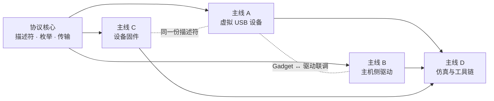

这条路线给已经熟悉 USB 协议核心（[学习路线](page:guide/learning-paths)第 1–3 阶段）、想往 **虚拟 USB、驱动、固件** 方向深挖的读者。四条主线可以并行，每条都给出“先读什么 → 动手做什么 → 对照哪份实现”。

:::tip[一句话结论]
只有 Linux 系（含 Android、ARM 板）把 **设备模式** 开放给开发者：ConfigFS / FunctionFS / Raw Gadget 是做虚拟 USB 研究的首选平台；Windows 侧对应的是 UDE（UdeCx），macOS/iOS 没有公开的等价接口（见 [跨平台对比](page:tech-doc/12-cross-platform-comparison.md)）。
:::

## 主线 A · 虚拟 USB 设备（Linux 为主）

| 步骤 | 读 | 做 |
|---|---|---|
| 1 | [Linux 虚拟 USB：USB/IP、ConfigFS、FunctionFS、Raw Gadget](page:tech-doc/06-linux-virtual-usb.md) | 理清四种机制各自在哪一层“造设备”、谁写描述符 |
| 2 | [实战：Linux USB Gadget（configfs）与 usbip](page:60-枝干-主机侧与实现/07-实战-LinuxGadget与usbip.md) | 用 configfs 拼一个 HID/ACM 复合 gadget；用 usbip 把设备导出到另一台主机 |
| 3 | [Linux USB 栈](page:tech-doc/07-linux-usb-stack.md) · [ARM 嵌入式 USB](page:tech-doc/08-arm-embedded-usb.md) | 看懂 UDC 驱动、设备树里的 `dr_mode` 与角色切换 |
| 4 | [USB 安全与 BadUSB](page:70-枝干-调试测试与安全/04-USB安全与BadUSB.md) | 理解“能伪装成任何设备”带来的攻击面与防护 |

对照实现：[usbsim 协议仿真器](page:labs/usbsim)（纯软件虚拟主机 ↔ 虚拟设备，包级编解码与 CRC 实算）。

## 主线 B · 主机侧驱动

| 步骤 | 读 | 做 |
|---|---|---|
| 1 | [主机控制器栈全景](page:60-枝干-主机侧与实现/01-主机控制器栈全景.md) · [操作系统 USB 支持](page:60-枝干-主机侧与实现/02-操作系统USB支持.md) | 画出 xHCI → 集线器驱动 → 复合设备驱动 → 类驱动 的调用链 |
| 2 | [Windows USB 驱动开发](page:60-枝干-主机侧与实现/08-WindowsUSB驱动开发.md) | 按决策树判断：WinUSB 免驱够不够、何时写 KMDF |
| 3 | [libusb 与用户态访问](page:60-枝干-主机侧与实现/04-libusb与用户态访问.md) · [实战：libusb 主机程序](page:60-枝干-主机侧与实现/06-实战-libusb主机程序.md) | 用户态直接收发控制/批量传输 |
| 4 | [macOS USB（IOKit / DriverKit）](page:tech-doc/09-macos-usb.md) · [Android USB](page:tech-doc/11-android-usb.md) · [iOS/iPadOS](page:tech-doc/10-ios-ipados-usb.md) | 对照 Windows 经验迁移：驱动跑在哪一层、谁签名、谁授权 |
| 5 | [跨平台 USB 栈异同](page:tech-doc/12-cross-platform-comparison.md) | 做一张自己的“同一需求在五个平台怎么实现”对照表 |

对照实现：[USB DevStudio 原生上位机](page:labs/devstudio)（Win32 + C++20：SetupDi / HidD / WinUSB / SCSI 直通四类通道）。

## 主线 C · 设备固件

| 步骤 | 读 | 做 |
|---|---|---|
| 1 | [设备端固件栈](page:60-枝干-主机侧与实现/03-设备端固件栈.md) | 对比 TinyUSB 与其他开源栈；IAD 复合设备骨架、ZLP 语义 |
| 2 | [实战：TinyUSB 复合设备固件](page:60-枝干-主机侧与实现/05-实战-TinyUSB设备固件.md) | 在 RP2040 / STM32 上跑通 HID + CDC |
| 3 | [HID 报告描述符与 Item 编码](page:20-枝干-设备类协议/HID-人机接口设备/02-报告描述符与Item编码.md) · [DFU 固件升级](page:20-枝干-设备类协议/其他设备类/01-DFU固件升级.md) | 手写报告描述符；设计 bootloader 分区与跳转 |
| 4 | [USB PD 深入：状态机与消息全表](page:30-枝干-接口与供电/07-USBPD深入-状态机与消息全表.md) | 读懂 PE_SNK 状态机，再看 TCPC 驱动骨架 |

对照实现：[Lab1 HID](page:labs/lab1-hid-composite) · [Lab2 CDC+DFU](page:labs/lab2-cdc-dfu) · [Lab3 MSC](page:labs/lab3-msc) · [Lab5 PD](page:labs/lab5-pd-charger)。

## 主线 D · 仿真、抓包与测试工具链

| 步骤 | 读 | 做 |
|---|---|---|
| 1 | [协议分析仪与抓包](page:70-枝干-调试测试与安全/01-协议分析仪与抓包.md) | usbmon / USBPcap + Wireshark 抓一次完整枚举 |
| 2 | [枚举失败排查手册](page:70-枝干-调试测试与安全/02-枚举失败排查手册.md) | 用错误注入复现“描述符长度错 / STALL / 超时” |
| 3 | [合规测试实操](page:70-枝干-调试测试与安全/05-合规测试实操.md) | 把检查项写成自动化产测步骤 |

对照实现：[usbtest 产测框架](page:labs/usbtest) · [抓包教学样本](page:labs/captures) · [usbsim](page:labs/usbsim)。

## 规范出处

研究时需要回到原文的地方，优先看[规范精读](page:tech-doc/README.md)（每条事实标章节/表号）与[规范索引](page:reference/specs)（官方下载地址）。平台驱动部分的权威来源是厂商官方文档（Microsoft Learn、docs.kernel.org、developer.apple.com、source.android.com），不是标准组织规范。
