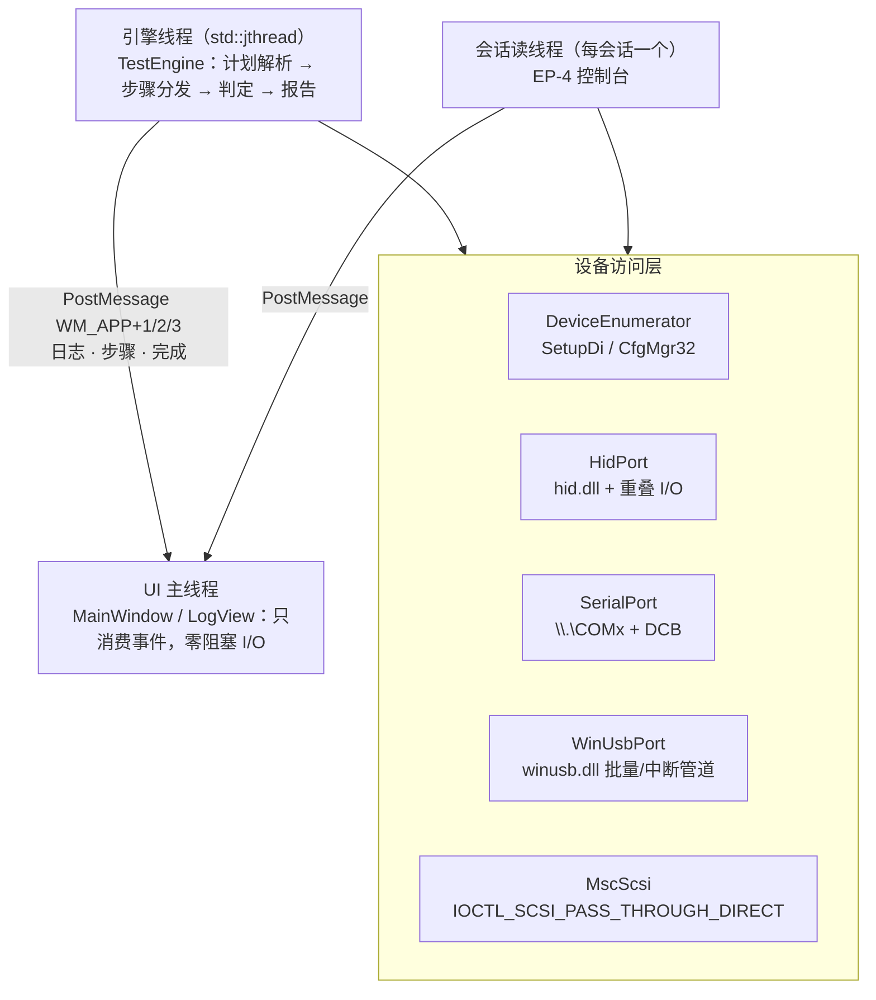

:::caution[验证状态]
目录 [apps/win/USBTestStudio](labtree:apps/win/USBTestStudio) · usb-labs @ `c990292`。仓库 CI 用 MSVC 编译并跑离线自测靶（零告警），但 README 第 8 节明确写着：**设备访问层未在真机上联调**，首次真机联调预计要按“不确定 API 清单”小幅修正。macOS 版**未编译验证**。
:::

## 演示什么

把 USBTree 的知识变成一个工程师每天用的工具：同一个 exe 里能看设备树、编辑并校验描述符、在虚拟设备上单步调试枚举、过滤协议追踪、跑产测计划、上产线。产测计划与报告和 [usbtest](page:labs/usbtest) **字段完全一致**，可以直接进 MES。

启动模式：默认 DevStudio 工作站 · `--console` 工程师通信控制台 · `--legacy` 旧产测界面 · `--smoke` 烟测。退出码 `0` PASS、`1` FAIL、`2` 中止、`3` 计划加载失败，供 MES 以 `--auto` 启动后读取。

## 六个工作台

| 工作台 | 引擎 | 关键源码 | 对应概念 |
|---|---|---|---|
| W1 项目台 | 工程模型 `.ustsproj`、设备目录、诊断 | [project_tree.h](labsrc:apps/win/USBTestStudio/src/shell/project_tree.h) · [device_catalog.h](labsrc:apps/win/USBTestStudio/src/discovery/device_catalog.h) | [Windows USB 驱动开发](page:60-枝干-主机侧与实现/08-WindowsUSB驱动开发.md) |
| W2 描述符台 | **三向编译器**：二进制 ⇄ 模型 ⇄ C 源码，外加 25 条规则的 Linter | [desc_parse.h](labsrc:apps/win/USBTestStudio/src/shell/desc_parse.h) · [desc_build.h](labsrc:apps/win/USBTestStudio/src/shell/desc_build.h) · [desc_gen_c.h](labsrc:apps/win/USBTestStudio/src/shell/desc_gen_c.h) · [desc_lint.h](labsrc:apps/win/USBTestStudio/src/shell/desc_lint.h) | [描述符详解](page:10-树干-USB核心/07-描述符详解.md) |
| W3 虚拟调试器 | C++ 原生虚拟设备内核：USB 状态机 + EP0 标准请求子集 + HID 中断报告流 + 断点 + 错误注入；`.ustssim` 场景脚本 | [vd_core.h](labsrc:apps/win/USBTestStudio/src/shell/vd_core.h#L17-L80) · [vd_script.h](labsrc:apps/win/USBTestStudio/src/shell/vd_script.h) | [枚举流程](page:10-树干-USB核心/08-枚举流程与标准请求.md) · [错误处理与可靠性](page:10-树干-USB核心/11-错误处理与可靠性.md) |
| W4 协议追踪台 | 过滤 DSL（`&&` `||` `!` 比较式）+ 统计 | [trace_dsl.h](labsrc:apps/win/USBTestStudio/src/shell/trace_dsl.h) | — |
| W5 测试台 | 双后端回归 + `.ustsflow` 线性 Pipeline | [pipeline.h](labsrc:apps/win/USBTestStudio/src/shell/pipeline.h) · [te_runner.h](labsrc:apps/win/USBTestStudio/src/shell/te_runner.h) · [test_engine.cpp](labsrc:apps/win/USBTestStudio/src/engine/test_engine.cpp) | — |
| W6 产线台 | 产测执行视图、产线大屏、报告中心 | [设计文档 §6](labsrc:apps/设计-USBDevStudio六工作台.md) | — |

W3 的错误注入点直接对应知识树里的异常路径：`StallNext`、`NakTimes`、`DropPower`、`ToggleErr`、`Babble`；断点可以设在控制请求、枚举步骤、端点传输、状态变化或错误计数上。

## 架构与线程模型



四种通道（HID、串口、WinUSB、MSC）共用 [channel.h](labsrc:apps/win/USBTestStudio/src/channel/channel.h) 里的 `IChannel` 契约，控制台与产测引擎用同一套实现。日志统一走 vendored spdlog v1.14.1，格式与 Python 端 `logbase.py` 对齐。

## 构建与运行

```powershell
# 方式 A：VS2022 打开 USBTestStudio.sln（v143），Release | x64
# 方式 B：CMake
cd apps\win\USBTestStudio
cmake -S . -B build -G "Visual Studio 17 2022" -A x64
cmake --build build --config Release
USBTestStudio.exe                                  # DevStudio 工作站
USBTestStudio.exe --console                        # 工程师通信控制台
USBTestStudio.exe --plan plan.json --dut-sn SN0001 --auto   # 产线：跑完自动退出并返回退出码
```

CMake 同时产出多个 `*_selftest` 自测靶（通道、发现、描述符、解析、会话、引擎、追踪、虚拟设备、工作站壳等），CI 逐个跑。

## 已知限制（摘自 README §8）

- 未真机运行；`msc_write_verify`、`line_coding`、`dfu_verify` 在 Windows 版里尚未实现，执行到即 FAIL。
- 回环类步骤依赖回显固件或工装。
- 高 DPI 下 ListView 列宽未随 `WM_DPICHANGED` 调整。

## macOS 版 USBTestStudio

[apps/mac/USBTestStudio](labtree:apps/mac/USBTestStudio)：Swift 5.9 + AppKit + IOKit，零第三方依赖，SPM 构建（`swift build` / `swift run`），计划与报告字段同 usbtest。仓库标注为**未编译验证**。
