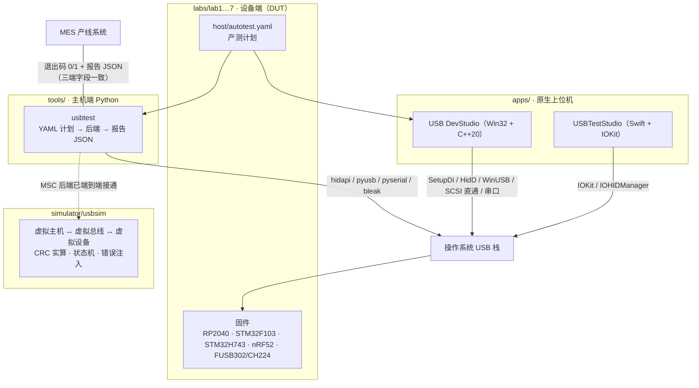

[usb-labs](https://github.com/tangjianfang/usb-labs) 是 USBTree 的配套实现仓库：**USBTree 讲“为什么 / 是什么”，usb-labs 讲“怎么做”**。本节逐个摘要它的实验与工具——演示什么、怎么搭的、关键代码在哪、怎么跑、对应哪些知识树概念。

:::note[实现快照]
摘要基于 usb-labs 提交 [`c990292`](https://github.com/tangjianfang/usb-labs/tree/c99029204b73ce5b38f9feedf1997b143c766ca8)（2026-09-12）。页面里的源码链接都固定在这个提交上，行号不会随 main 漂移。
:::

## 体系结构

三端（Python 参考实现、Windows、macOS）共用同一套**冻结契约**：测试计划字段、报告 JSON 字段、PD 遥测键名、MSC CDB 口径——同一份计划可在三端互换，报告可以直接进 MES。

## 七个全栈实验

| 实验 | 协议族 | 平台 / 栈 | 实现深度 | 对应知识树 |
|---|---|---|---|---|
| [Lab1 · HID 复合设备](page:labs/lab1-hid-composite) | HID | RP2040 · pico-sdk + TinyUSB | 完整固件 + 主机监视器 | [HID](page:20-枝干-设备类协议/HID-人机接口设备) · [描述符](page:10-树干-USB核心/07-描述符详解.md) |
| [Lab2 · CDC + DFU](page:labs/lab2-cdc-dfu) | CDC-ACM · DFU 1.1 | STM32F103 · TinyUSB | 完整固件 + 串口工具 | [虚拟串口 ACM](page:20-枝干-设备类协议/CDC-通信设备类/01-虚拟串口ACM.md) · [DFU](page:20-枝干-设备类协议/其他设备类/01-DFU固件升级.md) |
| [Lab3 · MSC 大容量存储](page:labs/lab3-msc) | MSC BOT · SCSI | RP2040 · TinyUSB | 完整固件（Flash 盘 / SD 卡） | [MSC 与 BOT](page:20-枝干-设备类协议/MSC-大容量存储/00-MSC概述与BOT.md) |
| [Lab4 · UVC + UAC](page:labs/lab4-uvc-uac) | UVC 1.1 · UAC 1.0 | STM32H743 骨架 / Linux gadget | 教学骨架 | [UVC](page:20-枝干-设备类协议/Video-UVC/00-UVC详解.md) · [UAC](page:20-枝干-设备类协议/Audio-UAC/00-UAC概述.md) |
| [Lab5 · USB PD 电源](page:labs/lab5-pd-charger) | Type-C · PD | FUSB302 TCPC / CH224 | PE_SNK 骨架 + 遥测契约 | [USB PD](page:30-枝干-接口与供电/04-USBPD协议.md) |
| [Lab6 · BLE 双模键鼠](page:labs/lab6-ble-hid-dongle) | HOGP · HID · ESB | nRF52 · nRF Connect SDK | 集成点与骨架 | [HOGP](page:50-枝干-无线关联/BLE-低功耗蓝牙/07-HOGP-HIDoverGATT.md) |
| [Lab7 · 扩展坞](page:labs/lab7-dock-altmode) | Alt Mode · USB4 · Hub | 方案级 | 概要（架构地图） | [Alt Mode](page:30-枝干-接口与供电/05-AlternateMode与E-marker.md) · [USB4](page:40-枝干-高速演进/02-USB4与雷电整合.md) |

## 工具链

| 工具 | 是什么 | 语言 | 状态（按仓库自述与本次复核） |
|---|---|---|---|
| [usbsim](page:labs/usbsim) | 纯软件 USB/BLE/PD 协议仿真器 | Python | 自测全绿（本次在 Linux 上复跑通过） |
| [usbtest](page:labs/usbtest) | YAML 计划驱动的产测框架 | Python | 7 个实验的计划 mock 全绿；后端离线自测 35 例中 34 例在 Linux 通过（1 例 GBK 解码用例依赖 Windows 环境） |
| [USB DevStudio](page:labs/devstudio) | Windows 原生上位机 / USB 工作站 | C++20 · Win32 | CI 上 MSVC 编译 + 离线自测；仓库声明“未在真机上运行验证” |
| [抓包教学样本](page:labs/captures) | 6 份按规范重构的逐包标注 | Markdown + Python 校验 | 字节校验脚本本次复跑：DATA 44 / TOKEN 14 全部通过 |

## 诚实边界

usb-labs 自己写明的限制，这里照实转述：

- `captures/` 与各实验 `capture/` 里的帧序列是**按官方规范重构的教学样本**，不是真实设备抓包；CRC 按规范算法实算。
- Lab4（UVC/UAC）、Lab5（PD）、Lab6（BLE）的固件是**教学骨架 / 集成点**，生产实现建议用 Linux TCPM、Nordic NCS 官方示例等已认证栈；Lab7 只到架构地图。
- 真机验收与实验室 bring-up 尚未执行（缺 U 盘 / 串口治具 / 蓝牙适配器 / USB 声卡 / 扩展坞），macOS 端未编译验证。
