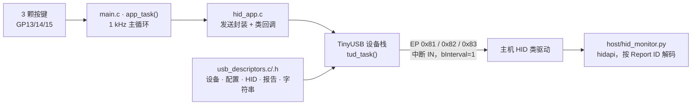

:::note[实现快照]
目录 [labs/lab1-hid-composite](labtree:labs/lab1-hid-composite) · usb-labs @ `c990292` · 实现深度：**完整固件 + 主机工具**
:::

## 演示什么

一个 USB 设备、三个独立 HID 接口：**Interface 0 键盘 / Interface 1 鼠标 / Interface 2 消费控制**（音量、播放/暂停）。基准平台是 Raspberry Pi RP2040（USB 1.1 全速设备），固件栈是 pico-sdk 内置的 TinyUSB。没有自制板时可以直接跑在 Raspberry Pi Pico 上：GP13/14/15 对地短接就是三颗演示按键。

它对应的量产品类是 2.4G 键鼠接收器、游戏外设、多媒体遥控器、KVM/测试治具——接收器插上 PC 就是“键盘 + 鼠标”复合 HID。[Lab6](page:labs/lab6-ble-hid-dongle) 直接复用这里的报告描述符。

## 架构



## 关键代码路径

| 文件 | 做什么 | 对应概念 |
|---|---|---|
| [usb_descriptors.h](labsrc:labs/lab1-hid-composite/firmware/src/usb_descriptors.h#L25-L56) | 演示用 VID/PID（`0x1234/0x0002`，量产必须替换）、Report ID `0x01/0x02/0x03`、端点 `0x81/0x82/0x83` | [描述符详解](page:10-树干-USB核心/07-描述符详解.md) |
| [usb_descriptors.c · 配置描述符](labsrc:labs/lab1-hid-composite/firmware/src/usb_descriptors.c#L88-L127) | 总长 84 字节 = 9 + 25×3；键盘、鼠标声明 boot 子类（BIOS 下可用），消费控制协议 = 0；三接口 `bInterval=1` → 全速下 1 ms 轮询 | [HID 描述符](page:20-枝干-设备类协议/HID-人机接口设备/01-HID描述符.md) · [四种传输类型](page:10-树干-USB核心/06-四种传输类型.md) |
| [usb_descriptors.c · 报告描述符回调](labsrc:labs/lab1-hid-composite/firmware/src/usb_descriptors.c#L79-L86) | 按接口实例返回三份报告描述符 | [报告描述符与 Item 编码](page:20-枝干-设备类协议/HID-人机接口设备/02-报告描述符与Item编码.md) |
| [hid_app.c · 发送封装](labsrc:labs/lab1-hid-composite/firmware/src/hid_app.c#L29-L51) | 键盘（modifier + 6 键码）、鼠标（按钮 + dx/dy/滚轮）、消费控制（16 位 Usage，发 `0x0000` 表示释放） | [键盘](page:20-枝干-设备类协议/HID-人机接口设备/05-键盘详解.md) · [鼠标](page:20-枝干-设备类协议/HID-人机接口设备/06-鼠标详解.md) · [消费控制](page:20-枝干-设备类协议/HID-人机接口设备/07-消费控制与多媒体.md) |
| [hid_app.c · 类请求回调](labsrc:labs/lab1-hid-composite/firmware/src/hid_app.c#L58-L106) | GET_REPORT / SET_REPORT（键盘 LED 输出报告）、boot 协议切换回调 | [传输与类特定请求](page:20-枝干-设备类协议/HID-人机接口设备/04-传输与类特定请求.md) |
| [main.c · app_task](labsrc:labs/lab1-hid-composite/firmware/src/main.c#L123-L172) | 1 ms 节拍：按键消抖 → 播放/暂停（150 ms 后补发释放）、鼠标画正方形、逐字符打字；1 Hz 心跳灯 | — |
| [tusb_config.h](labsrc:labs/lab1-hid-composite/firmware/src/tusb_config.h#L38-L49) | `CFG_TUD_HID 3`、EP0 64 字节、HID 端点缓冲 16 字节 | [TinyUSB 实战](page:60-枝干-主机侧与实现/05-实战-TinyUSB设备固件.md) |
| [host/hid_monitor.py](labsrc:labs/lab1-hid-composite/host/hid_monitor.py#L40-L95) | hidapi 打开设备，按 Report ID 解码三种报告 | — |

## 构建与运行

```bash
# pico-sdk（tinyusb 是它的 submodule，必须拉全）
git clone -b 1.5.1 https://github.com/raspberrypi/pico-sdk.git
cd pico-sdk && git submodule update --init && cd ..
export PICO_SDK_PATH=$(pwd)/pico-sdk

cd usb-labs/labs/lab1-hid-composite/firmware
mkdir build && cd build && cmake .. && make
# 按住 BOOTSEL 插 USB，把 lab1_hid_composite.uf2 拖进出现的 U 盘

pip install hidapi
python host/hid_monitor.py --list
python host/hid_monitor.py --vid 0x1234 --pid 0x0002
```

抓包：Linux 用 usbmon、Windows 用 USBPcap，Wireshark 过滤 `usb.transfer_type == 0x01` 看中断传输（实验自带的[帧分析](labsrc:labs/lab1-hid-composite/capture/HID帧序列分析.md)）。

## 产测计划

[host/autotest.yaml](labsrc:labs/lab1-hid-composite/host/autotest.yaml) 交给 [usbtest](page:labs/usbtest) 或 [DevStudio](page:labs/devstudio) 执行：枚举检测 → 描述符合规 → 回报率 ≥ 900 Hz（测 2 s）→ 写 LED 输出报告 → 工装环回。回报率与环回需要工装或固件自测模式配合（仓库风险表 R-005：固件自环模式尚未实现）。

## 读码时注意

- 三个接口各自独立，但每份报告描述符仍声明了 Report ID，所以报告第一个字节是 ID（监视器按 ID 解码）。
- 回调名随 TinyUSB 版本变化（源码注释提到 0.15 的 `tud_hid_boot_protocol_cb`），以所用 SDK 头文件为准。
- [experience.md](labsrc:labs/lab1-hid-composite/experience.md) 是量产经验：回报率营销口径、NKRO、休眠功耗、三端兼容、寿命与量产烧录。
