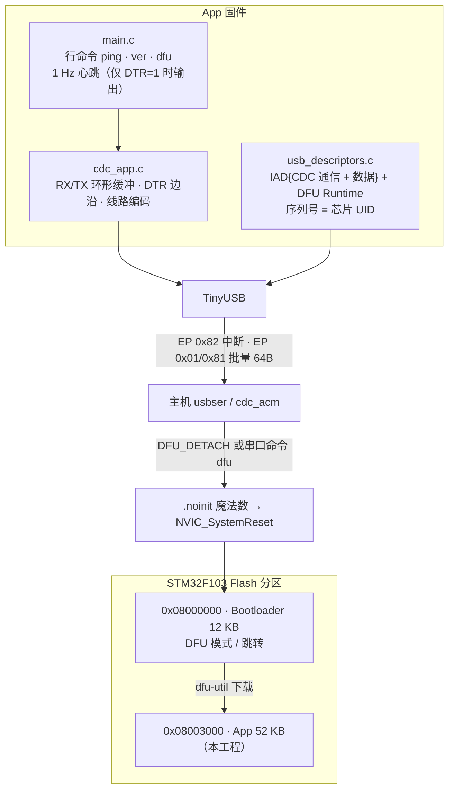

:::note[实现快照]
目录 [labs/lab2-cdc-dfu](labtree:labs/lab2-cdc-dfu) · usb-labs @ `c990292` · 实现深度：**完整应用固件源码 + 主机串口工具**（工程需按 README 用 CubeMX 生成外壳后合并）
:::

## 演示什么

一块 STM32F103C8T6（“蓝色药丸”级 64 KB Flash / 20 KB RAM）枚举成**复合设备**：Interface 0/1 是 CDC-ACM 虚拟串口（命令行调试口），Interface 2 是 DFU Runtime（在线升级入口）。VID/PID 为演示值 `0xCAFE/0x4010`。

对应的真实品类：工业控制器的调试口、可在线升级的仪器、各种“插上就有 COM 口”的开发板。

## 架构



## 关键代码路径

| 文件 | 做什么 | 对应概念 |
|---|---|---|
| [usb_descriptors.c · 端点与配置](labsrc:labs/lab2-cdc-dfu/firmware/src/usb_descriptors.c#L36-L83) | 通知端点 `0x82`（中断）、数据端点 `0x01/0x81`（批量 64 B）；`TUD_CDC_DESCRIPTOR` 宏自带 IAD，把两个 CDC 接口绑成一个功能 | [虚拟串口 ACM](page:20-枝干-设备类协议/CDC-通信设备类/01-虚拟串口ACM.md) · [CDC 概述](page:20-枝干-设备类协议/CDC-通信设备类/00-CDC概述.md) |
| [usb_descriptors.c · 序列号](labsrc:labs/lab2-cdc-dfu/firmware/src/usb_descriptors.c#L98-L121) | 用芯片 96 位 UID 生成 iSerial，Windows 据此记住 COM 号 | [描述符详解](page:10-树干-USB核心/07-描述符详解.md) |
| [cdc_app.c · 环形缓冲](labsrc:labs/lab2-cdc-dfu/firmware/src/cdc_app.c#L45-L86) | `ring_put(..., drop_oldest)`：主机不读时丢旧日志而不是阻塞主循环 | — |
| [cdc_app.c · 类回调](labsrc:labs/lab2-cdc-dfu/firmware/src/cdc_app.c#L147-L185) | `tud_cdc_line_state_cb` 记录 DTR 边沿；`tud_cdc_line_coding_cb` 接收波特率（对虚拟串口只是“协商值”） | [CDC 请求与通知全表](page:20-枝干-设备类协议/CDC-通信设备类/03-CDC规范级-请求与通知全表.md) |
| [main.c · 命令与心跳](labsrc:labs/lab2-cdc-dfu/firmware/src/main.c#L82-L123) | `ping`/`ver`/`dfu` 行命令；心跳只在 DTR=1（主机打开串口）时输出 | — |
| [main.c · DFU 回调](labsrc:labs/lab2-cdc-dfu/firmware/src/main.c#L126-L132) | 收到 `DFU_DETACH`（bmRequestType 0x21, bRequest 0x00）→ 写魔法数 → 复位，由 bootloader 接管 | [DFU 固件升级](page:20-枝干-设备类协议/其他设备类/01-DFU固件升级.md) |
| [bootloader 选型与跳转设计](labsrc:labs/lab2-cdc-dfu/firmware/src/bootloader选型与跳转设计.md) | ROM DFU / 自研 bootloader 的取舍、跳转前的外设与中断复位、向量表重定位 | — |
| [host/serial_tool.py](labsrc:labs/lab2-cdc-dfu/host/serial_tool.py#L31-L56) | 按 VID:PID 自动找口、断线自动重连、按日切分日志 | — |

## 构建与运行

仓库提供应用层四个源文件与 `tusb_config.h`，不带 CubeMX 生成的启动/时钟外壳。按 [firmware/README](labsrc:labs/lab2-cdc-dfu/firmware/README.md) 用 CubeMX 生成 F103 工程，把 `src/` 原样加入并合并 `SystemClock_Config`，再：

```bash
cmake -B build -G Ninja -DCMAKE_TOOLCHAIN_FILE=cmake/arm-gcc.cmake
cmake --build build

pip install pyserial
python host/serial_tool.py --vidpid 0xCAFE:0x4010  # 只认本 Lab 设备，断线自动重连
dfu-util -l                                        # 看到 Runtime 接口
dfu-util -e                                        # 发 DFU_DETACH
dfu-util -a 0 -s 0x08003000:leave -D app.bin       # 升级 App 分区
```

升级流程详见 [host/dfu_guide.md](labsrc:labs/lab2-cdc-dfu/host/dfu_guide.md)。

## 产测计划

[host/autotest.yaml](labsrc:labs/lab2-cdc-dfu/host/autotest.yaml)：枚举 → 线路编码往返 → 串口环回 ×4 → DFU 升级校验。

## 读码时注意

- “波特率”对 USB 虚拟串口没有物理意义，只有桥接真 UART 时才需要生效。
- Windows 10+ 自带 `usbser.sys`，满足 ACM 子类即可免驱；复合设备必须有 IAD，否则只会绑到第一个接口。
- [experience.md](labsrc:labs/lab2-cdc-dfu/experience.md) 记录了 COM 号漂移、DTR 门控、升级变砖防护等量产问题。
