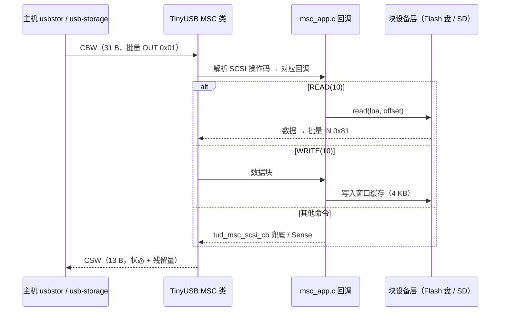

:::note[实现快照]
目录 [labs/lab3-msc](labtree:labs/lab3-msc) · usb-labs @ `c990292` · 实现深度：**完整固件（两种存储后端）**
:::

## 演示什么

RP2040 枚举为 **Mass Storage / SCSI 透明命令集 / Bulk-Only Transport**（接口三元组 `08h/06h/50h`），VID/PID 演示值 `0xCAFE/0x4002`。主机端无需驱动，直接出现一个可格式化的盘。两种后端在编译期切换：

- **默认：Flash RAM 盘**：取 RP2040 外挂 Flash 尾部 1024 块 × 512 B = 512 KB，写入先进 4 KB 扇区窗口缓存，再按擦除粒度回写；
- **`MSC_USE_SD_CARD=1`：SPI TF 卡**：CMD0/8/41/58 初始化，CMD9 读 CSD 算容量，CMD17/24 单块读写。

## 架构



## 关键代码路径

| 文件 | 做什么 | 对应概念 |
|---|---|---|
| [msc_app.c · 文件头](labsrc:labs/lab3-msc/firmware/src/msc_app.c#L1-L30) | SCSI 命令 → TinyUSB 回调映射表（INQUIRY、TEST UNIT READY、READ CAPACITY、READ/WRITE(10)…） | [SCSI 命令与 UFI](page:20-枝干-设备类协议/MSC-大容量存储/01-SCSI命令与UFI.md) |
| [msc_app.c · 设备信息回调](labsrc:labs/lab3-msc/firmware/src/msc_app.c#L232-L287) | LUN 数、INQUIRY 字符串、就绪状态、容量、START STOP UNIT（弹出）、写保护 | [MSC 概述与 BOT](page:20-枝干-设备类协议/MSC-大容量存储/00-MSC概述与BOT.md) |
| [msc_app.c · 读写回调](labsrc:labs/lab3-msc/firmware/src/msc_app.c#L289-L370) | `read10/write10` 按 `lba + offset` 分片；返回值 >0 已完成、0 忙、负数出错（STALL → 主机 REQUEST SENSE） | [SCSI 操作码与 Sense 全表](page:20-枝干-设备类协议/MSC-大容量存储/02-SCSI操作码与Sense全表.md) |
| [msc_app.c · 兜底](labsrc:labs/lab3-msc/firmware/src/msc_app.c#L372-L397) | TinyUSB 内建清单外的命令：PREVENT/ALLOW MEDIUM REMOVAL（0x1E）记录、SYNCHRONIZE CACHE（0x35）落盘，其余回 ILLEGAL REQUEST / 20h（不静默成功） | [SCSI 操作码与 Sense 全表](page:20-枝干-设备类协议/MSC-大容量存储/02-SCSI操作码与Sense全表.md) |
| [sd_spi.c](labsrc:labs/lab3-msc/firmware/src/sd_spi.c) | SPI 模式 SD 驱动：初始化序列、CSD 容量解析、单块读写 | — |

## 构建与运行

```bash
cd labs/lab3-msc/firmware
# Flash RAM 盘（默认，不需要卡）
cmake -S . -B build -DPICO_SDK_PATH=~/pico-sdk -DPICO_BOARD=pico
cmake --build build -j
# SPI TF 卡真盘
cmake -S . -B build-sd -DPICO_SDK_PATH=~/pico-sdk -DPICO_BOARD=pico -DMSC_USE_SD_CARD=1
cmake --build build-sd -j
```

主机验证：Linux `lsblk` + `sg_inq /dev/sdX`；Windows 磁盘管理里能看到 512 KB 的盘。

## 产测计划

[host/autotest.yaml](labsrc:labs/lab3-msc/host/autotest.yaml)：INQUIRY → 容量核对 → LBA 0–7 写读校验（**破坏性**，仅限空白盘产线）。usbtest 的 MSC 后端自己拼 CBW/CSW（[msc_test.py](labsrc:tools/usbtest/msc_test.py#L61-L100)），超过 2 TB 自动切 READ CAPACITY(16)/READ(16)；它也是唯一与 [usbsim](page:labs/usbsim) 端到端接通的后端。

## 读码时注意

- 4 KB 写回缓存意味着掉电可能丢最后一个窗口；真正落盘的时点只有三个：SYNCHRONIZE CACHE、START STOP UNIT（停盘/弹出）和换窗——`write10_complete` 回调故意不冲刷。
- INQUIRY、REQUEST SENSE、READ CAPACITY(10)、READ FORMAT CAPACITIES、MODE SENSE(6)、READ/WRITE(10) 由 TinyUSB 内建处理；`is_writable` 回调关成 false 就是“只读导出”模式（行车记录仪场景）。
