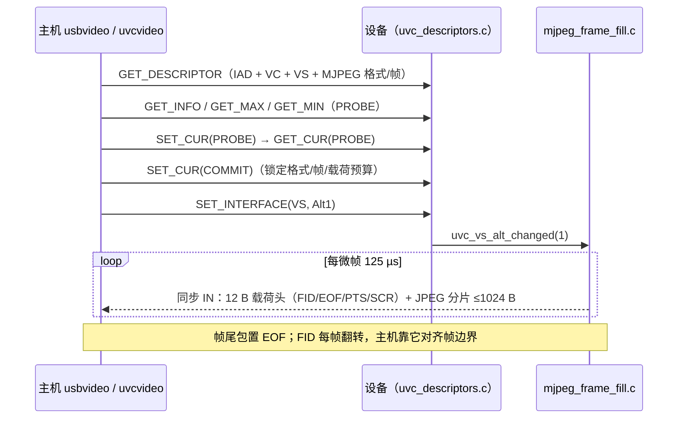

:::caution[实现深度：教学骨架]
目录 [labs/lab4-uvc-uac](labtree:labs/lab4-uvc-uac) · usb-labs @ `c990292`。三份源文件是**描述符 + 类请求 + 打包逻辑**，依赖一个最小平台层（`dcd_*` 接口），仓库不含可直接烧录的工程。README 推荐的路线 A 是 Linux configfs UVC gadget + `uvc-gadget`。
:::

## 演示什么

一个 HS 复合设备：**if0 视频控制（VC）+ if1 视频流（VS，Alt0 零带宽 / Alt1 同步 IN）**，加上 **if2 音频控制 + if3 音频流** 的 UAC1 麦克风。目标硬件是 STM32H743（OTG_HS + ULPI PHY）+ OV5640 JPEG 直出。

- 视频：MJPEG，1280×720 与 640×480 两档，都是 30 fps（帧间隔 333333 × 100 ns）；
- 音频：16 kHz / 48 kHz 两档采样率，拓扑 IT1 → FU2（静音/音量）→ OT3，异步源、无反馈端点；
- VID/PID 演示值 `0x1234/0x5678`。

## 架构

## 关键代码路径

| 文件 | 做什么 | 对应概念 |
|---|---|---|
| [uvc_descriptors.c · 配置](labsrc:labs/lab4-uvc-uac/firmware/src/uvc_descriptors.c#L40-L135) | IAD（Video Collection）、VC 头（bcdUVC 1.10、27 MHz 时钟）、Camera Terminal、MJPEG 格式与两个帧描述符；Alt1 包长 FS 512 / HS 1024 | [UVC 详解](page:20-枝干-设备类协议/Video-UVC/00-UVC详解.md) · [UVC 控制与格式全表](page:20-枝干-设备类协议/Video-UVC/01-UVC规范级-控制与格式全表.md) |
| [uvc_descriptors.c · PROBE/COMMIT](labsrc:labs/lab4-uvc-uac/firmware/src/uvc_descriptors.c#L140-L195) | 26 字节探测结构、主机协商流、`uvc_class_request()` 处理 VS_PROBE / VS_COMMIT | [UVC 详解 · 协商](page:20-枝干-设备类协议/Video-UVC/00-UVC详解.md) |
| [mjpeg_frame_fill.c · 载荷头](labsrc:labs/lab4-uvc-uac/firmware/src/mjpeg_frame_fill.c#L20-L45) | 载荷预算 1024 B；完整头 12 B（含 4 B PTS + 6 B SCR），头部位 FID / EOF / PTS / SCR / ERR / EOH | [四种传输类型 · 同步](page:10-树干-USB核心/06-四种传输类型.md) |
| [mjpeg_frame_fill.c · 发帧](labsrc:labs/lab4-uvc-uac/firmware/src/mjpeg_frame_fill.c#L64-L131) | JPEG 切片、帧尾置 EOF、丢帧时仍翻转 FID | [带宽与调度计算](page:10-树干-USB核心/13-总线带宽与调度计算.md) |
| [uac_mic_descriptors.c](labsrc:labs/lab4-uvc-uac/firmware/src/uac_mic_descriptors.c#L99-L160) | FU 音量（-96…0 dB，0.25 dB 步进；数值单位 1/256 dB）/静音请求，端点采样率控制只接受 16 k / 48 k | [UAC 1.0 详解](page:20-枝干-设备类协议/Audio-UAC/01-UAC1.0详解.md) |

## 为什么帧率不高（这是预期，不是 bug）

HS 单事务同步端点每微帧 1024 B → 8000 × 1024 × 8 ≈ **8.19 Mbit/s**。720p MJPEG 一帧常见 60–150 KB，所以 720p 实际只有个位数到十几 fps，640×480 才是这个骨架“最稳”的档位。商用 720p30 要用每微帧 3 事务（`wMaxPacketSize = 0x1400`）或 USB 3.x，源码注释给出了编码方法。

## 构建与运行

**路线 A（推荐先走通）**：任意支持 USB OTG 的 Linux 板（树莓派 4/Zero 2 W、i.MX 等）用 configfs 组 `uvc` + `uac1` 功能，用户态跑 `uvc-gadget` 喂 vivid 或真实 sensor，详见 [firmware/README](labsrc:labs/lab4-uvc-uac/firmware/README.md)。

**路线 B（MCU 移植）**：把三个源文件接到平台层 `dcd_init / dcd_ep0_send / dcd_iso_video_send / dcd_iso_audio_send`，并把 `SET_INTERFACE` 与类请求事件回调给 `uvc_vs_alt_changed()` / `uvc_class_request()` / `uac_class_request()`。

主机侧调参与验证见 [host/预览与调参.md](labsrc:labs/lab4-uvc-uac/host/预览与调参.md)（`v4l2-ctl --list-formats-ext`、ffplay、Windows 相机应用）。

## 产测计划

[host/autotest.yaml](labsrc:labs/lab4-uvc-uac/host/autotest.yaml)：UVC 接口数 ≥ 2 → 采 30 帧。另有 `uac_record_level` 处理器可测录音电平。
