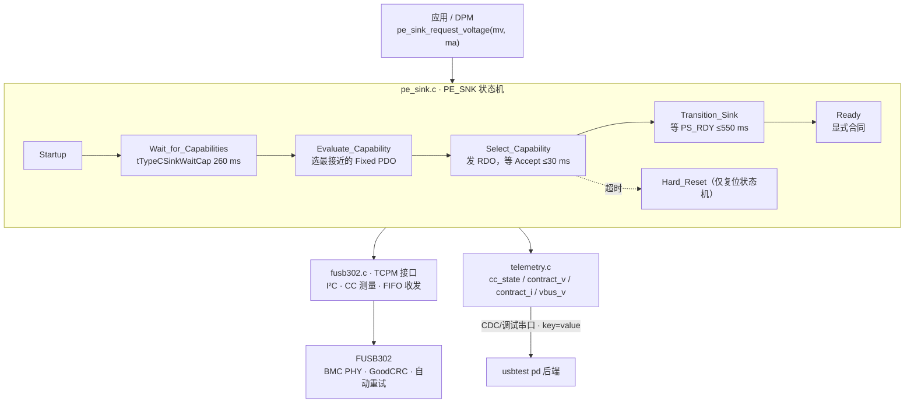

:::caution[实现深度：骨架 + 契约]
目录 [labs/lab5-pd-charger](labtree:labs/lab5-pd-charger) · usb-labs @ `c990292`。`pe_sink.c` 只实现 Fixed PDO 的基本协商；**Hard Reset 恢复、PPS/APDO、EPR、Chunking 都没做**。量产建议参考 Linux `drivers/usb/typec/tcpm/`（含生产级 `fusb302.c`）。
:::

## 演示什么

让一个设备从 Type-C 电源**谈下 9 V（或其他档位）的电源合同**，并把状态用固定格式的遥测行吐给产测工具。

| 路线 | 器件 | 代码量 | 适合 |
|---|---|---|---|
| A | 沁恒 CH224K/M/Q 诱骗芯片 | GPIO/电阻选档或 I²C 读状态 | 只要取电的产品（烙铁、灯带、小风扇） |
| B | onsemi FUSB302 TCPC + MCU | I²C 驱动 + 自写策略引擎 | 要理解协议、或需要动态改电压的产品 |

## 架构（路线 B）



## 关键代码路径

| 文件 | 做什么 | 对应概念 |
|---|---|---|
| [pe_sink.c · 状态与定时器](labsrc:labs/lab5-pd-charger/firmware/src/pe_sink.c#L25-L84) | 状态名对齐规范 `PE_SNK_*`；tSinkWaitCap / tSenderResponse / tPSTransition 常量及其规范窗口 | [PD 深入：状态机与消息全表](page:30-枝干-接口与供电/07-USBPD深入-状态机与消息全表.md) |
| [pe_sink.c · 选档与 RDO](labsrc:labs/lab5-pd-charger/firmware/src/pe_sink.c#L118-L167) | 遍历 Source_Capabilities 只看 Fixed PDO（B31:30=00），选与需求电压最接近的；RDO 里没有电压，只有 ObjPos 指向 PDO | [USB PD 协议](page:30-枝干-接口与供电/04-USBPD协议.md) · [PD 消息全表](page:30-枝干-接口与供电/08-USBPD消息全表.md) |
| [pe_sink.c · 收包与推进](labsrc:labs/lab5-pd-charger/firmware/src/pe_sink.c#L180-L335) | `pe_sink_on_rx()` 按消息类型推进状态；`pe_sink_run()` 处理超时 | — |
| [fusb302.c](labsrc:labs/lab5-pd-charger/firmware/src/fusb302.c#L96-L330) | 初始化、CC1/CC2 测量与 Rp 档位判断、TX FIFO 发包、RX FIFO 收包 | [Type-C 状态机与 CC 时序](page:30-枝干-接口与供电/09-TypeC规范级-状态机与CC时序.md) |
| [ch224_example.c](labsrc:labs/lab5-pd-charger/firmware/src/ch224_example.c#L55-L120) | CH224K 用 CFG 引脚电平选档，CH224M/Q 走 I²C 读状态，PG 引脚判定成功 | [Type-C 详解](page:30-枝干-接口与供电/02-USBType-C详解.md) |
| [telemetry_contract.h](labsrc:labs/lab5-pd-charger/firmware/src/telemetry_contract.h) | 遥测契约 v1：四个键名“只加不改”，产测在 2 s 窗口内采集 | — |

## 构建与运行

源码不绑定特定 MCU：平台层提供 I²C 读写与毫秒节拍即可。遥测部分可以在主机上自检：

```bash
cd labs/lab5-pd-charger/firmware/src
cc -DHOST_TELEMETRY_SELFTEST telemetry.c -o tel && ./tel
# cc_state=Attached.SNK
# contract_v=9.00 …
```

协议对照：[capture/PD协商帧序列.md](labsrc:labs/lab5-pd-charger/capture/PD协商帧序列.md)，也可以用 [usbsim](page:labs/usbsim) 的 `run_pd_negotiation.py` 在纯软件里看完整一轮协商。

## 产测计划

[host/autotest.yaml](labsrc:labs/lab5-pd-charger/host/autotest.yaml)：CC attach → 5 V 合同 → 发 `req 9` 后 9 V 合同 → VBUS 实测 9 V ± 0.25 V。
