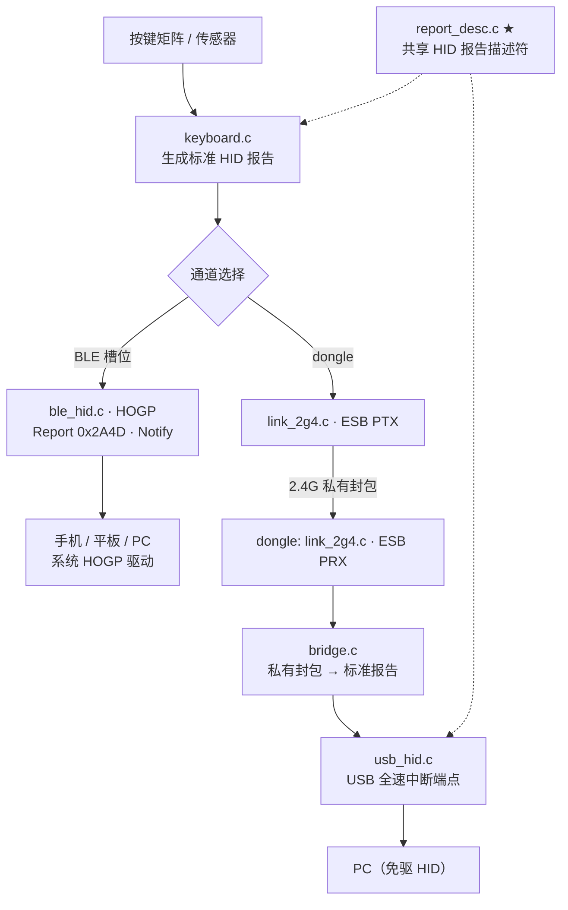

:::caution[实现深度：集成点与骨架]
目录 [labs/lab6-ble-hid-dongle](labtree:labs/lab6-ble-hid-dongle) · usb-labs @ `c990292`。固件目录里只有 [架构说明.md](labsrc:labs/lab6-ble-hid-dongle/firmware/src/架构说明.md)：关键文件骨架 + 集成点，**不是可直接烧录的工程**。完整工程 = NCS 官方 `peripheral_hids_keyboard` + USB HID 示例 + ESB 库 + 本文集成点；API 名以所装 NCS 版本头文件为准。
:::

## 演示什么

罗技 K380 / MX Keys 那类**双模三通道**键盘：通道 1 走 2.4G dongle，通道 2/3 直连蓝牙。核心论点是 **HOGP 的 Report Map（0x2A4B）就是 USB HID 报告描述符原样塞进 GATT**——所以 [Lab1](page:labs/lab1-hid-composite) 的描述符可以两边 100% 共用。

## 架构

## 关键集成点

| 集成点 | 内容 | 对应概念 |
|---|---|---|
| HOGP 服务注册 | Report Map 0x2A4B 直接引用共享描述符；每个报告一个 Report 0x2A4D 实例 + Report Reference 0x2908（ID, 类型 1/2/3）；Boot Keyboard/Mouse Input 0x2A22/0x2A33；Protocol Mode 0x2A4E | [HOGP](page:50-枝干-无线关联/BLE-低功耗蓝牙/07-HOGP-HIDoverGATT.md) · [ATT 与 GATT](page:50-枝干-无线关联/BLE-低功耗蓝牙/04-ATT与GATT.md) |
| 电量服务 | BAS 0x180F，系统托盘显示电量，商业键盘必备 | [标准 UUID 全表](page:50-枝干-无线关联/BLE-低功耗蓝牙/16-标准UUID全表.md) |
| 发送路径 | 按键事件 → 与 USB 侧同一函数组报告 → `bt_hids_report_send()` → ATT Notification（opcode 0x1B） | [HID 跨传输 I²C 与 BLE](page:20-枝干-设备类协议/HID-人机接口设备/10-HID跨传输I2C与BLE.md) |
| 配对与白名单 | 配对按钮、多槽位绑定、dongle 白名单 | [SMP 安全与配对](page:50-枝干-无线关联/BLE-低功耗蓝牙/06-SMP安全与配对.md) |
| 报告节奏映射 | USB 中断端点 bInterval ↔ BLE 连接间隔，是同一条“报告节奏”在两种物理层上的映射 | [广播与连接](page:50-枝干-无线关联/BLE-低功耗蓝牙/03-广播与连接.md) |

## 选型结论（摘自实验 README）

nRF52840 内置全速 USB，可以“同款芯片做键盘和 dongle”；ESP32-C6 的 USB 只是 Serial/JTAG 调试口，不能做通用 HID 设备；ESP32-S3 有 USB OTG 可做单芯片备选。

## 构建与运行

按 [firmware/README](labsrc:labs/lab6-ble-hid-dongle/firmware/README.md) 安装 nRF Connect SDK，以 `peripheral_hids_keyboard` 为起点 `west build -b nrf52840dk/nrf52840`（旧版 NCS 板名为 `nrf52840dk_nrf52840`），再按架构说明加入共享描述符与 dongle 侧工程。主机侧抓 HCI：Linux `btmon`（[host/btmon.md](labsrc:labs/lab6-ble-hid-dongle/host/btmon.md)）。帧分析是按 Core Spec 重构的教学样本：[capture/BLE连接帧分析.md](labsrc:labs/lab6-ble-hid-dongle/capture/BLE连接帧分析.md)。

## 产测计划

[host/autotest.yaml](labsrc:labs/lab6-ble-hid-dongle/host/autotest.yaml)：BLE 扫描连接（名称前缀 `USB-Labs Mouse`）→ 发现 HOGP 服务 0x1812 → 收到 3 次 HID 通知。usbtest 的 BLE 后端基于 bleak。
