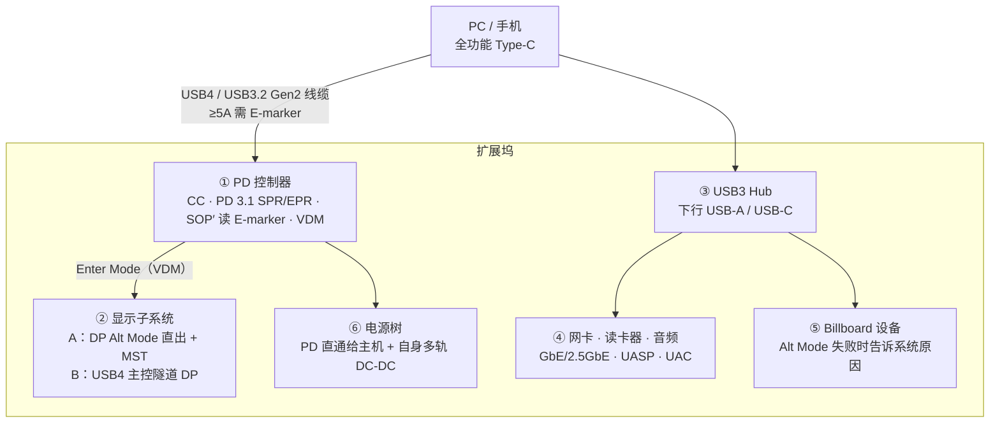

:::caution[实现深度：概要（架构地图）]
目录 [labs/lab7-dock-altmode](labtree:labs/lab7-dock-altmode) · usb-labs @ `c990292`。实验自述：商业扩展坞涉及 USB4/雷电主控授权、全栈认证、DP 带宽调试、多 PC 兼容矩阵，是数人月到数人年的工程量，所以**只给架构地图、选型起点与调试方向，不提供固件**。
:::

## 演示什么

一句话：**扩展坞 = PD 控制器（谈判代表）+ 显示/数据分发芯片（干活的）+ Billboard（翻译官）+ 一堆挂在 Hub 下的标准 USB 设备**。读懂它就把 Type-C、PD、Alt Mode、USB4 隧道和 Hub 串成了一条线。

## 架构

## 知识地图

| 层级 | 内容 | 对应概念 |
|---|---|---|
| 连接器 / 线缆 | 全功能 Type-C、E-marker、插拔寿命 | [Alt Mode 与 E-marker](page:30-枝干-接口与供电/05-AlternateMode与E-marker.md) |
| PD / CC | PD 3.1 SPR/EPR、Source/Sink、SOP′/SOP″、VDM | [USB PD 协议](page:30-枝干-接口与供电/04-USBPD协议.md) · [PD 深入](page:30-枝干-接口与供电/07-USBPD深入-状态机与消息全表.md) |
| Alt Mode / 显示 | DP Alt Mode 进入/退出、lane 分配、SST/MST、DSC | [Alt Mode 与 E-marker](page:30-枝干-接口与供电/05-AlternateMode与E-marker.md) |
| USB4 / 隧道 | 路由器、适配层、USB3/DP 隧道、连接管理器 | [USB4 与雷电整合](page:40-枝干-高速演进/02-USB4与雷电整合.md) · [USB4 路由与隧道](page:40-枝干-高速演进/05-USB4深入-路由隧道与配置.md) |
| USB 设备 | Hub、网卡、读卡器、Billboard 枚举 | [集线器与连接管理](page:10-树干-USB核心/09-集线器与连接管理.md) · [长尾设备类（含 Billboard）](page:20-枝干-设备类协议/其他设备类/09-长尾设备类-AV-Billboard-Healthcare-I3C.md) |

## 产测与抓包

[host/autotest.yaml](labsrc:labs/lab7-dock-altmode/host/autotest.yaml)：拓扑核对（下行高速口 ≥ 2）→ Hub 端口插拔循环 5 次（期望 ID `2341`，通过率 100%）。拓扑示例见 [capture/Dock 枚举拓扑.md](labsrc:labs/lab7-dock-altmode/capture/Dock%20枚举拓扑.md)；量产经验（兼容矩阵、DP 带宽、发热）见 [experience.md](labsrc:labs/lab7-dock-altmode/experience.md)。
