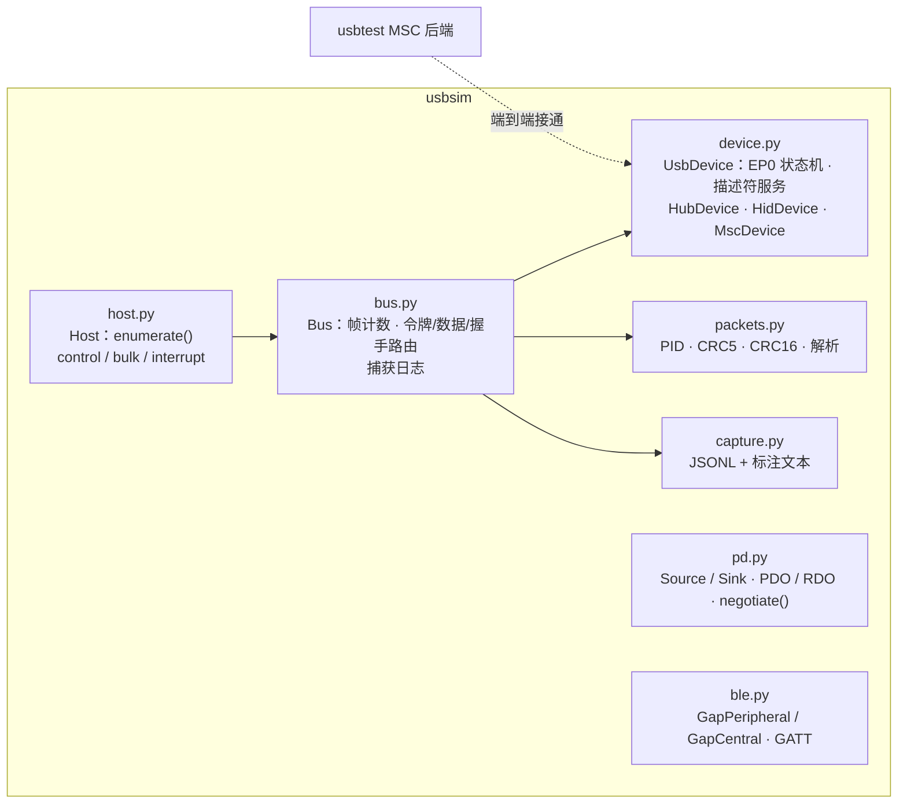

:::note[实现快照]
目录 [simulator/](labtree:simulator) · usb-labs @ `c990292` · 自测 [test_sim.py](labsrc:simulator/tests/test_sim.py) 6 组**本次在 Linux 上复跑全部通过**
:::

## 演示什么

在纯软件里模拟 USB 的**通信链路行为**：虚拟主机在虚拟总线上轮询虚拟设备，每个包都真编码、真算 CRC、真走状态机，并导出 JSONL 抓包流。它是 USBTree 协议章节的“可执行注释”：读完 [枚举流程](page:10-树干-USB核心/08-枚举流程与标准请求.md)，跑一遍 `run_enumeration.py` 就能看到同样的序列。

| 层 | 仿真 | 不仿真 |
|---|---|---|
| 电气层 | — | 波形、NRZI / 位填充、BMC 载波、LFPS 时序 |
| 协议层 | 包编解码（CRC 实算）、事务、状态机 | — |
| 链路层 | 帧节拍、NAK 重试、DATA0/1 翻转 | 精确到微秒的时序 |

## 架构



## 关键代码路径

| 文件 | 做什么 | 对应概念 |
|---|---|---|
| [packets.py · CRC](labsrc:simulator/usbsim/packets.py#L19-L60) | CRC5（令牌，11 位）与 CRC16（数据）按 USB 2.0 §8.3.5 的移位寄存器实现 | [包格式与事务](page:10-树干-USB核心/05-包格式与事务.md) · [信号编码与比特流](page:10-树干-USB核心/04-信号编码与比特流.md) |
| [packets.py · 组包/解析](labsrc:simulator/usbsim/packets.py#L62-L106) | Token / SOF / DATA / 握手包的构造与解析 | [包格式与事务](page:10-树干-USB核心/05-包格式与事务.md) |
| [host.py · enumerate](labsrc:simulator/usbsim/host.py#L73-L99) | 总线复位 → 读 8 字节设备描述符拿 EP0 MPS → SET_ADDRESS → 读完整设备描述符 → 读配置 → SET_CONFIGURATION | [枚举流程与标准请求](page:10-树干-USB核心/08-枚举流程与标准请求.md) |
| [host.py · 传输 API](labsrc:simulator/usbsim/host.py#L29-L143) | 控制传输三阶段、批量读写、中断轮询、DATA0/1 翻转跟踪 | [四种传输类型](page:10-树干-USB核心/06-四种传输类型.md) |
| [device.py · 设备模型](labsrc:simulator/usbsim/device.py#L121-L237) | Hub（端口复位/挂载）、HID（键盘/鼠标报告）、MSC（CBW/CSW、SCSI，含 >2 TB 的 READ CAPACITY(16)/READ(16)） | [集线器与连接管理](page:10-树干-USB核心/09-集线器与连接管理.md) · [MSC 与 BOT](page:20-枝干-设备类协议/MSC-大容量存储/00-MSC概述与BOT.md) |
| [pd.py](labsrc:simulator/usbsim/pd.py#L18-L130) | PD 消息头、Fixed PDO、RDO，Source 发能力、Sink 选档、`negotiate()` 跑完整一轮 | [USB PD 协议](page:30-枝干-接口与供电/04-USBPD协议.md) |
| [ble.py](labsrc:simulator/usbsim/ble.py#L15-L73) | AD 结构广播、扫描/连接、服务发现、读、订阅通知 | [广播与连接](page:50-枝干-无线关联/BLE-低功耗蓝牙/03-广播与连接.md) · [ATT 与 GATT](page:50-枝干-无线关联/BLE-低功耗蓝牙/04-ATT与GATT.md) |

## 运行

```bash
cd usb-labs
python simulator/examples/run_enumeration.py     # 枚举一台虚拟 HID 复合设备并轮询报告
python simulator/examples/run_pd_negotiation.py  # Source/Sink 协商 9V 合同
python simulator/tests/test_sim.py               # 全部自测
```

本次复跑：枚举示例把设备分到地址 5，读出 VID `0x1234` / PID `0x0002`（与 [Lab1](page:labs/lab1-hid-composite) 一致），全程记录了 3124 条总线事件。

:::caution[与仓库文档的出入]
`simulator/README.md` 的快速开始里列了 `examples/run_msc_rw.py`，但在 `c990292` 的 `examples/` 目录中**不存在**（只有 `run_enumeration.py` 和 `run_pd_negotiation.py`）。MSC 读写可以看 `tests/test_sim.py` 里的用例，或通过 usbtest 的 MSC 后端端到端驱动。
:::
