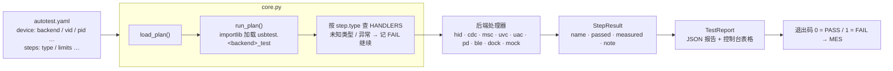

:::note[实现快照]
目录 [tools/usbtest](labtree:tools/usbtest) · usb-labs @ `c990292` · 状态矩阵见 [STATUS.md](labsrc:tools/usbtest/STATUS.md)
:::

## 演示什么

产线测试站（工控机 + 治具）上跑的上位机：读一份 YAML 计划，按 `device.backend` 动态加载协议后端，逐步执行、量化判定、写 JSON 报告，并用**退出码 0/1** 告诉 MES 通过与否。每个实验的 `host/autotest.yaml` 都是一份计划；Windows 的 [DevStudio](page:labs/devstudio) 与 macOS 版读同一套字段，报告格式三端一致。

## 架构



## 关键代码路径

| 文件 | 做什么 |
|---|---|
| [core.py · run_plan](labsrc:tools/usbtest/core.py#L69-L103) | 动态加载后端、构造上下文、逐步派发；设备拔出或驱动异常只让该步 FAIL，不中断整站 |
| [core.py · 命令行](labsrc:tools/usbtest/core.py#L105-L122) | `--plan` `--dut-sn` `--station` `--mock` `--report-dir` |
| [msc_test.py](labsrc:tools/usbtest/msc_test.py#L61-L160) | 自拼 CBW（31 B）/ CSW（13 B），INQUIRY、READ CAPACITY(10→16 自动升级)、READ/WRITE(10/16) |
| [hid_test.py](labsrc:tools/usbtest/hid_test.py) | 枚举、回报率测量（统计窗口内收到的报告数换算 Hz）、输出报告写入、环回 |
| [pd_test.py](labsrc:tools/usbtest/pd_test.py) | 读 DUT 遥测口 2 s 窗口内的 `cc_state / contract_v / contract_i / vbus_v`，与 [Lab5](page:labs/lab5-pd-charger) 的遥测契约一一对应 |

## 处理器一览

| 后端 | 处理器（step.type） | 对应实验 |
|---|---|---|
| hid | `enumerate` `hid_polling_rate` `hid_output_write` `hid_report_loopback` | [Lab1](page:labs/lab1-hid-composite) |
| cdc | `serial_loopback` `line_coding` `dfu_verify` | [Lab2](page:labs/lab2-cdc-dfu) |
| msc | `msc_inquiry` `msc_capacity` `msc_write_verify`（破坏性） | [Lab3](page:labs/lab3-msc) |
| uvc / uac | `uvc_formats` `uvc_capture_frames` / `uac_record_level` | [Lab4](page:labs/lab4-uvc-uac) |
| pd | `pd_attach` `pd_negotiate` `measure_voltage` | [Lab5](page:labs/lab5-pd-charger) |
| ble | `ble_scan_connect` `ble_gatt_discover` `ble_hid_notify` | [Lab6](page:labs/lab6-ble-hid-dongle) |
| dock | `dock_topology` `hub_port_cycle` | [Lab7](page:labs/lab7-dock-altmode) |

## 运行

```bash
cd usb-labs/tools
pip install -r usbtest/requirements.txt              # 或按后端最小安装
python -m usbtest --plan ../labs/lab1-hid-composite/host/autotest.yaml --mock
python -m usbtest --plan ../labs/lab1-hid-composite/host/autotest.yaml \
                  --dut-sn SN0001 --station STN-01  # 真机
echo $?                                              # 0=PASS 1=FAIL
```

## 验证状态

- **mock**：7 个实验的计划在 `--mock` 下全部 PASS（仓库 CI `usbtest-mock.yml`；本次本地复跑 Lab1 计划亦 PASS）。
- **离线后端自测**：`tests/test_backends.py` 本次在 Linux 上 35 例过 34 例，失败的是一条依赖 Windows 本地代码页（GBK）的解码用例，属于环境差异；`tests/test_msc.py` 通过。
- **真机**（据 STATUS.md，2026-09-10）：HID 枚举、UVC 采帧、UAC 主机侧电平、dock 拓扑在真实设备上跑通；CDC、MSC、PD、BLE 尚待治具 / DUT。
