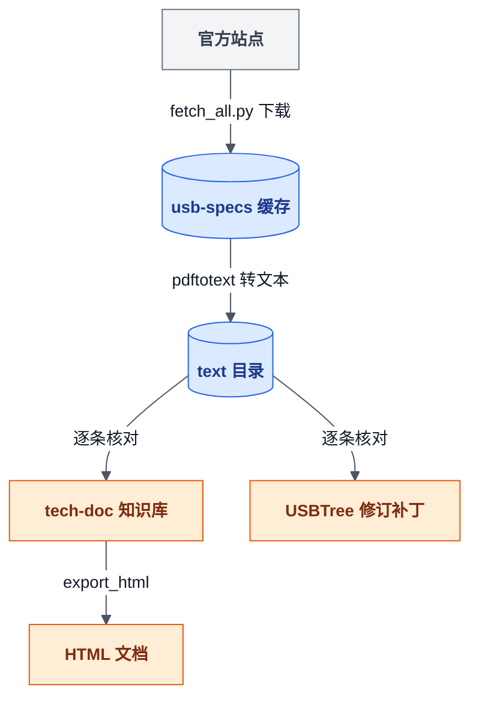

# USB / 蓝牙协议规范知识库

> 类型：readme ｜ 最后核对：2026-11-28 ｜ lang: zh

给做 USB、Type-C PD 与 BLE 开发的工程师：每条事实都标出官方规范的章节或表号。

## Overview

本知识库由 tech-doc 技能按 Reverse 模式从官方规范原文整理而来，与 USBTree 仓库互补。

- 规范来源只限官方站点：usb.org、bluetooth.com、intel.com、learn.microsoft.com、kernel.org。
- 本地缓存 96 项：93 项已下载并记 sha256，3 项蓝牙文档只能手动下载。
- 07–12 号文档是平台软件栈篇（Linux、ARM、macOS、iOS/iPadOS、Android 与对比），来源同样只限官方文档；未能核实的点标为 **待核实**。
- 非目标：不替代规范原文；位级字段布局以原文为准。

## Quick Start

前提：Python 3、curl、poppler-utils（`pdftotext`）、unzip。

```bash
cd /workspace/usb-specs
python3 tools/fetch_all.py        # 按清单下载，校验官方域名并写 manifest.json / manifest.md
bash tools/extract_text.sh        # 解压 ZIP，PDF 转文本到 text/
grep -n "tSenderResponse" text/*PD_R3.3_V1.0_2026_10_16.pdf.txt
```

## Usage

- 查某个数值：先看对应专题文档，再用其中的章节号在 `text/` 里 grep 原文核对。
- 查规范版本：读 `/workspace/usb-specs/manifest.md`，里面有版本、日期、URL 与 sha256。
- 看渲染版：打开同名 `.html`，离线可读。

| 文档 | 主题 | 主要来源 |
|---|---|---|
| [01-usb2-ch9-control.md](01-usb2-ch9-control.md) | 标准请求、描述符、枚举时序 | USB 2.0 / 3.2 第 9 章 |
| [02-hid-class-hogp.md](02-hid-class-hogp.md) | HID 类请求与 HID over GATT | HID 1.11、HUT 1.7、HOGP 1.1、HIDS 1.1 |
| [03-usb-pd-messages-timers.md](03-usb-pd-messages-timers.md) | PD 消息头、消息类型、定时器 | USB PD R3.3 V1.0 |
| [04-bc12-charger-detection.md](04-bc12-charger-detection.md) | SDP / CDP / DCP 检测 | BC 1.2 |
| [05-ble-llcp-ifs.md](05-ble-llcp-ifs.md) | LL 控制过程与帧间隔 | Bluetooth Core 7.0 |
| [06-linux-virtual-usb.md](06-linux-virtual-usb.md) | USB/IP、ConfigFS、FunctionFS、Raw Gadget | docs.kernel.org |
| [07-linux-usb-stack.md](07-linux-usb-stack.md) | Linux 主机栈、HID、gadget 框架、dummy_hcd、usbmon | docs.kernel.org、torvalds/linux |
| [08-arm-embedded-usb.md](08-arm-embedded-usb.md) | ARM SoC 控制器 IP、设备树、双角色、Type-C、TinyUSB | Linux DT binding 与 Kconfig、TinyUSB |
| [09-macos-usb.md](09-macos-usb.md) | IOKit、DriverKit、HID 路径、签名与公证 | developer.apple.com |
| [10-ios-ipados-usb.md](10-ios-ipados-usb.md) | MFi、iPad DriverKit、USB-C 配件、配件安全 | developer.apple.com、support.apple.com |
| [11-android-usb.md](11-android-usb.md) | Host API、AOA、Gadget HAL、MTP、HID | developer.android.com、source.android.com |
| [12-cross-platform-comparison.md](12-cross-platform-comparison.md) | 五平台加 Windows 的异同大表与映射 | 07–11 号文档、learn.microsoft.com |

## Architecture at a Glance



## Project Structure

| Path | Purpose |
|---|---|
| `/workspace/usb-specs/usb-core/` | USB 2.0/3.2/USB4、PD、Type-C、BC 1.2 等核心规范（16 项） |
| `/workspace/usb-specs/device-classes/` | HID、CDC、MSC、UAC、UVC 等设备类规范（40 项） |
| `/workspace/usb-specs/host-controllers/` | xHCI 1.2、EHCI 1.0（2 项） |
| `/workspace/usb-specs/bluetooth/` | Core 6.0/7.0、HOGP、HIDS、BAS、DIS、Assigned Numbers（12 项已下载，3 项手动） |
| `/workspace/usb-specs/microsoft/`、`linux/` | 微软与内核官方在线文档（10 + 13 项） |
| `/workspace/usb-specs/manifest.md` | 清单：名称、版本、日期、URL、sha256、状态 |
| `/workspace/usb-os-kb-src/` | 07–12 号文档抓取的官方页面文本缓存（约 100 页） |
| `/workspace/usb-techdoc/kb/` | 本知识库的 Markdown 与 HTML |
| `/workspace/usb-techdoc/llms-full.md` | 00–12 号文档拼接的单文件版，供 AI 使用 |

## Configuration

| Option | Default | Description |
|---|---|---|
| `tools/fetch_all.py` 内的条目表 | 96 项 | 增删规范时改这里；非官方域名会被拒绝 |

## Development

改完任何一篇后运行检查与导出：

```bash
python3 -I ~/.claude/skills/tech-doc/scripts/check_doc.py kb/03-usb-pd-messages-timers.md --fix-style && rm -f kb/*.bak
node ~/.claude/skills/tech-doc/scripts/mermaid-tools/export_html.mjs kb/03-usb-pd-messages-timers.md
```

## Troubleshooting

- bluetooth.com 返回 HTML 而非 PDF：该文件需要登录或浏览器下载，清单中标为 `manual-only`。
- intel.com 返回 403：不要设置浏览器 User-Agent，用 curl 默认值。
- 数值和 USBTree 不一致：以本库引用的规范原文为准，USBTree 修订见 `/workspace/usbtree-full-patch/`。
