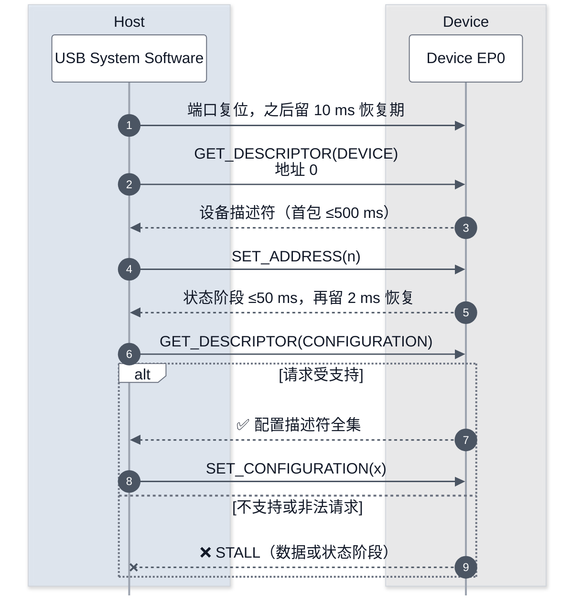

# 协议规范：USB 第 9 章标准请求与枚举

> 类型：api ｜ 模式：Reverse ｜ 状态：Stable ｜ 版本：USB 2.0 / USB 3.2 r1.1 ｜ 代码基线：`usb_20.pdf (pkg 2025-06-03)` ｜ 最后核对：2026-11-28 ｜ 范围：`usb-specs/usb-core/USB2.0-Specification.zip`, `usb-specs/usb-core/USB3.2-Rev1.1-2022-06.zip` ｜ lang: zh

## Overview

主机经**默认控制管道**（端点 0）发标准请求，完成设备枚举与配置。每个事实都标注规范章节，出处见文末附录。

- 消息信封：8 字节 Setup 包，字段 `bmRequestType`、`bRequest`、`wValue`、`wIndex`、`wLength`（USB 2.0 Table 9-2）。
- `bmRequestType`：D7 方向（0 主机到设备，1 设备到主机），D6..5 类型（0 标准、1 类、2 厂商），D4..0 接收者（0 设备、1 接口、2 端点、3 其他）（Table 9-2）。
- EP0 最大包长：全速取 8/16/32/64，高速固定 64，低速固定 8（USB 2.0 §5.5.3）。
- Enhanced SuperSpeed 设备的 `bMaxPacketSize0` 必须写 `09H`，按 2 的指数解释，即 512 字节（USB 3.2 r1.1 §9.6.1 与 Table 9-11）。
- 总时限：任何命令的处理上限是 **5 s**（USB 2.0 §9.2.6.1）。

## Message Flow

蓝色 = 主机软件，灰色 = 设备。图为 L1 枚举主线，失败统一回到 STALL 或复位。



| # | 参与方 | 动作 | 源码 |
|---|---|---|---|
| 1 | 主机 | 复位或恢复后给出 10 ms 恢复期，期间设备可忽略数据传输 | USB 2.0 §9.2.6.2 |
| 2 | 主机 | 设备处于 Default 状态，用默认地址 0 访问 EP0 | §9.1.1.3；地址 0 保留为默认地址见 §8.3.2.1 |
| 3 | 设备 | 带数据阶段的标准请求：首个数据包须在 500 ms 内返回 | §9.2.6.4 |
| 4 | 主机 | 分配地址，设备由 Default 进入 Address 状态 | §9.1.1.4 |
| 5 | 设备 | 状态阶段须在 50 ms 内完成，之后有 2 ms 恢复期 | §9.2.6.3 |
| 6 | 主机 | 按 `wLength` 读取配置描述符 | §9.4.3 |
| 7 | 设备 | 后续数据包各自在 500 ms 内返回，末包后 50 ms 内完成状态阶段 | §9.2.6.4 |
| 8 | 主机 | 选定配置，设备进入 Configured 状态 | §9.1.1.5 |
| 9 | 设备 | 不支持或非法请求返回 STALL，且不会置位控制管道 Halt | §9.4 |

设备可见状态依次是 Attached、Powered、Default、Address、Configured，另有 Suspended（USB 2.0 §9.1.1，Table 9-1）。

## Operations

| Operation | Direction | Request | Response | Errors | Since |
|---|---|---|---|---|---|
| `GET_STATUS` (0) | 主机 → 设备 | `wIndex` 选接收者 | 2 字节状态 | `STALL` | USB 2.0 |
| `CLEAR_FEATURE` (1) | 主机 → 设备 | `wValue` = 特性选择子 | 无数据阶段 | `STALL` | USB 2.0 |
| `SET_FEATURE` (3) | 主机 → 设备 | `wValue` = 特性选择子 | 无数据阶段 | `STALL` | USB 2.0 |
| `SET_ADDRESS` (5) | 主机 → 设备 | `wValue` = 新地址 | 状态阶段 ≤50 ms | `TIMEOUT` | USB 2.0 |
| `GET_DESCRIPTOR` (6) | 主机 → 设备 | `wValue` 高字节 = 类型，低字节 = 索引 | 描述符字节 | `STALL`, `TIMEOUT` | USB 2.0 |
| `SET_DESCRIPTOR` (7) | 主机 → 设备 | 描述符数据 | 无 | `STALL` | USB 2.0 |
| `GET_CONFIGURATION` (8) | 主机 → 设备 | 无 | 1 字节配置值 | `STALL` | USB 2.0 |
| `SET_CONFIGURATION` (9) | 主机 → 设备 | `wValue` = 配置值 | 无数据阶段 | `STALL` | USB 2.0 |
| `GET_INTERFACE` (10) | 主机 → 设备 | `wIndex` = 接口 | 1 字节备用设置 | `STALL` | USB 2.0 |
| `SET_INTERFACE` (11) | 主机 → 设备 | `wValue` = 备用设置 | 无数据阶段 | `STALL` | USB 2.0 |
| `SYNCH_FRAME` (12) | 主机 → 设备 | `wIndex` = 端点 | 2 字节帧号 | `STALL` | USB 2.0 |
| `SET_SEL` (48) | 主机 → 设备 | 系统退出延迟参数 | 无 | `STALL` | USB 3.2 |
| `SET_ISOCH_DELAY` (49) | 主机 → 设备 | `wValue` = 等时延迟 | 无数据阶段 | `STALL` | USB 3.2 |

请求码见 USB 2.0 Table 9-4；48、49 两项见 USB 3.2 r1.1 Table 9-5。2 与 4 保留。

## Data Types

| Type | Field | Format | Required | Notes |
|---|---|---|---|---|
| 描述符类型 | `DEVICE`=1, `CONFIGURATION`=2, `STRING`=3 | 1 字节 | 是 | USB 2.0 Table 9-5 |
| 描述符类型 | `INTERFACE`=4, `ENDPOINT`=5 | 1 字节 | 是 | USB 2.0 Table 9-5 |
| 描述符类型 | `DEVICE_QUALIFIER`=6, `OTHER_SPEED_CONFIGURATION`=7, `INTERFACE_POWER`=8 | 1 字节 | 视速度 | USB 2.0 Table 9-5 |
| 描述符类型 | `OTG`=9, `DEBUG`=10, `INTERFACE_ASSOCIATION`=11 | 1 字节 | 否 | USB 3.2 r1.1 Table 9-6 |
| 描述符类型 | `BOS`=15, `DEVICE CAPABILITY`=16 | 1 字节 | USB 3.x 必需 | USB 3.2 r1.1 Table 9-6 |
| 描述符类型 | `SUPERSPEED_USB_ENDPOINT_COMPANION`=48, `SUPERSPEEDPLUS_ISOCHRONOUS_ENDPOINT_COMPANION`=49 | 1 字节 | SS 端点 | USB 3.2 r1.1 Table 9-6 |
| 特性选择子 | `ENDPOINT_HALT`=0, `DEVICE_REMOTE_WAKEUP`=1, `TEST_MODE`=2 | 2 字节 | 是 | USB 2.0 Table 9-6 |

## Errors

| Code | Meaning | Caller action |
|---|---|---|
| `STALL` | 请求不受支持或参数非法；设备在数据或状态阶段回 STALL（USB 2.0 §9.4） | 修正请求；不要原样重试 |
| `TIMEOUT` | 超出 §9.2.6 时限：无数据请求 50 ms、首包 500 ms、总上限 5 s | 重试一次；仍失败则端口复位后重新枚举 |

## Versioning & Compatibility

| Version | Change | Breaking |
|---|---|---|
| USB 2.0 | 定义第 9 章标准请求、描述符类型 1~8 与设备状态机 | No |
| USB 3.2 | 新增 `SET_SEL`、`SET_ISOCH_DELAY`、BOS 与 SuperSpeed 端点伴随描述符；SS 设备 EP0 包长改为指数编码 `09H` | No |

## Examples

读取设备描述符前 8 字节。Setup 包按 Table 9-2 排列；多字节字段按小端序传输（USB 2.0 §8.1）：

```text
bmRequestType=0x80  bRequest=0x06  wValue=0x0100  wIndex=0x0000  wLength=0x0008
```

失败调用：向设备发保留请求码 2，设备在状态阶段回 STALL（§9.4）。

```text
bmRequestType=0x00  bRequest=0x02  wValue=0x0000  wIndex=0x0000  wLength=0x0000  -> STALL
```

## 待确认项

- [ ] Core 规范外的类请求（HID、CDC 等）不在本文范围，见本知识库其他篇。
