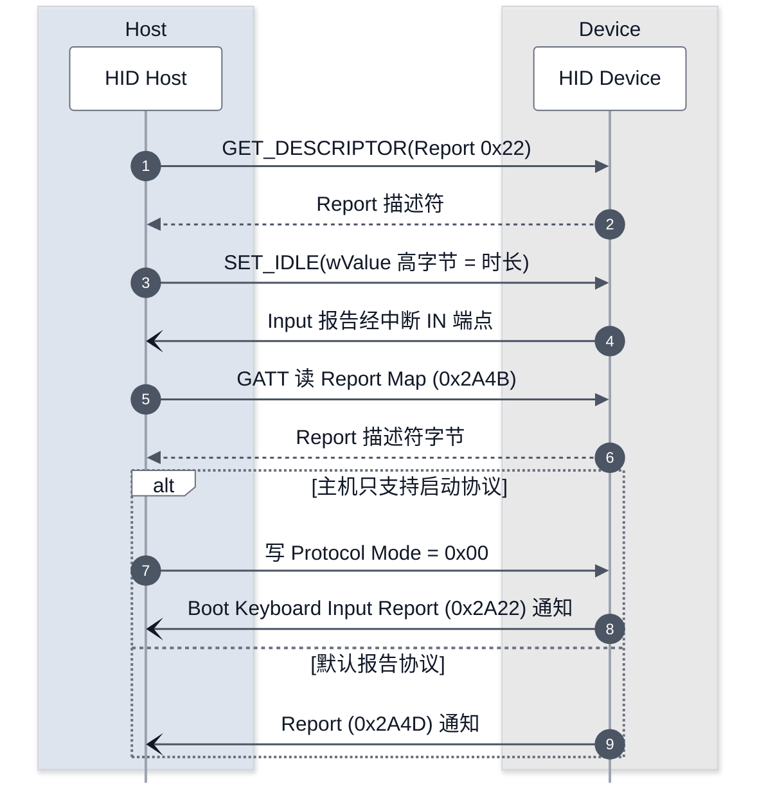

# 协议规范：HID 类请求与 HID over GATT

> 类型：api ｜ 模式：Reverse ｜ 状态：Stable ｜ 版本：HID 1.11 / HUT 1.7 / HOGP 1.1 / HIDS 1.1 ｜ 代码基线：`hid1_11.pdf`, `HOGP_v1.1 (2025-08-05)`, `HIDS_v1.1 (2026-04-21)` ｜ 最后核对：2026-11-28 ｜ 范围：`usb-specs/device-classes/HID-1.11.pdf`, `usb-specs/device-classes/HID-UsageTables-1.7.pdf`, `usb-specs/bluetooth/HOGP-latest.pdf`, `usb-specs/bluetooth/HID-Service-1.1.pdf`, `usb-specs/bluetooth/Assigned_Numbers.pdf` ｜ lang: zh

## Overview

同一套 **HID 报告模型**跑在两种传输上：USB 用控制管道与中断端点，BLE 用 GATT 的 HID Service。

- USB 类请求：`bmRequestType` 读为 `10100001`，写为 `00100001`，`wIndex` = 接口号（HID 1.11 §7.2）。
- 类描述符类型：HID = `0x21`，Report = `0x22`，Physical = `0x23`（HID 1.11 §7.1）。
- 启动设备：接口 SubClass `1` = Boot Interface；Protocol `1` = Keyboard，`2` = Mouse（HID 1.11 §4.2、§4.3）。
- BLE：HID Device 必须有 HID Service、Battery Service、Device Information Service；Scan Parameters 可选（HOGP 1.1 Table 3.1）。
- Report Map 特征值最长 **512 octets**（HIDS 1.1 §2.6.1）。

## Message Flow

蓝色 = 主机，灰色 = HID 设备。上半是 USB，下半是 BLE。



| # | 参与方 | 动作 | 源码 |
|---|---|---|---|
| 1 | 主机 | 用标准 `GET_DESCRIPTOR` 取类描述符，类型 `0x22` | HID 1.11 §7.1.1 |
| 2 | 设备 | 返回 Report 描述符 | HID 1.11 §6.2.2 |
| 3 | 主机 | 设置空闲速率；高字节 0 表示无限期，只在数据变化时上报 | HID 1.11 §7.2.4 |
| 4 | 设备 | 只有 Input 报告经中断 IN 管道发送 | HID 1.11 §5.6 |
| 5 | 主机 | 读 Report Map 特征 | HIDS 1.1 §2.6 |
| 6 | 设备 | 返回值最长 512 octets | HIDS 1.1 §2.6.1 |
| 7 | 主机 | 只有写入 `0x00` 后服务才进入 Boot Protocol Mode | HIDS 1.1 Table 2.2 |
| 8 | 设备 | 启动键盘输入报告 | Assigned Numbers（0x2A22） |
| 9 | 设备 | Report Protocol Mode 是所有 HID 设备的默认模式 | HIDS 1.1 Table 2.2 |

## Operations

| Operation | Direction | Request | Response | Errors | Since |
|---|---|---|---|---|---|
| `GET_REPORT` (0x01) | 主机 → 设备 | `wValue` 高字节 = 报告类型，低字节 = Report ID | 报告字节 | `STALL` | HID 1.11 |
| `GET_IDLE` (0x02) | 主机 → 设备 | `wValue` 低字节 = Report ID | 1 字节空闲速率 | `STALL` | HID 1.11 |
| `GET_PROTOCOL` (0x03) | 主机 → 设备 | `wValue` = 0，`wLength` = 1 | 0 = Boot，1 = Report | `STALL` | HID 1.11 |
| `SET_REPORT` (0x09) | 主机 → 设备 | 报告类型 + Report ID + 报告字节 | 无 | `STALL` | HID 1.11 |
| `SET_IDLE` (0x0A) | 主机 → 设备 | `wValue` 高字节 = 时长（4 ms 单位） | 无 | `STALL` | HID 1.11 |
| `SET_PROTOCOL` (0x0B) | 主机 → 设备 | `wValue` = 0 Boot / 1 Report | 无 | `STALL` | HID 1.11 |
| 写 `HID Control Point` (0x2A4C) | 主机 → 设备 | `0x00` Suspend / `0x01` Exit Suspend | 无 | `ATT_ERROR` | HIDS 1.0 |
| 写 `Protocol Mode` (0x2A4E) | 主机 → 设备 | `0x00` Boot / `0x01` Report | 无 | `ATT_ERROR` | HIDS 1.0 |
| 通知 `Report` (0x2A4D) | 设备 → 主机 | — | Input 报告 | `ATT_ERROR` | HIDS 1.0 |

`GET_REPORT` 是所有设备必须支持的请求；`GET_PROTOCOL`、`SET_PROTOCOL` 只要求启动设备支持（HID 1.11 §7.2 表注 1、2）。

## Data Types

| Type | Field | Format | Required | Notes |
|---|---|---|---|---|
| 报告类型 | `01` Input，`02` Output，`03` Feature | `wValue` 高字节 | 是 | HID 1.11 §7.2.1 |
| 空闲时长 | 0 = 无限期；1~255 × 4 ms | 1 字节 | 是 | 0.004~1.020 s，精度 ±(10% + 2 ms)（§7.2.4） |
| 默认空闲速率 | 键盘 500 ms；摇杆与鼠标为无限期 | 推荐值 | 否 | HID 1.11 §7.2.4 |
| GATT UUID | HID Service `0x1812`，Battery `0x180F`，Device Information `0x180A`，Scan Parameters `0x1813` | 16 位 | 是 | Assigned Numbers |
| GATT UUID | HID Information `0x2A4A`，Report Map `0x2A4B`，Report `0x2A4D`，Protocol Mode `0x2A4E` | 16 位 | 是 | Assigned Numbers |
| GATT UUID | Boot Keyboard Input `0x2A22`，Boot Keyboard Output `0x2A32`，Boot Mouse Input `0x2A33` | 16 位 | 启动设备 | Assigned Numbers |
| Usage Page | `0x01` Generic Desktop，`0x07` Keyboard/Keypad，`0x0C` Consumer，`0x11` SoC | 16 位 | — | HUT 1.7 Table 3.1 |

## Errors

| Code | Meaning | Caller action |
|---|---|---|
| `STALL` | 设备不支持该类请求或参数非法（USB 2.0 §9.4 的通用规则） | 不要重试；启动设备以外不要发 `SET_PROTOCOL` |
| `ATT_ERROR` | GATT 读写被拒，错误码由 Core 规范 Vol 3 Part F 定义 | 按 ATT 错误码处理；未加密时先配对 |

## Versioning & Compatibility

| Version | Change | Breaking |
|---|---|---|
| HID 1.11 | USB HID 类定义，现行版（2001-06-27） | No |
| HIDS 1.0 | GATT HID Service 首版，特征与 USB HID 一一映射 | No |
| HOGP 1.1 | 2025-08-05 采纳；新增可选 HID ISO，经 LE 等时信道传 HID 报告 | No |
| HUT 1.7 | Usage Page 表新增 `0x11` SoC 页（HUT 1.3 时为保留） | No |

## Examples

`SET_IDLE`：对全部报告设无限期空闲（`wValue` 高字节 0，低字节 0），接口 0：

```text
bmRequestType=0x21  bRequest=0x0A  wValue=0x0000  wIndex=0x0000  wLength=0x0000
```

失败调用：向非启动设备发 `SET_PROTOCOL`，设备可以回 STALL。

```text
bmRequestType=0x21  bRequest=0x0B  wValue=0x0000  wIndex=0x0000  wLength=0x0000  -> STALL
```

## 待确认项

- [ ] HID 报告周期上限由端点 `bInterval` 决定，见 USB 2.0 §9.6.6；本文未展开。
- [ ] HID ISO 的具体特征与流程见 HOGP 1.1 §5、§6，本文只登记其存在。
