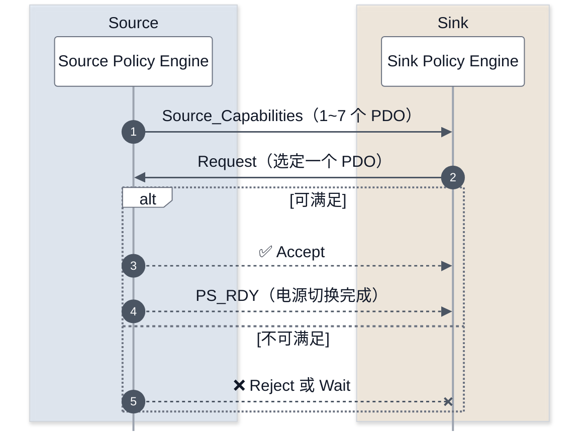

# 协议规范：USB PD 消息头、消息类型与定时器

> 类型：api ｜ 模式：Reverse ｜ 状态：Stable ｜ 版本：USB PD R3.3 V1.0 ｜ 代码基线：`USB_PD_R3.3_V1.0_2026_10_16.pdf` ｜ 最后核对：2026-11-28 ｜ 范围：`usb-specs/usb-core/USB-PD-3.3-V1.0.zip` ｜ lang: zh

## Overview

USB PD 在 Type-C 的 CC 线上交换消息，协商电压、电流与角色。本文取 usb.org 现行版 **PD R3.3 V1.0**（2026-10-16）。

- 消息 = 16 位消息头 + 0~7 个 32 位数据对象；扩展消息另带扩展头（PD R3.3 Table 6.2、§6.5.1）。
- 功率范围：SPR 最高 100 W；EPR 最高 240 W，EPR Mode 最高电压 48 V（PD R3.3 §2 术语表）。
- 可靠传输：每条消息由对端回 `GoodCRC`，其 MessageID 与原消息一致（§6.3.1）。
- R3.3 重组章节，目标是与上一版技术等价（R3.3 包内 Reorganization Guide）。

## Message Flow

蓝色 = Source，橙色 = Sink。图为 L1 显式契约主线；每条消息后的 `GoodCRC` 省略。



| # | 参与方 | 动作 | 源码 |
|---|---|---|---|
| 1 | Source | 首个 PDO 必须是 vSafe5V Fixed Supply；其余 Fixed PDO 按电压升序 | PD R3.3 §6.4.1.1 |
| 2 | Sink | 用 Request 选择 PDO；Source 等待响应的时限是 tSenderResponse | §6.4.2，Table 7.10 |
| 3 | Source | 接受请求；Sink 发完 GoodCRC 后启动 PSTransitionTimer | §6.3.3，§4.5.1.1 |
| 4 | Source | 新电源就绪后发 PS_RDY；Sink 的等待上限是 tPSTransition | §6.3.6，Table 7.10 |
| 5 | Source | 拒绝或要求稍后重试 | §6.3.4，§6.3.12 |

## Operations

控制消息类型见 PD R3.3 Table 6.4，数据消息类型见 Table 6.5。下表列常用项。

| Operation | Direction | Request | Response | Errors | Since |
|---|---|---|---|---|---|
| `GoodCRC` (控制 00001b) | 双向 | MessageID = 被确认消息的 ID | — | `Retry` | PD 2.0 |
| `Accept` (控制 00011b) | 双向 | — | — | `Not_Supported` | PD 2.0 |
| `Reject` (控制 00100b) | 双向 | — | — | `Not_Supported` | PD 2.0 |
| `PS_RDY` (控制 00110b) | Source → Sink | — | — | `Hard_Reset` | PD 2.0 |
| `Get_Source_Cap` (控制 00111b) | Sink → Source | — | `Source_Capabilities` | `Not_Supported` | PD 2.0 |
| `Soft_Reset` (控制 01101b) | 双向 | — | `Accept` | `Hard_Reset` | PD 2.0 |
| `Get_Revision` (控制 11000b) | 双向 | — | `Revision` (数据 01100b) | `Not_Supported` | PD 3.3 |
| `Source_Capabilities` (数据 00001b) | Source → Sink | 1~7 个 PDO | `Request` | `Soft_Reset` | PD 2.0 |
| `Request` (数据 00010b) | Sink → Source | 1 个 RDO | `Accept` / `Reject` / `Wait` | `Soft_Reset` | PD 2.0 |
| `EPR_Request` (数据 01001b) | Sink → Source | RDO + PDO 副本 | `Accept` / `Reject` | `Soft_Reset` | PD 3.1 |
| `Vendor_Defined` (数据 01111b) | 双向 | VDM 头 + VDO | 依命令 | `Not_Supported` | PD 2.0 |

`GotoMin` 已弃用，接收方须回 `Not_Supported`（§6.3.2）。`Ping` 已弃用，接收方可回 `Not_Supported` 或忽略（§6.3.5）。

## Data Types

| Type | Field | Format | Required | Notes |
|---|---|---|---|---|
| 消息头 | `Extended` | bit 15 | 是 | 0 = 控制或数据消息，1 = 扩展消息（Table 6.2） |
| 消息头 | `Number of Data Objects` | bit 14..12 | 是 | 0 表示控制消息（Table 6.2，§6.2.2） |
| 消息头 | `MessageID` | bit 11..9 | 是 | 发送方维护的滚动计数（Table 6.2） |
| 消息头 | `Port Power Role` | bit 8 | SOP | 0 = Sink，1 = Source；接收方不校验（Table 6.2） |
| 消息头 | `Specification Revision` | bit 7..6 | 是 | 01b = Rev 2.0，10b = Rev 3.x；00b 按 2.0 解释（Table 6.2） |
| 消息头 | `Message Type` | bit 4..0 | 是 | 取值见 Table 6.4 / 6.5 |
| 计数器 | `nCapsCount` = 50，`nHardResetCount` = 2，`nMessageIDCount` = 7 | 整数 | 是 | Table 7.12 |

## Errors

| Code | Meaning | Caller action |
|---|---|---|
| `Retry` | 发送后 tReceive（0.9~1.1 ms）内未收到 GoodCRC（Table 7.10） | 按协议层规则重发同一 MessageID |
| `Not_Supported` | 收到保留或不支持的消息类型（Table 6.4 / 6.5） | 放弃该请求，不要重发 |
| `Soft_Reset` | 协议错误，复位协议层与 MessageID（§6.3.13） | 等 `Accept` 后重新协商 |
| `Hard_Reset` | 软复位失败或电源异常；VBUS 回到 USB 默认（§7.1.3，术语表） | 重新附着并从 Source_Capabilities 开始 |

## Versioning & Compatibility

| Version | Change | Breaking |
|---|---|---|
| PD 2.0 | 消息头 Specification Revision = 01b | No |
| PD 3.1 | 引入 EPR：功率上限 240 W、EPR Mode 最高 48 V（推断：R2.0 V1.3 无 EPR_Request，3.1 原文未缓存） | No |
| PD 3.2 | R3.2 V1.2（2026-08-19）是 3.2 系列最后一版，随 R3.3 包作为 Previous Rev 提供 | No |
| PD 3.3 | R3.3 V1.0（2026-10-16）章节重组，目标是与上一版保持技术等价；`Get_Revision` 在 3.2 V1.2 与 3.3 中均有定义 | No |

不同修订版通过消息头 Specification Revision 协商到双方共同支持的版本（Table 6.2，§6.1.3）。

## Examples

PD R3.3 Table 7.10 中协商主线用到的定时器：

```text
tTypeCSendSourceCap  100 / 150 / 200 ms   (min / nom / max)
tSenderResponse       27 /  -  /  50 ms
tPSTransition (SPR)  450 / 500 / 550 ms
tPSTransition (EPR)  830 / 925 / 1020 ms
tFirstSourceCap        - /  -  / 250 ms
tPPSRequest            - /  -  /  10 s
```

失败调用：Sink 发保留数据消息类型 01101b，对端回 `Not_Supported`（Table 6.5）。

```text
Header: Extended=0 NumDO=1 MessageType=01101b  ->  Not_Supported
```

## 待确认项

- [ ] `Get_Revision`、`Revision` 的首次引入版本：未确认。已缓存的 3.2 V1.2 与 3.3 V1.0 均包含它们。
- [ ] `PS_RDY` 超时后进入 Hard Reset 的具体条件见 §8 策略引擎状态机，本文未展开。
