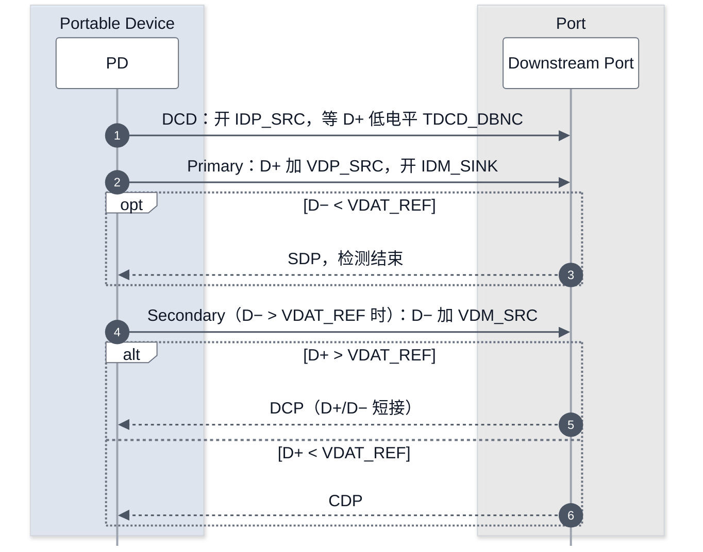

# 协议规范：USB BC 1.2 充电端口检测

> 类型：api ｜ 模式：Reverse ｜ 状态：Stable ｜ 版本：BC 1.2（含 2012-03-15 勘误） ｜ 代码基线：`BC1.2 plus errata 2012-3-15.pdf` ｜ 最后核对：2026-11-28 ｜ 范围：`usb-specs/usb-core/BC-1.2.zip` ｜ lang: zh

## Overview

BC 1.2 让便携设备（PD）只用 D+/D− 上的模拟信号，在枚举前区分三类下行端口：**SDP、CDP、DCP**。

- SDP：标准下行端口，按 USB 2.0 规则供电。
- CDP：主机或集线器端口，可枚举，D+ 落在 VDAT_REF~VLGC 时在 D− 输出 VDM_SRC（BC 1.2 §1.4.4）。
- DCP：不能枚举，D+ 与 D− 短接，阻值 ≤ RDCP_DAT = 200 Ω（§1.4.7，Table 5-3）。
- 检测顺序：DCD（可选）→ Primary Detection → Secondary Detection（§3.3.2）。

## Message Flow

蓝色 = 便携设备，灰色 = 充电端口。“消息”是 D+/D− 上的电压与电流。



| # | 参与方 | 动作 | 源码 |
|---|---|---|---|
| 1 | PD | VBUS 有效后启动 TDCD_TIMEOUT；超时未检测到接触也进入 Primary | BC 1.2 §3.3.2 |
| 2 | PD | Primary：开 VDP_SRC 与 IDM_SINK，比较 D− 与 VDAT_REF | §3.2.4 |
| 3 | 端口 | SDP 的 D− 只有下拉，D− 保持低于 VDAT_REF | §3.2.4.3 |
| 4 | PD | 已判为 DCP 或 CDP 但尚未准备枚举时，必须做 Secondary | §3.3.2，§3.2.5 |
| 5 | 端口 | D+ 高于 VDAT_REF 即判为 DCP | §3.2.5.1 |
| 6 | 端口 | D+ 低于 VDAT_REF 即判为 CDP；PD 关 VDM_SRC，D+/D− 保持低直到连接 | §3.2.5.2，§3.3.2 |

可选：Primary 时再比较 D− 与 VLGC，避免把 PS/2 端口误判为充电端口（§3.2.4.1）。

## Operations

| Operation | Direction | Request | Response | Errors | Since |
|---|---|---|---|---|---|
| `Data Contact Detect` | PD → 端口 | IDP_SRC = 7~13 µA 注入 D+ | D+ 保持 VLGC_LOW 达 TDCD_DBNC | `DCD_TIMEOUT` | BC 1.2 |
| `Primary Detection` | PD → 端口 | VDP_SRC = 0.5~0.7 V 加到 D+ | D− 电压 | `PS2_FALSE_POSITIVE` | BC 1.2 |
| `Secondary Detection` | PD → 端口 | VDM_SRC = 0.5~0.7 V 加到 D− | D+ 电压 | `PS2_FALSE_POSITIVE` | BC 1.2 |
| `DCP connect` | PD → 端口 | 开 VDP_SRC 或经 RDP_UP 上拉 D+ | 保持 D+ > VDAT_REF | `DCD_TIMEOUT` | BC 1.2 |

DCP 上的 PD 必须在附着后 TSVLD_CON_PWD（≤1 s）内开 VDP_SRC 或上拉 D+（§3.3.2，Table 5-5）。

## Data Types

| Type | Field | Format | Required | Notes |
|---|---|---|---|---|
| 电压 | VDAT_REF 0.25~0.4 V；VDP_SRC、VDM_SRC 0.5~0.7 V；VLGC 0.8~2.0 V | 模拟量 | 是 | Table 5-1 |
| 电流 | ICDP 1.5~5.0 A；IDCP 0.5~5.0 A | 端口额定 | 是 | Table 5-2 |
| 电流 | IDEV_CHG ≤ 1.5 A：PD 从充电端口可取的电流 | 上限 | 是 | Table 5-2，§4.6 |
| 电流 | IDP_SRC 7~13 µA；IDM_SINK、IDP_SINK 25~175 µA | 模拟量 | 是 | Table 5-2 |
| 电阻 | RDCP_DAT ≤ 200 Ω；RDM_DWN、RDP_DWN 14.25~24.8 kΩ | 模拟量 | 是 | Table 5-3 |
| 时间 | TDCD_DBNC ≥ 10 ms；TDCD_TIMEOUT 300~900 ms | 定时 | 是 | Table 5-5 |
| 时间 | TVDPSRC_ON、TVDMSRC_ON ≥ 40 ms；TVDMSRC_EN、TVDMSRC_DIS ≤ 20 ms | 定时 | 是 | Table 5-5 |

## Errors

| Code | Meaning | Caller action |
|---|---|---|
| `DCD_TIMEOUT` | TDCD_TIMEOUT 到期仍未检测到 D+ 接触（本文命名） | 规范要求直接进入 Primary Detection（§3.3.2） |
| `PS2_FALSE_POSITIVE` | PS/2 端口上拉 D+/D−，只比 VDAT_REF 会误判为充电端口（本文命名） | 同时比较 VLGC，只在 VDAT_REF < D− < VLGC 时判定（§3.2.4.1） |

## Versioning & Compatibility

| Version | Change | Breaking |
|---|---|---|
| BC 1.2 | 2010-12-07 发布；2012-03-15 并入勘误，为 usb.org 现行版 | No |

ICFG_MAX：接 SDP 时为 500 mA，接 SuperSpeed 端口时为 900 mA（Table 5-2 注 2）。

## Examples

Primary Detection 判定（Table 5-1 阈值）：

```text
VDP_SRC(0.5~0.7 V) -> D+ ;  measure D-
D- > VDAT_REF(0.25~0.4 V) and D- < VLGC(0.8~2.0 V)  -> DCP or CDP
D- < VDAT_REF                                       -> SDP
```

失败调用：PD 只比 VDAT_REF，插在 PS/2 端口上被误判为充电端口。

```text
D- pulled high by PS/2 port -> D- > VDAT_REF -> wrong "DCP/CDP" (PS2_FALSE_POSITIVE)
```

## 待确认项

- [ ] ACA 与 ACA-Dock 检测（§3.2.6，RID_A/B/C）未展开。
- [ ] 错误码 `DCD_TIMEOUT`、`PS2_FALSE_POSITIVE` 是本文为结构化而起的名字，BC 1.2 原文没有错误码。
