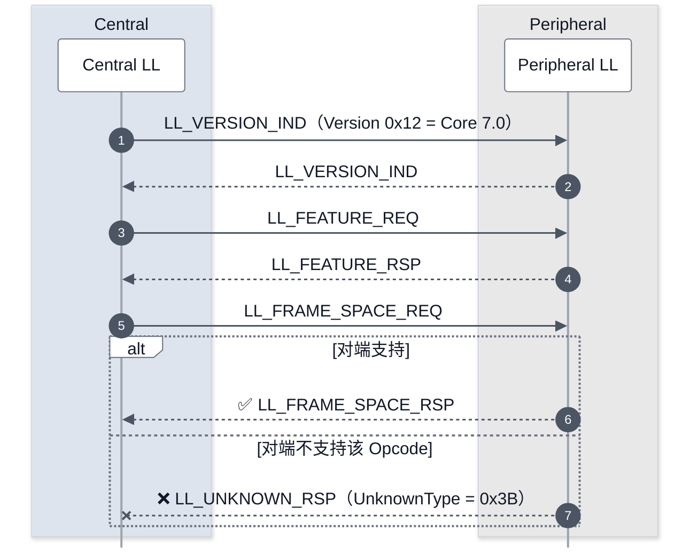

# 协议规范：BLE 链路层控制过程（LLCP）与帧间隔

> 类型：api ｜ 模式：Reverse ｜ 状态：Stable ｜ 版本：Bluetooth Core 7.0 ｜ 代码基线：`Core_v7.0.pdf (Version Date 2026-11-02)` ｜ 最后核对：2026-11-28 ｜ 范围：`usb-specs/bluetooth/Bluetooth-Core-7.0.pdf`, `usb-specs/bluetooth/Assigned_Numbers.pdf` ｜ lang: zh

## Overview

BLE 连接建立后，两端链路层用 **LL Control PDU** 协商特性、版本、参数、加密与帧间隔。本文以 Core 7.0 Vol 6 Part B 为准。

- LL Control PDU = 1 字节 `Opcode` + 可变长 `CtrData`（Vol 6 Part B §2.4.2）。
- Core 7.0 定义 Opcode `0x00`~`0x4A`；`0xF0`~`0xFB` 留给规范开发用途（Table 2.22）。
- 收到不支持或保留的 Opcode，必须回 `LL_UNKNOWN_RSP`，`UnknownType` = 收到的 Opcode（§2.4.2）。
- 每个过程受 **TPRT = 40 s** 超时约束；Connection Update 与 Channel Map Update 例外（§5.2）。
- 帧间隔默认 **150 µs**；可用 Frame Space Update 过程按连接、按 PHY 调整，`T_IFS_150` 除外（§4.1.1）。

## Message Flow

蓝色 = Central，灰色 = Peripheral。



| # | 参与方 | 动作 | 源码 |
|---|---|---|---|
| 1 | Central | Version 字段填控制器支持的 LL 版本，取值见 Assigned Numbers | Vol 6 Part B §2.4.2.13 |
| 2 | Peripheral | 回自己的版本、Company_Identifier 与 Subversion | §2.4.2.13 |
| 3 | Central | 请求对端特性集 | §2.4.2.9 |
| 4 | Peripheral | 返回特性集 | Table 2.22（0x09） |
| 5 | Central | 发起 Frame Space Update，指定要改的间隔类型与 PHY | §5.1.30 |
| 6 | Peripheral | 接受并回应答 | Table 2.22（0x3C） |
| 7 | Peripheral | 不支持时回 LL_UNKNOWN_RSP；收到方此后不得再发起同一过程 | §2.4.2 注，§4.6 |

## Operations

下表选列常用 Opcode；完整 0x00~0x4A 见 Core 7.0 Table 2.22。

| Operation | Direction | Request | Response | Errors | Since |
|---|---|---|---|---|---|
| `LL_TERMINATE_IND` (0x02) | 双向 | `ErrorCode` | — | — | Core 4.0 |
| `LL_UNKNOWN_RSP` (0x07) | 双向 | `UnknownType` = 收到的 Opcode | — | — | Core 4.0 |
| `LL_FEATURE_REQ` (0x08) | Central → Peripheral | 特性集 | `LL_FEATURE_RSP` (0x09) | `LL_UNKNOWN_RSP` | Core 4.0 |
| `LL_VERSION_IND` (0x0C) | 双向 | Version / Company_Identifier / Subversion | `LL_VERSION_IND` | `TPRT_TIMEOUT` | Core 4.0 |
| `LL_REJECT_EXT_IND` (0x11) | 双向 | `RejectOpcode` + `ErrorCode` | — | — | Core 4.1 |
| `LL_LENGTH_REQ` (0x14) | 双向 | 最大收发长度与时间 | `LL_LENGTH_RSP` (0x15) | `LL_UNKNOWN_RSP` | Core 4.2 |
| `LL_PHY_REQ` (0x16) | 双向 | 期望 PHY | `LL_PHY_RSP` (0x17) / `LL_PHY_UPDATE_IND` (0x18) | `LL_REJECT_EXT_IND` | Core 5.0 |
| `LL_FRAME_SPACE_REQ` (0x3B) | 双向 | Spacing_Types + PHYS | `LL_FRAME_SPACE_RSP` (0x3C) | `LL_UNKNOWN_RSP` | Core 6.0 |
| `LL_CIS_UPDATE_REQ` (0x49) | 见规范 | 见 §2.4.2 对应小节 | `LL_CIS_UPDATE_RSP` (0x4A) | `LL_UNKNOWN_RSP` | Core 7.0 |

## Data Types

| Type | Field | Format | Required | Notes |
|---|---|---|---|---|
| LL Control PDU | `Opcode` | 1 octet | 是 | Table 2.22 |
| LL Control PDU | `CtrData` | 依 Opcode | 视 Opcode | §2.4.2 各小节 |
| 帧间隔 | `T_IFS_ACL_CP`、`T_IFS_ACL_PC`、`T_IFS_CIS` | µs | 是 | 默认 150 µs，可协商（§4.1.1） |
| 帧间隔 | `T_IFS_150` | µs | 是 | 固定 150 µs，不可协商（§4.1.1） |
| 可调参数 | `T_IFS_ACL_CP`、`T_IFS_ACL_PC`、`T_MCES`、`T_IFS_CIS`、`T_MSS_CIS` | µs | 否 | Frame Space Update 可改（§5.1.30） |
| LL 版本号 | 5.0 = `0x09` … 6.0 = `0x0E`，6.1 = `0x0F`，6.2 = `0x10`，6.3 = `0x11`，7.0 = `0x12` | 1 octet | 是 | Assigned Numbers |

## Errors

| Code | Meaning | Caller action |
|---|---|---|
| `LL_UNKNOWN_RSP` | 对端不支持或视为保留的 Opcode（§2.4.2） | 本连接内不再发起同一过程（§4.6） |
| `LL_REJECT_EXT_IND` | 对端按过程规则拒绝，`ErrorCode` 见 Vol 1 Part F（§2.4.2.18） | 按错误码处理，例如 `0x1A` Unsupported Remote Feature |
| `TPRT_TIMEOUT` | 过程 40 s 无响应，ACL 视为丢失；错误码 `0x22` LL Response Timeout（§5.2，Vol 1 Part F） | 进入 Standby，按需重新连接 |

## Versioning & Compatibility

| Version | Change | Breaking |
|---|---|---|
| Core 4.0 | LE 链路层与首批 LL Control PDU | No |
| Core 4.1 | 增加 `LL_REJECT_EXT_IND` 等（推断：按 Opcode 顺序与版本号推断，4.x 原文未缓存） | No |
| Core 4.2 | 增加数据长度扩展 `LL_LENGTH_REQ/RSP`（推断，原因同上） | No |
| Core 5.0 | 增加 PHY 更新 `LL_PHY_*`（推断，原因同上） | No |
| Core 6.0 | 已缓存的 6.0 表止于 0x3C，含 `LL_FRAME_SPACE_REQ/RSP` | No |
| Core 7.0 | 2026-11 发布；表扩展到 0x4A（0x3D~0x4A 在 6.0 中没有） | No |

0x3D~0x4A 可能在 6.1~6.3 之间分批引入；这几版原文未缓存，具体归属未确认。

## Examples

Peripheral 不认识 `LL_FRAME_SPACE_REQ` 时的 LL Control PDU 负载：

```text
Opcode=0x07 (LL_UNKNOWN_RSP)  CtrData: UnknownType=0x3B
```

失败调用：过程发起后对端不再回任何 LL Control PDU，40 s 后连接丢失。

```text
LL_LENGTH_REQ -> (no response) ... TPRT reaches 40 s -> Standby, reason 0x22 LL Response Timeout
```

## 待确认项

- [ ] Core 4.0~5.x 与 6.1~6.3 原文未在本次下载范围内；“Since”列中 4.1/4.2/5.0 为推断，0x3D 以后各条的引入版本未确认。
- [ ] `TPRT_TIMEOUT` 是本文为结构化起的名字；规范描述为“procedure response timeout”。
