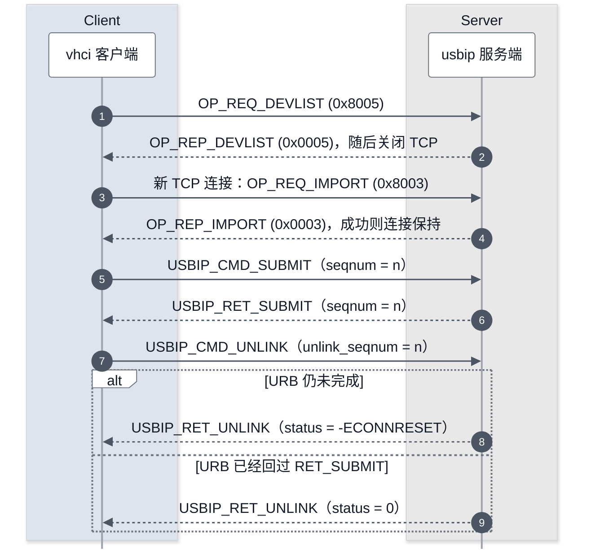

# 协议规范：Linux 虚拟 USB（USB/IP、ConfigFS、FunctionFS、Raw Gadget）

> 类型：api ｜ 模式：Reverse ｜ 状态：Stable ｜ 版本：USB/IP v1.1.1 / Linux 内核文档 ｜ 代码基线：`docs.kernel.org（2026-11 抓取）` ｜ 最后核对：2026-11-28 ｜ 范围：`usb-specs/linux/usbip_protocol.html`, `usb-specs/linux/gadget_configfs.html`, `usb-specs/linux/functionfs.html`, `usb-specs/linux/raw-gadget.html` ｜ lang: zh

## Overview

本文内容来自 Linux 内核官方文档，不是 USB-IF 规范；它是这些接口唯一的权威定义。

- **USB/IP**：服务端导出 USB 设备，客户端导入；设备驱动跑在客户端（usbip_protocol §Architecture）。
- 字段一律为网络字节序（大端）；头部版本号 `0x0111` 表示 v1.1.1。
- **ConfigFS**：用目录与符号链接拼出 gadget，最后写 `UDC` 绑定控制器（gadget_configfs）。
- **FunctionFS**：用户态向 `ep0` 写描述符与字符串，之后出现 `ep#` 文件（functionfs）。
- **Raw Gadget**：打开 `/dev/raw-gadget`，用 ioctl 实现任意 gadget（raw-gadget）。

## Message Flow

蓝色 = 客户端（虚拟主机控制器），灰色 = 服务端（导出设备的主机）。



| # | 参与方 | 动作 | 源码 |
|---|---|---|---|
| 1 | 客户端 | 打开 TCP 连接请求导出列表 | usbip_protocol §Architecture |
| 2 | 服务端 | 返回导出设备列表后关闭连接 | §Architecture |
| 3 | 客户端 | 新开 TCP 连接请求导入某个 busid | §Message Format |
| 4 | 服务端 | 导入成功后该连接用于 URB 流量 | §Architecture |
| 5 | 客户端 | 提交 URB；seqnum 每连接递增，用于匹配请求与响应 | usbip_header_basic |
| 6 | 服务端 | 返回 URB 结果，`status` 为 0 表示成功 | USBIP_RET_SUBMIT |
| 7 | 客户端 | 撤销先前提交的 URB | USBIP_CMD_UNLINK |
| 8 | 服务端 | 撤销成功时 status 为 -ECONNRESET | USBIP_RET_UNLINK |
| 9 | 服务端 | UNLINK 晚于 RET_SUBMIT 到达时 status 为 0 | USBIP_RET_UNLINK |

## Operations

| Operation | Direction | Request | Response | Errors | Since |
|---|---|---|---|---|---|
| `OP_REQ_DEVLIST` (0x8005) | 客户端 → 服务端 | 版本 + 命令码 + status | `OP_REP_DEVLIST` (0x0005) | `OP_STATUS_ERROR` | USB/IP v1.1.1 |
| `OP_REQ_IMPORT` (0x8003) | 客户端 → 服务端 | busid（32 字节） | `OP_REP_IMPORT` (0x0003) | `OP_STATUS_ERROR` | USB/IP v1.1.1 |
| `USBIP_CMD_SUBMIT` (0x00000001) | 客户端 → 服务端 | usbip_header + 传输缓冲 | `USBIP_RET_SUBMIT` (0x00000003) | `URB_STATUS` | USB/IP v1.1.1 |
| `USBIP_CMD_UNLINK` (0x00000002) | 客户端 → 服务端 | unlink_seqnum | `USBIP_RET_UNLINK` (0x00000004) | `URB_STATUS` | USB/IP v1.1.1 |
| ConfigFS 绑定 | 用户态 → 内核 | `echo <udc name> > UDC` | gadget 上线 | `UDC_BIND_FAIL` | Linux 内核文档 |
| FunctionFS 挂载 | 用户态 → 内核 | `mount -t functionfs <name> <dir>` | 出现 `ep0` | `UDC_BIND_FAIL` | Linux 内核文档 |
| Raw Gadget 启动 | 用户态 → 内核 | `USB_RAW_IOCTL_INIT`，再 `USB_RAW_IOCTL_RUN` | 事件经 `USB_RAW_IOCTL_EVENT_FETCH` | `UDC_BIND_FAIL` | Linux 内核文档 |

## Data Types

| Type | Field | Format | Required | Notes |
|---|---|---|---|---|
| usbip_header_basic | `command` | 4 字节，大端 | 是 | 1 SUBMIT，2 UNLINK，3 RET_SUBMIT，4 RET_UNLINK |
| usbip_header_basic | `seqnum` | 4 字节 | 是 | 每连接递增 |
| usbip_header_basic | `devid` | 4 字节 | 是 | 请求方为 `(busnum << 16) \| devnum`；服务端填 0 |
| usbip_header_basic | `direction` | 4 字节 | 是 | 0 OUT，1 IN；只客户端使用，服务端填 0 |
| usbip_header_basic | `ep` | 4 字节 | 是 | 端点号；服务端与 UNLINK 填 0 |
| ConfigFS 路径 | `usb_gadget/g1`、`strings/0x409`、`configs/c.1/MaxPower`、`functions/ncm.usb0` | 目录与属性文件 | 是 | gadget_configfs 第 1~4 节 |
| Raw Gadget | `USB_RAW_IOCTL_EPS_INFO` | ioctl | 否 | 收到 `USB_RAW_EVENT_CONNECT` 后查询 UDC 端点 |

## Errors

| Code | Meaning | Caller action |
|---|---|---|
| `OP_STATUS_ERROR` | OP_REP 的 status 非 0；导入失败时回复只到 status 字段为止（本文命名） | 关闭连接，检查 busid 与导出状态 |
| `URB_STATUS` | RET 包中的 `status`，语义同 Linux URB 状态；撤销成功为 `-ECONNRESET`（本文命名） | 按 errno 处理；`-ECONNRESET` 表示撤销生效 |
| `UDC_BIND_FAIL` | 写 `UDC` 或启动 Raw Gadget 失败（本文命名，推断） | 检查 `/sys/class/udc/*` 是否有可用 UDC |

## Versioning & Compatibility

| Version | Change | Breaking |
|---|---|---|
| USB/IP v1.1.1 | 头部版本号 `0x0111`，定义于 `tools/usb/usbip/configure.ac` | No |
| Linux 内核文档 | ConfigFS、FunctionFS、Raw Gadget 文档随内核演进，无独立版本号 | No |

## Examples

ConfigFS 拼一个 NCM 网卡 gadget（gadget_configfs 原文命令）：

```bash
mount none $CONFIGFS_HOME -t configfs
mkdir $CONFIGFS_HOME/usb_gadget/g1 && cd $CONFIGFS_HOME/usb_gadget/g1
echo <VID> > idVendor; echo <PID> > idProduct
mkdir strings/0x409 configs/c.1 functions/ncm.usb0
echo 120 > configs/c.1/MaxPower
ln -s functions/ncm.usb0 configs/c.1
echo <udc name> > UDC      # <udc name> 取自 /sys/class/udc/*
echo "" > UDC              # 解绑
```

失败调用：FunctionFS 的 gadget 在所有函数文件系统挂载完、且每个 `ep0` 写入描述符之前不会注册。

```text
mount -t functionfs hid /dev/ffs-hid   # 未写 ep0 描述符 -> gadget 不注册
```

## 待确认项

- [ ] USB/IP 的 TCP 端口号在内核文档中没有写明，本文不列出。
- [ ] `OP_STATUS_ERROR`、`URB_STATUS`、`UDC_BIND_FAIL` 是本文为结构化起的名字，内核文档无此命名。
