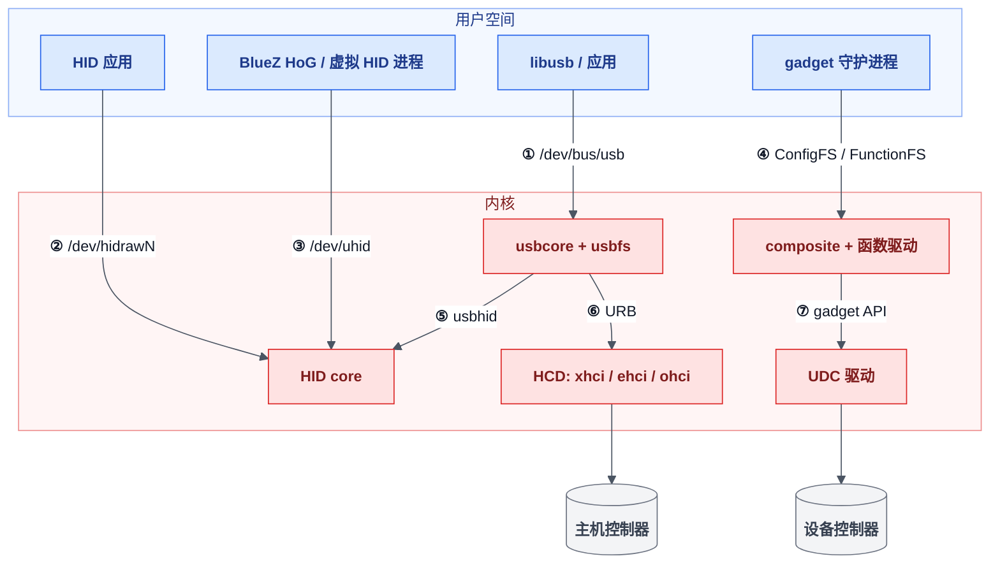

# 架构文档：Linux USB 栈（主机、HID、Gadget 与虚拟 USB）

> 类型：arch ｜ 模式：Reverse ｜ 代码基线：`docs.kernel.org（页面标注 Linux 7.4.0-rc4）；torvalds/linux master` ｜ 最后核对：2026-11-28 ｜ 范围：`docs.kernel.org/driver-api/usb, docs.kernel.org/usb, docs.kernel.org/hid, drivers/usb` ｜ lang: zh

## Overview

Linux 用一个内核 USB 栈同时覆盖主机侧（usbcore + HCD）、HID 子系统和设备侧（gadget 框架）：新设备默认 autosuspend 延迟 **2 秒**，USB/IP 用 TCP **3240**，`/dev/uhid`、ConfigFS、dummy_hcd 都可在无硬件时造出“真实”设备。读者是熟悉 Windows WinUSB/KMDF/hidclass、要做虚拟 USB 与驱动研究的工程师。来源只用 kernel.org 文档与 torvalds/linux 源码，以及 libusb、systemd、BlueZ、Wireshark 官方站点。

**TL;DR**

- 主机侧：URB 经 usbcore 交给 HCD；用户态走 usbfs/libusb 或 hidraw。
- 虚拟 HID 用 uhid，虚拟设备用 ConfigFS + dummy_hcd，网络导出用 USB/IP。
- Raw Gadget 官方定位为调试与 fuzzing，生产用 FunctionFS。
- 协议报文与 ConfigFS/FunctionFS/Raw Gadget 的逐条定义见 [06-linux-virtual-usb.md](06-linux-virtual-usb.md)，本文只讲栈结构与取舍。

蓝 = 用户空间应用，红 = 内核/系统级驱动，绿 = 用户态驱动或守护进程，橙 = 系统框架，灰 = 硬件与外部。

标记 **待核实** 的内容未能从官方来源确认，不要当作事实引用。

## 核心事实 Key Facts（已核对）

| # | 事实 | 值 / 说明 | 来源 |
|---|---|---|---|
| 1 | 主机侧 I/O 的基本单位 | URB（USB Request Block），由 HCD 执行 | [L1] |
| 2 | usbfs 设备节点 | `/dev/bus/usb/BBB/DDD`（总线号/设备号），通过 `USBDEVFS_*` ioctl 访问，如 `USBDEVFS_CLAIMINTERFACE` | [L1] |
| 3 | 新设备默认 autosuspend 延迟 | `usbcore.autosuspend=` 默认 **2 秒** | [L2][L16] |
| 3.2 | 新设备默认 autosuspend 延迟 | sysfs `power/autosuspend_delay_ms` 默认 2000 | [L2][L16] |
| 3.3 | 新设备默认 autosuspend 延迟 | 负值表示不自动挂起 | [L2][L16] |
| 4 | quirks 内核参数格式 | `usbcore.quirks=VID:PID:Flags`，VID/PID 为 4 位十六进制，Flags 为字母（如 `b`=RESET_RESUME，`g`=DELAY_INIT），逗号分隔 | [L16] |
| 5 | hidraw 节点与关键 ioctl | `/dev/hidrawN`；`HIDIOCGRDESCSIZE`/`HIDIOCGRDESC` 读报告描述符，`HIDIOCSFEATURE`/`HIDIOCGFEATURE` 收发 Feature 报告 | [L8] |
| 6 | uhid（用户态 HID 传输驱动） | 字符设备 `/dev/uhid`；每个虚拟设备 open 一次，先写 `UHID_CREATE2`，之后 `UHID_INPUT2` 注入输入报告 | [L9] |
| 7 | HID 核心支持的传输 | USB、I2C、Bluetooth L2CAP、用户态 I/O（uhid）等 | [L11] |
| 8 | USB/IP 端口 | TCP **3240** | [L19] |
| 9 | 设备授权 | `/sys/bus/usb/devices/DEVICE/authorized`（0/1），`usbX/authorized_default` 控制新设备默认是否授权 | [L13] |
| 10 | ConfigFS gadget 绑定 | 向 gadget 目录下 `UDC` 写入 `/sys/class/udc/*` 中的控制器名即启用；写空字符串解绑 | [L3] |
| 11 | ConfigFS HID 函数 | 模块 `usb_f_hid.ko`，函数目录名 `hid` | [L3] |
| 12 | Raw Gadget | `/dev/raw-gadget`，ioctl 接口，`CONFIG_USB_RAW_GADGET`；官方声明**仅用于调试，不应用于生产**（生产用 GadgetFS） | [L5] |
| 13 | dummy_hcd | `CONFIG_USB_DUMMY_HCD`，在同一主机内把主机侧请求回环给 gadget 驱动；模块参数 `is_super_speed`、`is_high_speed`（默认 HS）、`num` | [L20][L21] |
| 14 | usbmon 接口 | 文本 API 与二进制 API；debugfs 路径 `/sys/kernel/debug/usb/usbmon/`，`0u` 抓取所有总线 | [L7] |
| 15 | BLE HID（HoG）在 Linux 的实现位置 | 用户态 BlueZ 的 HoG profile，经 `src/shared/uhid` 把设备注入内核 HID 子系统 | [L23] |
| 16 | Type-C 软件栈 | typec class（注册每个 Type-C 端口） | [L15][L24] |
| 16.2 | Type-C 软件栈 | TCPM（`CONFIG_TYPEC_TCPM`，自动 select `USB_ROLE_SWITCH`） | [L15][L24] |
| 16.3 | Type-C 软件栈 | UCSI（`CONFIG_TYPEC_UCSI`） | [L15][L24] |

## 架构分层：主机侧、HID 与设备侧三条路径



图中 ①–④ 是用户态入口，⑤–⑥ 是主机侧调用路径，⑦ 是设备侧；红色内核块都在同一内核镜像内。

- 主机侧：usbcore 负责枚举、配置选择、hub 与电源管理；设备驱动（`struct usb_driver`）通过提交 URB 让 HCD 执行传输 [L1]。
- HCD：`drivers/usb/host/Kconfig` 中有 `USB_XHCI_HCD`、`USB_XHCI_PCI`、`USB_XHCI_PLATFORM`（SoC 平台 xHCI）、EHCI/OHCI 等选项 [L22]。xHCI 还有 `USB_XHCI_DBGCAP`（xHCI Debug Capability，DbC）用于调试口 [L22][L25]。
- 设备侧（gadget）：UDC 驱动 ↔ gadget API ↔ gadget 驱动（多为 composite 框架上的函数驱动），可组成复合设备 [L14]。

## 用户态访问主机侧设备

| 方式 | 说明 | 来源 |
|---|---|---|
| usbfs | `/dev/bus/usb/BBB/DDD`，ioctl 族 `USBDEVFS_*`（claim 接口、控制/批量传输、异步 URB 等） | [L1] |
| libusb | 跨平台用户态库；在 Linux 上基于 usbfs | [L26]（项目官方站）|
| hidraw | 面向 HID 设备的原始报告读写，绕过输入子系统解析 | [L8] |
| hiddev | 面向“非输入类” HID 用途（如 UPS、电源）的事件/用途接口 | [L10] |

> 与 Windows 对照：usbfs ≈ WinUSB（用户态直接发 Control/Bulk/Interrupt）；hidraw ≈ `HidD_*`/`ReadFile` 走 hidclass 的原始报告路径。

**权限**：设备节点权限由 udev 规则决定（`SUBSYSTEM=="usb"`/`"hidraw"` + `ATTRS{idVendor}` 等匹配后设置 MODE/GROUP）[L27]。具体发行版默认规则 **待核实**（各发行版不同）。

## HID 子系统

- HID core 与传输驱动分离：传输驱动（USB、I2C、Bluetooth L2CAP、uhid）负责原始数据收发与设备管理，HID core 负责报告描述符解析和向上层（input、hidraw、hiddev）分发 [L11]。
- **uhid**：用户态实现“HID 传输驱动”，内核看到的就是一个真正的 HID 设备；示例程序在 `samples/uhid/uhid-example.c` [L9]。这是 Linux 上做**虚拟 HID**（不经过 USB）最直接的官方方式，相当于 Windows 的 VHF。
- **HID-BPF**：用 eBPF 程序在内核里修补/改写 HID 报告与描述符，替代编写小型 quirk 驱动 [L12]。
- **BLE HID (HoG)**：内核 HID 传输里列的是 Bluetooth L2CAP（经典 BR/EDR HID）[L11]；BLE 的 HID over GATT 由 BlueZ 在用户态实现，并通过 uhid 注入内核 [L23]。

## USB/IP（网络虚拟 USB）

报文格式、命令码与 UNLINK 语义见 [06-linux-virtual-usb.md](06-linux-virtual-usb.md)；那篇的“待确认项”称内核文档页未写端口号，本文的 3240 来自内核源码树的 `tools/usb/usbip/README`。

- 服务器端导出（export）设备，客户端导入（import）；客户端打开 TCP 连接并发送 `OP_REQ_DEVLIST` 等报文 [L6]。
- 当前使用 TCP 端口 3240 [L19]。
- 内核驱动位于 `drivers/usb/usbip/`（`usbip-host` 服务端、`vhci-hcd` 客户端虚拟主机控制器）[L19]。`vhci-hcd` 即“虚拟主机控制器”，是 Linux 版的“UDE 主机侧”。

## 电源管理

- 运行时 PM：sysfs `power/control`（`on`/`auto`）、`power/autosuspend_delay_ms`（默认 2000，0 表示立即挂起）[L2]。
- 全局默认：`usbcore.autosuspend=`（秒，默认 2，负值禁用）[L16]。
- 驱动需支持 `supports_autosuspend`，并用 `usb_autopm_get_interface()`/`usb_autopm_put_interface()` 管理引用计数 [L2]。
- 远程唤醒、reset-resume 等细节见 [L2]；`USB_QUIRK_RESET_RESUME`（quirk 字母 `b`）用于无法正确 resume 的设备 [L16]。

## Quirks 与安全

- `usbcore.quirks=` 可在运行时追加/翻转内建 quirk 表项 [L16]。
- 授权机制：`authorized`/`authorized_default` 可实现“默认拒绝新设备，人工放行”（类似 USBGuard 的基础）[L13]。

## 设备侧：Gadget 框架（虚拟 USB 研究的核心）

ConfigFS 属性、FunctionFS 挂载流程与 Raw Gadget ioctl 的逐条定义见 [06-linux-virtual-usb.md](06-linux-virtual-usb.md)；本节只讲选型与组合。

### 7.1 组成
- **UDC 驱动**：控制器硬件驱动（dwc3、dwc2、chipidea、cdns3、musb 等）[L14]。
- **Composite 框架 + 函数驱动**：一份设备可组合多个函数（HID、NCM/ECM、ACM、MSC、UVC、UAC、FunctionFS…）[L14][L18]。

### 7.2 ConfigFS（推荐的组装方式）
最小 HID gadget 流程（路径与属性名以官方文档为准）[L3]：
```sh
modprobe libcomposite
cd /sys/kernel/config/usb_gadget && mkdir g1 && cd g1
echo 0x1d6b > idVendor; echo 0x0104 > idProduct   # 示例 ID
mkdir -p strings/0x409 configs/c.1 functions/hid.usb0
echo 1 > functions/hid.usb0/protocol      # 1=键盘
echo 1 > functions/hid.usb0/subclass      # 1=Boot
echo 8 > functions/hid.usb0/report_length
cat my_report_desc.bin > functions/hid.usb0/report_desc
ln -s functions/hid.usb0 configs/c.1/
echo <udc name> > UDC                      # 名称取自 /sys/class/udc/
```
gadget 侧随后通过 `/dev/hidgN` 写输入报告 [L18]。

### 7.3 FunctionFS / GadgetFS / Raw Gadget 对比

| 接口 | 定位 | 描述符/请求处理 | 适用 | 来源 |
|---|---|---|---|---|
| FunctionFS | 作为 composite 中的一个函数，用户态实现该函数（ep0 写描述符，epN 读写数据） | 用户态提供描述符；内核 composite 处理标准请求 | 生产（Android 的 adb/MTP 均用它） | [L4] |
| GadgetFS | 用户态实现整个 gadget | 内核对描述符做合法性检查，部分请求内部应答，绑定第一个可用 UDC | 生产 | [L5] |
| Raw Gadget | 最底层：每个 USB 请求都交给用户态，可返回任意（含畸形）数据，可选择绑定哪个 UDC，多实例 | 不做检查 | **仅调试/模糊测试** | [L5] |

### 7.4 dummy_hcd：无硬件的虚拟 USB 回环
- 一个“假 HCD + 假 UDC”对：主机侧的传输请求回环到同机的 gadget 驱动，可在没有 OTG 硬件的 PC 上开发 gadget [L20]。
- 支持 HS（默认）与 SuperSpeed（`is_super_speed=1`）；`num` 可建多个实例 [L21]。
- 典型组合：`dummy_hcd` + ConfigFS HID → 本机即出现一个“真实”USB HID 设备，可用 usbmon 抓包、测试主机侧驱动；`dummy_hcd` + Raw Gadget → 主机 USB 栈模糊测试（官方文档说明 Raw Gadget 适合 fuzzing）[L5]。

## Type-C / 角色切换（概要，细节见 ARM 篇）

- typec class 为每个 Type-C 端口在 sysfs 中建模（端口、伙伴、线缆、Alt Mode）[L15]。
- TCPM：软件实现 Type-C/PD 状态机，配合 TCPCI 等端口控制器；Kconfig 自动选择 `USB_ROLE_SWITCH` [L24]。
- UCSI：由 EC/PD 控制器固件实现策略，OS 通过 UCSI 接口获取状态（PC 平台常见）[L24]。
- USB Role Switch：选择端口为 host 或 device 的抽象（`drivers/usb/roles/`）[L24]。

## 调试工具

| 工具 | 用途 | 来源 |
|---|---|---|
| usbmon | 内核 USB 抓包，文本/二进制 API，`/sys/kernel/debug/usb/usbmon/Nu` | [L7] |
| Wireshark + usbmon | 图形化解析；部分发行版用 udev 规则把 `/dev/usbmonX` 交给 `usbmon` 组 | [L28] |
| xHCI DbC | 通过 USB3 调试口做内核调试/控制台 | [L25] |
| `lsusb -v`、`/sys/bus/usb/devices/*` | 描述符与属性查看 | usbutils 项目（**待核实**：未逐项核对其官方文档）|
| ftrace/动态调试 | `dyndbg` 打开 usbcore/xhci 日志 | **待核实**（未在本轮官方文档中逐条核对）|

## 与 Windows 的映射（速查）

| Windows | Linux 对应 | 备注 |
|---|---|---|
| Usbxhci.sys / UcxCx / Usbhub3.sys | xhci-hcd / usbcore hub 驱动 | [L22][W1] |
| WinUSB.sys + WinUsb_* | usbfs + libusb | [L1][W2] |
| KMDF USB 客户端驱动 | `struct usb_driver` 内核模块 | [L17] |
| hidclass + hidusb | HID core + usbhid | [L11][W3] |
| VHF（虚拟 HID 框架） | uhid | [L9][W4] |
| UDE/UdeCx（模拟主机控制器+设备） | dummy_hcd / vhci-hcd(usbip) | [L20][L19][W5] |
| UFX（USB 功能控制器） | gadget/UDC 框架 | [L14][W6] |
| Selective Suspend | runtime PM autosuspend | [L2][W7] |
| USB ETW / USBPcap | usbmon + Wireshark | [L7][W8] |

## 参考来源

### 来源组 1

- [L1] Linux USB API（usbcore、URB、usbfs）https://docs.kernel.org/driver-api/usb/usb.html
- [L2] USB 电源管理 https://docs.kernel.org/driver-api/usb/power-management.html
- [L3] Linux USB gadget configured through configfs https://docs.kernel.org/usb/gadget_configfs.html
- [L4] How FunctionFS works https://docs.kernel.org/usb/functionfs.html
- [L5] USB Raw Gadget https://docs.kernel.org/usb/raw-gadget.html
- [L6] USB/IP protocol https://docs.kernel.org/usb/usbip_protocol.html
- [L7] usbmon https://docs.kernel.org/usb/usbmon.html
- [L8] HIDRAW https://docs.kernel.org/hid/hidraw.html

### 来源组 2

- [L9] UHID https://docs.kernel.org/hid/uhid.html
- [L10] HIDDEV https://docs.kernel.org/hid/hiddev.html
- [L11] HID I/O Transport Drivers https://docs.kernel.org/hid/hid-transport.html
- [L12] HID-BPF https://docs.kernel.org/hid/hid-bpf.html
- [L13] Authorizing (or not) your USB devices https://docs.kernel.org/usb/authorization.html
- [L14] USB Gadget API for Linux https://docs.kernel.org/driver-api/usb/gadget.html
- [L15] USB Type-C connector class https://docs.kernel.org/driver-api/usb/typec.html
- [L16] kernel-parameters.txt（usbcore.autosuspend / usbcore.quirks）https://github.com/torvalds/linux/blob/master/Documentation/admin-guide/kernel-parameters.txt

### 来源组 3

- [L17] Writing USB Device Drivers https://docs.kernel.org/driver-api/usb/writing_usb_driver.html
- [L18] Gadget testing（各 ConfigFS 函数用法，含 hid）https://docs.kernel.org/usb/gadget-testing.html
- [L19] tools/usb/usbip/README（TCP 3240）https://github.com/torvalds/linux/blob/master/tools/usb/usbip/README ；驱动目录 https://github.com/torvalds/linux/tree/master/drivers/usb/usbip
- [L20] drivers/usb/gadget/udc/Kconfig（USB_DUMMY_HCD）https://github.com/torvalds/linux/blob/master/drivers/usb/gadget/udc/Kconfig
- [L21] drivers/usb/gadget/udc/dummy_hcd.c（模块参数）https://github.com/torvalds/linux/blob/master/drivers/usb/gadget/udc/dummy_hcd.c
- [L22] drivers/usb/host/Kconfig https://github.com/torvalds/linux/blob/master/drivers/usb/host/Kconfig
- [L23] BlueZ profiles/input/hog.c（包含 src/shared/uhid.h）https://github.com/bluez/bluez/blob/master/profiles/input/hog.c
- [L24] drivers/usb/typec/tcpm/Kconfig、typec/ucsi/Kconfig、drivers/usb/roles/Kconfig https://github.com/torvalds/linux/tree/master/drivers/usb/typec

### 来源组 4

- [L25] USB3 debug port（xHCI DbC）https://docs.kernel.org/driver-api/usb/usb3-debug-port.html
- [L26] libusb 官方站 https://libusb.info/
- [L27] systemd udev 手册 https://www.freedesktop.org/software/systemd/man/latest/udev.html
- [L28] Wireshark Wiki: CaptureSetup/USB https://wiki.wireshark.org/CaptureSetup/USB
- [W1]–[W8] 见 `12-cross-platform-comparison.md` 的 Windows 参考来源。

## 待确认项

- [ ] …标记 **待核实** 的内容未能从官方来源确认，不要当作事实引用。…
- [ ] …"`/`"hidraw"` + `ATTRS{idVendor}` 等匹配后设置 MODE/GROUP）[L27]。具体发行版默认规则 **待核实**（各发行版不同）。…
- [ ] …`lsusb -v`、`/sys/bus/usb/devices/*` | 描述符与属性查看 | usbutils 项目（**待核实**：未逐项核对其官方文档）…
- [ ] …ftrace/动态调试 | `dyndbg` 打开 usbcore/xhci 日志 | **待核实**（未在本轮官方文档中逐条核对）…
