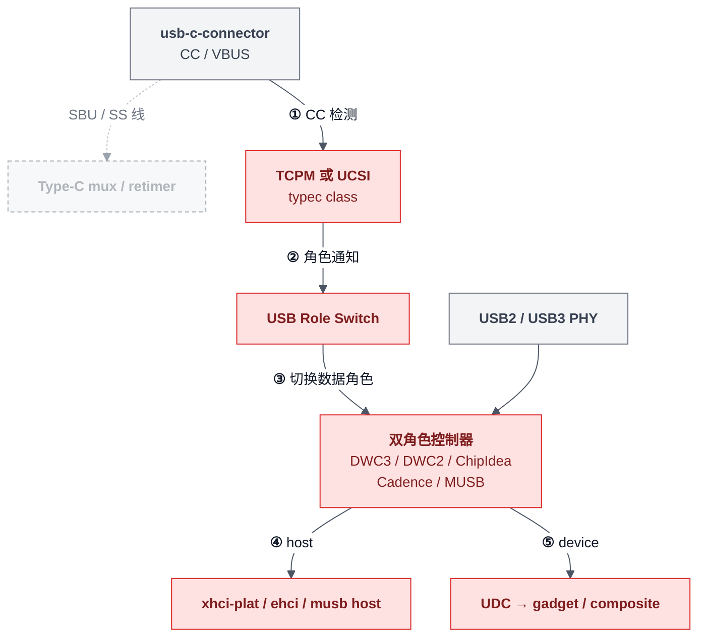

# 架构文档：ARM / 嵌入式 USB（SoC 控制器、设备树、双角色与 MCU 栈）

> 类型：arch ｜ 模式：Reverse ｜ 代码基线：`torvalds/linux master（Kconfig 与 DT binding）；TinyUSB README` ｜ 最后核对：2026-11-28 ｜ 范围：`drivers/usb/{dwc2,dwc3,chipidea,musb,cdns3,typec,roles}, Documentation/devicetree/bindings/usb, hathach/tinyusb` ｜ lang: zh

## Overview

ARM 在 USB 层没有独立 OS 栈：Linux/Android 跑在 ARM SoC 上时，差异集中在 **5 类控制器 IP**（DWC2、DWC3、ChipIdea、MUSB、Cadence）、设备树描述（`dr_mode` 未指定时默认 `otg`）、双角色切换和 Type-C 管理；MCU 上则是 TinyUSB 等裸机/RTOS 协议栈。

**TL;DR**

- 控制器 IP 决定驱动：dwc2/dwc3/ci_hdrc/musb-hdrc/cdns3；主机侧 USB3 类走 xhci-plat。
- 角色链路：连接器 → TCPM 或 UCSI → Role Switch → 双角色控制器。
- 同一 IP 在 Linux 与 TinyUSB 都有驱动，寄存器模型一致，是从固件迁到内核驱动研究的入口。
- Synopsys、Cadence、Mentor 的 Databook 需 NDA，本文不引用，寄存器细节以 Linux 驱动与 binding 为准。
- 虚拟 USB 与 gadget 的做法见 [07-linux-usb-stack.md](07-linux-usb-stack.md) 与 [06-linux-virtual-usb.md](06-linux-virtual-usb.md)。

蓝 = 用户空间应用，红 = 内核/系统级驱动，绿 = 用户态驱动或守护进程，橙 = 系统框架，灰 = 硬件与外部。

## 核心事实 Key Facts（已核对）

| # | 事实 | 值 / 说明 | 来源 |
|---|---|---|---|
| 1 | DWC2 | Synopsys DesignWare **HS OTG USB 2.0** 控制器（Hi-Speed 双角色），Linux 驱动 `dwc2.ko`，Kconfig 选择 `USB_ROLE_SWITCH` | [A1][A6] |
| 2 | DWC3 | DesignWare **USB3 DRD** 控制器（SuperSpeed 双角色）；主机模式复用 `xhci-plat`（`select USB_XHCI_PLATFORM`）| [A2][A7] |
| 3 | DWC3 DT 结构 | 通常是厂商 glue 节点下的子节点，也可作为独立节点（`compatible = "snps,dwc3"`）| [A7] |
| 4 | ChipIdea | Highspeed 双角色控制器，支持 ID/OTG FSM/sysfs 角色切换、仅主机、仅外设 | [A3] |
| 4.2 | ChipIdea | 模块 `ci_hdrc.ko` | [A3] |
| 4.3 | ChipIdea | 主机侧依赖 EHCI | [A3] |
| 5 | MUSB | Mentor Graphics Inventra (M)HDRC 高速双角色控制器 | [A4] |
| 5.2 | MUSB | TI DaVinci/OMAP3、Allwinner A10/A13/A20 等使用 | [A4] |
| 5.3 | MUSB | 模块 `musb-hdrc` | [A4] |
| 6 | Cadence | USBSS（USB 3.0）与 USBSSP（SuperSpeed Plus gen2x1）DRD 控制器，共享 DRD/OTG 寄存器接口，驱动运行时识别；主机侧走 xHCI platform | [A5][A8] |
| 7 | `dr_mode` | 取值 `host` / `peripheral` / `otg`，**未指定时默认 `otg`** | [A9] |
| 8 | `usb-role-switch` | 布尔属性，表示控制器可为连接器分配数据角色；`role-switch-default-mode` 取值 host/peripheral，默认 `peripheral`（角色为 NONE 时）| [A9] |
| 9 | `otg-rev` | OTG 修订号（如 `<0x0200>`），与 HNP/SRP/ADP 特性相关 | [A9] |
| 10 | `maximum-speed` | low-speed … super-speed-plus-gen2x2；未指定时按硬件最大能力 | [A10] |
| 11 | 连接器节点 | `compatible` 为 `usb-a-connector` / `usb-b-connector` / `usb-c-connector`；Type-C 属性 `power-role`(source/sink/dual)、`try-power-role`、`data-role`(host/device/dual)、`source-pdos`、`sink-pdos`、`op-sink-microwatt` 等 | [A11] |
| 12 | TCPM | `CONFIG_TYPEC_TCPM`：USB Type-C Port Controller Manager（软件状态机），select `USB_ROLE_SWITCH` 与 `POWER_SUPPLY` | [A12] |
| 13 | USB Role Switch 抽象 | 选择端口为 host 或 device 的设备；多数情况下双角色控制器自身即开关，也可能是在独立主机/设备控制器间切换数据线的 mux | [A13] |
| 14 | TinyUSB 设计 | 无动态内存分配 | [A14] |
| 14.2 | TinyUSB 设计 | 所有中断事件排队到非 ISR 任务处理（线程安全） | [A14] |
| 14.3 | TinyUSB 设计 | 支持 50+ MCU 家族 | [A14] |
| 14.4 | TinyUSB 设计 | 可裸机或 FreeRTOS/RT-Thread/Mynewt | [A14] |

## SoC 里的角色链路：连接器到控制器



① 到 ③ 是 Type-C 角色协商链，④ 与 ⑤ 是控制器按角色选择的两条路；虚线是数据线复用，不走角色链。

- 控制器：IP 核（DWC2/DWC3/ChipIdea/MUSB/Cadence）+ 厂商 glue（时钟、复位、电源、wrapper 寄存器）[A7][A3]。
- PHY：DT 中通过 `phys`/`phy-names` 引用（例：DWC3 的 `usb2-phy`/`usb3-phy`）[A15]。
- 角色管理：ID 引脚/extcon、OTG FSM、Type-C（TCPM/UCSI）→ Role Switch → 控制器 [A3][A12][A13]。

## 控制器 IP 对比

| IP | 最高速率 | 主机侧实现 | 设备侧 | Linux 目录 | 常见用途 | 来源 |
|---|---|---|---|---|---|---|
| DWC2 (HSOTG) | USB 2.0 HS | DWC2 自有主机驱动 | dwc2 gadget | `drivers/usb/dwc2` | 树莓派 BCM2835、Rockchip、Ingenic 等 | [A1][A6] |
| DWC3 | USB 3.x（SS/SSP，具体以 SoC 为准）| xhci-plat | dwc3 gadget | `drivers/usb/dwc3` | 主流手机/平板/开发板 SoC | [A2][A7] |
| ChipIdea | USB 2.0 HS | EHCI | ci_hdrc UDC | `drivers/usb/chipidea` | NXP i.MX 等（**待核实**：具体 SoC 列表以 binding 的 compatible 为准） | [A3][A16] |
| MUSB | USB 2.0 HS | musb host | musb gadget | `drivers/usb/musb` | TI、Allwinner | [A4] |
| Cadence USBSS/USBSSP | USB 3.0 / 3.1 Gen2x1 | xhci-plat | cdns3 gadget | `drivers/usb/cdns3` | TI J7、NXP i.MX8 等（**待核实**） | [A5][A8] |

## 设备树（DT）关键片段

DWC3 双角色 + Type-C 连接器（字段名均来自官方 binding；节点地址与 glue 属性因 SoC 而异）[A7][A9][A11]：
```dts
usb@a600000 {
    compatible = "snps,dwc3";
    dr_mode = "otg";            /* host | peripheral | otg(默认) */
    usb-role-switch;
    role-switch-default-mode = "peripheral";
    maximum-speed = "super-speed";
    phys = <&usb2_phy>, <&usb3_phy>;
    phy-names = "usb2-phy", "usb3-phy";
    port { dwc3_hs_ep: endpoint { remote-endpoint = <&conn_hs_ep>; }; };
};

connector {
    compatible = "usb-c-connector";
    power-role = "dual";        /* source | sink | dual(DRP) */
    try-power-role = "sink";
    data-role = "dual";         /* host | device | dual(DRD) */
    source-pdos = <PDO_FIXED(5000, 2000, PDO_FIXED_USB_COMM)>;
    sink-pdos = <PDO_FIXED(5000, 3000, PDO_FIXED_USB_COMM)>;
    op-sink-microwatt = <10000000>;
};
```
- `usb-role-switch` 与 OF graph（`port`/`endpoint`）一起使用，把控制器与连接器/Type-C 控制器连接起来 [A15][A9]。
- 一些 DWC3 quirk 属性（如 `snps,dis_u3_susphy_quirk`）用于规避特定 SoC 的问题，属性全表见 `snps,dwc3-common.yaml` [A15]。

## OTG、DRD 与角色切换

- **OTG**（On-The-Go 规范）：HNP/SRP/ADP，由 `otg-rev` 声明 [A9]。现代手机多用 Type-C 的 DRP/DRD，而非 OTG HNP（**待核实**：属行业惯例，无单一官方出处）。
- **DRD**：控制器同时具备主机与设备功能；切换来源可以是 ID 引脚（Micro-AB）、extcon、sysfs（ChipIdea 支持）或 Role Switch [A3][A13]。
- **Type-C**：CC 检测 → TCPM（软件 PD 状态机，适合无独立 PD 固件的嵌入式）或 UCSI（PD 固件在 EC/控制器里，OS 只读状态/下命令）→ 通知 Role Switch 与 power_supply [A12][A17]。
- 用户可见接口：typec class 在 sysfs 中呈现端口/伙伴/线缆/Alt Mode，可读写数据角色与电源角色 [A17]。

## MCU 协议栈（上下文）

| 协议栈 | 维护方 | 特点（官方描述） | 来源 |
|---|---|---|---|
| TinyUSB | 开源项目（hathach/tinyusb） | 设备栈：UAC1/2、BT HCI、CDC、DFU、HID（通用/键盘/鼠标/手柄）、Printer、MSC 多 LUN、MIDI、MTP/PTP、RNDIS/ECM/NCM、USBTMC、UVC（WIP）、Vendor+WebUSB（可配合 MS OS 2.0 描述符免 INF 加载 WinUSB） | [A14] |
| TinyUSB | 开源项目（hathach/tinyusb） | 主机栈：CDC-ACM、常见 USB 串口芯片、HID、MSC、MIDI、多级 Hub | [A14] |
| TinyUSB | 开源项目（hathach/tinyusb） | PD3.0 栈仍处早期且仅 STM32G4 | [A14] |
| STM32Cube USB Device | STMicroelectronics | STM32Cube MCU 中间件的 USB Device 库，覆盖全部 STM32 系列 | [A18] |
| Eclipse ThreadX USBX | Eclipse 基金会 | 高性能 USB host/device/OTG 嵌入式协议栈，与 ThreadX RTOS 集成 | [A19] |
| Zephyr USB、Nordic nRF Connect SDK、ESP-IDF（ESP32-S2/S3 等使用 TinyUSB） | 各厂商/基金会 | 本轮未能抓取官方页面全文，**待核实** | — |

TinyUSB 的驱动层可直接对应 SoC/MCU 的控制器 IP：`dwc2`、`musb`、`ci_hs`（ChipIdea HS）、`fsdev`（STM32 FS 设备）、`rp2040`、`nrf5x` 等均出现在其支持表中 [A14]。这意味着**同一 IP（如 DWC2）在 Linux 由 dwc2.ko 驱动、在 MCU 上由 TinyUSB dwc2 端口驱动**，寄存器模型一致，是从固件迁移到 Linux 驱动研究的好切入点。

## 虚拟 USB / 设备模式在 ARM 上

- 有 UDC 的 ARM 板（DWC2/DWC3/ChipIdea/MUSB/Cadence）可直接跑 Linux gadget（ConfigFS/FunctionFS/Raw Gadget），把板子变成任意 USB 设备（HID、NCM、UVC…）——方法见 [07-linux-usb-stack.md](07-linux-usb-stack.md) 的“设备侧”节。
- 没有 UDC 的环境用 dummy_hcd 做回环（见 [07-linux-usb-stack.md](07-linux-usb-stack.md) 的“dummy_hcd”小节）。

## BLE / HID-over-GATT

- ARM Linux 与 x86 Linux 相同：BlueZ 用户态 HoG + uhid（见 [07-linux-usb-stack.md](07-linux-usb-stack.md) 的“HID 子系统”节）[A20]。
- MCU 侧（作为 HID 外设）通常由 SoC 厂商 BLE 协议栈实现 HOGP Device 角色；本轮未核对各厂商文档，**待核实**。

## 参考来源

### 来源组 1

- [A1] drivers/usb/dwc2/Kconfig https://github.com/torvalds/linux/blob/master/drivers/usb/dwc2/Kconfig
- [A2] drivers/usb/dwc3/Kconfig https://github.com/torvalds/linux/blob/master/drivers/usb/dwc3/Kconfig
- [A3] drivers/usb/chipidea/Kconfig https://github.com/torvalds/linux/blob/master/drivers/usb/chipidea/Kconfig
- [A4] drivers/usb/musb/Kconfig https://github.com/torvalds/linux/blob/master/drivers/usb/musb/Kconfig
- [A5] drivers/usb/cdns3/Kconfig https://github.com/torvalds/linux/blob/master/drivers/usb/cdns3/Kconfig
- [A6] DT binding dwc2.yaml（title: DesignWare HS OTG USB 2.0 controller）https://github.com/torvalds/linux/blob/master/Documentation/devicetree/bindings/usb/dwc2.yaml
- [A7] DT binding snps,dwc3.yaml https://github.com/torvalds/linux/blob/master/Documentation/devicetree/bindings/usb/snps,dwc3.yaml ；驱动文档 https://docs.kernel.org/driver-api/usb/dwc3.html
- [A8] DT binding cdns,usb3.yaml https://github.com/torvalds/linux/blob/master/Documentation/devicetree/bindings/usb/cdns,usb3.yaml

### 来源组 2

- [A9] DT binding usb-drd.yaml https://github.com/torvalds/linux/blob/master/Documentation/devicetree/bindings/usb/usb-drd.yaml
- [A10] DT binding usb.yaml https://github.com/torvalds/linux/blob/master/Documentation/devicetree/bindings/usb/usb.yaml
- [A11] DT binding connector/usb-connector.yaml https://github.com/torvalds/linux/blob/master/Documentation/devicetree/bindings/connector/usb-connector.yaml
- [A12] drivers/usb/typec/tcpm/Kconfig https://github.com/torvalds/linux/blob/master/drivers/usb/typec/tcpm/Kconfig
- [A13] drivers/usb/roles/Kconfig https://github.com/torvalds/linux/blob/master/drivers/usb/roles/Kconfig
- [A14] TinyUSB README https://github.com/hathach/tinyusb/blob/master/README.rst ；文档 https://docs.tinyusb.org/
- [A15] DT binding snps,dwc3-common.yaml https://github.com/torvalds/linux/blob/master/Documentation/devicetree/bindings/usb/snps,dwc3-common.yaml
- [A16] DT binding chipidea,usb2-common.yaml / ci-hdrc-usb2.yaml https://github.com/torvalds/linux/tree/master/Documentation/devicetree/bindings/usb

### 来源组 3

- [A17] USB Type-C connector class https://docs.kernel.org/driver-api/usb/typec.html ；UCSI Kconfig https://github.com/torvalds/linux/blob/master/drivers/usb/typec/ucsi/Kconfig
- [A18] STMicroelectronics stm32-mw-usb-device https://github.com/STMicroelectronics/stm32_mw_usb_device
- [A19] Eclipse ThreadX USBX https://github.com/eclipse-threadx/usbx
- [A20] BlueZ profiles/input/hog.c https://github.com/bluez/bluez/blob/master/profiles/input/hog.c

## 待确认项

- [ ] …B 2.0 HS | EHCI | ci_hdrc UDC | `drivers/usb/chipidea` | NXP i.MX 等（**待核实**：具体 SoC 列表以 binding 的 compatible 为准） | [A3][A16]…
- [ ] … xhci-plat | cdns3 gadget | `drivers/usb/cdns3` | TI J7、NXP i.MX8 等（**待核实**） | [A5][A8]…
- [ ] …：HNP/SRP/ADP，由 `otg-rev` 声明 [A9]。现代手机多用 Type-C 的 DRP/DRD，而非 OTG HNP（**待核实**：属行业惯例，无单一官方出处）。…
- [ ] …nnect SDK、ESP-IDF（ESP32-S2/S3 等使用 TinyUSB） | 各厂商/基金会 | 本轮未能抓取官方页面全文，**待核实** | —…
- [ ] …MCU 侧（作为 HID 外设）通常由 SoC 厂商 BLE 协议栈实现 HOGP Device 角色；本轮未核对各厂商文档，**待核实**。…
