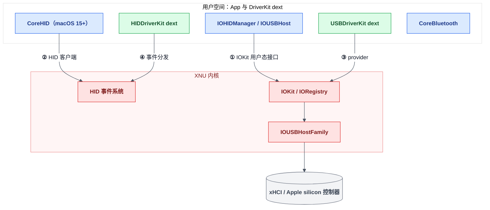

# 架构文档：macOS USB 栈（IOKit、DriverKit 系统扩展与 HID 路径）

> 类型：arch ｜ 模式：Reverse ｜ 代码基线：`developer.apple.com 文档 JSON 与 support.apple.com（2026-11-28 抓取）` ｜ 最后核对：2026-11-28 ｜ 范围：`IOUSBHost, DriverKit, USBDriverKit, HIDDriverKit, SystemExtensions, CoreHID, IOHIDManager` ｜ lang: zh

## Overview

macOS 11（Big Sur）起不再支持 **IOUSBFamily 与 IOHIDFamily 的全部 KPI**，第三方 USB/HID 驱动改为用户态 DriverKit 扩展（dext），分发要走 entitlement 申请、Developer ID 签名与公证。读者是 Windows 驱动背景、想做 macOS 虚拟 HID 或自定义 USB 驱动的工程师。来源只用 developer.apple.com 与 support.apple.com，Apple 未公开的内核实现标 **待核实**。

**TL;DR**

- 免驱动访问：IOUSBHost 框架（macOS 10.15+）与 IOHIDManager；CoreHID 需 macOS 15+。
- 写驱动：USBDriverKit / HIDDriverKit，需向 Apple 申请 DriverKit entitlement。
- 虚拟 HID：CoreHID `HIDVirtualDevice` 或 HIDDriverKit，都要对应 entitlement。
- 没有面向第三方的 USB 设备（gadget）模式 API（否定性结论，**待核实**）。

蓝 = 用户空间应用，红 = 内核/系统级驱动，绿 = 用户态驱动或守护进程，橙 = 系统框架，灰 = 硬件与外部。

## 核心事实 Key Facts（已核对）

| # | 事实 | 值 / 说明 | 来源 |
|---|---|---|---|
| 1 | IOUSBHost 框架 | 在**用户空间**为 USB 设备写 host-mode 驱动（访问自定义/非类兼容设备） | [M1] |
| 1.2 | IOUSBHost 框架 | macOS 10.15+，Mac Catalyst 14+ | [M1] |
| 1.3 | IOUSBHost 框架 | 核心类 IOUSBHostDevice、IOUSBHostInterface、IOUSBHostPipe、IOUSBHostStream | [M1] |
| 2 | DriverKit | 驱动运行在用户空间，以扩展形式随 App 分发 | [M2] |
| 2.2 | DriverKit | macOS 10.15+，iOS/iPadOS 16+ 有 DriverKit 框架 | [M2] |
| 2.3 | DriverKit | macOS 用 SystemExtensions 框架安装/升级，iPadOS 由系统随宿主 App 自动发现与升级 | [M2] |
| 3 | DriverKit 支持的传输 | USB、PCI、HID、网络、串口 | [M7] |
| 4 | USBDriverKit | 为自定义或非类兼容 USB 设备开发驱动 | [M3] |
| 4.2 | USBDriverKit | 可用于 Intel 与 Apple silicon 的 macOS，以及 **M 系列芯片的 iPadOS** | [M3] |
| 4.3 | USBDriverKit | 提供 IOUSBHostDevice / IOUSBHostInterface / IOUSBHostPipe 等 provider | [M3] |
| 5 | HIDDriverKit | 键盘、指点设备、数字化仪等 HID 驱动；**仅 macOS**（10.15+） | [M4] |
| 6 | 内核扩展淘汰 | 自 macOS Big Sur 起默认不再加载使用已弃用 KPI 的 kext | [M8] |
| 6.2 | 内核扩展淘汰 | **IOUSBFamily 全部 KPI 在 Big Sur 不再支持**（应迁到 IOUSBHostFamily 或 USBDriverKit） | [M8] |
| 6.3 | 内核扩展淘汰 | **IOHIDFamily 全部 KPI 在 Big Sur 不再支持**（应改用 HIDDriverKit） | [M8] |
| 7 | 关键 entitlement | `com.apple.developer.driverkit`（允许作为用户态驱动运行） | [M7][M9] |
| 7.2 | 关键 entitlement | `com.apple.developer.driverkit.transport.usb`（字典数组，键名为设备描述符字段名，用于声明匹配的 USB 设备） | [M7][M9] |
| 7.3 | 关键 entitlement | `com.apple.developer.driverkit.transport.hid` | [M7][M9] |
| 7.4 | 关键 entitlement | `com.apple.developer.driverkit.family.hid.device` | [M7][M9] |
| 7.5 | 关键 entitlement | `com.apple.developer.driverkit.family.hid.eventservice` | [M7][M9] |
| 7.6 | 关键 entitlement | `com.apple.developer.driverkit.userclient-access` | [M7][M9] |
| 7.7 | 关键 entitlement | `com.apple.developer.driverkit.allow-any-userclient-access` | [M7][M9] |
| 7.8 | 关键 entitlement | 安装方 App 需 `com.apple.developer.system-extension.install` | [M7][M9] |
| 8 | 虚拟 HID entitlement | `com.apple.developer.hid.virtual.device`（驱动创建虚拟 HID 设备）；`com.apple.developer.driverkit.family.hid.virtual.device`（App 创建并管理虚拟 HID 设备） | [M9] |
| 9 | Entitlement 申请 | 需向 Apple 申请 DriverKit entitlement，并提供硬件 vendor ID、设备与安装 App 描述 | [M7] |
| 9.2 | Entitlement 申请 | 同一产品的 entitlement 须属于同一组 | [M7] |
| 9.3 | Entitlement 申请 | 获批前可关闭安全检查在本机开发 | [M7] |
| 10 | 开发模式 | `systemextensionsctl developer on` 让系统不检查扩展位置；示例工程的自动签名流程要求临时关闭 SIP | [M10][M11] |
| 11 | 公证 | Developer ID 签名软件可提交 Apple notary service 自动扫描，生成 ticket 供 Gatekeeper 校验；kext 等非 App bundle 也可公证 | [M12] |
| 12 | IOHIDManager | IOKit 的 HID 管理对象：设备发现/移除回调、输入报告回调、输入值回调、匹配条件、run loop 调度 | [M5] |
| 13 | CoreHID | **macOS 15+**；可发现 HID 设备、收输入、发请求（如点灯），并可用 `HIDVirtualDevice` 模拟 HID 设备（如虚拟手柄）| [M6] |
| 14 | Apple silicon 笔记本配件授权 | 新/未知的 USB、Thunderbolt 配件或 SD 卡需用户允许 | [M13] |
| 14.2 | Apple silicon 笔记本配件授权 | 默认“新配件询问” | [M13] |
| 14.3 | Apple silicon 笔记本配件授权 | 锁定 3 天以上可能需解锁后才能用已允许的配件 | [M13] |
| 14.4 | Apple silicon 笔记本配件授权 | 拒绝后仍可充电 | [M13] |

## 架构分层：App、dext 与内核三层

① 与 ② 是不写驱动的路径，③ 与 ④ 是 dext 路径；dext 虽在用户态，仍通过 IOKit 服务平面与内核对话。

- IOKit 以“驱动匹配 + IORegistry 树”为核心；USB 设备与接口作为服务出现在 service plane，IOUSBHost 框架为设备与接口类定义了 service plane 属性 [M1][M14]。
- DriverKit 驱动以 IOService 子类实现，provider 是 USBDriverKit 提供的设备/接口对象 [M3]。

## 用户态访问（不写驱动）

| 路径 | 用途 | 平台 | 来源 |
|---|---|---|---|
| IOUSBHost 框架（ObjC/Swift） | 用户态 claim 设备/接口、取描述符、发控制/批量/中断/等时请求，管理 stream | macOS 10.15+ | [M1] |
| IOHIDManager / IOHIDDevice（IOKit C API） | 枚举 HID 设备、收输入报告/值、发 Output/Feature 报告 | macOS | [M5] |
| CoreHID（Swift） | 新一代 HID 客户端 API + 虚拟 HID 设备 | macOS 15+ | [M6] |
| libusb | 跨平台库（在 macOS 上基于 IOKit） | — | 项目官方站 https://libusb.info/ ；实现细节**待核实** |

> 读取键盘类 HID 输入通常还受隐私权限（“输入监控”）约束，API `IOHIDRequestAccess` 等细节本轮未能抓取官方页面，**待核实**。

## 驱动开发：DriverKit 系统扩展（dext）

1. **项目结构**：dext 放在 App bundle 的指定目录，由 App 用 SystemExtensions 框架激活；App 需 `com.apple.developer.system-extension.install` [M7][M9][M15]。
2. **匹配**：driver 的 entitlement `com.apple.developer.driverkit.transport.usb` 列出它支持的设备（键为设备描述符字段名，如厂商 ID/产品 ID）[M9]；Info.plist 中 IOKitPersonalities 的具体写法以 Xcode 模板为准（**待核实**：本轮未逐键核对）。
3. **USB I/O**：在 IOUSBHostInterface 上打开 pipe（IOUSBHostPipe）进行传输 [M3]。
4. **与 App 通信**：通过 user client（IOUserClient 子类），需 `userclient-access` 或 `allow-any-userclient-access` entitlement；官方示例演示了带输入校验的标量/结构体调用和异步回调 [M9][M16]。
5. **开发调试**：`systemextensionsctl developer on`；必要时临时关闭 SIP（仅开发机）[M10][M11]。
6. **发布**：Developer ID 签名 + 公证（Gatekeeper 校验 ticket）[M12]；用户首次安装需在“隐私与安全性”中允许 [M16]。

### HIDDriverKit 要点
- 类：IOUserHIDDevice（HID 设备 provider 基类相关）、IOUserHIDEventService / IOUserHIDEventDriver（向系统分发键盘、数字化仪、滚动、指针事件）、IOUserUSBHostHIDDevice（支持 HID 交互的 USB 设备 provider）等 [M4]。
- 用于：修正非标准报告描述符、把厂商报告转成系统事件、实现虚拟 HID（配合虚拟 HID entitlement）[M4][M9]。

## HID 路径对比（macOS）

| 场景 | 推荐 API | 说明 |
|---|---|---|
| App 读写自家 HID 设备（如鼠标配置工具） | IOHIDManager / IOHIDDevice，或 CoreHID（macOS 15+） | 无需驱动；Feature/Output 报告读写 [M5][M6] |
| 改变系统对设备的解释 | HIDDriverKit dext | 需 entitlement 与用户批准 [M4][M7] |
| 虚拟键鼠/手柄（测试、远控） | CoreHID `HIDVirtualDevice`（macOS 15+）或 HIDDriverKit 虚拟设备 | 均需虚拟 HID entitlement [M6][M9] |
| BLE HID 外设 | 系统蓝牙栈作为 HoG 主机，设备出现在 HID 系统中（**待核实**：Apple 未在本轮抓取页面中描述 HoG 内部实现）；自定义 GATT 服务用 CoreBluetooth（macOS 10.10+） | [M17] |

## 虚拟 USB / 设备模式

- macOS **没有面向第三方的 USB 设备（gadget）模式 API**：本轮在 IOUSBHost/USBDriverKit 文档中只看到 host-mode 能力 [M1][M3]（“完全没有”属于否定性结论，**待核实**）。
- IOUSBHost 框架中存在 `IOUSBHostControllerInterface` 类（macOS 10.15+ 标注），从命名看与用户态主机控制器接口相关，但官方页面无说明文字，用途 **待核实** [M18]。
- 虚拟 HID 是官方支持的方向：CoreHID HIDVirtualDevice / HIDDriverKit [M6][M4]。

## 电源管理

- USB 设备电源/挂起策略由系统管理，DriverKit 驱动通过 IOService 电源接口参与；本轮未抓取具体 API 文档，**待核实**。

## 安全与权限（Apple silicon 特有项）

- 便携 Mac（Apple silicon）配件授权：可在“系统设置 › 隐私与安全性 › 配件”选择“始终询问 / 新配件询问（默认）/ 解锁时自动允许 / 始终允许”；受监管设备可由管理员用 Apple Configurator 控制 [M13]。
- Apple 平台安全指南：iPad、iPhone 与 Apple silicon 便携 Mac 上，若近期无数据连接，需 Face ID/Touch ID/密码才能激活 Thunderbolt、USB 等数据连接 [M19]。
- 锁定模式（Lockdown Mode）下，Apple silicon 笔记本连接配件须解锁且显式批准 [M20]。

## 调试工具

| 工具 | 用途 | 来源 |
|---|---|---|
| IORegistryExplorer / `ioreg` | 查看 IORegistry 中的 USB 设备、接口、属性与匹配到的驱动 | IORegistryExplorer 随 Apple “Additional Tools for Xcode” 分发（**待核实**：下载页需登录，本轮未核对） |
| `systemextensionsctl list` / `developer on` | 查看/调试系统扩展 | [M10] |
| 系统信息 › USB（`system_profiler SPUSBDataType`） | 设备树与速率 | **待核实** |
| Wireshark（XHC20 接口） | macOS High Sierra + Wireshark 2.4/libpcap 1.9 起可抓 USB；需 `sudo ifconfig XHC20 up`；Catalina 及以后据称需关闭 SIP | [M21]（Wireshark 官方 Wiki，原文措辞为“apparently”，视为 **待核实**）|

## 与 Windows 的映射

| Windows | macOS |
|---|---|
| WinUSB（用户态访问） | IOUSBHost 框架 [M1] |
| KMDF USB 客户端驱动 | USBDriverKit dext（用户态！）[M3] |
| UMDF 2 | DriverKit 整体理念更接近 UMDF（驱动跑在用户态）[M2] |
| hidclass + HID minidriver / 过滤驱动 | HIDDriverKit [M4] |
| VHF | CoreHID HIDVirtualDevice / HIDDriverKit 虚拟设备 [M6][M9] |
| Driver signing（EV 证书 + 硬件开发者中心签名）| DriverKit entitlement 审批 + Developer ID + 公证 [M7][M12] |
| UsbView / USB ETW | IORegistryExplorer / Wireshark XHC20 |

## 参考来源

### 来源组 1

- [M1] IOUSBHost https://developer.apple.com/documentation/iousbhost
- [M2] DriverKit https://developer.apple.com/documentation/driverkit
- [M3] USBDriverKit https://developer.apple.com/documentation/usbdriverkit
- [M4] HIDDriverKit https://developer.apple.com/documentation/hiddriverkit
- [M5] IOHIDManager.h https://developer.apple.com/documentation/iokit/iohidmanager_h
- [M6] CoreHID https://developer.apple.com/documentation/corehid ；HIDVirtualDevice https://developer.apple.com/documentation/corehid/hidvirtualdevice
- [M7] Requesting entitlements for DriverKit development https://developer.apple.com/documentation/driverkit/requesting-entitlements-for-driverkit-development
- [M8] Deprecated Kernel Extensions and System Extension Alternatives https://developer.apple.com/support/kernel-extensions/

### 来源组 2

- [M9] Entitlements（各 DriverKit/HID/System Extension 键）https://developer.apple.com/documentation/bundleresources/entitlements ，例如 https://developer.apple.com/documentation/bundleresources/entitlements/com.apple.developer.driverkit.transport.usb
- [M10] Debugging and testing system extensions https://developer.apple.com/documentation/driverkit/debugging-and-testing-system-extensions
- [M11] Communicating between a DriverKit extension and a client app（SIP、dext 开发模式说明）https://developer.apple.com/documentation/driverkit/communicating-between-a-driverkit-extension-and-a-client-app
- [M12] Notarizing macOS software before distribution https://developer.apple.com/documentation/security/notarizing-macos-software-before-distribution
- [M13] Allow USB and other accessories to connect to your Mac https://support.apple.com/en-us/102282
- [M14] IOKit https://developer.apple.com/documentation/iokit
- [M15] SystemExtensions https://developer.apple.com/documentation/systemextensions
- [M16] 同 [M11]（安装确认与 user client 示例）

### 来源组 3

- [M17] CoreBluetooth https://developer.apple.com/documentation/corebluetooth
- [M18] IOUSBHostControllerInterface https://developer.apple.com/documentation/iousbhost/iousbhostcontrollerinterface
- [M19] Apple Platform Security: Activating data connections securely https://support.apple.com/guide/security/activating-data-connections-securely-sec5044aad1b/web
- [M20] About Lockdown Mode https://support.apple.com/en-us/105120
- [M21] Wireshark Wiki CaptureSetup/USB https://wiki.wireshark.org/CaptureSetup/USB

## 待确认项

### 待确认组 1

- [ ] …驱动的工程师。来源只用 developer.apple.com 与 support.apple.com，Apple 未公开的内核实现标 **待核实**。…
- [ ] …没有面向第三方的 USB 设备（gadget）模式 API（否定性结论，**待核实**）。…
- [ ] …usb | 跨平台库（在 macOS 上基于 IOKit） | — | 项目官方站 https://libusb.info/ ；实现细节**待核实…
- [ ] …如厂商 ID/产品 ID）[M9]；Info.plist 中 IOKitPersonalities 的具体写法以 Xcode 模板为准（**待核实**：本轮未逐键核对）。…
- [ ] …BLE HID 外设 | 系统蓝牙栈作为 HoG 主机，设备出现在 HID 系统中（**待核实**：Apple 未在本轮抓取页面中描述 HoG 内部实现）；自定义 GATT 服务用 CoreBluetooth…
- [ ] …在 IOUSBHost/USBDriverKit 文档中只看到 host-mode 能力 [M1][M3]（“完全没有”属于否定性结论，**待核实**）。…
- [ ] …rollerInterface` 类（macOS 10.15+ 标注），从命名看与用户态主机控制器接口相关，但官方页面无说明文字，用途 **待核实** [M18]。…
- [ ] …USB 设备电源/挂起策略由系统管理，DriverKit 驱动通过 IOService 电源接口参与；本轮未抓取具体 API 文档，**待核实**。…

### 待确认组 2

- [ ] …匹配到的驱动 | IORegistryExplorer 随 Apple “Additional Tools for Xcode” 分发（**待核实**：下载页需登录，本轮未核对）…
- [ ] …系统信息 › USB（`system_profiler SPUSBDataType`） | 设备树与速率 | **待核实…
- [ ] …atalina 及以后据称需关闭 SIP | [M21]（Wireshark 官方 Wiki，原文措辞为“apparently”，视为 **待核实**）…

