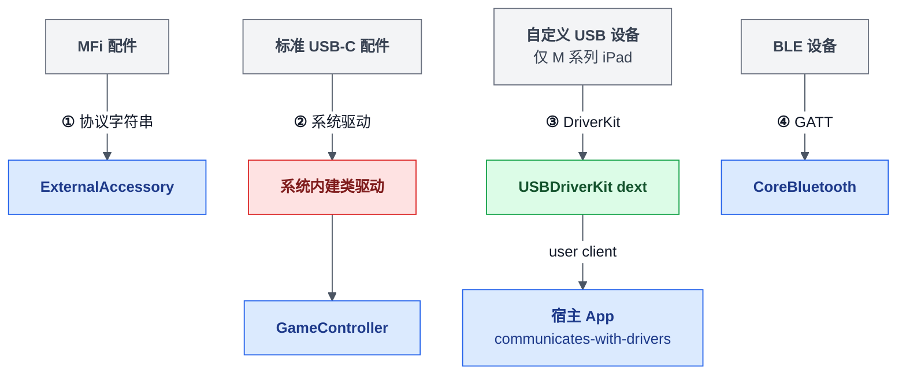

# 架构文档：iOS / iPadOS USB（MFi、iPad DriverKit 与配件安全）

> 类型：arch ｜ 模式：Reverse ｜ 代码基线：`developer.apple.com、support.apple.com、mfi.apple.com（2026-11-28 抓取）` ｜ 最后核对：2026-11-28 ｜ 范围：`ExternalAccessory, DriverKit(iPadOS), USBDriverKit, GameController, CoreBluetooth, 有线配件设置` ｜ lang: zh

## Overview

iOS 是最封闭的 USB 平台：第三方 App 没有通用 USB 主机 API，只有 **4 条通道**——MFi/ExternalAccessory、系统内建标准类驱动、M 系列 iPad 的 DriverKit、蓝牙。iPhone 15 起为 USB-C，Pro 机型配 USB 3 线可达 10 Gbit/s。“某 API 不存在”这类否定性结论无法由单页官方文档证实，一律标 **待核实**。

**TL;DR**

- 私有协议配件：MFi 计划 + ExternalAccessory，由配件厂商决定哪些 App 能通信。
- 自定义 USB 设备：只有 M 系列 iPad 能用 USBDriverKit，驱动随 App 分发。
- 没有 HIDDriverKit，CoreHID 仅 macOS，iOS 上无公开原始 HID 报告 API（**待核实**）。
- 安全：锁定超 1 小时后不允许新数据连接，已知配件记忆 30 天。

蓝 = 用户空间应用，红 = 内核/系统级驱动，绿 = 用户态驱动或守护进程，橙 = 系统框架，灰 = 硬件与外部。

## 核心事实 Key Facts（已核对）

| # | 事实 | 值 / 说明 | 来源 |
|---|---|---|---|
| 1 | ExternalAccessory 框架 | 与 **MFi 配件**通信 | [I1] |
| 1.2 | ExternalAccessory 框架 | 官方描述的物理连接为 Apple Lightning / 30-pin，或蓝牙 | [I1] |
| 1.3 | ExternalAccessory 框架 | iOS/iPadOS 3.0+ | [I1] |
| 2 | 谁能与 MFi 配件通信 | 由**配件制造商**决定哪些第三方 App 可通信；App 在 Info.plist `UISupportedExternalAccessoryProtocols` 声明协议字符串 | [I1][I2] |
| 3 | EA 核心类 | `EAAccessoryManager`（识别已连接配件、连接/断开通知）、`EASession`（与配件的通信会话） | [I2] |
| 4 | Apple silicon Mac 上运行的 iPad/iPhone App | **不能**通过 ExternalAccessory 连接外部配件 | [I1] |
| 5 | MFi 计划 | 提供与 Apple 设备有线/无线连接配件的技术规范与资源（含游戏手柄、CarPlay、电源与线缆等类别）| [I3] |
| 6 | DriverKit on iPadOS | DriverKit 框架 iOS/iPadOS 16.0+ | [I4][I5] |
| 6.2 | DriverKit on iPadOS | **需 M 系列芯片 iPad** | [I4][I5] |
| 6.3 | DriverKit on iPadOS | 驱动随宿主 App 由系统自动发现与升级（无需 SystemExtensions） | [I4][I5] |
| 7 | USBDriverKit on iPadOS | 可用于 M 系列芯片 iPadOS 设备 | [I6] |
| 8 | HIDDriverKit | 文档标注**仅 macOS** → iPad 上没有 HID dext | [I7] |
| 9 | iPadOS 专用 entitlement | `com.apple.developer.driverkit.communicates-with-drivers`（App 可与驱动通信）、`com.apple.developer.driverkit.allow-third-party-userclients`（驱动接受第三方 user client），均 iOS/iPadOS 16.0+ | [I8] |
| 10 | iPhone USB-C | iPhone 15 及以后为 USB-C | [I9] |
| 10.2 | iPhone USB-C | Pro 机型（iPhone 15 Pro 至 18 Pro 等）配 USB 3 线可达 **USB 3.2 Gen 2 10 Gbit/s** | [I9] |
| 10.3 | iPhone USB-C | DisplayPort 连接 USB-C 显示器最高 4K 60Hz | [I9] |
| 10.4 | iPhone USB-C | 支持外置存储、显示器、麦克风、USB 以太网转接器等基于标准的配件 | [I9] |
| 10.5 | iPhone USB-C | 可给 AirPods/Apple Watch 等供电 | [I9] |
| 11 | 有线配件授权（USB Restricted Mode 演进） | 设置 › 隐私与安全性 › 有线配件。USB-C 机型：始终询问 / 新配件询问 / 解锁时自动允许（默认）/ 始终允许；Lightning 机型只有后两项。存储类配件**始终**需先解锁 | [I10] |
| 12 | 数据连接激活规则 | 锁定超 1 小时后不允许新数据连接直到解锁 | [I11] |
| 12.2 | 数据连接激活规则 | 期间仅允许曾在解锁状态下连接过的配件（记忆 30 天） | [I11] |
| 12.3 | 数据连接激活规则 | 若 3 天以上未建立配件数据连接，则锁屏后立即禁止新连接 | [I11] |
| 13 | GameController | iOS/iPadOS 7.0+ | [I12] |
| 13.2 | GameController | 支持 DualShock 4、DualSense、Xbox 等第三方手柄以及鼠标、键盘、Siri Remote、赛车方向盘 | [I12] |
| 13.3 | GameController | 也可显示虚拟手柄 | [I12] |
| 14 | CoreHID | 文档仅标注 **macOS 15+**，iOS 不可用 | [I13] |
| 15 | CoreBluetooth | iOS/iPadOS 5.0+，BLE GATT 中心/外设 API | [I14] |

## 访问路径：四条通道，只有 iPad 能写驱动

① 到 ④ 对应四条通道；绿色 dext 只在 M 系列 iPad 上存在，其余机型只能走 ①②④。

## MFi 与 ExternalAccessory

- 适用：需要与 App 交换私有协议数据的配件（POS、医疗、工业等）。流程：加入 MFi 计划获得规范与认证组件 → 配件声明协议字符串 → App 在 `UISupportedExternalAccessoryProtocols` 中声明 → 运行时用 `EAAccessoryManager` 发现、`EASession` 打开输入/输出流 [I1][I2][I3]。
- 官方文档仍写 Lightning/30-pin/蓝牙；**USB-C iPhone/iPad 上 EA 的具体传输方式（如是否走 iAP2 over USB）本轮未找到公开官方说明，待核实**。MFi 规范本身需注册会员才能查看。

## M 系列 iPad 上的 DriverKit

- 同一 DriverKit/USBDriverKit 代码可面向 macOS 与 iPadOS；官方示例工程同时含 macOS 与 iPadOS App 目标，并说明 DriverKit on iPadOS 需要 M 系列 iPad [I5]。
- 部署：iPadOS 上系统随宿主 App 自动发现与升级驱动 [I4]；App 需 `communicates-with-drivers`，驱动需 `allow-third-party-userclients` 才能接受第三方 user client 调用 [I8]。
- 注意：`com.apple.developer.driverkit.transport.usb` 的官方 entitlement 页面平台元数据只列 macOS 10.15+，而 USBDriverKit 文档又写支持 M 系列 iPadOS——iPadOS 上 USB 设备匹配所需 entitlement 的确切形式 **待核实** [I6][I15]。
- 没有 HIDDriverKit → iPad 上无法写 HID 驱动；HID 设备只能走系统内建支持或 GameController [I7][I12]。

## USB-C 与标准类设备

- iPhone 15 起的 USB-C 支持基于标准的配件（存储、显示、麦克风、以太网、SD 读卡器、CarPlay 车机等）[I9]。这些由系统驱动处理，App 通过高层框架（文件、AVFoundation 等）使用，**不是**直接 USB 访问。
- 速率：Pro 机型 USB 3（10 Gbit/s，需 USB 3 线）[I9]；非 Pro 机型如 iPhone 15 Plus 官方技术规格写为 USB 2（最高 480 Mb/s），以具体机型技术规格为准 [I16]。

## HID 与 BLE

- 键盘/鼠标/手柄：系统内建支持；App 通过 GameController（`GCController`、键盘/鼠标对象）读取输入 [I12]。原始 HID 报告级访问在 iOS 上没有公开 API（**待核实**）。
- BLE：CoreBluetooth 访问自定义 GATT 服务；系统蓝牙设置配对的 BLE HID（HoG）键鼠由系统处理（实现细节 **待核实**）[I14]。

## 虚拟 USB / 设备模式

- iPhone/iPad 连接电脑时作为 USB 设备由系统实现（同步、网络共享等），**第三方无 gadget/设备模式 API**（否定性结论，**待核实**）。
- 无公开虚拟 HID API（CoreHID 仅 macOS）[I13]。

## 安全模型

- 有线配件授权与 USB Restricted Mode：见 Key Facts #11–#12 [I10][I11]。受监管设备可由 Apple Configurator 或 MDM 控制该设置 [I10]。
- 锁定模式下连接配件或电脑需设备解锁 [I17]。
- 对硬件开发的影响：自动化测试台需考虑“锁屏 1 小时后新配件不能建立数据连接”。

## 调试

- Xcode 设备日志 / Console.app 查看系统日志（**待核实**：未逐条核对官方页面）。
- 无用户可用的 USB 抓包接口；协议分析需外部硬件分析仪（**待核实**）。

## 与 Windows 的映射

| Windows | iOS/iPadOS |
|---|---|
| WinUSB 用户态访问 | 无通用等价物；MFi 设备用 ExternalAccessory；M 系列 iPad 用 USBDriverKit dext + App [I1][I6] |
| KMDF/UMDF 驱动 | 仅 M 系列 iPad 的 DriverKit（用户态）[I5] |
| HID API（HidD_*） | GameController（高层）；无原始报告 API（**待核实**）|
| 设备安装/签名 | App Store 分发 + DriverKit entitlement；MFi 认证（配件端）[I3][I8] |

## 参考来源

### 来源组 1

- [I1] ExternalAccessory https://developer.apple.com/documentation/externalaccessory
- [I2] UISupportedExternalAccessoryProtocols https://developer.apple.com/documentation/bundleresources/information-property-list/uisupportedexternalaccessoryprotocols ；EAAccessoryManager https://developer.apple.com/documentation/externalaccessory/eaaccessorymanager ；EASession https://developer.apple.com/documentation/externalaccessory/easession
- [I3] MFi Program https://mfi.apple.com/
- [I4] DriverKit https://developer.apple.com/documentation/driverkit
- [I5] Communicating between a DriverKit extension and a client app（iPadOS 需 M 系列芯片）https://developer.apple.com/documentation/driverkit/communicating-between-a-driverkit-extension-and-a-client-app
- [I6] USBDriverKit https://developer.apple.com/documentation/usbdriverkit
- [I7] HIDDriverKit https://developer.apple.com/documentation/hiddriverkit
- [I8] Entitlements: communicates-with-drivers https://developer.apple.com/documentation/bundleresources/entitlements/com.apple.developer.driverkit.communicates-with-drivers ；allow-third-party-userclients https://developer.apple.com/documentation/bundleresources/entitlements/com.apple.developer.driverkit.allow-third-party-userclients

### 来源组 2

- [I9] Charge and connect with the USB-C connector on your iPhone https://support.apple.com/en-us/105099
- [I10] Allow USB and other accessories to connect to your iPhone or iPad https://support.apple.com/en-us/111806
- [I11] Apple Platform Security: Activating data connections securely https://support.apple.com/guide/security/activating-data-connections-securely-sec5044aad1b/web
- [I12] Game Controller https://developer.apple.com/documentation/gamecontroller
- [I13] CoreHID https://developer.apple.com/documentation/corehid
- [I14] Core Bluetooth https://developer.apple.com/documentation/corebluetooth
- [I15] com.apple.developer.driverkit.transport.usb https://developer.apple.com/documentation/bundleresources/entitlements/com.apple.developer.driverkit.transport.usb
- [I16] iPhone 15 Plus - Tech Specs https://support.apple.com/en-us/111830（列出 “USB 2 (up to 480Mb/s)”）

### 来源组 3

- [I17] About Lockdown Mode https://support.apple.com/en-us/105120

## 待确认项

### 待确认组 1

- [ ] …USB-C，Pro 机型配 USB 3 线可达 10 Gbit/s。“某 API 不存在”这类否定性结论无法由单页官方文档证实，一律标 **待核实**。…
- [ ] …没有 HIDDriverKit，CoreHID 仅 macOS，iOS 上无公开原始 HID 报告 API（**待核实**）。…
- [ ] …in/蓝牙；**USB-C iPhone/iPad 上 EA 的具体传输方式（如是否走 iAP2 over USB）本轮未找到公开官方说明，待核实**。MFi 规范本身需注册会员才能查看。…
- [ ] …DriverKit 文档又写支持 M 系列 iPadOS——iPadOS 上 USB 设备匹配所需 entitlement 的确切形式 **待核实** [I6][I15]。…
- [ ] …oller（`GCController`、键盘/鼠标对象）读取输入 [I12]。原始 HID 报告级访问在 iOS 上没有公开 API（**待核实**）。…
- [ ] …BLE：CoreBluetooth 访问自定义 GATT 服务；系统蓝牙设置配对的 BLE HID（HoG）键鼠由系统处理（实现细节 **待核实**）[I14]。…
- [ ] …e/iPad 连接电脑时作为 USB 设备由系统实现（同步、网络共享等），**第三方无 gadget/设备模式 API**（否定性结论，**待核实**）。…
- [ ] …Xcode 设备日志 / Console.app 查看系统日志（**待核实**：未逐条核对官方页面）。…

### 待确认组 2

- [ ] …无用户可用的 USB 抓包接口；协议分析需外部硬件分析仪（**待核实**）。…
- [ ] …HID API（HidD_*） | GameController（高层）；无原始报告 API（**待核实**）…

