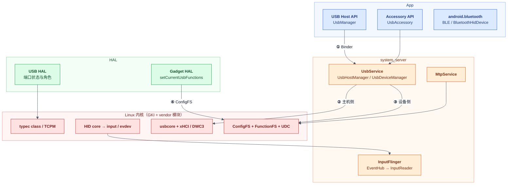

# 架构文档：Android USB（Host API、AOA、Gadget HAL 与 HID）

> 类型：arch ｜ 模式：Reverse ｜ 代码基线：`developer.android.com、source.android.com（含 Android 15 CDD）、android.googlesource.com（2026-11-28 抓取）` ｜ 最后核对：2026-11-28 ｜ 范围：`android.hardware.usb, AOA/AOAv2, USB HAL, Gadget HAL, MTP/PTP, 输入链路` ｜ lang: zh

## Overview

Android 在 Linux 内核 USB 栈（见 [07-linux-usb-stack.md](07-linux-usb-stack.md)）之上加了框架层：Host API 要 Android **3.1（API 12）** 以上，外设模式经 AOA（VID `0x18D1`，PID `0x2D00`–`0x2D05`），Android 15 CDD 要求带外设口的手持设备必须实现 AOA。读者是要在手机上做 USB 外设通信、或把手机当虚拟 USB 设备的工程师。

**TL;DR**

- 主机模式：`UsbManager` + 每设备用户授权，不装驱动。
- 外设模式：AOA 握手（请求 51 / 52 / 53），AOAv2 还能由配件注入 HID。
- 设备侧由 Gadget HAL 通过 ConfigFS 组装，MTP/PTP 用 FunctionFS。
- HID 输入走 内核 HID → evdev → EventHub → InputReader；蓝牙 HID 设备角色用 `BluetoothHidDevice`（API 28+）。

蓝 = 用户空间应用，红 = 内核/系统级驱动，绿 = 用户态驱动或守护进程，橙 = 系统框架，灰 = 硬件与外部。

## 核心事实 Key Facts（已核对）

| # | 事实 | 值 / 说明 | 来源 |
|---|---|---|---|
| 1 | USB Host 模式 | Android 3.1+ 支持 | [D1] |
| 1.2 | USB Host 模式 | API 在 `android.hardware.usb` | [D1] |
| 1.3 | USB Host 模式 | manifest 需 `<uses-feature android:name="android.hardware.usb.host"/>`，minSdk ≥ 12 | [D1] |
| 2 | Host API 主要类 | `UsbManager`（枚举/通信）、`UsbDevice`、`UsbInterface`、`UsbEndpoint`、`UsbDeviceConnection`（同步/异步传输）、`UsbRequest`（异步请求）、`UsbConstants`（对应 Linux `linux/usb/ch9.h`）| [D1] |
| 3 | UsbDeviceConnection 关键方法 | `claimInterface(intf, force)`、`controlTransfer(...)`、`bulkTransfer(...)`、`getRawDescriptors()`、`getFileDescriptor()`（返回原生 fd，可交给 native 代码/libusb）| [D3] |
| 4 | 权限模型 | ① 通过 intent filter `android.hardware.usb.action.USB_DEVICE_ATTACHED` + `res/xml/device_filter.xml`（VID/PID 等）匹配，用户确认后 App 在设备断开前持有权限；② 或显式 `UsbManager.requestPermission()` 弹窗，经广播接收结果 | [D1][D2] |
| 5 | Accessory 模式 | 外部配件作 USB 主机并供电，Android 作设备 | [D4] |
| 5.2 | Accessory 模式 | Android 3.1（API 12）引入，回移到 2.3.4（API 10，`com.android.future.usb` 附加库） | [D4] |
| 5.3 | Accessory 模式 | manifest 用 `android.hardware.usb.accessory` | [D4] |
| 6 | AOA 握手 | 配件检查 VID = Google `0x18D1` | [D5] |
| 6.2 | AOA 握手 | PID `0x2D00`（accessory）或 `0x2D01`（accessory+adb）表示已在配件模式 | [D5] |
| 6.3 | AOA 握手 | 否则发厂商请求 **51** Get Protocol → **52** 发送字符串（manufacturer/model/description/version/URI/serial，ID 0–5，每串 ≤256 字节）→ **53** Start，设备重新枚举 | [D5] |
| 7 | AOAv2 | 新增音频输出（**Android 8.0 已弃用**）与 HID | [D6] |
| 7.2 | AOAv2 | PID `0x2D02`–`0x2D05` 为音频组合 | [D6] |
| 7.3 | AOAv2 | HID 请求 `ACCESSORY_REGISTER_HID`=54 等，全部经 EP0 控制请求，无需新接口 | [D6] |
| 7.4 | AOAv2 | `SET_AUDIO_MODE`=58 | [D6] |
| 8 | CDD：外设模式 | Android 15 手持设备若 USB 口支持外设模式，**MUST 实现 AOA API**；若支持主机模式，**MUST 实现 USB 音频类** | [D7] |
| 9 | CDD：存储暴露 | 外设模式设备 MUST 提供主机访问共享存储的机制，MAY 用 USB 大容量存储但 SHOULD 用 MTP；SHOULD 报 USB 设备类 0x00、接口名 'MTP' | [D7] |
| 10 | USB HAL | Android 8.0 起 USB 命令处理从 init 脚本移到原生 USB HAL 守护进程 | [D8] |
| 10.2 | USB HAL | HAL 查询端口状态并执行数据角色/电源角色切换 | [D8] |
| 10.3 | USB HAL | Android 12 Gadget HAL 增加 NCM 与查询 HAL 版本/USB 速率的 API | [D8] |
| 11 | Gadget 实现 | Gadget HAL 通过 **ConfigFS** 组装函数 | [D9][D10][D11] |
| 11.2 | Gadget 实现 | MTP/PTP 以 FunctionFS 实例 `ffs.mtp`/`ffs.ptp` 实现，端点 `/dev/usb-ffs/mtp/ep0..ep3` | [D9][D10][D11] |
| 11.3 | Gadget 实现 | Android 14 起 UVC 函数加入 `GadgetFunction.aidl`，同样挂到 ConfigFS | [D9][D10][D11] |
| 12 | USB 摄像头（设备作 UVC） | Android 14 QPR1+ 可把设备作为 USB 网络摄像头（UVC），由 DeviceAsWebcam 服务提供 | [D11] |
| 13 | HID 输入链路 | 内核 HID/输入驱动 → Linux input 协议（evdev）→ EventHub 读取 → InputReader 按设备类解码 | [D12] |
| 14 | 蓝牙 HID 设备角色 | `BluetoothHidDevice`（API 28+）让 Android 充当蓝牙 HID 设备（registerApp/sendReport）；Android 12（S）起需 `BLUETOOTH_CONNECT` 权限 | [D13] |
| 15 | GKI | 统一核心内核，SoC/板级支持移到可加载 vendor 模块，提供稳定 KMI | [D14] |

## 架构分层：App、system_server、HAL 与内核

① 到 ④ 是 App 与 HAL 进入内核的四条入口；主机侧与设备侧在内核里分属不同子系统，不要混为一条链。

- `UsbDeviceManager` 通过 Gadget HAL 设置函数，并在 MTP/PTP 启用时绑定 MtpService [D15]。

## USB Host API 要点

1. Manifest：`uses-feature android.hardware.usb.host`；如需插入自动拉起，Activity 加 `USB_DEVICE_ATTACHED` intent filter 与 `device_filter.xml` [D1]。
2. 权限：自动匹配时用户确认即授权到断开；否则 `requestPermission()` [D1][D2]。
3. 传输：`claimInterface` → `controlTransfer`/`bulkTransfer`（同步）或 `UsbRequest`（异步，可用于中断端点）[D1][D3]。
4. Native：`getFileDescriptor()` 取 fd，交给 NDK/libusb 处理（libusb 在 Android 上的使用方式见其官方文档，**待核实**）[D3]。
5. HID 设备：系统内核 HID 驱动会接管标准键鼠/手柄（进入输入子系统）[D12]；App 若用 Host API 直接访问 HID 接口是否需要/能够 `force` claim 依具体设备与系统版本，**待核实**。

## Accessory 模式与 AOA（Android 作为 USB 设备）

- 适用：Android 不能/不想当主机时，由外部配件（MCU、车机）当主机 [D4]。
- 握手流程见 Key Facts #6；`0x2D01` 额外提供 ADB 接口，便于开发调试 [D5][D6]。
- AOAv2 HID：配件可经 EP0 向 Android 注册多个虚拟 HID 设备（`ACCESSORY_REGISTER_HID` / `ACCESSORY_UNREGISTER_HID` / `ACCESSORY_SET_HID_REPORT_DESC` / `ACCESSORY_SEND_HID_EVENT`）——这是**无需 Android 当主机就让外设向手机注入 HID** 的官方机制 [D6]。
- CDD 要求手持设备的外设口实现 AOA [D7]。

## 设备侧：Gadget HAL、ConfigFS、MTP/PTP

- Android 8.0 引入 USB HAL，替代设备特定 init 脚本，原因包括 sysfs 写失败无法回传、init 操作受限等 [D8]。
- Gadget 函数（adb、mtp、ptp、rndis/ncm、midi、uvc…）通过 ConfigFS 组合；adb、MTP/PTP 走 FunctionFS（`/dev/usb-ffs/adb`、`/dev/usb-ffs/mtp`）[D9][D10][D11]。
- MTP：CDD 建议使用 MTP 暴露共享存储、兼容 Android File Transfer 参考主机 [D7]；原生实现位于 `frameworks/av/media/mtp`（MtpFfsHandle 等）[D10]。
- 研究虚拟 USB：Android 设备 = 现成的 Linux gadget 平台；root/工程机上可直接操作 ConfigFS（见 [07-linux-usb-stack.md](07-linux-usb-stack.md) 的“设备侧”节），但量产设备由 Gadget HAL 独占管理（**待核实**：权限/SELinux 细节因厂商而异）。

## HID：USB 与蓝牙/BLE

- USB HID：内核 HID 驱动 → evdev → EventHub/InputReader；键盘布局/键码映射通过 `.kl`/`.kcm`/`.idc` 配置文件 [D12][D16]。
- CDD 对 USB-C 耳机 HID 按键规定了映射（如 Usage Page 0x0C Usage 0x0CD → `KEY_PLAYPAUSE` → `KEYCODE_MEDIA_PLAY_PAUSE`）[D7]。
- BLE：平台内建 BLE **中心角色**支持并提供 API（发现、查询服务、传输）[D17]；BLE HID 键鼠（HoG）由系统蓝牙栈处理（内部实现，如是否经 uhid，**待核实**）。
- Android 作为 HID 设备：经典蓝牙 `BluetoothHidDevice`（API 28+）[D13]；USB 方向可用 AOAv2 HID（由配件注入）或 gadget `f_hid`（需系统/厂商支持，**待核实**）。

## 电源与 Type-C

- USB HAL 负责查询端口状态与数据/电源角色切换 [D8]；底层是 Linux typec class/TCPM（见 `08-arm-embedded-usb.md`）。
- 主机侧 autosuspend 由内核 runtime PM 管理（同 Linux）；Android 特有策略 **待核实**。

## 调试工具

| 工具 | 用途 | 来源 |
|---|---|---|
| `adb shell dumpsys usb` | UsbService 状态（端口、函数、设备）| **待核实**（未在本轮抓取的官方页面中出现）|
| `adb shell getevent` | 查看输入事件（HID → evdev）| **待核实** |
| usbmon（需 root/debugfs） | 同 Linux | [L7]（见 `07-linux-usb-stack.md`）|
| 外部 PC 抓包（Wireshark/USBPcap）观察 AOA 握手 | — | 见 `12-cross-platform-comparison.md` |

## 与 Windows 的映射

| Windows | Android |
|---|---|
| WinUSB + WinUsb_ControlTransfer/ReadPipe | UsbDeviceConnection.controlTransfer/bulkTransfer [D3] |
| SetupDi 枚举 + 设备接口 GUID | UsbManager.getDeviceList + intent filter [D1][D2] |
| INF 绑定驱动 | device_filter.xml + 用户授权（无驱动安装）[D1] |
| UFX（function controller） | Linux gadget + Gadget HAL [D8] |
| hidclass → Raw Input | HID core → evdev → InputReader [D12] |
| VHF | AOAv2 HID（配件侧注入）；系统内部 uhid（**待核实**）[D6] |

## 参考来源

### 来源组 1

- [D1] USB host overview https://developer.android.com/develop/connectivity/usb/host
- [D2] UsbManager https://developer.android.com/reference/android/hardware/usb/UsbManager
- [D3] UsbDeviceConnection https://developer.android.com/reference/android/hardware/usb/UsbDeviceConnection
- [D4] USB accessory overview https://developer.android.com/develop/connectivity/usb/accessory
- [D5] Android Open Accessory protocol 1.0 https://source.android.com/docs/core/interaction/accessories/aoa
- [D6] Android Open Accessory 2.0 https://source.android.com/docs/core/interaction/accessories/aoa2
- [D7] Android 15 Compatibility Definition（§7.7 USB、§7.6 存储、§7.8.2.2 耳机 HID 映射）https://source.android.com/docs/compatibility/15/android-15-cdd
- [D8] Implement USB HAL https://source.android.com/docs/core/permissions/usb-hal

### 来源组 2

- [D9] device/google/crosshatch usb/UsbGadget.cpp（ffs.mtp/ffs.ptp 链接示例）https://android.googlesource.com/device/google/crosshatch/+/master/usb/UsbGadget.cpp
- [D10] frameworks/av media/mtp/MtpDescriptors.h（/dev/usb-ffs/mtp/ep0..ep3）https://android.googlesource.com/platform/frameworks/av/+/master/media/mtp/MtpDescriptors.h
- [D11] Use a device as a webcam https://source.android.com/docs/core/camera/webcam
- [D12] Input https://source.android.com/docs/core/interaction/input
- [D13] BluetoothHidDevice https://developer.android.com/reference/android/bluetooth/BluetoothHidDevice
- [D14] Generic Kernel Image (GKI) project https://source.android.com/docs/core/architecture/kernel/generic-kernel-image
- [D15] frameworks/base UsbDeviceManager.java https://android.googlesource.com/platform/frameworks/base.git/+/master/services/usb/java/com/android/server/usb/UsbDeviceManager.java
- [D16] Input device configuration files https://source.android.com/docs/core/interaction/input/input-device-configuration-files ；Keyboard devices https://source.android.com/docs/core/interaction/input/keyboard-devices

### 来源组 3

- [D17] Bluetooth Low Energy overview https://developer.android.com/develop/connectivity/bluetooth/ble/ble-overview

## 待确认项

- [ ] …leDescriptor()` 取 fd，交给 NDK/libusb 处理（libusb 在 Android 上的使用方式见其官方文档，**待核实**）[D3]。…
- [ ] …统）[D12]；App 若用 Host API 直接访问 HID 接口是否需要/能够 `force` claim 依具体设备与系统版本，**待核实**。…
- [ ] …可直接操作 ConfigFS（见 [07-linux-usb-stack.md](07-linux-usb-stack.md) 的“设备侧”节），但量产设备由 Gadget HAL 独占管理（**待核实**：权限/SELinux 细节因厂商而异）。…
- [ ] …**支持并提供 API（发现、查询服务、传输）[D17]；BLE HID 键鼠（HoG）由系统蓝牙栈处理（内部实现，如是否经 uhid，**待核实**）。…
- [ ] …e`（API 28+）[D13]；USB 方向可用 AOAv2 HID（由配件注入）或 gadget `f_hid`（需系统/厂商支持，**待核实**）。…
- [ ] …主机侧 autosuspend 由内核 runtime PM 管理（同 Linux）；Android 特有策略 **待核实**。…
- [ ] …`adb shell dumpsys usb` | UsbService 状态（端口、函数、设备）| **待核实**（未在本轮抓取的官方页面中出现）…
- [ ] …`adb shell getevent` | 查看输入事件（HID → evdev）| **待核实…
- [ ] …VHF | AOAv2 HID（配件侧注入）；系统内部 uhid（**待核实**）[D6]…
