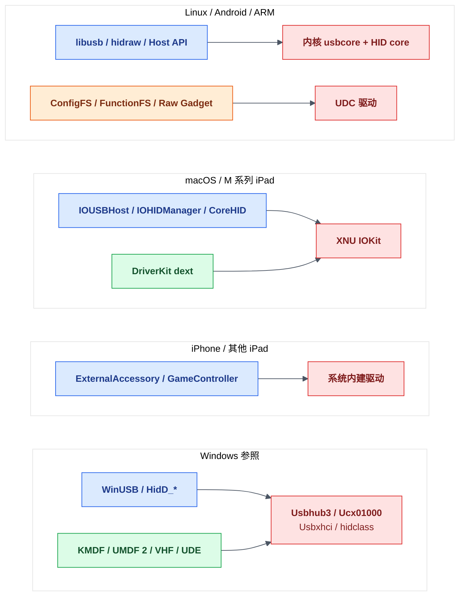

# 架构文档：跨平台 USB 栈异同（Linux、ARM、macOS、iOS、Android 与 Windows）

> 类型：arch ｜ 模式：Reverse ｜ 代码基线：`07–11 号文档与 learn.microsoft.com（2026-11-28 核对）` ｜ 最后核对：2026-11-28 ｜ 范围：`07-linux-usb-stack.md, 08-arm-embedded-usb.md, 09-macos-usb.md, 10-ios-ipados-usb.md, 11-android-usb.md` ｜ lang: zh

## Overview

在 **5 个平台 + Windows 参照** 的对比中，只有 Linux 系（含 Android 与 ARM 板）把 USB **设备侧**完整开放给开发者；Apple 平台第三方驱动强制用户态（DriverKit）；Android 的特色是 AOA。本文只做归纳，每格事实回链到 07–11 号文档的引用标签（`[Lx]` `[Ax]` `[Mx]` `[Ix]` `[Dx]`）与 learn.microsoft.com 的 `[Wx]`。各平台文档中标 **待核实** 的点，这里保持 **待核实**。

**TL;DR**

- Linux 与 Android 共用同一内核 USB 栈；ARM 的差异在控制器 IP、设备树与角色管理。
- 虚拟 USB 研究首选 Linux：dummy_hcd + ConfigFS / Raw Gadget；USB/IP 细节见 [06-linux-virtual-usb.md](06-linux-virtual-usb.md)。
- 虚拟 HID：Linux uhid、macOS CoreHID、Windows VHF、Android AOAv2；iOS 无公开 API。
- Apple 的门槛是授权（entitlement、公证、MFi），不是技术。

蓝 = 用户空间应用，红 = 内核/系统级驱动，绿 = 用户态驱动或守护进程，橙 = 系统框架，灰 = 硬件与外部。

## 核心结论 Key Facts

| # | 结论 | 依据 |
|---|---|---|
| 1 | Linux 与 Android **共用同一个内核 USB 栈**（usbcore/HCD/HID core/gadget）；Android 在其上加框架层权限、Gadget HAL 与 AOA | [L1][D8][D12] |
| 2 | “ARM”不是独立 OS 栈：差异集中在控制器 IP（DWC2/DWC3/ChipIdea/MUSB/Cadence）、设备树、双角色与 Type-C 管理 | [A1]–[A13] |
| 3 | 驱动位置：Linux/Android 驱动在内核；macOS/iPadOS 第三方驱动在**用户空间**（DriverKit），kext 中 IOUSBFamily/IOHIDFamily KPI 已在 Big Sur 不再支持；Windows 两者兼有（KMDF / UMDF 2） | [L17][M2][M8][W9] |
| 4 | 设备模式（把主机变成 USB 外设）：Linux/Android/ARM 板官方支持（gadget/ConfigFS/FunctionFS）；macOS/iOS 无第三方 API（**待核实**）；Windows 有 UFX（面向功能控制器驱动）| [L3][D11][M1][W6] |
| 5 | 无硬件虚拟 USB：Linux 有 dummy_hcd、vhci-hcd（USB/IP）、Raw Gadget；Windows 有 UDE；macOS/iOS 无公开等价物（IOUSBHostControllerInterface 用途 **待核实**） | [L19][L20][L5][W5][M18] |
| 6 | 虚拟 HID：Linux uhid；macOS CoreHID HIDVirtualDevice（15+）/HIDDriverKit；Windows VHF；Android 有 AOAv2 HID（配件注入）；iOS 无公开 API | [L9][M6][W4][D6][I13] |
| 7 | 权限：Linux 节点权限+udev+authorized；Android 每设备用户授权；macOS DriverKit entitlement 审批+公证+Apple silicon 配件允许；iOS MFi/有线配件授权；Windows 驱动签名 | [L13][L27][D1][M7][M12][M13][I10] |

## 大对比表

| 维度 | Linux | ARM/嵌入式 | macOS | iOS / iPadOS | Android | Windows（参照） |
|---|---|---|---|---|---|---|
| 内核/框架 | usbcore + HCD（xhci-hcd 等）[L1][L22] | 同 Linux；控制器 IP 驱动 dwc2/dwc3/ci_hdrc/musb/cdns3 [A1]–[A5] | XNU IOKit + IOUSBHostFamily（内部细节待核实）[M8][M14] | 同 XNU，第三方不可见 | Linux 内核（GKI + vendor 模块）[D14] | Usbxhci.sys + Ucx01000.sys + Usbhub3.sys（KMDF）[W1] |
| 第三方驱动模型 | 内核模块 `usb_driver` [L17] | 同 Linux；MCU 上 TinyUSB/厂商栈 [A14][A18] | DriverKit dext（USBDriverKit/HIDDriverKit，用户态）[M3][M4] | 仅 M 系列 iPad：DriverKit/USBDriverKit [I5][I6] | App 层用 Host API [D1]；内核模块由 OEM 以 GKI vendor 模块形式提供 [D14]（第三方 App 不能装内核驱动属行业常识，**待核实**） | KMDF / UMDF 2 / WinUSB [W2][W9] |
| 用户态直接访问 | usbfs / libusb [L1][L26] | 同 Linux | IOUSBHost 框架 [M1] | ExternalAccessory（仅 MFi）[I1] | `android.hardware.usb` Host API + 用户授权 [D1] | WinUSB [W2] |
| 驱动匹配 | `id_table`（`usb_device_id`）[L17]；udev 处理节点与规则 [L27] | 同 Linux + DT compatible [A7] | entitlement `transport.usb`（按设备描述符字段）+ IOKitPersonalities [M9] | 系统随 App 自动发现 dext [I4] | `device_filter.xml` + intent [D1] | INF（硬件 ID/兼容 ID）[W13] |
| HID 路径 | usbhid → HID core → input/hidraw/hiddev [L11][L8][L10] | 同 Linux | IOHIDFamily（内核）→ IOHIDManager / CoreHID；HIDDriverKit 定制 [M5][M6][M4] | 系统内建 → GameController [I12] | HID core → evdev → EventHub/InputReader [D12] | hidclass.sys + hidusb.sys → HidD_* [W3][W14] |
| 原始 HID 报告访问 | hidraw ioctl [L8] | 同 Linux | IOHIDDevice / CoreHID [M5][M6] | 无公开 API（待核实） | 无专用 API；可经 Host API 访问接口（待核实）| HidD_Get/SetFeature、ReadFile [W14] |
| BLE HID (HoG) 主机 | BlueZ 用户态 HoG + uhid [L23] | 同 Linux | 系统蓝牙栈（实现待核实），自定义 GATT 用 CoreBluetooth [M17] | 同左，CoreBluetooth [I14] | 系统蓝牙栈（实现待核实），BLE 中心角色 API [D17] | HidBthLE.dll（Windows 8 起）[W3] |
| 设备模式/Gadget | ConfigFS / FunctionFS / GadgetFS / Raw Gadget [L3][L4][L5] | 有 UDC 即可（DWC2/DWC3/ChipIdea/MUSB/Cadence）[A1]–[A5] | 无第三方 API（待核实） | 无第三方 API（待核实） | Gadget HAL + ConfigFS（adb/MTP/PTP/NCM/UVC）、AOA [D8][D11][D5] | UFX（功能控制器驱动）[W6] |
| 无硬件虚拟 USB | dummy_hcd、vhci-hcd、Raw Gadget [L20][L19][L5] | 同 Linux | 无公开等价物（待核实）| 无 | 同 Linux（需 root/工程机，待核实）| UDE（UdeCx）[W5] |
| 虚拟 HID | uhid [L9] | 同 Linux | CoreHID HIDVirtualDevice（15+）/ HIDDriverKit + entitlement [M6][M9] | 无 [I13] | AOAv2 HID（配件侧）[D6] | VHF（Vhf.sys 下层过滤）[W4] |
| 网络虚拟 USB | USB/IP（TCP 3240）[L19] | 同 Linux | 无内建（待核实）| 无 | 无内建（待核实）| 无内建（待核实）|
| 电源管理 | runtime PM autosuspend，默认 2 s [L2][L16] | 同 Linux | 系统管理，DriverKit 电源接口（待核实） | 系统管理 | 同 Linux 内核 + USB HAL 角色切换 [D8] | Selective Suspend [W7] |
| Type-C/PD | typec class、TCPM、UCSI [L15][L24] | DT `usb-c-connector` + TCPM/Role Switch [A11][A12][A13] | 系统内部 | 系统内部 | USB HAL 角色切换 + 内核 typec [D8] | UCSI（UcmUcsiCx.sys）[W11] |
| 安全/权限 | 文件权限+udev、`authorized_default` [L13][L27] | 同 Linux | entitlement 审批、Developer ID+公证、配件允许（Apple silicon 笔记本）[M7][M12][M13] | MFi 授权、有线配件设置、1 小时/30 天/3 天规则 [I3][I10][I11] | 每设备运行时授权、CDD 要求 [D1][D7] | 驱动签名（细节待核实） |
| 抓包/调试 | usbmon + Wireshark、xHCI DbC [L7][L28][L25] | 同 Linux；JTAG/厂商工具（待核实） | Wireshark XHC20（新系统可能需关 SIP，待核实）、IORegistryExplorer（待核实）、systemextensionsctl [M21][M10] | 外部分析仪（待核实） | usbmon（root）、dumpsys usb（待核实）| USB ETW（logman）、USBView、USBPcap [W8][W12][L28] |

## 架构总览图

图只展示各平台“应用 → 驱动层”的分层差异，不含设备侧细节；设备模式与虚拟 USB 的差异在下面的大表里。

## 相同点

1. **协议层完全一致**：描述符、枚举、四种传输、HID 报告描述符都遵循 USB-IF 规范；各平台 API 只是包装（Android 的 `UsbConstants` 直接对应 Linux `ch9.h`）[D1]。
2. **HID 都是“类驱动 + 传输层”分离**：Linux HID core + 传输驱动 [L11]，Windows hidclass + 传输 minidriver [W3][W14]，macOS HIDDriverKit 也区分 HID 设备 provider 与事件服务 [M4]。
3. **主流平台都提供“无需写驱动”的用户态访问**：libusb/usbfs、WinUSB、IOUSBHost、Android Host API [L1][W2][M1][D1]。
4. **都在收紧 USB 攻击面**：Linux `authorized_default` [L13]、Apple 配件允许与 USB Restricted Mode [M13][I11]、Android 每设备授权 [D1]。

## 不同点（要点）

1. **驱动位置**：Linux/Android 在内核；Apple 第三方驱动强制用户态（DriverKit），IOUSBFamily/IOHIDFamily kext KPI 已不再支持 [M8]；Windows 两者都有。
2. **设备模式**：Linux 系（含 Android、ARM 板）是唯一把“设备侧”完整开放给开发者的平台 [L3][L5]；Windows 有 UFX 但面向带功能控制器的硬件 [W6]。
3. **虚拟 USB 研究首选 Linux**：dummy_hcd + ConfigFS/Raw Gadget 可在单机构造任意设备并抓包；Windows 对应 UDE [L20][L5][W5]。
4. **Apple 的门槛是“授权”而非“技术”**：DriverKit entitlement 需向 Apple 申请、需 Developer ID 签名与公证 [M7][M12]；iPhone 上只有 MFi 路径 [I1]。
5. **Android 的特色**：AOA 协议让 Android 以设备身份与 MCU 配件通信，AOAv2 还能由配件注入 HID [D5][D6]；CDD 强制外设口实现 AOA [D7]。

## Windows 背景开发者速查（映射表）

| 你熟悉的 Windows 概念 | Linux / Android | macOS | iOS / iPadOS |
|---|---|---|---|
| WinUSB.sys + WinUsb_* [W2] | usbfs/libusb [L1]；Android UsbDeviceConnection [D3] | IOUSBHost [M1] | ExternalAccessory（MFi）[I1]；M 系列 iPad 用 USBDriverKit [I6] |
| KMDF USB 客户端驱动 [W1] | `usb_driver` 内核模块 [L17] | USBDriverKit dext [M3] | USBDriverKit（M 系列 iPad）[I6] |
| UMDF 2 [W9] | 无直接对应（用户态即 libusb/uhid）| DriverKit（理念最接近）[M2] | 同左 |
| hidclass.sys / hidusb.sys [W3][W14] | HID core / usbhid [L11] | IOHIDFamily + HIDDriverKit [M4][M8] | 系统内建 |
| HidD_GetFeature / SetFeature | hidraw `HIDIOCGFEATURE`/`HIDIOCSFEATURE` [L8] | IOHIDDevice / CoreHID [M5][M6] | 无公开 API（待核实） |
| VHF (Vhf.sys) [W4] | uhid [L9] | CoreHID HIDVirtualDevice / HIDDriverKit [M6] | 无 |
| UDE / UdeCx [W5] | dummy_hcd、vhci-hcd [L20][L19] | 无公开等价物（待核实） | 无 |
| UFX [W6] | gadget/UDC + ConfigFS [L14][L3] | 无（待核实）| 无 |
| Usbccgp.sys（复合设备父驱动）[W10] | usbcore 按接口绑定驱动 [L1] | IOKit 按接口匹配（细节待核实）| — |
| Selective Suspend [W7] | runtime PM autosuspend [L2] | 系统管理（待核实） | 系统管理 |
| UCSI (UcmUcsiCx.sys) [W11] | typec UCSI / TCPM [L24] | 系统内部 | 系统内部 |
| HidBthLE.dll（BLE HID）[W3] | BlueZ HoG + uhid [L23] | 系统蓝牙栈（待核实）| 系统蓝牙栈（待核实）|
| USB ETW / USBView [W8][W12] | usbmon / lsusb [L7] | IORegistryExplorer（待核实）/ Wireshark XHC20 [M21] | — |

## 研究路线建议（虚拟 USB / 驱动 / 固件）

1. **Linux 起步**：dummy_hcd + ConfigFS HID 复刻一个雷蛇式多接口 HID 设备，usbmon 抓包对照描述符 [L20][L3][L7]。
2. **深入枚举/健壮性**：Raw Gadget 构造畸形描述符测试主机栈（官方定位为调试/fuzzing）[L5]。
3. **跨机**：USB/IP 把 gadget 导出到另一台机器（USB/IP 也支持导出 gadget 子系统创建的软件设备）[L19]。
4. **Windows 对照**：UDE 写虚拟主机控制器 + 设备，VHF 做虚拟 HID [W5][W4]。
5. **macOS**：IOUSBHost 用户态访问 → USBDriverKit/HIDDriverKit（先 `systemextensionsctl developer on` 本地开发，再申请 entitlement）[M1][M10][M7]。
6. **固件**：TinyUSB（dwc2/musb/ci_hs 等端口与 Linux 控制器驱动对应同一 IP）[A14]。

## 参考来源

### 来源组 1

- [W1] USB 3.0 driver stack architecture https://learn.microsoft.com/en-us/windows-hardware/drivers/usbcon/usb-3-0-driver-stack-architecture
- [W2] WinUSB (Winusb.sys) installation for developers https://learn.microsoft.com/en-us/windows-hardware/drivers/usbcon/winusb-installation ；Using WinUSB API https://learn.microsoft.com/en-us/windows-hardware/drivers/usbcon/using-winusb-api-to-communicate-with-a-usb-device
- [W3] HID transports（Hidusb.sys、Hidbth.sys、HidBthLE.dll（Windows 8 起 BLE HID）、Hidi2c.sys、HidSpi.sys（Windows 11））https://learn.microsoft.com/en-us/windows-hardware/drivers/hid/hid-transports
- [W4] Virtual HID Framework (VHF) https://learn.microsoft.com/en-us/windows-hardware/drivers/hid/virtual-hid-framework--vhf-
- [W5] Overview of developing Windows drivers for emulated USB devices (UDE) https://learn.microsoft.com/en-us/windows-hardware/drivers/usbcon/developing-windows-drivers-for-emulated-usb-host-controllers-and-devices
- [W6] Developing Windows drivers for USB function controllers (UFX) https://learn.microsoft.com/en-us/windows-hardware/drivers/usbcon/developing-windows-drivers-for-usb-function-controllers
- [W7] USB selective suspend https://learn.microsoft.com/en-us/windows-hardware/drivers/usbcon/usb-selective-suspend
- [W8] USB Event Tracing for Windows https://learn.microsoft.com/en-us/windows-hardware/drivers/usbcon/usb-event-tracing-for-windows

### 来源组 2

- [W9] Getting started with UMDF version 2（新 UMDF 驱动应使用 UMDF 2）https://learn.microsoft.com/en-us/windows-hardware/drivers/wdf/getting-started-with-umdf-version-2
- [W10] USB Generic Parent Driver (Usbccgp.sys) https://learn.microsoft.com/en-us/windows-hardware/drivers/usbcon/usb-common-class-generic-parent-driver
- [W11] UCSI driver（UcmUcsiCx.sys、UcmUcsiAcpiClient.sys）https://learn.microsoft.com/en-us/windows-hardware/drivers/usbcon/ucsi
- [W12] USBView https://learn.microsoft.com/en-us/windows-hardware/drivers/debugger/usbview
- [W13] USB driver installation based on compatible IDs https://learn.microsoft.com/en-us/windows-hardware/drivers/usbcon/usb-driver-installation-based-on-compatible-ids
- [W14] HID architecture（hidclass.sys）https://learn.microsoft.com/en-us/windows-hardware/drivers/hid/hid-architecture
- 其余标签见各平台文件：[Lx] `07-linux-usb-stack.md`、[Ax] `08-arm-embedded-usb.md`、[Mx] `09-macos-usb.md`、[Ix] `10-ios-ipados-usb.md`、[Dx] `11-android-usb.md`

## 待确认项

### 待确认组 1

- [ ] … `[Ax]` `[Mx]` `[Ix]` `[Dx]`）与 learn.microsoft.com 的 `[Wx]`。各平台文档中标 **待核实** 的点，这里保持 **待核实**。…
- [ ] …ux/Android/ARM 板官方支持（gadget/ConfigFS/FunctionFS）；macOS/iOS 无第三方 API（**待核实**）；Windows 有 UFX（面向功能控制器驱动）| [L3][D11][M1][W6]…
- [ ] …dget；Windows 有 UDE；macOS/iOS 无公开等价物（IOUSBHostControllerInterface 用途 **待核实**） | [L19][L20][L5][W5][M18]…
- [ ] …2/dwc3/ci_hdrc/musb/cdns3 [A1]–[A5] | XNU IOKit + IOUSBHostFamily（内部细节待核实）[M8][M14] | 同 XNU，第三方不可见 | Linux 内核（GKI + vendor 模块）[D14…
- [ ] …t API [D1]；内核模块由 OEM 以 GKI vendor 模块形式提供 [D14]（第三方 App 不能装内核驱动属行业常识，**待核实**） | KMDF / UMDF 2 / WinUSB [W2][W9]…
- [ ] …idraw ioctl [L8] | 同 Linux | IOHIDDevice / CoreHID [M5][M6] | 无公开 API（待核实） | 无专用 API；可经 Host API 访问接口（待核实）| HidD_Get/SetFeature、Re…
- [ ] …BLE HID (HoG) 主机 | BlueZ 用户态 HoG + uhid [L23] | 同 Linux | 系统蓝牙栈（实现待核实），自定义 GATT 用 CoreBluetooth [M17] | 同左，CoreBluetooth [I14]…
- [ ] …][L5] | 有 UDC 即可（DWC2/DWC3/ChipIdea/MUSB/Cadence）[A1]–[A5] | 无第三方 API（待核实） | 无第三方 API（待核实） | Gadget HAL + ConfigFS（adb/MTP/PTP/NCM…

### 待确认组 2

- [ ] …USB | dummy_hcd、vhci-hcd、Raw Gadget [L20][L19][L5] | 同 Linux | 无公开等价物（待核实）| 无 | 同 Linux（需 root/工程机，待核实）| UDE（UdeCx）[W5]…
- [ ] …网络虚拟 USB | USB/IP（TCP 3240）[L19] | 同 Linux | 无内建（待核实）| 无 | 无内建（待核实）| 无内建（待核实）…
- [ ] …ntime PM autosuspend，默认 2 s [L2][L16] | 同 Linux | 系统管理，DriverKit 电源接口（待核实） | 系统管理 | 同 Linux 内核 + USB HAL 角色切换 [D8] | Selective Sus…
- [ ] …设置、1 小时/30 天/3 天规则 [I3][I10][I11] | 每设备运行时授权、CDD 要求 [D1][D7] | 驱动签名（细节待核实）…
- [ ] …包/调试 | usbmon + Wireshark、xHCI DbC [L7][L28][L25] | 同 Linux；JTAG/厂商工具（待核实） | Wireshark XHC20（新系统可能需关 SIP，待核实）、IORegistryExplorer（待…
- [ ] …URE`/`HIDIOCSFEATURE` [L8] | IOHIDDevice / CoreHID [M5][M6] | 无公开 API（待核实）…
- [ ] …UDE / UdeCx [W5] | dummy_hcd、vhci-hcd [L20][L19] | 无公开等价物（待核实） | 无…
- [ ] …UFX [W6] | gadget/UDC + ConfigFS [L14][L3] | 无（待核实）| 无…

### 待确认组 3

- [ ] …Usbccgp.sys（复合设备父驱动）[W10] | usbcore 按接口绑定驱动 [L1] | IOKit 按接口匹配（细节待核实）| —…
- [ ] …Selective Suspend [W7] | runtime PM autosuspend [L2] | 系统管理（待核实） | 系统管理…
- [ ] …HidBthLE.dll（BLE HID）[W3] | BlueZ HoG + uhid [L23] | 系统蓝牙栈（待核实）| 系统蓝牙栈（待核实）…
- [ ] …SB ETW / USBView [W8][W12] | usbmon / lsusb [L7] | IORegistryExplorer（待核实）/ Wireshark XHC20 [M21] | —…

