# USB 知识库全量拼接

每篇以 `<!-- FILE: 名称 -->` 分隔；规范类（01–06）来源为 USB-IF、Bluetooth SIG、Intel、微软、kernel.org，平台栈类（07–12）来源为 kernel.org、Apple、Android、微软与项目官方站点。**待核实** 标记表示未能由官方来源确认。


<!-- FILE: 00-README.md -->

# USB / 蓝牙协议规范知识库

> 类型：readme ｜ 最后核对：2026-11-28 ｜ lang: zh

给做 USB、Type-C PD 与 BLE 开发的工程师：每条事实都标出官方规范的章节或表号。

## Overview

本知识库由 tech-doc 技能按 Reverse 模式从官方规范原文整理而来，与 USBTree 仓库互补。

- 规范来源只限官方站点：usb.org、bluetooth.com、intel.com、learn.microsoft.com、kernel.org。
- 本地缓存 96 项：93 项已下载并记 sha256，3 项蓝牙文档只能手动下载。
- 07–12 号文档是平台软件栈篇（Linux、ARM、macOS、iOS/iPadOS、Android 与对比），来源同样只限官方文档；未能核实的点标为 **待核实**。
- 非目标：不替代规范原文；位级字段布局以原文为准。

## Quick Start

前提：Python 3、curl、poppler-utils（`pdftotext`）、unzip。

```bash
cd /workspace/usb-specs
python3 tools/fetch_all.py        # 按清单下载，校验官方域名并写 manifest.json / manifest.md
bash tools/extract_text.sh        # 解压 ZIP，PDF 转文本到 text/
grep -n "tSenderResponse" text/*PD_R3.3_V1.0_2026_10_16.pdf.txt
```

## Usage

- 查某个数值：先看对应专题文档，再用其中的章节号在 `text/` 里 grep 原文核对。
- 查规范版本：读 `/workspace/usb-specs/manifest.md`，里面有版本、日期、URL 与 sha256。
- 看渲染版：打开同名 `.html`，离线可读。

| 文档 | 主题 | 主要来源 |
|---|---|---|
| [01-usb2-ch9-control.md](01-usb2-ch9-control.md) | 标准请求、描述符、枚举时序 | USB 2.0 / 3.2 第 9 章 |
| [02-hid-class-hogp.md](02-hid-class-hogp.md) | HID 类请求与 HID over GATT | HID 1.11、HUT 1.7、HOGP 1.1、HIDS 1.1 |
| [03-usb-pd-messages-timers.md](03-usb-pd-messages-timers.md) | PD 消息头、消息类型、定时器 | USB PD R3.3 V1.0 |
| [04-bc12-charger-detection.md](04-bc12-charger-detection.md) | SDP / CDP / DCP 检测 | BC 1.2 |
| [05-ble-llcp-ifs.md](05-ble-llcp-ifs.md) | LL 控制过程与帧间隔 | Bluetooth Core 7.0 |
| [06-linux-virtual-usb.md](06-linux-virtual-usb.md) | USB/IP、ConfigFS、FunctionFS、Raw Gadget | docs.kernel.org |
| [07-linux-usb-stack.md](07-linux-usb-stack.md) | Linux 主机栈、HID、gadget 框架、dummy_hcd、usbmon | docs.kernel.org、torvalds/linux |
| [08-arm-embedded-usb.md](08-arm-embedded-usb.md) | ARM SoC 控制器 IP、设备树、双角色、Type-C、TinyUSB | Linux DT binding 与 Kconfig、TinyUSB |
| [09-macos-usb.md](09-macos-usb.md) | IOKit、DriverKit、HID 路径、签名与公证 | developer.apple.com |
| [10-ios-ipados-usb.md](10-ios-ipados-usb.md) | MFi、iPad DriverKit、USB-C 配件、配件安全 | developer.apple.com、support.apple.com |
| [11-android-usb.md](11-android-usb.md) | Host API、AOA、Gadget HAL、MTP、HID | developer.android.com、source.android.com |
| [12-cross-platform-comparison.md](12-cross-platform-comparison.md) | 五平台加 Windows 的异同大表与映射 | 07–11 号文档、learn.microsoft.com |

## Architecture at a Glance

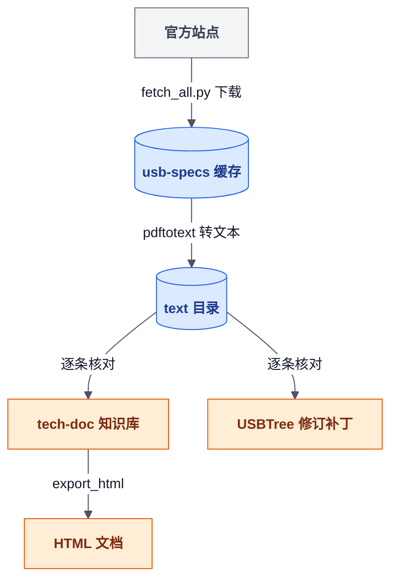

## Project Structure

| Path | Purpose |
|---|---|
| `/workspace/usb-specs/usb-core/` | USB 2.0/3.2/USB4、PD、Type-C、BC 1.2 等核心规范（16 项） |
| `/workspace/usb-specs/device-classes/` | HID、CDC、MSC、UAC、UVC 等设备类规范（40 项） |
| `/workspace/usb-specs/host-controllers/` | xHCI 1.2、EHCI 1.0（2 项） |
| `/workspace/usb-specs/bluetooth/` | Core 6.0/7.0、HOGP、HIDS、BAS、DIS、Assigned Numbers（12 项已下载，3 项手动） |
| `/workspace/usb-specs/microsoft/`、`linux/` | 微软与内核官方在线文档（10 + 13 项） |
| `/workspace/usb-specs/manifest.md` | 清单：名称、版本、日期、URL、sha256、状态 |
| `/workspace/usb-os-kb-src/` | 07–12 号文档抓取的官方页面文本缓存（约 100 页） |
| `/workspace/usb-techdoc/kb/` | 本知识库的 Markdown 与 HTML |
| `/workspace/usb-techdoc/llms-full.md` | 00–12 号文档拼接的单文件版，供 AI 使用 |

## Configuration

| Option | Default | Description |
|---|---|---|
| `tools/fetch_all.py` 内的条目表 | 96 项 | 增删规范时改这里；非官方域名会被拒绝 |

## Development

改完任何一篇后运行检查与导出：

```bash
python3 -I ~/.claude/skills/tech-doc/scripts/check_doc.py kb/03-usb-pd-messages-timers.md --fix-style && rm -f kb/*.bak
node ~/.claude/skills/tech-doc/scripts/mermaid-tools/export_html.mjs kb/03-usb-pd-messages-timers.md
```

## Troubleshooting

- bluetooth.com 返回 HTML 而非 PDF：该文件需要登录或浏览器下载，清单中标为 `manual-only`。
- intel.com 返回 403：不要设置浏览器 User-Agent，用 curl 默认值。
- 数值和 USBTree 不一致：以本库引用的规范原文为准，USBTree 修订见 `/workspace/usbtree-full-patch/`。


<!-- FILE: 01-usb2-ch9-control.md -->

# 协议规范：USB 第 9 章标准请求与枚举

> 类型：api ｜ 模式：Reverse ｜ 状态：Stable ｜ 版本：USB 2.0 / USB 3.2 r1.1 ｜ 代码基线：`usb_20.pdf (pkg 2025-06-03)` ｜ 最后核对：2026-11-28 ｜ 范围：`usb-specs/usb-core/USB2.0-Specification.zip`, `usb-specs/usb-core/USB3.2-Rev1.1-2022-06.zip` ｜ lang: zh

## Overview

主机经**默认控制管道**（端点 0）发标准请求，完成设备枚举与配置。每个事实都标注规范章节，出处见文末附录。

- 消息信封：8 字节 Setup 包，字段 `bmRequestType`、`bRequest`、`wValue`、`wIndex`、`wLength`（USB 2.0 Table 9-2）。
- `bmRequestType`：D7 方向（0 主机到设备，1 设备到主机），D6..5 类型（0 标准、1 类、2 厂商），D4..0 接收者（0 设备、1 接口、2 端点、3 其他）（Table 9-2）。
- EP0 最大包长：全速取 8/16/32/64，高速固定 64，低速固定 8（USB 2.0 §5.5.3）。
- Enhanced SuperSpeed 设备的 `bMaxPacketSize0` 必须写 `09H`，按 2 的指数解释，即 512 字节（USB 3.2 r1.1 §9.6.1 与 Table 9-11）。
- 总时限：任何命令的处理上限是 **5 s**（USB 2.0 §9.2.6.1）。

## Message Flow

蓝色 = 主机软件，灰色 = 设备。图为 L1 枚举主线，失败统一回到 STALL 或复位。

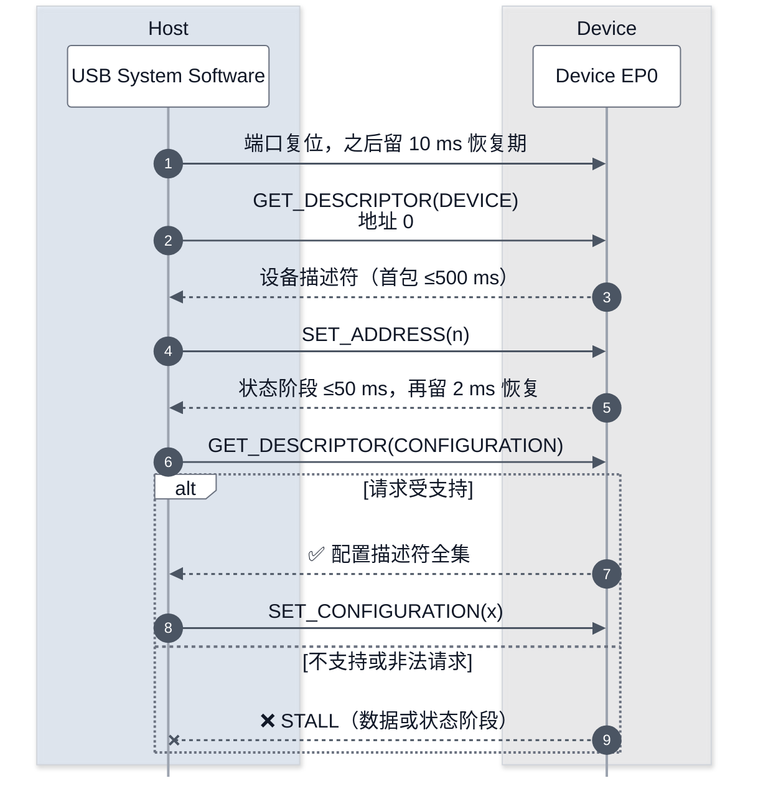

| # | 参与方 | 动作 | 源码 |
|---|---|---|---|
| 1 | 主机 | 复位或恢复后给出 10 ms 恢复期，期间设备可忽略数据传输 | USB 2.0 §9.2.6.2 |
| 2 | 主机 | 设备处于 Default 状态，用默认地址 0 访问 EP0 | §9.1.1.3；地址 0 保留为默认地址见 §8.3.2.1 |
| 3 | 设备 | 带数据阶段的标准请求：首个数据包须在 500 ms 内返回 | §9.2.6.4 |
| 4 | 主机 | 分配地址，设备由 Default 进入 Address 状态 | §9.1.1.4 |
| 5 | 设备 | 状态阶段须在 50 ms 内完成，之后有 2 ms 恢复期 | §9.2.6.3 |
| 6 | 主机 | 按 `wLength` 读取配置描述符 | §9.4.3 |
| 7 | 设备 | 后续数据包各自在 500 ms 内返回，末包后 50 ms 内完成状态阶段 | §9.2.6.4 |
| 8 | 主机 | 选定配置，设备进入 Configured 状态 | §9.1.1.5 |
| 9 | 设备 | 不支持或非法请求返回 STALL，且不会置位控制管道 Halt | §9.4 |

设备可见状态依次是 Attached、Powered、Default、Address、Configured，另有 Suspended（USB 2.0 §9.1.1，Table 9-1）。

## Operations

| Operation | Direction | Request | Response | Errors | Since |
|---|---|---|---|---|---|
| `GET_STATUS` (0) | 主机 → 设备 | `wIndex` 选接收者 | 2 字节状态 | `STALL` | USB 2.0 |
| `CLEAR_FEATURE` (1) | 主机 → 设备 | `wValue` = 特性选择子 | 无数据阶段 | `STALL` | USB 2.0 |
| `SET_FEATURE` (3) | 主机 → 设备 | `wValue` = 特性选择子 | 无数据阶段 | `STALL` | USB 2.0 |
| `SET_ADDRESS` (5) | 主机 → 设备 | `wValue` = 新地址 | 状态阶段 ≤50 ms | `TIMEOUT` | USB 2.0 |
| `GET_DESCRIPTOR` (6) | 主机 → 设备 | `wValue` 高字节 = 类型，低字节 = 索引 | 描述符字节 | `STALL`, `TIMEOUT` | USB 2.0 |
| `SET_DESCRIPTOR` (7) | 主机 → 设备 | 描述符数据 | 无 | `STALL` | USB 2.0 |
| `GET_CONFIGURATION` (8) | 主机 → 设备 | 无 | 1 字节配置值 | `STALL` | USB 2.0 |
| `SET_CONFIGURATION` (9) | 主机 → 设备 | `wValue` = 配置值 | 无数据阶段 | `STALL` | USB 2.0 |
| `GET_INTERFACE` (10) | 主机 → 设备 | `wIndex` = 接口 | 1 字节备用设置 | `STALL` | USB 2.0 |
| `SET_INTERFACE` (11) | 主机 → 设备 | `wValue` = 备用设置 | 无数据阶段 | `STALL` | USB 2.0 |
| `SYNCH_FRAME` (12) | 主机 → 设备 | `wIndex` = 端点 | 2 字节帧号 | `STALL` | USB 2.0 |
| `SET_SEL` (48) | 主机 → 设备 | 系统退出延迟参数 | 无 | `STALL` | USB 3.2 |
| `SET_ISOCH_DELAY` (49) | 主机 → 设备 | `wValue` = 等时延迟 | 无数据阶段 | `STALL` | USB 3.2 |

请求码见 USB 2.0 Table 9-4；48、49 两项见 USB 3.2 r1.1 Table 9-5。2 与 4 保留。

## Data Types

| Type | Field | Format | Required | Notes |
|---|---|---|---|---|
| 描述符类型 | `DEVICE`=1, `CONFIGURATION`=2, `STRING`=3 | 1 字节 | 是 | USB 2.0 Table 9-5 |
| 描述符类型 | `INTERFACE`=4, `ENDPOINT`=5 | 1 字节 | 是 | USB 2.0 Table 9-5 |
| 描述符类型 | `DEVICE_QUALIFIER`=6, `OTHER_SPEED_CONFIGURATION`=7, `INTERFACE_POWER`=8 | 1 字节 | 视速度 | USB 2.0 Table 9-5 |
| 描述符类型 | `OTG`=9, `DEBUG`=10, `INTERFACE_ASSOCIATION`=11 | 1 字节 | 否 | USB 3.2 r1.1 Table 9-6 |
| 描述符类型 | `BOS`=15, `DEVICE CAPABILITY`=16 | 1 字节 | USB 3.x 必需 | USB 3.2 r1.1 Table 9-6 |
| 描述符类型 | `SUPERSPEED_USB_ENDPOINT_COMPANION`=48, `SUPERSPEEDPLUS_ISOCHRONOUS_ENDPOINT_COMPANION`=49 | 1 字节 | SS 端点 | USB 3.2 r1.1 Table 9-6 |
| 特性选择子 | `ENDPOINT_HALT`=0, `DEVICE_REMOTE_WAKEUP`=1, `TEST_MODE`=2 | 2 字节 | 是 | USB 2.0 Table 9-6 |

## Errors

| Code | Meaning | Caller action |
|---|---|---|
| `STALL` | 请求不受支持或参数非法；设备在数据或状态阶段回 STALL（USB 2.0 §9.4） | 修正请求；不要原样重试 |
| `TIMEOUT` | 超出 §9.2.6 时限：无数据请求 50 ms、首包 500 ms、总上限 5 s | 重试一次；仍失败则端口复位后重新枚举 |

## Versioning & Compatibility

| Version | Change | Breaking |
|---|---|---|
| USB 2.0 | 定义第 9 章标准请求、描述符类型 1~8 与设备状态机 | No |
| USB 3.2 | 新增 `SET_SEL`、`SET_ISOCH_DELAY`、BOS 与 SuperSpeed 端点伴随描述符；SS 设备 EP0 包长改为指数编码 `09H` | No |

## Examples

读取设备描述符前 8 字节。Setup 包按 Table 9-2 排列；多字节字段按小端序传输（USB 2.0 §8.1）：

```text
bmRequestType=0x80  bRequest=0x06  wValue=0x0100  wIndex=0x0000  wLength=0x0008
```

失败调用：向设备发保留请求码 2，设备在状态阶段回 STALL（§9.4）。

```text
bmRequestType=0x00  bRequest=0x02  wValue=0x0000  wIndex=0x0000  wLength=0x0000  -> STALL
```

## 待确认项

- [ ] Core 规范外的类请求（HID、CDC 等）不在本文范围，见本知识库其他篇。


<!-- FILE: 02-hid-class-hogp.md -->

# 协议规范：HID 类请求与 HID over GATT

> 类型：api ｜ 模式：Reverse ｜ 状态：Stable ｜ 版本：HID 1.11 / HUT 1.7 / HOGP 1.1 / HIDS 1.1 ｜ 代码基线：`hid1_11.pdf`, `HOGP_v1.1 (2025-08-05)`, `HIDS_v1.1 (2026-04-21)` ｜ 最后核对：2026-11-28 ｜ 范围：`usb-specs/device-classes/HID-1.11.pdf`, `usb-specs/device-classes/HID-UsageTables-1.7.pdf`, `usb-specs/bluetooth/HOGP-latest.pdf`, `usb-specs/bluetooth/HID-Service-1.1.pdf`, `usb-specs/bluetooth/Assigned_Numbers.pdf` ｜ lang: zh

## Overview

同一套 **HID 报告模型**跑在两种传输上：USB 用控制管道与中断端点，BLE 用 GATT 的 HID Service。

- USB 类请求：`bmRequestType` 读为 `10100001`，写为 `00100001`，`wIndex` = 接口号（HID 1.11 §7.2）。
- 类描述符类型：HID = `0x21`，Report = `0x22`，Physical = `0x23`（HID 1.11 §7.1）。
- 启动设备：接口 SubClass `1` = Boot Interface；Protocol `1` = Keyboard，`2` = Mouse（HID 1.11 §4.2、§4.3）。
- BLE：HID Device 必须有 HID Service、Battery Service、Device Information Service；Scan Parameters 可选（HOGP 1.1 Table 3.1）。
- Report Map 特征值最长 **512 octets**（HIDS 1.1 §2.6.1）。

## Message Flow

蓝色 = 主机，灰色 = HID 设备。上半是 USB，下半是 BLE。

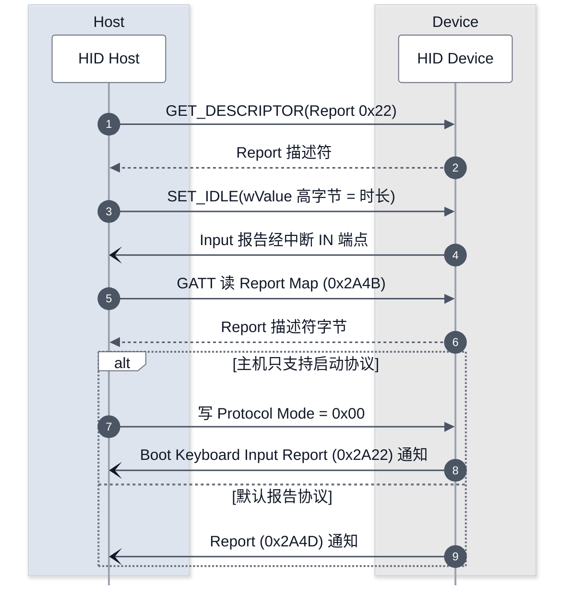

| # | 参与方 | 动作 | 源码 |
|---|---|---|---|
| 1 | 主机 | 用标准 `GET_DESCRIPTOR` 取类描述符，类型 `0x22` | HID 1.11 §7.1.1 |
| 2 | 设备 | 返回 Report 描述符 | HID 1.11 §6.2.2 |
| 3 | 主机 | 设置空闲速率；高字节 0 表示无限期，只在数据变化时上报 | HID 1.11 §7.2.4 |
| 4 | 设备 | 只有 Input 报告经中断 IN 管道发送 | HID 1.11 §5.6 |
| 5 | 主机 | 读 Report Map 特征 | HIDS 1.1 §2.6 |
| 6 | 设备 | 返回值最长 512 octets | HIDS 1.1 §2.6.1 |
| 7 | 主机 | 只有写入 `0x00` 后服务才进入 Boot Protocol Mode | HIDS 1.1 Table 2.2 |
| 8 | 设备 | 启动键盘输入报告 | Assigned Numbers（0x2A22） |
| 9 | 设备 | Report Protocol Mode 是所有 HID 设备的默认模式 | HIDS 1.1 Table 2.2 |

## Operations

| Operation | Direction | Request | Response | Errors | Since |
|---|---|---|---|---|---|
| `GET_REPORT` (0x01) | 主机 → 设备 | `wValue` 高字节 = 报告类型，低字节 = Report ID | 报告字节 | `STALL` | HID 1.11 |
| `GET_IDLE` (0x02) | 主机 → 设备 | `wValue` 低字节 = Report ID | 1 字节空闲速率 | `STALL` | HID 1.11 |
| `GET_PROTOCOL` (0x03) | 主机 → 设备 | `wValue` = 0，`wLength` = 1 | 0 = Boot，1 = Report | `STALL` | HID 1.11 |
| `SET_REPORT` (0x09) | 主机 → 设备 | 报告类型 + Report ID + 报告字节 | 无 | `STALL` | HID 1.11 |
| `SET_IDLE` (0x0A) | 主机 → 设备 | `wValue` 高字节 = 时长（4 ms 单位） | 无 | `STALL` | HID 1.11 |
| `SET_PROTOCOL` (0x0B) | 主机 → 设备 | `wValue` = 0 Boot / 1 Report | 无 | `STALL` | HID 1.11 |
| 写 `HID Control Point` (0x2A4C) | 主机 → 设备 | `0x00` Suspend / `0x01` Exit Suspend | 无 | `ATT_ERROR` | HIDS 1.0 |
| 写 `Protocol Mode` (0x2A4E) | 主机 → 设备 | `0x00` Boot / `0x01` Report | 无 | `ATT_ERROR` | HIDS 1.0 |
| 通知 `Report` (0x2A4D) | 设备 → 主机 | — | Input 报告 | `ATT_ERROR` | HIDS 1.0 |

`GET_REPORT` 是所有设备必须支持的请求；`GET_PROTOCOL`、`SET_PROTOCOL` 只要求启动设备支持（HID 1.11 §7.2 表注 1、2）。

## Data Types

| Type | Field | Format | Required | Notes |
|---|---|---|---|---|
| 报告类型 | `01` Input，`02` Output，`03` Feature | `wValue` 高字节 | 是 | HID 1.11 §7.2.1 |
| 空闲时长 | 0 = 无限期；1~255 × 4 ms | 1 字节 | 是 | 0.004~1.020 s，精度 ±(10% + 2 ms)（§7.2.4） |
| 默认空闲速率 | 键盘 500 ms；摇杆与鼠标为无限期 | 推荐值 | 否 | HID 1.11 §7.2.4 |
| GATT UUID | HID Service `0x1812`，Battery `0x180F`，Device Information `0x180A`，Scan Parameters `0x1813` | 16 位 | 是 | Assigned Numbers |
| GATT UUID | HID Information `0x2A4A`，Report Map `0x2A4B`，Report `0x2A4D`，Protocol Mode `0x2A4E` | 16 位 | 是 | Assigned Numbers |
| GATT UUID | Boot Keyboard Input `0x2A22`，Boot Keyboard Output `0x2A32`，Boot Mouse Input `0x2A33` | 16 位 | 启动设备 | Assigned Numbers |
| Usage Page | `0x01` Generic Desktop，`0x07` Keyboard/Keypad，`0x0C` Consumer，`0x11` SoC | 16 位 | — | HUT 1.7 Table 3.1 |

## Errors

| Code | Meaning | Caller action |
|---|---|---|
| `STALL` | 设备不支持该类请求或参数非法（USB 2.0 §9.4 的通用规则） | 不要重试；启动设备以外不要发 `SET_PROTOCOL` |
| `ATT_ERROR` | GATT 读写被拒，错误码由 Core 规范 Vol 3 Part F 定义 | 按 ATT 错误码处理；未加密时先配对 |

## Versioning & Compatibility

| Version | Change | Breaking |
|---|---|---|
| HID 1.11 | USB HID 类定义，现行版（2001-06-27） | No |
| HIDS 1.0 | GATT HID Service 首版，特征与 USB HID 一一映射 | No |
| HOGP 1.1 | 2025-08-05 采纳；新增可选 HID ISO，经 LE 等时信道传 HID 报告 | No |
| HUT 1.7 | Usage Page 表新增 `0x11` SoC 页（HUT 1.3 时为保留） | No |

## Examples

`SET_IDLE`：对全部报告设无限期空闲（`wValue` 高字节 0，低字节 0），接口 0：

```text
bmRequestType=0x21  bRequest=0x0A  wValue=0x0000  wIndex=0x0000  wLength=0x0000
```

失败调用：向非启动设备发 `SET_PROTOCOL`，设备可以回 STALL。

```text
bmRequestType=0x21  bRequest=0x0B  wValue=0x0000  wIndex=0x0000  wLength=0x0000  -> STALL
```

## 待确认项

- [ ] HID 报告周期上限由端点 `bInterval` 决定，见 USB 2.0 §9.6.6；本文未展开。
- [ ] HID ISO 的具体特征与流程见 HOGP 1.1 §5、§6，本文只登记其存在。


<!-- FILE: 03-usb-pd-messages-timers.md -->

# 协议规范：USB PD 消息头、消息类型与定时器

> 类型：api ｜ 模式：Reverse ｜ 状态：Stable ｜ 版本：USB PD R3.3 V1.0 ｜ 代码基线：`USB_PD_R3.3_V1.0_2026_10_16.pdf` ｜ 最后核对：2026-11-28 ｜ 范围：`usb-specs/usb-core/USB-PD-3.3-V1.0.zip` ｜ lang: zh

## Overview

USB PD 在 Type-C 的 CC 线上交换消息，协商电压、电流与角色。本文取 usb.org 现行版 **PD R3.3 V1.0**（2026-10-16）。

- 消息 = 16 位消息头 + 0~7 个 32 位数据对象；扩展消息另带扩展头（PD R3.3 Table 6.2、§6.5.1）。
- 功率范围：SPR 最高 100 W；EPR 最高 240 W，EPR Mode 最高电压 48 V（PD R3.3 §2 术语表）。
- 可靠传输：每条消息由对端回 `GoodCRC`，其 MessageID 与原消息一致（§6.3.1）。
- R3.3 重组章节，目标是与上一版技术等价（R3.3 包内 Reorganization Guide）。

## Message Flow

蓝色 = Source，橙色 = Sink。图为 L1 显式契约主线；每条消息后的 `GoodCRC` 省略。

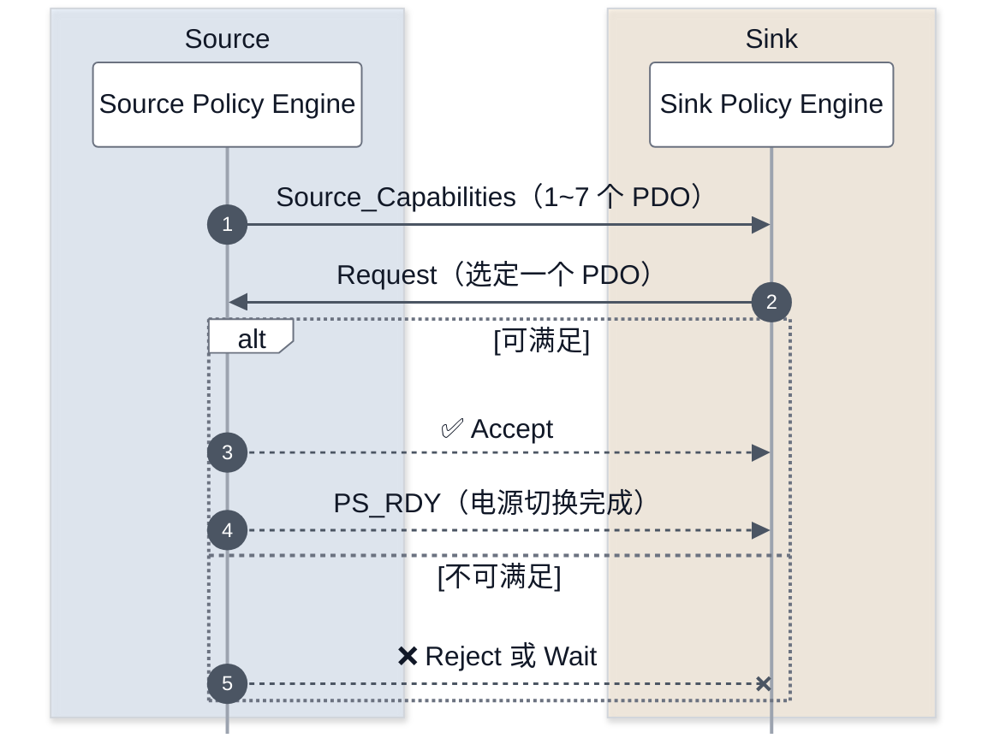

| # | 参与方 | 动作 | 源码 |
|---|---|---|---|
| 1 | Source | 首个 PDO 必须是 vSafe5V Fixed Supply；其余 Fixed PDO 按电压升序 | PD R3.3 §6.4.1.1 |
| 2 | Sink | 用 Request 选择 PDO；Source 等待响应的时限是 tSenderResponse | §6.4.2，Table 7.10 |
| 3 | Source | 接受请求；Sink 发完 GoodCRC 后启动 PSTransitionTimer | §6.3.3，§4.5.1.1 |
| 4 | Source | 新电源就绪后发 PS_RDY；Sink 的等待上限是 tPSTransition | §6.3.6，Table 7.10 |
| 5 | Source | 拒绝或要求稍后重试 | §6.3.4，§6.3.12 |

## Operations

控制消息类型见 PD R3.3 Table 6.4，数据消息类型见 Table 6.5。下表列常用项。

| Operation | Direction | Request | Response | Errors | Since |
|---|---|---|---|---|---|
| `GoodCRC` (控制 00001b) | 双向 | MessageID = 被确认消息的 ID | — | `Retry` | PD 2.0 |
| `Accept` (控制 00011b) | 双向 | — | — | `Not_Supported` | PD 2.0 |
| `Reject` (控制 00100b) | 双向 | — | — | `Not_Supported` | PD 2.0 |
| `PS_RDY` (控制 00110b) | Source → Sink | — | — | `Hard_Reset` | PD 2.0 |
| `Get_Source_Cap` (控制 00111b) | Sink → Source | — | `Source_Capabilities` | `Not_Supported` | PD 2.0 |
| `Soft_Reset` (控制 01101b) | 双向 | — | `Accept` | `Hard_Reset` | PD 2.0 |
| `Get_Revision` (控制 11000b) | 双向 | — | `Revision` (数据 01100b) | `Not_Supported` | PD 3.3 |
| `Source_Capabilities` (数据 00001b) | Source → Sink | 1~7 个 PDO | `Request` | `Soft_Reset` | PD 2.0 |
| `Request` (数据 00010b) | Sink → Source | 1 个 RDO | `Accept` / `Reject` / `Wait` | `Soft_Reset` | PD 2.0 |
| `EPR_Request` (数据 01001b) | Sink → Source | RDO + PDO 副本 | `Accept` / `Reject` | `Soft_Reset` | PD 3.1 |
| `Vendor_Defined` (数据 01111b) | 双向 | VDM 头 + VDO | 依命令 | `Not_Supported` | PD 2.0 |

`GotoMin` 已弃用，接收方须回 `Not_Supported`（§6.3.2）。`Ping` 已弃用，接收方可回 `Not_Supported` 或忽略（§6.3.5）。

## Data Types

| Type | Field | Format | Required | Notes |
|---|---|---|---|---|
| 消息头 | `Extended` | bit 15 | 是 | 0 = 控制或数据消息，1 = 扩展消息（Table 6.2） |
| 消息头 | `Number of Data Objects` | bit 14..12 | 是 | 0 表示控制消息（Table 6.2，§6.2.2） |
| 消息头 | `MessageID` | bit 11..9 | 是 | 发送方维护的滚动计数（Table 6.2） |
| 消息头 | `Port Power Role` | bit 8 | SOP | 0 = Sink，1 = Source；接收方不校验（Table 6.2） |
| 消息头 | `Specification Revision` | bit 7..6 | 是 | 01b = Rev 2.0，10b = Rev 3.x；00b 按 2.0 解释（Table 6.2） |
| 消息头 | `Message Type` | bit 4..0 | 是 | 取值见 Table 6.4 / 6.5 |
| 计数器 | `nCapsCount` = 50，`nHardResetCount` = 2，`nMessageIDCount` = 7 | 整数 | 是 | Table 7.12 |

## Errors

| Code | Meaning | Caller action |
|---|---|---|
| `Retry` | 发送后 tReceive（0.9~1.1 ms）内未收到 GoodCRC（Table 7.10） | 按协议层规则重发同一 MessageID |
| `Not_Supported` | 收到保留或不支持的消息类型（Table 6.4 / 6.5） | 放弃该请求，不要重发 |
| `Soft_Reset` | 协议错误，复位协议层与 MessageID（§6.3.13） | 等 `Accept` 后重新协商 |
| `Hard_Reset` | 软复位失败或电源异常；VBUS 回到 USB 默认（§7.1.3，术语表） | 重新附着并从 Source_Capabilities 开始 |

## Versioning & Compatibility

| Version | Change | Breaking |
|---|---|---|
| PD 2.0 | 消息头 Specification Revision = 01b | No |
| PD 3.1 | 引入 EPR：功率上限 240 W、EPR Mode 最高 48 V（推断：R2.0 V1.3 无 EPR_Request，3.1 原文未缓存） | No |
| PD 3.2 | R3.2 V1.2（2026-08-19）是 3.2 系列最后一版，随 R3.3 包作为 Previous Rev 提供 | No |
| PD 3.3 | R3.3 V1.0（2026-10-16）章节重组，目标是与上一版保持技术等价；`Get_Revision` 在 3.2 V1.2 与 3.3 中均有定义 | No |

不同修订版通过消息头 Specification Revision 协商到双方共同支持的版本（Table 6.2，§6.1.3）。

## Examples

PD R3.3 Table 7.10 中协商主线用到的定时器：

```text
tTypeCSendSourceCap  100 / 150 / 200 ms   (min / nom / max)
tSenderResponse       27 /  -  /  50 ms
tPSTransition (SPR)  450 / 500 / 550 ms
tPSTransition (EPR)  830 / 925 / 1020 ms
tFirstSourceCap        - /  -  / 250 ms
tPPSRequest            - /  -  /  10 s
```

失败调用：Sink 发保留数据消息类型 01101b，对端回 `Not_Supported`（Table 6.5）。

```text
Header: Extended=0 NumDO=1 MessageType=01101b  ->  Not_Supported
```

## 待确认项

- [ ] `Get_Revision`、`Revision` 的首次引入版本：未确认。已缓存的 3.2 V1.2 与 3.3 V1.0 均包含它们。
- [ ] `PS_RDY` 超时后进入 Hard Reset 的具体条件见 §8 策略引擎状态机，本文未展开。


<!-- FILE: 04-bc12-charger-detection.md -->

# 协议规范：USB BC 1.2 充电端口检测

> 类型：api ｜ 模式：Reverse ｜ 状态：Stable ｜ 版本：BC 1.2（含 2012-03-15 勘误） ｜ 代码基线：`BC1.2 plus errata 2012-3-15.pdf` ｜ 最后核对：2026-11-28 ｜ 范围：`usb-specs/usb-core/BC-1.2.zip` ｜ lang: zh

## Overview

BC 1.2 让便携设备（PD）只用 D+/D− 上的模拟信号，在枚举前区分三类下行端口：**SDP、CDP、DCP**。

- SDP：标准下行端口，按 USB 2.0 规则供电。
- CDP：主机或集线器端口，可枚举，D+ 落在 VDAT_REF~VLGC 时在 D− 输出 VDM_SRC（BC 1.2 §1.4.4）。
- DCP：不能枚举，D+ 与 D− 短接，阻值 ≤ RDCP_DAT = 200 Ω（§1.4.7，Table 5-3）。
- 检测顺序：DCD（可选）→ Primary Detection → Secondary Detection（§3.3.2）。

## Message Flow

蓝色 = 便携设备，灰色 = 充电端口。“消息”是 D+/D− 上的电压与电流。

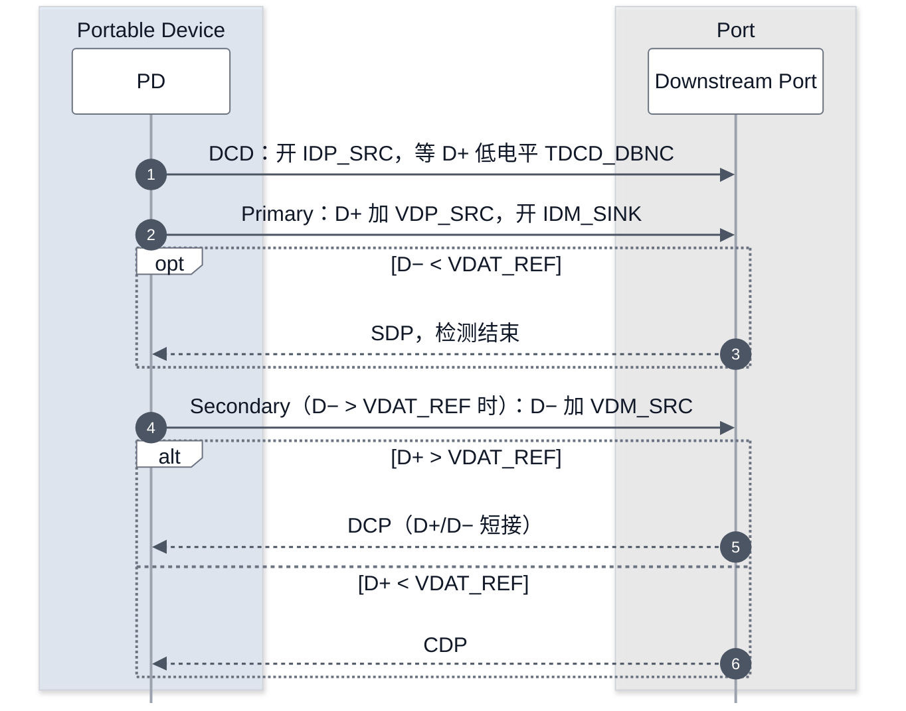

| # | 参与方 | 动作 | 源码 |
|---|---|---|---|
| 1 | PD | VBUS 有效后启动 TDCD_TIMEOUT；超时未检测到接触也进入 Primary | BC 1.2 §3.3.2 |
| 2 | PD | Primary：开 VDP_SRC 与 IDM_SINK，比较 D− 与 VDAT_REF | §3.2.4 |
| 3 | 端口 | SDP 的 D− 只有下拉，D− 保持低于 VDAT_REF | §3.2.4.3 |
| 4 | PD | 已判为 DCP 或 CDP 但尚未准备枚举时，必须做 Secondary | §3.3.2，§3.2.5 |
| 5 | 端口 | D+ 高于 VDAT_REF 即判为 DCP | §3.2.5.1 |
| 6 | 端口 | D+ 低于 VDAT_REF 即判为 CDP；PD 关 VDM_SRC，D+/D− 保持低直到连接 | §3.2.5.2，§3.3.2 |

可选：Primary 时再比较 D− 与 VLGC，避免把 PS/2 端口误判为充电端口（§3.2.4.1）。

## Operations

| Operation | Direction | Request | Response | Errors | Since |
|---|---|---|---|---|---|
| `Data Contact Detect` | PD → 端口 | IDP_SRC = 7~13 µA 注入 D+ | D+ 保持 VLGC_LOW 达 TDCD_DBNC | `DCD_TIMEOUT` | BC 1.2 |
| `Primary Detection` | PD → 端口 | VDP_SRC = 0.5~0.7 V 加到 D+ | D− 电压 | `PS2_FALSE_POSITIVE` | BC 1.2 |
| `Secondary Detection` | PD → 端口 | VDM_SRC = 0.5~0.7 V 加到 D− | D+ 电压 | `PS2_FALSE_POSITIVE` | BC 1.2 |
| `DCP connect` | PD → 端口 | 开 VDP_SRC 或经 RDP_UP 上拉 D+ | 保持 D+ > VDAT_REF | `DCD_TIMEOUT` | BC 1.2 |

DCP 上的 PD 必须在附着后 TSVLD_CON_PWD（≤1 s）内开 VDP_SRC 或上拉 D+（§3.3.2，Table 5-5）。

## Data Types

| Type | Field | Format | Required | Notes |
|---|---|---|---|---|
| 电压 | VDAT_REF 0.25~0.4 V；VDP_SRC、VDM_SRC 0.5~0.7 V；VLGC 0.8~2.0 V | 模拟量 | 是 | Table 5-1 |
| 电流 | ICDP 1.5~5.0 A；IDCP 0.5~5.0 A | 端口额定 | 是 | Table 5-2 |
| 电流 | IDEV_CHG ≤ 1.5 A：PD 从充电端口可取的电流 | 上限 | 是 | Table 5-2，§4.6 |
| 电流 | IDP_SRC 7~13 µA；IDM_SINK、IDP_SINK 25~175 µA | 模拟量 | 是 | Table 5-2 |
| 电阻 | RDCP_DAT ≤ 200 Ω；RDM_DWN、RDP_DWN 14.25~24.8 kΩ | 模拟量 | 是 | Table 5-3 |
| 时间 | TDCD_DBNC ≥ 10 ms；TDCD_TIMEOUT 300~900 ms | 定时 | 是 | Table 5-5 |
| 时间 | TVDPSRC_ON、TVDMSRC_ON ≥ 40 ms；TVDMSRC_EN、TVDMSRC_DIS ≤ 20 ms | 定时 | 是 | Table 5-5 |

## Errors

| Code | Meaning | Caller action |
|---|---|---|
| `DCD_TIMEOUT` | TDCD_TIMEOUT 到期仍未检测到 D+ 接触（本文命名） | 规范要求直接进入 Primary Detection（§3.3.2） |
| `PS2_FALSE_POSITIVE` | PS/2 端口上拉 D+/D−，只比 VDAT_REF 会误判为充电端口（本文命名） | 同时比较 VLGC，只在 VDAT_REF < D− < VLGC 时判定（§3.2.4.1） |

## Versioning & Compatibility

| Version | Change | Breaking |
|---|---|---|
| BC 1.2 | 2010-12-07 发布；2012-03-15 并入勘误，为 usb.org 现行版 | No |

ICFG_MAX：接 SDP 时为 500 mA，接 SuperSpeed 端口时为 900 mA（Table 5-2 注 2）。

## Examples

Primary Detection 判定（Table 5-1 阈值）：

```text
VDP_SRC(0.5~0.7 V) -> D+ ;  measure D-
D- > VDAT_REF(0.25~0.4 V) and D- < VLGC(0.8~2.0 V)  -> DCP or CDP
D- < VDAT_REF                                       -> SDP
```

失败调用：PD 只比 VDAT_REF，插在 PS/2 端口上被误判为充电端口。

```text
D- pulled high by PS/2 port -> D- > VDAT_REF -> wrong "DCP/CDP" (PS2_FALSE_POSITIVE)
```

## 待确认项

- [ ] ACA 与 ACA-Dock 检测（§3.2.6，RID_A/B/C）未展开。
- [ ] 错误码 `DCD_TIMEOUT`、`PS2_FALSE_POSITIVE` 是本文为结构化而起的名字，BC 1.2 原文没有错误码。


<!-- FILE: 05-ble-llcp-ifs.md -->

# 协议规范：BLE 链路层控制过程（LLCP）与帧间隔

> 类型：api ｜ 模式：Reverse ｜ 状态：Stable ｜ 版本：Bluetooth Core 7.0 ｜ 代码基线：`Core_v7.0.pdf (Version Date 2026-11-02)` ｜ 最后核对：2026-11-28 ｜ 范围：`usb-specs/bluetooth/Bluetooth-Core-7.0.pdf`, `usb-specs/bluetooth/Assigned_Numbers.pdf` ｜ lang: zh

## Overview

BLE 连接建立后，两端链路层用 **LL Control PDU** 协商特性、版本、参数、加密与帧间隔。本文以 Core 7.0 Vol 6 Part B 为准。

- LL Control PDU = 1 字节 `Opcode` + 可变长 `CtrData`（Vol 6 Part B §2.4.2）。
- Core 7.0 定义 Opcode `0x00`~`0x4A`；`0xF0`~`0xFB` 留给规范开发用途（Table 2.22）。
- 收到不支持或保留的 Opcode，必须回 `LL_UNKNOWN_RSP`，`UnknownType` = 收到的 Opcode（§2.4.2）。
- 每个过程受 **TPRT = 40 s** 超时约束；Connection Update 与 Channel Map Update 例外（§5.2）。
- 帧间隔默认 **150 µs**；可用 Frame Space Update 过程按连接、按 PHY 调整，`T_IFS_150` 除外（§4.1.1）。

## Message Flow

蓝色 = Central，灰色 = Peripheral。

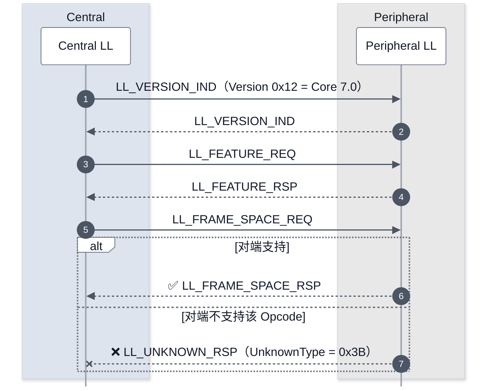

| # | 参与方 | 动作 | 源码 |
|---|---|---|---|
| 1 | Central | Version 字段填控制器支持的 LL 版本，取值见 Assigned Numbers | Vol 6 Part B §2.4.2.13 |
| 2 | Peripheral | 回自己的版本、Company_Identifier 与 Subversion | §2.4.2.13 |
| 3 | Central | 请求对端特性集 | §2.4.2.9 |
| 4 | Peripheral | 返回特性集 | Table 2.22（0x09） |
| 5 | Central | 发起 Frame Space Update，指定要改的间隔类型与 PHY | §5.1.30 |
| 6 | Peripheral | 接受并回应答 | Table 2.22（0x3C） |
| 7 | Peripheral | 不支持时回 LL_UNKNOWN_RSP；收到方此后不得再发起同一过程 | §2.4.2 注，§4.6 |

## Operations

下表选列常用 Opcode；完整 0x00~0x4A 见 Core 7.0 Table 2.22。

| Operation | Direction | Request | Response | Errors | Since |
|---|---|---|---|---|---|
| `LL_TERMINATE_IND` (0x02) | 双向 | `ErrorCode` | — | — | Core 4.0 |
| `LL_UNKNOWN_RSP` (0x07) | 双向 | `UnknownType` = 收到的 Opcode | — | — | Core 4.0 |
| `LL_FEATURE_REQ` (0x08) | Central → Peripheral | 特性集 | `LL_FEATURE_RSP` (0x09) | `LL_UNKNOWN_RSP` | Core 4.0 |
| `LL_VERSION_IND` (0x0C) | 双向 | Version / Company_Identifier / Subversion | `LL_VERSION_IND` | `TPRT_TIMEOUT` | Core 4.0 |
| `LL_REJECT_EXT_IND` (0x11) | 双向 | `RejectOpcode` + `ErrorCode` | — | — | Core 4.1 |
| `LL_LENGTH_REQ` (0x14) | 双向 | 最大收发长度与时间 | `LL_LENGTH_RSP` (0x15) | `LL_UNKNOWN_RSP` | Core 4.2 |
| `LL_PHY_REQ` (0x16) | 双向 | 期望 PHY | `LL_PHY_RSP` (0x17) / `LL_PHY_UPDATE_IND` (0x18) | `LL_REJECT_EXT_IND` | Core 5.0 |
| `LL_FRAME_SPACE_REQ` (0x3B) | 双向 | Spacing_Types + PHYS | `LL_FRAME_SPACE_RSP` (0x3C) | `LL_UNKNOWN_RSP` | Core 6.0 |
| `LL_CIS_UPDATE_REQ` (0x49) | 见规范 | 见 §2.4.2 对应小节 | `LL_CIS_UPDATE_RSP` (0x4A) | `LL_UNKNOWN_RSP` | Core 7.0 |

## Data Types

| Type | Field | Format | Required | Notes |
|---|---|---|---|---|
| LL Control PDU | `Opcode` | 1 octet | 是 | Table 2.22 |
| LL Control PDU | `CtrData` | 依 Opcode | 视 Opcode | §2.4.2 各小节 |
| 帧间隔 | `T_IFS_ACL_CP`、`T_IFS_ACL_PC`、`T_IFS_CIS` | µs | 是 | 默认 150 µs，可协商（§4.1.1） |
| 帧间隔 | `T_IFS_150` | µs | 是 | 固定 150 µs，不可协商（§4.1.1） |
| 可调参数 | `T_IFS_ACL_CP`、`T_IFS_ACL_PC`、`T_MCES`、`T_IFS_CIS`、`T_MSS_CIS` | µs | 否 | Frame Space Update 可改（§5.1.30） |
| LL 版本号 | 5.0 = `0x09` … 6.0 = `0x0E`，6.1 = `0x0F`，6.2 = `0x10`，6.3 = `0x11`，7.0 = `0x12` | 1 octet | 是 | Assigned Numbers |

## Errors

| Code | Meaning | Caller action |
|---|---|---|
| `LL_UNKNOWN_RSP` | 对端不支持或视为保留的 Opcode（§2.4.2） | 本连接内不再发起同一过程（§4.6） |
| `LL_REJECT_EXT_IND` | 对端按过程规则拒绝，`ErrorCode` 见 Vol 1 Part F（§2.4.2.18） | 按错误码处理，例如 `0x1A` Unsupported Remote Feature |
| `TPRT_TIMEOUT` | 过程 40 s 无响应，ACL 视为丢失；错误码 `0x22` LL Response Timeout（§5.2，Vol 1 Part F） | 进入 Standby，按需重新连接 |

## Versioning & Compatibility

| Version | Change | Breaking |
|---|---|---|
| Core 4.0 | LE 链路层与首批 LL Control PDU | No |
| Core 4.1 | 增加 `LL_REJECT_EXT_IND` 等（推断：按 Opcode 顺序与版本号推断，4.x 原文未缓存） | No |
| Core 4.2 | 增加数据长度扩展 `LL_LENGTH_REQ/RSP`（推断，原因同上） | No |
| Core 5.0 | 增加 PHY 更新 `LL_PHY_*`（推断，原因同上） | No |
| Core 6.0 | 已缓存的 6.0 表止于 0x3C，含 `LL_FRAME_SPACE_REQ/RSP` | No |
| Core 7.0 | 2026-11 发布；表扩展到 0x4A（0x3D~0x4A 在 6.0 中没有） | No |

0x3D~0x4A 可能在 6.1~6.3 之间分批引入；这几版原文未缓存，具体归属未确认。

## Examples

Peripheral 不认识 `LL_FRAME_SPACE_REQ` 时的 LL Control PDU 负载：

```text
Opcode=0x07 (LL_UNKNOWN_RSP)  CtrData: UnknownType=0x3B
```

失败调用：过程发起后对端不再回任何 LL Control PDU，40 s 后连接丢失。

```text
LL_LENGTH_REQ -> (no response) ... TPRT reaches 40 s -> Standby, reason 0x22 LL Response Timeout
```

## 待确认项

- [ ] Core 4.0~5.x 与 6.1~6.3 原文未在本次下载范围内；“Since”列中 4.1/4.2/5.0 为推断，0x3D 以后各条的引入版本未确认。
- [ ] `TPRT_TIMEOUT` 是本文为结构化起的名字；规范描述为“procedure response timeout”。


<!-- FILE: 06-linux-virtual-usb.md -->

# 协议规范：Linux 虚拟 USB（USB/IP、ConfigFS、FunctionFS、Raw Gadget）

> 类型：api ｜ 模式：Reverse ｜ 状态：Stable ｜ 版本：USB/IP v1.1.1 / Linux 内核文档 ｜ 代码基线：`docs.kernel.org（2026-11 抓取）` ｜ 最后核对：2026-11-28 ｜ 范围：`usb-specs/linux/usbip_protocol.html`, `usb-specs/linux/gadget_configfs.html`, `usb-specs/linux/functionfs.html`, `usb-specs/linux/raw-gadget.html` ｜ lang: zh

## Overview

本文内容来自 Linux 内核官方文档，不是 USB-IF 规范；它是这些接口唯一的权威定义。

- **USB/IP**：服务端导出 USB 设备，客户端导入；设备驱动跑在客户端（usbip_protocol §Architecture）。
- 字段一律为网络字节序（大端）；头部版本号 `0x0111` 表示 v1.1.1。
- **ConfigFS**：用目录与符号链接拼出 gadget，最后写 `UDC` 绑定控制器（gadget_configfs）。
- **FunctionFS**：用户态向 `ep0` 写描述符与字符串，之后出现 `ep#` 文件（functionfs）。
- **Raw Gadget**：打开 `/dev/raw-gadget`，用 ioctl 实现任意 gadget（raw-gadget）。

## Message Flow

蓝色 = 客户端（虚拟主机控制器），灰色 = 服务端（导出设备的主机）。

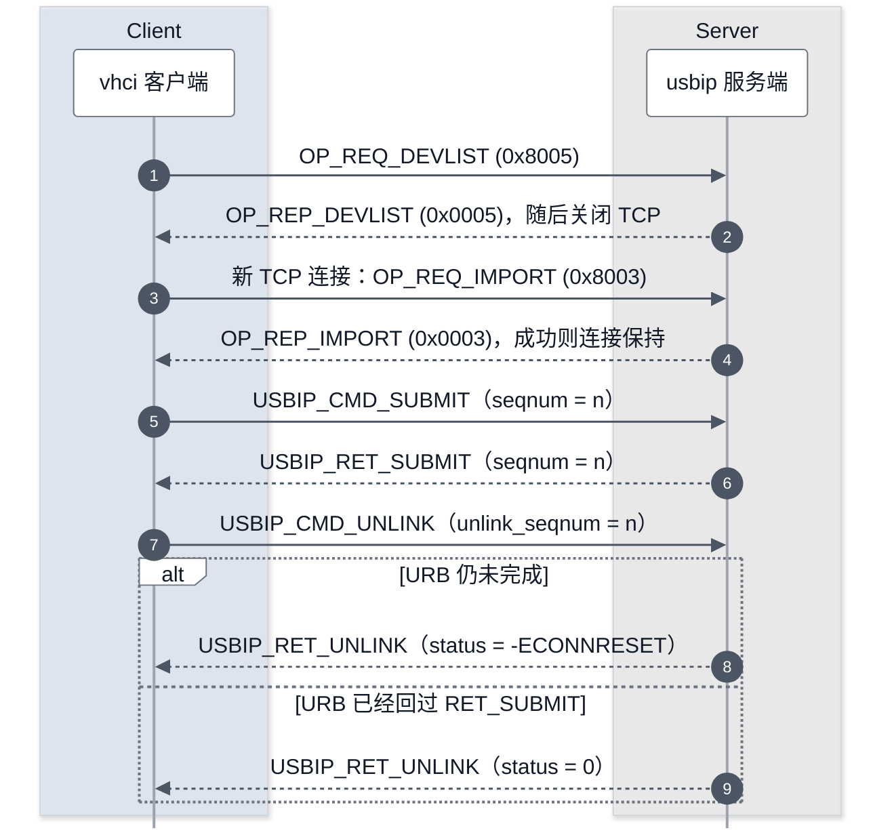

| # | 参与方 | 动作 | 源码 |
|---|---|---|---|
| 1 | 客户端 | 打开 TCP 连接请求导出列表 | usbip_protocol §Architecture |
| 2 | 服务端 | 返回导出设备列表后关闭连接 | §Architecture |
| 3 | 客户端 | 新开 TCP 连接请求导入某个 busid | §Message Format |
| 4 | 服务端 | 导入成功后该连接用于 URB 流量 | §Architecture |
| 5 | 客户端 | 提交 URB；seqnum 每连接递增，用于匹配请求与响应 | usbip_header_basic |
| 6 | 服务端 | 返回 URB 结果，`status` 为 0 表示成功 | USBIP_RET_SUBMIT |
| 7 | 客户端 | 撤销先前提交的 URB | USBIP_CMD_UNLINK |
| 8 | 服务端 | 撤销成功时 status 为 -ECONNRESET | USBIP_RET_UNLINK |
| 9 | 服务端 | UNLINK 晚于 RET_SUBMIT 到达时 status 为 0 | USBIP_RET_UNLINK |

## Operations

| Operation | Direction | Request | Response | Errors | Since |
|---|---|---|---|---|---|
| `OP_REQ_DEVLIST` (0x8005) | 客户端 → 服务端 | 版本 + 命令码 + status | `OP_REP_DEVLIST` (0x0005) | `OP_STATUS_ERROR` | USB/IP v1.1.1 |
| `OP_REQ_IMPORT` (0x8003) | 客户端 → 服务端 | busid（32 字节） | `OP_REP_IMPORT` (0x0003) | `OP_STATUS_ERROR` | USB/IP v1.1.1 |
| `USBIP_CMD_SUBMIT` (0x00000001) | 客户端 → 服务端 | usbip_header + 传输缓冲 | `USBIP_RET_SUBMIT` (0x00000003) | `URB_STATUS` | USB/IP v1.1.1 |
| `USBIP_CMD_UNLINK` (0x00000002) | 客户端 → 服务端 | unlink_seqnum | `USBIP_RET_UNLINK` (0x00000004) | `URB_STATUS` | USB/IP v1.1.1 |
| ConfigFS 绑定 | 用户态 → 内核 | `echo <udc name> > UDC` | gadget 上线 | `UDC_BIND_FAIL` | Linux 内核文档 |
| FunctionFS 挂载 | 用户态 → 内核 | `mount -t functionfs <name> <dir>` | 出现 `ep0` | `UDC_BIND_FAIL` | Linux 内核文档 |
| Raw Gadget 启动 | 用户态 → 内核 | `USB_RAW_IOCTL_INIT`，再 `USB_RAW_IOCTL_RUN` | 事件经 `USB_RAW_IOCTL_EVENT_FETCH` | `UDC_BIND_FAIL` | Linux 内核文档 |

## Data Types

| Type | Field | Format | Required | Notes |
|---|---|---|---|---|
| usbip_header_basic | `command` | 4 字节，大端 | 是 | 1 SUBMIT，2 UNLINK，3 RET_SUBMIT，4 RET_UNLINK |
| usbip_header_basic | `seqnum` | 4 字节 | 是 | 每连接递增 |
| usbip_header_basic | `devid` | 4 字节 | 是 | 请求方为 `(busnum << 16) \| devnum`；服务端填 0 |
| usbip_header_basic | `direction` | 4 字节 | 是 | 0 OUT，1 IN；只客户端使用，服务端填 0 |
| usbip_header_basic | `ep` | 4 字节 | 是 | 端点号；服务端与 UNLINK 填 0 |
| ConfigFS 路径 | `usb_gadget/g1`、`strings/0x409`、`configs/c.1/MaxPower`、`functions/ncm.usb0` | 目录与属性文件 | 是 | gadget_configfs 第 1~4 节 |
| Raw Gadget | `USB_RAW_IOCTL_EPS_INFO` | ioctl | 否 | 收到 `USB_RAW_EVENT_CONNECT` 后查询 UDC 端点 |

## Errors

| Code | Meaning | Caller action |
|---|---|---|
| `OP_STATUS_ERROR` | OP_REP 的 status 非 0；导入失败时回复只到 status 字段为止（本文命名） | 关闭连接，检查 busid 与导出状态 |
| `URB_STATUS` | RET 包中的 `status`，语义同 Linux URB 状态；撤销成功为 `-ECONNRESET`（本文命名） | 按 errno 处理；`-ECONNRESET` 表示撤销生效 |
| `UDC_BIND_FAIL` | 写 `UDC` 或启动 Raw Gadget 失败（本文命名，推断） | 检查 `/sys/class/udc/*` 是否有可用 UDC |

## Versioning & Compatibility

| Version | Change | Breaking |
|---|---|---|
| USB/IP v1.1.1 | 头部版本号 `0x0111`，定义于 `tools/usb/usbip/configure.ac` | No |
| Linux 内核文档 | ConfigFS、FunctionFS、Raw Gadget 文档随内核演进，无独立版本号 | No |

## Examples

ConfigFS 拼一个 NCM 网卡 gadget（gadget_configfs 原文命令）：

```bash
mount none $CONFIGFS_HOME -t configfs
mkdir $CONFIGFS_HOME/usb_gadget/g1 && cd $CONFIGFS_HOME/usb_gadget/g1
echo <VID> > idVendor; echo <PID> > idProduct
mkdir strings/0x409 configs/c.1 functions/ncm.usb0
echo 120 > configs/c.1/MaxPower
ln -s functions/ncm.usb0 configs/c.1
echo <udc name> > UDC      # <udc name> 取自 /sys/class/udc/*
echo "" > UDC              # 解绑
```

失败调用：FunctionFS 的 gadget 在所有函数文件系统挂载完、且每个 `ep0` 写入描述符之前不会注册。

```text
mount -t functionfs hid /dev/ffs-hid   # 未写 ep0 描述符 -> gadget 不注册
```

## 待确认项

- [ ] USB/IP 的 TCP 端口号在内核文档中没有写明，本文不列出。
- [ ] `OP_STATUS_ERROR`、`URB_STATUS`、`UDC_BIND_FAIL` 是本文为结构化起的名字，内核文档无此命名。


<!-- FILE: 07-linux-usb-stack.md -->

# 架构文档：Linux USB 栈（主机、HID、Gadget 与虚拟 USB）

> 类型：arch ｜ 模式：Reverse ｜ 代码基线：`docs.kernel.org（页面标注 Linux 7.4.0-rc4）；torvalds/linux master` ｜ 最后核对：2026-11-28 ｜ 范围：`docs.kernel.org/driver-api/usb, docs.kernel.org/usb, docs.kernel.org/hid, drivers/usb` ｜ lang: zh

## Overview

Linux 用一个内核 USB 栈同时覆盖主机侧（usbcore + HCD）、HID 子系统和设备侧（gadget 框架）：新设备默认 autosuspend 延迟 **2 秒**，USB/IP 用 TCP **3240**，`/dev/uhid`、ConfigFS、dummy_hcd 都可在无硬件时造出“真实”设备。读者是熟悉 Windows WinUSB/KMDF/hidclass、要做虚拟 USB 与驱动研究的工程师。来源只用 kernel.org 文档与 torvalds/linux 源码，以及 libusb、systemd、BlueZ、Wireshark 官方站点。

**TL;DR**

- 主机侧：URB 经 usbcore 交给 HCD；用户态走 usbfs/libusb 或 hidraw。
- 虚拟 HID 用 uhid，虚拟设备用 ConfigFS + dummy_hcd，网络导出用 USB/IP。
- Raw Gadget 官方定位为调试与 fuzzing，生产用 FunctionFS。
- 协议报文与 ConfigFS/FunctionFS/Raw Gadget 的逐条定义见 [06-linux-virtual-usb.md](06-linux-virtual-usb.md)，本文只讲栈结构与取舍。

蓝 = 用户空间应用，红 = 内核/系统级驱动，绿 = 用户态驱动或守护进程，橙 = 系统框架，灰 = 硬件与外部。

标记 **待核实** 的内容未能从官方来源确认，不要当作事实引用。

## 核心事实 Key Facts（已核对）

| # | 事实 | 值 / 说明 | 来源 |
|---|---|---|---|
| 1 | 主机侧 I/O 的基本单位 | URB（USB Request Block），由 HCD 执行 | [L1] |
| 2 | usbfs 设备节点 | `/dev/bus/usb/BBB/DDD`（总线号/设备号），通过 `USBDEVFS_*` ioctl 访问，如 `USBDEVFS_CLAIMINTERFACE` | [L1] |
| 3 | 新设备默认 autosuspend 延迟 | `usbcore.autosuspend=` 默认 **2 秒** | [L2][L16] |
| 3.2 | 新设备默认 autosuspend 延迟 | sysfs `power/autosuspend_delay_ms` 默认 2000 | [L2][L16] |
| 3.3 | 新设备默认 autosuspend 延迟 | 负值表示不自动挂起 | [L2][L16] |
| 4 | quirks 内核参数格式 | `usbcore.quirks=VID:PID:Flags`，VID/PID 为 4 位十六进制，Flags 为字母（如 `b`=RESET_RESUME，`g`=DELAY_INIT），逗号分隔 | [L16] |
| 5 | hidraw 节点与关键 ioctl | `/dev/hidrawN`；`HIDIOCGRDESCSIZE`/`HIDIOCGRDESC` 读报告描述符，`HIDIOCSFEATURE`/`HIDIOCGFEATURE` 收发 Feature 报告 | [L8] |
| 6 | uhid（用户态 HID 传输驱动） | 字符设备 `/dev/uhid`；每个虚拟设备 open 一次，先写 `UHID_CREATE2`，之后 `UHID_INPUT2` 注入输入报告 | [L9] |
| 7 | HID 核心支持的传输 | USB、I2C、Bluetooth L2CAP、用户态 I/O（uhid）等 | [L11] |
| 8 | USB/IP 端口 | TCP **3240** | [L19] |
| 9 | 设备授权 | `/sys/bus/usb/devices/DEVICE/authorized`（0/1），`usbX/authorized_default` 控制新设备默认是否授权 | [L13] |
| 10 | ConfigFS gadget 绑定 | 向 gadget 目录下 `UDC` 写入 `/sys/class/udc/*` 中的控制器名即启用；写空字符串解绑 | [L3] |
| 11 | ConfigFS HID 函数 | 模块 `usb_f_hid.ko`，函数目录名 `hid` | [L3] |
| 12 | Raw Gadget | `/dev/raw-gadget`，ioctl 接口，`CONFIG_USB_RAW_GADGET`；官方声明**仅用于调试，不应用于生产**（生产用 GadgetFS） | [L5] |
| 13 | dummy_hcd | `CONFIG_USB_DUMMY_HCD`，在同一主机内把主机侧请求回环给 gadget 驱动；模块参数 `is_super_speed`、`is_high_speed`（默认 HS）、`num` | [L20][L21] |
| 14 | usbmon 接口 | 文本 API 与二进制 API；debugfs 路径 `/sys/kernel/debug/usb/usbmon/`，`0u` 抓取所有总线 | [L7] |
| 15 | BLE HID（HoG）在 Linux 的实现位置 | 用户态 BlueZ 的 HoG profile，经 `src/shared/uhid` 把设备注入内核 HID 子系统 | [L23] |
| 16 | Type-C 软件栈 | typec class（注册每个 Type-C 端口） | [L15][L24] |
| 16.2 | Type-C 软件栈 | TCPM（`CONFIG_TYPEC_TCPM`，自动 select `USB_ROLE_SWITCH`） | [L15][L24] |
| 16.3 | Type-C 软件栈 | UCSI（`CONFIG_TYPEC_UCSI`） | [L15][L24] |

## 架构分层：主机侧、HID 与设备侧三条路径

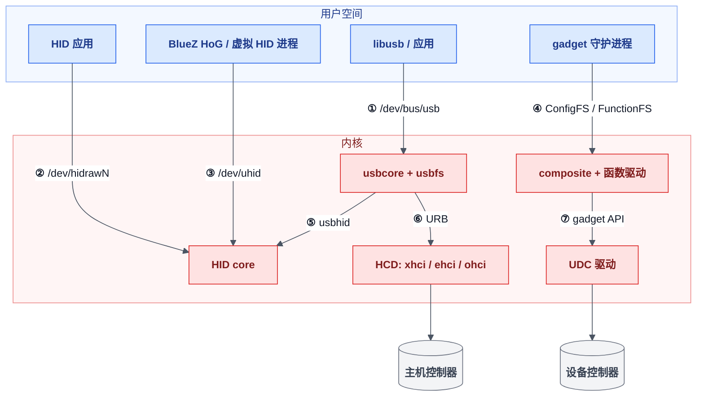

图中 ①–④ 是用户态入口，⑤–⑥ 是主机侧调用路径，⑦ 是设备侧；红色内核块都在同一内核镜像内。

- 主机侧：usbcore 负责枚举、配置选择、hub 与电源管理；设备驱动（`struct usb_driver`）通过提交 URB 让 HCD 执行传输 [L1]。
- HCD：`drivers/usb/host/Kconfig` 中有 `USB_XHCI_HCD`、`USB_XHCI_PCI`、`USB_XHCI_PLATFORM`（SoC 平台 xHCI）、EHCI/OHCI 等选项 [L22]。xHCI 还有 `USB_XHCI_DBGCAP`（xHCI Debug Capability，DbC）用于调试口 [L22][L25]。
- 设备侧（gadget）：UDC 驱动 ↔ gadget API ↔ gadget 驱动（多为 composite 框架上的函数驱动），可组成复合设备 [L14]。

## 用户态访问主机侧设备

| 方式 | 说明 | 来源 |
|---|---|---|
| usbfs | `/dev/bus/usb/BBB/DDD`，ioctl 族 `USBDEVFS_*`（claim 接口、控制/批量传输、异步 URB 等） | [L1] |
| libusb | 跨平台用户态库；在 Linux 上基于 usbfs | [L26]（项目官方站）|
| hidraw | 面向 HID 设备的原始报告读写，绕过输入子系统解析 | [L8] |
| hiddev | 面向“非输入类” HID 用途（如 UPS、电源）的事件/用途接口 | [L10] |

> 与 Windows 对照：usbfs ≈ WinUSB（用户态直接发 Control/Bulk/Interrupt）；hidraw ≈ `HidD_*`/`ReadFile` 走 hidclass 的原始报告路径。

**权限**：设备节点权限由 udev 规则决定（`SUBSYSTEM=="usb"`/`"hidraw"` + `ATTRS{idVendor}` 等匹配后设置 MODE/GROUP）[L27]。具体发行版默认规则 **待核实**（各发行版不同）。

## HID 子系统

- HID core 与传输驱动分离：传输驱动（USB、I2C、Bluetooth L2CAP、uhid）负责原始数据收发与设备管理，HID core 负责报告描述符解析和向上层（input、hidraw、hiddev）分发 [L11]。
- **uhid**：用户态实现“HID 传输驱动”，内核看到的就是一个真正的 HID 设备；示例程序在 `samples/uhid/uhid-example.c` [L9]。这是 Linux 上做**虚拟 HID**（不经过 USB）最直接的官方方式，相当于 Windows 的 VHF。
- **HID-BPF**：用 eBPF 程序在内核里修补/改写 HID 报告与描述符，替代编写小型 quirk 驱动 [L12]。
- **BLE HID (HoG)**：内核 HID 传输里列的是 Bluetooth L2CAP（经典 BR/EDR HID）[L11]；BLE 的 HID over GATT 由 BlueZ 在用户态实现，并通过 uhid 注入内核 [L23]。

## USB/IP（网络虚拟 USB）

报文格式、命令码与 UNLINK 语义见 [06-linux-virtual-usb.md](06-linux-virtual-usb.md)；那篇的“待确认项”称内核文档页未写端口号，本文的 3240 来自内核源码树的 `tools/usb/usbip/README`。

- 服务器端导出（export）设备，客户端导入（import）；客户端打开 TCP 连接并发送 `OP_REQ_DEVLIST` 等报文 [L6]。
- 当前使用 TCP 端口 3240 [L19]。
- 内核驱动位于 `drivers/usb/usbip/`（`usbip-host` 服务端、`vhci-hcd` 客户端虚拟主机控制器）[L19]。`vhci-hcd` 即“虚拟主机控制器”，是 Linux 版的“UDE 主机侧”。

## 电源管理

- 运行时 PM：sysfs `power/control`（`on`/`auto`）、`power/autosuspend_delay_ms`（默认 2000，0 表示立即挂起）[L2]。
- 全局默认：`usbcore.autosuspend=`（秒，默认 2，负值禁用）[L16]。
- 驱动需支持 `supports_autosuspend`，并用 `usb_autopm_get_interface()`/`usb_autopm_put_interface()` 管理引用计数 [L2]。
- 远程唤醒、reset-resume 等细节见 [L2]；`USB_QUIRK_RESET_RESUME`（quirk 字母 `b`）用于无法正确 resume 的设备 [L16]。

## Quirks 与安全

- `usbcore.quirks=` 可在运行时追加/翻转内建 quirk 表项 [L16]。
- 授权机制：`authorized`/`authorized_default` 可实现“默认拒绝新设备，人工放行”（类似 USBGuard 的基础）[L13]。

## 设备侧：Gadget 框架（虚拟 USB 研究的核心）

ConfigFS 属性、FunctionFS 挂载流程与 Raw Gadget ioctl 的逐条定义见 [06-linux-virtual-usb.md](06-linux-virtual-usb.md)；本节只讲选型与组合。

### 7.1 组成
- **UDC 驱动**：控制器硬件驱动（dwc3、dwc2、chipidea、cdns3、musb 等）[L14]。
- **Composite 框架 + 函数驱动**：一份设备可组合多个函数（HID、NCM/ECM、ACM、MSC、UVC、UAC、FunctionFS…）[L14][L18]。

### 7.2 ConfigFS（推荐的组装方式）
最小 HID gadget 流程（路径与属性名以官方文档为准）[L3]：
```sh
modprobe libcomposite
cd /sys/kernel/config/usb_gadget && mkdir g1 && cd g1
echo 0x1d6b > idVendor; echo 0x0104 > idProduct   # 示例 ID
mkdir -p strings/0x409 configs/c.1 functions/hid.usb0
echo 1 > functions/hid.usb0/protocol      # 1=键盘
echo 1 > functions/hid.usb0/subclass      # 1=Boot
echo 8 > functions/hid.usb0/report_length
cat my_report_desc.bin > functions/hid.usb0/report_desc
ln -s functions/hid.usb0 configs/c.1/
echo <udc name> > UDC                      # 名称取自 /sys/class/udc/
```
gadget 侧随后通过 `/dev/hidgN` 写输入报告 [L18]。

### 7.3 FunctionFS / GadgetFS / Raw Gadget 对比

| 接口 | 定位 | 描述符/请求处理 | 适用 | 来源 |
|---|---|---|---|---|
| FunctionFS | 作为 composite 中的一个函数，用户态实现该函数（ep0 写描述符，epN 读写数据） | 用户态提供描述符；内核 composite 处理标准请求 | 生产（Android 的 adb/MTP 均用它） | [L4] |
| GadgetFS | 用户态实现整个 gadget | 内核对描述符做合法性检查，部分请求内部应答，绑定第一个可用 UDC | 生产 | [L5] |
| Raw Gadget | 最底层：每个 USB 请求都交给用户态，可返回任意（含畸形）数据，可选择绑定哪个 UDC，多实例 | 不做检查 | **仅调试/模糊测试** | [L5] |

### 7.4 dummy_hcd：无硬件的虚拟 USB 回环
- 一个“假 HCD + 假 UDC”对：主机侧的传输请求回环到同机的 gadget 驱动，可在没有 OTG 硬件的 PC 上开发 gadget [L20]。
- 支持 HS（默认）与 SuperSpeed（`is_super_speed=1`）；`num` 可建多个实例 [L21]。
- 典型组合：`dummy_hcd` + ConfigFS HID → 本机即出现一个“真实”USB HID 设备，可用 usbmon 抓包、测试主机侧驱动；`dummy_hcd` + Raw Gadget → 主机 USB 栈模糊测试（官方文档说明 Raw Gadget 适合 fuzzing）[L5]。

## Type-C / 角色切换（概要，细节见 ARM 篇）

- typec class 为每个 Type-C 端口在 sysfs 中建模（端口、伙伴、线缆、Alt Mode）[L15]。
- TCPM：软件实现 Type-C/PD 状态机，配合 TCPCI 等端口控制器；Kconfig 自动选择 `USB_ROLE_SWITCH` [L24]。
- UCSI：由 EC/PD 控制器固件实现策略，OS 通过 UCSI 接口获取状态（PC 平台常见）[L24]。
- USB Role Switch：选择端口为 host 或 device 的抽象（`drivers/usb/roles/`）[L24]。

## 调试工具

| 工具 | 用途 | 来源 |
|---|---|---|
| usbmon | 内核 USB 抓包，文本/二进制 API，`/sys/kernel/debug/usb/usbmon/Nu` | [L7] |
| Wireshark + usbmon | 图形化解析；部分发行版用 udev 规则把 `/dev/usbmonX` 交给 `usbmon` 组 | [L28] |
| xHCI DbC | 通过 USB3 调试口做内核调试/控制台 | [L25] |
| `lsusb -v`、`/sys/bus/usb/devices/*` | 描述符与属性查看 | usbutils 项目（**待核实**：未逐项核对其官方文档）|
| ftrace/动态调试 | `dyndbg` 打开 usbcore/xhci 日志 | **待核实**（未在本轮官方文档中逐条核对）|

## 与 Windows 的映射（速查）

| Windows | Linux 对应 | 备注 |
|---|---|---|
| Usbxhci.sys / UcxCx / Usbhub3.sys | xhci-hcd / usbcore hub 驱动 | [L22][W1] |
| WinUSB.sys + WinUsb_* | usbfs + libusb | [L1][W2] |
| KMDF USB 客户端驱动 | `struct usb_driver` 内核模块 | [L17] |
| hidclass + hidusb | HID core + usbhid | [L11][W3] |
| VHF（虚拟 HID 框架） | uhid | [L9][W4] |
| UDE/UdeCx（模拟主机控制器+设备） | dummy_hcd / vhci-hcd(usbip) | [L20][L19][W5] |
| UFX（USB 功能控制器） | gadget/UDC 框架 | [L14][W6] |
| Selective Suspend | runtime PM autosuspend | [L2][W7] |
| USB ETW / USBPcap | usbmon + Wireshark | [L7][W8] |

## 参考来源

### 来源组 1

- [L1] Linux USB API（usbcore、URB、usbfs）https://docs.kernel.org/driver-api/usb/usb.html
- [L2] USB 电源管理 https://docs.kernel.org/driver-api/usb/power-management.html
- [L3] Linux USB gadget configured through configfs https://docs.kernel.org/usb/gadget_configfs.html
- [L4] How FunctionFS works https://docs.kernel.org/usb/functionfs.html
- [L5] USB Raw Gadget https://docs.kernel.org/usb/raw-gadget.html
- [L6] USB/IP protocol https://docs.kernel.org/usb/usbip_protocol.html
- [L7] usbmon https://docs.kernel.org/usb/usbmon.html
- [L8] HIDRAW https://docs.kernel.org/hid/hidraw.html

### 来源组 2

- [L9] UHID https://docs.kernel.org/hid/uhid.html
- [L10] HIDDEV https://docs.kernel.org/hid/hiddev.html
- [L11] HID I/O Transport Drivers https://docs.kernel.org/hid/hid-transport.html
- [L12] HID-BPF https://docs.kernel.org/hid/hid-bpf.html
- [L13] Authorizing (or not) your USB devices https://docs.kernel.org/usb/authorization.html
- [L14] USB Gadget API for Linux https://docs.kernel.org/driver-api/usb/gadget.html
- [L15] USB Type-C connector class https://docs.kernel.org/driver-api/usb/typec.html
- [L16] kernel-parameters.txt（usbcore.autosuspend / usbcore.quirks）https://github.com/torvalds/linux/blob/master/Documentation/admin-guide/kernel-parameters.txt

### 来源组 3

- [L17] Writing USB Device Drivers https://docs.kernel.org/driver-api/usb/writing_usb_driver.html
- [L18] Gadget testing（各 ConfigFS 函数用法，含 hid）https://docs.kernel.org/usb/gadget-testing.html
- [L19] tools/usb/usbip/README（TCP 3240）https://github.com/torvalds/linux/blob/master/tools/usb/usbip/README ；驱动目录 https://github.com/torvalds/linux/tree/master/drivers/usb/usbip
- [L20] drivers/usb/gadget/udc/Kconfig（USB_DUMMY_HCD）https://github.com/torvalds/linux/blob/master/drivers/usb/gadget/udc/Kconfig
- [L21] drivers/usb/gadget/udc/dummy_hcd.c（模块参数）https://github.com/torvalds/linux/blob/master/drivers/usb/gadget/udc/dummy_hcd.c
- [L22] drivers/usb/host/Kconfig https://github.com/torvalds/linux/blob/master/drivers/usb/host/Kconfig
- [L23] BlueZ profiles/input/hog.c（包含 src/shared/uhid.h）https://github.com/bluez/bluez/blob/master/profiles/input/hog.c
- [L24] drivers/usb/typec/tcpm/Kconfig、typec/ucsi/Kconfig、drivers/usb/roles/Kconfig https://github.com/torvalds/linux/tree/master/drivers/usb/typec

### 来源组 4

- [L25] USB3 debug port（xHCI DbC）https://docs.kernel.org/driver-api/usb/usb3-debug-port.html
- [L26] libusb 官方站 https://libusb.info/
- [L27] systemd udev 手册 https://www.freedesktop.org/software/systemd/man/latest/udev.html
- [L28] Wireshark Wiki: CaptureSetup/USB https://wiki.wireshark.org/CaptureSetup/USB
- [W1]–[W8] 见 `12-cross-platform-comparison.md` 的 Windows 参考来源。

## 待确认项

- [ ] …标记 **待核实** 的内容未能从官方来源确认，不要当作事实引用。…
- [ ] …"`/`"hidraw"` + `ATTRS{idVendor}` 等匹配后设置 MODE/GROUP）[L27]。具体发行版默认规则 **待核实**（各发行版不同）。…
- [ ] …`lsusb -v`、`/sys/bus/usb/devices/*` | 描述符与属性查看 | usbutils 项目（**待核实**：未逐项核对其官方文档）…
- [ ] …ftrace/动态调试 | `dyndbg` 打开 usbcore/xhci 日志 | **待核实**（未在本轮官方文档中逐条核对）…


<!-- FILE: 08-arm-embedded-usb.md -->

# 架构文档：ARM / 嵌入式 USB（SoC 控制器、设备树、双角色与 MCU 栈）

> 类型：arch ｜ 模式：Reverse ｜ 代码基线：`torvalds/linux master（Kconfig 与 DT binding）；TinyUSB README` ｜ 最后核对：2026-11-28 ｜ 范围：`drivers/usb/{dwc2,dwc3,chipidea,musb,cdns3,typec,roles}, Documentation/devicetree/bindings/usb, hathach/tinyusb` ｜ lang: zh

## Overview

ARM 在 USB 层没有独立 OS 栈：Linux/Android 跑在 ARM SoC 上时，差异集中在 **5 类控制器 IP**（DWC2、DWC3、ChipIdea、MUSB、Cadence）、设备树描述（`dr_mode` 未指定时默认 `otg`）、双角色切换和 Type-C 管理；MCU 上则是 TinyUSB 等裸机/RTOS 协议栈。

**TL;DR**

- 控制器 IP 决定驱动：dwc2/dwc3/ci_hdrc/musb-hdrc/cdns3；主机侧 USB3 类走 xhci-plat。
- 角色链路：连接器 → TCPM 或 UCSI → Role Switch → 双角色控制器。
- 同一 IP 在 Linux 与 TinyUSB 都有驱动，寄存器模型一致，是从固件迁到内核驱动研究的入口。
- Synopsys、Cadence、Mentor 的 Databook 需 NDA，本文不引用，寄存器细节以 Linux 驱动与 binding 为准。
- 虚拟 USB 与 gadget 的做法见 [07-linux-usb-stack.md](07-linux-usb-stack.md) 与 [06-linux-virtual-usb.md](06-linux-virtual-usb.md)。

蓝 = 用户空间应用，红 = 内核/系统级驱动，绿 = 用户态驱动或守护进程，橙 = 系统框架，灰 = 硬件与外部。

## 核心事实 Key Facts（已核对）

| # | 事实 | 值 / 说明 | 来源 |
|---|---|---|---|
| 1 | DWC2 | Synopsys DesignWare **HS OTG USB 2.0** 控制器（Hi-Speed 双角色），Linux 驱动 `dwc2.ko`，Kconfig 选择 `USB_ROLE_SWITCH` | [A1][A6] |
| 2 | DWC3 | DesignWare **USB3 DRD** 控制器（SuperSpeed 双角色）；主机模式复用 `xhci-plat`（`select USB_XHCI_PLATFORM`）| [A2][A7] |
| 3 | DWC3 DT 结构 | 通常是厂商 glue 节点下的子节点，也可作为独立节点（`compatible = "snps,dwc3"`）| [A7] |
| 4 | ChipIdea | Highspeed 双角色控制器，支持 ID/OTG FSM/sysfs 角色切换、仅主机、仅外设 | [A3] |
| 4.2 | ChipIdea | 模块 `ci_hdrc.ko` | [A3] |
| 4.3 | ChipIdea | 主机侧依赖 EHCI | [A3] |
| 5 | MUSB | Mentor Graphics Inventra (M)HDRC 高速双角色控制器 | [A4] |
| 5.2 | MUSB | TI DaVinci/OMAP3、Allwinner A10/A13/A20 等使用 | [A4] |
| 5.3 | MUSB | 模块 `musb-hdrc` | [A4] |
| 6 | Cadence | USBSS（USB 3.0）与 USBSSP（SuperSpeed Plus gen2x1）DRD 控制器，共享 DRD/OTG 寄存器接口，驱动运行时识别；主机侧走 xHCI platform | [A5][A8] |
| 7 | `dr_mode` | 取值 `host` / `peripheral` / `otg`，**未指定时默认 `otg`** | [A9] |
| 8 | `usb-role-switch` | 布尔属性，表示控制器可为连接器分配数据角色；`role-switch-default-mode` 取值 host/peripheral，默认 `peripheral`（角色为 NONE 时）| [A9] |
| 9 | `otg-rev` | OTG 修订号（如 `<0x0200>`），与 HNP/SRP/ADP 特性相关 | [A9] |
| 10 | `maximum-speed` | low-speed … super-speed-plus-gen2x2；未指定时按硬件最大能力 | [A10] |
| 11 | 连接器节点 | `compatible` 为 `usb-a-connector` / `usb-b-connector` / `usb-c-connector`；Type-C 属性 `power-role`(source/sink/dual)、`try-power-role`、`data-role`(host/device/dual)、`source-pdos`、`sink-pdos`、`op-sink-microwatt` 等 | [A11] |
| 12 | TCPM | `CONFIG_TYPEC_TCPM`：USB Type-C Port Controller Manager（软件状态机），select `USB_ROLE_SWITCH` 与 `POWER_SUPPLY` | [A12] |
| 13 | USB Role Switch 抽象 | 选择端口为 host 或 device 的设备；多数情况下双角色控制器自身即开关，也可能是在独立主机/设备控制器间切换数据线的 mux | [A13] |
| 14 | TinyUSB 设计 | 无动态内存分配 | [A14] |
| 14.2 | TinyUSB 设计 | 所有中断事件排队到非 ISR 任务处理（线程安全） | [A14] |
| 14.3 | TinyUSB 设计 | 支持 50+ MCU 家族 | [A14] |
| 14.4 | TinyUSB 设计 | 可裸机或 FreeRTOS/RT-Thread/Mynewt | [A14] |

## SoC 里的角色链路：连接器到控制器

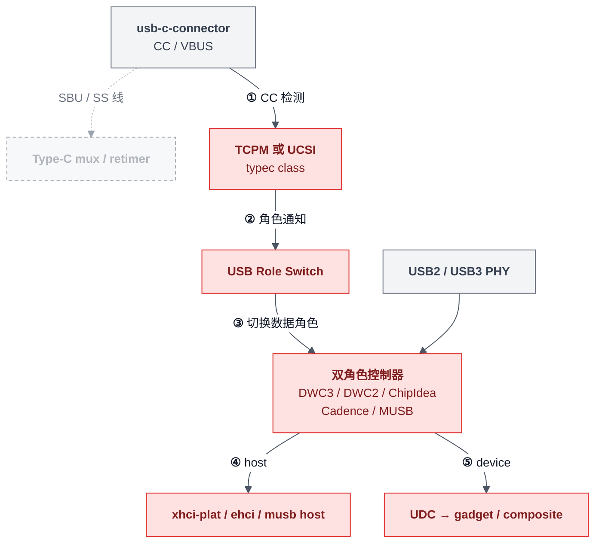

① 到 ③ 是 Type-C 角色协商链，④ 与 ⑤ 是控制器按角色选择的两条路；虚线是数据线复用，不走角色链。

- 控制器：IP 核（DWC2/DWC3/ChipIdea/MUSB/Cadence）+ 厂商 glue（时钟、复位、电源、wrapper 寄存器）[A7][A3]。
- PHY：DT 中通过 `phys`/`phy-names` 引用（例：DWC3 的 `usb2-phy`/`usb3-phy`）[A15]。
- 角色管理：ID 引脚/extcon、OTG FSM、Type-C（TCPM/UCSI）→ Role Switch → 控制器 [A3][A12][A13]。

## 控制器 IP 对比

| IP | 最高速率 | 主机侧实现 | 设备侧 | Linux 目录 | 常见用途 | 来源 |
|---|---|---|---|---|---|---|
| DWC2 (HSOTG) | USB 2.0 HS | DWC2 自有主机驱动 | dwc2 gadget | `drivers/usb/dwc2` | 树莓派 BCM2835、Rockchip、Ingenic 等 | [A1][A6] |
| DWC3 | USB 3.x（SS/SSP，具体以 SoC 为准）| xhci-plat | dwc3 gadget | `drivers/usb/dwc3` | 主流手机/平板/开发板 SoC | [A2][A7] |
| ChipIdea | USB 2.0 HS | EHCI | ci_hdrc UDC | `drivers/usb/chipidea` | NXP i.MX 等（**待核实**：具体 SoC 列表以 binding 的 compatible 为准） | [A3][A16] |
| MUSB | USB 2.0 HS | musb host | musb gadget | `drivers/usb/musb` | TI、Allwinner | [A4] |
| Cadence USBSS/USBSSP | USB 3.0 / 3.1 Gen2x1 | xhci-plat | cdns3 gadget | `drivers/usb/cdns3` | TI J7、NXP i.MX8 等（**待核实**） | [A5][A8] |

## 设备树（DT）关键片段

DWC3 双角色 + Type-C 连接器（字段名均来自官方 binding；节点地址与 glue 属性因 SoC 而异）[A7][A9][A11]：
```dts
usb@a600000 {
    compatible = "snps,dwc3";
    dr_mode = "otg";            /* host | peripheral | otg(默认) */
    usb-role-switch;
    role-switch-default-mode = "peripheral";
    maximum-speed = "super-speed";
    phys = <&usb2_phy>, <&usb3_phy>;
    phy-names = "usb2-phy", "usb3-phy";
    port { dwc3_hs_ep: endpoint { remote-endpoint = <&conn_hs_ep>; }; };
};

connector {
    compatible = "usb-c-connector";
    power-role = "dual";        /* source | sink | dual(DRP) */
    try-power-role = "sink";
    data-role = "dual";         /* host | device | dual(DRD) */
    source-pdos = <PDO_FIXED(5000, 2000, PDO_FIXED_USB_COMM)>;
    sink-pdos = <PDO_FIXED(5000, 3000, PDO_FIXED_USB_COMM)>;
    op-sink-microwatt = <10000000>;
};
```
- `usb-role-switch` 与 OF graph（`port`/`endpoint`）一起使用，把控制器与连接器/Type-C 控制器连接起来 [A15][A9]。
- 一些 DWC3 quirk 属性（如 `snps,dis_u3_susphy_quirk`）用于规避特定 SoC 的问题，属性全表见 `snps,dwc3-common.yaml` [A15]。

## OTG、DRD 与角色切换

- **OTG**（On-The-Go 规范）：HNP/SRP/ADP，由 `otg-rev` 声明 [A9]。现代手机多用 Type-C 的 DRP/DRD，而非 OTG HNP（**待核实**：属行业惯例，无单一官方出处）。
- **DRD**：控制器同时具备主机与设备功能；切换来源可以是 ID 引脚（Micro-AB）、extcon、sysfs（ChipIdea 支持）或 Role Switch [A3][A13]。
- **Type-C**：CC 检测 → TCPM（软件 PD 状态机，适合无独立 PD 固件的嵌入式）或 UCSI（PD 固件在 EC/控制器里，OS 只读状态/下命令）→ 通知 Role Switch 与 power_supply [A12][A17]。
- 用户可见接口：typec class 在 sysfs 中呈现端口/伙伴/线缆/Alt Mode，可读写数据角色与电源角色 [A17]。

## MCU 协议栈（上下文）

| 协议栈 | 维护方 | 特点（官方描述） | 来源 |
|---|---|---|---|
| TinyUSB | 开源项目（hathach/tinyusb） | 设备栈：UAC1/2、BT HCI、CDC、DFU、HID（通用/键盘/鼠标/手柄）、Printer、MSC 多 LUN、MIDI、MTP/PTP、RNDIS/ECM/NCM、USBTMC、UVC（WIP）、Vendor+WebUSB（可配合 MS OS 2.0 描述符免 INF 加载 WinUSB） | [A14] |
| TinyUSB | 开源项目（hathach/tinyusb） | 主机栈：CDC-ACM、常见 USB 串口芯片、HID、MSC、MIDI、多级 Hub | [A14] |
| TinyUSB | 开源项目（hathach/tinyusb） | PD3.0 栈仍处早期且仅 STM32G4 | [A14] |
| STM32Cube USB Device | STMicroelectronics | STM32Cube MCU 中间件的 USB Device 库，覆盖全部 STM32 系列 | [A18] |
| Eclipse ThreadX USBX | Eclipse 基金会 | 高性能 USB host/device/OTG 嵌入式协议栈，与 ThreadX RTOS 集成 | [A19] |
| Zephyr USB、Nordic nRF Connect SDK、ESP-IDF（ESP32-S2/S3 等使用 TinyUSB） | 各厂商/基金会 | 本轮未能抓取官方页面全文，**待核实** | — |

TinyUSB 的驱动层可直接对应 SoC/MCU 的控制器 IP：`dwc2`、`musb`、`ci_hs`（ChipIdea HS）、`fsdev`（STM32 FS 设备）、`rp2040`、`nrf5x` 等均出现在其支持表中 [A14]。这意味着**同一 IP（如 DWC2）在 Linux 由 dwc2.ko 驱动、在 MCU 上由 TinyUSB dwc2 端口驱动**，寄存器模型一致，是从固件迁移到 Linux 驱动研究的好切入点。

## 虚拟 USB / 设备模式在 ARM 上

- 有 UDC 的 ARM 板（DWC2/DWC3/ChipIdea/MUSB/Cadence）可直接跑 Linux gadget（ConfigFS/FunctionFS/Raw Gadget），把板子变成任意 USB 设备（HID、NCM、UVC…）——方法见 [07-linux-usb-stack.md](07-linux-usb-stack.md) 的“设备侧”节。
- 没有 UDC 的环境用 dummy_hcd 做回环（见 [07-linux-usb-stack.md](07-linux-usb-stack.md) 的“dummy_hcd”小节）。

## BLE / HID-over-GATT

- ARM Linux 与 x86 Linux 相同：BlueZ 用户态 HoG + uhid（见 [07-linux-usb-stack.md](07-linux-usb-stack.md) 的“HID 子系统”节）[A20]。
- MCU 侧（作为 HID 外设）通常由 SoC 厂商 BLE 协议栈实现 HOGP Device 角色；本轮未核对各厂商文档，**待核实**。

## 参考来源

### 来源组 1

- [A1] drivers/usb/dwc2/Kconfig https://github.com/torvalds/linux/blob/master/drivers/usb/dwc2/Kconfig
- [A2] drivers/usb/dwc3/Kconfig https://github.com/torvalds/linux/blob/master/drivers/usb/dwc3/Kconfig
- [A3] drivers/usb/chipidea/Kconfig https://github.com/torvalds/linux/blob/master/drivers/usb/chipidea/Kconfig
- [A4] drivers/usb/musb/Kconfig https://github.com/torvalds/linux/blob/master/drivers/usb/musb/Kconfig
- [A5] drivers/usb/cdns3/Kconfig https://github.com/torvalds/linux/blob/master/drivers/usb/cdns3/Kconfig
- [A6] DT binding dwc2.yaml（title: DesignWare HS OTG USB 2.0 controller）https://github.com/torvalds/linux/blob/master/Documentation/devicetree/bindings/usb/dwc2.yaml
- [A7] DT binding snps,dwc3.yaml https://github.com/torvalds/linux/blob/master/Documentation/devicetree/bindings/usb/snps,dwc3.yaml ；驱动文档 https://docs.kernel.org/driver-api/usb/dwc3.html
- [A8] DT binding cdns,usb3.yaml https://github.com/torvalds/linux/blob/master/Documentation/devicetree/bindings/usb/cdns,usb3.yaml

### 来源组 2

- [A9] DT binding usb-drd.yaml https://github.com/torvalds/linux/blob/master/Documentation/devicetree/bindings/usb/usb-drd.yaml
- [A10] DT binding usb.yaml https://github.com/torvalds/linux/blob/master/Documentation/devicetree/bindings/usb/usb.yaml
- [A11] DT binding connector/usb-connector.yaml https://github.com/torvalds/linux/blob/master/Documentation/devicetree/bindings/connector/usb-connector.yaml
- [A12] drivers/usb/typec/tcpm/Kconfig https://github.com/torvalds/linux/blob/master/drivers/usb/typec/tcpm/Kconfig
- [A13] drivers/usb/roles/Kconfig https://github.com/torvalds/linux/blob/master/drivers/usb/roles/Kconfig
- [A14] TinyUSB README https://github.com/hathach/tinyusb/blob/master/README.rst ；文档 https://docs.tinyusb.org/
- [A15] DT binding snps,dwc3-common.yaml https://github.com/torvalds/linux/blob/master/Documentation/devicetree/bindings/usb/snps,dwc3-common.yaml
- [A16] DT binding chipidea,usb2-common.yaml / ci-hdrc-usb2.yaml https://github.com/torvalds/linux/tree/master/Documentation/devicetree/bindings/usb

### 来源组 3

- [A17] USB Type-C connector class https://docs.kernel.org/driver-api/usb/typec.html ；UCSI Kconfig https://github.com/torvalds/linux/blob/master/drivers/usb/typec/ucsi/Kconfig
- [A18] STMicroelectronics stm32-mw-usb-device https://github.com/STMicroelectronics/stm32_mw_usb_device
- [A19] Eclipse ThreadX USBX https://github.com/eclipse-threadx/usbx
- [A20] BlueZ profiles/input/hog.c https://github.com/bluez/bluez/blob/master/profiles/input/hog.c

## 待确认项

- [ ] …B 2.0 HS | EHCI | ci_hdrc UDC | `drivers/usb/chipidea` | NXP i.MX 等（**待核实**：具体 SoC 列表以 binding 的 compatible 为准） | [A3][A16]…
- [ ] … xhci-plat | cdns3 gadget | `drivers/usb/cdns3` | TI J7、NXP i.MX8 等（**待核实**） | [A5][A8]…
- [ ] …：HNP/SRP/ADP，由 `otg-rev` 声明 [A9]。现代手机多用 Type-C 的 DRP/DRD，而非 OTG HNP（**待核实**：属行业惯例，无单一官方出处）。…
- [ ] …nnect SDK、ESP-IDF（ESP32-S2/S3 等使用 TinyUSB） | 各厂商/基金会 | 本轮未能抓取官方页面全文，**待核实** | —…
- [ ] …MCU 侧（作为 HID 外设）通常由 SoC 厂商 BLE 协议栈实现 HOGP Device 角色；本轮未核对各厂商文档，**待核实**。…


<!-- FILE: 09-macos-usb.md -->

# 架构文档：macOS USB 栈（IOKit、DriverKit 系统扩展与 HID 路径）

> 类型：arch ｜ 模式：Reverse ｜ 代码基线：`developer.apple.com 文档 JSON 与 support.apple.com（2026-11-28 抓取）` ｜ 最后核对：2026-11-28 ｜ 范围：`IOUSBHost, DriverKit, USBDriverKit, HIDDriverKit, SystemExtensions, CoreHID, IOHIDManager` ｜ lang: zh

## Overview

macOS 11（Big Sur）起不再支持 **IOUSBFamily 与 IOHIDFamily 的全部 KPI**，第三方 USB/HID 驱动改为用户态 DriverKit 扩展（dext），分发要走 entitlement 申请、Developer ID 签名与公证。读者是 Windows 驱动背景、想做 macOS 虚拟 HID 或自定义 USB 驱动的工程师。来源只用 developer.apple.com 与 support.apple.com，Apple 未公开的内核实现标 **待核实**。

**TL;DR**

- 免驱动访问：IOUSBHost 框架（macOS 10.15+）与 IOHIDManager；CoreHID 需 macOS 15+。
- 写驱动：USBDriverKit / HIDDriverKit，需向 Apple 申请 DriverKit entitlement。
- 虚拟 HID：CoreHID `HIDVirtualDevice` 或 HIDDriverKit，都要对应 entitlement。
- 没有面向第三方的 USB 设备（gadget）模式 API（否定性结论，**待核实**）。

蓝 = 用户空间应用，红 = 内核/系统级驱动，绿 = 用户态驱动或守护进程，橙 = 系统框架，灰 = 硬件与外部。

## 核心事实 Key Facts（已核对）

| # | 事实 | 值 / 说明 | 来源 |
|---|---|---|---|
| 1 | IOUSBHost 框架 | 在**用户空间**为 USB 设备写 host-mode 驱动（访问自定义/非类兼容设备） | [M1] |
| 1.2 | IOUSBHost 框架 | macOS 10.15+，Mac Catalyst 14+ | [M1] |
| 1.3 | IOUSBHost 框架 | 核心类 IOUSBHostDevice、IOUSBHostInterface、IOUSBHostPipe、IOUSBHostStream | [M1] |
| 2 | DriverKit | 驱动运行在用户空间，以扩展形式随 App 分发 | [M2] |
| 2.2 | DriverKit | macOS 10.15+，iOS/iPadOS 16+ 有 DriverKit 框架 | [M2] |
| 2.3 | DriverKit | macOS 用 SystemExtensions 框架安装/升级，iPadOS 由系统随宿主 App 自动发现与升级 | [M2] |
| 3 | DriverKit 支持的传输 | USB、PCI、HID、网络、串口 | [M7] |
| 4 | USBDriverKit | 为自定义或非类兼容 USB 设备开发驱动 | [M3] |
| 4.2 | USBDriverKit | 可用于 Intel 与 Apple silicon 的 macOS，以及 **M 系列芯片的 iPadOS** | [M3] |
| 4.3 | USBDriverKit | 提供 IOUSBHostDevice / IOUSBHostInterface / IOUSBHostPipe 等 provider | [M3] |
| 5 | HIDDriverKit | 键盘、指点设备、数字化仪等 HID 驱动；**仅 macOS**（10.15+） | [M4] |
| 6 | 内核扩展淘汰 | 自 macOS Big Sur 起默认不再加载使用已弃用 KPI 的 kext | [M8] |
| 6.2 | 内核扩展淘汰 | **IOUSBFamily 全部 KPI 在 Big Sur 不再支持**（应迁到 IOUSBHostFamily 或 USBDriverKit） | [M8] |
| 6.3 | 内核扩展淘汰 | **IOHIDFamily 全部 KPI 在 Big Sur 不再支持**（应改用 HIDDriverKit） | [M8] |
| 7 | 关键 entitlement | `com.apple.developer.driverkit`（允许作为用户态驱动运行） | [M7][M9] |
| 7.2 | 关键 entitlement | `com.apple.developer.driverkit.transport.usb`（字典数组，键名为设备描述符字段名，用于声明匹配的 USB 设备） | [M7][M9] |
| 7.3 | 关键 entitlement | `com.apple.developer.driverkit.transport.hid` | [M7][M9] |
| 7.4 | 关键 entitlement | `com.apple.developer.driverkit.family.hid.device` | [M7][M9] |
| 7.5 | 关键 entitlement | `com.apple.developer.driverkit.family.hid.eventservice` | [M7][M9] |
| 7.6 | 关键 entitlement | `com.apple.developer.driverkit.userclient-access` | [M7][M9] |
| 7.7 | 关键 entitlement | `com.apple.developer.driverkit.allow-any-userclient-access` | [M7][M9] |
| 7.8 | 关键 entitlement | 安装方 App 需 `com.apple.developer.system-extension.install` | [M7][M9] |
| 8 | 虚拟 HID entitlement | `com.apple.developer.hid.virtual.device`（驱动创建虚拟 HID 设备）；`com.apple.developer.driverkit.family.hid.virtual.device`（App 创建并管理虚拟 HID 设备） | [M9] |
| 9 | Entitlement 申请 | 需向 Apple 申请 DriverKit entitlement，并提供硬件 vendor ID、设备与安装 App 描述 | [M7] |
| 9.2 | Entitlement 申请 | 同一产品的 entitlement 须属于同一组 | [M7] |
| 9.3 | Entitlement 申请 | 获批前可关闭安全检查在本机开发 | [M7] |
| 10 | 开发模式 | `systemextensionsctl developer on` 让系统不检查扩展位置；示例工程的自动签名流程要求临时关闭 SIP | [M10][M11] |
| 11 | 公证 | Developer ID 签名软件可提交 Apple notary service 自动扫描，生成 ticket 供 Gatekeeper 校验；kext 等非 App bundle 也可公证 | [M12] |
| 12 | IOHIDManager | IOKit 的 HID 管理对象：设备发现/移除回调、输入报告回调、输入值回调、匹配条件、run loop 调度 | [M5] |
| 13 | CoreHID | **macOS 15+**；可发现 HID 设备、收输入、发请求（如点灯），并可用 `HIDVirtualDevice` 模拟 HID 设备（如虚拟手柄）| [M6] |
| 14 | Apple silicon 笔记本配件授权 | 新/未知的 USB、Thunderbolt 配件或 SD 卡需用户允许 | [M13] |
| 14.2 | Apple silicon 笔记本配件授权 | 默认“新配件询问” | [M13] |
| 14.3 | Apple silicon 笔记本配件授权 | 锁定 3 天以上可能需解锁后才能用已允许的配件 | [M13] |
| 14.4 | Apple silicon 笔记本配件授权 | 拒绝后仍可充电 | [M13] |

## 架构分层：App、dext 与内核三层

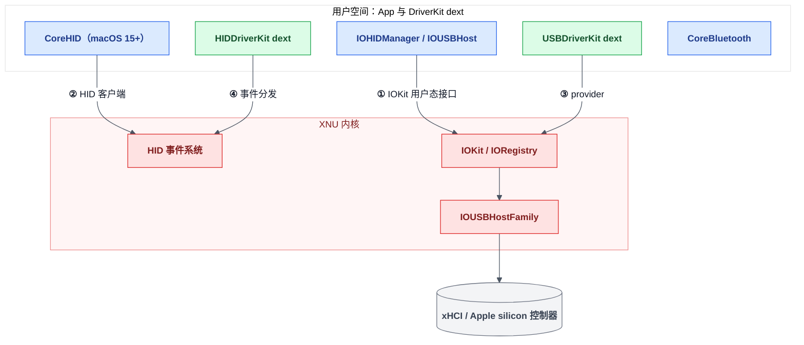

① 与 ② 是不写驱动的路径，③ 与 ④ 是 dext 路径；dext 虽在用户态，仍通过 IOKit 服务平面与内核对话。

- IOKit 以“驱动匹配 + IORegistry 树”为核心；USB 设备与接口作为服务出现在 service plane，IOUSBHost 框架为设备与接口类定义了 service plane 属性 [M1][M14]。
- DriverKit 驱动以 IOService 子类实现，provider 是 USBDriverKit 提供的设备/接口对象 [M3]。

## 用户态访问（不写驱动）

| 路径 | 用途 | 平台 | 来源 |
|---|---|---|---|
| IOUSBHost 框架（ObjC/Swift） | 用户态 claim 设备/接口、取描述符、发控制/批量/中断/等时请求，管理 stream | macOS 10.15+ | [M1] |
| IOHIDManager / IOHIDDevice（IOKit C API） | 枚举 HID 设备、收输入报告/值、发 Output/Feature 报告 | macOS | [M5] |
| CoreHID（Swift） | 新一代 HID 客户端 API + 虚拟 HID 设备 | macOS 15+ | [M6] |
| libusb | 跨平台库（在 macOS 上基于 IOKit） | — | 项目官方站 https://libusb.info/ ；实现细节**待核实** |

> 读取键盘类 HID 输入通常还受隐私权限（“输入监控”）约束，API `IOHIDRequestAccess` 等细节本轮未能抓取官方页面，**待核实**。

## 驱动开发：DriverKit 系统扩展（dext）

1. **项目结构**：dext 放在 App bundle 的指定目录，由 App 用 SystemExtensions 框架激活；App 需 `com.apple.developer.system-extension.install` [M7][M9][M15]。
2. **匹配**：driver 的 entitlement `com.apple.developer.driverkit.transport.usb` 列出它支持的设备（键为设备描述符字段名，如厂商 ID/产品 ID）[M9]；Info.plist 中 IOKitPersonalities 的具体写法以 Xcode 模板为准（**待核实**：本轮未逐键核对）。
3. **USB I/O**：在 IOUSBHostInterface 上打开 pipe（IOUSBHostPipe）进行传输 [M3]。
4. **与 App 通信**：通过 user client（IOUserClient 子类），需 `userclient-access` 或 `allow-any-userclient-access` entitlement；官方示例演示了带输入校验的标量/结构体调用和异步回调 [M9][M16]。
5. **开发调试**：`systemextensionsctl developer on`；必要时临时关闭 SIP（仅开发机）[M10][M11]。
6. **发布**：Developer ID 签名 + 公证（Gatekeeper 校验 ticket）[M12]；用户首次安装需在“隐私与安全性”中允许 [M16]。

### HIDDriverKit 要点
- 类：IOUserHIDDevice（HID 设备 provider 基类相关）、IOUserHIDEventService / IOUserHIDEventDriver（向系统分发键盘、数字化仪、滚动、指针事件）、IOUserUSBHostHIDDevice（支持 HID 交互的 USB 设备 provider）等 [M4]。
- 用于：修正非标准报告描述符、把厂商报告转成系统事件、实现虚拟 HID（配合虚拟 HID entitlement）[M4][M9]。

## HID 路径对比（macOS）

| 场景 | 推荐 API | 说明 |
|---|---|---|
| App 读写自家 HID 设备（如鼠标配置工具） | IOHIDManager / IOHIDDevice，或 CoreHID（macOS 15+） | 无需驱动；Feature/Output 报告读写 [M5][M6] |
| 改变系统对设备的解释 | HIDDriverKit dext | 需 entitlement 与用户批准 [M4][M7] |
| 虚拟键鼠/手柄（测试、远控） | CoreHID `HIDVirtualDevice`（macOS 15+）或 HIDDriverKit 虚拟设备 | 均需虚拟 HID entitlement [M6][M9] |
| BLE HID 外设 | 系统蓝牙栈作为 HoG 主机，设备出现在 HID 系统中（**待核实**：Apple 未在本轮抓取页面中描述 HoG 内部实现）；自定义 GATT 服务用 CoreBluetooth（macOS 10.10+） | [M17] |

## 虚拟 USB / 设备模式

- macOS **没有面向第三方的 USB 设备（gadget）模式 API**：本轮在 IOUSBHost/USBDriverKit 文档中只看到 host-mode 能力 [M1][M3]（“完全没有”属于否定性结论，**待核实**）。
- IOUSBHost 框架中存在 `IOUSBHostControllerInterface` 类（macOS 10.15+ 标注），从命名看与用户态主机控制器接口相关，但官方页面无说明文字，用途 **待核实** [M18]。
- 虚拟 HID 是官方支持的方向：CoreHID HIDVirtualDevice / HIDDriverKit [M6][M4]。

## 电源管理

- USB 设备电源/挂起策略由系统管理，DriverKit 驱动通过 IOService 电源接口参与；本轮未抓取具体 API 文档，**待核实**。

## 安全与权限（Apple silicon 特有项）

- 便携 Mac（Apple silicon）配件授权：可在“系统设置 › 隐私与安全性 › 配件”选择“始终询问 / 新配件询问（默认）/ 解锁时自动允许 / 始终允许”；受监管设备可由管理员用 Apple Configurator 控制 [M13]。
- Apple 平台安全指南：iPad、iPhone 与 Apple silicon 便携 Mac 上，若近期无数据连接，需 Face ID/Touch ID/密码才能激活 Thunderbolt、USB 等数据连接 [M19]。
- 锁定模式（Lockdown Mode）下，Apple silicon 笔记本连接配件须解锁且显式批准 [M20]。

## 调试工具

| 工具 | 用途 | 来源 |
|---|---|---|
| IORegistryExplorer / `ioreg` | 查看 IORegistry 中的 USB 设备、接口、属性与匹配到的驱动 | IORegistryExplorer 随 Apple “Additional Tools for Xcode” 分发（**待核实**：下载页需登录，本轮未核对） |
| `systemextensionsctl list` / `developer on` | 查看/调试系统扩展 | [M10] |
| 系统信息 › USB（`system_profiler SPUSBDataType`） | 设备树与速率 | **待核实** |
| Wireshark（XHC20 接口） | macOS High Sierra + Wireshark 2.4/libpcap 1.9 起可抓 USB；需 `sudo ifconfig XHC20 up`；Catalina 及以后据称需关闭 SIP | [M21]（Wireshark 官方 Wiki，原文措辞为“apparently”，视为 **待核实**）|

## 与 Windows 的映射

| Windows | macOS |
|---|---|
| WinUSB（用户态访问） | IOUSBHost 框架 [M1] |
| KMDF USB 客户端驱动 | USBDriverKit dext（用户态！）[M3] |
| UMDF 2 | DriverKit 整体理念更接近 UMDF（驱动跑在用户态）[M2] |
| hidclass + HID minidriver / 过滤驱动 | HIDDriverKit [M4] |
| VHF | CoreHID HIDVirtualDevice / HIDDriverKit 虚拟设备 [M6][M9] |
| Driver signing（EV 证书 + 硬件开发者中心签名）| DriverKit entitlement 审批 + Developer ID + 公证 [M7][M12] |
| UsbView / USB ETW | IORegistryExplorer / Wireshark XHC20 |

## 参考来源

### 来源组 1

- [M1] IOUSBHost https://developer.apple.com/documentation/iousbhost
- [M2] DriverKit https://developer.apple.com/documentation/driverkit
- [M3] USBDriverKit https://developer.apple.com/documentation/usbdriverkit
- [M4] HIDDriverKit https://developer.apple.com/documentation/hiddriverkit
- [M5] IOHIDManager.h https://developer.apple.com/documentation/iokit/iohidmanager_h
- [M6] CoreHID https://developer.apple.com/documentation/corehid ；HIDVirtualDevice https://developer.apple.com/documentation/corehid/hidvirtualdevice
- [M7] Requesting entitlements for DriverKit development https://developer.apple.com/documentation/driverkit/requesting-entitlements-for-driverkit-development
- [M8] Deprecated Kernel Extensions and System Extension Alternatives https://developer.apple.com/support/kernel-extensions/

### 来源组 2

- [M9] Entitlements（各 DriverKit/HID/System Extension 键）https://developer.apple.com/documentation/bundleresources/entitlements ，例如 https://developer.apple.com/documentation/bundleresources/entitlements/com.apple.developer.driverkit.transport.usb
- [M10] Debugging and testing system extensions https://developer.apple.com/documentation/driverkit/debugging-and-testing-system-extensions
- [M11] Communicating between a DriverKit extension and a client app（SIP、dext 开发模式说明）https://developer.apple.com/documentation/driverkit/communicating-between-a-driverkit-extension-and-a-client-app
- [M12] Notarizing macOS software before distribution https://developer.apple.com/documentation/security/notarizing-macos-software-before-distribution
- [M13] Allow USB and other accessories to connect to your Mac https://support.apple.com/en-us/102282
- [M14] IOKit https://developer.apple.com/documentation/iokit
- [M15] SystemExtensions https://developer.apple.com/documentation/systemextensions
- [M16] 同 [M11]（安装确认与 user client 示例）

### 来源组 3

- [M17] CoreBluetooth https://developer.apple.com/documentation/corebluetooth
- [M18] IOUSBHostControllerInterface https://developer.apple.com/documentation/iousbhost/iousbhostcontrollerinterface
- [M19] Apple Platform Security: Activating data connections securely https://support.apple.com/guide/security/activating-data-connections-securely-sec5044aad1b/web
- [M20] About Lockdown Mode https://support.apple.com/en-us/105120
- [M21] Wireshark Wiki CaptureSetup/USB https://wiki.wireshark.org/CaptureSetup/USB

## 待确认项

### 待确认组 1

- [ ] …驱动的工程师。来源只用 developer.apple.com 与 support.apple.com，Apple 未公开的内核实现标 **待核实**。…
- [ ] …没有面向第三方的 USB 设备（gadget）模式 API（否定性结论，**待核实**）。…
- [ ] …usb | 跨平台库（在 macOS 上基于 IOKit） | — | 项目官方站 https://libusb.info/ ；实现细节**待核实…
- [ ] …如厂商 ID/产品 ID）[M9]；Info.plist 中 IOKitPersonalities 的具体写法以 Xcode 模板为准（**待核实**：本轮未逐键核对）。…
- [ ] …BLE HID 外设 | 系统蓝牙栈作为 HoG 主机，设备出现在 HID 系统中（**待核实**：Apple 未在本轮抓取页面中描述 HoG 内部实现）；自定义 GATT 服务用 CoreBluetooth…
- [ ] …在 IOUSBHost/USBDriverKit 文档中只看到 host-mode 能力 [M1][M3]（“完全没有”属于否定性结论，**待核实**）。…
- [ ] …rollerInterface` 类（macOS 10.15+ 标注），从命名看与用户态主机控制器接口相关，但官方页面无说明文字，用途 **待核实** [M18]。…
- [ ] …USB 设备电源/挂起策略由系统管理，DriverKit 驱动通过 IOService 电源接口参与；本轮未抓取具体 API 文档，**待核实**。…

### 待确认组 2

- [ ] …匹配到的驱动 | IORegistryExplorer 随 Apple “Additional Tools for Xcode” 分发（**待核实**：下载页需登录，本轮未核对）…
- [ ] …系统信息 › USB（`system_profiler SPUSBDataType`） | 设备树与速率 | **待核实…
- [ ] …atalina 及以后据称需关闭 SIP | [M21]（Wireshark 官方 Wiki，原文措辞为“apparently”，视为 **待核实**）…


<!-- FILE: 10-ios-ipados-usb.md -->

# 架构文档：iOS / iPadOS USB（MFi、iPad DriverKit 与配件安全）

> 类型：arch ｜ 模式：Reverse ｜ 代码基线：`developer.apple.com、support.apple.com、mfi.apple.com（2026-11-28 抓取）` ｜ 最后核对：2026-11-28 ｜ 范围：`ExternalAccessory, DriverKit(iPadOS), USBDriverKit, GameController, CoreBluetooth, 有线配件设置` ｜ lang: zh

## Overview

iOS 是最封闭的 USB 平台：第三方 App 没有通用 USB 主机 API，只有 **4 条通道**——MFi/ExternalAccessory、系统内建标准类驱动、M 系列 iPad 的 DriverKit、蓝牙。iPhone 15 起为 USB-C，Pro 机型配 USB 3 线可达 10 Gbit/s。“某 API 不存在”这类否定性结论无法由单页官方文档证实，一律标 **待核实**。

**TL;DR**

- 私有协议配件：MFi 计划 + ExternalAccessory，由配件厂商决定哪些 App 能通信。
- 自定义 USB 设备：只有 M 系列 iPad 能用 USBDriverKit，驱动随 App 分发。
- 没有 HIDDriverKit，CoreHID 仅 macOS，iOS 上无公开原始 HID 报告 API（**待核实**）。
- 安全：锁定超 1 小时后不允许新数据连接，已知配件记忆 30 天。

蓝 = 用户空间应用，红 = 内核/系统级驱动，绿 = 用户态驱动或守护进程，橙 = 系统框架，灰 = 硬件与外部。

## 核心事实 Key Facts（已核对）

| # | 事实 | 值 / 说明 | 来源 |
|---|---|---|---|
| 1 | ExternalAccessory 框架 | 与 **MFi 配件**通信 | [I1] |
| 1.2 | ExternalAccessory 框架 | 官方描述的物理连接为 Apple Lightning / 30-pin，或蓝牙 | [I1] |
| 1.3 | ExternalAccessory 框架 | iOS/iPadOS 3.0+ | [I1] |
| 2 | 谁能与 MFi 配件通信 | 由**配件制造商**决定哪些第三方 App 可通信；App 在 Info.plist `UISupportedExternalAccessoryProtocols` 声明协议字符串 | [I1][I2] |
| 3 | EA 核心类 | `EAAccessoryManager`（识别已连接配件、连接/断开通知）、`EASession`（与配件的通信会话） | [I2] |
| 4 | Apple silicon Mac 上运行的 iPad/iPhone App | **不能**通过 ExternalAccessory 连接外部配件 | [I1] |
| 5 | MFi 计划 | 提供与 Apple 设备有线/无线连接配件的技术规范与资源（含游戏手柄、CarPlay、电源与线缆等类别）| [I3] |
| 6 | DriverKit on iPadOS | DriverKit 框架 iOS/iPadOS 16.0+ | [I4][I5] |
| 6.2 | DriverKit on iPadOS | **需 M 系列芯片 iPad** | [I4][I5] |
| 6.3 | DriverKit on iPadOS | 驱动随宿主 App 由系统自动发现与升级（无需 SystemExtensions） | [I4][I5] |
| 7 | USBDriverKit on iPadOS | 可用于 M 系列芯片 iPadOS 设备 | [I6] |
| 8 | HIDDriverKit | 文档标注**仅 macOS** → iPad 上没有 HID dext | [I7] |
| 9 | iPadOS 专用 entitlement | `com.apple.developer.driverkit.communicates-with-drivers`（App 可与驱动通信）、`com.apple.developer.driverkit.allow-third-party-userclients`（驱动接受第三方 user client），均 iOS/iPadOS 16.0+ | [I8] |
| 10 | iPhone USB-C | iPhone 15 及以后为 USB-C | [I9] |
| 10.2 | iPhone USB-C | Pro 机型（iPhone 15 Pro 至 18 Pro 等）配 USB 3 线可达 **USB 3.2 Gen 2 10 Gbit/s** | [I9] |
| 10.3 | iPhone USB-C | DisplayPort 连接 USB-C 显示器最高 4K 60Hz | [I9] |
| 10.4 | iPhone USB-C | 支持外置存储、显示器、麦克风、USB 以太网转接器等基于标准的配件 | [I9] |
| 10.5 | iPhone USB-C | 可给 AirPods/Apple Watch 等供电 | [I9] |
| 11 | 有线配件授权（USB Restricted Mode 演进） | 设置 › 隐私与安全性 › 有线配件。USB-C 机型：始终询问 / 新配件询问 / 解锁时自动允许（默认）/ 始终允许；Lightning 机型只有后两项。存储类配件**始终**需先解锁 | [I10] |
| 12 | 数据连接激活规则 | 锁定超 1 小时后不允许新数据连接直到解锁 | [I11] |
| 12.2 | 数据连接激活规则 | 期间仅允许曾在解锁状态下连接过的配件（记忆 30 天） | [I11] |
| 12.3 | 数据连接激活规则 | 若 3 天以上未建立配件数据连接，则锁屏后立即禁止新连接 | [I11] |
| 13 | GameController | iOS/iPadOS 7.0+ | [I12] |
| 13.2 | GameController | 支持 DualShock 4、DualSense、Xbox 等第三方手柄以及鼠标、键盘、Siri Remote、赛车方向盘 | [I12] |
| 13.3 | GameController | 也可显示虚拟手柄 | [I12] |
| 14 | CoreHID | 文档仅标注 **macOS 15+**，iOS 不可用 | [I13] |
| 15 | CoreBluetooth | iOS/iPadOS 5.0+，BLE GATT 中心/外设 API | [I14] |

## 访问路径：四条通道，只有 iPad 能写驱动

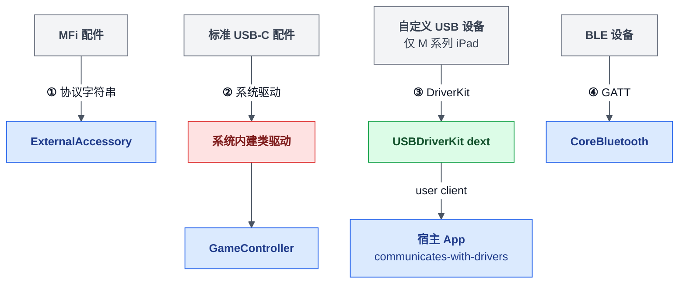

① 到 ④ 对应四条通道；绿色 dext 只在 M 系列 iPad 上存在，其余机型只能走 ①②④。

## MFi 与 ExternalAccessory

- 适用：需要与 App 交换私有协议数据的配件（POS、医疗、工业等）。流程：加入 MFi 计划获得规范与认证组件 → 配件声明协议字符串 → App 在 `UISupportedExternalAccessoryProtocols` 中声明 → 运行时用 `EAAccessoryManager` 发现、`EASession` 打开输入/输出流 [I1][I2][I3]。
- 官方文档仍写 Lightning/30-pin/蓝牙；**USB-C iPhone/iPad 上 EA 的具体传输方式（如是否走 iAP2 over USB）本轮未找到公开官方说明，待核实**。MFi 规范本身需注册会员才能查看。

## M 系列 iPad 上的 DriverKit

- 同一 DriverKit/USBDriverKit 代码可面向 macOS 与 iPadOS；官方示例工程同时含 macOS 与 iPadOS App 目标，并说明 DriverKit on iPadOS 需要 M 系列 iPad [I5]。
- 部署：iPadOS 上系统随宿主 App 自动发现与升级驱动 [I4]；App 需 `communicates-with-drivers`，驱动需 `allow-third-party-userclients` 才能接受第三方 user client 调用 [I8]。
- 注意：`com.apple.developer.driverkit.transport.usb` 的官方 entitlement 页面平台元数据只列 macOS 10.15+，而 USBDriverKit 文档又写支持 M 系列 iPadOS——iPadOS 上 USB 设备匹配所需 entitlement 的确切形式 **待核实** [I6][I15]。
- 没有 HIDDriverKit → iPad 上无法写 HID 驱动；HID 设备只能走系统内建支持或 GameController [I7][I12]。

## USB-C 与标准类设备

- iPhone 15 起的 USB-C 支持基于标准的配件（存储、显示、麦克风、以太网、SD 读卡器、CarPlay 车机等）[I9]。这些由系统驱动处理，App 通过高层框架（文件、AVFoundation 等）使用，**不是**直接 USB 访问。
- 速率：Pro 机型 USB 3（10 Gbit/s，需 USB 3 线）[I9]；非 Pro 机型如 iPhone 15 Plus 官方技术规格写为 USB 2（最高 480 Mb/s），以具体机型技术规格为准 [I16]。

## HID 与 BLE

- 键盘/鼠标/手柄：系统内建支持；App 通过 GameController（`GCController`、键盘/鼠标对象）读取输入 [I12]。原始 HID 报告级访问在 iOS 上没有公开 API（**待核实**）。
- BLE：CoreBluetooth 访问自定义 GATT 服务；系统蓝牙设置配对的 BLE HID（HoG）键鼠由系统处理（实现细节 **待核实**）[I14]。

## 虚拟 USB / 设备模式

- iPhone/iPad 连接电脑时作为 USB 设备由系统实现（同步、网络共享等），**第三方无 gadget/设备模式 API**（否定性结论，**待核实**）。
- 无公开虚拟 HID API（CoreHID 仅 macOS）[I13]。

## 安全模型

- 有线配件授权与 USB Restricted Mode：见 Key Facts #11–#12 [I10][I11]。受监管设备可由 Apple Configurator 或 MDM 控制该设置 [I10]。
- 锁定模式下连接配件或电脑需设备解锁 [I17]。
- 对硬件开发的影响：自动化测试台需考虑“锁屏 1 小时后新配件不能建立数据连接”。

## 调试

- Xcode 设备日志 / Console.app 查看系统日志（**待核实**：未逐条核对官方页面）。
- 无用户可用的 USB 抓包接口；协议分析需外部硬件分析仪（**待核实**）。

## 与 Windows 的映射

| Windows | iOS/iPadOS |
|---|---|
| WinUSB 用户态访问 | 无通用等价物；MFi 设备用 ExternalAccessory；M 系列 iPad 用 USBDriverKit dext + App [I1][I6] |
| KMDF/UMDF 驱动 | 仅 M 系列 iPad 的 DriverKit（用户态）[I5] |
| HID API（HidD_*） | GameController（高层）；无原始报告 API（**待核实**）|
| 设备安装/签名 | App Store 分发 + DriverKit entitlement；MFi 认证（配件端）[I3][I8] |

## 参考来源

### 来源组 1

- [I1] ExternalAccessory https://developer.apple.com/documentation/externalaccessory
- [I2] UISupportedExternalAccessoryProtocols https://developer.apple.com/documentation/bundleresources/information-property-list/uisupportedexternalaccessoryprotocols ；EAAccessoryManager https://developer.apple.com/documentation/externalaccessory/eaaccessorymanager ；EASession https://developer.apple.com/documentation/externalaccessory/easession
- [I3] MFi Program https://mfi.apple.com/
- [I4] DriverKit https://developer.apple.com/documentation/driverkit
- [I5] Communicating between a DriverKit extension and a client app（iPadOS 需 M 系列芯片）https://developer.apple.com/documentation/driverkit/communicating-between-a-driverkit-extension-and-a-client-app
- [I6] USBDriverKit https://developer.apple.com/documentation/usbdriverkit
- [I7] HIDDriverKit https://developer.apple.com/documentation/hiddriverkit
- [I8] Entitlements: communicates-with-drivers https://developer.apple.com/documentation/bundleresources/entitlements/com.apple.developer.driverkit.communicates-with-drivers ；allow-third-party-userclients https://developer.apple.com/documentation/bundleresources/entitlements/com.apple.developer.driverkit.allow-third-party-userclients

### 来源组 2

- [I9] Charge and connect with the USB-C connector on your iPhone https://support.apple.com/en-us/105099
- [I10] Allow USB and other accessories to connect to your iPhone or iPad https://support.apple.com/en-us/111806
- [I11] Apple Platform Security: Activating data connections securely https://support.apple.com/guide/security/activating-data-connections-securely-sec5044aad1b/web
- [I12] Game Controller https://developer.apple.com/documentation/gamecontroller
- [I13] CoreHID https://developer.apple.com/documentation/corehid
- [I14] Core Bluetooth https://developer.apple.com/documentation/corebluetooth
- [I15] com.apple.developer.driverkit.transport.usb https://developer.apple.com/documentation/bundleresources/entitlements/com.apple.developer.driverkit.transport.usb
- [I16] iPhone 15 Plus - Tech Specs https://support.apple.com/en-us/111830（列出 “USB 2 (up to 480Mb/s)”）

### 来源组 3

- [I17] About Lockdown Mode https://support.apple.com/en-us/105120

## 待确认项

### 待确认组 1

- [ ] …USB-C，Pro 机型配 USB 3 线可达 10 Gbit/s。“某 API 不存在”这类否定性结论无法由单页官方文档证实，一律标 **待核实**。…
- [ ] …没有 HIDDriverKit，CoreHID 仅 macOS，iOS 上无公开原始 HID 报告 API（**待核实**）。…
- [ ] …in/蓝牙；**USB-C iPhone/iPad 上 EA 的具体传输方式（如是否走 iAP2 over USB）本轮未找到公开官方说明，待核实**。MFi 规范本身需注册会员才能查看。…
- [ ] …DriverKit 文档又写支持 M 系列 iPadOS——iPadOS 上 USB 设备匹配所需 entitlement 的确切形式 **待核实** [I6][I15]。…
- [ ] …oller（`GCController`、键盘/鼠标对象）读取输入 [I12]。原始 HID 报告级访问在 iOS 上没有公开 API（**待核实**）。…
- [ ] …BLE：CoreBluetooth 访问自定义 GATT 服务；系统蓝牙设置配对的 BLE HID（HoG）键鼠由系统处理（实现细节 **待核实**）[I14]。…
- [ ] …e/iPad 连接电脑时作为 USB 设备由系统实现（同步、网络共享等），**第三方无 gadget/设备模式 API**（否定性结论，**待核实**）。…
- [ ] …Xcode 设备日志 / Console.app 查看系统日志（**待核实**：未逐条核对官方页面）。…

### 待确认组 2

- [ ] …无用户可用的 USB 抓包接口；协议分析需外部硬件分析仪（**待核实**）。…
- [ ] …HID API（HidD_*） | GameController（高层）；无原始报告 API（**待核实**）…


<!-- FILE: 11-android-usb.md -->

# 架构文档：Android USB（Host API、AOA、Gadget HAL 与 HID）

> 类型：arch ｜ 模式：Reverse ｜ 代码基线：`developer.android.com、source.android.com（含 Android 15 CDD）、android.googlesource.com（2026-11-28 抓取）` ｜ 最后核对：2026-11-28 ｜ 范围：`android.hardware.usb, AOA/AOAv2, USB HAL, Gadget HAL, MTP/PTP, 输入链路` ｜ lang: zh

## Overview

Android 在 Linux 内核 USB 栈（见 [07-linux-usb-stack.md](07-linux-usb-stack.md)）之上加了框架层：Host API 要 Android **3.1（API 12）** 以上，外设模式经 AOA（VID `0x18D1`，PID `0x2D00`–`0x2D05`），Android 15 CDD 要求带外设口的手持设备必须实现 AOA。读者是要在手机上做 USB 外设通信、或把手机当虚拟 USB 设备的工程师。

**TL;DR**

- 主机模式：`UsbManager` + 每设备用户授权，不装驱动。
- 外设模式：AOA 握手（请求 51 / 52 / 53），AOAv2 还能由配件注入 HID。
- 设备侧由 Gadget HAL 通过 ConfigFS 组装，MTP/PTP 用 FunctionFS。
- HID 输入走 内核 HID → evdev → EventHub → InputReader；蓝牙 HID 设备角色用 `BluetoothHidDevice`（API 28+）。

蓝 = 用户空间应用，红 = 内核/系统级驱动，绿 = 用户态驱动或守护进程，橙 = 系统框架，灰 = 硬件与外部。

## 核心事实 Key Facts（已核对）

| # | 事实 | 值 / 说明 | 来源 |
|---|---|---|---|
| 1 | USB Host 模式 | Android 3.1+ 支持 | [D1] |
| 1.2 | USB Host 模式 | API 在 `android.hardware.usb` | [D1] |
| 1.3 | USB Host 模式 | manifest 需 `<uses-feature android:name="android.hardware.usb.host"/>`，minSdk ≥ 12 | [D1] |
| 2 | Host API 主要类 | `UsbManager`（枚举/通信）、`UsbDevice`、`UsbInterface`、`UsbEndpoint`、`UsbDeviceConnection`（同步/异步传输）、`UsbRequest`（异步请求）、`UsbConstants`（对应 Linux `linux/usb/ch9.h`）| [D1] |
| 3 | UsbDeviceConnection 关键方法 | `claimInterface(intf, force)`、`controlTransfer(...)`、`bulkTransfer(...)`、`getRawDescriptors()`、`getFileDescriptor()`（返回原生 fd，可交给 native 代码/libusb）| [D3] |
| 4 | 权限模型 | ① 通过 intent filter `android.hardware.usb.action.USB_DEVICE_ATTACHED` + `res/xml/device_filter.xml`（VID/PID 等）匹配，用户确认后 App 在设备断开前持有权限；② 或显式 `UsbManager.requestPermission()` 弹窗，经广播接收结果 | [D1][D2] |
| 5 | Accessory 模式 | 外部配件作 USB 主机并供电，Android 作设备 | [D4] |
| 5.2 | Accessory 模式 | Android 3.1（API 12）引入，回移到 2.3.4（API 10，`com.android.future.usb` 附加库） | [D4] |
| 5.3 | Accessory 模式 | manifest 用 `android.hardware.usb.accessory` | [D4] |
| 6 | AOA 握手 | 配件检查 VID = Google `0x18D1` | [D5] |
| 6.2 | AOA 握手 | PID `0x2D00`（accessory）或 `0x2D01`（accessory+adb）表示已在配件模式 | [D5] |
| 6.3 | AOA 握手 | 否则发厂商请求 **51** Get Protocol → **52** 发送字符串（manufacturer/model/description/version/URI/serial，ID 0–5，每串 ≤256 字节）→ **53** Start，设备重新枚举 | [D5] |
| 7 | AOAv2 | 新增音频输出（**Android 8.0 已弃用**）与 HID | [D6] |
| 7.2 | AOAv2 | PID `0x2D02`–`0x2D05` 为音频组合 | [D6] |
| 7.3 | AOAv2 | HID 请求 `ACCESSORY_REGISTER_HID`=54 等，全部经 EP0 控制请求，无需新接口 | [D6] |
| 7.4 | AOAv2 | `SET_AUDIO_MODE`=58 | [D6] |
| 8 | CDD：外设模式 | Android 15 手持设备若 USB 口支持外设模式，**MUST 实现 AOA API**；若支持主机模式，**MUST 实现 USB 音频类** | [D7] |
| 9 | CDD：存储暴露 | 外设模式设备 MUST 提供主机访问共享存储的机制，MAY 用 USB 大容量存储但 SHOULD 用 MTP；SHOULD 报 USB 设备类 0x00、接口名 'MTP' | [D7] |
| 10 | USB HAL | Android 8.0 起 USB 命令处理从 init 脚本移到原生 USB HAL 守护进程 | [D8] |
| 10.2 | USB HAL | HAL 查询端口状态并执行数据角色/电源角色切换 | [D8] |
| 10.3 | USB HAL | Android 12 Gadget HAL 增加 NCM 与查询 HAL 版本/USB 速率的 API | [D8] |
| 11 | Gadget 实现 | Gadget HAL 通过 **ConfigFS** 组装函数 | [D9][D10][D11] |
| 11.2 | Gadget 实现 | MTP/PTP 以 FunctionFS 实例 `ffs.mtp`/`ffs.ptp` 实现，端点 `/dev/usb-ffs/mtp/ep0..ep3` | [D9][D10][D11] |
| 11.3 | Gadget 实现 | Android 14 起 UVC 函数加入 `GadgetFunction.aidl`，同样挂到 ConfigFS | [D9][D10][D11] |
| 12 | USB 摄像头（设备作 UVC） | Android 14 QPR1+ 可把设备作为 USB 网络摄像头（UVC），由 DeviceAsWebcam 服务提供 | [D11] |
| 13 | HID 输入链路 | 内核 HID/输入驱动 → Linux input 协议（evdev）→ EventHub 读取 → InputReader 按设备类解码 | [D12] |
| 14 | 蓝牙 HID 设备角色 | `BluetoothHidDevice`（API 28+）让 Android 充当蓝牙 HID 设备（registerApp/sendReport）；Android 12（S）起需 `BLUETOOTH_CONNECT` 权限 | [D13] |
| 15 | GKI | 统一核心内核，SoC/板级支持移到可加载 vendor 模块，提供稳定 KMI | [D14] |

## 架构分层：App、system_server、HAL 与内核

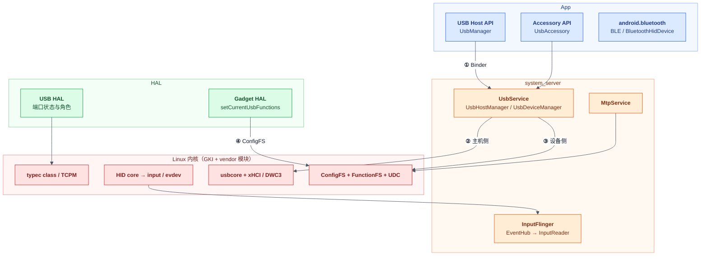

① 到 ④ 是 App 与 HAL 进入内核的四条入口；主机侧与设备侧在内核里分属不同子系统，不要混为一条链。

- `UsbDeviceManager` 通过 Gadget HAL 设置函数，并在 MTP/PTP 启用时绑定 MtpService [D15]。

## USB Host API 要点

1. Manifest：`uses-feature android.hardware.usb.host`；如需插入自动拉起，Activity 加 `USB_DEVICE_ATTACHED` intent filter 与 `device_filter.xml` [D1]。
2. 权限：自动匹配时用户确认即授权到断开；否则 `requestPermission()` [D1][D2]。
3. 传输：`claimInterface` → `controlTransfer`/`bulkTransfer`（同步）或 `UsbRequest`（异步，可用于中断端点）[D1][D3]。
4. Native：`getFileDescriptor()` 取 fd，交给 NDK/libusb 处理（libusb 在 Android 上的使用方式见其官方文档，**待核实**）[D3]。
5. HID 设备：系统内核 HID 驱动会接管标准键鼠/手柄（进入输入子系统）[D12]；App 若用 Host API 直接访问 HID 接口是否需要/能够 `force` claim 依具体设备与系统版本，**待核实**。

## Accessory 模式与 AOA（Android 作为 USB 设备）

- 适用：Android 不能/不想当主机时，由外部配件（MCU、车机）当主机 [D4]。
- 握手流程见 Key Facts #6；`0x2D01` 额外提供 ADB 接口，便于开发调试 [D5][D6]。
- AOAv2 HID：配件可经 EP0 向 Android 注册多个虚拟 HID 设备（`ACCESSORY_REGISTER_HID` / `ACCESSORY_UNREGISTER_HID` / `ACCESSORY_SET_HID_REPORT_DESC` / `ACCESSORY_SEND_HID_EVENT`）——这是**无需 Android 当主机就让外设向手机注入 HID** 的官方机制 [D6]。
- CDD 要求手持设备的外设口实现 AOA [D7]。

## 设备侧：Gadget HAL、ConfigFS、MTP/PTP

- Android 8.0 引入 USB HAL，替代设备特定 init 脚本，原因包括 sysfs 写失败无法回传、init 操作受限等 [D8]。
- Gadget 函数（adb、mtp、ptp、rndis/ncm、midi、uvc…）通过 ConfigFS 组合；adb、MTP/PTP 走 FunctionFS（`/dev/usb-ffs/adb`、`/dev/usb-ffs/mtp`）[D9][D10][D11]。
- MTP：CDD 建议使用 MTP 暴露共享存储、兼容 Android File Transfer 参考主机 [D7]；原生实现位于 `frameworks/av/media/mtp`（MtpFfsHandle 等）[D10]。
- 研究虚拟 USB：Android 设备 = 现成的 Linux gadget 平台；root/工程机上可直接操作 ConfigFS（见 [07-linux-usb-stack.md](07-linux-usb-stack.md) 的“设备侧”节），但量产设备由 Gadget HAL 独占管理（**待核实**：权限/SELinux 细节因厂商而异）。

## HID：USB 与蓝牙/BLE

- USB HID：内核 HID 驱动 → evdev → EventHub/InputReader；键盘布局/键码映射通过 `.kl`/`.kcm`/`.idc` 配置文件 [D12][D16]。
- CDD 对 USB-C 耳机 HID 按键规定了映射（如 Usage Page 0x0C Usage 0x0CD → `KEY_PLAYPAUSE` → `KEYCODE_MEDIA_PLAY_PAUSE`）[D7]。
- BLE：平台内建 BLE **中心角色**支持并提供 API（发现、查询服务、传输）[D17]；BLE HID 键鼠（HoG）由系统蓝牙栈处理（内部实现，如是否经 uhid，**待核实**）。
- Android 作为 HID 设备：经典蓝牙 `BluetoothHidDevice`（API 28+）[D13]；USB 方向可用 AOAv2 HID（由配件注入）或 gadget `f_hid`（需系统/厂商支持，**待核实**）。

## 电源与 Type-C

- USB HAL 负责查询端口状态与数据/电源角色切换 [D8]；底层是 Linux typec class/TCPM（见 `08-arm-embedded-usb.md`）。
- 主机侧 autosuspend 由内核 runtime PM 管理（同 Linux）；Android 特有策略 **待核实**。

## 调试工具

| 工具 | 用途 | 来源 |
|---|---|---|
| `adb shell dumpsys usb` | UsbService 状态（端口、函数、设备）| **待核实**（未在本轮抓取的官方页面中出现）|
| `adb shell getevent` | 查看输入事件（HID → evdev）| **待核实** |
| usbmon（需 root/debugfs） | 同 Linux | [L7]（见 `07-linux-usb-stack.md`）|
| 外部 PC 抓包（Wireshark/USBPcap）观察 AOA 握手 | — | 见 `12-cross-platform-comparison.md` |

## 与 Windows 的映射

| Windows | Android |
|---|---|
| WinUSB + WinUsb_ControlTransfer/ReadPipe | UsbDeviceConnection.controlTransfer/bulkTransfer [D3] |
| SetupDi 枚举 + 设备接口 GUID | UsbManager.getDeviceList + intent filter [D1][D2] |
| INF 绑定驱动 | device_filter.xml + 用户授权（无驱动安装）[D1] |
| UFX（function controller） | Linux gadget + Gadget HAL [D8] |
| hidclass → Raw Input | HID core → evdev → InputReader [D12] |
| VHF | AOAv2 HID（配件侧注入）；系统内部 uhid（**待核实**）[D6] |

## 参考来源

### 来源组 1

- [D1] USB host overview https://developer.android.com/develop/connectivity/usb/host
- [D2] UsbManager https://developer.android.com/reference/android/hardware/usb/UsbManager
- [D3] UsbDeviceConnection https://developer.android.com/reference/android/hardware/usb/UsbDeviceConnection
- [D4] USB accessory overview https://developer.android.com/develop/connectivity/usb/accessory
- [D5] Android Open Accessory protocol 1.0 https://source.android.com/docs/core/interaction/accessories/aoa
- [D6] Android Open Accessory 2.0 https://source.android.com/docs/core/interaction/accessories/aoa2
- [D7] Android 15 Compatibility Definition（§7.7 USB、§7.6 存储、§7.8.2.2 耳机 HID 映射）https://source.android.com/docs/compatibility/15/android-15-cdd
- [D8] Implement USB HAL https://source.android.com/docs/core/permissions/usb-hal

### 来源组 2

- [D9] device/google/crosshatch usb/UsbGadget.cpp（ffs.mtp/ffs.ptp 链接示例）https://android.googlesource.com/device/google/crosshatch/+/master/usb/UsbGadget.cpp
- [D10] frameworks/av media/mtp/MtpDescriptors.h（/dev/usb-ffs/mtp/ep0..ep3）https://android.googlesource.com/platform/frameworks/av/+/master/media/mtp/MtpDescriptors.h
- [D11] Use a device as a webcam https://source.android.com/docs/core/camera/webcam
- [D12] Input https://source.android.com/docs/core/interaction/input
- [D13] BluetoothHidDevice https://developer.android.com/reference/android/bluetooth/BluetoothHidDevice
- [D14] Generic Kernel Image (GKI) project https://source.android.com/docs/core/architecture/kernel/generic-kernel-image
- [D15] frameworks/base UsbDeviceManager.java https://android.googlesource.com/platform/frameworks/base.git/+/master/services/usb/java/com/android/server/usb/UsbDeviceManager.java
- [D16] Input device configuration files https://source.android.com/docs/core/interaction/input/input-device-configuration-files ；Keyboard devices https://source.android.com/docs/core/interaction/input/keyboard-devices

### 来源组 3

- [D17] Bluetooth Low Energy overview https://developer.android.com/develop/connectivity/bluetooth/ble/ble-overview

## 待确认项

- [ ] …leDescriptor()` 取 fd，交给 NDK/libusb 处理（libusb 在 Android 上的使用方式见其官方文档，**待核实**）[D3]。…
- [ ] …统）[D12]；App 若用 Host API 直接访问 HID 接口是否需要/能够 `force` claim 依具体设备与系统版本，**待核实**。…
- [ ] …可直接操作 ConfigFS（见 [07-linux-usb-stack.md](07-linux-usb-stack.md) 的“设备侧”节），但量产设备由 Gadget HAL 独占管理（**待核实**：权限/SELinux 细节因厂商而异）。…
- [ ] …**支持并提供 API（发现、查询服务、传输）[D17]；BLE HID 键鼠（HoG）由系统蓝牙栈处理（内部实现，如是否经 uhid，**待核实**）。…
- [ ] …e`（API 28+）[D13]；USB 方向可用 AOAv2 HID（由配件注入）或 gadget `f_hid`（需系统/厂商支持，**待核实**）。…
- [ ] …主机侧 autosuspend 由内核 runtime PM 管理（同 Linux）；Android 特有策略 **待核实**。…
- [ ] …`adb shell dumpsys usb` | UsbService 状态（端口、函数、设备）| **待核实**（未在本轮抓取的官方页面中出现）…
- [ ] …`adb shell getevent` | 查看输入事件（HID → evdev）| **待核实…
- [ ] …VHF | AOAv2 HID（配件侧注入）；系统内部 uhid（**待核实**）[D6]…


<!-- FILE: 12-cross-platform-comparison.md -->

# 架构文档：跨平台 USB 栈异同（Linux、ARM、macOS、iOS、Android 与 Windows）

> 类型：arch ｜ 模式：Reverse ｜ 代码基线：`07–11 号文档与 learn.microsoft.com（2026-11-28 核对）` ｜ 最后核对：2026-11-28 ｜ 范围：`07-linux-usb-stack.md, 08-arm-embedded-usb.md, 09-macos-usb.md, 10-ios-ipados-usb.md, 11-android-usb.md` ｜ lang: zh

## Overview

在 **5 个平台 + Windows 参照** 的对比中，只有 Linux 系（含 Android 与 ARM 板）把 USB **设备侧**完整开放给开发者；Apple 平台第三方驱动强制用户态（DriverKit）；Android 的特色是 AOA。本文只做归纳，每格事实回链到 07–11 号文档的引用标签（`[Lx]` `[Ax]` `[Mx]` `[Ix]` `[Dx]`）与 learn.microsoft.com 的 `[Wx]`。各平台文档中标 **待核实** 的点，这里保持 **待核实**。

**TL;DR**

- Linux 与 Android 共用同一内核 USB 栈；ARM 的差异在控制器 IP、设备树与角色管理。
- 虚拟 USB 研究首选 Linux：dummy_hcd + ConfigFS / Raw Gadget；USB/IP 细节见 [06-linux-virtual-usb.md](06-linux-virtual-usb.md)。
- 虚拟 HID：Linux uhid、macOS CoreHID、Windows VHF、Android AOAv2；iOS 无公开 API。
- Apple 的门槛是授权（entitlement、公证、MFi），不是技术。

蓝 = 用户空间应用，红 = 内核/系统级驱动，绿 = 用户态驱动或守护进程，橙 = 系统框架，灰 = 硬件与外部。

## 核心结论 Key Facts

| # | 结论 | 依据 |
|---|---|---|
| 1 | Linux 与 Android **共用同一个内核 USB 栈**（usbcore/HCD/HID core/gadget）；Android 在其上加框架层权限、Gadget HAL 与 AOA | [L1][D8][D12] |
| 2 | “ARM”不是独立 OS 栈：差异集中在控制器 IP（DWC2/DWC3/ChipIdea/MUSB/Cadence）、设备树、双角色与 Type-C 管理 | [A1]–[A13] |
| 3 | 驱动位置：Linux/Android 驱动在内核；macOS/iPadOS 第三方驱动在**用户空间**（DriverKit），kext 中 IOUSBFamily/IOHIDFamily KPI 已在 Big Sur 不再支持；Windows 两者兼有（KMDF / UMDF 2） | [L17][M2][M8][W9] |
| 4 | 设备模式（把主机变成 USB 外设）：Linux/Android/ARM 板官方支持（gadget/ConfigFS/FunctionFS）；macOS/iOS 无第三方 API（**待核实**）；Windows 有 UFX（面向功能控制器驱动）| [L3][D11][M1][W6] |
| 5 | 无硬件虚拟 USB：Linux 有 dummy_hcd、vhci-hcd（USB/IP）、Raw Gadget；Windows 有 UDE；macOS/iOS 无公开等价物（IOUSBHostControllerInterface 用途 **待核实**） | [L19][L20][L5][W5][M18] |
| 6 | 虚拟 HID：Linux uhid；macOS CoreHID HIDVirtualDevice（15+）/HIDDriverKit；Windows VHF；Android 有 AOAv2 HID（配件注入）；iOS 无公开 API | [L9][M6][W4][D6][I13] |
| 7 | 权限：Linux 节点权限+udev+authorized；Android 每设备用户授权；macOS DriverKit entitlement 审批+公证+Apple silicon 配件允许；iOS MFi/有线配件授权；Windows 驱动签名 | [L13][L27][D1][M7][M12][M13][I10] |

## 大对比表

| 维度 | Linux | ARM/嵌入式 | macOS | iOS / iPadOS | Android | Windows（参照） |
|---|---|---|---|---|---|---|
| 内核/框架 | usbcore + HCD（xhci-hcd 等）[L1][L22] | 同 Linux；控制器 IP 驱动 dwc2/dwc3/ci_hdrc/musb/cdns3 [A1]–[A5] | XNU IOKit + IOUSBHostFamily（内部细节待核实）[M8][M14] | 同 XNU，第三方不可见 | Linux 内核（GKI + vendor 模块）[D14] | Usbxhci.sys + Ucx01000.sys + Usbhub3.sys（KMDF）[W1] |
| 第三方驱动模型 | 内核模块 `usb_driver` [L17] | 同 Linux；MCU 上 TinyUSB/厂商栈 [A14][A18] | DriverKit dext（USBDriverKit/HIDDriverKit，用户态）[M3][M4] | 仅 M 系列 iPad：DriverKit/USBDriverKit [I5][I6] | App 层用 Host API [D1]；内核模块由 OEM 以 GKI vendor 模块形式提供 [D14]（第三方 App 不能装内核驱动属行业常识，**待核实**） | KMDF / UMDF 2 / WinUSB [W2][W9] |
| 用户态直接访问 | usbfs / libusb [L1][L26] | 同 Linux | IOUSBHost 框架 [M1] | ExternalAccessory（仅 MFi）[I1] | `android.hardware.usb` Host API + 用户授权 [D1] | WinUSB [W2] |
| 驱动匹配 | `id_table`（`usb_device_id`）[L17]；udev 处理节点与规则 [L27] | 同 Linux + DT compatible [A7] | entitlement `transport.usb`（按设备描述符字段）+ IOKitPersonalities [M9] | 系统随 App 自动发现 dext [I4] | `device_filter.xml` + intent [D1] | INF（硬件 ID/兼容 ID）[W13] |
| HID 路径 | usbhid → HID core → input/hidraw/hiddev [L11][L8][L10] | 同 Linux | IOHIDFamily（内核）→ IOHIDManager / CoreHID；HIDDriverKit 定制 [M5][M6][M4] | 系统内建 → GameController [I12] | HID core → evdev → EventHub/InputReader [D12] | hidclass.sys + hidusb.sys → HidD_* [W3][W14] |
| 原始 HID 报告访问 | hidraw ioctl [L8] | 同 Linux | IOHIDDevice / CoreHID [M5][M6] | 无公开 API（待核实） | 无专用 API；可经 Host API 访问接口（待核实）| HidD_Get/SetFeature、ReadFile [W14] |
| BLE HID (HoG) 主机 | BlueZ 用户态 HoG + uhid [L23] | 同 Linux | 系统蓝牙栈（实现待核实），自定义 GATT 用 CoreBluetooth [M17] | 同左，CoreBluetooth [I14] | 系统蓝牙栈（实现待核实），BLE 中心角色 API [D17] | HidBthLE.dll（Windows 8 起）[W3] |
| 设备模式/Gadget | ConfigFS / FunctionFS / GadgetFS / Raw Gadget [L3][L4][L5] | 有 UDC 即可（DWC2/DWC3/ChipIdea/MUSB/Cadence）[A1]–[A5] | 无第三方 API（待核实） | 无第三方 API（待核实） | Gadget HAL + ConfigFS（adb/MTP/PTP/NCM/UVC）、AOA [D8][D11][D5] | UFX（功能控制器驱动）[W6] |
| 无硬件虚拟 USB | dummy_hcd、vhci-hcd、Raw Gadget [L20][L19][L5] | 同 Linux | 无公开等价物（待核实）| 无 | 同 Linux（需 root/工程机，待核实）| UDE（UdeCx）[W5] |
| 虚拟 HID | uhid [L9] | 同 Linux | CoreHID HIDVirtualDevice（15+）/ HIDDriverKit + entitlement [M6][M9] | 无 [I13] | AOAv2 HID（配件侧）[D6] | VHF（Vhf.sys 下层过滤）[W4] |
| 网络虚拟 USB | USB/IP（TCP 3240）[L19] | 同 Linux | 无内建（待核实）| 无 | 无内建（待核实）| 无内建（待核实）|
| 电源管理 | runtime PM autosuspend，默认 2 s [L2][L16] | 同 Linux | 系统管理，DriverKit 电源接口（待核实） | 系统管理 | 同 Linux 内核 + USB HAL 角色切换 [D8] | Selective Suspend [W7] |
| Type-C/PD | typec class、TCPM、UCSI [L15][L24] | DT `usb-c-connector` + TCPM/Role Switch [A11][A12][A13] | 系统内部 | 系统内部 | USB HAL 角色切换 + 内核 typec [D8] | UCSI（UcmUcsiCx.sys）[W11] |
| 安全/权限 | 文件权限+udev、`authorized_default` [L13][L27] | 同 Linux | entitlement 审批、Developer ID+公证、配件允许（Apple silicon 笔记本）[M7][M12][M13] | MFi 授权、有线配件设置、1 小时/30 天/3 天规则 [I3][I10][I11] | 每设备运行时授权、CDD 要求 [D1][D7] | 驱动签名（细节待核实） |
| 抓包/调试 | usbmon + Wireshark、xHCI DbC [L7][L28][L25] | 同 Linux；JTAG/厂商工具（待核实） | Wireshark XHC20（新系统可能需关 SIP，待核实）、IORegistryExplorer（待核实）、systemextensionsctl [M21][M10] | 外部分析仪（待核实） | usbmon（root）、dumpsys usb（待核实）| USB ETW（logman）、USBView、USBPcap [W8][W12][L28] |

## 架构总览图

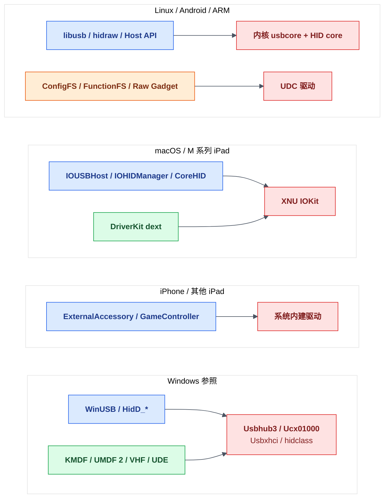

图只展示各平台“应用 → 驱动层”的分层差异，不含设备侧细节；设备模式与虚拟 USB 的差异在下面的大表里。

## 相同点

1. **协议层完全一致**：描述符、枚举、四种传输、HID 报告描述符都遵循 USB-IF 规范；各平台 API 只是包装（Android 的 `UsbConstants` 直接对应 Linux `ch9.h`）[D1]。
2. **HID 都是“类驱动 + 传输层”分离**：Linux HID core + 传输驱动 [L11]，Windows hidclass + 传输 minidriver [W3][W14]，macOS HIDDriverKit 也区分 HID 设备 provider 与事件服务 [M4]。
3. **主流平台都提供“无需写驱动”的用户态访问**：libusb/usbfs、WinUSB、IOUSBHost、Android Host API [L1][W2][M1][D1]。
4. **都在收紧 USB 攻击面**：Linux `authorized_default` [L13]、Apple 配件允许与 USB Restricted Mode [M13][I11]、Android 每设备授权 [D1]。

## 不同点（要点）

1. **驱动位置**：Linux/Android 在内核；Apple 第三方驱动强制用户态（DriverKit），IOUSBFamily/IOHIDFamily kext KPI 已不再支持 [M8]；Windows 两者都有。
2. **设备模式**：Linux 系（含 Android、ARM 板）是唯一把“设备侧”完整开放给开发者的平台 [L3][L5]；Windows 有 UFX 但面向带功能控制器的硬件 [W6]。
3. **虚拟 USB 研究首选 Linux**：dummy_hcd + ConfigFS/Raw Gadget 可在单机构造任意设备并抓包；Windows 对应 UDE [L20][L5][W5]。
4. **Apple 的门槛是“授权”而非“技术”**：DriverKit entitlement 需向 Apple 申请、需 Developer ID 签名与公证 [M7][M12]；iPhone 上只有 MFi 路径 [I1]。
5. **Android 的特色**：AOA 协议让 Android 以设备身份与 MCU 配件通信，AOAv2 还能由配件注入 HID [D5][D6]；CDD 强制外设口实现 AOA [D7]。

## Windows 背景开发者速查（映射表）

| 你熟悉的 Windows 概念 | Linux / Android | macOS | iOS / iPadOS |
|---|---|---|---|
| WinUSB.sys + WinUsb_* [W2] | usbfs/libusb [L1]；Android UsbDeviceConnection [D3] | IOUSBHost [M1] | ExternalAccessory（MFi）[I1]；M 系列 iPad 用 USBDriverKit [I6] |
| KMDF USB 客户端驱动 [W1] | `usb_driver` 内核模块 [L17] | USBDriverKit dext [M3] | USBDriverKit（M 系列 iPad）[I6] |
| UMDF 2 [W9] | 无直接对应（用户态即 libusb/uhid）| DriverKit（理念最接近）[M2] | 同左 |
| hidclass.sys / hidusb.sys [W3][W14] | HID core / usbhid [L11] | IOHIDFamily + HIDDriverKit [M4][M8] | 系统内建 |
| HidD_GetFeature / SetFeature | hidraw `HIDIOCGFEATURE`/`HIDIOCSFEATURE` [L8] | IOHIDDevice / CoreHID [M5][M6] | 无公开 API（待核实） |
| VHF (Vhf.sys) [W4] | uhid [L9] | CoreHID HIDVirtualDevice / HIDDriverKit [M6] | 无 |
| UDE / UdeCx [W5] | dummy_hcd、vhci-hcd [L20][L19] | 无公开等价物（待核实） | 无 |
| UFX [W6] | gadget/UDC + ConfigFS [L14][L3] | 无（待核实）| 无 |
| Usbccgp.sys（复合设备父驱动）[W10] | usbcore 按接口绑定驱动 [L1] | IOKit 按接口匹配（细节待核实）| — |
| Selective Suspend [W7] | runtime PM autosuspend [L2] | 系统管理（待核实） | 系统管理 |
| UCSI (UcmUcsiCx.sys) [W11] | typec UCSI / TCPM [L24] | 系统内部 | 系统内部 |
| HidBthLE.dll（BLE HID）[W3] | BlueZ HoG + uhid [L23] | 系统蓝牙栈（待核实）| 系统蓝牙栈（待核实）|
| USB ETW / USBView [W8][W12] | usbmon / lsusb [L7] | IORegistryExplorer（待核实）/ Wireshark XHC20 [M21] | — |

## 研究路线建议（虚拟 USB / 驱动 / 固件）

1. **Linux 起步**：dummy_hcd + ConfigFS HID 复刻一个雷蛇式多接口 HID 设备，usbmon 抓包对照描述符 [L20][L3][L7]。
2. **深入枚举/健壮性**：Raw Gadget 构造畸形描述符测试主机栈（官方定位为调试/fuzzing）[L5]。
3. **跨机**：USB/IP 把 gadget 导出到另一台机器（USB/IP 也支持导出 gadget 子系统创建的软件设备）[L19]。
4. **Windows 对照**：UDE 写虚拟主机控制器 + 设备，VHF 做虚拟 HID [W5][W4]。
5. **macOS**：IOUSBHost 用户态访问 → USBDriverKit/HIDDriverKit（先 `systemextensionsctl developer on` 本地开发，再申请 entitlement）[M1][M10][M7]。
6. **固件**：TinyUSB（dwc2/musb/ci_hs 等端口与 Linux 控制器驱动对应同一 IP）[A14]。

## 参考来源

### 来源组 1

- [W1] USB 3.0 driver stack architecture https://learn.microsoft.com/en-us/windows-hardware/drivers/usbcon/usb-3-0-driver-stack-architecture
- [W2] WinUSB (Winusb.sys) installation for developers https://learn.microsoft.com/en-us/windows-hardware/drivers/usbcon/winusb-installation ；Using WinUSB API https://learn.microsoft.com/en-us/windows-hardware/drivers/usbcon/using-winusb-api-to-communicate-with-a-usb-device
- [W3] HID transports（Hidusb.sys、Hidbth.sys、HidBthLE.dll（Windows 8 起 BLE HID）、Hidi2c.sys、HidSpi.sys（Windows 11））https://learn.microsoft.com/en-us/windows-hardware/drivers/hid/hid-transports
- [W4] Virtual HID Framework (VHF) https://learn.microsoft.com/en-us/windows-hardware/drivers/hid/virtual-hid-framework--vhf-
- [W5] Overview of developing Windows drivers for emulated USB devices (UDE) https://learn.microsoft.com/en-us/windows-hardware/drivers/usbcon/developing-windows-drivers-for-emulated-usb-host-controllers-and-devices
- [W6] Developing Windows drivers for USB function controllers (UFX) https://learn.microsoft.com/en-us/windows-hardware/drivers/usbcon/developing-windows-drivers-for-usb-function-controllers
- [W7] USB selective suspend https://learn.microsoft.com/en-us/windows-hardware/drivers/usbcon/usb-selective-suspend
- [W8] USB Event Tracing for Windows https://learn.microsoft.com/en-us/windows-hardware/drivers/usbcon/usb-event-tracing-for-windows

### 来源组 2

- [W9] Getting started with UMDF version 2（新 UMDF 驱动应使用 UMDF 2）https://learn.microsoft.com/en-us/windows-hardware/drivers/wdf/getting-started-with-umdf-version-2
- [W10] USB Generic Parent Driver (Usbccgp.sys) https://learn.microsoft.com/en-us/windows-hardware/drivers/usbcon/usb-common-class-generic-parent-driver
- [W11] UCSI driver（UcmUcsiCx.sys、UcmUcsiAcpiClient.sys）https://learn.microsoft.com/en-us/windows-hardware/drivers/usbcon/ucsi
- [W12] USBView https://learn.microsoft.com/en-us/windows-hardware/drivers/debugger/usbview
- [W13] USB driver installation based on compatible IDs https://learn.microsoft.com/en-us/windows-hardware/drivers/usbcon/usb-driver-installation-based-on-compatible-ids
- [W14] HID architecture（hidclass.sys）https://learn.microsoft.com/en-us/windows-hardware/drivers/hid/hid-architecture
- 其余标签见各平台文件：[Lx] `07-linux-usb-stack.md`、[Ax] `08-arm-embedded-usb.md`、[Mx] `09-macos-usb.md`、[Ix] `10-ios-ipados-usb.md`、[Dx] `11-android-usb.md`

## 待确认项

### 待确认组 1

- [ ] … `[Ax]` `[Mx]` `[Ix]` `[Dx]`）与 learn.microsoft.com 的 `[Wx]`。各平台文档中标 **待核实** 的点，这里保持 **待核实**。…
- [ ] …ux/Android/ARM 板官方支持（gadget/ConfigFS/FunctionFS）；macOS/iOS 无第三方 API（**待核实**）；Windows 有 UFX（面向功能控制器驱动）| [L3][D11][M1][W6]…
- [ ] …dget；Windows 有 UDE；macOS/iOS 无公开等价物（IOUSBHostControllerInterface 用途 **待核实**） | [L19][L20][L5][W5][M18]…
- [ ] …2/dwc3/ci_hdrc/musb/cdns3 [A1]–[A5] | XNU IOKit + IOUSBHostFamily（内部细节待核实）[M8][M14] | 同 XNU，第三方不可见 | Linux 内核（GKI + vendor 模块）[D14…
- [ ] …t API [D1]；内核模块由 OEM 以 GKI vendor 模块形式提供 [D14]（第三方 App 不能装内核驱动属行业常识，**待核实**） | KMDF / UMDF 2 / WinUSB [W2][W9]…
- [ ] …idraw ioctl [L8] | 同 Linux | IOHIDDevice / CoreHID [M5][M6] | 无公开 API（待核实） | 无专用 API；可经 Host API 访问接口（待核实）| HidD_Get/SetFeature、Re…
- [ ] …BLE HID (HoG) 主机 | BlueZ 用户态 HoG + uhid [L23] | 同 Linux | 系统蓝牙栈（实现待核实），自定义 GATT 用 CoreBluetooth [M17] | 同左，CoreBluetooth [I14]…
- [ ] …][L5] | 有 UDC 即可（DWC2/DWC3/ChipIdea/MUSB/Cadence）[A1]–[A5] | 无第三方 API（待核实） | 无第三方 API（待核实） | Gadget HAL + ConfigFS（adb/MTP/PTP/NCM…

### 待确认组 2

- [ ] …USB | dummy_hcd、vhci-hcd、Raw Gadget [L20][L19][L5] | 同 Linux | 无公开等价物（待核实）| 无 | 同 Linux（需 root/工程机，待核实）| UDE（UdeCx）[W5]…
- [ ] …网络虚拟 USB | USB/IP（TCP 3240）[L19] | 同 Linux | 无内建（待核实）| 无 | 无内建（待核实）| 无内建（待核实）…
- [ ] …ntime PM autosuspend，默认 2 s [L2][L16] | 同 Linux | 系统管理，DriverKit 电源接口（待核实） | 系统管理 | 同 Linux 内核 + USB HAL 角色切换 [D8] | Selective Sus…
- [ ] …设置、1 小时/30 天/3 天规则 [I3][I10][I11] | 每设备运行时授权、CDD 要求 [D1][D7] | 驱动签名（细节待核实）…
- [ ] …包/调试 | usbmon + Wireshark、xHCI DbC [L7][L28][L25] | 同 Linux；JTAG/厂商工具（待核实） | Wireshark XHC20（新系统可能需关 SIP，待核实）、IORegistryExplorer（待…
- [ ] …URE`/`HIDIOCSFEATURE` [L8] | IOHIDDevice / CoreHID [M5][M6] | 无公开 API（待核实）…
- [ ] …UDE / UdeCx [W5] | dummy_hcd、vhci-hcd [L20][L19] | 无公开等价物（待核实） | 无…
- [ ] …UFX [W6] | gadget/UDC + ConfigFS [L14][L3] | 无（待核实）| 无…

### 待确认组 3

- [ ] …Usbccgp.sys（复合设备父驱动）[W10] | usbcore 按接口绑定驱动 [L1] | IOKit 按接口匹配（细节待核实）| —…
- [ ] …Selective Suspend [W7] | runtime PM autosuspend [L2] | 系统管理（待核实） | 系统管理…
- [ ] …HidBthLE.dll（BLE HID）[W3] | BlueZ HoG + uhid [L23] | 系统蓝牙栈（待核实）| 系统蓝牙栈（待核实）…
- [ ] …SB ETW / USBView [W8][W12] | usbmon / lsusb [L7] | IORegistryExplorer（待核实）/ Wireshark XHC20 [M21] | —…

